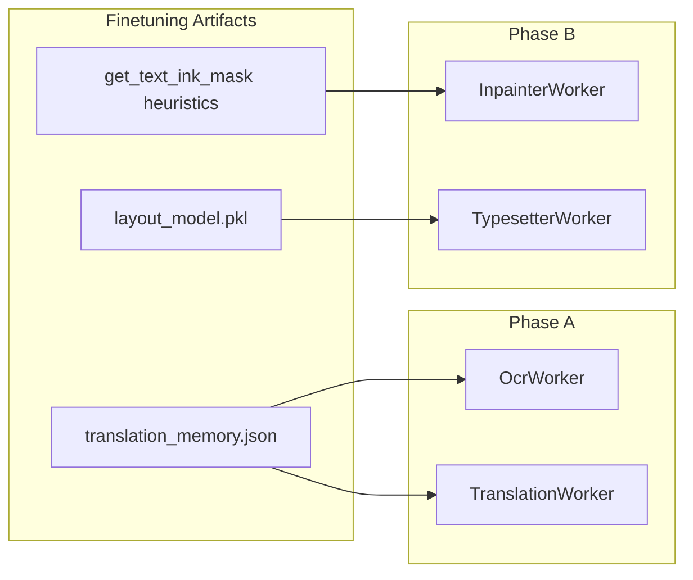

# Finetuning ↔ Manga Translator Integration Plan (Phase 9 + 10, 300 Tests)

## Current state (verified)

| Track | Status |
|-------|--------|
| Main pipeline (Stages 6–10) | Complete — workers in [`workers/`](workers/), orchestrated by [`stages/controller.py`](stages/controller.py) |
| Finetuning Phases 1–8 | Complete — offline toolchain in [`finetuning/`](finetuning/), artifacts at [`assets/models/`](assets/models/) |
| **Integration (Phases 9–10)** | **Not implemented** — zero imports of `finetuning.*` from any worker |

**Artifacts ready for integration:**
- [`assets/models/translation_memory.json`](assets/models/translation_memory.json) — built by [`scripts/build_translation_memory.py`](scripts/build_translation_memory.py), API in [`finetuning/translation_memory.py`](finetuning/translation_memory.py)
- [`assets/models/layout_model.pkl`](assets/models/layout_model.pkl) — trained by [`scripts/train_layout_model.py`](scripts/train_layout_model.py); features: `[w, h, area, aspect_ratio, char_count, char_density]` → targets: `[font_size, padding, line_spacing]`

**User decisions locked in:**
- Scope: **Phase 9 + Phase 10** (all four workers)
- Argos context strategy: **prepend** prior JP dialogue lines onto current bubble text when TM has no match



---

## Part 1 — Implementation (prerequisite for integration tests)

### 1.1 Shared integration layer

Create [`finetuning/pipeline_integration.py`](finetuning/pipeline_integration.py) — single bridge module used by all workers (avoids duplicating finetuning logic):

| Helper | Responsibility |
|--------|----------------|
| `load_translation_memory(path) -> TranslationMemoryDB \| None` | Load TM JSON; return `None` if missing/disabled (graceful degrade) |
| `load_layout_model(path) -> model \| None` | `pickle.load` layout RF; return `None` if missing |
| `build_story_position(manga_id, page_number, region_index) -> str` | Format `"{manga_id}::{page:04d}::{region:02d}"` (matches Phase 6 schema) |
| `derive_page_order(manifest) -> dict[str, int]` | Port [`finetuning/page_order.py`](finetuning/page_order.py) numeric-prefix sort for manifest page filenames |
| `correct_ocr_with_vocab(db, manga_id, raw_text) -> str` | Strip Japanese/English punctuation and notation, then perform fuzzy token substitution against normalized `db.manga_vocab[manga_id]` keys (edit distance similarity >= 0.8) |
| `build_context_prefix(db, manga_id, story_position, limit=5) -> str` | Join preceding JP sentences from `db.get_context()` with `。` separator |
| `prepend_context(prefix, text) -> str` | Glue for Argos: `f"{prefix}\n---\n{text}"` if prefix non-empty; uses a distinct structural delimiter for target isolation |
| `extract_layout_features(box, jp_text) -> np.ndarray` | Same 6-feature vector as [`scripts/train_layout_model.py`](scripts/train_layout_model.py) lines 100–148 |
| `build_jp_ink_inpaint_mask(page_gray, box) -> (mask, confidence)` | Runtime contour mask using [`get_text_ink_mask`](finetuning/typesetting_features.py) on JP crop, returning a binarized mask and a confidence score based on the foreground pixel ratio |

Export `extract_layout_features` from training script or move to shared module to prevent train/infer drift.

### 1.2 Manifest & config extensions

**[`core/models.py`](core/models.py)** — backward-compatible optional fields:
- `ProjectManifest.manga_id: str = ""` (default `project_name` at scan time)
- `PageManifest.page_number: int = 0` (set by manifest scan / stage controller)
- `TextRegion.region_index: int = 0` (index in `page.text_regions`)

All new fields default safely so existing [`tests/test_manifest.py`](tests/test_manifest.py) manifests deserialize unchanged.

**[`cli/config/models.py`](cli/config/models.py)** — new `FinetuningSettings` section:

```toml
[finetuning]
enabled = true
translation_memory_path = "assets/models/translation_memory.json"
layout_model_path = "assets/models/layout_model.pkl"
fuzzy_match_threshold = 0.8
context_sentence_limit = 5
use_contour_inpaint = true
layout_model_min_confidence = 0.5
```

Wire through [`cli/worker_factory.py`](cli/worker_factory.py) and legacy [`main.py`](main.py) execute path.

### 1.3 Phase 9 — OCR + Translate integration

**[`workers/ocr_worker.py`](workers/ocr_worker.py)**
- Accept optional `tm_db`, `manga_id`, `enable_tm_correction: bool`
- After MangaOCR per region: call `correct_ocr_with_vocab()` when TM loaded
- **Design note:** MangaOCR always sets `ocr_confidence = 1.0` (sentinel). TM correction triggers on **vocab/token mismatch** after stripping notations and punctuation (e.g. `「`, `」`, `。`, `、`, `！`, `？`, `!`, `?` and brackets/furigana), not a confidence threshold. Document this in the worker docstring.

**[`workers/translator.py`](workers/translator.py)**
- Accept optional `tm_db`, `manga_id`, `fuzzy_threshold`, `context_limit`
- Per region translation order:
  1. `tm_db.exact_match(manga_id, raw_text)` → use EN, skip MT
  2. `tm_db.fuzzy_match(..., threshold)` → use EN, skip MT
  3. Build `prefix = build_context_prefix(...)` from `story_position`
  4. Call Argos/Google with `query = prepend_context(prefix, raw_text)` where context separator is `\n---\n`
  5. **Target sentence extraction:** Search the translated output for the `---` separator regex (`r'(?:\n-+\n|\n\|{3,}\n|---)'`). If found, extract the part after it. If not found, fall back to sentence tokenization (`nltk.tokenize.sent_tokenize`) and take the last sentence. If still ambiguous, fallback to translating the raw text *without context*.
- Add metadata field or log marker `translation_source: tm_exact | tm_fuzzy | mt` (optional `TextRegion` field `translation_source: str = ""` for testability)

### 1.4 Phase 10 — Inpaint + Typeset integration

**[`workers/inpainter.py`](workers/inpainter.py)**
- When `use_contour_inpaint=True`: build per-region mask via `build_jp_ink_inpaint_mask()` on the raw page instead of a filled rectangle
- **Heuristic Confidence:** Start with `confidence = 1.0`. Let `ratio = fg_pixels / crop_area`. If `fg_pixels == 0`, confidence is `0.0`. If `ratio > 0.8` (noise/border), deduct `0.8`. If `ratio < 0.005` (empty crop), deduct `0.6`. Clamped to `[0.0, 1.0]`.
- Fallback to rectangle mask when ink mask confidence is below `0.5` (or configured `layout_model_min_confidence`) or mask area is zero
- Reuse existing tempfile + `os.replace` crash-safe write path

**[`workers/typesetter.py`](workers/typesetter.py)**
- When layout model loaded: `predict()` → `[font_size, padding, line_spacing]` with clamping (font: 8–72, padding: 0–50, line spacing: 0.5–2.5) and finite checks.
- Use predicted `font_size` as **binary-search starting upper bound** (not a hard override) to preserve existing fit logic; apply predicted `padding` and `line_spacing` (via optional kwargs to maintain backward compatibility in worker signatures)
- When model missing/disabled: existing binary-search behavior unchanged

### 1.5 Docs update (Phase 9 start rule)

When implementation begins, update [`docs/finetuning_context.md`](docs/finetuning_context.md) and [`docs/project_context.md`](docs/project_context.md) per project rules.

### 1.6 Test infrastructure setup

- Add `pytest>=8.0` to [`requirements-finetuning.txt`](requirements-finetuning.txt) (or new `requirements-dev.txt`)
- Create [`tests/conftest.py`](tests/conftest.py) with shared fixtures:
  - `synthetic_tm_db` — in-memory `TranslationMemoryDB` with 3 manga_ids, 10 entries each
  - `synthetic_layout_model` — tiny `RandomForestRegressor` fit on 20 rows, pickled to `tmp_path`
  - `make_manifest_with_story()` — builds manifest with `manga_id`, `page_number`, `region_index`
  - `mock_manga_ocr`, `mock_argos`, `mock_cv2_inpaint` — consistent with existing [`tests/test_stage7.py`](tests/test_stage7.py) patterns

---

## Part 2 — 300 Integration Test Suite

**Target:** 300 **new** tests in `tests/integration/` (existing ~246 unit tests in `tests/test_*.py` must continue passing — add a CI gate: `pytest tests/ -q`).

**Principles (match existing codebase):**
- No real GPU / network / model downloads
- Mock MangaOCR, Argos, GoogleTranslator, EasyOCR
- Use real `TranslationMemoryDB` logic and real sklearn pickles (tiny synthetic)
- Parametrize boundary cases with `@pytest.mark.parametrize` to reach 300 without boilerplate duplication

### Test file breakdown (300 total)

#### A. `tests/integration/test_integration_config.py` — 25 tests
- `FinetuningSettings` defaults match artifact paths
- TOML round-trip load/save with `[finetuning]` section
- `enabled=false` → workers receive `tm_db=None`, `layout_model=None`
- Relative vs absolute path resolution from project dir
- Invalid threshold values rejected by Pydantic validators
- `worker_factory` passes finetuning kwargs to all 4 workers (parametrize worker builder × 5 config variants)

#### B. `tests/integration/test_integration_manifest_story.py` — 25 tests
- Old manifest JSON without new fields loads with defaults
- `derive_page_order` sorts `001.png`, `002.png`, `page_10.png` correctly (15 parametrized filename cases)
- `build_story_position` format matches Phase 6 (`manga1::0003::01`)
- `region_index` preserved through `StageController` page loop
- `manga_id` defaults to `project_name` when unset
- Serialization round-trip includes new fields

#### C. `tests/integration/test_integration_tm_ocr.py` — 55 tests
- OcrWorker loads TM on `load()` when path exists; skips when missing (5 cases)
- Vocab correction replaces known character name tokens (20 parametrized JP typo → canonical via vocab)
- No correction when `enable_tm_correction=False`
- No correction when TM not loaded (backward compat)
- NFKC full-width input normalized before vocab lookup (5 cases)
- Per-region OCR exception leaves text unchanged; TM correction not applied to failed regions
- `correct_ocr_with_vocab` unit-isolated tests (10 edge cases: empty text, unknown manga_id, multi-token sentence)
- Regression: existing Stage 7 behavior when finetuning disabled (5 tests mirroring [`tests/test_stage7.py`](tests/test_stage7.py))

#### D. `tests/integration/test_integration_tm_translate.py` — 90 tests
- **Exact match bypass (20):** local manga hit, global fallback hit, NFKC whitespace, empty query, no match
- **Fuzzy match bypass (25):** parametrized similarity at 0.79/0.80/0.95; long text; single-char; cross-manga fallback
- **MT never called when TM hits (10):** assert `argostranslate.translate` not called
- **Context prepend (20):** 0/1/3/5 preceding sentences; verify Argos receives `prefix。current` string; story_position ordering
- **Fallback chain (10):** TM miss → Argos success; TM miss → Argos fail → Google; both fail → `needs_review`
- **prefer_offline=False (5):** TM still checked before Google
- Regression: existing Stage 8 tests pass with finetuning disabled (mirror key cases from [`tests/test_stage8.py`](tests/test_stage8.py))

#### E. `tests/integration/test_integration_layout_typeset.py` — 55 tests
- Layout model load success / missing file / corrupt pickle (5)
- `extract_layout_features` matches training script for 15 synthetic (box, text) pairs
- Predicted font_size used as binary-search upper bound (10 parametrized bubble sizes)
- Predicted padding applied to `_BOX_PADDING` equivalent (5)
- Model disabled → identical output dimensions as pre-integration baseline (5 regression)
- Zero-area box skipped; empty `raw_text` uses `char_count=0` (5)
- `layout_model_min_confidence` gates model use (5)
- Stage 10 + StageController integration: `phase_b_completed` still set (5)
- Font fallback chain (Bangers → system) still works with model enabled (5)

#### F. `tests/integration/test_integration_contour_inpaint.py` — 35 tests
- Rectangle mask used when `use_contour_inpaint=False` (regression, 5)
- Ink mask used when confidence above threshold (10 parametrized synthetic JP crops)
- Falls back to rectangle when mask area = 0 or confidence low (5)
- Mask confined to region ROI (does not inpaint outside bubble, 5)
- Output file written via temp+replace (5)
- Stage 9 + StageController: `phase_b_completed` path (5)

#### G. `tests/integration/test_integration_e2e_regression.py` — 25 tests
- **Full Phase A chain:** detect-text → ocr → translate with TM enabled (mocked models, 5 multi-region pages)
- **Full pipeline:** ocr → translate → inpaint → typeset with all finetuning enabled (5)
- **Backward compat:** no `assets/models/*` files present → pipeline completes with legacy behavior (5)
- **Partial enable:** TM on, layout model off; layout on, TM off (5)
- **Existing suite gate:** parametrized import/smoke of all 17 existing test modules collect without error (5)

---

## Part 3 — Test case catalog (representative examples)

Below are **sample named cases** from each category; parametrized variants expand each into multiple tests to reach 300.

### Phase 9 — Translation Memory

| ID | Test name | Input | Expected |
|----|-----------|-------|----------|
| TM-E01 | exact_match_local | manga_id=m1, text in m1 entries | EN from m1, MT not called |
| TM-E02 | exact_match_global_fallback | query in m2, processing m1 | EN from m2 |
| TM-E03 | exact_match_nfkc | full-width spaces + chars | normalized match |
| TM-F01 | fuzzy_at_threshold | similarity=0.80 | match accepted |
| TM-F02 | fuzzy_below_threshold | similarity=0.79 | falls through to MT |
| TM-C01 | context_zero | first bubble on page | Argos gets raw text only |
| TM-C02 | context_five | 6th bubble, 5 prior in TM | Argos gets 5 sentences + current |
| TM-C03 | context_prefix_format | 2 prior lines | `"文1。文2。current"` |
| OCR-V01 | vocab_fix_character_name | OCR `ルフィ` → vocab maps to canonical | corrected text |
| OCR-V02 | vocab_no_match | unknown text | unchanged |

### Phase 10 — Layout + Inpaint

| ID | Test name | Input | Expected |
|----|-----------|-------|----------|
| LY-01 | predict_font_bounds | wide bubble, 3 chars | font_size in [8, 72] |
| LY-02 | model_disabled | finetuning.enabled=false | legacy binary search |
| LY-03 | feature_parity | known box+text | same vector as train script |
| IN-01 | contour_mask_used | synthetic JP ink blob | mask non-rectangular, inpaint called |
| IN-02 | contour_fallback | blank crop | rectangle fallback |
| IN-03 | no_regression_output_path | inpaint completes | output file exists in output_dir |

### Regression / non-breaking

| ID | Test name | Assertion |
|----|-----------|-----------|
| REG-01 | manifest_v1_compat | old JSON loads, runs pipeline |
| REG-02 | no_artifacts | pipeline completes without finetuning files |
| REG-03 | stage_flags | phase_a/b_completed unchanged semantics |
| REG-04 | existing_246_tests | full `pytest tests/` green |

---

## Part 4 — Execution & acceptance

### Commands

```powershell
# All integration tests (new)
venv\Scripts\python.exe -m pytest tests/integration/ -v

# Full regression (existing + new, target ~546 tests)
venv\Scripts\python.exe -m pytest tests/ -q

# Build artifacts if missing (user machine)
venv\Scripts\python.exe scripts/build_translation_memory.py
venv\Scripts\python.exe scripts/train_layout_model.py
```

### Acceptance criteria

- [ ] Phase 9: TM loads in OCR + Translate workers; exact/fuzzy bypass works; Argos receives prepended context on miss
- [ ] Phase 10: Layout model informs typesetting; contour inpaint replaces rectangles when confident
- [ ] **300 new integration tests pass**
- [ ] **All pre-existing tests pass** (no breaking manifest/worker contract)
- [ ] Finetuning can be disabled via config without code changes
- [ ] Docs updated: `finetuning_context.md` Phases 9–10 marked complete

### Risk mitigations

| Risk | Mitigation |
|------|------------|
| Train/infer feature drift | Single `extract_layout_features()` shared by train script + typesetter |
| Argos quality with glued context | Tests assert string format only; prepend only JP (not EN) to avoid lang confusion |
| Ink mask false positives | Confidence threshold + rectangle fallback; covered by 10+ inpaint tests |
| VRAM increase | TM + layout model are CPU-only (0 VRAM per [`library_documentation_finetuning.md`](docs/library_documentation_finetuning.md)) |

---

## Implementation order (recommended)

1. Shared layer + config + manifest fields + conftest fixtures
2. Phase 9 workers + integration tests (B, C, D) — 170 tests
3. Phase 10 workers + integration tests (E, F) — 90 tests
4. E2E regression tests (G) + full suite gate (A) — 40 tests
5. Docs update + final `pytest tests/` verification
