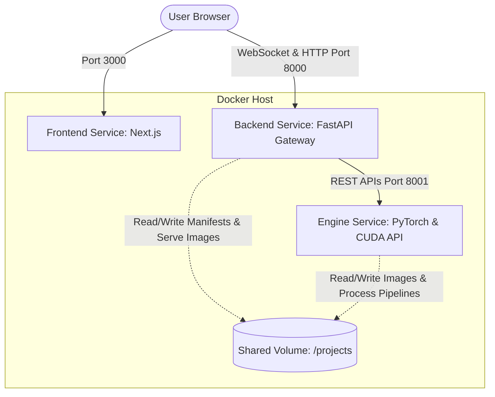

# Approved Backend & Manga Translator Engine Docker Integration Plan

This plan was approved by the user in a previous conversation. It details the design, architecture, and task checklist for establishing a robust, decoupled, and platform-independent connection between the web backend (`webui/backend`) and the Manga Translator engine (`Manga Translator`).

---

## 1. Architectural Decisions

- **Decoupling Strategy:** The backend and engine will be fully containerized using **Docker** and communicate solely via **REST APIs** rather than direct directory imports.
- **Subprocess Queue:** A centralized execution queue will be added to the backend to serialize all heavy engine runs (EasyOCR, MangaOCR, Argos Translate), avoiding VRAM overflow on the host/container.
- **Bidirectional WebSockets:** Process logs will stream to the frontend via WebSockets, allowing the client to send immediate bidirectional cancellation signals to abort active processes.
- **Single-Backup & Crash-Safe Manifest Saving:** Instead of creating timestamped backups (`project_manifest.backup_*.json`) which clutter the directory, the manifest saving process will be simplified:
  1. Keep a single backup file (e.g., `project_manifest.json.bak`).
  2. Write updates to a temporary JSON file (e.g., `project_manifest.json.tmp`).
  3. Perform an atomic replace of the manifest file, removing/renaming the temp version on successful write.

---

## 2. Service Layout & Communication Flow

### A. Frontend (`frontend` container)
- **Base Image:** `node:18-alpine`
- **Role:** Serves the Next.js React application.
- **Port:** Exposes port `3000`.
- **Environment:** `NEXT_PUBLIC_API_URL=http://localhost:8000` (points user browsers to the Backend Gateway).

### B. Web UI Backend Gateway (`backend` container)
- **Base Image:** `python:3.10-slim`
- **Role:** Handles client requests, user manifest saves, backup pruning, image/thumbnail serving, and WebSockets.
- **Port:** Exposes port `8000`.
- **Decoupling Action:** Bypasses `sys.path.insert` engine imports entirely. Any pipeline executions, OCR calculations, or font-fitting actions are dispatched as REST calls to the `engine` container.
- **Storage:** Mounts the host's manga projects folder to `/projects`.

### C. Manga Translator Engine (`engine` container)
- **Base Image:** `pytorch/pytorch:2.1.0-cuda11.8-cudnn8-runtime`
- **Role:** Houses the core machine learning translation engine, layout modeling, inpainting, and typesetting logic.
- **Port:** Exposes internal API port `8001` to the backend. Exposes:
  - `POST /api/engine/execute` (triggers stages, returns stream)
  - `POST /api/engine/fit-font` (calculates typesetting sizes)
- **GPU Access:** Reserved CUDA resources via the Docker daemon (`deploy.resources.reservations`).
- **Storage:** Mounts the identical host folder to `/projects` so both containers share paths.

---

## 3. Proposed Changes

### Component 1: Docker Configurations
- **[NEW] `webui/backend/Dockerfile`**: Slim python docker image for the API backend.
- **[NEW] `Manga Translator/Dockerfile`**: PyTorch/CUDA-cuda11.8 base image compiling engine dependencies and models.
- **[NEW] `webui/docker-compose.yml`**: Links the Next.js frontend, FastAPI backend, and PyTorch engine services with GPU mapping and shared volumes.

### Component 2: Queue & WebSockets
- **[NEW] `webui/backend/utils/queue_manager.py`**: Handles sequential task scheduling.
- **[NEW] `webui/backend/utils/ws_manager.py`**: WebSocket manager tracking client connections and cancellation events.
- **[MODIFY] `webui/backend/main.py`**: Mounts the WebSockets endpoint.

### Component 3: Single-Backup & Temporary Manifest Saving
- **[MODIFY] `webui/backend/routers/project.py`**: Refactors `/save-page-regions` and manifest editing endpoints to write to `.json.tmp` and atomically rename, maintaining a single `.bak` backup file instead of timestamped files.

---

## 4. Task Checklist

- [ ] **Component 1: Docker Setup**
  - [ ] Create `Dockerfile` for the backend (`webui/backend/Dockerfile`)
  - [ ] Create `Dockerfile` for the engine (`Manga Translator/Dockerfile`)
  - [ ] Create `docker-compose.yml` (`webui/docker-compose.yml`)
- [ ] **Component 2: Queue & WebSockets**
  - [ ] Create `queue_manager.py` in backend utils
  - [ ] Create `ws_manager.py` in backend utils
  - [ ] Integrate WebSocket logs endpoint in backend `main.py` and routers
- [ ] **Component 3: Manifest Refactoring**
  - [ ] Implement single-backup and temp-saving schema in `routers/project.py`
  - [ ] Clean up redundant backup code from other endpoints
- [ ] **Component 4: Verification**
  - [ ] Verify Docker Compose up and CUDA GPU recognition
  - [ ] Verify WebSocket log streaming and cancellation
  - [ ] Verify manifest backup behavior and lack of timestamp file spam
