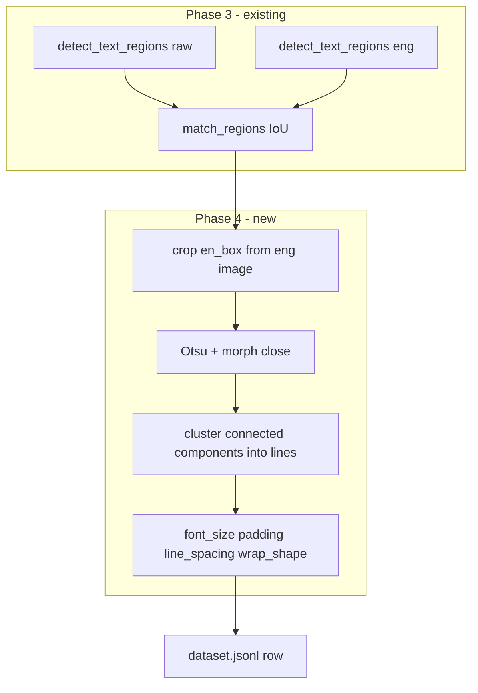

# Phase 4 — Typesetting Feature Extraction

## Context

Phases 1–3 are complete. [`finetuning/extractor.py`](finetuning/extractor.py) `process_pair()` currently emits one JSONL row per IoU-matched region with geometry and OCR text only:

```172:188:finetuning/extractor.py
        for idx, (jp, en, iou) in enumerate(matches):
            rows.append(
                {
                    "pair_id": pair_id,
                    ...
                    "en_box": asdict(en.box),
                    "en_text_detected": en.text,
                    ...
                }
            )
```

Phase 4 adds **training labels** by reverse-engineering how a human typesetter laid out English text inside each `en_box`. This is **CPU-only** (OpenCV + NumPy + Pillow) — no VRAM impact on the GTX 1050ti.

Downstream consumers:
- **Phase 7** trains on `[font_size, padding, line_spacing]` (plus `wrap_shape` optionally)
- **Phase 10** will load `layout_model.pkl` to mimic human sizing ([`workers/typesetter.py`](workers/typesetter.py) currently hardcodes `_BOX_PADDING = 4` and binary-searches font size)

---

## Target JSONL Schema (enriched row)

Each matched row gains four top-level fields (names aligned with [`docs/next_steps_finetunning.md`](docs/next_steps_finetunning.md)):

```json
{
  "pair_id": "manga1/1.png",
  "status": "matched",
  "en_box": {"x_min": 12, "y_min": 22, "x_max": 98, "y_max": 78},
  "en_text_detected": "HELLO WORLD",
  "font_size": 18,
  "padding": 5,
  "line_spacing": 1.2,
  "wrap_shape": "rectangular"
}
```

Optional diagnostic fields (recommended, low cost, helps Phase 7 debugging):

| Field | Type | Purpose |
|-------|------|---------|
| `line_count` | int | Number of detected text lines |
| `typesetting_confidence` | float 0–1 | Heuristic quality score (see below) |

Keep diagnostics optional in v1; core four fields are required for acceptance.

---

## Architecture



---

## New Module: [`finetuning/typesetting_features.py`](finetuning/typesetting_features.py)

### Public API

```python
def extract_typesetting_features(
    page_gray: np.ndarray,  # H×W, uint8
    en_box: BoundingBox | dict,
    *,
    crop_margin_px: int = 2,
) -> "TypesettingFeatures":
    ...
```

Returns `{"font_size", "padding", "line_spacing", "wrap_shape"}` (+ optional diagnostics).

Accept `BoundingBox` or the dict form already stored in JSONL (`en_box` keys).

### Step 1 — Crop region

- Load eng page with Pillow or OpenCV (grayscale).
- Clamp `en_box` to image bounds (mirror [`workers/typesetter.py`](workers/typesetter.py) clamp logic).
- Expand crop by `crop_margin_px` (default 2) so stroke/outline pixels at edges are not clipped.
- If clamped box has zero area → raise `ValueError` (caller handles).

### Step 2 — Binarize text ink mask

Manga typesetting uses **black fill + white stroke**. Strategy:

1. Convert crop to grayscale.
2. Gaussian blur (3×3) to suppress JPEG noise.
3. **Otsu threshold** → two classes (0 and 255).
4. **Perimeter-based inversion**:
   - Sample original grayscale on a 1–2 px inner border of the crop.
   - Compare border median to each Otsu class mean.
   - Assign the class closer to the border median as the background.
   - Invert so text = True in the final mask.
   - Fallback (if ambiguous): assume dark text on light background and log debug warning.
5. **Morphological close** (3×3 kernel, 1 iteration) to merge stroke fragments into glyph blobs.
6. Remove speckle: drop connected components with area `< min_area` (e.g. 4 px), and optionally width < 2 or height < 4.

Output: boolean `text_mask` same size as crop.

### Step 3 — Line clustering (connected components)

Use `cv2.connectedComponentsWithStats` on `text_mask`:

1. For each component, record `(x, y, w, h, cy)`.
2. Sort components by `cy`.
3. **Estimate font size**:
   - Filter `h` array to include only the top 80% (cutoff = 20th percentile) to ignore remaining punctuation/speckles. If fewer than 3 components, use all.
   - `font_size_estimate` = median of this filtered array.
4. Greedy line clustering: components whose `cy` differs by `< font_size_estimate * 0.6` belong to same line.
5. Refine: per line, `line_height = max(h)`, `line_y_min/max` from component bounds.

**Edge case — single line:** `line_count = 1`, `line_spacing = 1.0` (neutral ratio).

### Step 4 — Compute features

#### `font_size` (int px)

- Per component height `h`, apply the same **20th-percentile cutoff filter** as used in clustering, then take the **median** of the filtered heights (robust to stroke width and speckles).
- Clamp to `[8, 72]` (matches typesetter `_MIN_FONT_SIZE` and reasonable manga upper bound).
- Fallback if no components: `(en_box.height // max(line_count, 1))` with floor 8.

#### `padding` (int px)

- Tight ink bbox from `text_mask`: `(ink_x_min, ink_y_min, ink_x_max, ink_y_max)`.
- Per-edge padding relative to **original en_box** (not crop margin):
  - `left = ink_x_min + crop.x_offset - en_box.x_min` (account for crop origin)
  *Note: Phase 3 `en_box` is an OCR-tight box, not a bubble outline. Padding will often be small (0-2px). Do not expect it to match human "bubble padding" perfectly.*
  - Same for top/right/bottom.
- Report **`padding = min(left, top, right, bottom)`** (conservative inner margin — matches Phase 7 “PaddingMargin” single scalar in [`library_documentation_finetuning.md`](docs/library_documentation_finetuning.md)).
- Clamp to `[0, en_box.height // 2]`.

#### `line_spacing` (float ratio)

- For adjacent lines: `gap = next.y_min - prev.y_max`.
- `ratio = median(gap) / font_size` when `line_count >= 2`.
- Clamp to `[1.0, 2.5]`; default `1.0` for single-line bubbles.

#### `wrap_shape` (`"rectangular"` | `"elliptical"`)

Heuristic (no ML):

1. `fill_ratio = text_pixels / en_box_area`.
2. Divide en_box into 4 corner quadrants (each 25% of area at corners).
3. `corner_ink_ratio` = ink pixels in corners / corner area.
4. Classify **elliptical** if:
   - `corner_ink_ratio < 0.08` **and** `fill_ratio < 0.55`, **or**
   - en_box aspect ratio is near-square (0.7–1.4) **and** `corner_ink_ratio < 0.12`.
5. Otherwise **rectangular**.

This captures scanlation behavior: elliptical bubbles leave corners empty; rectangular boxes fill more uniformly.
*Note: Because `en_box` is OCR-tight, the elliptical vs rectangular signal may be weak, but it provides a best-effort label.*

#### `typesetting_confidence` (optional)

Composite score penalizing:
- Empty mask (0.0)
- Very low component count vs expected from `en_text_detected` word count (if `en_text_detected` is passed into feature extraction)
- Extreme padding (> 40% of box dimension)
- `font_size` at clamp boundaries

Used for filtering bad rows in Phase 7, not for failing extraction.

---

## Integration into [`finetuning/extractor.py`](finetuning/extractor.py)

In `process_pair()`, **after** building each matched row dict:

import cv2
from finetuning.typesetting_features import extract_typesetting_features

# Load page once outside the loop
page_gray = cv2.imread(str(eng_path), cv2.IMREAD_GRAYSCALE)

features = extract_typesetting_features(page_gray, en.box)
row.update(features.to_dict())

### Error handling policy

- Wrap per-region extraction in `try/except`.
- On failure: log warning with `pair_id` + `region_index`; use the dataclass fallback:
  ```python
  except Exception:
      features = TypesettingFeatures.fallback()
  row.update(features.to_dict())
  ```
- Do **not** fail the whole pair — partial OCR matches already exist; one bad bubble should not block the page.

### Performance

- One crop + OpenCV pass per matched region (~1–5 ms CPU).
- No change to EasyOCR reader reload cadence.
- Load eng image **once per pair** in `process_pair()`, pass the `page_gray` numpy array to avoid re-reading disk per region.

Suggested helper signature:

```python
def _extract_from_crop(
    crop_gray: np.ndarray,
    en_box: BoundingBox,
    crop_origin: tuple[int, int],
) -> TypesettingFeatures: ...
```

`extract_typesetting_features()` clamps/crops the page array and delegates to `_extract_from_crop()`.

---

## Data Model (optional but recommended)

Add to [`finetuning/models.py`](finetuning/models.py):

```python
from typing import Literal
from dataclasses import dataclass

@dataclass
class TypesettingFeatures:
    font_size: int
    padding: int
    line_spacing: float
    wrap_shape: Literal["rectangular", "elliptical"]
    line_count: int = 1
    typesetting_confidence: float = 1.0

    @classmethod
    def fallback(cls) -> "TypesettingFeatures":
        # mirrors workers/typesetter.py _BOX_PADDING=4, _MIN_FONT_SIZE=8
        return cls(12, 4, 1.0, "rectangular", line_count=0, typesetting_confidence=0.0)

    def to_dict(self) -> dict[str, int | float | str]: ...
```

**Mandatory.** Use in module return type; extractor merges via `.to_dict()`. Provides a clean fallback path.

---

## Tests

### New file: [`tests/test_typesetting_features.py`](tests/test_typesetting_features.py)

Synthetic fixtures only (no GPU, no EasyOCR):

| Test case | Setup | Expected |
|-----------|-------|----------|
| Single-line rect bubble | White 100×40 crop, black "HELLO" block 80×16 centered | `line_count=1`, `font_size≈16`, `padding≈10`, `wrap_shape=rectangular` |
| Two-line spacing | Two horizontal bars, gap = 8px, bar height 14px | `line_count=2`, `line_spacing≈8/14≈0.57` → clamped to 1.0 min or measured ratio |
| Elliptical corners empty | Text ellipse in center of 80×80, corners blank | `wrap_shape=elliptical` |
| Stroke outline | Black text with white 2px halo | `font_size` stable (median height, not doubled by stroke) |
| Empty crop | All-white region | defaults or low confidence |
| Dict box input | Pass `en_box` as dict | same results as `BoundingBox` |

Use `PIL.ImageDraw` or NumPy to paint fixtures; save to temp PNG or pass ndarray directly to `from_crop`.

### Update [`tests/test_dataset_extractor.py`](tests/test_dataset_extractor.py)

- In `test_process_pair_produces_matches`: patch `extract_typesetting_features` **or** use real tiny synthetic eng image with drawn text.
- Assert output rows contain keys: `font_size`, `padding`, `line_spacing`, `wrap_shape`.
- Update `_matched_rows()` helper to include the four new fields for mock-based tests.

### Run command

```powershell
venv\Scripts\python.exe -m pytest tests/test_typesetting_features.py tests/test_geometry.py tests/test_detection.py tests/test_dataset_extractor.py -v
```

---

## Documentation Updates (end of phase)

| File | Change |
|------|--------|
| [`docs/finetuning_context.md`](docs/finetuning_context.md) | Mark Phase 4 complete; add deliverables table; set active phase to Phase 5 |
| [`docs/next_steps_finetunning.md`](docs/next_steps_finetunning.md) | Move Phase 4 to "done"; write Phase 5 handoff section |

No changes to `project_context.md` (Phase 9 rule).

---

## Re-extraction Note

Existing `training_data/dataset.jsonl` rows lack Phase 4 fields. After implementation:

```powershell
venv\Scripts\python.exe scripts/dataset_extractor.py --reset-checkpoint --no-gpu
```

Checkpoint reset required so all pairs are reprocessed with enriched schema.

---

## Out of Scope (Phase 4)

- Inpaint masks (Phase 5)
- Japanese OCR / translation pairs (Phase 6)
- Training `layout_model.pkl` (Phase 7)
- CLI command `manga extract`
- Elliptical **rendering** in typesetter (Phase 10)
- New pip dependencies (OpenCV/Pillow/NumPy already present)

---

## Acceptance Criteria

- [ ] [`finetuning/typesetting_features.py`](finetuning/typesetting_features.py) implemented with crop → binarize → line cluster → metrics pipeline
- [ ] [`finetuning/extractor.py`](finetuning/extractor.py) merges features into every matched JSONL row
- [ ] Matched rows include `font_size`, `padding`, `line_spacing`, `wrap_shape`
- [ ] [`tests/test_typesetting_features.py`](tests/test_typesetting_features.py) passes with synthetic fixtures (no GPU)
- [ ] Existing finetuning test suite still passes (target: 30+ tests)
- [ ] [`docs/finetuning_context.md`](docs/finetuning_context.md) updated; Phase 5 marked active

---

## Implementation Order

1. Implement core algorithms in `typesetting_features.py` with `from_crop` helper (testable without file I/O).
2. Add unit tests with synthetic images first (TDD-friendly).
3. Wire into `process_pair()` with per-region error handling + single image load per pair.
4. Extend extractor tests and `_matched_rows` fixture.
5. Manual smoke test on 1–2 real pages from `training_data - backup/`; inspect JSONL values for sanity.
6. Update context docs.
