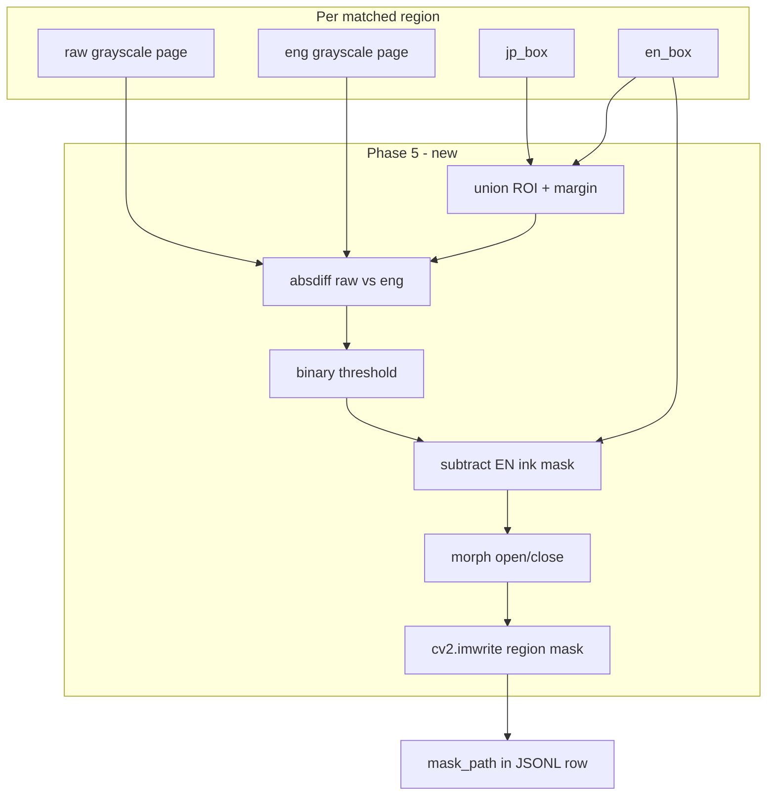

# Phase 5 — Inpaint Mask Extraction

## Context

Phases 1–4 are complete. [`finetuning/extractor.py`](finetuning/extractor.py) `process_pair()` currently:
- Matches JP/EN regions via IoU ([`finetuning/geometry.py`](finetuning/geometry.py))
- Loads **EN grayscale only** for typesetting features
- Emits JSONL rows with geometry, OCR text, and Phase 4 typesetting labels

Phase 5 adds **training targets for Stage 9 inpainting**. Today [`workers/inpainter.py`](workers/inpainter.py) draws filled **rectangles** over each `TextRegion.box` before `cv2.inpaint()`. Phase 10 will replace that with **contour-shaped masks** learned from human scanlation edits captured here.

**Hardware:** CPU-only (OpenCV + NumPy). No VRAM impact on GTX 1050ti.

**Downstream consumers:**
- **Phase 7** — optional mask area/pixel stats as layout features (not required in Phase 5)
- **Phase 10** — load per-region mask contours instead of bbox rectangles in `InpainterWorker`

---

## Problem Definition

For each IoU-matched bubble, infer the pixel mask a human typesetter effectively "erased" when replacing Japanese text with English. This is **not** the EN text ink mask (Phase 4 [`finetuning/typesetting_features.py`](finetuning/typesetting_features.py)); it is the **JP-side erase region** derived from page differencing.



---

## Target JSONL Schema (enriched row)

Each matched row gains mask fields (relative to `training_data/`):

```json
{
  "pair_id": "manga1/1.webp",
  "region_index": 0,
  "jp_box": {"x_min": 10, "y_min": 20, "x_max": 100, "y_max": 80},
  "en_box": {"x_min": 12, "y_min": 22, "x_max": 98, "y_max": 78},
  "font_size": 18,
  "mask_path": "masks/manga1_1_region0.png",
  "mask_roi_box": {"x_min": 2, "y_min": 12, "x_max": 108, "y_max": 88},
  "mask_confidence": 0.85,
  "mask_pixel_count": 1240
}
```

| Field | Type | Required | Purpose |
|-------|------|----------|---------|
| `mask_path` | str | yes | Relative path to cropped binary mask PNG |
| `mask_roi_box` | dict | yes | Absolute page coordinates (x_min, y_min, x_max, y_max) of the mask crop to align it during Phase 10 |
| `mask_confidence` | float 0–1 | yes | Heuristic quality score for Phase 7 filtering |
| `mask_pixel_count` | int | recommended | Foreground pixel count; sanity check + future features |

**Mask PNG format:** Single-channel uint8, cropped to ROI. **255 = inpaint/erase**, 0 = keep. Matches `cv2.inpaint()` convention used in [`workers/inpainter.py`](workers/inpainter.py).

**Naming convention:** `masks/{manga_id}_{page}_region{idx}.png`
- Sanitize `manga_id` for filesystem (`/` → `_`, strip unsafe chars)
- Example: `manga1/1.webp` region 0 → `masks/manga1_1_region0.png`

---

## New Module: [`finetuning/mask_extraction.py`](finetuning/mask_extraction.py)

### Public API

```python
@dataclass
class InpaintMaskResult:
    mask: np.ndarray          # cropped binary mask (H, W) uint8
    mask_confidence: float
    mask_pixel_count: int
    mask_roi_box: BoundingBox # page coords of crop (required for Phase 10)

def extract_inpaint_mask_from_pages(
    raw_gray: np.ndarray,
    eng_gray: np.ndarray,
    jp_box: BoundingBox | dict,
    en_box: BoundingBox | dict,
    *,
    roi_margin_px: int = 8,
    diff_threshold: int = 30,
    min_component_area: int = 16,
) -> InpaintMaskResult: ...

def save_region_mask(
    mask: np.ndarray,
    masks_dir: Path,
    manga_id: str,
    page: str,
    region_index: int,
) -> str:
    """Write PNG; return relative mask_path like 'masks/manga1_1_region0.png'."""
```

`extract_inpaint_mask(raw_path, eng_path, jp_box, en_box)` may exist as a thin file-I/O wrapper, but **extractor should call `from_pages`** with arrays loaded once per pair (mirrors Phase 4 pattern).

### Step 1 — Compute ROI

Add helper to [`finetuning/geometry.py`](finetuning/geometry.py):

```python
def union_box(box_a: BoundingBox, box_b: BoundingBox) -> BoundingBox:
    """Axis-aligned union of two boxes."""
```

- Normalize `jp_box` / `en_box` from dict or `BoundingBox`
- `roi = union_box(jp, en)` expanded by `roi_margin_px` (default 8px)
- Clamp to page bounds; zero area → raise `ValueError`

**Why union?** OCR boxes for JP and EN rarely align exactly; union captures the full bubble edit zone.

### Step 2 — Pixel differencing

Within ROI crop:

```python
diff = cv2.absdiff(raw_crop, eng_crop)
_, diff_mask = cv2.threshold(diff, diff_threshold, 255, cv2.THRESH_BINARY)
```

Default `diff_threshold=30` per [`docs/library_documentation_finetuning.md`](docs/library_documentation_finetuning.md). Diff captures both **JP text removal** and **EN text addition**.

### Step 3 — Subtract English ink (critical)

Without this step, masks include new English glyphs — wrong training signal for "what to erase on the JP page."

Reuse Phase 4 binarization logic. Preferred approach:

1. Extract a **private helper** from [`finetuning/typesetting_features.py`](finetuning/typesetting_features.py):

```python
def get_text_ink_mask(page_gray: np.ndarray, box: BoundingBox, *, crop_margin_px: int = 2) -> tuple[np.ndarray, np.ndarray, tuple[int,int]]:
    """Returns (text_mask_crop, crop_gray, crop_origin). Encapsulates cropping and binarization."""
```

   Refactor `extract_typesetting_features` and `_extract_from_crop` to call this internally so cropping and binarization logic isn't duplicated.

2. In mask extraction, build full-page-sized `en_ink` zeros array, paste EN ink crop (`text_mask_crop`) at `crop_origin`, restricted to ROI.
3. Dilate EN ink by 2–3px (`cv2.dilate`) to cover white stroke halos around scanlation text.
4. `erase_mask = diff_mask & ~en_ink_roi`

**Fallback Trigger:** If EN ink subtraction leaves less than 5% of the `diff_mask` foreground (i.e., subtraction removed > 95%), trigger the fallback and use `diff_mask` clipped strictly to the `jp_box` interior only.

### Step 4 — Morphological cleanup

Per library doc + scanlation noise handling:

```python
kernel = cv2.getStructuringElement(cv2.MORPH_ELLIPSE, (3, 3))
clean = cv2.morphologyEx(erase_mask, cv2.MORPH_OPEN, kernel, iterations=1)
clean = cv2.morphologyEx(clean, cv2.MORPH_CLOSE, kernel, iterations=1)
```

- Remove speckle: drop connected components with area `< min_component_area` (default 16px)
- Re-threshold to strict 0/255

### Step 5 — Confidence score

Composite heuristic based on standard mask extraction penalties:

| Condition | Penalty |
|-----------|---------|
| Zero foreground pixels | confidence = 0.0 |
| Foreground > 80% of ROI area (likely bad diff / misalignment) | subtract 0.8 |
| Foreground < 0.5% of ROI (likely missed JP text) | subtract 0.6 |
| EN ink subtraction removed > 95% of diff (fallback used) | subtract 0.4 |
| ROI extends beyond page (clamped heavily) | subtract 0.2 |

Start at 1.0, subtract penalties, clamp to `[0.0, 1.0]`.

### Step 6 — Save mask

- Ensure `masks_dir` exists (created in `DatasetExtractor.__init__`)
- Write with `cv2.imwrite` (PNG compression)
- Return relative `mask_path` for JSONL
- `.gitignore` already ignores `training_data/masks/*.png` — no change needed

---

## Integration into [`finetuning/extractor.py`](finetuning/extractor.py)

### Constructor changes

```python
def __init__(..., masks_dir: str | Path = "training_data/masks"):
    self.masks_dir = Path(masks_dir)
    self.masks_dir.mkdir(parents=True, exist_ok=True)
```

### `process_pair()` changes

After line 157 (`matches = ...`), load **both** pages once:

```python
raw_gray = cv2.imread(str(raw_path), cv2.IMREAD_GRAYSCALE)
page_gray = cv2.imread(str(eng_path), cv2.IMREAD_GRAYSCALE)
```

Fix latent bug: line 178 uses `np.zeros` without `import numpy as np` — add import.

Per matched region loop (after typesetting features):

```python
try:
    mask_result = extract_inpaint_mask_from_pages(raw_gray, page_gray, jp.box, en.box)
    mask_path = save_region_mask(
        mask_result.mask, self.masks_dir, manga_name, page, idx
    )
    row["mask_path"] = mask_path
    row["mask_roi_box"] = mask_result.mask_roi_box.to_dict()
    row["mask_confidence"] = round(mask_result.mask_confidence, 4)
    row["mask_pixel_count"] = mask_result.mask_pixel_count
except Exception as exc:
    logger.warning("Failed to extract inpaint mask for %s region %d: %s", pair_id, idx, exc)
    row["mask_path"] = ""
    row["mask_roi_box"] = {}
    row["mask_confidence"] = 0.0
    row["mask_pixel_count"] = 0
```

**Error policy:** Do not fail the pair — same as Phase 4 typesetting fallbacks.

### CLI: [`scripts/dataset_extractor.py`](scripts/dataset_extractor.py)

Add optional flag:

```python
parser.add_argument(
    "--masks-dir",
    type=str,
    default="training_data/masks",
    help="Directory for per-region inpaint mask PNGs",
)
```

Pass through to `DatasetExtractor(masks_dir=args.masks_dir)`.

---

## Optional Data Model

Add to [`finetuning/models.py`](finetuning/models.py) (mirrors `TypesettingFeatures`):

```python
@dataclass
class InpaintMaskMetadata:
    mask_path: str
    mask_roi_box: dict[str, int]
    mask_confidence: float
    mask_pixel_count: int

    @classmethod
    def empty(cls) -> InpaintMaskMetadata: ...
    def to_dict(self) -> dict[str, str | float | int]: ...
```

Use in extractor via `.to_dict()` merge into row.

---

## Tests

### New file: [`tests/test_mask_extraction.py`](tests/test_mask_extraction.py)

Synthetic fixtures only (NumPy/PIL, no GPU, no EasyOCR):

| Test case | Setup | Expected |
|-----------|-------|----------|
| JP text erased | 100×100 white canvas; raw has 40×20 black rect; eng same rect filled white | mask has foreground blob ≈ rect shape |
| EN text excluded | Same + eng adds black EN text block elsewhere in ROI | EN pixels not in erase mask |
| No change | Identical raw/eng crops | `mask_pixel_count == 0`, confidence ≈ 0 |
| Union ROI | jp_box and en_box offset; change only in jp_box | mask captured inside union |
| Morph noise | Diff with 1–2px salt noise | speckle removed, main blob kept |
| save_region_mask | tmp dir write | file exists, returns correct relative path |
| Dict box input | Pass jp_box/en_box as dicts | same as BoundingBox |

Use `numpy` arrays directly via `extract_inpaint_mask_from_pages`; no file I/O in unit tests.

### Update [`tests/test_dataset_extractor.py`](tests/test_dataset_extractor.py)

- Extend `_matched_rows()` with `mask_path`, `mask_roi_box`, `mask_confidence`, `mask_pixel_count`
- In `test_process_pair_produces_matches`: patch `extract_inpaint_mask_from_pages` + `save_region_mask` **or** use small synthetic PNG pair with drawn diff
- Assert output rows contain the new mask fields

### Run command

```powershell
venv\Scripts\python.exe -m pytest tests/test_mask_extraction.py tests/test_typesetting_features.py tests/test_geometry.py tests/test_detection.py tests/test_dataset_extractor.py -v
```

Target: 35+ passing tests (5+ new mask tests).

---

## Documentation Updates (end of phase)

| File | Change |
|------|--------|
| [`docs/finetuning_context.md`](docs/finetuning_context.md) | Mark Phase 5 complete; add deliverables table; set active phase to Phase 6 |
| [`docs/next_steps_finetunning.md`](docs/next_steps_finetunning.md) | Move Phase 5 to "done"; write Phase 6 handoff (manga-ocr translation pairs) |
| [`docs/library_documentation_finetuning.md`](docs/library_documentation_finetuning.md) | Expand mask section with EN-ink subtraction and per-region crop notes |

No changes to `project_context.md` (Phase 9 rule).

---

## Re-extraction Note

Existing `training_data/dataset.jsonl` rows lack Phase 5 fields. After implementation:

```powershell
venv\Scripts\python.exe scripts/dataset_extractor.py --reset-checkpoint --no-gpu
```

Checkpoint reset required so all pairs are reprocessed with mask PNGs generated.

---

## Relationship to Phase 10 (future, out of scope)

Phase 5 stores **cropped per-region masks** + page-level `jp_box`. Phase 10 integration will:

1. Load `mask_path` relative to `training_data/`
2. Paste cropped mask into full-page mask using `mask_roi_box` to align the origin precisely.
3. Replace `cv2.rectangle` loop in [`workers/inpainter.py`](workers/inpainter.py) with contour-based mask assembly using the loaded mask images.

No pipeline changes in Phase 5.

---

## Out of Scope (Phase 5)

- Japanese OCR via manga-ocr / translation pairs (Phase 6)
- Training layout model (Phase 7)
- Full-page mask storage (use per-region crops only)
- Image registration / alignment beyond dimension equality check
- New pip dependencies
- `manga extract` CLI command
- Main pipeline / `InpainterWorker` changes

---

## Acceptance Criteria

- [ ] [`finetuning/mask_extraction.py`](finetuning/mask_extraction.py) implements ROI crop → absdiff → EN ink subtraction → morph cleanup pipeline
- [ ] [`finetuning/geometry.py`](finetuning/geometry.py) adds `union_box` helper
- [ ] [`finetuning/extractor.py`](finetuning/extractor.py) loads raw+eng once per pair, saves masks, adds `mask_path` to every matched row
- [ ] [`scripts/dataset_extractor.py`](scripts/dataset_extractor.py) exposes `--masks-dir`
- [ ] [`tests/test_mask_extraction.py`](tests/test_mask_extraction.py) passes with synthetic fixtures
- [ ] Extractor tests updated; full finetuning test suite passes
- [ ] [`docs/finetuning_context.md`](docs/finetuning_context.md) updated; Phase 6 marked active
- [ ] Latent `np` import bug in extractor fixed

---

## Implementation Order

1. Add `union_box` to `geometry.py` + unit test in `test_geometry.py`
2. Refactor `text_ink_mask` helper out of `typesetting_features.py` (no behavior change; run existing tests)
3. Implement `mask_extraction.py` core (`from_pages`) with TDD via `test_mask_extraction.py`
4. Implement `save_region_mask` and wire `masks_dir` into `DatasetExtractor`
5. Integrate into `process_pair()` with per-region error handling; fix `numpy` import
6. Add `--masks-dir` CLI flag
7. Update `test_dataset_extractor.py` fixtures and integration test
8. Manual smoke test: 1–2 real pages from `training_data - backup/`; visually inspect mask PNGs vs bubbles
9. Update finetuning docs
