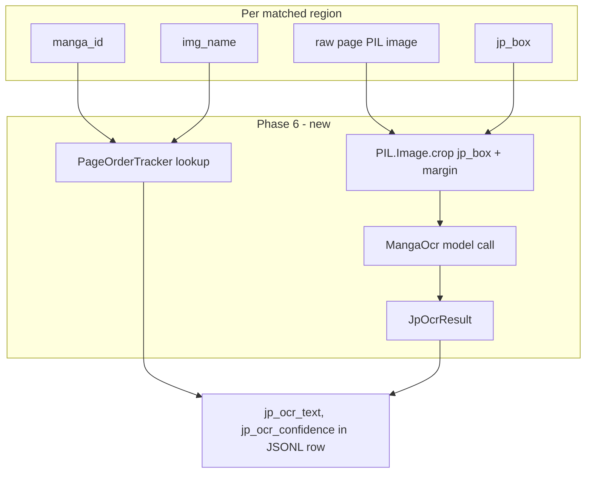

# Phase 6 — Story Context & Translation Extraction

## Context

Phases 1–5 are complete. [`finetuning/extractor.py`](../finetuning/extractor.py)
`process_pair()` currently emits one JSONL row per IoU-matched region with:

- Geometry (`jp_box`, `en_box`, `iou`)
- OCR text from EasyOCR (`jp_text_detected`, `en_text_detected`)
- Typesetting labels (`font_size`, `padding`, `line_spacing`, `wrap_shape`)
- Inpaint mask metadata (`mask_path`, `mask_roi_box`, `mask_confidence`, `mask_pixel_count`)

**The gap:** `jp_text_detected` is produced by EasyOCR (multi-language `["ja", "en"]`),
which is not optimised for vertical Japanese manga text. EasyOCR OCRs the full page
and matches regions geometrically, producing noisy Japanese transcription. Phase 6
replaces it with **manga-ocr** — a model purpose-built for Japanese manga bubbles —
operating on a tight crop of each `jp_box`, yielding cleaner training signal for Phase 8.

Phase 6 also tags each pair with a **sequential `page_number`** across the manga's
page set (not just the filename stem), allowing Phase 8's translation memory to
reconstruct story context ordering (`manga_id` + `page_number` → ordered sentence stream).

**Hardware:** `manga-ocr` auto-detects CUDA/CPU (`MangaOcr()` with no flags).
On GTX 1050ti it uses ~400MB VRAM. Must be loaded **once per batch** and unloaded
before EasyOCR reloads to avoid VRAM stacking. On `--no-gpu` runs it falls back to CPU.

**Downstream consumers:**
- **Phase 8** — `build_translation_memory.py` reads `jp_ocr_text` ↔ `en_text_detected`
  pairs ordered by (`manga_id`, `page_number`, `region_index`) to build vocabulary dicts
- **Phase 9** — translation memory phrase matching uses `jp_ocr_text` as the query key

---

## Problem Definition

For each IoU-matched bubble, run manga-ocr on the `jp_box` crop of the raw page
to obtain a clean Japanese transcription, and tag it with an absolute page_number
so Phase 8 can reconstruct story-order context.



---

## Target JSONL Schema (enriched row)

Each matched row gains five new top-level fields:

```json
{
  "pair_id": "manga1/1.webp",
  "manga_id": "manga1",
  "page": "1",
  "region_index": 0,
  "status": "matched",
  "iou": 0.82,
  "jp_box": {"x_min": 10, "y_min": 20, "x_max": 100, "y_max": 80},
  "en_box": {"x_min": 12, "y_min": 22, "x_max": 98, "y_max": 78},
  "jp_text_detected": "こんにちは",
  "en_text_detected": "HELLO",
  "font_size": 18,
  "padding": 5,
  "line_spacing": 1.2,
  "wrap_shape": "rectangular",
  "mask_path": "masks/manga1_1_region0.png",
  "mask_confidence": 0.85,
  "mask_pixel_count": 1240,
  "jp_ocr_text": "こんにちは世界",
  "jp_ocr_confidence": 1.0,
  "page_number": 1,
  "story_position": "manga1::0001::00"
}
```

| Field | Type | Required | Purpose |
|-------|------|----------|---------|
| `jp_ocr_text` | str | yes | manga-ocr transcription of `jp_box` crop (replaces noisy EasyOCR output for Phase 8) |
| `jp_ocr_confidence` | float 0–1 | yes | Sentinel `1.0` = processed by MangaOCR; `0.0` = fallback (EasyOCR text kept) |
| `page_number` | int | yes | 1-based sequential page index within `manga_id`; enables story-order sorting |
| `story_position` | str | recommended | Sortable key `"{manga_id}::{page_number:04d}::{region_index:02d}"` for Phase 8 ordering |

**Fallback values** (when MangaOCR fails or `--no-manga-ocr`):
- `jp_ocr_text`: `""` (empty string, Phase 8 falls back to `jp_text_detected`)
- `jp_ocr_confidence`: `0.0`
- `page_number`: derived from `PageOrderTracker` (always set; independent of OCR)
- `story_position`: always set (independent of OCR)

> **Note:** `jp_text_detected` (EasyOCR) is **preserved** as a fallback field.
> Phase 8 uses `jp_ocr_text` when non-empty, otherwise falls back to `jp_text_detected`.

---

## New Module: [`finetuning/manga_ocr_extraction.py`](../finetuning/manga_ocr_extraction.py)

### Public API

```python
from __future__ import annotations
from dataclasses import dataclass
from pathlib import Path
from PIL import Image
from core.models import BoundingBox


@dataclass
class JpOcrResult:
    jp_ocr_text: str
    jp_ocr_confidence: float  # 1.0 sentinel = MangaOCR processed; 0.0 = fallback

    @classmethod
    def fallback(cls) -> "JpOcrResult":
        return cls(jp_ocr_text="", jp_ocr_confidence=0.0)

    def to_dict(self) -> dict[str, str | float]:
        return {
            "jp_ocr_text": self.jp_ocr_text,
            "jp_ocr_confidence": self.jp_ocr_confidence,
        }


class MangaOcrExtractor:
    """Lazy-loaded wrapper around manga-ocr MangaOcr model.

    Mirrors the OcrWorker lifecycle pattern from workers/ocr_worker.py:
      extractor.load()   # downloads/loads model once per batch
      result = extractor.extract_text(raw_pil, jp_box)
      extractor.unload() # releases model before EasyOCR reloads
    """

    def __init__(self, crop_margin_px: int = 4) -> None:
        self._mocr = None
        self._loaded = False
        self.crop_margin_px = crop_margin_px

    def load(self) -> None:
        """Initialise MangaOcr. Idempotent. Raises ImportError if not installed."""

    def unload(self) -> None:
        """Release model reference. Idempotent."""

    @property
    def is_loaded(self) -> bool: ...

    def extract_text(
        self,
        raw_pil: Image.Image,
        jp_box: BoundingBox | dict,
    ) -> JpOcrResult:
        """Crop jp_box (+ margin), call MangaOcr, return JpOcrResult."""


def extract_jp_text_from_page(
    raw_pil: Image.Image,
    jp_box: BoundingBox | dict,
    extractor: MangaOcrExtractor,
) -> JpOcrResult:
    """Thin functional wrapper; extractor must already be loaded."""
```

### Step 1 — Crop the JP bubble

Mirror the crop pattern from [`workers/ocr_worker.py`](../workers/ocr_worker.py) (line 106):

```python
box = _normalize_box(jp_box)  # accepts BoundingBox or dict
margin = self.crop_margin_px
left   = max(0, box.x_min - margin)
upper  = max(0, box.y_min - margin)
right  = min(raw_pil.width,  box.x_max + margin)
lower  = min(raw_pil.height, box.y_max + margin)
crop   = raw_pil.crop((left, upper, right, lower))
```

Default `crop_margin_px = 4` (larger than typesetting's 2px) to include speech
bubble border cues that help MangaOCR distinguish furigana from main text.

**Zero-area guard:** If `(right - left) <= 0 or (lower - upper) <= 0` raise `ValueError`
(caller catches and uses `JpOcrResult.fallback()`).

**Input image mode:** MangaOcr expects `PIL.Image` in any mode; convert to `"RGB"` before call.

### Step 2 — Call MangaOcr

```python
crop_rgb = crop.convert("RGB")
text: str = self._mocr(crop_rgb)
```

MangaOcr returns the raw transcribed string. No confidence score is provided —
use sentinel `1.0` to mark "processed by MangaOCR" (same convention as
[`workers/ocr_worker.py`](../workers/ocr_worker.py) line 109).

**Empty result handling:** If `text.strip() == ""`, the model found no text.
Return `JpOcrResult(jp_ocr_text="", jp_ocr_confidence=0.5)` — partial confidence
(model ran but found nothing; box may be a decorative element).

### Step 3 — Normalize text

```python
text = text.strip()
# Normalize full-width ASCII → half-width for Phase 8 consistency
import unicodedata
text = unicodedata.normalize("NFKC", text)
```

`unicodedata.normalize("NFKC", ...)` is stdlib; no new dependency. Converts
`Ａ` → `A`, `１` → `1`, etc. Phase 8 translation memory will match against this
normalized form. Preserve Japanese characters — NFKC does not affect CJK ideographs.

---

## New Helper: [`finetuning/page_order.py`](../finetuning/page_order.py)

### Motivation

Filenames like `001.jpg`, `page_03.webp`, `ch02_pg04.png` don't sort reliably
with pure lexicographic order across mangas. `PageOrderTracker` pre-scans all pairs
found by `find_image_pairs()` before extraction starts and assigns deterministic
1-based `page_number` values per `manga_id`.

### Public API

```python
class PageOrderTracker:
    """Map (manga_id, img_name) → 1-based page_number for story ordering.

    Built once before extraction; read-only during process_pair calls.
    """

    def __init__(self, pairs: list[tuple[Path, Path, str, str]]) -> None:
        """
        Args:
            pairs: Result of DatasetExtractor.find_image_pairs() —
                   list of (raw_path, eng_path, manga_name, img_name).
        """

    def get_page_number(self, manga_id: str, img_name: str) -> int:
        """Return 1-based page number. Returns 0 if not found (safety)."""

    def get_story_position(self, manga_id: str, img_name: str, region_index: int) -> str:
        """Return sortable key: '{manga_id}::{page_number:04d}::{region_index:02d}'."""
```

### Sorting strategy

For each `manga_id`, collect all `img_name` values from pairs. Sort by:

1. **Numeric prefix extraction** — extract leading digit sequence from the filename stem:
   - `"001.jpg"` → `1`
   - `"page_03.webp"` → `3` (first digit run in stem)
   - `"ch02_pg04.png"` → `2` (first digit run)
2. **Lexicographic fallback** — if no digits found, sort alphabetically.

```python
import re

def _sort_key(img_name: str) -> tuple[int, str]:
    stem = img_name.rsplit(".", 1)[0]
    m = re.search(r"\d+", stem)
    return (int(m.group()), stem) if m else (0, stem)
```

This gracefully handles mixed-format filenames within the same manga.

### Integration point

Build tracker in `DatasetExtractor.__init__()` (or lazily on first `extract()` call)
after `find_image_pairs()` runs — before the pair processing loop starts.

---

## Data Model Updates: [`finetuning/models.py`](../finetuning/models.py)

### New dataclass: `JpOcrResult`

```python
@dataclass
class JpOcrResult:
    jp_ocr_text: str
    jp_ocr_confidence: float

    @classmethod
    def fallback(cls) -> "JpOcrResult":
        return cls(jp_ocr_text="", jp_ocr_confidence=0.0)

    def to_dict(self) -> dict[str, str | float]:
        return {
            "jp_ocr_text": self.jp_ocr_text,
            "jp_ocr_confidence": self.jp_ocr_confidence,
        }
```

> **Note:** `JpOcrResult` is defined in both `finetuning/models.py` (for import
> convenience by extractor) and `finetuning/manga_ocr_extraction.py` (module-local
> use). The canonical source is `models.py`; `manga_ocr_extraction.py` imports from
> there to avoid circular dependency.

---

## Integration into [`finetuning/extractor.py`](../finetuning/extractor.py)

### Constructor changes

```python
from finetuning.manga_ocr_extraction import MangaOcrExtractor
from finetuning.page_order import PageOrderTracker

def __init__(
    self,
    ...,
    masks_dir: str | Path = "training_data/masks",
    use_manga_ocr: bool = True,
    ocr_crop_margin_px: int = 4,
):
    ...
    self.use_manga_ocr = use_manga_ocr
    self._manga_ocr_extractor: MangaOcrExtractor | None = (
        MangaOcrExtractor(crop_margin_px=ocr_crop_margin_px)
        if use_manga_ocr else None
    )
    self._page_tracker: PageOrderTracker | None = None  # built lazily in extract()
```

### `extract()` changes — lifecycle management

MangaOcr and EasyOCR **must not be loaded simultaneously** on the GTX 1050ti
(combined VRAM ~2.4GB; safe under 4GB limit but keep them sequential per-batch).
The existing pattern already unloads/reloads EasyOCR every `checkpoint_interval` pairs.
Phase 6 **co-loads** MangaOcr during the same batch window:

```python
def extract(self) -> dict[str, int]:
    pairs = self.find_image_pairs()

    # Build page order tracker before processing loop
    self._page_tracker = PageOrderTracker(pairs)

    reader: Any = None
    pairs_since_load = 0

    for raw_path, eng_path, manga_name, img_name in pairs:
        ...
        try:
            if reader is None or pairs_since_load >= self.checkpoint_interval:
                # Unload previous models
                if reader is not None:
                    del reader
                    reader = None
                if self._manga_ocr_extractor and self._manga_ocr_extractor.is_loaded:
                    self._manga_ocr_extractor.unload()

                # Reload EasyOCR
                reader = self._create_reader()

                # Load MangaOcr in same window (both stay for checkpoint_interval pairs)
                if self._manga_ocr_extractor:
                    self._manga_ocr_extractor.load()

                pairs_since_load = 0

            records = self.process_pair(...)
            ...
```

**VRAM note:** Both models loaded together use ~2.4GB (EasyOCR ~2GB + MangaOcr ~0.4GB)
on the GTX 1050ti. This is within the 4GB limit but tight. If OOM occurs, users can
pass `--no-manga-ocr` to skip MangaOcr and keep only EasyOCR.

**Teardown:** Add `finally` block for MangaOcr (mirrors existing `del reader`):

```python
finally:
    if reader is not None:
        del reader
    if self._manga_ocr_extractor and self._manga_ocr_extractor.is_loaded:
        self._manga_ocr_extractor.unload()
```

### `process_pair()` changes

Add after mask extraction block, before building the `row` dict:

```python
# Load raw page as PIL image once per pair (for manga-ocr crops)
from PIL import Image as PILImage
raw_pil: PILImage.Image | None = None
if self._manga_ocr_extractor and self._manga_ocr_extractor.is_loaded:
    try:
        raw_pil = PILImage.open(raw_path).convert("RGB")
    except Exception as exc:
        logger.warning("Failed to open raw_path for manga-ocr: %s: %s", raw_path, exc)
```

Per matched region loop — after mask extraction, before `row.update(features.to_dict())`:

```python
# Phase 6: manga-ocr JP transcription
if raw_pil is not None and self._manga_ocr_extractor and self._manga_ocr_extractor.is_loaded:
    try:
        jp_ocr_result = self._manga_ocr_extractor.extract_text(raw_pil, jp.box)
    except Exception as exc:
        logger.warning(
            "Failed to extract JP OCR for %s region %d: %s", pair_id, idx, exc
        )
        jp_ocr_result = JpOcrResult.fallback()
else:
    jp_ocr_result = JpOcrResult.fallback()

# Phase 6: page ordering
page_number = self._page_tracker.get_page_number(manga_name, img_name) if self._page_tracker else 0
story_position = self._page_tracker.get_story_position(manga_name, img_name, idx) if self._page_tracker else ""
```

Add to `row` dict:

```python
row = {
    ...  # existing fields unchanged
    "jp_ocr_text": jp_ocr_result.jp_ocr_text,
    "jp_ocr_confidence": jp_ocr_result.jp_ocr_confidence,
    "page_number": page_number,
    "story_position": story_position,
}
```

**Error policy:** Never fail the pair — fallback `JpOcrResult` provides empty strings.
`page_number` and `story_position` are always set regardless of OCR success.

---

## CLI: [`scripts/dataset_extractor.py`](../scripts/dataset_extractor.py)

Add two optional flags:

```python
parser.add_argument(
    "--no-manga-ocr",
    action="store_true",
    help="Skip manga-ocr JP transcription (faster, CPU debug mode)",
)
parser.add_argument(
    "--ocr-crop-margin",
    type=int,
    default=4,
    help="Pixel margin added around jp_box before manga-ocr crop (default: 4)",
)
```

Pass through to `DatasetExtractor`:

```python
extractor = DatasetExtractor(
    ...
    masks_dir=args.masks_dir,
    use_manga_ocr=not args.no_manga_ocr,
    ocr_crop_margin_px=args.ocr_crop_margin,
)
```

---

## Optional Data Model — `StoryContextMetadata`

Add to [`finetuning/models.py`](../finetuning/models.py) (mirrors `InpaintMaskMetadata`):

```python
@dataclass
class StoryContextMetadata:
    jp_ocr_text: str
    jp_ocr_confidence: float
    page_number: int
    story_position: str

    @classmethod
    def fallback(cls, page_number: int = 0, story_position: str = "") -> "StoryContextMetadata":
        return cls(
            jp_ocr_text="",
            jp_ocr_confidence=0.0,
            page_number=page_number,
            story_position=story_position,
        )

    def to_dict(self) -> dict[str, str | float | int]:
        return {
            "jp_ocr_text": self.jp_ocr_text,
            "jp_ocr_confidence": self.jp_ocr_confidence,
            "page_number": self.page_number,
            "story_position": self.story_position,
        }
```

Use in extractor via `.to_dict()` merge into row dict (consistent with
`TypesettingFeatures.to_dict()` pattern).

---

## Tests

### New file: [`tests/test_manga_ocr_extraction.py`](../tests/test_manga_ocr_extraction.py)

Synthetic fixtures only (NumPy/PIL). MangaOcr is **always mocked** — no GPU,
no model download, no network access.

```python
@pytest.fixture
def mock_manga_ocr(monkeypatch):
    """Patch manga_ocr.MangaOcr so no model loads."""
    mock_cls = MagicMock()
    mock_instance = MagicMock()
    mock_cls.return_value = mock_instance
    mock_instance.return_value = "こんにちは"  # default OCR result
    monkeypatch.setattr("finetuning.manga_ocr_extraction.MangaOcr", mock_cls)
    return mock_instance
```

| Test case | Setup | Expected |
|-----------|-------|----------|
| `test_extract_text_returns_ocr_result` | MangaOcr mock returns `"テスト"` | `JpOcrResult.jp_ocr_text == "テスト"`, `jp_ocr_confidence == 1.0` |
| `test_extract_text_empty_result` | MangaOcr mock returns `"  "` (whitespace) | `jp_ocr_text == ""`, `jp_ocr_confidence == 0.5` |
| `test_extract_text_zero_area_box` | Pass BoundingBox(0,0,0,0) | raises `ValueError` |
| `test_extract_text_dict_box` | Pass jp_box as dict | same result as BoundingBox |
| `test_crop_margin_applied` | spy on PIL crop call | crop wider than jp_box by 2×margin |
| `test_nfkc_normalization` | MangaOcr returns `"Ａ１"` (full-width) | `jp_ocr_text == "A1"` (half-width after NFKC) |
| `test_load_unload_idempotent` | Call load() twice, unload() twice | no exception; `is_loaded` correct after each |
| `test_load_raises_if_not_installed` | monkeypatch MangaOcr = None | `ImportError` with install hint |
| `test_fallback_dataclass` | `JpOcrResult.fallback()` | `jp_ocr_text == ""`, `jp_ocr_confidence == 0.0` |

### New file: [`tests/test_page_order.py`](../tests/test_page_order.py)

| Test case | Setup | Expected |
|-----------|-------|----------|
| `test_sequential_numeric` | pairs: `manga1/001.jpg, manga1/002.jpg, manga1/003.jpg` | page_numbers = 1, 2, 3 |
| `test_mixed_format_stems` | pairs: `manga1/page_02.png, manga1/001.png` | `001.png` → 1, `page_02.png` → 2 |
| `test_alphabetic_fallback` | pairs: `manga1/intro.png, manga1/epilogue.png` | alphabetical: `epilogue` → 1, `intro` → 2 |
| `test_multi_manga_independent` | pairs from `manga1` and `manga2` | page_numbers restart at 1 per manga |
| `test_story_position_format` | `manga_id="manga1"`, page 3, region 0 | `"manga1::0003::00"` |
| `test_get_page_number_unknown` | query missing `(manga_id, img_name)` | returns `0` (safe fallback) |

### Update [`tests/test_dataset_extractor.py`](../tests/test_dataset_extractor.py)

#### `_matched_rows()` fixture

Extend the helper to include new Phase 6 fields:

```python
def _matched_rows(...) -> list[dict]:
    rows = []
    for idx in range(count):
        rows.append({
            ...  # existing fields
            "jp_ocr_text": "こんにちは",
            "jp_ocr_confidence": 1.0,
            "page_number": 1,
            "story_position": f"{manga_id}::0001::{idx:02d}",
        })
    return rows
```

#### `TestProcessPair.test_process_pair_produces_matches`

Extend existing patch stack:

```python
@patch("finetuning.extractor.MangaOcrExtractor")
@patch("finetuning.extractor.PageOrderTracker")
@patch("finetuning.extractor.save_region_mask")
@patch("finetuning.extractor.extract_inpaint_mask_from_pages")
@patch("finetuning.extractor.extract_typesetting_features")
@patch("finetuning.extractor.detect_text_regions")
def test_process_pair_produces_matches(
    self, mock_detect, mock_ts, mock_mask, mock_save_mask,
    mock_tracker_cls, mock_ocr_cls, tmp_path
):
    # Configure manga-ocr mock
    mock_ocr = MagicMock()
    mock_ocr.is_loaded = True
    mock_ocr.extract_text.return_value = JpOcrResult(
        jp_ocr_text="テスト", jp_ocr_confidence=1.0
    )
    mock_ocr_cls.return_value = mock_ocr

    # Configure page tracker mock
    mock_tracker = MagicMock()
    mock_tracker.get_page_number.return_value = 1
    mock_tracker.get_story_position.return_value = "default::0001::00"
    mock_tracker_cls.return_value = mock_tracker

    ...

    # Additional assertions
    assert rows[0]["jp_ocr_text"] == "テスト"
    assert rows[0]["jp_ocr_confidence"] == 1.0
    assert rows[0]["page_number"] == 1
    assert rows[0]["story_position"] == "default::0001::00"
```

#### New test: `test_no_manga_ocr_flag_produces_fallback`

```python
def test_no_manga_ocr_flag_produces_fallback(self, tmp_path):
    """With use_manga_ocr=False, jp_ocr_text should be empty string."""
    extractor = _extractor(tmp_path, use_manga_ocr=False)
    assert extractor._manga_ocr_extractor is None
```

#### New test: `test_manga_ocr_lifecycle_unload_on_checkpoint`

Verify `MangaOcrExtractor.unload()` is called when EasyOCR reloads:

```python
def test_manga_ocr_lifecycle_unload_on_checkpoint(self, tmp_path):
    for i in range(1, 4):
        _make_png(tmp_path / "raw" / f"{i}.png", size=(10, 10))
        _make_png(tmp_path / "eng" / f"{i}.png", size=(10, 10))

    with patch("finetuning.extractor.MangaOcrExtractor") as mock_cls:
        mock_ocr = MagicMock()
        mock_ocr.is_loaded = True
        mock_cls.return_value = mock_ocr

        extractor = _extractor(tmp_path, checkpoint_interval=2, use_manga_ocr=True)
        extractor.process_pair = MagicMock(return_value=_matched_rows(...))
        extractor.extract()

        # Unload called at least once (at checkpoint boundary)
        assert mock_ocr.unload.call_count >= 1
```

### Run command

```powershell
venv\Scripts\python.exe -m pytest `
  tests/test_manga_ocr_extraction.py `
  tests/test_page_order.py `
  tests/test_typesetting_features.py `
  tests/test_geometry.py `
  tests/test_detection.py `
  tests/test_mask_extraction.py `
  tests/test_dataset_extractor.py `
  -v
```

Target: **50+ passing tests** (9+ new manga-ocr tests, 6+ new page_order tests,
4+ new extractor tests).

---

## Library Dependency

manga-ocr is **already installed** in the project (used by `workers/ocr_worker.py`).
No new pip dependencies required. Confirm version:

```powershell
venv\Scripts\python.exe -c "import manga_ocr; print(manga_ocr.__version__)"
# Expected: 0.1.11 (pinned in workers/ocr_worker.py comment)
```

The `unicodedata` module is Python stdlib. No changes to `requirements-finetuning.txt`.

---

## Documentation Updates (end of phase)

| File | Change |
|------|--------|
| [`docs/finetuning_context.md`](finetuning_context.md) | Mark Phase 6 complete; add Phase 6 deliverables table; set active phase to Phase 7 |
| [`docs/next_steps_finetunning.md`](next_steps_finetunning.md) | Move Phase 6 to "done"; write Phase 7 handoff (`train_layout_model.py`, sklearn Random Forest) |
| [`docs/library_documentation_finetuning.md`](library_documentation_finetuning.md) | Add manga-ocr VRAM profile (~400MB GPU), NFKC normalization note, and PageOrderTracker usage |

No changes to `project_context.md` (Phase 9 rule).

---

## Re-extraction Note

Existing `training_data/dataset.jsonl` rows lack Phase 6 fields. After implementation:

```powershell
venv\Scripts\python.exe scripts/dataset_extractor.py --reset-checkpoint
```

Omit `--no-gpu` (manga-ocr benefits from GPU). For debug runs without manga-ocr:

```powershell
venv\Scripts\python.exe scripts/dataset_extractor.py --reset-checkpoint --no-gpu --no-manga-ocr
```

---

## Relationship to Phase 8 (future, out of scope)

Phase 6 stores `jp_ocr_text` ↔ `en_text_detected` pairs ordered by `story_position`.
Phase 8 integration will:

1. Read `dataset.jsonl` sorted by `story_position`
2. Group rows by `manga_id` into per-manga vocabulary dicts
3. Build prefix-context windows (last 5 `jp_ocr_text` values) for ArgosTranslate
4. Use `jp_ocr_text` as the primary match key (fall back to `jp_text_detected` if empty)

No pipeline changes in Phase 6.

---

## Out of Scope (Phase 6)

- Training layout/translation model (Phase 7 / Phase 8)
- Full-page MangaOCR pass (per-region crop only — same as `workers/ocr_worker.py`)
- Reading order detection (right-to-left vertical vs horizontal) — Phase 8 concern
- Character/vocabulary analysis — Phase 8
- New pip dependencies
- `manga extract` CLI command
- Main pipeline / `InpainterWorker` or `TypesetterWorker` changes
- `project_context.md` or `next_steps.md` updates

---

## Acceptance Criteria

- [ ] [`finetuning/manga_ocr_extraction.py`](../finetuning/manga_ocr_extraction.py) implements `MangaOcrExtractor` with `load/unload/extract_text` lifecycle
- [ ] [`finetuning/page_order.py`](../finetuning/page_order.py) implements `PageOrderTracker` with numeric-prefix sort
- [ ] [`finetuning/models.py`](../finetuning/models.py) adds `JpOcrResult` and `StoryContextMetadata` dataclasses
- [ ] [`finetuning/extractor.py`](../finetuning/extractor.py) loads raw PIL once per pair; MangaOcr co-loaded with EasyOCR per batch; per-region OCR + fallback; `page_number` and `story_position` always set
- [ ] JSONL rows include `jp_ocr_text`, `jp_ocr_confidence`, `page_number`, `story_position`
- [ ] MangaOcr unloaded at same checkpoint boundary as EasyOCR reload
- [ ] [`scripts/dataset_extractor.py`](../scripts/dataset_extractor.py) exposes `--no-manga-ocr` and `--ocr-crop-margin`
- [ ] [`tests/test_manga_ocr_extraction.py`](../tests/test_manga_ocr_extraction.py) passes with mocked MangaOcr (no GPU, no download)
- [ ] [`tests/test_page_order.py`](../tests/test_page_order.py) passes with synthetic pairs
- [ ] Extractor tests updated; full finetuning test suite passes (50+ tests)
- [ ] [`docs/finetuning_context.md`](finetuning_context.md) updated; Phase 7 marked active

---

## Proposed Changes

### finetuning
- **[MODIFY] [models.py](../finetuning/models.py)**: Add `JpOcrResult` dataclass to hold the OCR text and confidence. Add `StoryContextMetadata` dataclass to capture Phase 6 fields (`jp_ocr_text`, `jp_ocr_confidence`, `page_number`, `story_position`).
- **[NEW] [page_order.py](../finetuning/page_order.py)**: Create `PageOrderTracker` class to map `(manga_id, img_name)` to a 1-based sequential `page_number` and format a sortable `story_position` key. Implement numeric-prefix and alphabetical fallback sorting.
- **[NEW] [manga_ocr_extraction.py](../finetuning/manga_ocr_extraction.py)**: Create `MangaOcrExtractor` to wrap the `manga-ocr` library's `MangaOcr` model. Implement lazy loading via `load()` and VRAM release via `unload()`. Implement `extract_text(raw_pil, jp_box)` to crop the image with a specified margin (default: 4px), convert it to RGB, run MangaOCR, and apply NFKC normalization to the text. Add thin functional wrapper `extract_jp_text_from_page()`.
- **[MODIFY] [extractor.py](../finetuning/extractor.py)**: Add `use_manga_ocr` and `ocr_crop_margin_px` to `DatasetExtractor.__init__()`. Initialize `_manga_ocr_extractor` and `_page_tracker`. In `extract()`, initialize `PageOrderTracker` before processing pairs. In `extract()`, coordinate loading/unloading of `MangaOcrExtractor` alongside the EasyOCR reader at checkpoint boundaries. In `process_pair()`, load the raw page as a PIL image once, run MangaOCR on the cropped region (if enabled/loaded), lookup page order data, and enrich the matched rows.

### CLI
- **[MODIFY] [dataset_extractor.py](../scripts/dataset_extractor.py)**: Expose new CLI options: `--no-manga-ocr` to skip MangaOCR transcription, and `--ocr-crop-margin` to customize crop margin (default: 4). Pass parameters to `DatasetExtractor`.

### Tests
- **[NEW] [test_page_order.py](../tests/test_page_order.py)**: Unit tests for `PageOrderTracker` verifying: sequential numeric sorting, mixed format stems sorting, alphabetical fallback, independent ordering per `manga_id`, sortable formatting of `story_position`, and safe fallback for unknown images.
- **[NEW] [test_manga_ocr_extraction.py](../tests/test_manga_ocr_extraction.py)**: Unit tests for `MangaOcrExtractor` with a mocked `manga_ocr.MangaOcr` instance verifying: correct text extraction and confidence, empty text handling (confidence 0.5, empty string), normalization (NFKC), crop margin behavior (mocking/spying on crop), zero-area box guard (`ValueError`), load/unload idempotence, and `ImportError` on missing installation.
- **[MODIFY] [test_dataset_extractor.py](../tests/test_dataset_extractor.py)**: Update `_matched_rows()` helper to include the new Phase 6 fields. Update `test_process_pair_produces_matches` to assert Phase 6 fields are correctly populated. Add `test_no_manga_ocr_flag_produces_fallback`. Add `test_manga_ocr_lifecycle_unload_on_checkpoint` to verify unloading on batch boundaries.

## Verification Plan

### Automated Tests
Execute the entire test suite:
```powershell
venv\Scripts\python.exe -m pytest tests/test_manga_ocr_extraction.py tests/test_page_order.py tests/test_dataset_extractor.py tests/test_geometry.py tests/test_detection.py -v
```
Expect all tests to pass (50+ tests total).

### Manual Verification
Run the extractor on 1–2 real pairs to verify:
1. `jp_ocr_text` values extracted from real Japanese bubbles are accurate.
2. `page_number` and `story_position` sort order matches manga reading order.
3. Checkpoint/VRAM cycles unload and reload without OOM issues on CUDA GPU.

---

## Implementation Order

1. Add `JpOcrResult` and `StoryContextMetadata` to `finetuning/models.py`
2. Create `finetuning/page_order.py` with `PageOrderTracker`; add `tests/test_page_order.py` (TDD)
3. Create `finetuning/manga_ocr_extraction.py` with `MangaOcrExtractor`; add `tests/test_manga_ocr_extraction.py` (TDD with mocked MangaOcr)
4. Wire `PageOrderTracker` into `DatasetExtractor.__init__` and `extract()` (build before loop)
5. Wire `MangaOcrExtractor` lifecycle into `extract()` (co-load/unload with EasyOCR at batch boundary)
6. Integrate `extract_text()` call into `process_pair()` per-region loop with try/except fallback
7. Add `--no-manga-ocr` and `--ocr-crop-margin` CLI flags
8. Extend `_matched_rows()` fixture and `TestProcessPair` with Phase 6 assertions
9. Manual smoke test: run on 1–2 real pages from `training_data - backup/`; inspect `jp_ocr_text` values vs bubble content; verify `story_position` sort order
10. Update finetuning docs
