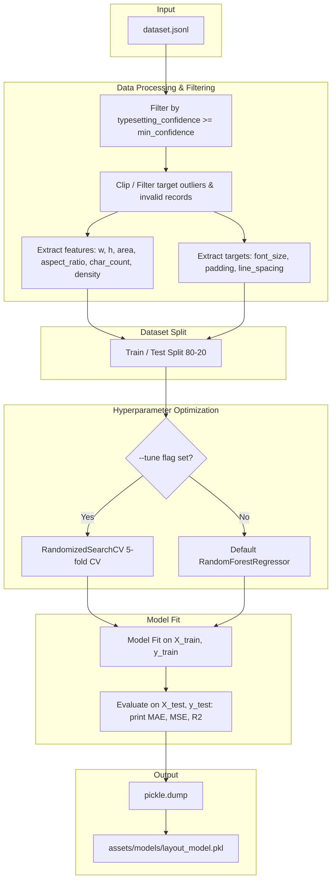

# Phase 7 — Layout Optimization Model Training

## Context

Phases 1–6 of the finetuning pipeline are complete. The incremental dataset extractor (`scripts/dataset_extractor.py`) processes raw Japanese and translated English manga pages to produce `training_data/dataset.jsonl`. Each JSONL row represents a matched text region containing:
- **Japanese Bubble Geometry** (`jp_box`: `x_min`, `y_min`, `x_max`, `y_max`)
- **Japanese Text Content** (`jp_ocr_text` from `manga-ocr`, falling back to `jp_text_detected` from `easyocr`)
- **English Typesetting Targets** (`font_size`, `padding`, `line_spacing`, `wrap_shape`, `typesetting_confidence`)

**The gap:** In the main pipeline (specifically in `workers/typesetter.py`), selecting appropriate typesetting parameters is heavily reliant on hardcoded bounds or geometric heuristics. We need an automated way to predict optimal, human-style typesetting parameters (`font_size`, `padding`, `line_spacing`) dynamically from the Japanese speech bubble context.

In Phase 7, we train a lightweight **Random Forest Regressor** using `scikit-learn` to solve this multi-output regression task.

**Hardware & VRAM Profile:** 
- The target system (NVIDIA GTX 1050ti, 4GB VRAM) is resource-constrained.
- `scikit-learn` is fully CPU-bound during both training and inference.
- **VRAM footprint:** **0 MB**. This ensures model training does not interfere with deep learning models or cause CUDA Out-of-Memory (OOM) issues.

**Downstream consumers:**
- **Phase 10 (Stage 10 - Typesetter Integration)**: The typesetter worker will load `layout_model.pkl` to dynamically size text and padding for new bubbles based on Japanese context features.

---

## Problem Definition

We must implement a training script `scripts/train_layout_model.py` that processes the `dataset.jsonl` file, performs feature extraction and data filtering, trains a multi-output Random Forest regressor, and serializes the model to `assets/models/layout_model.pkl`.



---

## Feature Engineering Details

For each valid JSONL record, features and targets are extracted as follows:

### 1. Inputs / Features ($X$)
We extract 6 features representing the shape, textual density, and aspect ratio of the Japanese speech bubble to give the Random Forest model rich cues for horizontal vs. vertical text layout and density:
- **`jp_box_width`**: `x_max - x_min`
- **`jp_box_height`**: `y_max - y_min`
- **`jp_box_area`**: `jp_box_width * jp_box_height`
- **`jp_box_aspect_ratio`**: `jp_box_width / jp_box_height` (handles edge cases where height is 0 by defaulting aspect ratio to 0).
- **`jp_char_count`**: Character count of the Japanese transcription.
  - Derived from `jp_ocr_text` (cleaned and stripped).
  - Fallback to `jp_text_detected` if `jp_ocr_text` is empty, missing, or null.
  - Defaults to `0` if both are missing.
- **`jp_char_density`**: `jp_char_count / jp_box_area` (handles edge cases where area is 0 by defaulting density to 0).

### 2. Targets ($y$)
We train the model to predict 3 continuous/integer variables extracted in Phase 4:
- **`font_size`** (integer target)
- **`padding`** (integer target)
- **`line_spacing`** (float target)

---

## Edge Case Management & Robustness Guards

Manga speech bubble data extracted automatically from OCR matching contains various outliers and edge cases that must be programmatically handled during training:

1. **Aspect Ratio Edge Cases**: If a speech bubble bounding box is narrow or zero-width/height (due to extraction noise), aspect ratio calculations can result in `ZeroDivisionError` or infinite values.
   - *Fix*: Aspect ratio is calculated with a guard: `w / h if h > 0 else 0`.
2. **Text Density Edge Cases**: Very small boxes with high character counts can result in high densities. If a box has an area of 0, `jp_char_count / jp_box_area` will fail.
   - *Fix*: Density is calculated with a guard: `char_count / area if area > 0 else 0`.
3. **Target Outliers & Physical Limits**: Automatically extracted typesetting targets may contain extreme or physically impossible values (e.g., negative padding or line spacing, or extremely large font sizes from noisy labels).
   - *Fix*: Targets are hard-clipped or validated:
     - `font_size` clamped to range `[8, 72]`
     - `padding` clamped to range `[0, 50]`
     - `line_spacing` clamped to range `[0.5, 2.5]`
     - Skip rows where targets are missing or completely invalid (e.g., non-numeric).
4. **Confidence Filtering**: To exclude poor typesetting approximations (e.g. text that didn't wrap cleanly in Phase 4), rows are filtered using the `--min-confidence` flag (default `0.5`).
5. **Too Few Samples for Splits**: If the dataset has very few valid samples (e.g. less than 10), splitting into train/test splits or running 5-fold cross-validation will fail.
   - *Fix*: If total valid samples is `< 10`, the script disables the train-test split and `--tune` optimization, fallback to fitting on all available data directly, and prints a warning.

---

## Optimization Tools: Hyperparameter Tuning & Validation

To ensure the model generalizes well and behaves optimally on the typeset targets, we implement several optimization techniques:

### 1. Randomized Search Cross-Validation (`--tune` Flag)
When the user runs the script with `--tune`, we use `RandomizedSearchCV` from `scikit-learn` to automatically optimize hyperparameters:
- **Parameters grid**:
  - `n_estimators`: `[50, 100, 150, 200]`
  - `max_depth`: `[None, 5, 10, 15, 20]`
  - `min_samples_split`: `[2, 5, 10]`
  - `min_samples_leaf`: `[1, 2, 4]`
  - `max_features`: `["sqrt", "log2", None]`
- Cross-validation: 5-fold CV to evaluate generalization.
- Metric optimized: Mean Squared Error (MSE).

### 2. Validation Reporting
If the dataset size is sufficient ($\ge 10$ samples):
- Split the dataset into an **80% training** and **20% test** set using `train_test_split`.
- Compute and display Mean Absolute Error (MAE), Mean Squared Error (MSE), and $R^2$ scores for both training and testing datasets.
- Print feature importances so the developer can verify which inputs (e.g., `jp_box_area` or `jp_char_count`) are guiding the model.

---

## Standalone Script: [`scripts/train_layout_model.py`](file:///e:/u%20torrentz/Manga%20Translator/scripts/train_layout_model.py)

Below is the complete implementation design for the training script:

```python
#!/usr/bin/env python3
"""Train an optimized Random Forest Regressor to predict manga typesetting parameters."""

from __future__ import annotations
import argparse
import json
import logging
import os
import pickle
import sys
from pathlib import Path
from typing import Any
import numpy as np

logging.basicConfig(level=logging.INFO, format="%(asctime)s [%(levelname)s] %(message)s")
logger = logging.getLogger("train_layout_model")


def parse_args() -> argparse.Namespace:
    parser = argparse.ArgumentParser(
        description="Train layout optimization Random Forest model with validation and tuning."
    )
    parser.add_argument(
        "--dataset-file",
        type=str,
        default="training_data/dataset.jsonl",
        help="Path to the dataset.jsonl file",
    )
    parser.add_argument(
        "--model-out",
        type=str,
        default="assets/models/layout_model.pkl",
        help="Path to save the trained layout model (.pkl)",
    )
    parser.add_argument(
        "--min-confidence",
        type=float,
        default=0.5,
        help="Minimum typesetting confidence threshold (default: 0.5)",
    )
    parser.add_argument(
        "--tune",
        action="store_true",
        help="Run RandomizedSearchCV hyperparameter optimization",
    )
    return parser.parse_args()


def load_dataset(dataset_path: Path, min_confidence: float) -> tuple[np.ndarray, np.ndarray]:
    """Load JSONL dataset, apply edge case guards, clip target ranges, and return X, y."""
    if not dataset_path.exists():
        raise FileNotFoundError(f"Dataset file not found at: {dataset_path}")

    X_list = []
    y_list = []
    skipped_confidence = 0
    skipped_invalid = 0
    total_rows = 0

    with open(dataset_path, "r", encoding="utf-8") as f:
        for line_num, line in enumerate(f, 1):
            line_str = line.strip()
            if not line_str:
                continue
            total_rows += 1
            try:
                row = json.loads(line_str)
            except json.JSONDecodeError as exc:
                logger.warning("Line %d is not valid JSON. Skipping. Error: %s", line_num, exc)
                continue

            # 1. Confidence filtering
            confidence = row.get("typesetting_confidence", 1.0)
            if confidence < min_confidence:
                skipped_confidence += 1
                continue

            # 2. Geometry extraction & division-by-zero guards
            jp_box = row.get("jp_box")
            if not jp_box or not isinstance(jp_box, dict):
                skipped_invalid += 1
                continue

            try:
                x_min = float(jp_box["x_min"])
                y_min = float(jp_box["y_min"])
                x_max = float(jp_box["x_max"])
                y_max = float(jp_box["y_max"])
            except (KeyError, ValueError, TypeError):
                skipped_invalid += 1
                continue

            w = x_max - x_min
            h = y_max - y_min
            area = w * h

            # Guard aspect ratio division-by-zero
            aspect_ratio = w / h if h > 0 else 0.0

            # 3. Japanese character count & density
            jp_text = row.get("jp_ocr_text")
            if jp_text is None:
                jp_text = row.get("jp_text_detected", "")
            
            if not isinstance(jp_text, str):
                jp_text = ""
            
            char_count = len(jp_text.strip())

            # Guard density division-by-zero
            char_density = char_count / area if area > 0 else 0.0

            # 4. Target extraction & range boundary clipping
            try:
                font_size = float(row["font_size"])
                padding = float(row["padding"])
                line_spacing = float(row["line_spacing"])
            except (KeyError, ValueError, TypeError):
                skipped_invalid += 1
                continue

            # Target bounds clamping to remove outliers
            font_size = np.clip(font_size, 8.0, 72.0)
            padding = np.clip(padding, 0.0, 50.0)
            line_spacing = np.clip(line_spacing, 0.5, 2.5)

            # Features: [w, h, area, aspect_ratio, char_count, char_density]
            X_list.append([w, h, area, aspect_ratio, char_count, char_density])
            y_list.append([font_size, padding, line_spacing])

    logger.info("Total rows scanned: %d", total_rows)
    logger.info("Skipped due to low confidence (< %s): %d", min_confidence, skipped_confidence)
    logger.info("Skipped due to invalid fields/geometry: %d", skipped_invalid)
    logger.info("Valid training samples: %d", len(X_list))

    if not X_list:
        raise ValueError("No valid training samples remaining after filtering.")

    return np.array(X_list, dtype=np.float32), np.array(y_list, dtype=np.float32)


def train_model(
    X_train: np.ndarray,
    y_train: np.ndarray,
    tune: bool = False
) -> Any:
    """Initialize and fit RandomForestRegressor with optional RandomizedSearchCV tuning."""
    from sklearn.ensemble import RandomForestRegressor

    if tune and len(X_train) >= 10:
        from sklearn.model_selection import RandomizedSearchCV
        logger.info("Starting hyperparameter tuning via RandomizedSearchCV (5-fold CV)...")
        
        param_dist = {
            "n_estimators": [50, 100, 150, 200],
            "max_depth": [None, 5, 10, 15, 20],
            "min_samples_split": [2, 5, 10],
            "min_samples_leaf": [1, 2, 4],
            "max_features": ["sqrt", "log2", None],
        }
        
        base_rf = RandomForestRegressor(random_state=42)
        search = RandomizedSearchCV(
            estimator=base_rf,
            param_distributions=param_dist,
            n_iter=15,
            cv=5,
            random_state=42,
            n_jobs=-1,
            scoring="neg_mean_squared_error",
        )
        search.fit(X_train, y_train)
        
        logger.info("Best hyperparameters found: %s", search.best_params_)
        model = search.best_estimator_
    else:
        if tune:
            logger.warning("Fewer than 10 training samples. Disabling hyperparameter tuning.")
        logger.info("Training default RandomForestRegressor with 100 estimators...")
        model = RandomForestRegressor(n_estimators=100, random_state=42)
        model.fit(X_train, y_train)
        
    return model


def main() -> int:
    args = parse_args()
    dataset_path = Path(args.dataset_file)
    model_path = Path(args.model_out)

    try:
        X, y = load_dataset(dataset_path, args.min_confidence)
    except Exception as exc:
        logger.error("Dataset load failed: %s", exc)
        return 1

    # 1. Split training and test data if dataset is large enough
    if len(X) >= 10:
        from sklearn.model_selection import train_test_split
        X_train, X_test, y_train, y_test = train_test_split(
            X, y, test_size=0.2, random_state=42
        )
        logger.info("Split dataset: Train size = %d, Test size = %d", len(X_train), len(X_test))
    else:
        logger.warning("Dataset too small (%d samples) for train/test split. Training on all data.", len(X))
        X_train, X_test, y_train, y_test = X, None, y, None

    # 2. Train model
    try:
        model = train_model(X_train, y_train, tune=args.tune)
    except Exception as exc:
        logger.error("Model training failed: %s", exc)
        return 1

    # 3. Validation and Metrics Reporting
    from sklearn.metrics import mean_absolute_error, mean_squared_error
    
    # Train Metrics
    y_train_pred = model.predict(X_train)
    mae_train = mean_absolute_error(y_train, y_train_pred, multioutput="raw_values")
    mse_train = mean_squared_error(y_train, y_train_pred, multioutput="raw_values")
    r2_train = model.score(X_train, y_train)
    
    logger.info("--- Training Metrics ---")
    logger.info("Train R^2 score: %.4f", r2_train)
    logger.info("Train MAE [font_size, padding, line_spacing]: %s", np.round(mae_train, 4))
    logger.info("Train MSE [font_size, padding, line_spacing]: %s", np.round(mse_train, 4))

    # Test Metrics
    if X_test is not None and y_test is not None:
        y_test_pred = model.predict(X_test)
        mae_test = mean_absolute_error(y_test, y_test_pred, multioutput="raw_values")
        mse_test = mean_squared_error(y_test, y_test_pred, multioutput="raw_values")
        r2_test = model.score(X_test, y_test)
        
        logger.info("--- Test/Validation Metrics ---")
        logger.info("Test R^2 score: %.4f", r2_test)
        logger.info("Test MAE [font_size, padding, line_spacing]: %s", np.round(mae_test, 4))
        logger.info("Test MSE [font_size, padding, line_spacing]: %s", np.round(mse_test, 4))

    # Feature Importance Reporting
    feature_names = ["width", "height", "area", "aspect_ratio", "char_count", "char_density"]
    importances = model.feature_importances_
    logger.info("--- Feature Importances ---")
    for name, importance in zip(feature_names, importances):
        logger.info("  %s: %.4f", name, importance)

    # 4. Serialize Model
    try:
        model_path.parent.mkdir(parents=True, exist_ok=True)
        with open(model_path, "wb") as f:
            pickle.dump(model, f)
        logger.info("Model successfully saved to: %s", model_path)
    except Exception as exc:
        logger.error("Failed to save model: %s", exc)
        return 1

    return 0


if __name__ == "__main__":
    sys.exit(main())
```

---

## Unit Tests: [`tests/test_train_layout_model.py`](file:///e:/u%20torrentz/Manga%20Translator/tests/test_train_layout_model.py)

The unit tests will verify feature processing and the training/tuning logic using mocked datasets.

### Test Coverage Plan

| Test Function | Setup | Expected Behavior |
|:---|:---|:---|
| `test_load_dataset_success` | Write a temporary JSONL with 2 valid high-confidence rows | Returns numpy arrays `X` and `y` matching specifications. Verify shapes: $X$ shape `(2, 6)` containing 6 engineered features, $y$ shape `(2, 3)`. |
| `test_load_dataset_confidence_filtering` | Write one high-confidence row ($0.8$) and one low-confidence row ($0.2$) | Extracted features contain exactly 1 sample (the high-confidence one). |
| `test_load_dataset_aspect_ratio_and_density_guards` | Write a row where `jp_box` height is 0 and area is 0 | Script handles these without division-by-zero errors. `aspect_ratio` and `char_density` evaluate to `0.0`. |
| `test_load_dataset_clamping_ranges` | Write a row with target values `font_size=120`, `padding=-5.0`, `line_spacing=4.0` | Targets in output $y$ are clamped to `font_size=72`, `padding=0`, `line_spacing=2.5`. |
| `test_load_dataset_empty_raises` | Provide empty dataset file or a file where all rows fail confidence | Raises `ValueError` with a clear message. |
| `test_load_dataset_missing_file` | Provide non-existent path | Raises `FileNotFoundError`. |
| `test_train_and_predict_flow` | Train a model using mock features and serialize it to a temp path | Pickle file exists. Can reload model and predict for a new sample. Verify output shape is `(1, 3)`. |
| `test_tuning_cv_flow` | Run `train_model()` with `tune=True` and 12 mock samples | `RandomizedSearchCV` fits successfully and returns best estimator. |
| `test_tuning_fallback_on_small_data` | Run `train_model()` with `tune=True` but only 5 mock samples | Script outputs a warning, ignores tuning, and fits a standard `RandomForestRegressor` successfully. |
| `test_cli_main_success` | Mock `sys.argv` and invoke `main()` pointing to valid temp dataset | `main()` returns `0`, model pickle is successfully written. |
| `test_cli_main_failure` | Mock `sys.argv` and point to invalid dataset | `main()` returns `1`. |

---

## Documentation Updates

At the conclusion of Phase 7, the following documentation files will be updated:

1. **[`docs/finetuning_context.md`](file:///e:/u%20torrentz/Manga%20Translator/docs/finetuning_context.md)**:
   - Mark **Phase 7** as complete.
   - Increment overall status completion percentage (e.g. from 65% to 75%).
   - Add a "Phase 7 Deliverables" table documenting `scripts/train_layout_model.py` and its tests.
2. **[`docs/next_steps_finetunning.md`](file:///e:/u%20torrentz/Manga%20Translator/docs/next_steps_finetunning.md)**:
   - Move Phase 7 to the complete section.
   - Activate and document immediate next steps for **Phase 8: Translation Memory Database Construction**.

---

## Acceptance Criteria

- [ ] `scripts/train_layout_model.py` is created with CLI arguments `--dataset-file`, `--model-out`, `--min-confidence`, and `--tune`.
- [ ] Features matrix ($X$) includes exactly: `[jp_box_width, jp_box_height, jp_box_area, jp_box_aspect_ratio, jp_char_count, jp_char_density]`.
- [ ] Targets matrix ($y$) includes exactly: `[font_size, padding, line_spacing]`.
- [ ] Aspect ratio and density guards prevent division by zero errors.
- [ ] Targets are clamped to standard comic boundaries (`font_size`: 8–72, `padding`: 0–50, `line_spacing`: 0.5–2.5) to remove outliers.
- [ ] Train/Test splits (80-20) are generated and MAE, MSE, and $R^2$ metrics are logged during training.
- [ ] If `--tune` is specified and dataset size $\ge 10$, hyperparameters are optimized using 5-fold cross-validated randomized search.
- [ ] Model trains successfully using `RandomForestRegressor` and serialized to `assets/models/layout_model.pkl`.
- [ ] Unit tests in `tests/test_train_layout_model.py` achieve 100% logic coverage with zero external dependencies.
- [ ] Running `venv\Scripts\python.exe -m pytest tests/test_train_layout_model.py -v` passes cleanly.
- [ ] `docs/finetuning_context.md` is updated to reflect Phase 7 completion.
