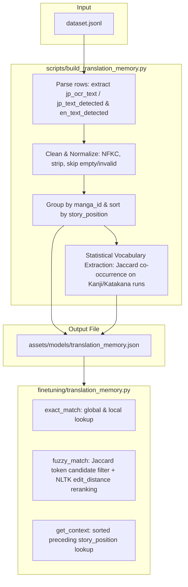

# Phase 8 — Translation Memory Database Construction

## Context

Phases 1–7 of the finetuning pipeline are complete. The incremental dataset extractor (`scripts/dataset_extractor.py`) processes raw Japanese and translated English manga pages to produce `training_data/dataset.jsonl`. Each JSONL row represents a matched text region containing:
- **Japanese Bubble Geometry** (`jp_box`: `x_min`, `y_min`, `x_max`, `y_max`)
- **Japanese Text Content** (`jp_ocr_text` from `manga-ocr`, falling back to `jp_text_detected` from `easyocr`)
- **English Typesetting Targets** (`font_size`, `padding`, `line_spacing`, `wrap_shape`, `typesetting_confidence`)
- **Mask Metadata** (`mask_path`, `mask_roi_box`, `mask_confidence`, `mask_pixel_count`)
- **Dialogue Continuity Fields** (`page_number`, `story_position`)

**The gap:** When the main translation pipeline runs, the machine translation step (Stage 8) runs sentence-by-sentence using ArgosTranslate without any historical context or memory. This leads to:
1. Loss of terminology/character name consistency (e.g. translating proper names differently across pages).
2. Poor translations for context-dependent sentences where preceding dialogue is critical.
3. Lack of exact translation reuse when identical speech bubbles are repeated.

In Phase 8, we build a local **Translation Memory (TM) Database** from the matched text regions in `dataset.jsonl`. This database will group parallel Japanese-English sentence pairs by `manga_id`, construct a statistical vocabulary list of recurring terms, and index the sentences to support exact/fuzzy queries and chronological dialogue context tracking.

**VRAM Profile:**
- **`nltk` & standard matching**: Fully CPU-bound.
- **VRAM footprint:** **0 MB**. This ensures the TM database can be constructed and queried in memory without impacting GPU resources.

**Downstream consumers:**
- **Phase 9 (Stage 7 - OCR & Stage 8 - Translator Integration)**:
  - The OCR stage can use the Japanese TM index as a spelling/fallback guide.
  - The Translator stage will query the TM for exact/fuzzy matches before calling the MT engine, and feed the last 5 dialogue sentences as context to improve translation quality.

---

## Problem Definition

We must implement a modular Translation Memory system:
1. A core module `finetuning/translation_memory.py` representing entries, the database index, exact/fuzzy matching algorithms, and preceding context tracking.
2. A standalone construction script `scripts/build_translation_memory.py` that reads `dataset.jsonl`, cleans and processes rows, extracts statistical bilingual vocabularies, and serializes the database to `assets/models/translation_memory.json`.



---

## Technical Specifications

### 1. Database Schema (`translation_memory.json`)

To keep TM lookups fast and lightweight, we serialize the database to a single structured JSON file:

```json
{
  "version": "1.0",
  "vocabularies": {
    "manga_id_1": {
      "ルフィ": "luffy",
      "エルバフ": "elbaf"
    }
  },
  "entries": {
    "manga_id_1": [
      {
        "jp_text": "こんにちは",
        "en_text": "HELLO",
        "page_number": 1,
        "story_position": "manga_id_1::0001::00",
        "region_index": 0
      }
    ]
  }
}
```

### 2. Statistical Vocabulary Extraction

To build the manga-specific bilingual dictionary without heavy external dependency pipelines:
- **Japanese Tokenization**: Extract Katakana runs (`[\u30a0-\u30ff\u30fc]+`) and Kanji runs (`[\u4e00-\u9fff]+`) from the normalized Japanese text. This naturally isolates proper names and content words from Hiragana grammatical particles.
- **English Tokenization**: Extract lowercase alphabetic words, filtering out common stop words (e.g. `the`, `is`, `and`, `to`) and punctuation.
- **Jaccard Co-occurrence Score**: For each Japanese token $j$ and English token $e$, compute:
  $$J(j, e) = \frac{\text{count}(j \text{ and } e \text{ co-occur in same bubble})}{\text{count}(j \text{ appears}) + \text{count}(e \text{ appears}) - \text{count}(j \text{ and } e \text{ co-occur})}$$
- **Association Mapping**: Map $j \rightarrow e$ if $J(j, e) \ge \text{threshold}$ (default `0.3`), keeping only the highest scoring translation $e$ for each $j$.

### 3. Exact and Fuzzy Matching

When querying the TM for a translation fallback:
- **Exact Match**: NFKC-normalize query; check local `manga_id` entries, fall back to global entries.
- **Fuzzy Match (Optimized)**:
  1. Tokenize query into character unigrams and bigrams.
  2. Compute Jaccard overlap against all database entries to pre-filter the top 20 candidate sentences.
  3. Rerank the top 20 candidates using precise `nltk.metrics.distance.edit_distance`.
  4. Define similarity as:
     $$\text{Similarity}(Q, T) = 1.0 - \frac{\text{edit\_distance}(Q, T)}{\max(|Q|, |T|)}$$
  5. Return translation if best similarity $\ge \text{threshold}$ (default `0.8`).

### 4. Dialogue Context Tracking

To retrieve the preceding dialogue history:
- Sort entries within `manga_id` chronologically. The sort key is `story_position` (e.g. `"{manga_id}::{page_number:04d}::{region_index:02d}"`).
- Expose `get_context(manga_id, story_position, limit=5)`:
  - Find all entries in the sorted list where `entry.story_position < query_story_position`.
  - Return the last `limit` sentence pairs (both JP and EN text).

---

## Edge Case Management & Robustness Guards

Speech bubble translations and OCR outputs contain noise that must be programmatically guarded during TM construction and matching:

1. **Missing OCR Fields**: If a record lacks `jp_ocr_text` (due to older schema or OCR skip), fall back to `jp_text_detected` (EasyOCR). If both are empty or null, skip the record.
2. **Whitespace/Empty Text**: If normalized text pairs result in empty strings (e.g., `""` Japanese or `""` English), filter them out during database construction to prevent matching empty speech bubbles.
3. **Invalid/Malformed Page Numbers**: If `page_number` is missing, non-finite, or malformed:
   - *Fix*: Default to `0` or derive index from `story_position` if possible.
4. **Vocabulary Division-by-Zero**: If a word $j$ or $e$ has a count of 0 (due to filtering or math errors), Jaccard score computation could crash.
   - *Fix*: Guard with `co_count / (count_j + count_e - co_count) if (count_j + count_e - co_count) > 0 else 0.0`.
5. **No Candidate Matches**: If Jaccard pre-filtering returns no candidate sentences (i.e. zero overlap with all entries), return `None` immediately, skipping edit distance calculation entirely.
6. **Edit Distance Division-by-Zero**: If a query is empty and is matched against an empty TM string, the maximum length is 0.
   - *Fix*: Guard with `1.0 - (dist / max_len) if max_len > 0 else 0.0`.

---

## Core Module Design: [`finetuning/translation_memory.py`](file:///e:/u%20torrentz/Manga%20Translator/finetuning/translation_memory.py)

Below is the implementation design for the Translation Memory engine:

```python
from __future__ import annotations
import json
import re
import unicodedata
from dataclasses import dataclass, asdict
from pathlib import Path
from typing import Any
import nltk


@dataclass
class TranslationMemoryEntry:
    jp_text: str
    en_text: str
    page_number: int
    story_position: str
    region_index: int

    def to_dict(self) -> dict[str, Any]:
        return asdict(self)

    @classmethod
    def from_dict(cls, data: dict[str, Any]) -> TranslationMemoryEntry:
        return cls(
            jp_text=data["jp_text"],
            en_text=data["en_text"],
            page_number=int(data.get("page_number", 0)),
            story_position=str(data.get("story_position", "")),
            region_index=int(data.get("region_index", 0)),
        )


class TranslationMemoryDB:
    """Core Translation Memory indexing, matching, and vocabulary engine."""

    def __init__(self) -> None:
        # Map manga_id -> list of TranslationMemoryEntry
        self.manga_entries: dict[str, list[TranslationMemoryEntry]] = {}
        # Map manga_id -> dict of bilingual word mappings (vocab)
        self.manga_vocab: dict[str, dict[str, str]] = {}

    def add_entry(self, manga_id: str, entry: TranslationMemoryEntry) -> None:
        """Add a translation entry to the memory. Idempotent."""
        if manga_id not in self.manga_entries:
            self.manga_entries[manga_id] = []
        self.manga_entries[manga_id].append(entry)

    def load(self, path: Path | str) -> None:
        """Load database from JSON file."""
        path = Path(path)
        if not path.exists():
            raise FileNotFoundError(f"TM database not found at: {path}")
        with open(path, "r", encoding="utf-8") as f:
            data = json.load(f)
        
        self.manga_entries = {}
        self.manga_vocab = data.get("vocabularies", {})
        
        db_entries = data.get("entries", {})
        for manga_id, entries_list in db_entries.items():
            self.manga_entries[manga_id] = [
                TranslationMemoryEntry.from_dict(e) for e in entries_list
            ]

    def save(self, path: Path | str) -> None:
        """Save database to JSON file."""
        path = Path(path)
        path.parent.mkdir(parents=True, exist_ok=True)
        
        db_entries = {
            manga_id: [e.to_dict() for e in entries]
            for manga_id, entries in self.manga_entries.items()
        }
        
        data = {
            "version": "1.0",
            "vocabularies": self.manga_vocab,
            "entries": db_entries,
        }
        with open(path, "w", encoding="utf-8") as f:
            json.dump(data, f, ensure_ascii=False, indent=2)

    def normalize_text(self, text: str) -> str:
        """Apply standard NFKC normalization and strip whitespace."""
        if not text:
            return ""
        return unicodedata.normalize("NFKC", text.strip())

    def exact_match(self, manga_id: str, jp_query: str) -> str | None:
        """Look up exact translation match. local manga first, then global fallback."""
        normalized_query = self.normalize_text(jp_query)
        if not normalized_query:
            return None
        
        # 1. Search locally within manga_id
        if manga_id in self.manga_entries:
            for entry in self.manga_entries[manga_id]:
                if self.normalize_text(entry.jp_text) == normalized_query:
                    return entry.en_text
        
        # 2. Search globally across all other mangas
        for m_id, entries in self.manga_entries.items():
            if m_id == manga_id:
                continue
            for entry in entries:
                if self.normalize_text(entry.jp_text) == normalized_query:
                    return entry.en_text
                    
        return None

    def fuzzy_match(
        self, manga_id: str, jp_query: str, threshold: float = 0.8
    ) -> tuple[str, float] | None:
        """Match query using Jaccard unigram/bigram pre-filter and edit distance reranking."""
        normalized_query = self.normalize_text(jp_query)
        if not normalized_query:
            return None

        # Collect candidate entries
        candidates: list[tuple[str, TranslationMemoryEntry]] = []
        if manga_id in self.manga_entries:
            for entry in self.manga_entries[manga_id]:
                candidates.append((manga_id, entry))
        for m_id, entries in self.manga_entries.items():
            if m_id == manga_id:
                continue
            for entry in entries:
                candidates.append((m_id, entry))

        if not candidates:
            return None

        # Pre-filter using Jaccard similarity of character bigrams/unigrams to find top 20 candidates.
        query_tokens = self._get_char_ngrams(normalized_query)
        
        scored_candidates: list[tuple[TranslationMemoryEntry, float]] = []
        for c_manga_id, entry in candidates:
            entry_norm = self.normalize_text(entry.jp_text)
            entry_tokens = self._get_char_ngrams(entry_norm)
            
            intersection = len(query_tokens & entry_tokens)
            union = len(query_tokens | entry_tokens)
            jaccard = intersection / union if union > 0 else 0.0
            
            scored_candidates.append((entry, jaccard))

        # Sort and take top 20 candidates
        scored_candidates.sort(key=lambda x: x[1], reverse=True)
        top_candidates = scored_candidates[:20]

        best_entry: TranslationMemoryEntry | None = None
        best_sim = -1.0

        for entry, _ in top_candidates:
            entry_norm = self.normalize_text(entry.jp_text)
            dist = nltk.metrics.distance.edit_distance(normalized_query, entry_norm)
            max_len = max(len(normalized_query), len(entry_norm))
            sim = 1.0 - (dist / max_len) if max_len > 0 else 0.0
            
            if sim > best_sim:
                best_sim = sim
                best_entry = entry

        if best_entry and best_sim >= threshold:
            return best_entry.en_text, best_sim

        return None

    def _get_char_ngrams(self, text: str) -> set[str]:
        unigrams = set(text)
        bigrams = {text[i:i+2] for i in range(len(text)-1)}
        return unigrams | bigrams

    def get_context(self, manga_id: str, story_position: str, limit: int = 5) -> list[tuple[str, str]]:
        """Retrieve the preceding dialogue sentences sorted chronologically."""
        if manga_id not in self.manga_entries:
            return []
        
        entries = self.manga_entries[manga_id]
        
        # Sort key logic (chronological positioning)
        def get_sort_key(e: TranslationMemoryEntry) -> tuple[int, int, str]:
            if e.story_position:
                return (0, 0, e.story_position)
            return (e.page_number, e.region_index, "")

        sorted_entries = sorted(entries, key=get_sort_key)
        
        # Filter preceding entries
        preceding = []
        for e in sorted_entries:
            if e.story_position < story_position:
                preceding.append(e)
            else:
                break
        
        return [(e.jp_text, e.en_text) for e in preceding[-limit:]]

    def build_vocabularies(self, cooccurrence_threshold: float = 0.3) -> None:
        """Extract bilingual terminology and character names for each manga."""
        self.manga_vocab = {}
        for manga_id, entries in self.manga_entries.items():
            self.manga_vocab[manga_id] = self._extract_vocabulary_for_manga(entries, cooccurrence_threshold)

    def _extract_vocabulary_for_manga(
        self, entries: list[TranslationMemoryEntry], threshold: float
    ) -> dict[str, str]:
        # Offline stop words configuration
        stop_words = {
            "i", "me", "my", "myself", "we", "our", "ours", "ourselves", "you", "your", 
            "yours", "yourself", "yourselves", "he", "him", "his", "himself", "she", 
            "her", "hers", "herself", "it", "its", "itself", "they", "them", "their", 
            "theirs", "themselves", "what", "which", "who", "whom", "this", "that", 
            "these", "those", "am", "is", "are", "was", "were", "be", "been", "being", 
            "have", "has", "had", "having", "do", "does", "did", "doing", "a", "an", 
            "the", "and", "but", "if", "or", "because", "as", "until", "while", "of", 
            "at", "by", "for", "with", "about", "against", "between", "into", "through", 
            "during", "before", "after", "above", "below", "to", "from", "up", "down", 
            "in", "out", "on", "off", "over", "under", "again", "further", "then", "once",
            "youre", "dont", "im", "its", "cant", "wont", "didnt", "cant", "that", "this"
        }
        
        jp_regex = re.compile(r'[\u30a0-\u30ff\u30fc]+|[\u4e00-\u9fff]+')
        en_regex = re.compile(r'[a-zA-Z]+')

        pair_tokens = []
        all_jp_tokens = set()
        all_en_tokens = set()

        for entry in entries:
            jp_norm = self.normalize_text(entry.jp_text)
            en_norm = entry.en_text.lower()

            jp_words = set(jp_regex.findall(jp_norm))
            en_words = {w for w in en_regex.findall(en_norm) if w not in stop_words and len(w) > 1}

            pair_tokens.append((jp_words, en_words))
            all_jp_tokens.update(jp_words)
            all_en_tokens.update(en_words)

        jp_counts = {j: 0 for j in all_jp_tokens}
        en_counts = {e: 0 for e in all_en_tokens}
        co_counts = {}

        for jp_words, en_words in pair_tokens:
            for j in jp_words:
                jp_counts[j] += 1
            for e in en_words:
                en_counts[e] += 1
            for j in jp_words:
                for e in en_words:
                    pair_key = (j, e)
                    co_counts[pair_key] = co_counts.get(pair_key, 0) + 1

        # Calculate Jaccard association scores
        vocab = {}
        best_mappings = {}  # jp_word -> (en_word, score)

        for (j, e), co_count in co_counts.items():
            denominator = jp_counts[j] + en_counts[e] - co_count
            jaccard = co_count / denominator if denominator > 0 else 0.0
            if jaccard >= threshold:
                if j not in best_mappings or jaccard > best_mappings[j][1]:
                    best_mappings[j] = (e, jaccard)

        for j, (e, score) in best_mappings.items():
            vocab[j] = e

        return vocab
```

---

## Standalone Script Design: [`scripts/build_translation_memory.py`](file:///e:/u%20torrentz/Manga%20Translator/scripts/build_translation_memory.py)

Below is the implementation design for the TM builder script:

```python
#!/usr/bin/env python3
"""Parse dataset.jsonl and build a Translation Memory (TM) Database."""

from __future__ import annotations
import argparse
import json
import logging
import sys
from pathlib import Path

# Add project root to sys.path to allow importing finetuning modules
sys.path.append(str(Path(__file__).resolve().parent.parent))

from finetuning.translation_memory import TranslationMemoryDB, TranslationMemoryEntry

logging.basicConfig(level=logging.INFO, format="%(asctime)s [%(levelname)s] %(message)s")
logger = logging.getLogger("build_translation_memory")


def parse_args() -> argparse.Namespace:
    parser = argparse.ArgumentParser(
        description="Build Translation Memory Database from dataset.jsonl."
    )
    parser.add_argument(
        "--dataset-file",
        type=str,
        default="training_data/dataset.jsonl",
        help="Path to the dataset.jsonl file",
    )
    parser.add_argument(
        "--output-file",
        type=str,
        default="assets/models/translation_memory.json",
        help="Path to save the serialized Translation Memory Database (.json)",
    )
    parser.add_argument(
        "--vocab-threshold",
        type=float,
        default=0.3,
        help="Co-occurrence threshold for terminology extraction (default: 0.3)",
    )
    return parser.parse_args()


def main() -> int:
    args = parse_args()
    dataset_path = Path(args.dataset_file)
    output_path = Path(args.output_file)

    if not dataset_path.exists():
        logger.error("Dataset file not found at: %s", dataset_path)
        return 1

    db = TranslationMemoryDB()
    rows_processed = 0
    skipped_empty = 0

    logger.info("Reading dataset from: %s", dataset_path)
    with open(dataset_path, "r", encoding="utf-8") as f:
        for line_num, line in enumerate(f, 1):
            line_str = line.strip()
            if not line_str:
                continue
            try:
                row = json.loads(line_str)
            except json.JSONDecodeError as exc:
                logger.warning("Line %d is not valid JSON. Skipping. Error: %s", line_num, exc)
                continue

            # 1. Text extraction & fallbacks
            jp_text = row.get("jp_ocr_text")
            if jp_text is None or str(jp_text).strip() == "":
                jp_text = row.get("jp_text_detected", "")

            en_text = row.get("en_text_detected", "")

            jp_text = str(jp_text).strip()
            en_text = str(en_text).strip()

            if not jp_text or not en_text:
                skipped_empty += 1
                continue

            manga_id = row.get("manga_id", "default")
            page_number = int(row.get("page_number", 0))
            story_position = str(row.get("story_position", ""))
            region_index = int(row.get("region_index", 0))

            # 2. Add entry to database
            entry = TranslationMemoryEntry(
                jp_text=jp_text,
                en_text=en_text,
                page_number=page_number,
                story_position=story_position,
                region_index=region_index,
            )
            db.add_entry(manga_id, entry)
            rows_processed += 1

    logger.info("Processed %d valid translation pairs (skipped %d empty)", rows_processed, skipped_empty)

    if rows_processed == 0:
        logger.error("No valid translation pairs found. Aborting.")
        return 1

    # 3. Build bilingual vocabularies
    logger.info("Extracting terminology dictionaries with threshold %.2f...", args.vocab_threshold)
    db.build_vocabularies(args.vocab_threshold)

    # 4. Serialize database to output JSON file
    try:
        db.save(output_path)
        logger.info("Translation Memory successfully saved to: %s", output_path)
    except Exception as exc:
        logger.error("Failed to save Translation Memory: %s", exc)
        return 1

    # Print summary statistics
    logger.info("--- Database Statistics ---")
    logger.info("Total Mangas: %d", len(db.manga_entries))
    for m_id, entries in db.manga_entries.items():
        vocab_size = len(db.manga_vocab.get(m_id, {}))
        logger.info("  Manga: '%s' -> %d entries, %d vocab mappings", m_id, len(entries), vocab_size)

    return 0


if __name__ == "__main__":
    sys.exit(main())
```

---

## Unit Tests: [`tests/test_build_translation_memory.py`](file:///e:/u%20torrentz/Manga%20Translator/tests/test_build_translation_memory.py)

The unit tests will verify text processing, exact/fuzzy matching, context history tracking, terminology extraction, and CLI build behavior.

### Test Coverage Plan

| Test Function | Setup | Expected Behavior |
|:---|:---|:---|
| `test_entry_serialization` | Instantiate `TranslationMemoryEntry` and convert to dict, then reconstruct | The `to_dict` and `from_dict` methods successfully recreate the entry object with no loss of properties. |
| `test_db_exact_matching` | Load database with exact strings; run queries with space differences and NFKC variants | Match succeeds locally. When local doesn't exist, successfully searches other mangas globally as fallback. |
| `test_db_fuzzy_matching` | Run fuzzy match on typos (e.g. `"こんにちは世界"` vs `"こんいちは世界"`) | Candidate Jaccard filter extracts candidate; NLTK edit distance calculates similarity score and yields match if $\ge 0.8$, else `None`. |
| `test_context_tracking` | Construct ordered pages of entries with alphanumeric `story_position` strings | `get_context()` queries return preceding entries (up to 5) in chronological story order. |
| `test_vocab_cooccurrence` | Provide parallel entries matching Katakana character name `"ルフィ"` with English `"Luffy"` | Vocabulary Jaccard calculator correlates them with score $\ge 0.3$. Common English stop words are filtered out. |
| `test_cli_main_success` | Mock `sys.argv` and point script to a valid synthetic JSONL dataset | Builder parses rows, runs vocabulary extraction, writes file, prints stats, and exits with code 0. |
| `test_cli_main_failure` | Mock `sys.argv` and point script to non-existent dataset | Main logs error and exits with code 1. |
| `test_edge_case_missing_fields` | Row contains missing `jp_ocr_text` but valid `jp_text_detected` | Builder uses `jp_text_detected` successfully. If both are missing, skips row. |
| `test_edge_case_empty_sentences` | Row contains whitespace strings | Builder ignores the empty row and skips it cleanly. |

---

## Documentation Updates

At the conclusion of Phase 8, the following documentation files will be updated:

1. **[`docs/finetuning_context.md`](file:///e:/u%20torrentz/Manga%20Translator/docs/finetuning_context.md)**:
   - Mark **Phase 8** as complete.
   - Increment overall status completion percentage (e.g. from 75% to 80%).
   - Add a "Phase 8 Deliverables" table documenting `finetuning/translation_memory.py`, `scripts/build_translation_memory.py`, and their unit tests.
2. **[`docs/next_steps_finetunning.md`](file:///e:/u%20torrentz/Manga%20Translator/docs/next_steps_finetunning.md)**:
   - Move Phase 8 to the completed section.
   - Activate and document immediate tasks for **Phase 9: Integration into Pipeline Phase A (OCR & Translation)**.
3. **[`docs/library_documentation_finetuning.md`](file:///e:/u%20torrentz/Manga%20Translator/docs/library_documentation_finetuning.md)**:
   - Add NLTK edit distance API usage, Jaccard similarity candidate retrieval details, and stop word lists.

---

## Acceptance Criteria

- [ ] `finetuning/translation_memory.py` is created with `TranslationMemoryEntry` and `TranslationMemoryDB`.
- [ ] `scripts/build_translation_memory.py` is created with CLI args `--dataset-file`, `--output-file`, and `--vocab-threshold`.
- [ ] Statistical vocabularies and proper noun mappings are extracted for each manga.
- [ ] Pre-filtering Jaccard n-gram optimization handles large database sizes and speeds up fuzzy matching.
- [ ] Context tracker chronological sorting correctly handles `story_position` keys.
- [ ] Zero division guards protect Jaccard calculation and edit distance normalization.
- [ ] Unit tests in `tests/test_build_translation_memory.py` cover exact, fuzzy, context, vocab, and CLI paths.
- [ ] All unit tests pass cleanly.
- [ ] `docs/finetuning_context.md` is updated.

---

## Implementation Order

1. Implement `finetuning/translation_memory.py` core class structures and exact match/context history methods.
2. Implement Jaccard token pre-filtering and NLTK-based edit distance fuzzy matching.
3. Implement statistical vocabulary bilingual Jaccard co-occurrence extractor.
4. Implement `scripts/build_translation_memory.py` CLI script to read dataset, run extractor, and serialize.
5. Create comprehensive test suite `tests/test_build_translation_memory.py` validating each feature.
6. Verify implementation by running the test suite via pytest.
7. Run the builder script on the actual `training_data/dataset.jsonl` to generate the TM database.
8. Update context documentation.
