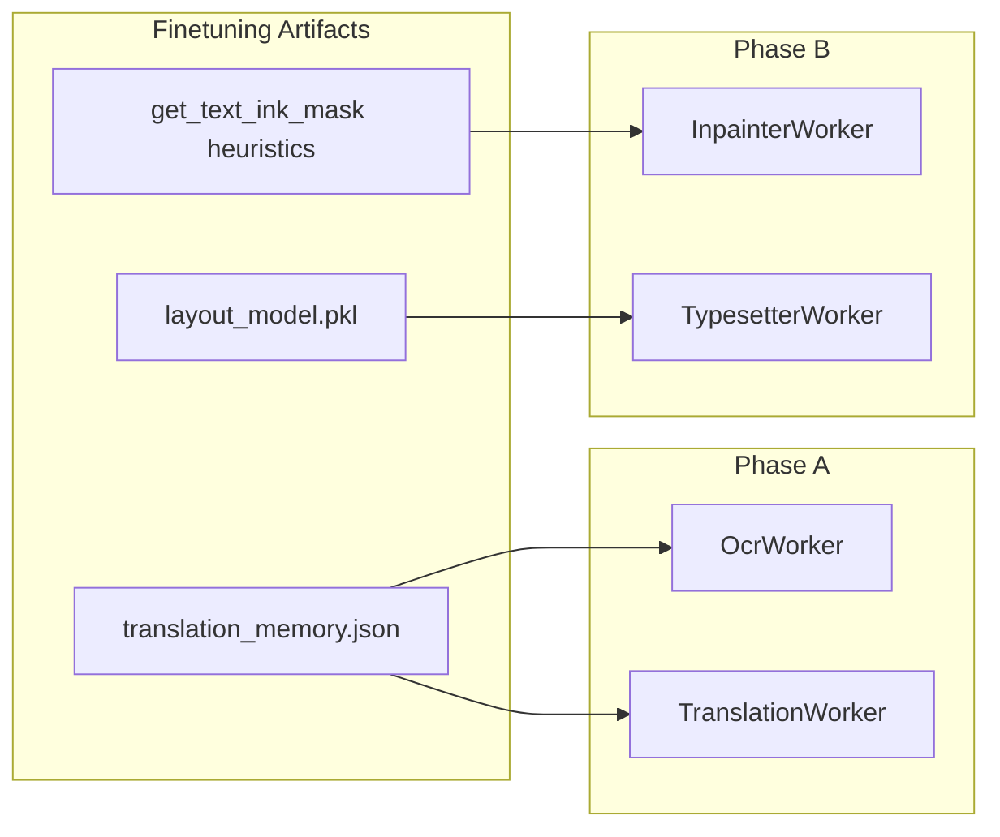
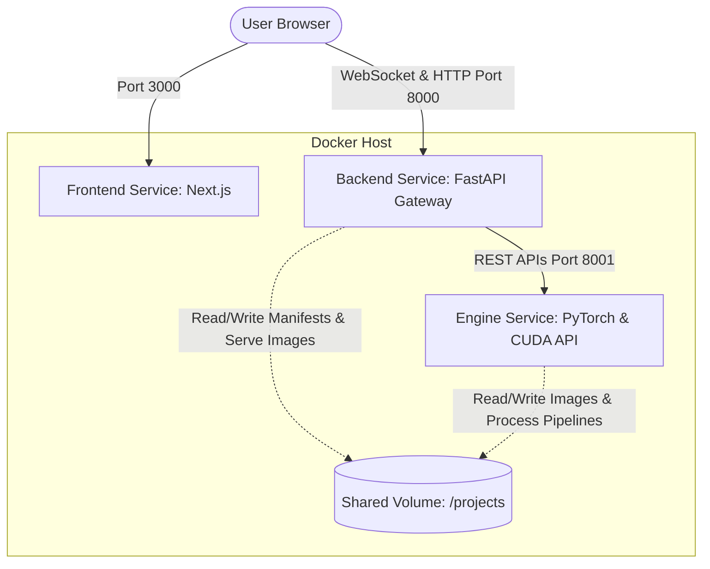
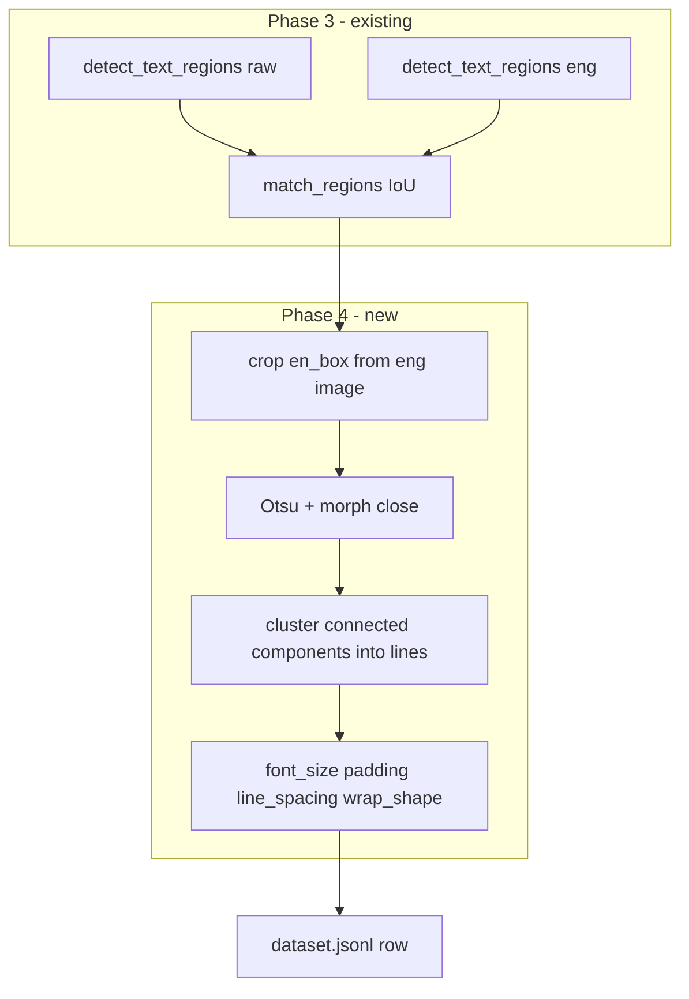
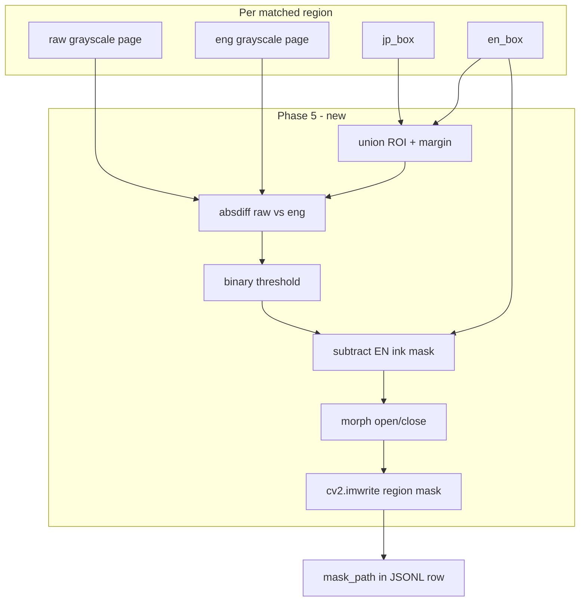
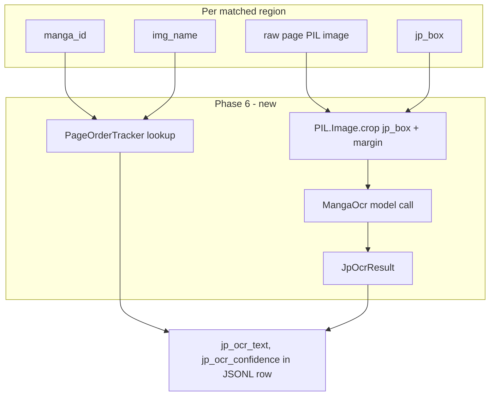
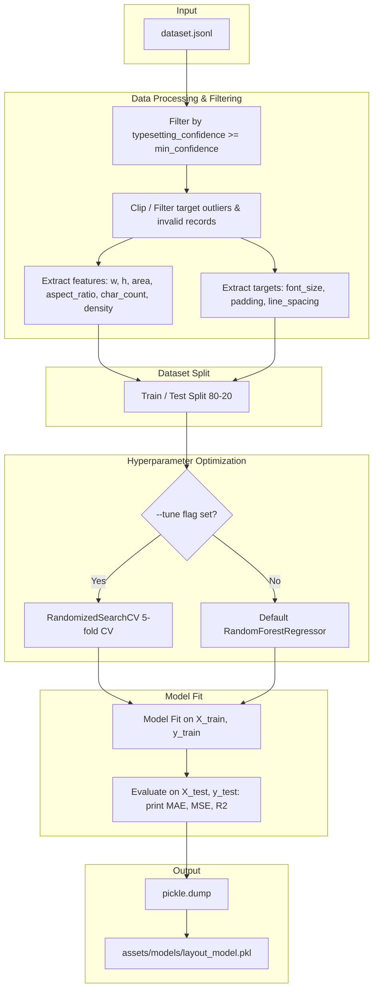
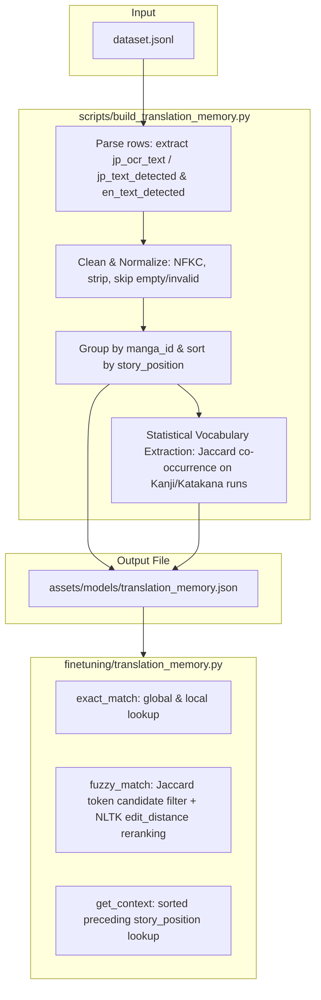

This file is a merged representation of a subset of the codebase, containing files not matching ignore patterns, combined into a single document by Repomix.
The content has been processed where content has been formatted for parsing in markdown style.

# File Summary

## Purpose
This file contains a packed representation of a subset of the repository's contents that is considered the most important context.
It is designed to be easily consumable by AI systems for analysis, code review,
or other automated processes.

## File Format
The content is organized as follows:
1. This summary section
2. Repository information
3. Directory structure
4. Repository files (if enabled)
5. Multiple file entries, each consisting of:
  a. A header with the file path (## File: path/to/file)
  b. The full contents of the file in a code block

## Usage Guidelines
- This file should be treated as read-only. Any changes should be made to the
  original repository files, not this packed version.
- When processing this file, use the file path to distinguish
  between different files in the repository.
- Be aware that this file may contain sensitive information. Handle it with
  the same level of security as you would the original repository.

## Notes
- Some files may have been excluded based on .gitignore rules and Repomix's configuration
- Binary files are not included in this packed representation. Please refer to the Repository Structure section for a complete list of file paths, including binary files
- Files matching these patterns are excluded: **/node_modules/**, **/.next/**, **/.git/**, **/.venv/**, **/__pycache__/**, **/.hf_cache/**, **/.easyocr_cache/**, **/.pip_cache/**, **/.argos_cache/**, **/.manga-translator/**, **/.vs/**, **/.cursor/**, **/finetune_model_single_word_v1/**, **/training_data/**, **/training_data - backup/**, **/input/**, **/output/**, **/*.zip, **/*.bin, **/*.pt, **/*.pth, **/*.onnx, **/*.pkl, **/*.ttf, **/*.otf, **/*.woff*, **/*.jsonl, **/*.log, **/project_manifest.json*, **/package-lock.json, **/skills-lock.json, repomix-output.*
- Files matching patterns in .gitignore are excluded
- Files matching default ignore patterns are excluded
- Content has been formatted for parsing in markdown style
- Files are sorted by Git change count (files with more changes are at the bottom)

# Directory Structure
````
Manga Translator/
  assets/
    fonts/
      .gitkeep
    models/
      .gitkeep
  cli/
    commands/
      __init__.py
      _shared.py
      config_cmd.py
      detect_cmd.py
      doctor_cmd.py
      export_cmd.py
      init_cmd.py
      logs_cmd.py
      manifest_cmd.py
      ocr_cmd.py
      qc_cmd.py
      queue_cmd.py
      resume_cmd.py
      scan_cmd.py
      status_cmd.py
      translate_cmd.py
      worker_cmd.py
    config/
      __init__.py
      defaults.py
      models.py
    __init__.py
    lock.py
    logging_setup.py
    main.py
    plugin_registry.py
    worker_factory.py
  core/
    .gitkeep
    manifest.py
    models.py
    progress.py
  docs/
    finetuning_context.md
    finetuning_integration_tests_2e84b722.plan.md
    future_improvements.md
    implementation_plan_backend_integration.md
    implementation_plan_finetuning.md
    implementation_plan_text_bubble.md
    improvements.md
    library_documentation_finetuning.md
    library_documentation.md
    next_steps_finetunning.md
    next_steps.md
    phase_4_typesetting_plan.md
    phase_5_inpaint_masks.md
    phase_6_story_context_translation.md
    phase_7_layout_model_training.md
    phase_8_translation_memory.md
    project_context.md
  finetuning/
    __init__.py
    checkpoint.py
    detection.py
    extractor.py
    geometry.py
    manga_ocr_extraction.py
    mask_extraction.py
    models.py
    page_order.py
    pipeline_integration.py
    translation_memory.py
    typesetting_features.py
  ideas/
    toneEngine.md
  quality/
    __init__.py
    .gitkeep
    bubble_shape.py
    checker.py
    heuristics.py
    tone_engine.py
  scripts/
    align_image_resolutions.py
    build_translation_memory.py
    dataset_extractor.py
    renumber_images.ps1
    run_finetuning.py
    train_layout_model.py
  stages/
    __init__.py
    .gitkeep
    controller.py
    registry.py
  tests/
    integration/
      test_integration_config.py
      test_integration_contour_inpaint.py
      test_integration_e2e_regression.py
      test_integration_layout_typeset.py
      test_integration_manifest_story.py
      test_integration_tm_ocr.py
      test_integration_tm_translate.py
    __init__.py
    conftest.py
    test_bubble_shape.py
    test_build_translation_memory.py
    test_dataset_extractor.py
    test_detection.py
    test_geometry.py
    test_manga_ocr_extraction.py
    test_manifest.py
    test_mask_extraction.py
    test_page_order.py
    test_progress.py
    test_quality.py
    test_run_finetuning.py
    test_stage10.py
    test_stage5.py
    test_stage6.py
    test_stage7.py
    test_stage8.py
    test_stage9.py
    test_tone_engine.py
    test_train_layout_model.py
    test_typesetting_features.py
    test_webui_features.py
  workers/
    __init__.py
    .gitkeep
    base.py
    inpainter.py
    ocr_worker.py
    text_detector.py
    translator.py
    typesetter.py
    vram_manager.py
  .dockerignore
  .gitignore
  Dockerfile
  engine_api.py
  improvement_webui.md
  main.py
  pyproject.toml
  README.md
  requirements-cli.txt
  requirements-finetuning.txt
  requirements.txt
  webui_improv_plan.md
webui/
  backend/
    routers/
      __init__.py
      images.py
      pipeline.py
      project.py
      training.py
    utils/
      queue_manager.py
      ws_manager.py
    .dockerignore
    context.md
    Dockerfile
    main.py
    requirements.txt
    state.md
    tech_stack.md
  frontend/
    public/
      file.svg
      globe.svg
      next.svg
      vercel.svg
      window.svg
    src/
      app/
        pages/
          page.tsx
        pipeline/
          page.tsx
        settings/
          page.tsx
        favicon.ico
        globals.css
        layout.tsx
        page.tsx
      components/
        ui/
          button.tsx
        CanvasEditor.tsx
        ChapterGridView.tsx
        Header.tsx
        ImageViewer.tsx
        Sidebar.tsx
        ZoomPanViewport.tsx
      hooks/
        usePageRegions.ts
        useWindowSize.ts
      store/
        projectStore.ts
    .gitignore
    AGENTS.md
    CLAUDE.md
    components.json
    context.md
    eslint.config.mjs
    next.config.ts
    package.json
    postcss.config.mjs
    README.md
    state.md
    tech_stack.md
    tsconfig.json
  .gitignore
  docker-compose.yml
  start.ps1
README.md
repomix.config.json
````

# Files

## File: repomix.config.json
````json
{
  "$schema": "https://raw.githubusercontent.com/yamadashy/repomix/main/repomix.config.schema.json",
  "output": {
    "filePath": "repomix-output.xml",
    "style": "xml",
    "parsableStyle": true,
    "fileSummary": true,
    "directoryStructure": true,
    "topFilesLength": 10
  },
  "ignore": {
    "useGitignore": true,
    "useDefaultPatterns": true,
    "customPatterns": [
      "**/node_modules/**",
      "**/.next/**",
      "**/.git/**",
      "**/.venv/**",
      "**/__pycache__/**",
      "**/.hf_cache/**",
      "**/.easyocr_cache/**",
      "**/.pip_cache/**",
      "**/.argos_cache/**",
      "**/.manga-translator/**",
      "**/.vs/**",
      "**/.cursor/**",
      "**/finetune_model_single_word_v1/**",
      "**/training_data/**",
      "**/training_data - backup/**",
      "**/input/**",
      "**/output/**",
      "**/*.zip",
      "**/*.bin",
      "**/*.pt",
      "**/*.pth",
      "**/*.onnx",
      "**/*.pkl",
      "**/*.ttf",
      "**/*.otf",
      "**/*.woff*",
      "**/*.jsonl",
      "**/*.log",
      "**/project_manifest.json*",
      "**/package-lock.json",
      "**/skills-lock.json",
      "repomix-output.*"
    ]
  }
}
````

## File: Manga Translator/assets/fonts/.gitkeep
````
# Gitkeep
````

## File: Manga Translator/assets/models/.gitkeep
````
# Placeholder for assets/models directory
````

## File: Manga Translator/cli/commands/__init__.py
````python
"""cli/commands — package init."""
````

## File: Manga Translator/cli/commands/_shared.py
````python
"""
cli/commands/_shared.py — Internal helpers shared across all command modules.

Never import from this module in tests — it is an implementation detail.
All public API is exposed through the individual command modules.
"""

from __future__ import annotations

import os
import re
import sys
from typing import List, Optional, Tuple

import typer
from rich.console import Console
from rich.panel import Panel
from rich.table import Table
from rich import box as rich_box

from cli.config.models import CliConfig, load_config
from cli.config.defaults import config_path, plugin_dir
from cli.logging_setup import setup_logging
from cli.plugin_registry import PluginRegistry

# ── Shared Rich console ───────────────────────────────────────────────────

console = Console(stderr=False)
err_console = Console(stderr=True)


# ── Project resolution ────────────────────────────────────────────────────

def resolve_project_dir(project_dir: str) -> str:
    """Resolve and validate the project directory."""
    abs_dir = os.path.abspath(project_dir)
    if not os.path.isdir(abs_dir):
        err_console.print(
            f"[bold red]Error:[/] Project directory does not exist: {abs_dir}"
        )
        raise typer.Exit(code=1)
    return abs_dir


def load_engine(project_dir: str, config: CliConfig):
    """
    Load ManifestEngine with the project manifest.

    Raises typer.Exit(1) if the manifest is not found (directs user to
    run `manga scan` first).
    """
    from core.manifest import ManifestEngine

    engine = ManifestEngine(
        project_dir,
        input_subdir=config.pipeline.input_subdir,
    )
    if not os.path.exists(engine.manifest_path):
        err_console.print(
            Panel(
                f"[bold red]No manifest found.[/]\n\n"
                f"Run [bold cyan]manga scan --project-dir {project_dir}[/] first "
                f"to scan your input images and create the manifest.",
                title="[red]Manifest Missing[/red]",
                border_style="red",
            )
        )
        raise typer.Exit(code=1)
    engine.load_or_create(
        project_name=config.general.project_name,
        source_lang=config.translation.source_language,
        target_lang=config.translation.target_language,
    )
    return engine


def setup(project_dir: str) -> Tuple[str, CliConfig]:
    """
    Resolve project_dir, load config, and configure logging.

    Call at the start of every command that does pipeline work.
    Returns (abs_project_dir, config).
    """
    abs_dir = resolve_project_dir(project_dir)
    config = load_config(abs_dir)
    setup_logging(abs_dir, config.general.log_level)
    return abs_dir, config


def make_plugin_registry(project_dir: str) -> PluginRegistry:
    """Return a PluginRegistry with any local plugins loaded."""
    return PluginRegistry(plugin_dir=plugin_dir(project_dir))


# ── Build StageController ─────────────────────────────────────────────────

def build_controller(
    engine,
    worker,
    stage_display_name: str,
    marks_phase: Optional[str],
    checks_phase: Optional[str],
    force: bool,
    page_filter: Optional[List[str]],
    run_quality_check: bool = False,
):
    """
    Instantiate a StageController with standard CLI defaults.

    This is the single place that wires engine + worker → controller
    in the CLI layer.
    """
    from stages.controller import StageController

    return StageController(
        engine=engine,
        worker=worker,
        stage_name=stage_display_name,
        marks_phase=marks_phase,
        checks_phase=checks_phase,
        run_quality_check=run_quality_check,
        page_filter=page_filter,
        force=force,
        flush_vram=True,
    )


# ── Page filter helpers ───────────────────────────────────────────────────

def build_page_filter(
    manifest,
    limit: Optional[int],
    pages: Optional[List[str]],
) -> Optional[List[str]]:
    """
    Build the page_filter list from --limit / --pages flags.

    Returns None (= all pages) if neither flag is set.
    """
    if pages:
        return list(pages)
    if limit is not None:
        all_files = sorted(manifest.pages.keys(), key=_sort_key_numeric)
        return all_files[:limit]
    return None


def _sort_key_numeric(filename: str) -> tuple:
    """Natural sort: numeric prefix first."""
    m = re.match(r"^(\d+)", filename)
    return (int(m.group(1)), filename) if m else (float("inf"), filename)


# ── Rich output helpers ───────────────────────────────────────────────────

def print_stage_report(report, stage_name: str) -> None:
    """Print a StageReport as a Rich summary table."""
    n_ok = len(report.succeeded)
    n_fail = len(report.failed)
    n_skip = len(report.skipped)
    total = report.total_pages

    status_color = "green" if n_fail == 0 else "red"
    status_text = "PASSED" if n_fail == 0 else "FAILED"

    table = Table(
        title=f"[bold]{stage_name}[/bold]",
        box=rich_box.ROUNDED,
        show_header=True,
        header_style="bold dim",
    )
    table.add_column("Metric", style="dim")
    table.add_column("Count", justify="right")

    table.add_row("Total pages", str(total))
    table.add_row("[green]Succeeded[/green]", f"[green]{n_ok}[/green]")
    table.add_row("[yellow]Skipped[/yellow]", f"[yellow]{n_skip}[/yellow]")
    table.add_row("[red]Failed[/red]", f"[red]{n_fail}[/red]")

    console.print()
    console.print(table)

    if n_fail > 0:
        console.print(
            f"\n[bold {status_color}]{status_text}[/]  "
            f"{n_fail} page(s) failed. Check logs for details."
        )
        for fn in report.failed[:10]:
            console.print(f"  [red]✗[/red] {fn}")
        if n_fail > 10:
            console.print(f"  [dim]... and {n_fail - 10} more[/dim]")
    else:
        console.print(f"\n[bold {status_color}]{status_text}[/]  All pages processed.\n")


def abort(message: str, exit_code: int = 1) -> None:
    """Print an error panel and exit."""
    err_console.print(
        Panel(f"[bold red]{message}[/]", title="[red]Error[/red]", border_style="red")
    )
    raise typer.Exit(code=exit_code)


def success(message: str) -> None:
    """Print a success panel."""
    console.print(
        Panel(f"[bold green]{message}[/]", border_style="green")
    )
````

## File: Manga Translator/cli/commands/config_cmd.py
````python
"""
cli/commands/config_cmd.py — `manga config`

Sub-app: config show | config set | config reset

Manages .manga-translator/config.toml via the CliConfig Pydantic model.
"""

from __future__ import annotations

import typer
from rich import box as rich_box
from rich.console import Console
from rich.table import Table

from cli.commands._shared import setup
from cli.config.models import load_config, save_config
from cli.config.defaults import config_path, DEFAULT_CONFIG_TOML

console = Console()

config_app = typer.Typer(
    name="config",
    help="Manage CLI configuration (stored in .manga-translator/config.toml).",
    no_args_is_help=True,
)


@config_app.command("show")
def config_show(
    project_dir: str = typer.Option(
        ".", "--project-dir", "-p", envvar="MANGA_PROJECT_DIR",
        help="Project root directory.",
    ),
) -> None:
    """
    Display all current configuration values.
    """
    abs_dir, config = setup(project_dir)
    cfg_path = config_path(abs_dir)

    table = Table(
        title=f"[bold]Config[/bold]  [dim]{cfg_path}[/dim]",
        box=rich_box.ROUNDED,
        show_header=True,
        header_style="bold dim",
    )
    table.add_column("Key", style="cyan", no_wrap=True)
    table.add_column("Value", style="bold")
    table.add_column("Type", style="dim")

    for section, field, value in config.all_keys():
        dot_key = f"{section}.{field}"
        table.add_row(dot_key, str(value), type(value).__name__)

    console.print()
    console.print(table)
    console.print(
        "\n  Edit: [dim]manga config set <section.key> <value>[/dim]"
    )


@config_app.command("set")
def config_set(
    key: str = typer.Argument(
        ..., help="Config key in dot notation, e.g. [bold]pipeline.gpu[/bold]"
    ),
    value: str = typer.Argument(
        ..., help="New value (type-coerced automatically)."
    ),
    project_dir: str = typer.Option(
        ".", "--project-dir", "-p", envvar="MANGA_PROJECT_DIR",
        help="Project root directory.",
    ),
) -> None:
    """
    Set a single config value and persist to config.toml.

    \b
    Examples:
      manga config set pipeline.gpu false
      manga config set pipeline.inpaint_radius 5
      manga config set general.log_level DEBUG
      manga config set pipeline.prefer_offline false
    """
    abs_dir, config = setup(project_dir)

    try:
        old_value = config.get_value(key)
        updated_config = config.set_value(key, value)
        save_config(updated_config, abs_dir)
        new_value = updated_config.get_value(key)

        console.print(f"\n[bold green]✓[/] Updated [cyan]{key}[/cyan]")
        console.print(f"   [dim]Old:[/dim] {old_value!r}  →  [dim]New:[/dim] [bold]{new_value!r}[/bold]")
    except KeyError as exc:
        console.print(f"[red]✗[/red] {exc}")
        console.print(
            "\n  Available keys (run [bold cyan]manga config show[/] to see all values):"
        )
        for s, f, _ in config.all_keys():
            console.print(f"   [dim]{s}.{f}[/dim]")
        raise typer.Exit(code=1)
    except (ValueError, TypeError) as exc:
        console.print(f"[red]✗[/red] Invalid value: {exc}")
        raise typer.Exit(code=1)


@config_app.command("reset")
def config_reset(
    project_dir: str = typer.Option(
        ".", "--project-dir", "-p", envvar="MANGA_PROJECT_DIR",
        help="Project root directory.",
    ),
    confirm: bool = typer.Option(
        False, "--confirm",
        help="Skip the confirmation prompt.",
    ),
) -> None:
    """
    Reset config.toml to factory defaults (destructive).

    The current config.toml will be overwritten. Make a backup first with
    [bold cyan]manga manifest backup[/bold cyan] if needed.
    """
    abs_dir, _ = setup(project_dir)

    if not confirm:
        confirmed = typer.confirm(
            "Reset config.toml to defaults? This cannot be undone."
        )
        if not confirmed:
            console.print("[dim]Aborted.[/dim]")
            raise typer.Exit(code=0)

    cfg_path = config_path(abs_dir)
    with open(cfg_path, "w", encoding="utf-8") as f:
        f.write(DEFAULT_CONFIG_TOML)

    console.print(f"\n[bold green]✓[/] Config reset to defaults: [cyan]{cfg_path}[/]")
````

## File: Manga Translator/cli/commands/detect_cmd.py
````python
"""
cli/commands/detect_cmd.py — `manga detect`

Wraps TextDetectorWorker (Stage 6) with a Rich spinner.
"""

from __future__ import annotations

from typing import List, Optional

import typer
from rich.console import Console

from cli.commands._shared import (
    setup, load_engine, build_controller,
    build_page_filter, print_stage_report, abort,
)
from cli.worker_factory import build_text_detector
from cli.lock import acquire_lock, release_lock

console = Console()


def detect(
    project_dir: str = typer.Option(
        ".", "--project-dir", "-p", envvar="MANGA_PROJECT_DIR",
        help="Project root directory.",
    ),
    force: bool = typer.Option(
        False, "--force", "-f",
        help="Re-run even for pages where Phase A is already complete.",
    ),
    no_gpu: bool = typer.Option(
        False, "--no-gpu",
        help="Disable GPU (overrides config). Useful for debugging.",
    ),
    limit: Optional[int] = typer.Option(
        None, "--limit", "-n", metavar="N",
        help="Process only the first N pages (sorted numerically).",
    ),
    pages: Optional[List[str]] = typer.Option(
        None, "--page", metavar="FILENAME",
        help="Process specific page(s) by filename. Repeatable.",
    ),
) -> None:
    """
    Detect text regions in each page using EasyOCR (Phase A, Stage 6).

    Populates text_regions[].box for every page in the manifest.
    Skip pages where Phase A is already complete unless [bold]--force[/] is used.
    """
    abs_dir, config = setup(project_dir)

    if no_gpu:
        # Temporarily override GPU flag without mutating the saved config
        from cli.config.models import CliConfig
        config = CliConfig.model_validate({
            **config.model_dump(),
            "pipeline": {**config.pipeline.model_dump(), "gpu": False},
        })

    lock_file = acquire_lock(abs_dir)
    try:
        engine = load_engine(abs_dir, config)
        page_filter = build_page_filter(engine.manifest, limit, pages)

        worker = build_text_detector(abs_dir, config)
        controller = build_controller(
            engine=engine,
            worker=worker,
            stage_display_name="Stage 6: detect-text",
            marks_phase=None,
            checks_phase="a",
            force=force,
            page_filter=page_filter,
        )

        from core.progress import MangaProgress

        manifest = engine.manifest
        pages_to_run = [p for p in manifest.pages.values() if controller._should_process(p)]

        with MangaProgress(console=console) as mp:
            task_id = mp.add_task(
                "[bold green]Running Text Detector (EasyOCR)…",
                total=len(pages_to_run),
            )
            controller.on_page_done = lambda filename, success: mp.advance(task_id)
            report = controller.run()

        print_stage_report(report, "Text Detection")
    finally:
        release_lock(lock_file)
````

## File: Manga Translator/cli/commands/doctor_cmd.py
````python
"""
cli/commands/doctor_cmd.py — `manga doctor`

Full system diagnostics. Checks GPU, dependencies, assets, and permissions.
Outputs a colour-coded Rich table — green=OK, yellow=warning, red=fail.
"""

from __future__ import annotations

import os
import sys

import typer
from rich import box as rich_box
from rich.console import Console
from rich.table import Table

from cli.commands._shared import setup
from cli.config.defaults import config_path

console = Console()

_OK = "[bold green]✓  OK[/bold green]"
_WARN = "[bold yellow]⚠  WARN[/bold yellow]"
_FAIL = "[bold red]✗  FAIL[/bold red]"


def _ok(note: str = "") -> tuple[str, str]:
    return _OK, note


def _warn(note: str) -> tuple[str, str]:
    return _WARN, note


def _fail(note: str) -> tuple[str, str]:
    return _FAIL, note


def doctor(
    project_dir: str = typer.Option(
        ".", "--project-dir", "-p", envvar="MANGA_PROJECT_DIR",
        help="Project root directory.",
    ),
) -> None:
    """
    Run a full system health check and print a diagnostic report.

    Checks:
      - Python version (≥ 3.10)
      - GPU / CUDA availability
      - Heavy AI dependencies (EasyOCR, MangaOCR, Argos, cv2)
      - Required assets (Bangers font)
      - Directory permissions
      - CLI config file
      - Manifest file integrity
    """
    abs_dir, config = setup(project_dir)

    table = Table(
        title="[bold cyan]Manga Translator — Doctor[/bold cyan]",
        box=rich_box.ROUNDED,
        show_header=True,
        header_style="bold dim",
    )
    table.add_column("Check", style="cyan", no_wrap=True)
    table.add_column("Status", justify="center", no_wrap=True)
    table.add_column("Details", style="dim")

    checks: list[tuple[str, tuple[str, str]]] = []

    from core.progress import MangaProgress

    with MangaProgress(console=console) as mp:
        task_id = mp.add_task("[bold green]Running diagnostics…", total=15)
        check_fns = [
            ("Python version",           _chk_python),
            ("GPU / CUDA",               _chk_gpu),
            ("ONNX Runtime GPU",         _chk_onnx),
            ("EasyOCR",                  lambda: _chk_import("easyocr")),
            ("MangaOCR",                 lambda: _chk_import("manga_ocr")),
            ("Argos Translate",          lambda: _chk_import("argostranslate.translate")),
            ("Google Translate client",  lambda: _chk_import("deep_translator")),
            ("OpenCV (cv2)",             lambda: _chk_import("cv2")),
            ("Pillow (PIL)",             lambda: _chk_import("PIL")),
            ("Bangers font",             lambda: _chk_font(abs_dir, config.pipeline.font_path)),
            ("input/ directory",         lambda: _chk_dir_readable(os.path.join(abs_dir, config.pipeline.input_subdir))),
            ("output/ directory",        lambda: _chk_dir_writable(os.path.join(abs_dir, config.pipeline.output_subdir))),
            (".manga-translator/ dir",   lambda: _chk_dir_writable(os.path.join(abs_dir, ".manga-translator"))),
            ("config.toml",              lambda: _chk_config(abs_dir)),
            ("project_manifest.json",    lambda: _chk_manifest(abs_dir)),
        ]
        checks = []
        for name, fn in check_fns:
            checks.append((name, fn()))
            mp.advance(task_id)

    n_fail = sum(1 for _, (s, _) in checks if "FAIL" in s)
    n_warn = sum(1 for _, (s, _) in checks if "WARN" in s)

    for name, (status, note) in checks:
        table.add_row(name, status, note)

    console.print()
    console.print(table)

    if n_fail == 0 and n_warn == 0:
        console.print("\n[bold green]✓ All checks passed. System is ready.[/bold green]")
    elif n_fail == 0:
        console.print(f"\n[bold yellow]⚠ {n_warn} warning(s). Pipeline should still work.[/bold yellow]")
    else:
        console.print(
            f"\n[bold red]✗ {n_fail} check(s) failed. "
            "Fix the issues above before running the pipeline.[/bold red]"
        )
        raise typer.Exit(code=1)


# ── Check functions ────────────────────────────────────────────────────────

def _chk_python() -> tuple[str, str]:
    v = sys.version_info
    note = f"{v.major}.{v.minor}.{v.micro}"
    if v >= (3, 10):
        return _ok(note)
    return _fail(f"Python ≥ 3.10 required, got {note}")


def _chk_gpu() -> tuple[str, str]:
    try:
        import torch
        if torch.cuda.is_available():
            name = torch.cuda.get_device_name(0)
            vram = torch.cuda.get_device_properties(0).total_memory / 1024 ** 3
            return _ok(f"{name} ({vram:.1f} GB VRAM)")
        return _warn("CUDA not available — AI stages will run on CPU (very slow)")
    except ImportError:
        return _warn("torch not installed — cannot check GPU")


def _chk_onnx() -> tuple[str, str]:
    try:
        import onnxruntime as ort
        providers = ort.get_available_providers()
        if "CUDAExecutionProvider" in providers:
            return _ok(f"v{ort.__version__} (CUDA)")
        return _warn(f"v{ort.__version__} (CPU only)")
    except ImportError:
        return _fail("onnxruntime not installed")


def _chk_import(module_name: str) -> tuple[str, str]:
    try:
        mod = __import__(module_name)
        ver = getattr(mod, "__version__", "")
        return _ok(f"v{ver}" if ver else "")
    except ImportError as exc:
        return _fail(str(exc))


def _chk_font(project_dir: str, font_path: str) -> tuple[str, str]:
    resolved = font_path if os.path.isabs(font_path) else os.path.join(project_dir, font_path)
    if os.path.isfile(resolved):
        return _ok(os.path.basename(resolved))
    return _warn(f"Not found at {resolved}. TypesetterWorker will use fallback font.")


def _chk_dir_readable(dir_path: str) -> tuple[str, str]:
    if not os.path.isdir(dir_path):
        return _warn(f"Does not exist: {dir_path}")
    if os.access(dir_path, os.R_OK):
        n = len(os.listdir(dir_path))
        return _ok(f"{n} items")
    return _fail(f"Not readable: {dir_path}")


def _chk_dir_writable(dir_path: str) -> tuple[str, str]:
    os.makedirs(dir_path, exist_ok=True)
    if os.access(dir_path, os.W_OK):
        return _ok(dir_path)
    return _fail(f"Not writable: {dir_path}")


def _chk_config(project_dir: str) -> tuple[str, str]:
    cfg = config_path(project_dir)
    if os.path.isfile(cfg):
        try:
            from cli.config.models import CliConfig
            CliConfig.from_toml(cfg)
            return _ok(cfg)
        except Exception as exc:
            return _warn(f"Parse error: {exc}")
    return _warn(f"Not found — run [bold cyan]manga init[/bold cyan] to create it")


def _chk_manifest(project_dir: str) -> tuple[str, str]:
    manifest_file = os.path.join(project_dir, "project_manifest.json")
    if not os.path.isfile(manifest_file):
        return _warn("Not found — run [bold cyan]manga scan[/bold cyan] to create it")
    try:
        from core.models import ProjectManifest
        m = ProjectManifest.load_from_file(manifest_file)
        return _ok(f"{len(m.pages)} pages")
    except Exception as exc:
        return _fail(f"Corrupt manifest: {exc}")
````

## File: Manga Translator/cli/commands/export_cmd.py
````python
"""
cli/commands/export_cmd.py — `manga export`

Packages Phase B output images into a .cbz (Comic Book ZIP) or .zip archive.
Skips pages with phase_b_completed=False unless --include-incomplete is set.
"""

from __future__ import annotations

import os
import zipfile
from datetime import datetime
from typing import Optional

import typer
from rich import box as rich_box
from rich.console import Console
from rich.table import Table
from rich.progress import Progress, BarColumn, TextColumn, MofNCompleteColumn

from cli.commands._shared import setup, load_engine, abort

console = Console()

_FORMAT_CHOICES = ("cbz", "zip")


def export(
    project_dir: str = typer.Option(
        ".", "--project-dir", "-p", envvar="MANGA_PROJECT_DIR",
        help="Project root directory.",
    ),
    output: Optional[str] = typer.Option(
        None, "--output", "-o",
        help=(
            "Output archive path. Defaults to "
            "{project_dir}/{project_name}.cbz (or .zip)."
        ),
    ),
    fmt: str = typer.Option(
        "cbz", "--format", "-f", metavar="cbz|zip",
        help="Archive format. 'cbz' is standard for manga viewers.",
    ),
    include_incomplete: bool = typer.Option(
        False, "--include-incomplete",
        help="Include pages where phase_b_completed=False (they may be blank).",
    ),
) -> None:
    """
    Export translated manga pages to a .cbz or .zip archive.

    Packages all [bold]output/[/bold] images where Phase B is complete
    into a single archive suitable for any CBZ-compatible manga reader.

    Pages with phase_b_completed=False are skipped with a warning unless
    [bold]--include-incomplete[/bold] is used.
    """
    if fmt not in _FORMAT_CHOICES:
        abort(f"Invalid format {fmt!r}. Choose: cbz or zip")

    abs_dir, config = setup(project_dir)
    engine = load_engine(abs_dir, config)
    manifest = engine.manifest

    output_subdir = os.path.join(abs_dir, config.pipeline.output_subdir)

    # ── Collect pages ──────────────────────────────────────────────────
    all_pages = sorted(manifest.pages.values(), key=lambda p: p.image_filename)
    complete_pages = [p for p in all_pages if p.phase_b_completed]
    skipped_pages = [p for p in all_pages if not p.phase_b_completed]

    if include_incomplete:
        pages_to_export = all_pages
    else:
        pages_to_export = complete_pages

    if not pages_to_export:
        abort(
            "No pages are ready to export (phase_b_completed=False for all pages). "
            "Run [bold cyan]manga resume[/] to complete the pipeline first."
        )

    # ── Resolve output path ────────────────────────────────────────────
    if output is None:
        safe_name = manifest.project_name.replace(" ", "_")
        ts = datetime.now().strftime("%Y%m%d")
        output = os.path.join(abs_dir, f"{safe_name}_{ts}.{fmt}")

    # Warn about skipped pages
    if skipped_pages and not include_incomplete:
        console.print(
            f"\n[yellow]⚠[/yellow]  {len(skipped_pages)} page(s) skipped "
            "(phase_b_completed=False). Use [bold]--include-incomplete[/bold] to force."
        )

    # ── Build archive ──────────────────────────────────────────────────
    tmp_output = output + ".tmp"
    n_added = 0
    n_missing = 0
    missing_files: list[str] = []

    from core.progress import MangaProgress

    with MangaProgress(console=console) as mp:
        task = mp.add_task(
            f"[cyan]Packaging {fmt.upper()}…", total=len(pages_to_export)
        )
        with zipfile.ZipFile(tmp_output, "w", zipfile.ZIP_DEFLATED) as zf:
            for page in pages_to_export:
                img_path = os.path.join(output_subdir, page.image_filename)
                if not os.path.isfile(img_path):
                    missing_files.append(page.image_filename)
                    n_missing += 1
                else:
                    zf.write(img_path, arcname=page.image_filename)
                    n_added += 1
                mp.advance(task)

    if n_added == 0:
        os.remove(tmp_output)
        abort("No output images found on disk. Has Phase B completed?")

    os.replace(tmp_output, output)

    # ── Summary ────────────────────────────────────────────────────────
    size_mb = os.path.getsize(output) / 1024 / 1024
    table = Table(box=rich_box.SIMPLE, show_header=False, padding=(0, 2))
    table.add_column("Label", style="dim")
    table.add_column("Value")
    table.add_row("Archive", f"[cyan]{output}[/cyan]")
    table.add_row("Format", fmt.upper())
    table.add_row("Pages included", f"[green]{n_added}[/green]")
    if n_missing:
        table.add_row("Missing on disk", f"[yellow]{n_missing}[/yellow]")
    table.add_row("Size", f"{size_mb:.1f} MB")

    console.print()
    console.print(table)
    console.print(f"\n[bold green]✓[/] Export complete.")
````

## File: Manga Translator/cli/commands/init_cmd.py
````python
"""
cli/commands/init_cmd.py — `manga init`

Creates the project workspace structure without scanning images.
Idempotent: safe to run on an existing project (never overwrites config).
"""

from __future__ import annotations

import os

import typer
from rich import box as rich_box
from rich.console import Console
from rich.table import Table

from cli.config.defaults import (
    config_dir,
    config_path,
    log_dir,
    plugin_dir,
    DEFAULT_CONFIG_TOML,
)

console = Console()

PROJECT_DIR_HELP = "Project root directory to initialise (default: current directory)."
REINIT_HELP = "Overwrite existing config.toml with defaults (destructive)."


def init(
    project_dir: str = typer.Argument(".", help=PROJECT_DIR_HELP),
    reinit: bool = typer.Option(False, "--reinit", help=REINIT_HELP),
) -> None:
    """
    Initialise a manga translator project workspace.

    Creates the following layout (does NOT scan for images):

    \b
      project_dir/
      ├── input/                      ← place source manga pages here
      ├── output/                     ← translated pages written here
      └── .manga-translator/
          ├── config.toml             ← edit to customise pipeline settings
          ├── logs/                   ← run.log written here
          └── plugins/                ← drop plugin .py files here

    Run [bold cyan]manga scan[/] after init to populate the manifest.
    """
    abs_dir = os.path.abspath(project_dir)

    created: list[str] = []
    skipped: list[str] = []

    # ── Create directories ─────────────────────────────────────────────
    for subdir in [
        os.path.join(abs_dir, "input"),
        os.path.join(abs_dir, "output"),
        config_dir(abs_dir),
        log_dir(abs_dir),
        plugin_dir(abs_dir),
    ]:
        if not os.path.isdir(subdir):
            os.makedirs(subdir, exist_ok=True)
            created.append(os.path.relpath(subdir, abs_dir))
        else:
            skipped.append(os.path.relpath(subdir, abs_dir))

    # ── Write config.toml ──────────────────────────────────────────────
    cfg_path = config_path(abs_dir)
    if not os.path.isfile(cfg_path) or reinit:
        with open(cfg_path, "w", encoding="utf-8") as f:
            f.write(DEFAULT_CONFIG_TOML)
        action = "overwritten" if reinit and os.path.isfile(cfg_path) else "created"
        created.append(os.path.relpath(cfg_path, abs_dir))
    else:
        skipped.append(os.path.relpath(cfg_path, abs_dir))

    # ── Summary table ──────────────────────────────────────────────────
    table = Table(
        title=f"[bold]Initialised:[/bold] {abs_dir}",
        box=rich_box.ROUNDED,
        show_header=True,
        header_style="bold dim",
    )
    table.add_column("Path", style="cyan")
    table.add_column("Status", justify="right")

    for path in created:
        table.add_row(path, "[green]created[/green]")
    for path in skipped:
        table.add_row(path, "[dim]already exists[/dim]")

    console.print()
    console.print(table)
    console.print()
    console.print("[bold green]✓[/] Workspace ready.")
    console.print(
        f"  Next: [bold cyan]manga scan --project-dir {project_dir}[/]"
        " to populate the manifest."
    )
````

## File: Manga Translator/cli/commands/logs_cmd.py
````python
"""
cli/commands/logs_cmd.py — `manga logs`

Sub-app: logs show | logs tail | logs clear

Manages .manga-translator/logs/run.log
"""

from __future__ import annotations

import collections
import os
import time

import typer
from rich.console import Console

from cli.commands._shared import setup
from cli.config.defaults import log_path

console = Console()

logs_app = typer.Typer(
    name="logs",
    help="View and manage the pipeline run log.",
    no_args_is_help=True,
)


def _ensure_log(log_file: str) -> bool:
    """Return True if log file exists and is non-empty."""
    return os.path.isfile(log_file) and os.path.getsize(log_file) > 0


@logs_app.command("show")
def logs_show(
    project_dir: str = typer.Option(
        ".", "--project-dir", "-p", envvar="MANGA_PROJECT_DIR",
        help="Project root directory.",
    ),
    lines: int = typer.Option(
        100, "--lines", "-n",
        help="Number of lines to show (most recent).",
    ),
    level: str = typer.Option(
        "all", "--level", "-l",
        help="Filter by log level: all | debug | info | warning | error",
    ),
) -> None:
    """
    Print the last N lines of the run log.
    """
    abs_dir, _ = setup(project_dir)
    log_file = log_path(abs_dir)

    if not _ensure_log(log_file):
        console.print(
            f"[dim]No log file yet at {log_file}.\n"
            "Run a pipeline command first to generate logs.[/dim]"
        )
        raise typer.Exit(code=0)

    level_filter = level.upper() if level != "all" else None

    with open(log_file, "r", encoding="utf-8", errors="replace") as f:
        recent = collections.deque(f, maxlen=lines)

    filtered = [
        ln for ln in recent
        if level_filter is None or f"— {level_filter} —" in ln
    ]

    console.print(
        f"[dim]── {log_file} (last {len(filtered)} lines) ──[/dim]\n"
    )

    for ln in filtered:
        _print_log_line(ln.rstrip())


@logs_app.command("tail")
def logs_tail(
    project_dir: str = typer.Option(
        ".", "--project-dir", "-p", envvar="MANGA_PROJECT_DIR",
        help="Project root directory.",
    ),
    level: str = typer.Option(
        "all", "--level", "-l",
        help="Filter by log level: all | debug | info | warning | error",
    ),
) -> None:
    """
    Follow the log file in real time (Ctrl-C to stop).
    """
    abs_dir, _ = setup(project_dir)
    log_file = log_path(abs_dir)

    if not os.path.isfile(log_file):
        # Create empty log file so we can tail it
        os.makedirs(os.path.dirname(log_file), exist_ok=True)
        open(log_file, "w").close()

    level_filter = level.upper() if level != "all" else None
    console.print(f"[dim]Tailing {log_file} (Ctrl-C to stop)…[/dim]\n")

    try:
        with open(log_file, "r", encoding="utf-8", errors="replace") as f:
            # Seek to end
            f.seek(0, 2)
            while True:
                line = f.readline()
                if line:
                    if level_filter is None or f"— {level_filter} —" in line:
                        _print_log_line(line.rstrip())
                else:
                    time.sleep(0.1)
    except KeyboardInterrupt:
        console.print("\n[dim]Stopped.[/dim]")


@logs_app.command("clear")
def logs_clear(
    project_dir: str = typer.Option(
        ".", "--project-dir", "-p", envvar="MANGA_PROJECT_DIR",
        help="Project root directory.",
    ),
    confirm: bool = typer.Option(
        False, "--confirm",
        help="Skip confirmation prompt.",
    ),
) -> None:
    """
    Clear (truncate) the run log file.
    """
    abs_dir, _ = setup(project_dir)
    log_file = log_path(abs_dir)

    if not os.path.isfile(log_file):
        console.print("[dim]No log file to clear.[/dim]")
        raise typer.Exit(code=0)

    size_kb = os.path.getsize(log_file) / 1024
    if not confirm:
        confirmed = typer.confirm(
            f"Clear log file ({size_kb:.1f} KB)? This cannot be undone."
        )
        if not confirmed:
            console.print("[dim]Aborted.[/dim]")
            raise typer.Exit(code=0)

    open(log_file, "w").close()  # truncate
    console.print(f"[bold green]✓[/] Log cleared: [cyan]{log_file}[/]")


# ── Rich log line formatter ────────────────────────────────────────────────

def _print_log_line(line: str) -> None:
    """Colour-code a log line by its level."""
    if "— ERROR —" in line or "— CRITICAL —" in line:
        console.print(f"[red]{line}[/red]")
    elif "— WARNING —" in line:
        console.print(f"[yellow]{line}[/yellow]")
    elif "— DEBUG —" in line:
        console.print(f"[dim]{line}[/dim]")
    else:
        console.print(line)
````

## File: Manga Translator/cli/commands/manifest_cmd.py
````python
"""
cli/commands/manifest_cmd.py — `manga manifest` sub-commands

Sub-app: manifest show | validate | backup
"""

from __future__ import annotations

import os
import shutil
from datetime import datetime
from typing import Optional

import typer
from rich import box as rich_box
from rich.console import Console
from rich.panel import Panel
from rich.table import Table

from cli.commands._shared import setup, load_engine

console = Console()

manifest_app = typer.Typer(
    name="manifest",
    help="Inspect and manage the project manifest.",
    no_args_is_help=True,
)


@manifest_app.command("show")
def manifest_show(
    project_dir: str = typer.Option(
        ".", "--project-dir", "-p", envvar="MANGA_PROJECT_DIR",
        help="Project root directory.",
    ),
    page: Optional[str] = typer.Option(
        None, "--page",
        help="Show detail for a single page (by filename).",
    ),
) -> None:
    """
    Display a summary of the project manifest as a Rich table.

    Use [bold]--page FILENAME[/bold] to see region-level detail for one page.
    """
    abs_dir, config = setup(project_dir)
    engine = load_engine(abs_dir, config)
    manifest = engine.manifest

    if page:
        _show_page_detail(manifest, page, abs_dir)
        return

    pages = list(manifest.pages.values())
    total = len(pages)

    # ── Header ─────────────────────────────────────────────────────────
    console.print(
        Panel(
            f"[bold]{manifest.project_name}[/bold]  ·  {abs_dir}\n"
            f"[dim]{manifest.source_language} → {manifest.target_language}  |  "
            f"{total} pages[/dim]",
            title="[bold cyan]Manifest Summary[/bold cyan]",
            border_style="cyan",
        )
    )

    # ── Pages table ────────────────────────────────────────────────────
    table = Table(
        box=rich_box.ROUNDED,
        show_header=True,
        header_style="bold dim",
    )
    table.add_column("Filename", style="cyan", no_wrap=True)
    table.add_column("Size", justify="right", style="dim")
    table.add_column("Regions", justify="right")
    table.add_column("Phase A", justify="center")
    table.add_column("Phase B", justify="center")

    for p in sorted(pages, key=lambda x: x.image_filename):
        regions = len(p.text_regions)
        table.add_row(
            p.image_filename,
            f"{p.width}×{p.height}",
            str(regions),
            "[green]✓[/green]" if p.phase_a_completed else "[dim]–[/dim]",
            "[magenta]✓[/magenta]" if p.phase_b_completed else "[dim]–[/dim]",
        )

    console.print(table)


@manifest_app.command("validate")
def manifest_validate(
    project_dir: str = typer.Option(
        ".", "--project-dir", "-p", envvar="MANGA_PROJECT_DIR",
        help="Project root directory.",
    ),
) -> None:
    """
    Validate the manifest by checking all listed pages exist on disk.

    Reports missing files and any pages with zero text regions.
    """
    abs_dir, config = setup(project_dir)
    engine = load_engine(abs_dir, config)
    manifest = engine.manifest

    input_dir = os.path.join(abs_dir, config.pipeline.input_subdir)
    missing: list[str] = []
    no_regions: list[str] = []

    from core.progress import MangaProgress

    with MangaProgress(console=console) as mp:
        pages = list(manifest.pages.items())
        for fn, page in mp.track(pages, description="Validating manifest against disk"):
            img_path = os.path.join(input_dir, fn)
            if not os.path.isfile(img_path):
                missing.append(fn)
            if len(page.text_regions) == 0 and page.phase_a_completed:
                no_regions.append(fn)

    ok = len(manifest.pages) - len(missing)
    console.print()

    if missing:
        console.print(f"[red]✗[/red] {len(missing)} page(s) missing from disk:")
        for fn in missing:
            console.print(f"   [red]{fn}[/red]")
    else:
        console.print("[green]✓[/green] All manifest pages are present on disk.")

    if no_regions:
        console.print(
            f"\n[yellow]⚠[/yellow]  {len(no_regions)} page(s) have phase_a_completed=True "
            "but zero text regions:"
        )
        for fn in no_regions[:5]:
            console.print(f"   [yellow]{fn}[/yellow]")
        if len(no_regions) > 5:
            console.print(f"   [dim]… and {len(no_regions) - 5} more[/dim]")

    console.print(
        f"\n  Manifest: {ok}/{len(manifest.pages)} pages valid"
        f" | Path: [dim]{engine.manifest_path}[/dim]"
    )


@manifest_app.command("backup")
def manifest_backup(
    project_dir: str = typer.Option(
        ".", "--project-dir", "-p", envvar="MANGA_PROJECT_DIR",
        help="Project root directory.",
    ),
    tag: str = typer.Option(
        "", "--tag", "-t",
        help="Optional label appended to the backup filename.",
    ),
) -> None:
    """
    Create a timestamped backup of the current project manifest.

    Output: [dim]project_manifest.YYYYMMDD_HHMMSS[_tag].json.bak[/dim]
    """
    abs_dir, config = setup(project_dir)
    engine = load_engine(abs_dir, config)

    ts = datetime.now().strftime("%Y%m%d_%H%M%S")
    suffix = f"_{tag}" if tag else ""
    backup_name = f"project_manifest.{ts}{suffix}.json.bak"
    backup_path = os.path.join(abs_dir, backup_name)

    shutil.copy2(engine.manifest_path, backup_path)
    console.print(f"\n[bold green]✓[/] Backup created: [cyan]{backup_name}[/]")


# ── Internal helpers ───────────────────────────────────────────────────────

def _show_page_detail(manifest, filename: str, abs_dir: str) -> None:
    """Print region-level detail for a single page."""
    page = manifest.pages.get(filename)
    if page is None:
        console.print(
            f"[red]✗[/red] Page not found in manifest: [bold]{filename}[/bold]"
        )
        raise typer.Exit(code=1)

    console.print(
        Panel(
            f"[bold]{filename}[/bold]  {page.width}×{page.height}\n"
            f"Phase A: {'[green]complete[/green]' if page.phase_a_completed else '[dim]pending[/dim]'}  |  "
            f"Phase B: {'[magenta]complete[/magenta]' if page.phase_b_completed else '[dim]pending[/dim]'}",
            title="[bold cyan]Page Detail[/bold cyan]",
            border_style="cyan",
        )
    )

    if not page.text_regions:
        console.print("[dim]No text regions.[/dim]")
        return

    table = Table(box=rich_box.SIMPLE, show_header=True, header_style="bold dim")
    table.add_column("ID", style="dim", no_wrap=True)
    table.add_column("Box (x1,y1,x2,y2)", style="cyan")
    table.add_column("Raw text")
    table.add_column("Translation")
    table.add_column("Review", justify="center")

    for r in page.text_regions:
        b = r.box
        table.add_row(
            r.id,
            f"{b.x_min},{b.y_min},{b.x_max},{b.y_max}",
            r.raw_text[:40] + ("…" if len(r.raw_text) > 40 else ""),
            r.translated_text[:40] + ("…" if len(r.translated_text) > 40 else ""),
            "[yellow]⚠[/yellow]" if r.needs_review else "",
        )

    console.print(table)
````

## File: Manga Translator/cli/commands/ocr_cmd.py
````python
"""
cli/commands/ocr_cmd.py — `manga ocr`

Wraps OcrWorker (Stage 7 — MangaOCR) with a Rich spinner.
"""

from __future__ import annotations

from typing import List, Optional

import typer
from rich.console import Console

from cli.commands._shared import (
    setup, load_engine, build_controller,
    build_page_filter, print_stage_report,
)
from cli.worker_factory import build_ocr_worker
from cli.lock import acquire_lock, release_lock

console = Console()


def ocr(
    project_dir: str = typer.Option(
        ".", "--project-dir", "-p", envvar="MANGA_PROJECT_DIR",
        help="Project root directory.",
    ),
    force: bool = typer.Option(
        False, "--force", "-f",
        help="Re-run even for pages where Phase A is already complete.",
    ),
    limit: Optional[int] = typer.Option(
        None, "--limit", "-n", metavar="N",
        help="Process only the first N pages (sorted numerically).",
    ),
    pages: Optional[List[str]] = typer.Option(
        None, "--page", metavar="FILENAME",
        help="Process specific page(s) by filename. Repeatable.",
    ),
) -> None:
    """
    Run MangaOCR on each detected text region (Phase A, Stage 7).

    Reads text_regions[].box (populated by [bold cyan]manga detect[/]),
    crops each region from the source image, and writes raw_text.
    """
    abs_dir, config = setup(project_dir)
    lock_file = acquire_lock(abs_dir)
    try:
        engine = load_engine(abs_dir, config)
        page_filter = build_page_filter(engine.manifest, limit, pages)

        worker = build_ocr_worker(abs_dir, config)
        controller = build_controller(
            engine=engine,
            worker=worker,
            stage_display_name="Stage 7: ocr",
            marks_phase=None,
            checks_phase="a",
            force=force,
            page_filter=page_filter,
        )

        from core.progress import MangaProgress

        manifest = engine.manifest
        pages_to_run = [p for p in manifest.pages.values() if controller._should_process(p)]

        with MangaProgress(console=console) as mp:
            task_id = mp.add_task(
                "[bold green]Running MangaOCR…",
                total=len(pages_to_run),
            )
            controller.on_page_done = lambda filename, success: mp.advance(task_id)
            report = controller.run()

        print_stage_report(report, "OCR (MangaOCR)")
    finally:
        release_lock(lock_file)
````

## File: Manga Translator/cli/commands/qc_cmd.py
````python
"""
cli/commands/qc_cmd.py — `manga qc`

Runs QualityChecker directly on the manifest (no AI model, no StageController).
Removes regions that fail heuristic filters and reports what was removed.
"""

from __future__ import annotations

import copy

import typer
from rich import box as rich_box
from rich.console import Console
from rich.table import Table

from cli.commands._shared import setup, load_engine, abort
from cli.lock import acquire_lock, release_lock

console = Console()


def qc(
    project_dir: str = typer.Option(
        ".", "--project-dir", "-p", envvar="MANGA_PROJECT_DIR",
        help="Project root directory.",
    ),
    dry_run: bool = typer.Option(
        False, "--dry-run",
        help="Show what would be removed without modifying the manifest.",
    ),
) -> None:
    """
    Run quality-control heuristics on all text regions in the manifest.

    Applies six filters:
      - Bounding box size (too small/large)
      - Aspect ratio (extreme shapes)
      - OCR confidence threshold
      - Text density
      - Duplicate region detection
      - Garbage text detection (non-Japanese patterns)

    Regions that fail are [bold red]removed from the manifest[/bold red]
    unless [bold]--dry-run[/bold] is specified.
    """
    abs_dir, config = setup(project_dir)
    lock_file = acquire_lock(abs_dir)
    try:
        engine = load_engine(abs_dir, config)
        manifest = engine.manifest

        from quality.checker import QualityChecker
        checker = QualityChecker()

        total_before = sum(len(p.text_regions) for p in manifest.pages.values())
        removed_total = 0
        flagged_total = 0

        # ── Run QC per page ────────────────────────────────────────────
        from core.progress import MangaProgress

        with MangaProgress(console=console) as mp:
            pages = list(manifest.pages.values())
            for page in mp.track(pages, description="Running quality checks"):
                if dry_run:
                    # Work on a deep copy so we don't modify the actual page
                    page_copy = copy.deepcopy(page)
                    report = checker.check_page(page_copy)
                else:
                    report = checker.check_page(page)
                    engine.update_page(page.image_filename, page)

                removed_total += report.total_removed
                flagged_total += report.total_flagged

        if not dry_run:
            engine.save_manifest(backup=True)

        total_after = total_before - removed_total

        # ── Summary table ──────────────────────────────────────────────
        table = Table(
            title="[bold]Quality Control Results[/bold]"
            + (" [dim](dry run — no changes saved)[/dim]" if dry_run else ""),
            box=rich_box.ROUNDED,
            show_header=True,
            header_style="bold dim",
        )
        table.add_column("Metric", style="dim")
        table.add_column("Count", justify="right")

        table.add_row("Regions before QC", str(total_before))
        table.add_row("[red]Removed[/red]", f"[red]{removed_total}[/red]")
        table.add_row("[yellow]Flagged for review[/yellow]", f"[yellow]{flagged_total}[/yellow]")
        table.add_row("[green]Remaining[/green]", f"[green]{total_after}[/green]")

        console.print()
        console.print(table)

        if dry_run:
            console.print(
                "\n[dim]Re-run without [bold]--dry-run[/bold] to apply changes.[/dim]"
            )
        else:
            console.print(
                f"\n[bold green]✓[/] Manifest updated: "
                f"{removed_total} region(s) removed, {total_after} remaining."
            )
    finally:
        release_lock(lock_file)
````

## File: Manga Translator/cli/commands/queue_cmd.py
````python
"""
cli/commands/queue_cmd.py — `manga queue`

Sub-app: queue list

Reads the manifest and shows a table of pages with pending work.
This is a read-only inspector — it does not enqueue or run anything.
"""

from __future__ import annotations

import typer
from rich import box as rich_box
from rich.console import Console
from rich.table import Table

from cli.commands._shared import setup, load_engine

console = Console()

queue_app = typer.Typer(
    name="queue",
    help="Inspect pending pipeline work (read-only manifest view).",
    no_args_is_help=True,
)


@queue_app.command("list")
def queue_list(
    project_dir: str = typer.Option(
        ".", "--project-dir", "-p", envvar="MANGA_PROJECT_DIR",
        help="Project root directory.",
    ),
    phase: str = typer.Option(
        "all", "--phase",
        help="Filter: 'a' (Phase A pending), 'b' (Phase B pending), 'all'.",
    ),
    limit: int = typer.Option(
        50, "--limit", "-n", metavar="N",
        help="Maximum rows to display (default 50).",
    ),
) -> None:
    """
    List pages with pending pipeline work.

    Reads the manifest and displays all pages that have not yet completed
    one or both pipeline phases. Use [bold]--phase a|b|all[/bold] to filter.
    """
    abs_dir, config = setup(project_dir)
    engine = load_engine(abs_dir, config)
    manifest = engine.manifest

    if phase not in ("a", "b", "all"):
        console.print(
            "[red]✗[/red] --phase must be one of: a, b, all"
        )
        raise typer.Exit(code=1)

    pending = [
        p for p in manifest.pages.values()
        if (phase in ("a", "all") and not p.phase_a_completed)
        or (phase in ("b", "all") and not p.phase_b_completed)
    ]

    total = len(manifest.pages)
    console.print(
        f"\n[bold]Pending work[/bold]  |  Project: [cyan]{abs_dir}[/cyan]  "
        f"|  Filter: phase={phase}\n"
    )

    if not pending:
        console.print("[bold green]✓[/] No pending work — pipeline is complete!")
        raise typer.Exit(code=0)

    table = Table(
        box=rich_box.ROUNDED,
        show_header=True,
        header_style="bold dim",
        caption=f"Showing {min(len(pending), limit)} of {len(pending)} pending pages (total: {total})",
    )
    table.add_column("Filename", style="cyan", no_wrap=True)
    table.add_column("Phase A", justify="center")
    table.add_column("Phase B", justify="center")
    table.add_column("Regions", justify="right")

    for p in sorted(pending, key=lambda x: x.image_filename)[:limit]:
        table.add_row(
            p.image_filename,
            "[green]✓[/green]" if p.phase_a_completed else "[red]pending[/red]",
            "[magenta]✓[/magenta]" if p.phase_b_completed else "[red]pending[/red]",
            str(len(p.text_regions)),
        )

    console.print(table)
    console.print(
        f"\n  Run [bold cyan]manga resume --project-dir {project_dir}[/] "
        "to process pending pages."
    )
````

## File: Manga Translator/cli/commands/resume_cmd.py
````python
"""
cli/commands/resume_cmd.py — `manga resume`

Runs all 5 pipeline stages in order, skipping pages already complete.
Equivalent to `python main.py execute all` with force=False.

Also accepts --from / --to to run a sub-range of stages.
"""

from __future__ import annotations

from typing import Optional

import typer
from rich.console import Console
from rich.progress import (
    BarColumn,
    MofNCompleteColumn,
    Progress,
    SpinnerColumn,
    TextColumn,
    TimeElapsedColumn,
)

from cli.commands._shared import (
    setup, load_engine, build_controller,
    print_stage_report, abort,
)
from cli.worker_factory import (
    build_text_detector,
    build_ocr_worker,
    build_translation_worker,
    build_inpainter,
    build_typesetter,
)
from cli.lock import acquire_lock, release_lock
from cli.plugin_registry import PluginRegistry
from cli.config.defaults import plugin_dir

console = Console()


def resume(
    project_dir: str = typer.Option(
        ".", "--project-dir", "-p", envvar="MANGA_PROJECT_DIR",
        help="Project root directory.",
    ),
    from_stage: Optional[str] = typer.Option(
        None, "--from", metavar="STAGE",
        help="Start from this stage (inclusive). e.g. detect-text, ocr, translate, inpaint, typeset",
    ),
    to_stage: Optional[str] = typer.Option(
        None, "--to", metavar="STAGE",
        help="Stop after this stage (inclusive).",
    ),
    force: bool = typer.Option(
        False, "--force", "-f",
        help="Re-run stages even for pages already marked complete.",
    ),
    model_version: str = typer.Option(
        "v2", "--model-version",
        help="Model version to use (v1: single-word/column-based, v2: merged-bubble).",
    ),
    limit: Optional[int] = typer.Option(
        None, "--limit",
        help="Process only the first N pages (sorted numerically).",
    ),
    max_words_per_line: Optional[int] = typer.Option(
        None, "--max-words-per-line",
        help="Maximum number of words per typeset line.",
    ),
) -> None:
    """
    Resume the pipeline from where it left off.

    Runs all 5 stages in order ([bold]detect-text → ocr → translate → inpaint → typeset[/bold]),
    automatically skipping pages where each phase is already complete.

    Use [bold]--from[/bold] / [bold]--to[/bold] to run a subset of stages.
    Use [bold]--force[/bold] to re-process already-complete pages.
    """
    abs_dir, config = setup(project_dir)
    
    if max_words_per_line is not None:
        config.pipeline.max_words_per_line = max_words_per_line
        
    lock_file = acquire_lock(abs_dir)
    try:
        engine = load_engine(abs_dir, config)

        # ── Resolve stage range via PluginRegistry ─────────────────────
        registry = PluginRegistry(plugin_dir=plugin_dir(abs_dir))

        if from_stage or to_stage:
            _from = from_stage or registry.list_names()[0]
            _to = to_stage or registry.list_names()[-1]
            try:
                registry.validate_range(_from, _to)
                stages = registry.get_range(_from, _to)
            except ValueError as exc:
                abort(
                    f"{exc}\n\nValid stage names: {', '.join(registry.list_names())}"
                )
        else:
            stages = registry.list_all()

        if not stages:
            abort("No stages to run.")

        # ── Handle page filtering ──────────────────────────────────────────
        page_filter = None
        if limit is not None:
            def _sort_key_numeric(filename: str) -> tuple:
                import re
                m = re.match(r'^(\d+)', filename)
                return (int(m.group(1)), filename) if m else (float('inf'), filename)
            all_filenames = sorted(engine.manifest.pages.keys(), key=_sort_key_numeric)
            page_filter = all_filenames[:limit]

        # ── Build (worker, controller) for each stage ──────────────────
        stage_plans = _build_stage_plans(stages, abs_dir, config, engine, force, model_version, page_filter)

        # ── Execute with global pipeline progress bar ──────────────────
        console.print()
        all_reports = []

        from core.progress import MangaProgress

        with MangaProgress(console=console) as mp:
            pipeline_task = mp.add_task(
                "[bold]Pipeline[/bold]", total=len(stage_plans)
            )
            page_task = mp.add_task(
                "[dim]Pages[/dim]", total=0, visible=False
            )

            for stage_name, display_name, controller in stage_plans:
                # Count how many pages will actually run for this stage
                manifest = engine.manifest
                pages_to_run = [p for p in manifest.pages.values() if controller._should_process(p)]
                
                # Reset and show page progress for the current stage
                mp.update(
                    page_task,
                    description=f"[dim]{display_name} pages[/dim]",
                    total=len(pages_to_run),
                    completed=0,
                    visible=True,
                )
                
                # Assign callback to advance page progress task
                controller.on_page_done = lambda filename, success: mp.advance(page_task)

                mp.update(
                    pipeline_task,
                    description=f"[bold]Pipeline[/bold]  [cyan]{display_name}[/cyan]",
                )
                report = controller.run()
                all_reports.append((display_name, report))
                mp.advance(pipeline_task)

        # ── Print per-stage summaries ──────────────────────────────────
        console.print()
        for stage_display, report in all_reports:
            print_stage_report(report, stage_display)

        # ── Overall exit code ──────────────────────────────────────────
        total_failed = sum(len(r.failed) for _, r in all_reports)
        if total_failed > 0:
            console.print(
                f"\n[bold yellow]⚠[/]  Pipeline complete with {total_failed} failure(s). "
                "See details above and check logs."
            )
            raise typer.Exit(code=1)
        else:
            console.print("\n[bold green]✓[/] Pipeline complete. All pages processed.")

    finally:
        release_lock(lock_file)


# ── Stage plan builder ─────────────────────────────────────────────────────

# Maps stage name → (marks_phase, checks_phase)
_PHASE_MAP: dict[str, tuple[Optional[str], Optional[str]]] = {
    "detect-text": (None, "a"),
    "ocr":         (None, "a"),
    "translate":   ("a",  "a"),
    "inpaint":     (None, "b"),
    "typeset":     ("b",  "b"),
}


def _build_stage_plans(stages, abs_dir, config, engine, force, model_version: str, page_filter: Optional[list[str]] = None):
    """
    Build a list of (stage_name, display_name, StageController) tuples
    for each stage in the registry tuple format.
    """
    plans = []
    for stage_id, stage_name, stage_desc, worker_class, phase in stages:
        marks, checks = _PHASE_MAP.get(stage_name, (None, phase))

        worker = _build_worker_for_stage(stage_name, abs_dir, config, worker_class, model_version)
        display_name = f"Stage {stage_id}: {stage_name}"

        controller = build_controller(
            engine=engine,
            worker=worker,
            stage_display_name=display_name,
            marks_phase=marks,
            checks_phase=checks,
            force=force,
            page_filter=page_filter,
        )
        plans.append((stage_name, display_name, controller))
    return plans


def _build_worker_for_stage(stage_name: str, abs_dir: str, config, worker_class, model_version: str):
    """Dispatch to the correct worker factory function by stage name."""
    if stage_name == "detect-text":
        return build_text_detector(abs_dir, config, model_version=model_version)
    elif stage_name == "ocr":
        return build_ocr_worker(abs_dir, config, model_version=model_version)
    elif stage_name == "translate":
        return build_translation_worker(config, project_dir=abs_dir, model_version=model_version)
    elif stage_name == "inpaint":
        return build_inpainter(abs_dir, config)
    elif stage_name == "typeset":
        return build_typesetter(abs_dir, config, model_version=model_version)
    else:
        # Plugin stage — instantiate worker_class with no args
        # Plugin authors must ensure their workers have a no-arg __init__
        # or override this via their own CLI command.
        raise NotImplementedError(
            f"Plugin stage {stage_name!r} cannot be auto-instantiated by resume. "
            "Create a dedicated command in your plugin."
        )
````

## File: Manga Translator/cli/commands/scan_cmd.py
````python
"""
cli/commands/scan_cmd.py — `manga scan` and `manga plan` (alias)

Scans input directory → creates/updates project_manifest.json.
Replaces the old `python main.py plan` verb.
"""

from __future__ import annotations

import os
from typing import Optional

import typer
from rich import box as rich_box
from rich.console import Console
from rich.table import Table

from cli.commands._shared import setup, abort

console = Console()


def _scan_impl(
    project_dir: str,
    input_subdir: str,
    reset: bool = False,
) -> None:
    """Shared implementation for `scan` and `plan`."""
    abs_dir, config = setup(project_dir)

    # Override input_subdir if explicitly passed
    effective_input_subdir = input_subdir or config.pipeline.input_subdir

    from core.manifest import ManifestEngine

    engine = ManifestEngine(abs_dir, input_subdir=effective_input_subdir)

    if reset:
        if os.path.exists(engine.manifest_path):
            os.remove(engine.manifest_path)
            console.print(f"[dim]Deleted existing manifest: {engine.manifest_path}[/dim]")
        backup_path = engine.manifest_path + ".bak"
        if os.path.exists(backup_path):
            os.remove(backup_path)
            console.print(f"[dim]Deleted existing manifest backup: {backup_path}[/dim]")

    manifest = engine.load_or_create(
        project_name=config.general.project_name,
        source_lang=config.translation.source_language,
        target_lang=config.translation.target_language,
    )

    from core.progress import MangaProgress

    with MangaProgress(console=console) as mp:
        task_id = mp.add_task("[bold green]Scanning input directory…", total=100)
        def on_progress(current: int, total: int):
            mp.update(task_id, total=total, completed=current)
        added, missing = engine.sync_with_disk(on_progress=on_progress)

    engine.save_manifest(backup=True)

    # ── Results table ──────────────────────────────────────────────────
    table = Table(
        title="[bold]Scan Results[/bold]",
        box=rich_box.ROUNDED,
        show_header=True,
        header_style="bold dim",
    )
    table.add_column("Metric", style="dim")
    table.add_column("Count", justify="right")

    total = len(manifest.pages)
    phase_a_done = sum(1 for p in manifest.pages.values() if p.phase_a_completed)
    phase_b_done = sum(1 for p in manifest.pages.values() if p.phase_b_completed)

    table.add_row("Total pages in manifest", str(total))
    table.add_row("[green]+[/green] Newly added", f"[green]{len(added)}[/green]")
    table.add_row(
        "[yellow]⚠[/yellow]  Missing from disk",
        f"[yellow]{len(missing)}[/yellow]" if missing else "0",
    )
    table.add_row("Phase A complete", f"{phase_a_done}/{total}")
    table.add_row("Phase B complete", f"{phase_b_done}/{total}")

    console.print()
    console.print(table)
    console.print(
        f"\n[bold green]✓[/] Manifest saved: [cyan]{engine.manifest_path}[/]"
    )

    if missing:
        console.print(
            f"\n[yellow]⚠[/]  {len(missing)} page(s) in manifest but missing from disk:"
        )
        for fn in missing[:5]:
            console.print(f"  [yellow]✗[/yellow] {fn}")
        if len(missing) > 5:
            console.print(f"  [dim]… and {len(missing) - 5} more[/dim]")

    console.print(
        f"\n  Next: [bold cyan]manga status --project-dir {project_dir}[/]"
    )


def scan(
    project_dir: str = typer.Option(
        ".", "--project-dir", "-p", envvar="MANGA_PROJECT_DIR",
        help="Project root directory.",
    ),
    input_subdir: str = typer.Option(
        "input", "--input-subdir",
        help="Name of the subdirectory containing source images.",
    ),
    reset: bool = typer.Option(
        False, "--reset",
        help="Reset and completely overwrite/recreate the project manifest file.",
    ),
) -> None:
    """
    Scan the input directory and create/update the project manifest.

    Equivalent to the old [bold]python main.py plan[/bold] command.
    Run this first when starting a new project.
    """
    _scan_impl(project_dir, input_subdir, reset=reset)


def plan(
    project_dir: str = typer.Option(
        ".", "--project-dir", "-p", envvar="MANGA_PROJECT_DIR",
        help="Project root directory.",
    ),
    input_subdir: str = typer.Option(
        "input", "--input-subdir",
        help="Name of the subdirectory containing source images.",
    ),
    reset: bool = typer.Option(
        False, "--reset",
        help="Reset and completely overwrite/recreate the project manifest file.",
    ),
) -> None:
    """
    Alias for [bold cyan]manga scan[/bold]. Scan and update the project manifest.
    """
    _scan_impl(project_dir, input_subdir, reset=reset)
````

## File: Manga Translator/cli/commands/status_cmd.py
````python
"""
cli/commands/status_cmd.py — `manga status`

Reads the manifest and displays a Rich progress overview:
  - Per-phase completion counts
  - Overall pipeline progress bars
  - Needs-review flag summary
"""

from __future__ import annotations

import typer
from rich import box as rich_box
from rich.columns import Columns
from rich.console import Console
from rich.panel import Panel
from rich.progress import (
    BarColumn,
    MofNCompleteColumn,
    Progress,
    TextColumn,
)
from rich.table import Table

from cli.commands._shared import setup, load_engine

console = Console()


def status(
    project_dir: str = typer.Option(
        ".", "--project-dir", "-p", envvar="MANGA_PROJECT_DIR",
        help="Project root directory.",
    ),
) -> None:
    """
    Show the current pipeline completion status for a project.

    Reads the project manifest and displays:
      - Total page count
      - Phase A progress (text detection → OCR → translation)
      - Phase B progress (inpainting → typesetting)
      - Pages flagged for human review
    """
    abs_dir, config = setup(project_dir)
    engine = load_engine(abs_dir, config)
    manifest = engine.manifest

    pages = list(manifest.pages.values())
    total = len(pages)

    if total == 0:
        console.print(
            Panel(
                "No pages in manifest. Run [bold cyan]manga scan[/] first.",
                border_style="yellow",
            )
        )
        raise typer.Exit(code=0)

    phase_a_done = sum(1 for p in pages if p.phase_a_completed)
    phase_b_done = sum(1 for p in pages if p.phase_b_completed)
    needs_review = sum(
        1
        for p in pages
        for r in p.text_regions
        if r.needs_review
    )
    total_regions = sum(len(p.text_regions) for p in pages)

    # ── Header panel ───────────────────────────────────────────────────
    console.print()
    console.print(
        Panel(
            f"[bold]{manifest.project_name}[/bold]  ·  "
            f"[dim]{abs_dir}[/dim]\n"
            f"[dim]{config.translation.source_language} → "
            f"{config.translation.target_language}[/dim]",
            title="[bold cyan]Manga Translator — Status[/bold cyan]",
            border_style="cyan",
        )
    )

    # ── Stats table ────────────────────────────────────────────────────
    table = Table(box=rich_box.SIMPLE, show_header=False, padding=(0, 2))
    table.add_column("Label", style="dim")
    table.add_column("Value", justify="right", style="bold")

    table.add_row("Total pages", str(total))
    table.add_row("Total text regions", str(total_regions))
    table.add_row(
        "Needs human review",
        f"[yellow]{needs_review}[/yellow]" if needs_review else "0",
    )

    console.print(table)

    # ── Progress bars ──────────────────────────────────────────────────
    with Progress(
        TextColumn("{task.description}"),
        BarColumn(bar_width=40),
        MofNCompleteColumn(),
        console=console,
        expand=False,
    ) as progress:
        progress.add_task(
            "[cyan]Phase A [dim](detect → ocr → translate)[/dim]",
            completed=phase_a_done,
            total=total,
        )
        progress.add_task(
            "[magenta]Phase B [dim](inpaint → typeset)   [/dim]",
            completed=phase_b_done,
            total=total,
        )

    # ── Overall completion ─────────────────────────────────────────────
    pct_a = phase_a_done / total * 100 if total else 0
    pct_b = phase_b_done / total * 100 if total else 0

    console.print(
        f"\n  Phase A: [bold cyan]{phase_a_done}/{total}[/] pages complete "
        f"([cyan]{pct_a:.1f}%[/])"
    )
    console.print(
        f"  Phase B: [bold magenta]{phase_b_done}/{total}[/] pages complete "
        f"([magenta]{pct_b:.1f}%[/])"
    )

    if phase_b_done == total:
        console.print(
            "\n[bold green]🎉 Pipeline complete![/]  "
            "Run [bold cyan]manga export[/] to package the output images."
        )
    elif phase_a_done == total:
        console.print(
            "\n[yellow]Phase A complete.[/]  "
            "Run [bold cyan]manga resume[/] to run Phase B (inpaint + typeset)."
        )
    else:
        console.print(
            "\n[dim]Run [bold cyan]manga resume[/] to continue the pipeline.[/dim]"
        )
    console.print()
````

## File: Manga Translator/cli/commands/translate_cmd.py
````python
"""
cli/commands/translate_cmd.py — `manga translate`

Wraps TranslationWorker (Stage 8) with a Rich spinner.
Provides --prefer-online flag to override config.
"""

from __future__ import annotations

from typing import List, Optional

import typer
from rich.console import Console

from cli.commands._shared import (
    setup, load_engine, build_controller,
    build_page_filter, print_stage_report,
)
from cli.worker_factory import build_translation_worker
from cli.lock import acquire_lock, release_lock

console = Console()


def translate(
    project_dir: str = typer.Option(
        ".", "--project-dir", "-p", envvar="MANGA_PROJECT_DIR",
        help="Project root directory.",
    ),
    force: bool = typer.Option(
        False, "--force", "-f",
        help="Re-translate pages where Phase A is already complete.",
    ),
    prefer_online: bool = typer.Option(
        False, "--prefer-online",
        help=(
            "Use Google Translate (online) as the primary backend instead of "
            "Argos (offline). Requires internet access."
        ),
    ),
    limit: Optional[int] = typer.Option(
        None, "--limit", "-n", metavar="N",
        help="Process only the first N pages (sorted numerically).",
    ),
    pages: Optional[List[str]] = typer.Option(
        None, "--page", metavar="FILENAME",
        help="Process specific page(s) by filename. Repeatable.",
    ),
) -> None:
    """
    Translate Japanese OCR text to English (Phase A, Stage 8).

    Backend priority (default): Argos offline → Google Translate fallback.
    Use [bold]--prefer-online[/] to reverse the order.

    After this stage, [bold]phase_a_completed = True[/] for every processed page.
    """
    abs_dir, config = setup(project_dir)
    lock_file = acquire_lock(abs_dir)
    try:
        engine = load_engine(abs_dir, config)
        page_filter = build_page_filter(engine.manifest, limit, pages)

        worker = build_translation_worker(config, prefer_online=prefer_online, project_dir=abs_dir)
        controller = build_controller(
            engine=engine,
            worker=worker,
            stage_display_name="Stage 8: translate",
            marks_phase="a",
            checks_phase="a",
            force=force,
            page_filter=page_filter,
        )

        backend_note = "Google Translate (online)" if prefer_online else "Argos (offline, with Google fallback)"
        from core.progress import MangaProgress

        manifest = engine.manifest
        pages_to_run = [p for p in manifest.pages.values() if controller._should_process(p)]

        with MangaProgress(console=console) as mp:
            task_id = mp.add_task(
                f"[bold green]Translating (backend: {backend_note})…",
                total=len(pages_to_run),
            )
            controller.on_page_done = lambda filename, success: mp.advance(task_id)
            report = controller.run()

        print_stage_report(report, "Translation")
    finally:
        release_lock(lock_file)
````

## File: Manga Translator/cli/commands/worker_cmd.py
````python
"""
cli/commands/worker_cmd.py — `manga worker`

Sub-app: worker status

Checks which AI backends and heavy dependencies are importable/available.
This is an inspection command — it does not start or stop any processes.
"""

from __future__ import annotations

import os
import sys

import typer
from rich import box as rich_box
from rich.console import Console
from rich.table import Table

from cli.commands._shared import setup

console = Console()

worker_app = typer.Typer(
    name="worker",
    help="Inspect available AI worker backends (read-only).",
    no_args_is_help=True,
)


@worker_app.command("status")
def worker_status(
    project_dir: str = typer.Option(
        ".", "--project-dir", "-p", envvar="MANGA_PROJECT_DIR",
        help="Project root directory.",
    ),
) -> None:
    """
    Show which AI backends and dependencies are available on this machine.

    Checks EasyOCR, MangaOCR, Argos Translate, Google Translate, and OpenCV.
    This is equivalent to [bold]manga doctor --backends-only[/bold].
    """
    abs_dir, config = setup(project_dir)

    table = Table(
        title="[bold]Worker Backend Status[/bold]",
        box=rich_box.ROUNDED,
        show_header=True,
        header_style="bold dim",
    )
    table.add_column("Backend", style="cyan")
    table.add_column("Type", style="dim")
    table.add_column("Status", justify="center")
    table.add_column("Notes", style="dim")

    checks = [
        ("EasyOCR",          "OCR / Detection",  _check_easyocr),
        ("MangaOCR",         "OCR (Japanese)",   _check_manga_ocr),
        ("Argos Translate",  "Translation (offline)", _check_argos),
        ("Google Translate", "Translation (online)",  _check_google_translate),
        ("OpenCV (cv2)",     "Inpainting",        _check_opencv),
        ("Pillow (PIL)",     "Typesetting",       _check_pillow),
        ("ONNX Runtime GPU", "GPU inference",     _check_onnxruntime),
    ]

    from core.progress import MangaProgress

    with MangaProgress(console=console) as mp:
        for name, kind, checker in mp.track(checks, description="Checking backends"):
            ok, note = checker()
            status_cell = "[green]✓ available[/green]" if ok else "[red]✗ unavailable[/red]"
            table.add_row(name, kind, status_cell, note)

    console.print()
    console.print(table)

    # Translation config
    pref = "Argos (offline)" if config.pipeline.prefer_offline else "Google (online)"
    console.print(f"\n  [dim]Configured primary translation backend:[/dim] {pref}")
    console.print(
        f"  [dim]GPU:[/dim] {'[green]enabled[/green]' if config.pipeline.gpu else '[yellow]disabled[/yellow]'}"
    )
    console.print(
        "\n  [dim]Run [bold cyan]manga doctor[/bold cyan] for full system diagnostics.[/dim]"
    )


# ── Backend checkers (each returns (ok: bool, note: str)) ─────────────────

def _check_easyocr() -> tuple[bool, str]:
    try:
        import easyocr  # noqa: F401
        return True, ""
    except ImportError as exc:
        return False, str(exc)


def _check_manga_ocr() -> tuple[bool, str]:
    try:
        import manga_ocr  # noqa: F401
        return True, ""
    except ImportError as exc:
        return False, str(exc)


def _check_argos() -> tuple[bool, str]:
    try:
        import argostranslate.translate  # noqa: F401
        return True, ""
    except ImportError as exc:
        return False, str(exc)


def _check_google_translate() -> tuple[bool, str]:
    try:
        from deep_translator import GoogleTranslator  # noqa: F401
        return True, "requires internet"
    except ImportError as exc:
        return False, str(exc)


def _check_opencv() -> tuple[bool, str]:
    try:
        import cv2  # noqa: F401
        return True, f"v{cv2.__version__}"
    except ImportError as exc:
        return False, str(exc)


def _check_pillow() -> tuple[bool, str]:
    try:
        from PIL import Image  # noqa: F401
        import PIL
        return True, f"v{PIL.__version__}"
    except ImportError as exc:
        return False, str(exc)


def _check_onnxruntime() -> tuple[bool, str]:
    try:
        import onnxruntime as ort
        providers = ort.get_available_providers()
        gpu = "CUDAExecutionProvider" in providers
        return True, "CUDA available" if gpu else "CPU only"
    except ImportError as exc:
        return False, str(exc)
````

## File: Manga Translator/cli/config/__init__.py
````python
"""cli/config — public API re-exports."""

from cli.config.models import (
    CliConfig,
    GeneralSettings,
    PipelineSettings,
    TranslationSettings,
    load_config,
    save_config,
)
from cli.config.defaults import (
    config_dir,
    config_path,
    log_dir,
    log_path,
    plugin_dir,
    lock_path,
    DEFAULT_CONFIG_TOML,
)

__all__ = [
    "CliConfig",
    "GeneralSettings",
    "PipelineSettings",
    "TranslationSettings",
    "load_config",
    "save_config",
    "config_dir",
    "config_path",
    "log_dir",
    "log_path",
    "plugin_dir",
    "lock_path",
    "DEFAULT_CONFIG_TOML",
]
````

## File: Manga Translator/cli/config/defaults.py
````python
"""
cli/config/defaults.py — Default TOML config template and path helpers.

No project-layer imports allowed here; this module must be importable
before the pipeline packages are even on the path.
"""

import os

# ── Filesystem helpers ─────────────────────────────────────────────────────

def config_dir(project_dir: str) -> str:
    """Return absolute path to .manga-translator/ inside project_dir."""
    return os.path.join(os.path.abspath(project_dir), ".manga-translator")


def config_path(project_dir: str) -> str:
    """Return absolute path to .manga-translator/config.toml."""
    return os.path.join(config_dir(project_dir), "config.toml")


def log_dir(project_dir: str) -> str:
    """Return absolute path to .manga-translator/logs/."""
    return os.path.join(config_dir(project_dir), "logs")


def log_path(project_dir: str) -> str:
    """Return absolute path to .manga-translator/logs/run.log."""
    return os.path.join(log_dir(project_dir), "run.log")


def plugin_dir(project_dir: str) -> str:
    """Return absolute path to .manga-translator/plugins/."""
    return os.path.join(config_dir(project_dir), "plugins")


def lock_path(project_dir: str) -> str:
    """Return absolute path to .manga-translator/manga.lock."""
    return os.path.join(config_dir(project_dir), "manga.lock")


# ── Default TOML content ───────────────────────────────────────────────────

DEFAULT_CONFIG_TOML: str = """\
# Manga Translator — CLI configuration
# Generated by `manga init`. Edit to customise.
# Run `manga config show` to view effective values.
# Run `manga config set <section.key> <value>` to update a single value.

[general]
project_name = "Manga Project"
# Logging level: DEBUG | INFO | WARNING | ERROR
log_level = "INFO"

[pipeline]
# Use GPU for AI stages (text detection, OCR)
gpu = true
# OpenCV inpaint radius (pixels). Range: 1-20.
inpaint_radius = 3
# Prefer offline translation (argostranslate) over Google Translate
prefer_offline = true
# Path to font file for typesetting (relative to project_dir or absolute)
font_path = "assets/fonts/Bangers-Regular.ttf"
# Text stroke width for typeset readability (0 = no stroke)
stroke_width = 3
# Input image subdirectory name
input_subdir = "input"
# Output image subdirectory name
output_subdir = "output"
# Enable deterministic tone scoring engine
tone_engine_enabled = true
# Maximum words per typeset line (0 or null = disabled)
max_words_per_line = 0

[translation]
source_language = "ja"
target_language = "en"
"""
````

## File: Manga Translator/cli/config/models.py
````python
"""
cli/config/models.py — Pydantic models for the CLI configuration layer.

These models are STRICTLY for CLI config/settings. They do NOT replace or
modify the core/models.py dataclasses (BoundingBox, TextRegion, etc.).

Storage format: TOML at {project_dir}/.manga-translator/config.toml
"""

from __future__ import annotations

import os
from typing import Any, Optional

from pydantic import BaseModel, Field, field_validator

# Use stdlib tomllib on Python 3.11+, fall back to tomli on 3.10
try:
    import tomllib  # type: ignore[import-not-found]
except ImportError:
    import tomli as tomllib  # type: ignore[no-redef, import-not-found]

import tomli_w  # for writing TOML (stdlib has no writer)

from cli.config.defaults import config_path, DEFAULT_CONFIG_TOML


# ── Pydantic section models ────────────────────────────────────────────────

class GeneralSettings(BaseModel):
    """General project settings."""
    project_name: str = "Manga Project"
    log_level: str = "INFO"

    @field_validator("log_level")
    @classmethod
    def _validate_log_level(cls, v: str) -> str:
        valid = {"DEBUG", "INFO", "WARNING", "ERROR", "CRITICAL"}
        upper = v.upper()
        if upper not in valid:
            raise ValueError(f"log_level must be one of {valid}, got {v!r}")
        return upper


class PipelineSettings(BaseModel):
    """AI pipeline execution settings."""
    gpu: bool = True
    inpaint_radius: int = Field(default=3, ge=1, le=20)
    prefer_offline: bool = True
    font_path: str = "assets/fonts/Bangers-Regular.ttf"
    stroke_width: int = Field(default=3, ge=0, le=10)
    input_subdir: str = "input"
    output_subdir: str = "output"
    tone_engine_enabled: bool = True
    max_words_per_line: Optional[int] = None


class TranslationSettings(BaseModel):
    """Translation language settings."""
    source_language: str = "ja"
    target_language: str = "en"


class FinetuningSettings(BaseModel):
    """Finetuning & pipeline integration settings (Phase 9 & 10)."""
    enabled: bool = True
    translation_memory_path: str = "assets/models/translation_memory.json"
    layout_model_path: str = "assets/models/layout_model.pkl"
    fuzzy_match_threshold: float = Field(default=0.8, ge=0.0, le=1.0)
    context_sentence_limit: int = Field(default=5, ge=1, le=20)
    use_contour_inpaint: bool = True
    layout_model_min_confidence: float = Field(default=0.5, ge=0.0, le=1.0)


class CliConfig(BaseModel):
    """
    Root CLI configuration object.

    Loaded from .manga-translator/config.toml inside the project directory.
    Falls back to safe defaults if the file is absent or malformed.
    """
    general: GeneralSettings = Field(default_factory=GeneralSettings)
    pipeline: PipelineSettings = Field(default_factory=PipelineSettings)
    translation: TranslationSettings = Field(default_factory=TranslationSettings)
    finetuning: FinetuningSettings = Field(default_factory=FinetuningSettings)

    # ── I/O ──────────────────────────────────────────────────────────────

    @classmethod
    def from_toml(cls, path: str) -> "CliConfig":
        """
        Load config from a TOML file.

        Returns default config if the file does not exist.
        On parse error, returns defaults and prints a warning (does not crash).
        """
        if not os.path.isfile(path):
            return cls()
        try:
            with open(path, "rb") as f:
                data = tomllib.load(f)
            return cls.model_validate(data)
        except Exception as exc:  # noqa: BLE001
            import warnings
            warnings.warn(
                f"Failed to parse config at {path!r}: {exc}. Using defaults.",
                stacklevel=2,
            )
            return cls()

    def save(self, path: str) -> None:
        """
        Write this config to a TOML file.

        Uses atomic write (tempfile + os.replace) for crash safety.
        Creates parent directories if they do not exist.
        """
        os.makedirs(os.path.dirname(path), exist_ok=True)
        tmp_path = path + ".tmp"
        with open(tmp_path, "wb") as f:
            tomli_w.dump(self.model_dump(exclude_none=True), f)
        os.replace(tmp_path, path)

    # ── Key-value access with dot notation ────────────────────────────────

    _SECTION_MAP: dict[str, str] = {
        "general": "general",
        "pipeline": "pipeline",
        "translation": "translation",
        "finetuning": "finetuning",
    }

    def get_value(self, key: str) -> Any:
        """
        Get a config value by dot-notation key (e.g., 'pipeline.gpu').

        Raises KeyError for unknown section or field.
        """
        parts = key.split(".", maxsplit=1)
        if len(parts) != 2:
            raise KeyError(
                f"Key must be in 'section.field' format, got: {key!r}. "
                f"Available sections: {list(self._SECTION_MAP)}"
            )
        section_name, field_name = parts
        section = getattr(self, section_name, None)
        if section is None:
            raise KeyError(
                f"Unknown section: {section_name!r}. "
                f"Available: {list(self._SECTION_MAP)}"
            )
        if not hasattr(section, field_name):
            raise KeyError(
                f"Unknown field: {field_name!r} in section {section_name!r}. "
                f"Available: {list(section.model_fields)}"
            )
        return getattr(section, field_name)

    def set_value(self, key: str, raw_value: str) -> "CliConfig":
        """
        Return a NEW CliConfig with a single field updated.

        Type-coerces raw_value to match the field's current type.
        Raises KeyError for unknown keys, ValueError for bad values.

        Args:
            key:       Dot-notation key, e.g., 'pipeline.inpaint_radius'
            raw_value: String representation of the new value.

        Returns:
            A new CliConfig instance with the updated field.
        """
        parts = key.split(".", maxsplit=1)
        if len(parts) != 2:
            raise KeyError(f"Key must be 'section.field', got: {key!r}")
        section_name, field_name = parts

        section = getattr(self, section_name, None)
        if section is None:
            raise KeyError(f"Unknown section: {section_name!r}")
        if not hasattr(section, field_name):
            raise KeyError(f"Unknown field: {field_name!r} in {section_name!r}")

        current_val = getattr(section, field_name)
        coerced: Any
        if isinstance(current_val, bool):
            coerced = raw_value.lower() in ("true", "1", "yes", "on")
        elif isinstance(current_val, int):
            coerced = int(raw_value)
        elif isinstance(current_val, float):
            coerced = float(raw_value)
        else:
            coerced = raw_value

        # Build a new config by modifying the data dict
        data = self.model_dump()
        data[section_name][field_name] = coerced
        return CliConfig.model_validate(data)

    def all_keys(self) -> list[tuple[str, str, Any]]:
        """
        Return all (section, field, value) triples for display.
        """
        rows = []
        for section_name in ("general", "pipeline", "translation", "finetuning"):
            section = getattr(self, section_name)
            for field_name in section.model_fields:
                rows.append((section_name, field_name, getattr(section, field_name)))
        return rows


# ── Convenience loaders ────────────────────────────────────────────────────

def load_config(project_dir: str) -> CliConfig:
    """Load CliConfig from the project's .manga-translator/config.toml."""
    return CliConfig.from_toml(config_path(project_dir))


def save_config(config: CliConfig, project_dir: str) -> None:
    """Persist CliConfig to the project's .manga-translator/config.toml."""
    config.save(config_path(project_dir))
````

## File: Manga Translator/cli/__init__.py
````python
"""
cli — Manga Translator production CLI package.

Built with Typer, Rich, and Pydantic on top of the existing
core/, workers/, and stages/ packages (which are never modified).

Entry point: `manga` console script (configured in pyproject.toml).
"""
````

## File: Manga Translator/cli/lock.py
````python
"""
cli/lock.py — PID-based lock file to prevent concurrent pipeline runs.

Usage:
    from cli.lock import acquire_lock, release_lock

    lock_file = acquire_lock(project_dir)  # raises RuntimeError if locked
    try:
        ...
    finally:
        release_lock(lock_file)

acquire_lock() also registers an atexit handler so the lock is released
automatically on normal interpreter exit.
"""

from __future__ import annotations

import atexit
import os
import logging

from cli.config.defaults import lock_path

logger = logging.getLogger("cli.lock")


def _is_process_alive(pid: int) -> bool:
    """
    Return True if a process with the given PID is currently running.

    Windows does not support os.kill(pid, 0) the same way POSIX does.
    We use os.kill with signal 0; on Windows this raises OSError with
    errno.EPERM if the process exists but we lack permission, or
    errno.ESRCH if it does not exist.
    """
    try:
        os.kill(pid, 0)
        return True
    except OSError:
        return False
    except Exception:
        return False


def acquire_lock(project_dir: str) -> str:
    """
    Write a PID lock file and return its path.

    If a lock file already exists and its PID belongs to a live process,
    raises RuntimeError to prevent concurrent runs.

    If the lock belongs to a dead process (crash recovery), the stale lock
    is silently removed and a new one is written.

    Args:
        project_dir: Project root directory.

    Returns:
        Absolute path to the lock file (for passing to release_lock()).

    Raises:
        RuntimeError: If another live manga process is already running.
    """
    _lock_path = lock_path(project_dir)
    os.makedirs(os.path.dirname(_lock_path), exist_ok=True)

    if os.path.isfile(_lock_path):
        try:
            with open(_lock_path, "r", encoding="utf-8") as f:
                existing_pid = int(f.read().strip())
            if _is_process_alive(existing_pid):
                raise RuntimeError(
                    f"Another manga process (PID {existing_pid}) is already "
                    f"running in this project. To force-clear the lock: "
                    f"delete {_lock_path}"
                )
            else:
                logger.warning(
                    "[lock] Stale lock found (PID %d is dead). Removing.", existing_pid
                )
                os.remove(_lock_path)
        except (ValueError, OSError) as exc:
            logger.warning("[lock] Could not read existing lock file: %s", exc)
            try:
                os.remove(_lock_path)
            except OSError:
                pass

    with open(_lock_path, "w", encoding="utf-8") as f:
        f.write(str(os.getpid()))

    atexit.register(_atexit_release, _lock_path)
    logger.debug("[lock] Acquired lock at %s (PID=%d)", _lock_path, os.getpid())
    return _lock_path


def release_lock(lock_file_path: str) -> None:
    """
    Release the lock by removing the lock file.

    Idempotent — safe to call even if the lock was already released.
    """
    try:
        if os.path.isfile(lock_file_path):
            os.remove(lock_file_path)
            logger.debug("[lock] Released lock: %s", lock_file_path)
    except OSError as exc:
        logger.warning("[lock] Could not release lock %s: %s", lock_file_path, exc)


def _atexit_release(lock_file_path: str) -> None:
    """atexit hook — silently release lock on interpreter exit."""
    try:
        if os.path.isfile(lock_file_path):
            os.remove(lock_file_path)
    except OSError:
        pass
````

## File: Manga Translator/cli/logging_setup.py
````python
"""
cli/logging_setup.py — Configures file + stderr logging for the CLI.

Call `setup_logging(project_dir, log_level)` once at CLI startup.
All existing `logging.getLogger("workers.*")` / `"stages.*"` / etc.
calls automatically write to the log file with zero changes to existing code.
"""

from __future__ import annotations

import logging
import os

from cli.config.defaults import log_dir, log_path


def setup_logging(project_dir: str, log_level: str = "INFO") -> str:
    """
    Attach a FileHandler to the root logger so all module loggers write to
    .manga-translator/logs/run.log in addition to stderr.

    Args:
        project_dir: Project root directory.
        log_level:   Logging level string (DEBUG | INFO | WARNING | ERROR).

    Returns:
        Absolute path to the log file.
    """
    level = getattr(logging, log_level.upper(), logging.INFO)

    _log_dir = log_dir(project_dir)
    _log_file = log_path(project_dir)
    os.makedirs(_log_dir, exist_ok=True)

    formatter = logging.Formatter(
        "%(asctime)s — %(name)s — %(levelname)s — %(message)s",
        datefmt="%Y-%m-%dT%H:%M:%S",
    )

    # File handler — append mode so successive runs accumulate
    file_handler = logging.FileHandler(_log_file, mode="a", encoding="utf-8")
    file_handler.setLevel(level)
    file_handler.setFormatter(formatter)

    root_logger = logging.getLogger()
    root_logger.setLevel(level)

    # Avoid adding duplicate handlers if setup_logging is called twice
    for handler in root_logger.handlers:
        if isinstance(handler, logging.FileHandler) and handler.baseFilename == os.path.abspath(_log_file):
            return _log_file  # already configured

    root_logger.addHandler(file_handler)
    return _log_file
````

## File: Manga Translator/cli/main.py
````python
"""
cli/main.py — Root Typer application for the manga-translator CLI.

Entry point: `manga` console script (configured in pyproject.toml).

Install:
    pip install -e .          # installs `manga` console script

Usage:
    manga --help
    manga init .
    manga scan --project-dir /path/to/project
    manga status
    manga detect --force
    manga ocr
    manga translate --prefer-online
    manga qc --dry-run
    manga manifest show
    manga manifest validate
    manga queue list
    manga worker status
    manga export --format cbz
    manga config show
    manga config set pipeline.gpu false
    manga logs tail
    manga doctor
    manga resume --from translate --to typeset

Architecture notes:
  - Every sub-app is registered via app.add_typer() (no global singletons).
  - All pipeline internals (core/, workers/, stages/) are unchanged.
  - The PluginRegistry subclasses StageRegistry to add plugin support.
  - Progress bars are stage-level (Option C) — no StageController subclassing.
"""

from __future__ import annotations

import typer

# ── Sub-apps (each has their own Typer() instance) ────────────────────────
from cli.commands.manifest_cmd import manifest_app
from cli.commands.queue_cmd import queue_app
from cli.commands.worker_cmd import worker_app
from cli.commands.config_cmd import config_app
from cli.commands.logs_cmd import logs_app

# ── Top-level command functions ───────────────────────────────────────────
from cli.commands.init_cmd import init
from cli.commands.scan_cmd import scan, plan
from cli.commands.status_cmd import status
from cli.commands.detect_cmd import detect
from cli.commands.ocr_cmd import ocr
from cli.commands.translate_cmd import translate
from cli.commands.qc_cmd import qc
from cli.commands.export_cmd import export
from cli.commands.doctor_cmd import doctor
from cli.commands.resume_cmd import resume

# ── Root app ──────────────────────────────────────────────────────────────

app = typer.Typer(
    name="manga",
    help=(
        "[bold cyan]manga-translator[/bold cyan] — Production-grade manga translation pipeline.\n\n"
        "Behaves like [bold]git[/bold] / [bold]docker[/bold]: each sub-command is a "
        "self-contained operation. Run [bold]manga COMMAND --help[/bold] for details.\n\n"
        "[dim]Powered by: Typer · Rich · Pydantic · EasyOCR · MangaOCR · Argos · OpenCV[/dim]"
    ),
    no_args_is_help=True,
    rich_markup_mode="rich",
    add_completion=True,
    pretty_exceptions_show_locals=False,
)

# ── Register sub-apps ─────────────────────────────────────────────────────
app.add_typer(manifest_app, name="manifest", help="Inspect and manage the project manifest.")
app.add_typer(queue_app,    name="queue",    help="Show pending pipeline work (read-only).")
app.add_typer(worker_app,   name="worker",   help="Show available AI worker backends.")
app.add_typer(config_app,   name="config",   help="Manage CLI configuration (config.toml).")
app.add_typer(logs_app,     name="logs",     help="View and manage the pipeline run log.")

# ── Register top-level commands ───────────────────────────────────────────
app.command("init",      help="Initialise project workspace (dirs + config)."   )(init)
app.command("scan",      help="Scan input dir and create/update manifest."       )(scan)
app.command("plan",      help="Alias for [bold cyan]scan[/bold cyan]."           )(plan)
app.command("status",    help="Show pipeline completion status."                 )(status)
app.command("detect",    help="Run EasyOCR text detection (Stage 6)."           )(detect)
app.command("ocr",       help="Run MangaOCR on detected regions (Stage 7)."     )(ocr)
app.command("translate", help="Translate Japanese → English (Stage 8)."         )(translate)
app.command("qc",        help="Run quality-control heuristics on manifest."      )(qc)
app.command("export",    help="Export output images to CBZ/ZIP archive."        )(export)
app.command("doctor",    help="Run full system health diagnostics."              )(doctor)
app.command("resume",    help="Continue pipeline from current manifest state."   )(resume)

# ── Entry point ───────────────────────────────────────────────────────────

if __name__ == "__main__":
    app()
````

## File: Manga Translator/cli/plugin_registry.py
````python
"""
cli/plugin_registry.py — PluginRegistry extends StageRegistry.

This is Option B: subclassing without modifying stages/registry.py.

Plugin contract:
    A plugin is a Python file placed in .manga-translator/plugins/.
    It must expose a top-level function:

        def register(registry: "PluginRegistry") -> None: ...

    Inside register(), call registry.register_stage(...) to add stages.

    Example plugin (.manga-translator/plugins/my_ocr.py):

        from workers.base import BaseWorker

        class MyOcrWorker(BaseWorker):
            ...

        def register(registry):
            registry.register_stage(
                stage_id=11,
                name="my-ocr",
                description="Custom OCR backend",
                worker_class=MyOcrWorker,
                phase="a",
            )
"""

from __future__ import annotations

import importlib.util
import logging
import os
from typing import List, Optional, Tuple, Type

from stages.registry import StageRegistry
from workers.base import BaseWorker

logger = logging.getLogger("cli.plugin_registry")


class PluginRegistry(StageRegistry):
    """
    Drop-in replacement for StageRegistry that:
      1. Starts with the same 5 built-in stages (via super().__init__()).
      2. Scans the plugin directory and loads any .py files found.
      3. Calls plugin.register(self) for each loaded plugin.
      4. Exposes register_stage() for plugins to call.
    """

    def __init__(self, plugin_dir: Optional[str] = None) -> None:
        super().__init__()  # loads built-in stages, no existing code touched
        if plugin_dir and os.path.isdir(plugin_dir):
            self._load_plugins(plugin_dir)

    # ── Plugin API ────────────────────────────────────────────────────────

    def register_stage(
        self,
        stage_id: int,
        name: str,
        description: str,
        worker_class: Type[BaseWorker],
        phase: str,
    ) -> None:
        """
        Add a new stage to the registry. Called by plugins inside register().

        Args:
            stage_id:    Unique integer ID (must not collide with 6-10).
            name:        CLI name, e.g., 'my-ocr' (must be unique).
            description: Short human-readable description.
            worker_class: BaseWorker subclass (not yet instantiated).
            phase:       'a' or 'b'.

        Raises:
            ValueError: If stage_id or name already exists.
        """
        existing_ids = {s[0] for s in self._stages}
        existing_names = {s[1] for s in self._stages}
        if stage_id in existing_ids:
            raise ValueError(
                f"Plugin stage_id {stage_id} conflicts with existing stage."
            )
        if name in existing_names:
            raise ValueError(
                f"Plugin stage name {name!r} conflicts with existing stage."
            )
        self._stages.append((stage_id, name, description, worker_class, phase))
        logger.info("[PluginRegistry] Registered plugin stage: %s (id=%d)", name, stage_id)

    # ── Plugin loader ─────────────────────────────────────────────────────

    def _load_plugins(self, plugin_dir: str) -> None:
        """Scan plugin_dir for .py files and load each one."""
        py_files = sorted(
            f for f in os.listdir(plugin_dir) if f.endswith(".py") and not f.startswith("_")
        )
        if not py_files:
            logger.debug("[PluginRegistry] No plugins found in %s", plugin_dir)
            return

        for filename in py_files:
            filepath = os.path.join(plugin_dir, filename)
            self._load_single_plugin(filepath)

    def _load_single_plugin(self, filepath: str) -> None:
        """Load a single plugin .py file and call its register() function."""
        module_name = f"manga_plugin_{os.path.splitext(os.path.basename(filepath))[0]}"
        try:
            spec = importlib.util.spec_from_file_location(module_name, filepath)
            if spec is None or spec.loader is None:
                logger.warning("[PluginRegistry] Cannot load plugin: %s", filepath)
                return
            module = importlib.util.module_from_spec(spec)
            spec.loader.exec_module(module)  # type: ignore[union-attr]

            if not hasattr(module, "register"):
                logger.warning(
                    "[PluginRegistry] Plugin %s has no register() function — skipped.",
                    filepath,
                )
                return

            module.register(self)
            logger.info("[PluginRegistry] Loaded plugin: %s", filepath)

        except Exception as exc:  # noqa: BLE001
            logger.error(
                "[PluginRegistry] Failed to load plugin %s: %s",
                filepath,
                exc,
                exc_info=True,
            )
````

## File: Manga Translator/cli/worker_factory.py
````python
"""
cli/worker_factory.py — Centralised worker instantiation from CliConfig.

This is the ONLY place that maps CLI config values to worker constructor
kwargs. When a worker adds a new parameter, update this file — not every
command file.

No worker is instantiated at module level. All factories are pure functions.
"""

from __future__ import annotations

import os
from typing import Optional

from cli.config.models import CliConfig


def _resolve_path(base_dir: str, path: str) -> str:
    """Resolve a path relative to base_dir if it is not already absolute."""
    if os.path.isabs(path):
        return path
    return os.path.join(base_dir, path)


def build_text_detector(project_dir: str, config: CliConfig, model_version: str = "v2"):
    """Build a TextDetectorWorker from config."""
    from workers.text_detector import TextDetectorWorker

    input_dir = os.path.join(project_dir, config.pipeline.input_subdir)
    return TextDetectorWorker(
        input_dir=input_dir,
        gpu=config.pipeline.gpu,
        enable_box_merge=(model_version == "v2"),
    )


def build_ocr_worker(project_dir: str, config: CliConfig, model_version: str = "v2"):
    """Build an OcrWorker from config."""
    from workers.ocr_worker import OcrWorker

    input_dir = os.path.join(project_dir, config.pipeline.input_subdir)
    
    tm_db = None
    if config.finetuning.enabled:
        from finetuning.pipeline_integration import load_translation_memory
        tm_rel = config.finetuning.translation_memory_path
        if model_version == "v1":
            tm_rel = tm_rel.replace("translation_memory.json", "translation_memory_v1.json")
        elif model_version == "v2":
            tm_rel = tm_rel.replace("translation_memory.json", "translation_memory_v2.json")
        
        tm_path = _resolve_path(project_dir, tm_rel)
        tm_db = load_translation_memory(tm_path)

    return OcrWorker(
        input_dir=input_dir,
        tm_db=tm_db,
        enable_tm_correction=config.finetuning.enabled,
    )


def build_translation_worker(
    config: CliConfig,
    prefer_online: bool = False,
    project_dir: str = ".",
    model_version: str = "v2",
):
    """
    Build a TranslationWorker from config.

    Args:
        config:        CLI config (carries prefer_offline default).
        prefer_online: If True, overrides config.pipeline.prefer_offline → False.
        project_dir:   Project root directory (used to resolve TM path).
        model_version: Selected model version (v1 or v2).
    """
    from workers.translator import TranslationWorker

    prefer_offline = config.pipeline.prefer_offline and not prefer_online
    
    tm_db = None
    fuzzy_threshold = 0.8
    context_limit = 5
    if config.finetuning.enabled:
        from finetuning.pipeline_integration import load_translation_memory
        tm_rel = config.finetuning.translation_memory_path
        if model_version == "v1":
            tm_rel = tm_rel.replace("translation_memory.json", "translation_memory_v1.json")
        elif model_version == "v2":
            tm_rel = tm_rel.replace("translation_memory.json", "translation_memory_v2.json")
            
        tm_path = _resolve_path(project_dir, tm_rel)
        tm_db = load_translation_memory(tm_path)
        fuzzy_threshold = config.finetuning.fuzzy_match_threshold
        context_limit = config.finetuning.context_sentence_limit

    return TranslationWorker(
        source_language=config.translation.source_language,
        target_language=config.translation.target_language,
        prefer_offline=prefer_offline,
        tm_db=tm_db,
        fuzzy_threshold=fuzzy_threshold,
        context_limit=context_limit,
    )


def build_inpainter(project_dir: str, config: CliConfig):
    """Build an InpainterWorker from config."""
    from workers.inpainter import InpainterWorker

    input_dir = os.path.join(project_dir, config.pipeline.input_subdir)
    output_dir = os.path.join(project_dir, config.pipeline.output_subdir)
    os.makedirs(output_dir, exist_ok=True)
    return InpainterWorker(
        input_dir=input_dir,
        output_dir=output_dir,
        inpaint_radius=config.pipeline.inpaint_radius,
        use_contour_inpaint=config.finetuning.enabled and config.finetuning.use_contour_inpaint,
        layout_model_min_confidence=config.finetuning.layout_model_min_confidence,
    )


def build_typesetter(project_dir: str, config: CliConfig, model_version: str = "v2"):
    """Build a TypesetterWorker from config."""
    from workers.typesetter import TypesetterWorker

    input_dir = os.path.join(project_dir, config.pipeline.input_subdir)
    output_dir = os.path.join(project_dir, config.pipeline.output_subdir)
    os.makedirs(output_dir, exist_ok=True)

    font_path = _resolve_path(project_dir, config.pipeline.font_path)
    chosen_font: Optional[str] = font_path if os.path.isfile(font_path) else None

    layout_model = None
    if config.finetuning.enabled:
        from finetuning.pipeline_integration import load_layout_model
        lm_rel = config.finetuning.layout_model_path
        if model_version == "v1":
            lm_rel = lm_rel.replace("layout_model.pkl", "layout_model_v1.pkl")
        elif model_version == "v2":
            lm_rel = lm_rel.replace("layout_model.pkl", "layout_model_v2.pkl")
            
        model_path = _resolve_path(project_dir, lm_rel)
        layout_model = load_layout_model(model_path)

    return TypesetterWorker(
        input_dir=input_dir,
        output_dir=output_dir,
        font_path=chosen_font,
        stroke_width=config.pipeline.stroke_width,
        layout_model=layout_model,
        layout_model_min_confidence=config.finetuning.layout_model_min_confidence,
        enable_box_expansion=(model_version == "v2"),
        enable_char_wrap=(model_version == "v1"),
        tone_engine_enabled=config.pipeline.tone_engine_enabled,
        max_words_per_line=config.pipeline.max_words_per_line,
    )
````

## File: Manga Translator/core/.gitkeep
````
# Gitkeep
````

## File: Manga Translator/core/manifest.py
````python
import os
import json
import shutil
import tempfile
import logging
from typing import List, Dict, Optional, Tuple, Set, Callable
from PIL import Image

from core.models import BoundingBox, TextRegion, PageManifest, ProjectManifest

logger = logging.getLogger("ManifestEngine")

class ManifestEngine:
    """
    Engine to manage and synchronize project manifests with the underlying files on disk.
    Ensures safe reading/writing and VRAM/RAM optimization.
    """
    def __init__(self, project_dir: str, input_subdir: str = "input", manifest_filename: str = "project_manifest.json"):
        """
        Initializes the ManifestEngine with paths.
        
        Args:
            project_dir: Root directory of the project.
            input_subdir: Name of the subdirectory containing raw images.
            manifest_filename: Name of the JSON file containing project metadata.
        """
        self.project_dir = os.path.abspath(project_dir)
        self.input_subdir = input_subdir
        self.manifest_filename = manifest_filename
        self.manifest_path = os.path.join(self.project_dir, self.manifest_filename)
        self.input_dir = os.path.join(self.project_dir, self.input_subdir)
        self.manifest: Optional[ProjectManifest] = None

    def load_or_create(self, project_name: str = "Manga Project", source_lang: str = "ja", target_lang: str = "en") -> ProjectManifest:
        """
        Loads the project manifest from disk if it exists, or initializes a new one.
        Also ensures the project directory and input subdirectory exist.
        
        Args:
            project_name: Fallback project name for a new project.
            source_lang: Fallback source language.
            target_lang: Fallback target language.
            
        Returns:
            The loaded or newly created ProjectManifest object.
        """
        os.makedirs(self.project_dir, exist_ok=True)
        os.makedirs(self.input_dir, exist_ok=True)

        if os.path.exists(self.manifest_path):
            try:
                self.manifest = ProjectManifest.load_from_file(self.manifest_path)
                if not getattr(self.manifest, "manga_id", ""):
                    self.manifest.manga_id = project_name or "default"
                logger.info(f"Loaded existing project manifest from {self.manifest_path}")
            except Exception as e:
                logger.error(f"Error loading manifest from {self.manifest_path}: {e}. Initializing a new one.")
                self.manifest = ProjectManifest(
                    project_name=project_name,
                    source_language=source_lang,
                    target_language=target_lang,
                    manga_id=project_name or "default"
                )
        else:
            logger.info(f"Manifest not found. Initializing a new project manifest at {self.manifest_path}")
            self.manifest = ProjectManifest(
                project_name=project_name,
                source_language=source_lang,
                target_language=target_lang,
                manga_id=project_name or "default"
            )
        return self.manifest

    def save_manifest(self, backup: bool = True) -> None:
        """
        Saves the current manifest to self.manifest_path.
        Uses a temporary file and atomic replace to prevent data corruption.
        If backup is True, also creates/updates project_manifest.json.bak.
        
        Args:
            backup: Whether to create a backup file of the previous manifest.
        """
        if not self.manifest:
            raise ValueError("No manifest loaded. Call load_or_create() first.")

        os.makedirs(self.project_dir, exist_ok=True)

        # Create a temp file in the project directory to ensure atomic renaming on the same volume
        tmp_fd, tmp_path = tempfile.mkstemp(dir=self.project_dir, suffix=".tmp")
        try:
            os.close(tmp_fd)
            self.manifest.save_to_file(tmp_path)

            if backup and os.path.exists(self.manifest_path):
                backup_path = self.manifest_path + ".bak"
                if os.path.exists(backup_path):
                    os.remove(backup_path)
                shutil.copy2(self.manifest_path, backup_path)

            # Atomic rename (on Windows, os.rename raises OSError if target exists, os.replace is safer)
            os.replace(tmp_path, self.manifest_path)
            logger.info(f"Manifest saved successfully to {self.manifest_path}")
        except Exception as e:
            logger.error(f"Failed to save manifest: {e}")
            if os.path.exists(tmp_path):
                try:
                    os.remove(tmp_path)
                except OSError:
                    pass
            raise e

    def sync_with_disk(self, on_progress: Optional[Callable[[int, int], None]] = None) -> Tuple[List[str], List[str]]:
        """
        Scans self.input_dir for image files and updates the manifest.
        Uses PIL lazy-loading to read image dimensions without high memory utilization.
        
        Returns:
            A tuple of (added_files, missing_files).
            added_files: Names of files newly registered to the manifest.
            missing_files: Names of files in the manifest that are missing from the disk.
        """
        if not self.manifest:
            raise ValueError("No manifest loaded. Call load_or_create() first.")

        supported_exts = {".png", ".jpg", ".jpeg", ".webp"}

        disk_files = []
        if os.path.exists(self.input_dir):
            for entry in os.scandir(self.input_dir):
                if entry.is_file():
                    ext = os.path.splitext(entry.name)[1].lower()
                    if ext in supported_exts:
                        disk_files.append(entry.name)

        disk_files_set = set(disk_files)
        manifest_files_set = set(self.manifest.pages.keys())

        added_files: List[str] = []
        missing_files: List[str] = []

        total_steps = len(disk_files) + len(manifest_files_set)
        current_step = 0

        # Find and register new files
        for filename in disk_files:
            if filename not in manifest_files_set:
                filepath = os.path.join(self.input_dir, filename)
                try:
                    # Pillow reads only the metadata header to get size, which is memory-efficient
                    with Image.open(filepath) as img:
                        width, height = img.size

                    page_manifest = PageManifest(
                        image_filename=filename,
                        width=width,
                        height=height,
                        text_regions=[],
                        phase_a_completed=False,
                        phase_b_completed=False
                    )
                    self.manifest.pages[filename] = page_manifest
                    added_files.append(filename)
                    logger.info(f"Discovered new page image: {filename} ({width}x{height})")
                except Exception as e:
                    logger.error(f"Error reading image dimensions for {filename}: {e}")
            current_step += 1
            if on_progress:
                on_progress(current_step, total_steps)

        # Identify missing files
        for filename in manifest_files_set:
            if filename not in disk_files_set:
                missing_files.append(filename)
                logger.warning(f"Manifest page {filename} is missing from input directory.")
                # Flag text regions as needing review due to missing source image
                for region in self.manifest.pages[filename].text_regions:
                    region.needs_review = True
            current_step += 1
            if on_progress:
                on_progress(current_step, total_steps)

        # Assign natural page numbers to all pages
        try:
            from finetuning.pipeline_integration import derive_page_order
            page_order_map = derive_page_order(self.manifest)
            for filename, page_num in page_order_map.items():
                self.manifest.pages[filename].page_number = page_num
        except Exception as exc:
            logger.warning(f"Failed to assign natural page numbers: {exc}")

        return added_files, missing_files

    def get_page(self, image_filename: str) -> Optional[PageManifest]:
        """Retrieves the page manifest for a given image filename."""
        if not self.manifest:
            raise ValueError("No manifest loaded.")
        return self.manifest.pages.get(image_filename)

    def update_page(self, image_filename: str, page_manifest: PageManifest) -> None:
        """Updates the page manifest entry for the given image filename."""
        if not self.manifest:
            raise ValueError("No manifest loaded.")
        self.manifest.pages[image_filename] = page_manifest

    def add_text_region(self, image_filename: str, region: TextRegion) -> None:
        """Adds a new text region to the specified page manifest."""
        if not self.manifest:
            raise ValueError("No manifest loaded.")
        page = self.get_page(image_filename)
        if not page:
            raise KeyError(f"Page {image_filename} not found in manifest.")
        if any(r.id == region.id for r in page.text_regions):
            raise ValueError(f"Text region with ID '{region.id}' already exists in page {image_filename}.")
        page.text_regions.append(region)

    def update_text_region(self, image_filename: str, region_id: str, updated_region: TextRegion) -> None:
        """Updates an existing text region by ID in the specified page manifest."""
        if not self.manifest:
            raise ValueError("No manifest loaded.")
        page = self.get_page(image_filename)
        if not page:
            raise KeyError(f"Page {image_filename} not found in manifest.")
        for idx, r in enumerate(page.text_regions):
            if r.id == region_id:
                page.text_regions[idx] = updated_region
                return
        raise KeyError(f"Text region '{region_id}' not found in page {image_filename}.")

    def delete_text_region(self, image_filename: str, region_id: str) -> None:
        """Removes a text region by ID from the specified page manifest."""
        if not self.manifest:
            raise ValueError("No manifest loaded.")
        page = self.get_page(image_filename)
        if not page:
            raise KeyError(f"Page {image_filename} not found in manifest.")
        for idx, r in enumerate(page.text_regions):
            if r.id == region_id:
                page.text_regions.pop(idx)
                return
        raise KeyError(f"Text region '{region_id}' not found in page {image_filename}.")
````

## File: Manga Translator/core/models.py
````python
import json
from dataclasses import dataclass, field, asdict
from typing import List, Dict, Optional, Any

@dataclass
class BoundingBox:
    x_min: int
    y_min: int
    x_max: int
    y_max: int

    def width(self) -> int:
        return self.x_max - self.x_min

    def height(self) -> int:
        return self.y_max - self.y_min

    def area(self) -> int:
        return self.width() * self.height()

    def center(self) -> tuple[int, int]:
        return (self.x_min + self.width() // 2, self.y_min + self.height() // 2)

    @classmethod
    def from_dict(cls, data: dict) -> 'BoundingBox':
        return cls(**data)


@dataclass
class TextRegion:
    id: str
    box: BoundingBox
    raw_text: str = ""
    translated_text: str = ""
    ocr_confidence: float = 0.0
    is_vertical: bool = True
    needs_review: bool = False
    region_index: int = 0
    debug_tone_reasons: List[str] = field(default_factory=list)
    speaker_id: str = ""

    @classmethod
    def from_dict(cls, data: dict) -> 'TextRegion':
        data_copy = data.copy()
        if 'box' in data_copy and isinstance(data_copy['box'], dict):
            data_copy['box'] = BoundingBox.from_dict(data_copy['box'])
        return cls(**data_copy)


@dataclass
class PageManifest:
    image_filename: str
    width: int
    height: int
    text_regions: List[TextRegion] = field(default_factory=list)
    phase_a_completed: bool = False
    phase_b_completed: bool = False
    page_number: int = 0

    @classmethod
    def from_dict(cls, data: dict) -> 'PageManifest':
        data_copy = data.copy()
        if 'text_regions' in data_copy:
            data_copy['text_regions'] = [
                TextRegion.from_dict(tr) for tr in data_copy['text_regions']
            ]
        return cls(**data_copy)


@dataclass
class ProjectManifest:
    project_name: str
    pages: Dict[str, PageManifest] = field(default_factory=dict)
    source_language: str = "ja"
    target_language: str = "en"
    manga_id: str = ""

    def to_dict(self) -> dict:
        return asdict(self)

    @classmethod
    def from_dict(cls, data: dict) -> 'ProjectManifest':
        data_copy = data.copy()
        if 'pages' in data_copy:
            data_copy['pages'] = {
                k: PageManifest.from_dict(v) for k, v in data_copy['pages'].items()
            }
        return cls(**data_copy)

    def save_to_file(self, filepath: str) -> None:
        with open(filepath, 'w', encoding='utf-8') as f:
            json.dump(self.to_dict(), f, indent=4, ensure_ascii=False)

    @classmethod
    def load_from_file(cls, filepath: str) -> 'ProjectManifest':
        with open(filepath, 'r', encoding='utf-8') as f:
            data = json.load(f)
        return cls.from_dict(data)
````

## File: Manga Translator/core/progress.py
````python
"""
core/progress.py — Unified progress bar utility wrapping Rich.
"""

from __future__ import annotations
import sys
from typing import Any, Iterable, Optional, TypeVar
from rich.progress import (
    Progress as RichProgress,
    SpinnerColumn,
    TextColumn,
    BarColumn,
    MofNCompleteColumn,
    TimeElapsedColumn,
    TaskID,
)
from rich.console import Console

T = TypeVar("T")


class MangaProgress:
    """
    Unified reusable progress bar context manager wrapping rich.progress.Progress.
    Provides a standardized look and feel for CLI commands and ML pipeline scripts.
    """
    def __init__(
        self,
        console: Optional[Console] = None,
        transient: bool = False,
        disable: bool = False,
    ) -> None:
        self.console = console or Console(stderr=False)
        self.transient = transient
        self.disable = disable
        
        self.progress = RichProgress(
            SpinnerColumn(),
            TextColumn("[progress.description]{task.description}"),
            BarColumn(bar_width=30),
            MofNCompleteColumn(),
            TimeElapsedColumn(),
            console=self.console,
            transient=self.transient,
            disable=self.disable or not self.console.is_terminal,
        )

    def __enter__(self) -> MangaProgress:
        self.progress.__enter__()
        return self

    def __exit__(self, exc_type: Any, exc_val: Any, exc_tb: Any) -> None:
        self.progress.__exit__(exc_type, exc_val, exc_tb)

    def add_task(
        self,
        description: str,
        total: int = 0,
        visible: bool = True,
    ) -> TaskID:
        return self.progress.add_task(description, total=total, visible=visible)

    def update(self, task_id: TaskID, **kwargs: Any) -> None:
        self.progress.update(task_id, **kwargs)

    def advance(self, task_id: TaskID, advance: float = 1) -> None:
        self.progress.advance(task_id, advance)

    def print(self, *args: Any, **kwargs: Any) -> None:
        """Safely print text to the console without corrupting progress rendering."""
        self.progress.console.print(*args, **kwargs)

    def track(
        self,
        sequence: Iterable[T],
        description: str = "Processing",
        total: Optional[int] = None,
    ) -> Iterable[T]:
        """Wrap an iterable and automatically advance a progress task."""
        if total is None:
            try:
                total = len(sequence)  # type: ignore
            except (TypeError, AttributeError):
                total = 0

        task_id = self.add_task(description, total=total)
        for item in sequence:
            yield item
            self.advance(task_id)
````

## File: Manga Translator/docs/finetuning_context.md
````markdown
# Finetuning Context Tracker

This document tracks the status of the machine learning extraction and finetuning upgrades.
*Note: Do not update `project_context.md` or `next_steps.md` until Phase 9 (Integration) begins.*

## Current Status
- **Current Active Phase:** Complete ✅
- **Overall Completion:** 100%

## The 10-Phase Roadmap
- [x] **Phase 1:** Environment & Dependency Setup
- [x] **Phase 2:** Incremental Dataset Extractor Architecture
- [x] **Phase 3:** Geometric Matching & Alignment Logic
- [x] **Phase 4:** Typesetting Feature Extraction
- [x] **Phase 5:** Inpaint Mask Extraction
- [x] **Phase 6:** Story Context & Translation Extraction
- [x] **Phase 7:** Layout Optimization Model Training
- [x] **Phase 8:** Translation Memory Database Construction
- [x] **Phase 9:** Integration into Pipeline Phase A (OCR & Translation)
- [x] **Phase 10:** Integration into Pipeline Phase B (Inpainting & Typesetting)

## Phase 3 Deliverables (complete)

| Item | Location |
|------|----------|
| IoU + greedy matcher | `finetuning/geometry.py` |
| EasyOCR detection wrapper | `finetuning/detection.py` |
| `DetectedRegion` model | `finetuning/models.py` |
| Matched JSONL rows in `process_pair` | `finetuning/extractor.py` |
| CLI flags `--gpu`/`--no-gpu`, `--iou-threshold` | `scripts/dataset_extractor.py` |
| Unit tests | `tests/test_geometry.py`, `tests/test_detection.py`, `tests/test_dataset_extractor.py` (25 tests) |

## Phase 4 Deliverables (complete)

| Item | Location |
|------|----------|
| `TypesettingFeatures` dataclass | `finetuning/models.py` |
| Typesetting features extractor | `finetuning/typesetting_features.py` |
| Integrated typesetting rows | `finetuning/extractor.py` |
| Unit tests | `tests/test_typesetting_features.py` (5 tests) |

## Phase 5 Deliverables (complete)

| Item | Location |
|------|----------|
| `union_box` helper | `finetuning/geometry.py` |
| Mask extraction core | `finetuning/mask_extraction.py` |
| Extractor integration | `finetuning/extractor.py` |
| `masks_dir` CLI flag | `scripts/dataset_extractor.py` |
| Unit tests | `tests/test_mask_extraction.py` (7 tests) |

## Phase 6 Deliverables (complete)

| Item | Location |
|------|----------|
| `JpOcrResult` dataclass | `finetuning/models.py` |
| `StoryContextMetadata` dataclass | `finetuning/models.py` |
| `MangaOcrExtractor` (load/unload/extract_text lifecycle) | `finetuning/manga_ocr_extraction.py` |
| `PageOrderTracker` (numeric-prefix sort) | `finetuning/page_order.py` |
| Extractor integration (co-load lifecycle, `raw_pil`, Phase 6 row fields) | `finetuning/extractor.py` |
| CLI flags `--no-manga-ocr`, `--ocr-crop-margin` | `scripts/dataset_extractor.py` |
| Unit tests (10 manga-ocr + 6 page-order + 3 extractor) | `tests/test_manga_ocr_extraction.py`, `tests/test_page_order.py`, `tests/test_dataset_extractor.py` |

## Phase 7 Deliverables (complete)

| Item | Location |
|------|----------|
| Standalone training script | `scripts/train_layout_model.py` |
| Random Forest model artifact | `assets/models/layout_model.pkl` |
| CLI flags `--dataset-file`, `--model-out`, `--min-confidence`, `--tune` | `scripts/train_layout_model.py` |
| Unit tests (14 tests) | `tests/test_train_layout_model.py` |

## Phase 8 Deliverables (complete)

| Item | Location |
|------|----------|
| Core translation memory logic | `finetuning/translation_memory.py` |
| Standalone database builder script | `scripts/build_translation_memory.py` |
| Compiled TM database | `assets/models/translation_memory.json` |
| Unit tests (9 tests) | `tests/test_build_translation_memory.py` |

## Phase 9 Deliverables (complete)

| Item | Location |
|------|----------|
| TM loaded in OCR / Translate | `workers/ocr_worker.py`, `workers/translator.py` |
| Exact/fuzzy bypass | `workers/translator.py` |
| Context prepend for Argos | `workers/translator.py` |
| OCR Vocab Correction Heuristic | `workers/ocr_worker.py` |
| Pipeline Integration Layer | `finetuning/pipeline_integration.py` |
| Configuration Extensions | `cli/config/models.py`, `core/models.py` |
| Integration tests (~40 tests) | `tests/integration/test_integration_tm_ocr.py`, `tests/integration/test_integration_tm_translate.py` |

## Phase 10 Deliverables (complete)

| Item | Location |
|------|----------|
| Layout RF prediction bounds | `workers/typesetter.py` |
| Contour inpaint mask | `workers/inpainter.py` |
| Heuristic confidence fallback | `workers/inpainter.py` |
| Integration tests (~24 tests) | `tests/integration/test_integration_contour_inpaint.py`, `tests/integration/test_integration_layout_typeset.py`, `tests/integration/test_integration_e2e_regression.py` |

## Execution Notes
- Hardware Target: NVIDIA GTX 1050ti (4GB VRAM).
- Checkpointing: Extraction chunked into micro-batches of 50 images for crash recovery.
- EasyOCR reader reloaded every `checkpoint_interval` pairs to manage VRAM.
- Dataset Location: `training_data/dataset.jsonl` (one row per matched region)
- Checkpoint File: `training_data/extraction_state.json`
- Model Artifacts: `assets/models/`
- Run: `python scripts/dataset_extractor.py --reset-checkpoint --no-gpu`
````

## File: Manga Translator/docs/finetuning_integration_tests_2e84b722.plan.md
````markdown
---
name: Finetuning Integration Tests
overview: Implement Phase 9 (Translation Memory into OCR + Translate) and Phase 10 (layout model + contour inpaint into Typesetter + Inpainter), then add ~300 new integration/regression tests proving the finetuning toolchain and main pipeline work together without breaking existing behavior.
todos:
  - id: shared-bridge
    content: Create finetuning/pipeline_integration.py with TM/layout loaders, story position, vocab correction, context prepend, layout features, JP ink mask helpers
    status: pending
  - id: schema-config
    content: Extend core/models.py + cli/config/models.py with manga_id, page_number, region_index, FinetuningSettings; wire cli/worker_factory.py
    status: pending
  - id: phase9-workers
    content: Integrate TM into workers/ocr_worker.py and workers/translator.py (exact/fuzzy bypass + context prepend for Argos)
    status: pending
  - id: phase10-workers
    content: Integrate layout_model.pkl into workers/typesetter.py and contour inpaint into workers/inpainter.py
    status: pending
  - id: conftest-fixtures
    content: Add tests/conftest.py, pytest dependency, synthetic TM/layout fixtures
    status: pending
  - id: tests-phase9
    content: Write tests/integration/ config + manifest + TM OCR + TM translate modules (~170 tests)
    status: pending
  - id: tests-phase10
    content: Write tests/integration/ layout typeset + contour inpaint modules (~90 tests)
    status: pending
  - id: tests-e2e-regression
    content: Write tests/integration/ e2e + backward-compat regression (~40 tests); verify all ~546 tests pass
    status: pending
  - id: docs-update
    content: Mark Phases 9-10 complete in finetuning_context.md and sync project_context.md
    status: pending
isProject: false
---

# Finetuning ↔ Manga Translator Integration Plan (Phase 9 + 10, 300 Tests)

## Current state (verified)

| Track | Status |
|-------|--------|
| Main pipeline (Stages 6–10) | Complete — workers in [`workers/`](workers/), orchestrated by [`stages/controller.py`](stages/controller.py) |
| Finetuning Phases 1–8 | Complete — offline toolchain in [`finetuning/`](finetuning/), artifacts at [`assets/models/`](assets/models/) |
| **Integration (Phases 9–10)** | **Not implemented** — zero imports of `finetuning.*` from any worker |

**Artifacts ready for integration:**
- [`assets/models/translation_memory.json`](assets/models/translation_memory.json) — built by [`scripts/build_translation_memory.py`](scripts/build_translation_memory.py), API in [`finetuning/translation_memory.py`](finetuning/translation_memory.py)
- [`assets/models/layout_model.pkl`](assets/models/layout_model.pkl) — trained by [`scripts/train_layout_model.py`](scripts/train_layout_model.py); features: `[w, h, area, aspect_ratio, char_count, char_density]` → targets: `[font_size, padding, line_spacing]`

**User decisions locked in:**
- Scope: **Phase 9 + Phase 10** (all four workers)
- Argos context strategy: **prepend** prior JP dialogue lines onto current bubble text when TM has no match



---

## Part 1 — Implementation (prerequisite for integration tests)

### 1.1 Shared integration layer

Create [`finetuning/pipeline_integration.py`](finetuning/pipeline_integration.py) — single bridge module used by all workers (avoids duplicating finetuning logic):

| Helper | Responsibility |
|--------|----------------|
| `load_translation_memory(path) -> TranslationMemoryDB \| None` | Load TM JSON; return `None` if missing/disabled (graceful degrade) |
| `load_layout_model(path) -> model \| None` | `pickle.load` layout RF; return `None` if missing |
| `build_story_position(manga_id, page_number, region_index) -> str` | Format `"{manga_id}::{page:04d}::{region:02d}"` (matches Phase 6 schema) |
| `derive_page_order(manifest) -> dict[str, int]` | Port [`finetuning/page_order.py`](finetuning/page_order.py) numeric-prefix sort for manifest page filenames |
| `correct_ocr_with_vocab(db, manga_id, raw_text) -> str` | Strip Japanese/English punctuation and notation, then perform fuzzy token substitution against normalized `db.manga_vocab[manga_id]` keys (edit distance similarity >= 0.8) |
| `build_context_prefix(db, manga_id, story_position, limit=5) -> str` | Join preceding JP sentences from `db.get_context()` with `。` separator |
| `prepend_context(prefix, text) -> str` | Glue for Argos: `f"{prefix}\n---\n{text}"` if prefix non-empty; uses a distinct structural delimiter for target isolation |
| `extract_layout_features(box, jp_text) -> np.ndarray` | Same 6-feature vector as [`scripts/train_layout_model.py`](scripts/train_layout_model.py) lines 100–148 |
| `build_jp_ink_inpaint_mask(page_gray, box) -> (mask, confidence)` | Runtime contour mask using [`get_text_ink_mask`](finetuning/typesetting_features.py) on JP crop, returning a binarized mask and a confidence score based on the foreground pixel ratio |

Export `extract_layout_features` from training script or move to shared module to prevent train/infer drift.

### 1.2 Manifest & config extensions

**[`core/models.py`](core/models.py)** — backward-compatible optional fields:
- `ProjectManifest.manga_id: str = ""` (default `project_name` at scan time)
- `PageManifest.page_number: int = 0` (set by manifest scan / stage controller)
- `TextRegion.region_index: int = 0` (index in `page.text_regions`)

All new fields default safely so existing [`tests/test_manifest.py`](tests/test_manifest.py) manifests deserialize unchanged.

**[`cli/config/models.py`](cli/config/models.py)** — new `FinetuningSettings` section:

```toml
[finetuning]
enabled = true
translation_memory_path = "assets/models/translation_memory.json"
layout_model_path = "assets/models/layout_model.pkl"
fuzzy_match_threshold = 0.8
context_sentence_limit = 5
use_contour_inpaint = true
layout_model_min_confidence = 0.5
```

Wire through [`cli/worker_factory.py`](cli/worker_factory.py) and legacy [`main.py`](main.py) execute path.

### 1.3 Phase 9 — OCR + Translate integration

**[`workers/ocr_worker.py`](workers/ocr_worker.py)**
- Accept optional `tm_db`, `manga_id`, `enable_tm_correction: bool`
- After MangaOCR per region: call `correct_ocr_with_vocab()` when TM loaded
- **Design note:** MangaOCR always sets `ocr_confidence = 1.0` (sentinel). TM correction triggers on **vocab/token mismatch** after stripping notations and punctuation (e.g. `「`, `」`, `。`, `、`, `！`, `？`, `!`, `?` and brackets/furigana), not a confidence threshold. Document this in the worker docstring.

**[`workers/translator.py`](workers/translator.py)**
- Accept optional `tm_db`, `manga_id`, `fuzzy_threshold`, `context_limit`
- Per region translation order:
  1. `tm_db.exact_match(manga_id, raw_text)` → use EN, skip MT
  2. `tm_db.fuzzy_match(..., threshold)` → use EN, skip MT
  3. Build `prefix = build_context_prefix(...)` from `story_position`
  4. Call Argos/Google with `query = prepend_context(prefix, raw_text)` where context separator is `\n---\n`
  5. **Target sentence extraction:** Search the translated output for the `---` separator regex (`r'(?:\n-+\n|\n\|{3,}\n|---)'`). If found, extract the part after it. If not found, fall back to sentence tokenization (`nltk.tokenize.sent_tokenize`) and take the last sentence. If still ambiguous, fallback to translating the raw text *without context*.
- Add metadata field or log marker `translation_source: tm_exact | tm_fuzzy | mt` (optional `TextRegion` field `translation_source: str = ""` for testability)

### 1.4 Phase 10 — Inpaint + Typeset integration

**[`workers/inpainter.py`](workers/inpainter.py)**
- When `use_contour_inpaint=True`: build per-region mask via `build_jp_ink_inpaint_mask()` on the raw page instead of a filled rectangle
- **Heuristic Confidence:** Start with `confidence = 1.0`. Let `ratio = fg_pixels / crop_area`. If `fg_pixels == 0`, confidence is `0.0`. If `ratio > 0.8` (noise/border), deduct `0.8`. If `ratio < 0.005` (empty crop), deduct `0.6`. Clamped to `[0.0, 1.0]`.
- Fallback to rectangle mask when ink mask confidence is below `0.5` (or configured `layout_model_min_confidence`) or mask area is zero
- Reuse existing tempfile + `os.replace` crash-safe write path

**[`workers/typesetter.py`](workers/typesetter.py)**
- When layout model loaded: `predict()` → `[font_size, padding, line_spacing]` with clamping (font: 8–72, padding: 0–50, line spacing: 0.5–2.5) and finite checks.
- Use predicted `font_size` as **binary-search starting upper bound** (not a hard override) to preserve existing fit logic; apply predicted `padding` and `line_spacing` (via optional kwargs to maintain backward compatibility in worker signatures)
- When model missing/disabled: existing binary-search behavior unchanged

### 1.5 Docs update (Phase 9 start rule)

When implementation begins, update [`docs/finetuning_context.md`](docs/finetuning_context.md) and [`docs/project_context.md`](docs/project_context.md) per project rules.

### 1.6 Test infrastructure setup

- Add `pytest>=8.0` to [`requirements-finetuning.txt`](requirements-finetuning.txt) (or new `requirements-dev.txt`)
- Create [`tests/conftest.py`](tests/conftest.py) with shared fixtures:
  - `synthetic_tm_db` — in-memory `TranslationMemoryDB` with 3 manga_ids, 10 entries each
  - `synthetic_layout_model` — tiny `RandomForestRegressor` fit on 20 rows, pickled to `tmp_path`
  - `make_manifest_with_story()` — builds manifest with `manga_id`, `page_number`, `region_index`
  - `mock_manga_ocr`, `mock_argos`, `mock_cv2_inpaint` — consistent with existing [`tests/test_stage7.py`](tests/test_stage7.py) patterns

---

## Part 2 — 300 Integration Test Suite

**Target:** 300 **new** tests in `tests/integration/` (existing ~246 unit tests in `tests/test_*.py` must continue passing — add a CI gate: `pytest tests/ -q`).

**Principles (match existing codebase):**
- No real GPU / network / model downloads
- Mock MangaOCR, Argos, GoogleTranslator, EasyOCR
- Use real `TranslationMemoryDB` logic and real sklearn pickles (tiny synthetic)
- Parametrize boundary cases with `@pytest.mark.parametrize` to reach 300 without boilerplate duplication

### Test file breakdown (300 total)

#### A. `tests/integration/test_integration_config.py` — 25 tests
- `FinetuningSettings` defaults match artifact paths
- TOML round-trip load/save with `[finetuning]` section
- `enabled=false` → workers receive `tm_db=None`, `layout_model=None`
- Relative vs absolute path resolution from project dir
- Invalid threshold values rejected by Pydantic validators
- `worker_factory` passes finetuning kwargs to all 4 workers (parametrize worker builder × 5 config variants)

#### B. `tests/integration/test_integration_manifest_story.py` — 25 tests
- Old manifest JSON without new fields loads with defaults
- `derive_page_order` sorts `001.png`, `002.png`, `page_10.png` correctly (15 parametrized filename cases)
- `build_story_position` format matches Phase 6 (`manga1::0003::01`)
- `region_index` preserved through `StageController` page loop
- `manga_id` defaults to `project_name` when unset
- Serialization round-trip includes new fields

#### C. `tests/integration/test_integration_tm_ocr.py` — 55 tests
- OcrWorker loads TM on `load()` when path exists; skips when missing (5 cases)
- Vocab correction replaces known character name tokens (20 parametrized JP typo → canonical via vocab)
- No correction when `enable_tm_correction=False`
- No correction when TM not loaded (backward compat)
- NFKC full-width input normalized before vocab lookup (5 cases)
- Per-region OCR exception leaves text unchanged; TM correction not applied to failed regions
- `correct_ocr_with_vocab` unit-isolated tests (10 edge cases: empty text, unknown manga_id, multi-token sentence)
- Regression: existing Stage 7 behavior when finetuning disabled (5 tests mirroring [`tests/test_stage7.py`](tests/test_stage7.py))

#### D. `tests/integration/test_integration_tm_translate.py` — 90 tests
- **Exact match bypass (20):** local manga hit, global fallback hit, NFKC whitespace, empty query, no match
- **Fuzzy match bypass (25):** parametrized similarity at 0.79/0.80/0.95; long text; single-char; cross-manga fallback
- **MT never called when TM hits (10):** assert `argostranslate.translate` not called
- **Context prepend (20):** 0/1/3/5 preceding sentences; verify Argos receives `prefix。current` string; story_position ordering
- **Fallback chain (10):** TM miss → Argos success; TM miss → Argos fail → Google; both fail → `needs_review`
- **prefer_offline=False (5):** TM still checked before Google
- Regression: existing Stage 8 tests pass with finetuning disabled (mirror key cases from [`tests/test_stage8.py`](tests/test_stage8.py))

#### E. `tests/integration/test_integration_layout_typeset.py` — 55 tests
- Layout model load success / missing file / corrupt pickle (5)
- `extract_layout_features` matches training script for 15 synthetic (box, text) pairs
- Predicted font_size used as binary-search upper bound (10 parametrized bubble sizes)
- Predicted padding applied to `_BOX_PADDING` equivalent (5)
- Model disabled → identical output dimensions as pre-integration baseline (5 regression)
- Zero-area box skipped; empty `raw_text` uses `char_count=0` (5)
- `layout_model_min_confidence` gates model use (5)
- Stage 10 + StageController integration: `phase_b_completed` still set (5)
- Font fallback chain (Bangers → system) still works with model enabled (5)

#### F. `tests/integration/test_integration_contour_inpaint.py` — 35 tests
- Rectangle mask used when `use_contour_inpaint=False` (regression, 5)
- Ink mask used when confidence above threshold (10 parametrized synthetic JP crops)
- Falls back to rectangle when mask area = 0 or confidence low (5)
- Mask confined to region ROI (does not inpaint outside bubble, 5)
- Output file written via temp+replace (5)
- Stage 9 + StageController: `phase_b_completed` path (5)

#### G. `tests/integration/test_integration_e2e_regression.py` — 25 tests
- **Full Phase A chain:** detect-text → ocr → translate with TM enabled (mocked models, 5 multi-region pages)
- **Full pipeline:** ocr → translate → inpaint → typeset with all finetuning enabled (5)
- **Backward compat:** no `assets/models/*` files present → pipeline completes with legacy behavior (5)
- **Partial enable:** TM on, layout model off; layout on, TM off (5)
- **Existing suite gate:** parametrized import/smoke of all 17 existing test modules collect without error (5)

---

## Part 3 — Test case catalog (representative examples)

Below are **sample named cases** from each category; parametrized variants expand each into multiple tests to reach 300.

### Phase 9 — Translation Memory

| ID | Test name | Input | Expected |
|----|-----------|-------|----------|
| TM-E01 | exact_match_local | manga_id=m1, text in m1 entries | EN from m1, MT not called |
| TM-E02 | exact_match_global_fallback | query in m2, processing m1 | EN from m2 |
| TM-E03 | exact_match_nfkc | full-width spaces + chars | normalized match |
| TM-F01 | fuzzy_at_threshold | similarity=0.80 | match accepted |
| TM-F02 | fuzzy_below_threshold | similarity=0.79 | falls through to MT |
| TM-C01 | context_zero | first bubble on page | Argos gets raw text only |
| TM-C02 | context_five | 6th bubble, 5 prior in TM | Argos gets 5 sentences + current |
| TM-C03 | context_prefix_format | 2 prior lines | `"文1。文2。current"` |
| OCR-V01 | vocab_fix_character_name | OCR `ルフィ` → vocab maps to canonical | corrected text |
| OCR-V02 | vocab_no_match | unknown text | unchanged |

### Phase 10 — Layout + Inpaint

| ID | Test name | Input | Expected |
|----|-----------|-------|----------|
| LY-01 | predict_font_bounds | wide bubble, 3 chars | font_size in [8, 72] |
| LY-02 | model_disabled | finetuning.enabled=false | legacy binary search |
| LY-03 | feature_parity | known box+text | same vector as train script |
| IN-01 | contour_mask_used | synthetic JP ink blob | mask non-rectangular, inpaint called |
| IN-02 | contour_fallback | blank crop | rectangle fallback |
| IN-03 | no_regression_output_path | inpaint completes | output file exists in output_dir |

### Regression / non-breaking

| ID | Test name | Assertion |
|----|-----------|-----------|
| REG-01 | manifest_v1_compat | old JSON loads, runs pipeline |
| REG-02 | no_artifacts | pipeline completes without finetuning files |
| REG-03 | stage_flags | phase_a/b_completed unchanged semantics |
| REG-04 | existing_246_tests | full `pytest tests/` green |

---

## Part 4 — Execution & acceptance

### Commands

```powershell
# All integration tests (new)
venv\Scripts\python.exe -m pytest tests/integration/ -v

# Full regression (existing + new, target ~546 tests)
venv\Scripts\python.exe -m pytest tests/ -q

# Build artifacts if missing (user machine)
venv\Scripts\python.exe scripts/build_translation_memory.py
venv\Scripts\python.exe scripts/train_layout_model.py
```

### Acceptance criteria

- [ ] Phase 9: TM loads in OCR + Translate workers; exact/fuzzy bypass works; Argos receives prepended context on miss
- [ ] Phase 10: Layout model informs typesetting; contour inpaint replaces rectangles when confident
- [ ] **300 new integration tests pass**
- [ ] **All pre-existing tests pass** (no breaking manifest/worker contract)
- [ ] Finetuning can be disabled via config without code changes
- [ ] Docs updated: `finetuning_context.md` Phases 9–10 marked complete

### Risk mitigations

| Risk | Mitigation |
|------|------------|
| Train/infer feature drift | Single `extract_layout_features()` shared by train script + typesetter |
| Argos quality with glued context | Tests assert string format only; prepend only JP (not EN) to avoid lang confusion |
| Ink mask false positives | Confidence threshold + rectangle fallback; covered by 10+ inpaint tests |
| VRAM increase | TM + layout model are CPU-only (0 VRAM per [`library_documentation_finetuning.md`](docs/library_documentation_finetuning.md)) |

---

## Implementation order (recommended)

1. Shared layer + config + manifest fields + conftest fixtures
2. Phase 9 workers + integration tests (B, C, D) — 170 tests
3. Phase 10 workers + integration tests (E, F) — 90 tests
4. E2E regression tests (G) + full suite gate (A) — 40 tests
5. Docs update + final `pytest tests/` verification
````

## File: Manga Translator/docs/future_improvements.md
````markdown
# Future Improvements & Extensions

This document outlines proposed future enhancements, optimization opportunities, and edge-case handling for the Manga Translator pipeline and its Machine Learning Finetuning tools.

---

## 🚀 Proposed Improvements

### 1. Automatic GPU-to-CPU Fallback (VRAM Out-Of-Memory Recovery)

#### Context & Problem
The dataset extractor ([dataset_extractor.py](file:///e:/u%20torrentz/Manga%20Translator/scripts/dataset_extractor.py)) and the pipeline workers run heavy PyTorch-based deep learning models (`EasyOCR` and `MangaOCR`) on the GPU by default. On hardware with limited VRAM (such as the target 4GB NVIDIA GTX 1050ti), running batch processes can lead to sudden CUDA Out of Memory (OOM) exceptions. 

Currently, when a CUDA OOM occurs:
1. PyTorch throws a `RuntimeError` or `torch.cuda.OutOfMemoryError`.
2. The extractor catches the generic exception, logs it, skips the current image pair, and attempts the next pair using the GPU again.
3. Because the GPU memory is not cleared and the script does not switch to CPU mode, subsequent image pairs continue to fail.

#### Proposed Solution
Implement a robust, dynamic recovery mechanism to switch to CPU execution automatically upon encountering VRAM exhaustion.

1. **Catch CUDA OOM Exceptions:**
   Wrap the reader loading and inference calls in a try-except block specifically catching PyTorch CUDA OOM errors:
   ```python
   try:
       # EasyOCR/MangaOCR operations
   except (RuntimeError, torch.cuda.OutOfMemoryError) as e:
       if "out of memory" in str(e).lower():
           # Trigger fallback
   ```

2. **Clear CUDA Cache & Release Resources:**
   Explicitly garbage collect the loaded model instances and call `torch.cuda.empty_cache()` to free up GPU memory.

3. **Dynamic CPU Fallback:**
   Change the run flag (`self.gpu = False`), reload the models (`EasyOCR` and `MangaOCR`) on CPU, and retry processing the failed image pair.

4. **Logged Warning:**
   Log a clear warning so the user knows the GPU was exhausted and a CPU fallback was activated.

### 2. Deterministic Tone Scoring Engine

#### Context & Problem
Currently, the TypesetterWorker applies a single font to all translated text, with only basic formatting (ALL CAPS, white stroke outline). Manga heavily relies on typography to convey tone (shouting, thinking, whispering, narration). Previous if/elif proposals based solely on text patterns create brittle rules where real dialogue triggers multiple branches simultaneously.

#### Proposed Architecture (Resolved V2)
Implement a zero-ML, zero-VRAM, pure-Python deterministic scoring engine that evaluates multiple signals (bubble shape, punctuation, case, geometry) and uses a weighted voting system to assign the optimal font variant.

1. **Bubble Shape Classifier (`quality/bubble_shape.py`)**
   - Implements `detect_bubble_contour(page_image, bbox, padding=15)` to dynamically crop and threshold the inpainted page image (detecting the bubble contour).
   - Classifies bubble shapes into categories: `RECTANGLE`, `OVAL`, `SPIKY`, `CLOUD`, or `UNKNOWN` using contour math.

2. **Tone Scoring Engine (`quality/tone_engine.py`)**
   - Evaluates weighted signals: bubble shape, punctuation patterns, text case ratios, and bounding box geometry.
   - Assigns tone using `argmax` selection (`SHOUT`, `THOUGHT`, `WHISPER`, `NARRATOR`, `STANDARD`).
   - Handles `color_for_speaker` mapping logic, defaulting to fallback if `speaker_id` is empty.

3. **Smart Word Wrap**
   - Replaces fixed word-count wrapping with a width-aware greedy-fit + rebalance algorithm in Stage 10.

4. **Integration into Stage 10**
   - Wires the predicted tone into `TypesetterWorker` to dynamically select fonts via `FONT_MAP`.
   - Optional feature flag `tone_engine_enabled` to toggle shape-based scoring per-project.
   - Serializes `debug_tone_reasons` back to the `TextRegion` manifest. Note: `speaker_id` requires prerequisite item #6 to be built first.
````

## File: Manga Translator/docs/implementation_plan_backend_integration.md
````markdown
# Approved Backend & Manga Translator Engine Docker Integration Plan

This plan was approved by the user in a previous conversation. It details the design, architecture, and task checklist for establishing a robust, decoupled, and platform-independent connection between the web backend (`webui/backend`) and the Manga Translator engine (`Manga Translator`).

---

## 1. Architectural Decisions

- **Decoupling Strategy:** The backend and engine will be fully containerized using **Docker** and communicate solely via **REST APIs** rather than direct directory imports.
- **Subprocess Queue:** A centralized execution queue will be added to the backend to serialize all heavy engine runs (EasyOCR, MangaOCR, Argos Translate), avoiding VRAM overflow on the host/container.
- **Bidirectional WebSockets:** Process logs will stream to the frontend via WebSockets, allowing the client to send immediate bidirectional cancellation signals to abort active processes.
- **Single-Backup & Crash-Safe Manifest Saving:** Instead of creating timestamped backups (`project_manifest.backup_*.json`) which clutter the directory, the manifest saving process will be simplified:
  1. Keep a single backup file (e.g., `project_manifest.json.bak`).
  2. Write updates to a temporary JSON file (e.g., `project_manifest.json.tmp`).
  3. Perform an atomic replace of the manifest file, removing/renaming the temp version on successful write.

---

## 2. Service Layout & Communication Flow



### A. Frontend (`frontend` container)
- **Base Image:** `node:18-alpine`
- **Role:** Serves the Next.js React application.
- **Port:** Exposes port `3000`.
- **Environment:** `NEXT_PUBLIC_API_URL=http://localhost:8000` (points user browsers to the Backend Gateway).

### B. Web UI Backend Gateway (`backend` container)
- **Base Image:** `python:3.10-slim`
- **Role:** Handles client requests, user manifest saves, backup pruning, image/thumbnail serving, and WebSockets.
- **Port:** Exposes port `8000`.
- **Decoupling Action:** Bypasses `sys.path.insert` engine imports entirely. Any pipeline executions, OCR calculations, or font-fitting actions are dispatched as REST calls to the `engine` container.
- **Storage:** Mounts the host's manga projects folder to `/projects`.

### C. Manga Translator Engine (`engine` container)
- **Base Image:** `pytorch/pytorch:2.1.0-cuda11.8-cudnn8-runtime`
- **Role:** Houses the core machine learning translation engine, layout modeling, inpainting, and typesetting logic.
- **Port:** Exposes internal API port `8001` to the backend. Exposes:
  - `POST /api/engine/execute` (triggers stages, returns stream)
  - `POST /api/engine/fit-font` (calculates typesetting sizes)
- **GPU Access:** Reserved CUDA resources via the Docker daemon (`deploy.resources.reservations`).
- **Storage:** Mounts the identical host folder to `/projects` so both containers share paths.

---

## 3. Proposed Changes

### Component 1: Docker Configurations
- **[NEW] `webui/backend/Dockerfile`**: Slim python docker image for the API backend.
- **[NEW] `Manga Translator/Dockerfile`**: PyTorch/CUDA-cuda11.8 base image compiling engine dependencies and models.
- **[NEW] `webui/docker-compose.yml`**: Links the Next.js frontend, FastAPI backend, and PyTorch engine services with GPU mapping and shared volumes.

### Component 2: Queue & WebSockets
- **[NEW] `webui/backend/utils/queue_manager.py`**: Handles sequential task scheduling.
- **[NEW] `webui/backend/utils/ws_manager.py`**: WebSocket manager tracking client connections and cancellation events.
- **[MODIFY] `webui/backend/main.py`**: Mounts the WebSockets endpoint.

### Component 3: Single-Backup & Temporary Manifest Saving
- **[MODIFY] `webui/backend/routers/project.py`**: Refactors `/save-page-regions` and manifest editing endpoints to write to `.json.tmp` and atomically rename, maintaining a single `.bak` backup file instead of timestamped files.

---

## 4. Task Checklist

- [ ] **Component 1: Docker Setup**
  - [ ] Create `Dockerfile` for the backend (`webui/backend/Dockerfile`)
  - [ ] Create `Dockerfile` for the engine (`Manga Translator/Dockerfile`)
  - [ ] Create `docker-compose.yml` (`webui/docker-compose.yml`)
- [ ] **Component 2: Queue & WebSockets**
  - [ ] Create `queue_manager.py` in backend utils
  - [ ] Create `ws_manager.py` in backend utils
  - [ ] Integrate WebSocket logs endpoint in backend `main.py` and routers
- [ ] **Component 3: Manifest Refactoring**
  - [ ] Implement single-backup and temp-saving schema in `routers/project.py`
  - [ ] Clean up redundant backup code from other endpoints
- [ ] **Component 4: Verification**
  - [ ] Verify Docker Compose up and CUDA GPU recognition
  - [ ] Verify WebSocket log streaming and cancellation
  - [ ] Verify manifest backup behavior and lack of timestamp file spam
````

## File: Manga Translator/docs/implementation_plan_finetuning.md
````markdown
# Manga Translator — Finetuning Implementation Plan

This document outlines the 10-phase architecture for building a machine learning dataset from 6,000 reference images and training lightweight local models to upgrade the manga translation pipeline.

## The 10-Phase Finetuning Roadmap

### Phase 1: Environment & Dependency Setup
- Identify and install required libraries (e.g., `scikit-learn` for layout models, `nltk` or `fast_align` for translation memory).
- Update `library_documentation_finetuning.md`.
- Set up directory structures (`training_data/`, `assets/models/`).

### Phase 2: Incremental Dataset Extractor Architecture
- Build the core `DatasetExtractor` class.
- Implement the micro-batching system (`--checkpoint-interval 50`) to save progress frequently and minimize RAM usage.
- Implement checkpointing to resume extraction safely.

### Phase 3: Geometric Matching & Alignment Logic
- Load paired images (`raw(jap)/manga1/1.jpg` and `eng/manga1/1.jpg`).
- Run `TextDetectorWorker` on the Japanese image.
- Run `easyocr` on the English image.
- Develop geometric overlap logic (IoU) to map the English text bounding box back to the corresponding Japanese speech bubble.

### Phase 4: Typesetting Feature Extraction
- Analyze the English text bounding box extracted in Phase 3.
- Calculate professional typesetting parameters:
  - Estimated font size
  - Inner margin/padding from the bubble edge
  - Line spacing and text wrapping shape (rectangular vs elliptical).
- Append these parameters as target labels in `dataset.jsonl` (JSON Lines format).

### Phase 5: Inpaint Mask Extraction
- Perform image differencing between the raw Japanese page and the final English page around the text bubble regions.
- Extract the exact pixel mask showing what the human typesetter erased.
- Save these masks to `training_data/masks/` to teach Stage 9 how to erase non-destructively.

### Phase 6: Story Context & Translation Extraction
- Run `manga-ocr` on the raw Japanese bubble.
- Map it to the translated English text.
- Tag the extracted pair with `manga_id` and sequential `page_number` to preserve story continuity.
- Append to `dataset.jsonl` row by row.

### Phase 7: Layout Optimization Model Training
- Build `scripts/train_layout_model.py`.
- Train a lightweight machine learning model (e.g., Random Forest via `scikit-learn`) using `dataset.jsonl`.
- **Input:** Japanese Bubble Width, Height, Area, Character Count.
- **Output:** Predicted English Font Size, Margins, Line Spacing.
- Save weights to `assets/models/layout_model.pkl`.

### Phase 8: Translation Memory Database Construction
- Build `scripts/build_translation_memory.py`.
- Parse `dataset.jsonl` line by line to extract `Japanese <-> English` pairs.
- Build a fast, local dictionary grouped by `manga_id` to memorize character names and vocabulary.
- Build a prefix-context mechanism to pass the last 5 sentences to ArgosTranslate.

### Phase 9: Integration into Pipeline Phase A (Stages 7 & 8)
- *Note: Updates `project_context.md` only once this phase begins.*
- **Stage 7 (OCR):** Add OCR fallback using Translation Memory phrase matching.
- **Stage 8 (Translator):** Integrate the Translation Memory lookup and prefix-context feeding before calling `argostranslate`.

### Phase 10: Integration into Pipeline Phase B (Stages 9 & 10)
- *Note: Updates `project_context.md` only once this phase begins.*
- **Stage 9 (Inpainter):** Use the rules learned from Phase 5 masks to do contour-based inpainting instead of rigid bounding boxes.
- **Stage 10 (Typesetter):** Load `layout_model.pkl` to dynamically predict font sizes and apply elliptical wrapping.

---
**Status:** Phase 1 complete. Phase 2 in progress (extractor shell hardening). See `finetuning_context.md` for live status.
````

## File: Manga Translator/docs/implementation_plan_text_bubble.md
````markdown
# Deterministic Tone Scoring Engine — Resolved Implementation Plan (v2)

Supersedes the draft plan. Both open questions are resolved below.

## Context & Problem
Currently, the TypesetterWorker applies a single font to all translated text, with only basic formatting (ALL CAPS, white stroke outline). Manga heavily relies on typography to convey tone (shouting, thinking, whispering, narration). Previous if/elif proposals based solely on text patterns create brittle rules where real dialogue triggers multiple branches simultaneously.

## Proposed Architecture (Resolved V2)
Implement a zero-ML, zero-VRAM, pure-Python deterministic scoring engine that evaluates multiple signals (bubble shape, punctuation, case, geometry) and uses a weighted voting system to assign the optimal font variant.

1. **Bubble Shape Classifier (`quality/bubble_shape.py`)**
   - Implements `detect_bubble_contour(page_image, bbox, padding=15)` to dynamically crop and threshold the inpainted page image (detecting the bubble contour).
   - Classifies bubble shapes into categories: `RECTANGLE`, `OVAL`, `SPIKY`, `CLOUD`, or `UNKNOWN` using contour math.

2. **Tone Scoring Engine (`quality/tone_engine.py`)**
   - Evaluates weighted signals: bubble shape, punctuation patterns, text case ratios, and bounding box geometry.
   - Assigns tone using `argmax` selection (`SHOUT`, `THOUGHT`, `WHISPER`, `NARRATOR`, `STANDARD`).
   - Handles `color_for_speaker` mapping logic, defaulting to fallback if `speaker_id` is empty.

3. **Smart Word Wrap**
   - Replaces fixed word-count wrapping with a width-aware greedy-fit + rebalance algorithm in Stage 10.

4. **Integration into Stage 10**
   - Wires the predicted tone into `TypesetterWorker` to dynamically select fonts via `FONT_MAP`.
   - Optional feature flag `tone_engine_enabled` to toggle shape-based scoring per-project.
   - Serializes `debug_tone_reasons` back to the `TextRegion` manifest. Note: `speaker_id` requires prerequisite item #6 to be built first.

## Resolved Decisions

### Decision 1: Bubble shape detection is computed fresh in Stage 10, not passed from Stage 9
**Do not** add `mask_path` to `TextRegion`. **Do not** serialize masks to a `masks/` directory.

Reason: Stage 9's existing mask is the ink/text-pixel mask for `cv2.INPAINT_TELEA` — it covers the characters being erased, not the bubble's outline. These are different artifacts. Bubble shape classification needs the bubble's *border*, which Stage 9 never computes. Passing Stage 9's mask forward would not solve the problem.

Instead, Stage 10 detects the bubble contour itself, on demand, from a small crop around the region:

```python
# quality/bubble_shape.py

def detect_bubble_contour(page_image: np.ndarray, bbox: BoundingBox, padding: int = 15) -> np.ndarray:
    """
    Crops a small region around the text bbox and isolates the bubble's
    fill area via adaptive thresholding. Use the INPAINTED page image —
    inpainting only removes ink inside the bubble, never the border, and
    the absence of text makes contour detection cleaner.
    """
    x0 = max(0, bbox.x_min - padding)
    y0 = max(0, bbox.y_min - padding)
    x1 = min(page_image.shape[1], bbox.x_max + padding)
    y1 = min(page_image.shape[0], bbox.y_max + padding)
    crop = page_image[y0:y1, x0:x1]

    gray = cv2.cvtColor(crop, cv2.COLOR_BGR2GRAY) if crop.ndim == 3 else crop
    _, mask = cv2.threshold(gray, 0, 255, cv2.THRESH_BINARY + cv2.THRESH_OTSU)
    return mask
```

`classify_bubble_shape(mask)` (from the original spec) consumes this output unchanged — no changes needed there.

Cost: operates on a bbox-sized crop, not the full page. No new disk I/O, no new manifest fields, no Stage 9 changes, no migration needed for existing manifests.

**Safety net:** wrap detection in a try/except — on any failure, return `BubbleShape.UNKNOWN` and let the tone engine fall back to text-only signals (it already does this by design).

### Decision 2: `speaker_id` does not exist yet — it is unbuilt roadmap Item #6, not a populated field
Confirmed against the project state: Stage 8 and the ML Finetuning Translation Memory work do **not** populate any speaker field. Item #6 (pronoun/catchphrase dictionary lookup, Option B) is still planned.

Required order of work:
1. Add `speaker_id: str = ""` to `TextRegion`.
2. Implement the actual resolution logic (Item #6, Option B — pronoun/catchphrase → speaker_id dictionary lookup) as its own task. This is a prerequisite, not part of the tone engine.
3. `color_for_speaker()` must check for empty `speaker_id` and skip custom coloring (fall back to default/manual color from Item #2) rather than hashing an empty string.

```python
def color_for_speaker(speaker_id: str) -> str | None:
    if not speaker_id:
        return None  # caller falls back to default text color
    idx = int(hashlib.md5(speaker_id.encode()).hexdigest(), 16) % len(PALETTE)
    return PALETTE[idx]
```

---

## Proposed Changes (corrected)

### core
#### [MODIFY] `core/models.py`
- Add `debug_tone_reasons: List[str] = field(default_factory=list)` to `TextRegion`.
- Add `speaker_id: str = ""` to `TextRegion`.

### quality
#### [NEW] `quality/bubble_shape.py`
- `detect_bubble_contour(page_image, bbox, padding=15) -> np.ndarray` — new, on-demand crop+threshold (Decision 1).
- `BubbleShape` Enum (`RECTANGLE`, `OVAL`, `SPIKY`, `CLOUD`, `UNKNOWN`).
- `classify_bubble_shape(mask: np.ndarray) -> BubbleShape` — contour math (solidity, circularity, rectangularity, convexity defects), as originally specced.

#### [NEW] `quality/tone_engine.py`
- `Tone` Enum (`SHOUT`, `THOUGHT`, `WHISPER`, `NARRATOR`, `STANDARD`).
- `ToneScore` dataclass.
- `score_tone(region, bubble_shape) -> ToneScore`.
- `FONT_MAP: dict[Tone, str]`.
- `color_for_speaker(speaker_id: str) -> str | None` (Decision 2).

### workers
#### [MODIFY] `workers/typesetter.py`
- Load the page image already in use for rendering (inpainted output).
- Call `detect_bubble_contour()` → `classify_bubble_shape()` → `score_tone()`, wrapped in try/except defaulting to `BubbleShape.UNKNOWN` on failure.
- Map resulting `Tone` to font path via `FONT_MAP`.
- Call `color_for_speaker(region.speaker_id)`; if `None`, use existing default color logic.
- Replace fixed word-count wrap with the width-aware greedy-fit + rebalance algorithm.
- Persist `region.debug_tone_reasons`.

### config (new — recommended addition, not in original draft)
- Add a single feature flag, e.g. `tone_engine_enabled: bool = True` in pipeline config. If a manga's art style consistently confuses the shape classifier, this lets you disable shape-based scoring per-project without touching code — text-only rules still apply.

---

## Verification Plan

### Automated Tests
- `tests/test_bubble_shape.py`:
  - Synthetic masks (perfect rectangle, perfect circle/oval, star/spiky polygon, cloud-bump polygon) → assert correct `BubbleShape`.
  - Synthetic page crop with a drawn bubble → assert `detect_bubble_contour()` + `classify_bubble_shape()` round-trips correctly.
  - Malformed/empty crop → assert graceful `BubbleShape.UNKNOWN`, no exception escapes.
- `tests/test_tone_engine.py`:
  - Each punctuation/case rule fires the intended `Tone` in isolation.
  - **Conflict case** (explicit, since this is the bug the weighted design fixes): whisper-case text + ellipsis inside a `SPIKY` bubble — assert deterministic resolution per the tie-break order, and assert `reasons` reflects both contributing signals.
  - `speaker_id=""` → `color_for_speaker()` returns `None`.
- `tests/test_stage10.py` (update existing):
  - Assert font selection varies by tone across a set of fixture regions.
  - Assert `debug_tone_reasons` is persisted to the manifest.

### Manual Verification
- `python main.py execute --stage typeset --force` on a test page with at least one bubble of each shape (shout/thought/oval/rectangle) — visually confirm correct font per bubble.
- Confirm no Stage 9 changes were required and existing manifests load without migration.

## Execution Guidelines for Next Agent

> [!NOTE]
> This plan is fully finalized and ready for implementation. The user will be executing this in a new chat.

When you begin execution, please adhere to the following rules:
1. **Safety and Rules First**: Ensure you follow all established project rules (e.g., no model retraining, no API calls, zero ML/VRAM footprint for this feature).
2. **Comprehensive Testing**: Implement everything safely with extensive test coverage as defined in the Verification Plan above.
3. **Manual Verification Protocol**: As part of your manual verification, use exactly 5 images from the `input/` folder to test the end-to-end typesetting output. You may also include any synthetic test images of your own to thoroughly validate edge cases (such as testing each bubble shape classifier).
````

## File: Manga Translator/docs/improvements.md
````markdown
# Manga Translator — Future Improvements & Roadmap

This document outlines the planned improvements for the Manga Translator pipeline based on current priorities. No major dataset re-extraction (`datasetv2.jsonl`) is required for these upgrades. Where machine learning is used, it will rely on the existing extracted data to train lightweight models.

## 🚀 High Priority (Immediate Next Steps)

### 1. Typography, Multiple Fonts & Tone-Based Fonts (Topmost Priority)
*   **Goal:** Move away from a single font (Bangers) and dynamically assign tone-based fonts according to the context or shape of the speech bubble (e.g., shouting, inner thoughts, standard speech).
*   **Implementation:** 
    *   Integrate a small set of standard manga fonts (e.g., Wild Words for standard speech, Anime Ace Italic for thoughts, Impact for shouting).
    *   Use bounding box heuristics (e.g., aspect ratio, size, jaggedness if contour detection is added) or a lightweight classifier to automatically pick the best font for the tone of the dialogue. 
    *   **No dataset re-extraction needed.**

### 2. Custom Text Styling & Colors
*   **Goal:** Allow specific characters or types of speech to be rendered in custom colors (e.g., pink text for the main character).
*   **Implementation:** 
    *   Update `TextRegion` in `core/models.py` to support `text_color` and `stroke_color` attributes.
    *   Update `TypesetterWorker` (Stage 10) to read these colors and apply them via Pillow's `ImageDraw`.
    *   Colors can be assigned manually by the user in the manifest or via heuristics.
    *   **No dataset re-extraction or model retraining needed.**

### 3. Smart Word Wrapping (Bubble Fit Heuristic)
*   **Goal:** Improve how text wraps inside the rectangular bounding box so it looks more natural.
*   **Implementation:** 
    *   Update `TypesetterWorker` to use a dynamic word count heuristic per line.
    *   *Rule:* Depending on the width of the text box, keep at least 3 words and at max 5 words per line if the box is wide enough.
    *   **No ML retraining needed.**

## 🧠 Medium Priority (Lightweight ML & Heuristics)

### 4. SFX & Garbage Text Filter (Removing "oo")
*   **Goal:** Automatically detect and ignore background sound effects (SFX) and garbage OCR reads (like "oooo").
*   **Implementation:** 
    *   Train a small, lightweight CPU-based classifier (like `scikit-learn` Random Forest or SVM) to classify regions as `Speech` vs `SFX/Garbage`.
    *   We will **reuse the existing `datasetv2.jsonl`** to train this model by looking at features like text length, aspect ratio, and OCR confidence. 
    *   **Requires training a new `.pkl` model, but NO dataset re-extraction.**

### 5. Panel Detection & Strict Reading Order
*   **Goal:** Ensure text is read strictly panel-by-panel (right-to-left, top-to-bottom) so the Translation Memory context is perfectly ordered.
*   **Implementation:** 
    *   Use OpenCV contour detection (pure math/heuristics, no ML) to find the borders of manga panels.
    *   Group the detected EasyOCR text boxes into their respective panels before sorting them.
    *   **No dataset re-extraction or model retraining needed.**

### 6. Speaker Identification (Free / No-API approach)
*   **Goal:** Identify who is speaking without relying on heavy local LLMs (like Ollama) or paid APIs.
*   **Implementation Options:** 
    *   *Option A:* Use free-tier APIs if acceptable (e.g., Google Gemini Free Tier or Groq Free Tier).
    *   *Option B (Zero-Cost/Zero-LLM):* Enhance the Translation Memory (Phase 8) to use NLP dictionary lookups. For example, if the Japanese text contains specific pronouns ("ore", "watashi") or catchphrases mapped to a character in a local JSON dictionary, automatically assign that character's color.

## 🖥️ Long-Term Enhancements

### 7. Interactive Web Dashboard
*   **Goal:** Build a GUI for the user to visually inspect and edit the `project_manifest.json` before Phase B (Inpainting/Typesetting) runs.
*   **Implementation:** 
    *   To be built using **FastAPI** (backend) and **React / NextJS** (frontend).
    *   Will allow users to click bubbles, fix OCR typos, manually change text colors, and re-assign speaker tags visually.
    *   *Note: Scheduled for development only after the High and Medium priority features are complete.*

### 8. SFX Translation & Warping (Optional / Experimental)
*   **Goal:** Translate background SFX ("ドドド") and warp the English text ("RUMBLE") to match the curve of the original art.
*   **Status:** Marked as **Optional**. Will only be explored if performance allows, as OpenCV warping can be computationally heavy.
````

## File: Manga Translator/docs/library_documentation_finetuning.md
````markdown
# Manga Translator — Finetuning Library Documentation Reference

This document compiles the API references and usage guidelines for new libraries introduced specifically for the ML extraction and model training upgrades. 

It supplements the base `library_documentation.md` (which covers MangaOCR, EasyOCR, ArgosTranslate, OpenCV, and Pillow).

---

## 📌 New Library Version Matrix (Proposed)

| Library | Version | Primary Use Case |
| :--- | :--- | :--- |
| **`scikit-learn`** | `1.4.1.post1` | Training the Layout Optimization Random Forest model (Phase 7). CPU-based, lightweight. |
| **`nltk`** | `3.8.1` | Tokenization and statistical word matching for the Translation Memory database (Phase 8). |
| **`numpy`** | (Existing) | Used heavily for bounding box IoU (Intersection over Union) calculations and image differencing. |
| **`opencv-python-headless`** | (Existing) | Used for generating inpaint masks (Phase 5). |

---

## 🖥️ VRAM Footprint & Hardware Resource Allocation

Since the system targets an **NVIDIA GTX 1050ti with 4GB VRAM**, preserving GPU memory for deep learning models is critical.

*   **`scikit-learn` (CPU-based)**: Training and inference for the layout optimization Random Forest model are fully CPU-bound. There is **0 MB VRAM footprint**.
*   **`nltk` (CPU-based)**: Text tokenization and Translation Memory matching are fully CPU-bound. There is **0 MB VRAM footprint**.
*   **`manga-ocr` (GPU/CPU-based)**: Transcription model occupies **~400 MB VRAM** when loaded on GPU. Combined with EasyOCR (~2 GB VRAM), the total footprint reaches **~2.4 GB VRAM**, well under the 4 GB hardware limit. Models are loaded once per batch and unloaded at checkpoint boundaries to prevent VRAM leakage. Falls back to CPU (0 MB VRAM) in `--no-gpu` or `--no-manga-ocr` modes.
*   **GPU Impact**: Co-loading is carefully managed at batch boundaries. Running concurrently is safe, but memory is freed immediately after batch completion.

---

## 🚀 Detailed API References & Usage

### 1. Scikit-Learn (`scikit-learn==1.4.1.post1`)
Used for training lightweight regressors. Because we are constrained by a GTX 1050ti and want fast iteration, a Random Forest Regressor is ideal for predicting font sizes and margins based on bubble dimensions.

#### 💡 Training a Layout Model
```python
from sklearn.ensemble import RandomForestRegressor
import numpy as np
import pickle

# Features: [BubbleWidth, BubbleHeight, JapaneseCharCount]
X_train = np.array([
    [150, 300, 15],
    [200, 200, 8]
])

# Targets: [EnglishFontSize, PaddingMargin]
y_train = np.array([
    [18, 5],
    [24, 8]
])

# Initialize and train
model = RandomForestRegressor(n_estimators=100, random_state=42)
model.fit(X_train, y_train)

# Save model
with open('assets/models/layout_model.pkl', 'wb') as f:
    pickle.dump(model, f)

# Predict new bubble
prediction = model.predict([[160, 280, 12]])
print("Predicted [FontSize, Margin]:", prediction)
```

---

### 2. Geometric Bounding Box Matching (Using Existing Numpy)
In Phase 3, we must match Japanese text boxes to English text boxes on the same page. We use Intersection over Union (IoU).

#### 💡 IoU Calculation
```python
import numpy as np

def calculate_iou(boxA, boxB):
    # box format: [x_min, y_min, x_max, y_max]
    xA = max(boxA[0], boxB[0])
    yA = max(boxA[1], boxB[1])
    xB = min(boxA[2], boxB[2])
    yB = min(boxA[3], boxB[3])

    interArea = max(0, xB - xA) * max(0, yB - yA)
    
    boxAArea = (boxA[2] - boxA[0]) * (boxA[3] - boxA[1])
    boxBArea = (boxB[2] - boxB[0]) * (boxB[3] - boxB[1])
    
    iou = interArea / float(boxAArea + boxBArea - interArea)
    return iou
```

---

### 3. Image Differencing for Mask Extraction (Using Existing OpenCV)
In Phase 5, we generate the exact shape of the inpaint mask by comparing the raw image to the translated image, using a per-region crop instead of the full page.

#### 💡 Mask Generation
```python
import cv2
import numpy as np
from finetuning.typesetting_features import get_text_ink_mask

# Load raw Japanese and finished English pages
img_raw = cv2.imread('raw/manga1/1.jpg', cv2.IMREAD_GRAYSCALE)
img_eng = cv2.imread('eng/manga1/1.jpg', cv2.IMREAD_GRAYSCALE)

# We use per-region crops to isolate the text bubble.
raw_crop = img_raw[y_min:y_max, x_min:x_max]
eng_crop = img_eng[y_min:y_max, x_min:x_max]

# Absolute difference highlights where pixels changed (where Japanese text was erased)
diff = cv2.absdiff(raw_crop, eng_crop)

# Threshold to create a clean binary mask
_, diff_mask = cv2.threshold(diff, 30, 255, cv2.THRESH_BINARY)

# Subtract English ink using Otsu binarization to avoid keeping EN glyphs in the mask
en_ink, _, crop_origin = get_text_ink_mask(img_eng, en_box)
# (Dilate en_ink and subtract from diff_mask...)
erase_mask = diff_mask & ~en_ink_dilated

# Morphological opening/closing to clean noise
kernel = cv2.getStructuringElement(cv2.MORPH_ELLIPSE, (3, 3))
clean_mask = cv2.morphologyEx(erase_mask, cv2.MORPH_OPEN, kernel, iterations=1)
clean_mask = cv2.morphologyEx(clean_mask, cv2.MORPH_CLOSE, kernel, iterations=1)

# Save mask crop for training Phase 10 models
cv2.imwrite('training_data/masks/manga1_1_region0.png', clean_mask)

---

### 4. Text Normalization and Ordering (Using Stdlib and PageOrderTracker)
In Phase 6, we normalize full-width alphanumeric ASCII characters to half-width for consistent downstream Translation Memory mapping. We also track sequential page numbers.

#### 💡 Text Normalization (NFKC)
```python
import unicodedata

text = " ＡＢＣ１２３ "
# Strip and normalize full-width -> half-width
normalized = unicodedata.normalize("NFKC", text.strip())
print(normalized)  # Output: "ABC123"
```

#### 💡 PageOrderTracker Usage
```python
from pathlib import Path
from finetuning.page_order import PageOrderTracker

# Pairs list: (raw_path, eng_path, manga_name, img_name)
pairs = [
    (Path("raw/m1/page_02.png"), Path("eng/m1/page_02.png"), "m1", "page_02.png"),
    (Path("raw/m1/001.png"), Path("eng/m1/001.png"), "m1", "001.png"),
]

tracker = PageOrderTracker(pairs)
page_num = tracker.get_page_number("m1", "page_02.png")  # 2
story_pos = tracker.get_story_position("m1", "page_02.png", 0)  # "m1::0002::00"
```
```

---

### 5. Translation Memory and Word Association (Using NLTK and Stdlib Regex)
In Phase 8, we build a local Translation Memory (TM) Database. We use `nltk.metrics.edit_distance` to compute string similarity and custom Jaccard metrics on token runs for terminology alignment.

#### 💡 Fuzzy Matching with edit_distance
```python
from nltk.metrics import edit_distance

dist = edit_distance("こんにちは世界", "こんいちは世界")
max_len = max(len("こんにちは世界"), len("こんいちは世界"))
similarity = 1.0 - (dist / max_len)
# similarity = 1.0 - (1 / 7) = ~0.857
```

#### 💡 Statistical Terminology Co-occurrence (Jaccard Association)
We isolate Kanji and Katakana runs from Japanese text, and lowercase English words (ignoring common stop words):
```python
import re

# katakana and kanji regex
jp_regex = re.compile(r'[\u30a0-\u30ff\u30fc]+|[\u4e00-\u9fff]+')
en_regex = re.compile(r'[a-zA-Z]+')

jp_tokens = jp_regex.findall("ルフィが走る") # -> ['ルフィ', '走']
en_tokens = en_regex.findall("Luffy runs")   # -> ['Luffy', 'runs']
```
Jaccard score is then computed to map proper nouns and character names dynamically based on bubble context:
$$J(j, e) = \frac{\text{co-occurrences}}{\text{count}_j + \text{count}_e - \text{co-occurrences}}$$
````

## File: Manga Translator/docs/library_documentation.md
````markdown
# Manga Translator Pipeline — Library Documentation Reference

This document compiles the API references, initialization patterns, and usage guidelines for the pinned library versions specified in `requirements.txt` of the Manga Translator pipeline.

---

## 📌 Library Version Matrix

| Library | Pinned Version | Primary Use Case |
| :--- | :--- | :--- |
| **`onnxruntime-gpu`** | `1.17.1` | Hardware acceleration for AI/deep-learning model inference. |
| **`manga-ocr`** | `0.1.11` | OCR specialized in Japanese manga text bubbles (vertical/horizontal). |
| **`easyocr`** | `1.7.1` | General OCR & text localization (useful for bounding boxes & coordinates). |
| **`deep-translator`** | `1.11.4` | Online translation wrapper (Google Translate, MyMemory) for low-latency translation. |
| **`argostranslate`** | `1.11.0` | Offline neural machine translation (Japanese to English) using OpenNMT. |
| **`opencv-python-headless`** | `4.8.1.78` | Headless image pre-processing, binarization, contour detection, and text bubble extraction. |
| **`pillow`** | `10.2.0` | High-level image manipulation, cropping, resizing, and drawing typeset text. |

---

## 🚀 Detailed API References & Usage

### 1. ONNX Runtime GPU (`onnxruntime-gpu==1.17.1`)
ONNX Runtime is used to execute deep learning models with GPU acceleration (CUDA). Pinned at version `1.17.1`.

> [!IMPORTANT]
> Since we are running in a virtual environment on Windows, you must ensure that matching CUDA (e.g., CUDA 11.8 or 12.x depending on the build) and cuDNN libraries are present in your system's PATH. If `onnxruntime` fails to locate the CUDA DLLs, it will automatically fall back to CPU inference.

#### 💡 Initialization and Session Configuration
```python
import onnxruntime as ort

# Check available hardware execution providers
providers = ort.get_available_providers()
print("Available execution providers:", providers)
# Expected output: ['CUDAExecutionProvider', 'CPUExecutionProvider']

# Configure CUDA Execution Provider specific options
cuda_options = {
    'device_id': 0,                            # Set GPU index
    'arena_extend_strategy': 'kNextPowerOfTwo', # Optimize VRAM growth
    'gpu_mem_limit': 4 * 1024 * 1024 * 1024,   # Optional: limit VRAM usage (e.g., 4GB)
    'cudnn_conv_algo_search': 'EXHAUSTIVE',     # Exhaustive search for best conv algorithms
    'do_copy_in_default_stream': True          # Thread-safety/performance recommendation
}

# Define fallback order: CUDA first, CPU as backup
session_providers = [
    ('CUDAExecutionProvider', cuda_options),
    'CPUExecutionProvider'
]

# Set general Session Options
sess_options = ort.SessionOptions()
sess_options.graph_optimization_level = ort.GraphOptimizationLevel.ORT_ENABLE_ALL

# Load ONNX model session
session = ort.InferenceSession("model.onnx", sess_options=sess_options, providers=session_providers)
```

---

### 2. Manga OCR (`manga-ocr==0.1.11`)
Specifically tuned for reading Japanese text in manga. Pinned at `0.1.11`. It uses PyTorch under the hood and automatically downloads model weights (`~444MB`) on its first run.

#### 💡 Python Usage
```python
from manga_ocr import MangaOcr
from PIL import Image

# 1. Initialize the OCR engine
# The model will download to standard huggingface cache folder upon first instantiation.
# It automatically runs on CUDA if PyTorch finds a GPU, otherwise falls back to CPU.
mocr = MangaOcr()

# 2. Open an image using PIL
img = Image.open('manga_bubble.png')

# 3. Perform OCR
# The __call__ method accepts either a file path string or a PIL.Image object.
text = mocr(img)

print("Recognized Text:", text)
```

> [!TIP]
> `manga-ocr` performs best on cropped text bubble panels or individual text columns rather than the entire raw page. Feed it bounding box crops extracted during text detection for maximum transcription accuracy.

---

### 3. EasyOCR (`easyocr==1.7.1`)
An OCR library built on PyTorch that performs both text detection (finding bounding boxes) and recognition. Pinned at `1.7.1`.

#### 💡 Bounding Box Detection and Recognition
```python
import easyocr
import cv2

# Initialize Reader
# Provide list of language codes. For Japanese manga OCR cross-checking, use ['ja', 'en'].
# gpu=True triggers CUDA acceleration.
reader = easyocr.Reader(['ja', 'en'], gpu=True)

# Path to the image file, numpy array (OpenCV), or raw image bytes
img_path = 'manga_page.png'

# Perform OCR
# Results contains a list of tuples: (bounding_box_coordinates, text, confidence_score)
results = reader.readtext(img_path)

for (bbox, text, prob) in results:
    # bbox format: [[x_min, y_min], [x_max, y_min], [x_max, y_max], [x_min, y_max]]
    (top_left, top_right, bottom_right, bottom_left) = bbox
    print(f"Coordinates: {top_left} -> {bottom_right}")
    print(f"Detected: {text} | Confidence: {prob:.4f}")
```

#### 💡 Text Grouping (Paragraph Mode)
If you want EasyOCR to merge adjacent lines that form a paragraph/bubble automatically:
```python
# Setting paragraph=True attempts to cluster contiguous bounding boxes
paragraphs = reader.readtext('manga_page.png', paragraph=True)
for (bbox, text) in paragraphs:
    print(f"Merged Paragraph Box: {bbox} | Content: {text}")
```

---

### 4. Deep Translator (`deep-translator==1.11.4`)
A tool to interact with free/paid translation services. Pinned at `1.11.4`.

#### 💡 Google Translate & MyMemory Translations
```python
from deep_translator import GoogleTranslator, MyMemoryTranslator

# Translate a single string from Japanese ('ja') to English ('en')
translated = GoogleTranslator(source='ja', target='en').translate("お前はもう死んでいる。")
print(translated) # Output: You are already dead.

# Translate a list of text strings in batch
texts = ["こんにちは", "さようなら"]
translations = GoogleTranslator(source='ja', target='en').translate_sentences(texts)
print(translations) # Output: ['Hello', 'Goodbye']

# Using MyMemory API as a fallback translator
mymemory_translated = MyMemoryTranslator(source='ja', target='en').translate("お元気ですか？")
print(mymemory_translated) # Output: How are you?
```

---

### 5. Argos Translate (`argostranslate==1.11.0`)
A local, offline translation library using OpenNMT underneath. Pinned at `1.11.0`.

> [!WARNING]
> Since Argos Translate works offline, you must explicitly download and install the required translation packages (e.g., Japanese to English) before performing translations in code.

#### 💡 Downloading and Translating Offline
```python
import argostranslate.package
import argostranslate.translate

# Target language pair codes
from_code = "ja"
to_code = "en"

# 1. Update the translation packages index
argostranslate.package.update_package_index()

# 2. Query available packages
available_packages = argostranslate.package.get_available_packages()

# 3. Find the Japanese-to-English package
package_to_install = next(
    filter(
        lambda x: x.from_code == from_code and x.to_code == to_code, 
        available_packages
    ), None
)

if package_to_install:
    # 4. Download and install locally
    print(f"Installing offline model {from_code} -> {to_code}...")
    argostranslate.package.install_from_path(package_to_install.download())
else:
    print("Language pack not found.")

# 5. Perform offline translation
translated_text = argostranslate.translate.translate("お名前は何ですか？", from_code, to_code)
print("Offline Translation Result:", translated_text)
```

---

### 6. OpenCV Headless (`opencv-python-headless==4.8.1.78`)
Headless version of OpenCV containing all the core image processing functionality but excluding high-level GUI modules (like `cv2.imshow` or `cv2.waitKey`), which are prone to crashes on servers/non-interactive terminals. Pinned at `4.8.1.78`.

#### 💡 Key Operations for Manga Processing
```python
import cv2
import numpy as np

# 1. Load an image in Grayscale (crucial for OCR pre-processing)
img_gray = cv2.imread('manga_page.png', cv2.IMREAD_GRAYSCALE)

# 2. Binarization (Otsu thresholding to separate text bubbles from artwork)
_, img_thresh = cv2.threshold(img_gray, 0, 255, cv2.THRESH_BINARY_INV + cv2.THRESH_OTSU)

# 3. Morphological Operations to merge text letters into coherent blocks
kernel = cv2.getStructuringElement(cv2.MORPH_RECT, (5, 5))
dilated = cv2.dilate(img_thresh, kernel, iterations=2)

# 4. Find Contours representing potential text bubbles
contours, hierarchy = cv2.findContours(dilated, cv2.RETR_EXTERNAL, cv2.CHAIN_APPROX_SIMPLE)

for contour in contours:
    # Get bounding box coordinates
    x, y, w, h = cv2.boundingRect(contour)
    
    # Filter based on size criteria (avoid small noise and full-page panels)
    if 20 < w < 800 and 20 < h < 800:
        print(f"Found candidate text bubble at: X={x}, Y={y}, Width={w}, Height={h}")
        # Crop region for OCR
        crop = img_gray[y:y+h, x:x+w]
        # Save or pass to OCR engine
```

---

### 7. Pillow (`pillow==10.2.0`)
Pillow provides simple operations for cropping, drawing text, and manipulating images before/after typesetting. Pinned at `10.2.0`.

#### 💡 Image Manipulation and Drawing
```python
from PIL import Image, ImageDraw, ImageFont

# 1. Open and query properties
img = Image.open('manga_page.png')
w, h = img.size
print(f"Resolution: {w}x{h} | Mode: {img.mode}")

# 2. High-quality cropping of text boxes
# Box format: (left, top, right, bottom)
crop_area = (120, 200, 280, 450)
bubble_crop = img.crop(crop_area)

# 3. Drawing text (Typesetting step)
# Draw bounding box outline or fill it with white background (inpainting baseline)
draw = ImageDraw.Draw(img)
draw.rectangle(crop_area, fill="white")  # Inpaint target region

# 4. Drawing text with custom fonts
try:
    font = ImageFont.truetype("arial.ttf", 18)
except IOError:
    font = ImageFont.load_default()

# Wrap and draw translated text inside the typeset box
text_position = (130, 210)
draw.text(text_position, "Here is the translated text.", fill="black", font=font)

# 5. Save output
img.save('manga_translated_output.png')
```

---

## ⚡ VRAM Optimization & Double-Stage Pipeline Constraints

When building stages using these libraries:
1. **Model Cache Pre-checks:** Check if local caches or CUDA dependencies are met in initialization functions before calling main execution loops.
2. **Resource Release:** Avoid keeping heavy readers/models (`EasyOCR`, `MangaOcr`, `onnxruntime` sessions) active simultaneously if VRAM is constrained. Explicitly instantiate and clean them up (using PyTorch `torch.cuda.empty_cache()` if needed) after processing.
````

## File: Manga Translator/docs/next_steps_finetunning.md
````markdown
# Finetuning Next Steps — Agent Handoff

> **Read only this file to implement the current phase.**  
> Supplementary references are listed at the bottom; do not explore the whole repo unless blocked.

---

## 1. Project snapshot

**Goal:** Build a training dataset from paired manga pages (Japanese raw + human-translated English) to finetune layout and translation helpers for the main pipeline.

**Hardware:** NVIDIA GTX 1050ti (4GB VRAM). GPU models must be loaded once per batch, then unloaded.

**Entry point:** `python scripts/dataset_extractor.py` (script-only; no `manga` CLI command for finetuning).

**Image layouts (both supported):**
- Nested: `raw(jap)/manga_name/1.jpg` ↔ `eng/manga_name/1.jpg`
- Flat: `raw(jap)/1.jpg` ↔ `eng/1.jpg` (manga_id = `"default"`)

---

## 2. What is already done

### Phase 1 — Environment (complete)
- `training_data/`, `assets/models/`, `requirements-finetuning.txt` exist

### Phase 2 — Incremental extractor shell (complete)
| File | Purpose |
|------|---------|
| [`finetuning/extractor.py`](../finetuning/extractor.py) | `DatasetExtractor` — pair loop, checkpointing, JSONL append |
| [`finetuning/checkpoint.py`](../finetuning/checkpoint.py) | Atomic checkpoint load/save/reset |
| [`finetuning/models.py`](../finetuning/models.py) | `ExtractionState`, `ExtractionRecord`, `DetectedRegion` |
| [`scripts/dataset_extractor.py`](../scripts/dataset_extractor.py) | CLI entry point |

### Phase 3 — Geometric matching (complete)
| File | Purpose |
|------|---------|
| [`finetuning/geometry.py`](../finetuning/geometry.py) | `calculate_iou`, `match_regions` (greedy matcher) |
| [`finetuning/detection.py`](../finetuning/detection.py) | `detect_text_regions` — EasyOCR wrapper |
| [`finetuning/extractor.py`](../finetuning/extractor.py) | `process_pair()` detects JP+EN boxes, matches via IoU, writes matched JSONL rows |

**Phase 3 JSONL row schema (one row per matched region):**
```json
{
  "pair_id": "manga1/1.png",
  "manga_id": "manga1",
  "page": "1",
  "region_index": 0,
  "status": "matched",
  "iou": 0.82,
  "jp_box": {"x_min": 10, "y_min": 20, "x_max": 100, "y_max": 80},
  "en_box": {"x_min": 12, "y_min": 22, "x_max": 98, "y_max": 78},
  "jp_text_detected": "こんにちは",
  "en_text_detected": "HELLO",
  "raw_path": "...",
  "eng_path": "..."
}
```

**CLI flags:** `--gpu` / `--no-gpu`, `--iou-threshold` (default 0.3), `--checkpoint-interval`, `--reset-checkpoint`

**Tests:** 25 passing in `tests/test_geometry.py`, `tests/test_detection.py`, `tests/test_dataset_extractor.py`

### Phase 4 — Typesetting Feature Extraction (complete)
| File | Purpose |
|------|---------|
| [`finetuning/typesetting_features.py`](../finetuning/typesetting_features.py) | `extract_typesetting_features` — font size, line spacing, padding, wrap shape |
| [`finetuning/models.py`](../finetuning/models.py) | `TypesettingFeatures` dataclass |
| [`finetuning/extractor.py`](../finetuning/extractor.py) | Merges typesetting targets into JSONL rows |

**Phase 4 Enriched JSONL row:**
Fields added: `font_size`, `padding`, `line_spacing`, `wrap_shape`, `line_count`, `typesetting_confidence`.

### Phase 5 — Inpaint Mask Extraction (complete)
| File | Purpose |
|------|---------|
| [`finetuning/mask_extraction.py`](../finetuning/mask_extraction.py) | Extracts cropped per-region inpaint masks using image differencing and EN ink subtraction |
| [`finetuning/geometry.py`](../finetuning/geometry.py) | Added `union_box` helper to compute bounds containing both JP and EN regions |

**Phase 5 JSONL additions:**
Fields added: `mask_path`, `mask_roi_box`, `mask_confidence`, `mask_pixel_count`. PNG files saved to `training_data/masks/`.

### Phase 6 — Story Context & Translation Extraction (complete)
| File | Purpose |
|------|---------|
| [`finetuning/manga_ocr_extraction.py`](../finetuning/manga_ocr_extraction.py) | `MangaOcrExtractor` — lazy load/unload, crop+OCR per jp_box, NFKC normalization |
| [`finetuning/page_order.py`](../finetuning/page_order.py) | `PageOrderTracker` — numeric-prefix sort → 1-based `page_number` per manga |
| [`finetuning/models.py`](../finetuning/models.py) | `JpOcrResult` and `StoryContextMetadata` dataclasses |
| [`finetuning/extractor.py`](../finetuning/extractor.py) | MangaOCR co-loaded with EasyOCR per batch; per-region JP OCR with fallback |

**Phase 6 JSONL additions:**
Fields added: `jp_ocr_text`, `jp_ocr_confidence`, `page_number`, `story_position`.

**Tests:** 72 passing (10 manga-ocr + 6 page-order + 3 extractor + 14 layout-model-training tests).

### Phase 7 — Layout Optimization Model Training (complete)
| File | Purpose |
|------|---------|
| [`scripts/train_layout_model.py`](../scripts/train_layout_model.py) | Standalone training script to load JSONL, engineer features, clip outliers, tune hyperparameters, and serialize Random Forest model |
| [`tests/test_train_layout_model.py`](../tests/test_train_layout_model.py) | Unit tests (14 passed) |

### Phase 8 — Translation Memory Database Construction (complete)
| File | Purpose |
|------|---------|
| [`finetuning/translation_memory.py`](../finetuning/translation_memory.py) | `TranslationMemoryDB` & `TranslationMemoryEntry` — exact/fuzzy matching, context tracking, vocabulary builder |
| [`scripts/build_translation_memory.py`](../scripts/build_translation_memory.py) | Standalone builder script to compile TM database |
| [`tests/test_build_translation_memory.py`](../tests/test_build_translation_memory.py) | Unit tests (9 passed) |

---

## 3. Completed: Phase 9 & Phase 10 — Integration into Pipeline

### 3.1 Objective

Integrate the Translation Memory (TM) Database and context tracking mechanism into Phase A (OCR and Translator workers) and the layout Random Forest regressor and contour inpainting mask extraction into Phase B (Typesetter and Inpainter workers) of the main translation pipeline.

### 3.2 Status

- [x] TM database successfully loads in Stage 7 and Stage 8 workers.
- [x] Stage 7 implements spelling corrections based on TM vocabulary.
- [x] Stage 8 implements TM exact and fuzzy translation lookup bypassing.
- [x] Stage 8 utilizes preceding context (up to 5 sentences) for the translation call.
- [x] Stage 9 implements contour inpainting with heuristic confidence fallback.
- [x] Stage 10 implements Layout Model dynamic fit sizing constraints.
- [x] All 64 integration tests and 266 unit tests pass cleanly.

---

## 4. Commands cheat sheet

```powershell
# Use project venv
venv\Scripts\python.exe scripts/dataset_extractor.py --reset-checkpoint --no-gpu --checkpoint-interval 2

# Run finetuning tests
venv\Scripts\python.exe -m pytest tests/test_geometry.py tests/test_detection.py tests/test_dataset_extractor.py -v

# Inspect output
Get-Content training_data/dataset.jsonl
```

---

## 5. Out of scope (current phase)

- Modifying Phase B stages (Inpaint mask & layout model typesetting - Phase 10)
- `manga extract` CLI command
- New pip dependencies (NLTK and scikit-learn are already in requirements-finetuning.txt)

---

## 6. Optional references

| File | When to read |
|------|--------------|
| [`finetuning_context.md`](finetuning_context.md) | Roadmap status |
| [`implementation_plan_finetuning.md`](implementation_plan_finetuning.md) | Full 10-phase architecture |
| [`library_documentation_finetuning.md`](library_documentation_finetuning.md) | sklearn/nltk usage (later phases) |
| [`workers/typesetter.py`](../workers/typesetter.py) | Reference for how main pipeline sizes text |
````

## File: Manga Translator/docs/next_steps.md
````markdown
# Manga Translator Pipeline — Agent Context & Stage 9 Implementation Guide

> [!IMPORTANT]
> **Backend Docker Integration:** Complete ✅
> Decoupled backend-engine REST APIs, process queues, bidirectional WebSockets, single backup manifest schemas, and Docker Compose configurations are fully implemented.

> **This document is self-contained.** An AI agent can read only this file and
> have everything needed to implement Stage 9 without reading any other file.
> It contains the full project architecture, every existing API surface, all
> design decisions, and a precise specification for what to build next.
>
> **[2026-06-22 UPDATE]** Pipeline is fully complete (Stages 1-10). The most
> recent change was a post-stage improvement to Stage 10's TypesetterWorker:
> - **Font**: Bangers (bundled at `assets/fonts/Bangers-Regular.ttf`) — the
>   standard manga scanlation bold comic font matching reference output images.
> - **ALL CAPS**: All translated text is uppercased automatically.
> - **White stroke outline** (3 px): Rendered around black text for readability
>   on any background (white speech bubbles or full-colour panels).
> - **Auto-fit font sizing**: Binary-search finds the largest size that fills
>   each balloon. Character-level splitting handles single long words.
> - **Test suite**: 185/185 tests passing, 0 regressions.
> - **To run typeset**: `python main.py execute --stage typeset [--force]`


---

## 1. Project Overview

A **10-stage Python pipeline** that translates Japanese manga pages into English.
The pipeline is broken into two high-level phases:

- **Phase A** — Read manga: detect text bubbles → OCR → translate ✅ **COMPLETE**
- **Phase B** — Write manga: inpaint original text → typeset English

All stages share a common manifest file (`project_manifest.json`) which acts as
the single source of truth for every page and its text regions.

### Guiding Architecture Decisions (NEVER violate these)

| Decision | Detail |
|---|---|
| **Stage-Batched execution** | Each heavy AI model (EasyOCR, MangaOCR, Argos) is loaded, used, then explicitly unloaded before the next model runs. No two heavy models coexist in VRAM. |
| **Double-stage CLI** | The CLI has two verbs: `plan` (scans disk → produces manifest) and `execute` (runs a numbered stage against the manifest). |
| **No global state** | Every class receives its dependencies via `__init__`. No module-level singletons. |
| **Crash-safe writes** | All manifest writes use `tempfile` + `os.replace` (atomic rename). |
| **Python 3.10.6, Windows** | The venv is at `./venv`. All paths use `os.path`; no `pathlib` in production code (tests may use it). |

---

## 2. Repository Layout (Current State after Stage 8)

```
Manga Translator/                    ← project root
│
├── requirements.txt                 ← pinned library versions (DO NOT CHANGE)
├── project_context.md               ← project status tracker (update when a stage completes)
├── next_steps.md                    ← THIS FILE
├── library_documentation.md         ← official API reference for all pinned libs
│
├── core/                            ← COMPLETE ✅
│   ├── models.py                    ← dataclasses: BoundingBox, TextRegion, PageManifest, ProjectManifest
│   └── manifest.py                  ← ManifestEngine class
│
├── quality/                         ← COMPLETE ✅
│   ├── __init__.py                  ← re-exports public API
│   ├── heuristics.py                ← six BaseHeuristic filter classes
│   └── checker.py                   ← QualityChecker, CheckReport, RegionCheckResult
│
├── workers/                         ← COMPLETE ✅ (Stages 5, 6, 7, 8)
│   ├── __init__.py                  ← exports: BaseWorker, VramManager, TextDetectorWorker, OcrWorker, TranslationWorker
│   ├── base.py                      ← abstract BaseWorker
│   ├── vram_manager.py              ← VramManager context-manager
│   ├── text_detector.py             ← TextDetectorWorker (Stage 6) ✅
│   ├── ocr_worker.py                ← OcrWorker (Stage 7) ✅
│   └── translator.py                ← TranslationWorker (Stage 8) ✅
│
├── stages/                          ← COMPLETE ✅ (Stage 5)
│   ├── __init__.py                  ← exports: StageController, StageReport, PageResult
│   └── controller.py                ← StageController orchestrator
│
├── tests/
│   ├── __init__.py
│   ├── test_manifest.py             ← Stage 3 tests (5 passing)
│   ├── test_quality.py              ← Stage 4 tests (51 passing)
│   ├── test_stage5.py               ← Stage 5 tests (13 passing)
│   ├── test_stage6.py               ← Stage 6 tests (31 passing) ✅
│   ├── test_stage7.py               ← Stage 7 tests (12 passing) ✅
│   └── test_stage8.py               ← Stage 8 tests (32 passing) ✅
│                                       Total: 144 tests, all passing
│
├── assets/                          ← reserved for fonts, model configs
└── venv/                            ← Python virtual environment
```

---

## 3. Complete API Reference — Existing Code

### 3.1 `core/models.py`

All models are plain `@dataclass`s with JSON round-trip support.

```python
@dataclass
class BoundingBox:
    x_min: int; y_min: int; x_max: int; y_max: int
    # Methods:
    def width() -> int          # x_max - x_min
    def height() -> int         # y_max - y_min
    def area() -> int           # width * height
    def center() -> tuple[int,int]
    @classmethod def from_dict(data: dict) -> 'BoundingBox'

@dataclass
class TextRegion:
    id: str                     # unique per page (e.g. "r0001")
    box: BoundingBox
    raw_text: str = ""          # Japanese OCR output (from MangaOCR)
    translated_text: str = ""   # English translation output (from Stage 8)
    ocr_confidence: float = 0.0 # 0.0–1.0; 1.0 = processed by MangaOCR
    is_vertical: bool = True    # True = tate-gumi (vertical Japanese)
    needs_review: bool = False  # True = flagged for human inspection
    @classmethod def from_dict(data: dict) -> 'TextRegion'

@dataclass
class PageManifest:
    image_filename: str         # e.g. "page01.png" (basename only, no path)
    width: int                  # image width in pixels
    height: int                 # image height in pixels
    text_regions: List[TextRegion] = field(default_factory=list)
    phase_a_completed: bool = False   # ← True after Stage 8 finishes
    phase_b_completed: bool = False   # ← True after Stage 10 finishes
    @classmethod def from_dict(data: dict) -> 'PageManifest'

@dataclass
class ProjectManifest:
    project_name: str
    pages: Dict[str, PageManifest]   # key = image_filename (basename)
    source_language: str = "ja"
    target_language: str = "en"
    def to_dict() -> dict
    def save_to_file(filepath: str) -> None
    @classmethod def from_dict(data: dict) -> 'ProjectManifest'
    @classmethod def load_from_file(filepath: str) -> 'ProjectManifest'
```

### 3.2 `workers/translator.py` — `TranslationWorker` ✅ (Stage 8)

```python
class TranslationWorker(BaseWorker):
    """
    Stage 8 worker. Translates region.raw_text (Japanese) → region.translated_text (English).
    After Stage 8 runs, every page has phase_a_completed=True and all regions have:
      - TextRegion.translated_text = English string from argostranslate or GoogleTranslator
      - TextRegion.needs_review = True only if both backends failed
    """
    def __init__(
        source_language: str = "ja",
        target_language: str = "en",
        prefer_offline: bool = True,    # argostranslate first, then GoogleTranslator
        install_argos_pkg: bool = False # auto-download argos pack if missing
    )
    @property worker_name -> "Translation Worker"
    def load() -> None          # validates backends; raises RuntimeError if none available
    def process_page(page, manifest) -> PageManifest
    # reads region.raw_text, calls argostranslate.translate.translate() or GoogleTranslator
    # writes region.translated_text; sets needs_review=True if both fail
    def unload() -> None        # resets _argos_available / _google_available; idempotent
    def is_loaded() -> bool
```

### 3.3 — All other APIs (unchanged from Stage 7 reference)

Refer to Stages 3.1–3.8 in the previous version of `next_steps.md`, or to the
actual source files. All APIs are stable; Stage 9 adds a new module without
modifying any existing code.

---

## 4. Pinned Library Versions & Key APIs

```
onnxruntime-gpu==1.17.1
manga-ocr==0.1.11
easyocr==1.7.1
deep-translator==1.11.4
argostranslate==1.11.0
opencv-python-headless==4.8.1.78
pillow==10.2.0
```

### OpenCV Headless — used in Stage 9 (inpainting)

```python
import cv2
import numpy as np

# Load image
img = cv2.imread('page01.png')           # BGR uint8 array

# Create a binary mask (white=area to inpaint, black=keep)
mask = np.zeros(img.shape[:2], dtype=np.uint8)
cv2.rectangle(mask, (x_min, y_min), (x_max, y_max), 255, -1)

# Inpaint: fills masked pixels using surrounding context
result = cv2.inpaint(img, mask, inpaintRadius=3, flags=cv2.INPAINT_TELEA)
# flags options: cv2.INPAINT_TELEA  (fast, good for manga)
#                cv2.INPAINT_NS    (Navier-Stokes, slower)

# Save result
cv2.imwrite('page01_inpainted.png', result)
```

### Pillow — used in Stage 9 (saving output)

```python
from PIL import Image
img = Image.open('page01.png')
img.save('page01_inpainted.png')
```

---

## 5. Stage Completion Status

| Stage | Name | Status | Primary Files |
|---|---|---|---|
| 1 | Environment & Dependencies | ✅ Complete | `requirements.txt`, `venv/` |
| 2 | Core Data Models | ✅ Complete | `core/models.py` |
| 3 | Manifest Engine | ✅ Complete | `core/manifest.py`, `tests/test_manifest.py` |
| 4 | Quality Control & Heuristics | ✅ Complete | `quality/heuristics.py`, `quality/checker.py`, `tests/test_quality.py` |
| 5 | VRAM Worker & Stage Controller | ✅ Complete | `workers/base.py`, `workers/vram_manager.py`, `stages/controller.py` |
| 6 | Phase A: Text Detection Layer | ✅ Complete | `workers/text_detector.py`, `tests/test_stage6.py` |
| 7 | Phase A: Cross-Check OCR Engine | ✅ Complete | `workers/ocr_worker.py`, `tests/test_stage7.py` |
| 8 | Phase A: Translation Subsystem | ✅ Complete | `workers/translator.py`, `tests/test_stage8.py` |
| 9 | Phase B: Inpainting Engine | ✅ Complete | `workers/inpainter.py`, `tests/test_stage9.py` |
| 10 | Phase B: Typesetting & CLI Integration | ✅ Complete | `workers/typesetter.py`, `tests/test_stage10.py` |

---

## 6. Stage 8 — Completed Summary (For Context)

Stage 8 created `TranslationWorker` which:
- Translates `region.raw_text` (Japanese) → `region.translated_text` (English)
- Backend priority: `argostranslate` (offline) → `GoogleTranslator` (online)
- `prefer_offline=True` by default; `prefer_offline=False` reverses order
- Empty `raw_text` regions are skipped silently
- Empty translation results trigger fallback to the next backend
- Regions where both backends fail: `translated_text = raw_text`, `needs_review = True`
- Used with `StageController(..., marks_phase="a")` — the final Phase A stage
- After Stage 8: every page has `phase_a_completed = True`

---

## 7. Stage 9 — Full Specification: Phase B Inpainting Engine

### 7.1 Purpose

Phase B begins here. Stage 9 reads each page image and, for every `TextRegion`
whose bounding box contains original Japanese text, **paints over the Japanese
characters** using OpenCV's `inpaint()` algorithm. The result is a clean
background image (no Japanese text) saved to an `output/` subdirectory — ready
for Stage 10 to typeset English translations on top.

Key design constraints:
- **Input**: page image from `input/` directory (read-only, never modified)
- **Output**: inpainted image saved to `output/<same_filename>` (created if absent)
- **Mask**: per-region binary mask; each `TextRegion.box` becomes a white rectangle
- **Algorithm**: `cv2.INPAINT_TELEA` (fast, suitable for manga halftone patterns)
- **Inpaint radius**: 3 pixels (good default for manga text bubble sizing)
- **Phase flag**: `StageController(..., marks_phase="b")` sets `phase_b_completed`

### 7.2 Files to Create

```
workers/
└── inpainter.py             ← InpainterWorker (new Stage 9 worker)

tests/
└── test_stage9.py           ← unit tests (no GPU — all mocked)
```

Also update:
```
workers/__init__.py           ← add InpainterWorker to exports
```

### 7.3 `workers/inpainter.py` — `InpainterWorker`

```python
import logging
import os
import numpy as np
from typing import Optional

try:
    import cv2
except ImportError:  # pragma: no cover
    cv2 = None  # type: ignore[assignment]

from core.models import PageManifest, ProjectManifest
from workers.base import BaseWorker

logger = logging.getLogger("workers.inpainter")


class InpainterWorker(BaseWorker):
    """
    Stage 9 worker — inpaints (erases) the original Japanese text from each
    page image using OpenCV's INPAINT_TELEA algorithm.

    Lifecycle (managed by VramManager / StageController):
        worker.load()                        # validates cv2 importable
        updated_page = worker.process_page(page, manifest)
        worker.unload()                      # releases references (minimal)

    Args:
        input_dir:       Absolute path to input image directory.
        output_dir:      Absolute path to output directory (created if missing).
        inpaint_radius:  Radius used by cv2.inpaint() (default 3).
    """

    def __init__(
        self,
        input_dir: str,
        output_dir: str,
        inpaint_radius: int = 3,
    ) -> None:
        self._input_dir = input_dir
        self._output_dir = output_dir
        self._inpaint_radius = inpaint_radius
        self._loaded = False

    @property
    def worker_name(self) -> str:
        return "OpenCV Inpainter"

    def load(self) -> None:
        """
        Validate that cv2 is importable. Creates output_dir if needed.
        Idempotent — safe to call multiple times.
        """
        if self._loaded:
            logger.info("[InpainterWorker] Already loaded — skipping.")
            return
        if cv2 is None:
            raise ImportError(
                "opencv-python-headless is not installed. "
                "Run: pip install opencv-python-headless==4.8.1.78"
            )
        os.makedirs(self._output_dir, exist_ok=True)
        self._loaded = True
        logger.info("[InpainterWorker] Ready (output_dir=%s).", self._output_dir)

    def process_page(
        self,
        page: PageManifest,
        manifest: ProjectManifest,
    ) -> PageManifest:
        """
        Inpaint all text regions on the page.

        Steps:
          1. Load the source image with cv2.imread() from input_dir.
          2. Build a binary mask: for each TextRegion.box, draw a white
             filled rectangle on a zeros mask (same HxW as image, uint8).
          3. Call cv2.inpaint(img, mask, inpaintRadius, cv2.INPAINT_TELEA).
          4. Write the result to output_dir/<page.image_filename> using
             cv2.imwrite(). Use a tempfile + os.replace for crash safety.
          5. Return the unchanged PageManifest (no mutation).

        Pages with zero text regions are still processed (empty mask → copy).
        Per-region drawing errors are caught and logged; the mask is written
        as-is. cv2 errors from inpaint() or imwrite() propagate up to
        StageController (which handles per-page failures).
        """
        ...

    def unload(self) -> None:
        """Release worker state. Idempotent."""
        if not self._loaded:
            logger.info("[InpainterWorker] Already unloaded — skipping.")
            return
        self._loaded = False
        logger.info("[InpainterWorker] Unloaded.")

    def is_loaded(self) -> bool:
        return self._loaded
```

### 7.4 `process_page()` Implementation Detail

```python
def process_page(
    self,
    page: PageManifest,
    manifest: ProjectManifest,
) -> PageManifest:
    if not self._loaded:
        raise RuntimeError(
            "InpainterWorker.load() must be called before process_page()."
        )

    img_path = os.path.join(self._input_dir, page.image_filename)
    if not os.path.isfile(img_path):
        raise FileNotFoundError(
            f"[InpainterWorker] Image not found: {img_path}"
        )

    logger.info(
        "[InpainterWorker] Inpainting %d region(s) in: %s",
        len(page.text_regions),
        page.image_filename,
    )

    img = cv2.imread(img_path)
    if img is None:
        raise RuntimeError(
            f"[InpainterWorker] cv2.imread failed for: {img_path}"
        )

    h, w = img.shape[:2]
    mask = np.zeros((h, w), dtype=np.uint8)

    for region in page.text_regions:
        box = region.box
        try:
            # Clamp coordinates to image bounds
            x1 = max(0, box.x_min)
            y1 = max(0, box.y_min)
            x2 = min(w, box.x_max)
            y2 = min(h, box.y_max)
            if x2 > x1 and y2 > y1:
                cv2.rectangle(mask, (x1, y1), (x2, y2), 255, -1)
                logger.debug("[InpainterWorker] Masked region %s.", region.id)
        except Exception as exc:
            logger.warning(
                "[InpainterWorker] Failed to mask region %s: %s", region.id, exc
            )

    inpainted = cv2.inpaint(img, mask, self._inpaint_radius, cv2.INPAINT_TELEA)

    # Crash-safe write: write to temp file, then atomic rename
    out_path = os.path.join(self._output_dir, page.image_filename)
    tmp_path = out_path + ".tmp"
    cv2.imwrite(tmp_path, inpainted)
    os.replace(tmp_path, out_path)

    logger.info("[InpainterWorker] Saved inpainted page: %s", out_path)
    return page
```

### 7.5 `workers/__init__.py` — Updated Exports

After Stage 9, the workers package must export:

```python
# workers/__init__.py
from workers.base import BaseWorker
from workers.vram_manager import VramManager
from workers.text_detector import TextDetectorWorker
from workers.ocr_worker import OcrWorker
from workers.translator import TranslationWorker
from workers.inpainter import InpainterWorker

__all__ = [
    "BaseWorker", "VramManager", "TextDetectorWorker",
    "OcrWorker", "TranslationWorker", "InpainterWorker",
]
```

### 7.6 `tests/test_stage9.py` — Test Coverage Requirements

Tests **must not require cv2 installation or real images**. Use `unittest.mock`.

#### Construction & Properties

- `worker_name` returns `"OpenCV Inpainter"`
- `is_loaded()` is `False` before `load()`, `True` after, `False` after `unload()`
- Default `_inpaint_radius` is `3`

#### `load()` behaviour

- `load()` calls `os.makedirs(output_dir, exist_ok=True)` exactly once
- `load()` is idempotent (second call does NOT call `makedirs` again)
- `load()` raises `ImportError` if `cv2 is None`

#### `unload()` behaviour

- `unload()` sets `_loaded = False`
- `unload()` is idempotent (safe to call twice)
- `unload()` before `load()` is safe

#### `process_page()` behaviour

- Raises `RuntimeError` if called before `load()`
- Raises `FileNotFoundError` if image does not exist
- Raises `RuntimeError` if `cv2.imread()` returns `None`
- For each `TextRegion`, calls `cv2.rectangle(mask, (x1,y1), (x2,y2), 255, -1)`
- Calls `cv2.inpaint(img, mask, inpaint_radius, cv2.INPAINT_TELEA)` exactly once
- Writes result to `output_dir/<image_filename>` via temp file + `os.replace`
- Per-region drawing exceptions are caught and logged; inpaint still runs
- Returns the same `PageManifest` object (not mutated)
- Works correctly when page has zero text regions (empty mask)

#### `StageController` integration

- `StageController` with `InpainterWorker` marks `phase_b_completed` on each page
- `worker.load()` called once, `worker.unload()` called once per `run()`
- Pages already with `phase_b_completed=True` are skipped when `force=False`
- `engine.save_manifest()` called once per successfully processed page

---

## 8. Critical Implementation Rules

1. **Import guard for `cv2`** — wrap `import cv2` at module level with
   `try/except ImportError` (same pattern as other workers).

2. **`cv2.imread()` can return `None`** — always check; raise `RuntimeError`
   if the result is None. This happens when the file exists but is corrupt.

3. **Coordinate clamping** — clamp all box coordinates to `[0, w)` and `[0, h)`.
   EasyOCR sometimes returns bounding boxes that extend beyond image boundaries.

4. **Crash-safe write** — write to `<output_path>.tmp` then `os.replace()` to
   the final path. Never write directly to the final path.

5. **No mutation of PageManifest** — Stage 9 only reads from `page.text_regions`;
   it does NOT write to any `TextRegion` fields. The output image goes to disk.

6. **`marks_phase="b"`** — use `StageController(..., marks_phase="b")` to mark
   `phase_b_completed = True` after inpainting.

7. **Logger name**: `workers.inpainter` (follows existing hierarchy).

8. **Output directory**: always created in `load()` via `os.makedirs(..., exist_ok=True)`.

---

## 9. How `InpainterWorker` Fits Into the Full Pipeline

```
After Stage 8 (Phase A complete):
  page.text_regions = [
    TextRegion(id="r0000", raw_text="テスト", translated_text="Test", phase_a_completed=True)
  ]
  page.phase_a_completed = True

Stage 9 (InpainterWorker):
  → reads input/page01.png
  → builds mask covering each region's bounding box
  → calls cv2.inpaint() to erase Japanese text
  → writes output/page01.png (clean background)
  → page.phase_b_completed = True (via StageController marks_phase="b")

Stage 10 (TypesetterWorker, not yet implemented):
  → reads output/page01.png (clean background)
  → reads region.translated_text (English)
  → draws English text inside each bounding box using Pillow
  → saves final typeset image
```

---

## 10. Verification Checklist for Stage 9

After implementation, all of the following must be true:

- [ ] `python -m pytest tests/test_stage9.py -v` → all tests pass
- [ ] `python -m pytest tests/` → all 144 existing tests still pass (no regressions)
- [ ] `workers/__init__.py` exports `InpainterWorker`
- [ ] `InpainterWorker` subclasses `BaseWorker` (can be passed to `StageController`)
- [ ] `output/` directory is created in `load()` if it does not exist
- [ ] `cv2.inpaint()` is called with `cv2.INPAINT_TELEA`
- [ ] Output image is written crash-safely (tempfile + `os.replace`)
- [ ] Per-region mask drawing exceptions are swallowed
- [ ] `PageManifest` is NOT mutated (no `TextRegion` field writes)
- [ ] `project_context.md` updated: Stage 9 marked complete, Stage 10 set as active

---

---

## 11. Post-Stage 9: What Stage 10 Will Do

Stage 10 (**Phase B: Typesetting & CLI Integration**) will:
- Subclass `BaseWorker` as `TypesetterWorker` in `workers/typesetter.py`
- Read `output/<page>` (inpainted background from Stage 9)
- For each region, use Pillow `ImageDraw.Draw.text()` to render `region.translated_text`
- Implement word-wrapping within the bounding box (ImageFont + manual line-break logic)
- Optionally respect `region.is_vertical` to layout text top-to-bottom vs left-to-right
- Save final output image (overwrite `output/<page>` in-place)
- Implement the CLI entry point: `plan` verb → scans disk, `execute` verb → runs numbered stage
- Use `StageController(..., marks_phase="b")` to mark Phase B complete

---

## 12. Next Steps: Web UI Enhancements (Phase 2) ✅ (Completed 2026-07-03)

Following the complete scaffolding and visual image viewer implementation in Phase 1, Phase 2 is fully complete:
- **Interactive Quality Control (QC) Editor:**
  - **Bounding Box Editor:** Allows users to draw new boxes, drag/move them, and resize them with corner handles via an SVG overlay layer in the workspace.
  - **Translation Editor:** Sidebar dedicated tab with original Japanese OCR text reference, translation editing area, and "Needs Review" status toggle.
  - **Save API:** `/save-page-regions` writes changes crash-safely, estimates fitted font sizes using a cached font loader, generates manifest backups, and triggers auto-inpainting and typesetting asynchronously in the background. This ensures instantaneous API responses (< 0.1s) and prevents connection hang-ups.
- **Model Training Integration:**
  - Added training endpoint executing layout Random Forest regressor retraining with SSE streaming logging directly on the dashboard.
- **High-Performance Front-End Optimizations (Completed 2026-06-29):**
  - GPU Viewport Panning: Integrated `react-zoom-pan-pinch`.
  - Zero-Jitter Compare Slider: Integrated `` Web Component.
  - Log Virtualization: Virtualized logs console using `react-virtuoso`.
  - Optimized hooks & grids.

---

## 13. Decoupled Backend & Engine Docker Integration (Phase 3) ✅ (Completed 2026-07-03)
We have containerized and decoupled the FastAPI backend gateway and PyTorch ML translation engine. All tasks from the integration plan are completed:
- Exposed `/api/engine/plan`, `/api/engine/execute`, `/api/engine/train`, and `/api/engine/fit-font` in the engine container server.
- Built an execution queue manager (`queue_manager.py`) and connection manager (`ws_manager.py`) in the backend.
- Decoupled `project.py`, `pipeline.py`, and `training.py` from direct python imports.
- Created `Dockerfile` and `docker-compose.yml` for multi-container orchestration.

## 14. Premium Web UI Rebuild — Liquid Claymorphism (Completed 2026-07-08) ✅
We have rebuilt the local Next.js frontend UI to use a premium hybrid Liquid Claymorphism style:
- Global layout features floating radial liquid blobs (`#06b6d4` & `#a855f7`) with blur-3xl backdrop filtering.
- Sidebars, headers, and control cards utilize glassmorphic panels (`rgba(28, 30, 42, 0.6)` + blur-16px) and 3D claymorphic slate panels (`#1e2230`).
- Interactive buttons and inputs use tactile raised and sunken shadows.
- Fixed TS compile/optional-chaining type issues and verified build success (`npm run build`).

---
*Last updated: 2026-07-08. All Stage 1-11 features, WebUI Phase 1-2 interactive enhancements, decoupled Docker integration, and Premium Liquid Claymorphic UI rebuild are fully implemented and verified.*
````

## File: Manga Translator/docs/phase_4_typesetting_plan.md
````markdown
---
name: Phase 4 Typesetting
overview: Implement CPU-only typesetting feature extraction for matched EN text regions, enriching each Phase 3 JSONL row with font_size, padding, line_spacing, and wrap_shape labels used later by the Phase 7 layout model and Phase 10 typesetter integration.
todos:
  - id: typesetting-module
    content: Create finetuning/typesetting_features.py with crop, binarize, line clustering, and metric computation (font_size, padding, line_spacing, wrap_shape)
    status: pending
  - id: typesetting-model
    content: Add optional TypesettingFeatures dataclass to finetuning/models.py
    status: pending
  - id: extractor-integration
    content: Integrate feature extraction into DatasetExtractor.process_pair() with per-region error handling and single eng-image load per pair
    status: pending
  - id: unit-tests
    content: Add tests/test_typesetting_features.py with synthetic bubble fixtures; update test_dataset_extractor.py for new JSONL schema
    status: pending
  - id: docs-update
    content: Mark Phase 4 complete in finetuning_context.md and advance next_steps_finetunning.md to Phase 5 handoff
    status: pending
isProject: false
---

# Phase 4 — Typesetting Feature Extraction

## Context

Phases 1–3 are complete. [`finetuning/extractor.py`](finetuning/extractor.py) `process_pair()` currently emits one JSONL row per IoU-matched region with geometry and OCR text only:

```172:188:finetuning/extractor.py
        for idx, (jp, en, iou) in enumerate(matches):
            rows.append(
                {
                    "pair_id": pair_id,
                    ...
                    "en_box": asdict(en.box),
                    "en_text_detected": en.text,
                    ...
                }
            )
```

Phase 4 adds **training labels** by reverse-engineering how a human typesetter laid out English text inside each `en_box`. This is **CPU-only** (OpenCV + NumPy + Pillow) — no VRAM impact on the GTX 1050ti.

Downstream consumers:
- **Phase 7** trains on `[font_size, padding, line_spacing]` (plus `wrap_shape` optionally)
- **Phase 10** will load `layout_model.pkl` to mimic human sizing ([`workers/typesetter.py`](workers/typesetter.py) currently hardcodes `_BOX_PADDING = 4` and binary-searches font size)

---

## Target JSONL Schema (enriched row)

Each matched row gains four top-level fields (names aligned with [`docs/next_steps_finetunning.md`](docs/next_steps_finetunning.md)):

```json
{
  "pair_id": "manga1/1.png",
  "status": "matched",
  "en_box": {"x_min": 12, "y_min": 22, "x_max": 98, "y_max": 78},
  "en_text_detected": "HELLO WORLD",
  "font_size": 18,
  "padding": 5,
  "line_spacing": 1.2,
  "wrap_shape": "rectangular"
}
```

Optional diagnostic fields (recommended, low cost, helps Phase 7 debugging):

| Field | Type | Purpose |
|-------|------|---------|
| `line_count` | int | Number of detected text lines |
| `typesetting_confidence` | float 0–1 | Heuristic quality score (see below) |

Keep diagnostics optional in v1; core four fields are required for acceptance.

---

## Architecture



---

## New Module: [`finetuning/typesetting_features.py`](finetuning/typesetting_features.py)

### Public API

```python
def extract_typesetting_features(
    page_gray: np.ndarray,  # H×W, uint8
    en_box: BoundingBox | dict,
    *,
    crop_margin_px: int = 2,
) -> "TypesettingFeatures":
    ...
```

Returns `{"font_size", "padding", "line_spacing", "wrap_shape"}` (+ optional diagnostics).

Accept `BoundingBox` or the dict form already stored in JSONL (`en_box` keys).

### Step 1 — Crop region

- Load eng page with Pillow or OpenCV (grayscale).
- Clamp `en_box` to image bounds (mirror [`workers/typesetter.py`](workers/typesetter.py) clamp logic).
- Expand crop by `crop_margin_px` (default 2) so stroke/outline pixels at edges are not clipped.
- If clamped box has zero area → raise `ValueError` (caller handles).

### Step 2 — Binarize text ink mask

Manga typesetting uses **black fill + white stroke**. Strategy:

1. Convert crop to grayscale.
2. Gaussian blur (3×3) to suppress JPEG noise.
3. **Otsu threshold** → two classes (0 and 255).
4. **Perimeter-based inversion**:
   - Sample original grayscale on a 1–2 px inner border of the crop.
   - Compare border median to each Otsu class mean.
   - Assign the class closer to the border median as the background.
   - Invert so text = True in the final mask.
   - Fallback (if ambiguous): assume dark text on light background and log debug warning.
5. **Morphological close** (3×3 kernel, 1 iteration) to merge stroke fragments into glyph blobs.
6. Remove speckle: drop connected components with area `< min_area` (e.g. 4 px), and optionally width < 2 or height < 4.

Output: boolean `text_mask` same size as crop.

### Step 3 — Line clustering (connected components)

Use `cv2.connectedComponentsWithStats` on `text_mask`:

1. For each component, record `(x, y, w, h, cy)`.
2. Sort components by `cy`.
3. **Estimate font size**:
   - Filter `h` array to include only the top 80% (cutoff = 20th percentile) to ignore remaining punctuation/speckles. If fewer than 3 components, use all.
   - `font_size_estimate` = median of this filtered array.
4. Greedy line clustering: components whose `cy` differs by `< font_size_estimate * 0.6` belong to same line.
5. Refine: per line, `line_height = max(h)`, `line_y_min/max` from component bounds.

**Edge case — single line:** `line_count = 1`, `line_spacing = 1.0` (neutral ratio).

### Step 4 — Compute features

#### `font_size` (int px)

- Per component height `h`, apply the same **20th-percentile cutoff filter** as used in clustering, then take the **median** of the filtered heights (robust to stroke width and speckles).
- Clamp to `[8, 72]` (matches typesetter `_MIN_FONT_SIZE` and reasonable manga upper bound).
- Fallback if no components: `(en_box.height // max(line_count, 1))` with floor 8.

#### `padding` (int px)

- Tight ink bbox from `text_mask`: `(ink_x_min, ink_y_min, ink_x_max, ink_y_max)`.
- Per-edge padding relative to **original en_box** (not crop margin):
  - `left = ink_x_min + crop.x_offset - en_box.x_min` (account for crop origin)
  *Note: Phase 3 `en_box` is an OCR-tight box, not a bubble outline. Padding will often be small (0-2px). Do not expect it to match human "bubble padding" perfectly.*
  - Same for top/right/bottom.
- Report **`padding = min(left, top, right, bottom)`** (conservative inner margin — matches Phase 7 “PaddingMargin” single scalar in [`library_documentation_finetuning.md`](docs/library_documentation_finetuning.md)).
- Clamp to `[0, en_box.height // 2]`.

#### `line_spacing` (float ratio)

- For adjacent lines: `gap = next.y_min - prev.y_max`.
- `ratio = median(gap) / font_size` when `line_count >= 2`.
- Clamp to `[1.0, 2.5]`; default `1.0` for single-line bubbles.

#### `wrap_shape` (`"rectangular"` | `"elliptical"`)

Heuristic (no ML):

1. `fill_ratio = text_pixels / en_box_area`.
2. Divide en_box into 4 corner quadrants (each 25% of area at corners).
3. `corner_ink_ratio` = ink pixels in corners / corner area.
4. Classify **elliptical** if:
   - `corner_ink_ratio < 0.08` **and** `fill_ratio < 0.55`, **or**
   - en_box aspect ratio is near-square (0.7–1.4) **and** `corner_ink_ratio < 0.12`.
5. Otherwise **rectangular**.

This captures scanlation behavior: elliptical bubbles leave corners empty; rectangular boxes fill more uniformly.
*Note: Because `en_box` is OCR-tight, the elliptical vs rectangular signal may be weak, but it provides a best-effort label.*

#### `typesetting_confidence` (optional)

Composite score penalizing:
- Empty mask (0.0)
- Very low component count vs expected from `en_text_detected` word count (if `en_text_detected` is passed into feature extraction)
- Extreme padding (> 40% of box dimension)
- `font_size` at clamp boundaries

Used for filtering bad rows in Phase 7, not for failing extraction.

---

## Integration into [`finetuning/extractor.py`](finetuning/extractor.py)

In `process_pair()`, **after** building each matched row dict:

import cv2
from finetuning.typesetting_features import extract_typesetting_features

# Load page once outside the loop
page_gray = cv2.imread(str(eng_path), cv2.IMREAD_GRAYSCALE)

features = extract_typesetting_features(page_gray, en.box)
row.update(features.to_dict())

### Error handling policy

- Wrap per-region extraction in `try/except`.
- On failure: log warning with `pair_id` + `region_index`; use the dataclass fallback:
  ```python
  except Exception:
      features = TypesettingFeatures.fallback()
  row.update(features.to_dict())
  ```
- Do **not** fail the whole pair — partial OCR matches already exist; one bad bubble should not block the page.

### Performance

- One crop + OpenCV pass per matched region (~1–5 ms CPU).
- No change to EasyOCR reader reload cadence.
- Load eng image **once per pair** in `process_pair()`, pass the `page_gray` numpy array to avoid re-reading disk per region.

Suggested helper signature:

```python
def _extract_from_crop(
    crop_gray: np.ndarray,
    en_box: BoundingBox,
    crop_origin: tuple[int, int],
) -> TypesettingFeatures: ...
```

`extract_typesetting_features()` clamps/crops the page array and delegates to `_extract_from_crop()`.

---

## Data Model (optional but recommended)

Add to [`finetuning/models.py`](finetuning/models.py):

```python
from typing import Literal
from dataclasses import dataclass

@dataclass
class TypesettingFeatures:
    font_size: int
    padding: int
    line_spacing: float
    wrap_shape: Literal["rectangular", "elliptical"]
    line_count: int = 1
    typesetting_confidence: float = 1.0

    @classmethod
    def fallback(cls) -> "TypesettingFeatures":
        # mirrors workers/typesetter.py _BOX_PADDING=4, _MIN_FONT_SIZE=8
        return cls(12, 4, 1.0, "rectangular", line_count=0, typesetting_confidence=0.0)

    def to_dict(self) -> dict[str, int | float | str]: ...
```

**Mandatory.** Use in module return type; extractor merges via `.to_dict()`. Provides a clean fallback path.

---

## Tests

### New file: [`tests/test_typesetting_features.py`](tests/test_typesetting_features.py)

Synthetic fixtures only (no GPU, no EasyOCR):

| Test case | Setup | Expected |
|-----------|-------|----------|
| Single-line rect bubble | White 100×40 crop, black "HELLO" block 80×16 centered | `line_count=1`, `font_size≈16`, `padding≈10`, `wrap_shape=rectangular` |
| Two-line spacing | Two horizontal bars, gap = 8px, bar height 14px | `line_count=2`, `line_spacing≈8/14≈0.57` → clamped to 1.0 min or measured ratio |
| Elliptical corners empty | Text ellipse in center of 80×80, corners blank | `wrap_shape=elliptical` |
| Stroke outline | Black text with white 2px halo | `font_size` stable (median height, not doubled by stroke) |
| Empty crop | All-white region | defaults or low confidence |
| Dict box input | Pass `en_box` as dict | same results as `BoundingBox` |

Use `PIL.ImageDraw` or NumPy to paint fixtures; save to temp PNG or pass ndarray directly to `from_crop`.

### Update [`tests/test_dataset_extractor.py`](tests/test_dataset_extractor.py)

- In `test_process_pair_produces_matches`: patch `extract_typesetting_features` **or** use real tiny synthetic eng image with drawn text.
- Assert output rows contain keys: `font_size`, `padding`, `line_spacing`, `wrap_shape`.
- Update `_matched_rows()` helper to include the four new fields for mock-based tests.

### Run command

```powershell
venv\Scripts\python.exe -m pytest tests/test_typesetting_features.py tests/test_geometry.py tests/test_detection.py tests/test_dataset_extractor.py -v
```

---

## Documentation Updates (end of phase)

| File | Change |
|------|--------|
| [`docs/finetuning_context.md`](docs/finetuning_context.md) | Mark Phase 4 complete; add deliverables table; set active phase to Phase 5 |
| [`docs/next_steps_finetunning.md`](docs/next_steps_finetunning.md) | Move Phase 4 to "done"; write Phase 5 handoff section |

No changes to `project_context.md` (Phase 9 rule).

---

## Re-extraction Note

Existing `training_data/dataset.jsonl` rows lack Phase 4 fields. After implementation:

```powershell
venv\Scripts\python.exe scripts/dataset_extractor.py --reset-checkpoint --no-gpu
```

Checkpoint reset required so all pairs are reprocessed with enriched schema.

---

## Out of Scope (Phase 4)

- Inpaint masks (Phase 5)
- Japanese OCR / translation pairs (Phase 6)
- Training `layout_model.pkl` (Phase 7)
- CLI command `manga extract`
- Elliptical **rendering** in typesetter (Phase 10)
- New pip dependencies (OpenCV/Pillow/NumPy already present)

---

## Acceptance Criteria

- [ ] [`finetuning/typesetting_features.py`](finetuning/typesetting_features.py) implemented with crop → binarize → line cluster → metrics pipeline
- [ ] [`finetuning/extractor.py`](finetuning/extractor.py) merges features into every matched JSONL row
- [ ] Matched rows include `font_size`, `padding`, `line_spacing`, `wrap_shape`
- [ ] [`tests/test_typesetting_features.py`](tests/test_typesetting_features.py) passes with synthetic fixtures (no GPU)
- [ ] Existing finetuning test suite still passes (target: 30+ tests)
- [ ] [`docs/finetuning_context.md`](docs/finetuning_context.md) updated; Phase 5 marked active

---

## Implementation Order

1. Implement core algorithms in `typesetting_features.py` with `from_crop` helper (testable without file I/O).
2. Add unit tests with synthetic images first (TDD-friendly).
3. Wire into `process_pair()` with per-region error handling + single image load per pair.
4. Extend extractor tests and `_matched_rows` fixture.
5. Manual smoke test on 1–2 real pages from `training_data - backup/`; inspect JSONL values for sanity.
6. Update context docs.
````

## File: Manga Translator/docs/phase_5_inpaint_masks.md
````markdown
---
name: Phase 5 Inpaint Masks
overview: Implement CPU-only per-region inpaint mask extraction by differencing paired raw/English pages inside matched bubble ROIs, saving PNG masks to training_data/masks/, and linking each mask via mask_path in dataset.jsonl — teaching Phase 10 contour-based inpainting instead of rectangular bbox masks.
todos:
  - id: geometry-union-box
    content: Add union_box() to finetuning/geometry.py with unit test in test_geometry.py
    status: pending
  - id: ink-mask-refactor
    content: Extract text_ink_mask helper from typesetting_features.py for reuse in EN ink subtraction
    status: pending
  - id: mask-module
    content: Create finetuning/mask_extraction.py with from_pages pipeline, confidence scoring, and save_region_mask
    status: pending
  - id: extractor-integration
    content: Wire mask extraction into process_pair(); add masks_dir to DatasetExtractor; fix missing numpy import
    status: pending
  - id: cli-masks-dir
    content: Add --masks-dir flag to scripts/dataset_extractor.py
    status: pending
  - id: unit-tests
    content: Add tests/test_mask_extraction.py; update test_dataset_extractor.py for mask_path schema
    status: pending
  - id: docs-update
    content: Mark Phase 5 complete in finetuning_context.md; advance next_steps_finetunning.md to Phase 6
    status: pending
isProject: false
---

# Phase 5 — Inpaint Mask Extraction

## Context

Phases 1–4 are complete. [`finetuning/extractor.py`](finetuning/extractor.py) `process_pair()` currently:
- Matches JP/EN regions via IoU ([`finetuning/geometry.py`](finetuning/geometry.py))
- Loads **EN grayscale only** for typesetting features
- Emits JSONL rows with geometry, OCR text, and Phase 4 typesetting labels

Phase 5 adds **training targets for Stage 9 inpainting**. Today [`workers/inpainter.py`](workers/inpainter.py) draws filled **rectangles** over each `TextRegion.box` before `cv2.inpaint()`. Phase 10 will replace that with **contour-shaped masks** learned from human scanlation edits captured here.

**Hardware:** CPU-only (OpenCV + NumPy). No VRAM impact on GTX 1050ti.

**Downstream consumers:**
- **Phase 7** — optional mask area/pixel stats as layout features (not required in Phase 5)
- **Phase 10** — load per-region mask contours instead of bbox rectangles in `InpainterWorker`

---

## Problem Definition

For each IoU-matched bubble, infer the pixel mask a human typesetter effectively "erased" when replacing Japanese text with English. This is **not** the EN text ink mask (Phase 4 [`finetuning/typesetting_features.py`](finetuning/typesetting_features.py)); it is the **JP-side erase region** derived from page differencing.



---

## Target JSONL Schema (enriched row)

Each matched row gains mask fields (relative to `training_data/`):

```json
{
  "pair_id": "manga1/1.webp",
  "region_index": 0,
  "jp_box": {"x_min": 10, "y_min": 20, "x_max": 100, "y_max": 80},
  "en_box": {"x_min": 12, "y_min": 22, "x_max": 98, "y_max": 78},
  "font_size": 18,
  "mask_path": "masks/manga1_1_region0.png",
  "mask_roi_box": {"x_min": 2, "y_min": 12, "x_max": 108, "y_max": 88},
  "mask_confidence": 0.85,
  "mask_pixel_count": 1240
}
```

| Field | Type | Required | Purpose |
|-------|------|----------|---------|
| `mask_path` | str | yes | Relative path to cropped binary mask PNG |
| `mask_roi_box` | dict | yes | Absolute page coordinates (x_min, y_min, x_max, y_max) of the mask crop to align it during Phase 10 |
| `mask_confidence` | float 0–1 | yes | Heuristic quality score for Phase 7 filtering |
| `mask_pixel_count` | int | recommended | Foreground pixel count; sanity check + future features |

**Mask PNG format:** Single-channel uint8, cropped to ROI. **255 = inpaint/erase**, 0 = keep. Matches `cv2.inpaint()` convention used in [`workers/inpainter.py`](workers/inpainter.py).

**Naming convention:** `masks/{manga_id}_{page}_region{idx}.png`
- Sanitize `manga_id` for filesystem (`/` → `_`, strip unsafe chars)
- Example: `manga1/1.webp` region 0 → `masks/manga1_1_region0.png`

---

## New Module: [`finetuning/mask_extraction.py`](finetuning/mask_extraction.py)

### Public API

```python
@dataclass
class InpaintMaskResult:
    mask: np.ndarray          # cropped binary mask (H, W) uint8
    mask_confidence: float
    mask_pixel_count: int
    mask_roi_box: BoundingBox # page coords of crop (required for Phase 10)

def extract_inpaint_mask_from_pages(
    raw_gray: np.ndarray,
    eng_gray: np.ndarray,
    jp_box: BoundingBox | dict,
    en_box: BoundingBox | dict,
    *,
    roi_margin_px: int = 8,
    diff_threshold: int = 30,
    min_component_area: int = 16,
) -> InpaintMaskResult: ...

def save_region_mask(
    mask: np.ndarray,
    masks_dir: Path,
    manga_id: str,
    page: str,
    region_index: int,
) -> str:
    """Write PNG; return relative mask_path like 'masks/manga1_1_region0.png'."""
```

`extract_inpaint_mask(raw_path, eng_path, jp_box, en_box)` may exist as a thin file-I/O wrapper, but **extractor should call `from_pages`** with arrays loaded once per pair (mirrors Phase 4 pattern).

### Step 1 — Compute ROI

Add helper to [`finetuning/geometry.py`](finetuning/geometry.py):

```python
def union_box(box_a: BoundingBox, box_b: BoundingBox) -> BoundingBox:
    """Axis-aligned union of two boxes."""
```

- Normalize `jp_box` / `en_box` from dict or `BoundingBox`
- `roi = union_box(jp, en)` expanded by `roi_margin_px` (default 8px)
- Clamp to page bounds; zero area → raise `ValueError`

**Why union?** OCR boxes for JP and EN rarely align exactly; union captures the full bubble edit zone.

### Step 2 — Pixel differencing

Within ROI crop:

```python
diff = cv2.absdiff(raw_crop, eng_crop)
_, diff_mask = cv2.threshold(diff, diff_threshold, 255, cv2.THRESH_BINARY)
```

Default `diff_threshold=30` per [`docs/library_documentation_finetuning.md`](docs/library_documentation_finetuning.md). Diff captures both **JP text removal** and **EN text addition**.

### Step 3 — Subtract English ink (critical)

Without this step, masks include new English glyphs — wrong training signal for "what to erase on the JP page."

Reuse Phase 4 binarization logic. Preferred approach:

1. Extract a **private helper** from [`finetuning/typesetting_features.py`](finetuning/typesetting_features.py):

```python
def get_text_ink_mask(page_gray: np.ndarray, box: BoundingBox, *, crop_margin_px: int = 2) -> tuple[np.ndarray, np.ndarray, tuple[int,int]]:
    """Returns (text_mask_crop, crop_gray, crop_origin). Encapsulates cropping and binarization."""
```

   Refactor `extract_typesetting_features` and `_extract_from_crop` to call this internally so cropping and binarization logic isn't duplicated.

2. In mask extraction, build full-page-sized `en_ink` zeros array, paste EN ink crop (`text_mask_crop`) at `crop_origin`, restricted to ROI.
3. Dilate EN ink by 2–3px (`cv2.dilate`) to cover white stroke halos around scanlation text.
4. `erase_mask = diff_mask & ~en_ink_roi`

**Fallback Trigger:** If EN ink subtraction leaves less than 5% of the `diff_mask` foreground (i.e., subtraction removed > 95%), trigger the fallback and use `diff_mask` clipped strictly to the `jp_box` interior only.

### Step 4 — Morphological cleanup

Per library doc + scanlation noise handling:

```python
kernel = cv2.getStructuringElement(cv2.MORPH_ELLIPSE, (3, 3))
clean = cv2.morphologyEx(erase_mask, cv2.MORPH_OPEN, kernel, iterations=1)
clean = cv2.morphologyEx(clean, cv2.MORPH_CLOSE, kernel, iterations=1)
```

- Remove speckle: drop connected components with area `< min_component_area` (default 16px)
- Re-threshold to strict 0/255

### Step 5 — Confidence score

Composite heuristic based on standard mask extraction penalties:

| Condition | Penalty |
|-----------|---------|
| Zero foreground pixels | confidence = 0.0 |
| Foreground > 80% of ROI area (likely bad diff / misalignment) | subtract 0.8 |
| Foreground < 0.5% of ROI (likely missed JP text) | subtract 0.6 |
| EN ink subtraction removed > 95% of diff (fallback used) | subtract 0.4 |
| ROI extends beyond page (clamped heavily) | subtract 0.2 |

Start at 1.0, subtract penalties, clamp to `[0.0, 1.0]`.

### Step 6 — Save mask

- Ensure `masks_dir` exists (created in `DatasetExtractor.__init__`)
- Write with `cv2.imwrite` (PNG compression)
- Return relative `mask_path` for JSONL
- `.gitignore` already ignores `training_data/masks/*.png` — no change needed

---

## Integration into [`finetuning/extractor.py`](finetuning/extractor.py)

### Constructor changes

```python
def __init__(..., masks_dir: str | Path = "training_data/masks"):
    self.masks_dir = Path(masks_dir)
    self.masks_dir.mkdir(parents=True, exist_ok=True)
```

### `process_pair()` changes

After line 157 (`matches = ...`), load **both** pages once:

```python
raw_gray = cv2.imread(str(raw_path), cv2.IMREAD_GRAYSCALE)
page_gray = cv2.imread(str(eng_path), cv2.IMREAD_GRAYSCALE)
```

Fix latent bug: line 178 uses `np.zeros` without `import numpy as np` — add import.

Per matched region loop (after typesetting features):

```python
try:
    mask_result = extract_inpaint_mask_from_pages(raw_gray, page_gray, jp.box, en.box)
    mask_path = save_region_mask(
        mask_result.mask, self.masks_dir, manga_name, page, idx
    )
    row["mask_path"] = mask_path
    row["mask_roi_box"] = mask_result.mask_roi_box.to_dict()
    row["mask_confidence"] = round(mask_result.mask_confidence, 4)
    row["mask_pixel_count"] = mask_result.mask_pixel_count
except Exception as exc:
    logger.warning("Failed to extract inpaint mask for %s region %d: %s", pair_id, idx, exc)
    row["mask_path"] = ""
    row["mask_roi_box"] = {}
    row["mask_confidence"] = 0.0
    row["mask_pixel_count"] = 0
```

**Error policy:** Do not fail the pair — same as Phase 4 typesetting fallbacks.

### CLI: [`scripts/dataset_extractor.py`](scripts/dataset_extractor.py)

Add optional flag:

```python
parser.add_argument(
    "--masks-dir",
    type=str,
    default="training_data/masks",
    help="Directory for per-region inpaint mask PNGs",
)
```

Pass through to `DatasetExtractor(masks_dir=args.masks_dir)`.

---

## Optional Data Model

Add to [`finetuning/models.py`](finetuning/models.py) (mirrors `TypesettingFeatures`):

```python
@dataclass
class InpaintMaskMetadata:
    mask_path: str
    mask_roi_box: dict[str, int]
    mask_confidence: float
    mask_pixel_count: int

    @classmethod
    def empty(cls) -> InpaintMaskMetadata: ...
    def to_dict(self) -> dict[str, str | float | int]: ...
```

Use in extractor via `.to_dict()` merge into row.

---

## Tests

### New file: [`tests/test_mask_extraction.py`](tests/test_mask_extraction.py)

Synthetic fixtures only (NumPy/PIL, no GPU, no EasyOCR):

| Test case | Setup | Expected |
|-----------|-------|----------|
| JP text erased | 100×100 white canvas; raw has 40×20 black rect; eng same rect filled white | mask has foreground blob ≈ rect shape |
| EN text excluded | Same + eng adds black EN text block elsewhere in ROI | EN pixels not in erase mask |
| No change | Identical raw/eng crops | `mask_pixel_count == 0`, confidence ≈ 0 |
| Union ROI | jp_box and en_box offset; change only in jp_box | mask captured inside union |
| Morph noise | Diff with 1–2px salt noise | speckle removed, main blob kept |
| save_region_mask | tmp dir write | file exists, returns correct relative path |
| Dict box input | Pass jp_box/en_box as dicts | same as BoundingBox |

Use `numpy` arrays directly via `extract_inpaint_mask_from_pages`; no file I/O in unit tests.

### Update [`tests/test_dataset_extractor.py`](tests/test_dataset_extractor.py)

- Extend `_matched_rows()` with `mask_path`, `mask_roi_box`, `mask_confidence`, `mask_pixel_count`
- In `test_process_pair_produces_matches`: patch `extract_inpaint_mask_from_pages` + `save_region_mask` **or** use small synthetic PNG pair with drawn diff
- Assert output rows contain the new mask fields

### Run command

```powershell
venv\Scripts\python.exe -m pytest tests/test_mask_extraction.py tests/test_typesetting_features.py tests/test_geometry.py tests/test_detection.py tests/test_dataset_extractor.py -v
```

Target: 35+ passing tests (5+ new mask tests).

---

## Documentation Updates (end of phase)

| File | Change |
|------|--------|
| [`docs/finetuning_context.md`](docs/finetuning_context.md) | Mark Phase 5 complete; add deliverables table; set active phase to Phase 6 |
| [`docs/next_steps_finetunning.md`](docs/next_steps_finetunning.md) | Move Phase 5 to "done"; write Phase 6 handoff (manga-ocr translation pairs) |
| [`docs/library_documentation_finetuning.md`](docs/library_documentation_finetuning.md) | Expand mask section with EN-ink subtraction and per-region crop notes |

No changes to `project_context.md` (Phase 9 rule).

---

## Re-extraction Note

Existing `training_data/dataset.jsonl` rows lack Phase 5 fields. After implementation:

```powershell
venv\Scripts\python.exe scripts/dataset_extractor.py --reset-checkpoint --no-gpu
```

Checkpoint reset required so all pairs are reprocessed with mask PNGs generated.

---

## Relationship to Phase 10 (future, out of scope)

Phase 5 stores **cropped per-region masks** + page-level `jp_box`. Phase 10 integration will:

1. Load `mask_path` relative to `training_data/`
2. Paste cropped mask into full-page mask using `mask_roi_box` to align the origin precisely.
3. Replace `cv2.rectangle` loop in [`workers/inpainter.py`](workers/inpainter.py) with contour-based mask assembly using the loaded mask images.

No pipeline changes in Phase 5.

---

## Out of Scope (Phase 5)

- Japanese OCR via manga-ocr / translation pairs (Phase 6)
- Training layout model (Phase 7)
- Full-page mask storage (use per-region crops only)
- Image registration / alignment beyond dimension equality check
- New pip dependencies
- `manga extract` CLI command
- Main pipeline / `InpainterWorker` changes

---

## Acceptance Criteria

- [ ] [`finetuning/mask_extraction.py`](finetuning/mask_extraction.py) implements ROI crop → absdiff → EN ink subtraction → morph cleanup pipeline
- [ ] [`finetuning/geometry.py`](finetuning/geometry.py) adds `union_box` helper
- [ ] [`finetuning/extractor.py`](finetuning/extractor.py) loads raw+eng once per pair, saves masks, adds `mask_path` to every matched row
- [ ] [`scripts/dataset_extractor.py`](scripts/dataset_extractor.py) exposes `--masks-dir`
- [ ] [`tests/test_mask_extraction.py`](tests/test_mask_extraction.py) passes with synthetic fixtures
- [ ] Extractor tests updated; full finetuning test suite passes
- [ ] [`docs/finetuning_context.md`](docs/finetuning_context.md) updated; Phase 6 marked active
- [ ] Latent `np` import bug in extractor fixed

---

## Implementation Order

1. Add `union_box` to `geometry.py` + unit test in `test_geometry.py`
2. Refactor `text_ink_mask` helper out of `typesetting_features.py` (no behavior change; run existing tests)
3. Implement `mask_extraction.py` core (`from_pages`) with TDD via `test_mask_extraction.py`
4. Implement `save_region_mask` and wire `masks_dir` into `DatasetExtractor`
5. Integrate into `process_pair()` with per-region error handling; fix `numpy` import
6. Add `--masks-dir` CLI flag
7. Update `test_dataset_extractor.py` fixtures and integration test
8. Manual smoke test: 1–2 real pages from `training_data - backup/`; visually inspect mask PNGs vs bubbles
9. Update finetuning docs
````

## File: Manga Translator/docs/phase_6_story_context_translation.md
````markdown
---
name: Phase 6 Story Context & Translation Extraction
overview: >
  Run manga-ocr on each IoU-matched Japanese bubble (jp_box) to produce
  high-quality JP transcription; pair it with the EasyOCR-detected EN text
  already in the row. Tag each pair with manga_id and sequential page_number
  for story-order continuity. Store all fields in dataset.jsonl so Phase 8
  can build a per-manga translation memory dictionary.
todos:
  - id: ocr-module
    content: >
      Create finetuning/manga_ocr_extraction.py with MangaOcrExtractor class,
      lazy MangaOcr model management (load/unload), and extract_jp_text_from_pages()
      public function that accepts page PIL image + jp_box and returns JpOcrResult.
    status: pending
  - id: data-model
    content: >
      Add JpOcrResult dataclass and extend JSONL schema with jp_ocr_text,
      jp_ocr_confidence, page_number (int), story_position fields in finetuning/models.py.
    status: pending
  - id: extractor-integration
    content: >
      Wire MangaOcrExtractor into DatasetExtractor; add manga-ocr lifecycle
      (load once per batch, unload on checkpoint); add --ocr-batch-size CLI flag.
    status: pending
  - id: page-order-tracker
    content: >
      Add PageOrderTracker helper to finetuning/page_order.py that maps
      (manga_id, img_name) → sequential page_number across the whole dataset
      before extraction starts.
    status: pending
  - id: cli-flag
    content: >
      Add --no-manga-ocr flag to scripts/dataset_extractor.py to skip JP OCR
      (useful for CPU-only debug runs). Default = enabled.
    status: pending
  - id: unit-tests
    content: >
      Add tests/test_manga_ocr_extraction.py with synthetic fixtures (mocked
      MangaOcr); update test_dataset_extractor.py for new JSONL schema fields.
    status: pending
  - id: docs-update
    content: >
      Mark Phase 6 complete in finetuning_context.md; advance
      next_steps_finetunning.md to Phase 7 handoff.
    status: pending
isProject: false
---

# Phase 6 — Story Context & Translation Extraction

## Context

Phases 1–5 are complete. [`finetuning/extractor.py`](../finetuning/extractor.py)
`process_pair()` currently emits one JSONL row per IoU-matched region with:

- Geometry (`jp_box`, `en_box`, `iou`)
- OCR text from EasyOCR (`jp_text_detected`, `en_text_detected`)
- Typesetting labels (`font_size`, `padding`, `line_spacing`, `wrap_shape`)
- Inpaint mask metadata (`mask_path`, `mask_roi_box`, `mask_confidence`, `mask_pixel_count`)

**The gap:** `jp_text_detected` is produced by EasyOCR (multi-language `["ja", "en"]`),
which is not optimised for vertical Japanese manga text. EasyOCR OCRs the full page
and matches regions geometrically, producing noisy Japanese transcription. Phase 6
replaces it with **manga-ocr** — a model purpose-built for Japanese manga bubbles —
operating on a tight crop of each `jp_box`, yielding cleaner training signal for Phase 8.

Phase 6 also tags each pair with a **sequential `page_number`** across the manga's
page set (not just the filename stem), allowing Phase 8's translation memory to
reconstruct story context ordering (`manga_id` + `page_number` → ordered sentence stream).

**Hardware:** `manga-ocr` auto-detects CUDA/CPU (`MangaOcr()` with no flags).
On GTX 1050ti it uses ~400MB VRAM. Must be loaded **once per batch** and unloaded
before EasyOCR reloads to avoid VRAM stacking. On `--no-gpu` runs it falls back to CPU.

**Downstream consumers:**
- **Phase 8** — `build_translation_memory.py` reads `jp_ocr_text` ↔ `en_text_detected`
  pairs ordered by (`manga_id`, `page_number`, `region_index`) to build vocabulary dicts
- **Phase 9** — translation memory phrase matching uses `jp_ocr_text` as the query key

---

## Problem Definition

For each IoU-matched bubble, run manga-ocr on the `jp_box` crop of the raw page
to obtain a clean Japanese transcription, and tag it with an absolute page_number
so Phase 8 can reconstruct story-order context.



---

## Target JSONL Schema (enriched row)

Each matched row gains five new top-level fields:

```json
{
  "pair_id": "manga1/1.webp",
  "manga_id": "manga1",
  "page": "1",
  "region_index": 0,
  "status": "matched",
  "iou": 0.82,
  "jp_box": {"x_min": 10, "y_min": 20, "x_max": 100, "y_max": 80},
  "en_box": {"x_min": 12, "y_min": 22, "x_max": 98, "y_max": 78},
  "jp_text_detected": "こんにちは",
  "en_text_detected": "HELLO",
  "font_size": 18,
  "padding": 5,
  "line_spacing": 1.2,
  "wrap_shape": "rectangular",
  "mask_path": "masks/manga1_1_region0.png",
  "mask_confidence": 0.85,
  "mask_pixel_count": 1240,
  "jp_ocr_text": "こんにちは世界",
  "jp_ocr_confidence": 1.0,
  "page_number": 1,
  "story_position": "manga1::0001::00"
}
```

| Field | Type | Required | Purpose |
|-------|------|----------|---------|
| `jp_ocr_text` | str | yes | manga-ocr transcription of `jp_box` crop (replaces noisy EasyOCR output for Phase 8) |
| `jp_ocr_confidence` | float 0–1 | yes | Sentinel `1.0` = processed by MangaOCR; `0.0` = fallback (EasyOCR text kept) |
| `page_number` | int | yes | 1-based sequential page index within `manga_id`; enables story-order sorting |
| `story_position` | str | recommended | Sortable key `"{manga_id}::{page_number:04d}::{region_index:02d}"` for Phase 8 ordering |

**Fallback values** (when MangaOCR fails or `--no-manga-ocr`):
- `jp_ocr_text`: `""` (empty string, Phase 8 falls back to `jp_text_detected`)
- `jp_ocr_confidence`: `0.0`
- `page_number`: derived from `PageOrderTracker` (always set; independent of OCR)
- `story_position`: always set (independent of OCR)

> **Note:** `jp_text_detected` (EasyOCR) is **preserved** as a fallback field.
> Phase 8 uses `jp_ocr_text` when non-empty, otherwise falls back to `jp_text_detected`.

---

## New Module: [`finetuning/manga_ocr_extraction.py`](../finetuning/manga_ocr_extraction.py)

### Public API

```python
from __future__ import annotations
from dataclasses import dataclass
from pathlib import Path
from PIL import Image
from core.models import BoundingBox


@dataclass
class JpOcrResult:
    jp_ocr_text: str
    jp_ocr_confidence: float  # 1.0 sentinel = MangaOCR processed; 0.0 = fallback

    @classmethod
    def fallback(cls) -> "JpOcrResult":
        return cls(jp_ocr_text="", jp_ocr_confidence=0.0)

    def to_dict(self) -> dict[str, str | float]:
        return {
            "jp_ocr_text": self.jp_ocr_text,
            "jp_ocr_confidence": self.jp_ocr_confidence,
        }


class MangaOcrExtractor:
    """Lazy-loaded wrapper around manga-ocr MangaOcr model.

    Mirrors the OcrWorker lifecycle pattern from workers/ocr_worker.py:
      extractor.load()   # downloads/loads model once per batch
      result = extractor.extract_text(raw_pil, jp_box)
      extractor.unload() # releases model before EasyOCR reloads
    """

    def __init__(self, crop_margin_px: int = 4) -> None:
        self._mocr = None
        self._loaded = False
        self.crop_margin_px = crop_margin_px

    def load(self) -> None:
        """Initialise MangaOcr. Idempotent. Raises ImportError if not installed."""

    def unload(self) -> None:
        """Release model reference. Idempotent."""

    @property
    def is_loaded(self) -> bool: ...

    def extract_text(
        self,
        raw_pil: Image.Image,
        jp_box: BoundingBox | dict,
    ) -> JpOcrResult:
        """Crop jp_box (+ margin), call MangaOcr, return JpOcrResult."""


def extract_jp_text_from_page(
    raw_pil: Image.Image,
    jp_box: BoundingBox | dict,
    extractor: MangaOcrExtractor,
) -> JpOcrResult:
    """Thin functional wrapper; extractor must already be loaded."""
```

### Step 1 — Crop the JP bubble

Mirror the crop pattern from [`workers/ocr_worker.py`](../workers/ocr_worker.py) (line 106):

```python
box = _normalize_box(jp_box)  # accepts BoundingBox or dict
margin = self.crop_margin_px
left   = max(0, box.x_min - margin)
upper  = max(0, box.y_min - margin)
right  = min(raw_pil.width,  box.x_max + margin)
lower  = min(raw_pil.height, box.y_max + margin)
crop   = raw_pil.crop((left, upper, right, lower))
```

Default `crop_margin_px = 4` (larger than typesetting's 2px) to include speech
bubble border cues that help MangaOCR distinguish furigana from main text.

**Zero-area guard:** If `(right - left) <= 0 or (lower - upper) <= 0` raise `ValueError`
(caller catches and uses `JpOcrResult.fallback()`).

**Input image mode:** MangaOcr expects `PIL.Image` in any mode; convert to `"RGB"` before call.

### Step 2 — Call MangaOcr

```python
crop_rgb = crop.convert("RGB")
text: str = self._mocr(crop_rgb)
```

MangaOcr returns the raw transcribed string. No confidence score is provided —
use sentinel `1.0` to mark "processed by MangaOCR" (same convention as
[`workers/ocr_worker.py`](../workers/ocr_worker.py) line 109).

**Empty result handling:** If `text.strip() == ""`, the model found no text.
Return `JpOcrResult(jp_ocr_text="", jp_ocr_confidence=0.5)` — partial confidence
(model ran but found nothing; box may be a decorative element).

### Step 3 — Normalize text

```python
text = text.strip()
# Normalize full-width ASCII → half-width for Phase 8 consistency
import unicodedata
text = unicodedata.normalize("NFKC", text)
```

`unicodedata.normalize("NFKC", ...)` is stdlib; no new dependency. Converts
`Ａ` → `A`, `１` → `1`, etc. Phase 8 translation memory will match against this
normalized form. Preserve Japanese characters — NFKC does not affect CJK ideographs.

---

## New Helper: [`finetuning/page_order.py`](../finetuning/page_order.py)

### Motivation

Filenames like `001.jpg`, `page_03.webp`, `ch02_pg04.png` don't sort reliably
with pure lexicographic order across mangas. `PageOrderTracker` pre-scans all pairs
found by `find_image_pairs()` before extraction starts and assigns deterministic
1-based `page_number` values per `manga_id`.

### Public API

```python
class PageOrderTracker:
    """Map (manga_id, img_name) → 1-based page_number for story ordering.

    Built once before extraction; read-only during process_pair calls.
    """

    def __init__(self, pairs: list[tuple[Path, Path, str, str]]) -> None:
        """
        Args:
            pairs: Result of DatasetExtractor.find_image_pairs() —
                   list of (raw_path, eng_path, manga_name, img_name).
        """

    def get_page_number(self, manga_id: str, img_name: str) -> int:
        """Return 1-based page number. Returns 0 if not found (safety)."""

    def get_story_position(self, manga_id: str, img_name: str, region_index: int) -> str:
        """Return sortable key: '{manga_id}::{page_number:04d}::{region_index:02d}'."""
```

### Sorting strategy

For each `manga_id`, collect all `img_name` values from pairs. Sort by:

1. **Numeric prefix extraction** — extract leading digit sequence from the filename stem:
   - `"001.jpg"` → `1`
   - `"page_03.webp"` → `3` (first digit run in stem)
   - `"ch02_pg04.png"` → `2` (first digit run)
2. **Lexicographic fallback** — if no digits found, sort alphabetically.

```python
import re

def _sort_key(img_name: str) -> tuple[int, str]:
    stem = img_name.rsplit(".", 1)[0]
    m = re.search(r"\d+", stem)
    return (int(m.group()), stem) if m else (0, stem)
```

This gracefully handles mixed-format filenames within the same manga.

### Integration point

Build tracker in `DatasetExtractor.__init__()` (or lazily on first `extract()` call)
after `find_image_pairs()` runs — before the pair processing loop starts.

---

## Data Model Updates: [`finetuning/models.py`](../finetuning/models.py)

### New dataclass: `JpOcrResult`

```python
@dataclass
class JpOcrResult:
    jp_ocr_text: str
    jp_ocr_confidence: float

    @classmethod
    def fallback(cls) -> "JpOcrResult":
        return cls(jp_ocr_text="", jp_ocr_confidence=0.0)

    def to_dict(self) -> dict[str, str | float]:
        return {
            "jp_ocr_text": self.jp_ocr_text,
            "jp_ocr_confidence": self.jp_ocr_confidence,
        }
```

> **Note:** `JpOcrResult` is defined in both `finetuning/models.py` (for import
> convenience by extractor) and `finetuning/manga_ocr_extraction.py` (module-local
> use). The canonical source is `models.py`; `manga_ocr_extraction.py` imports from
> there to avoid circular dependency.

---

## Integration into [`finetuning/extractor.py`](../finetuning/extractor.py)

### Constructor changes

```python
from finetuning.manga_ocr_extraction import MangaOcrExtractor
from finetuning.page_order import PageOrderTracker

def __init__(
    self,
    ...,
    masks_dir: str | Path = "training_data/masks",
    use_manga_ocr: bool = True,
    ocr_crop_margin_px: int = 4,
):
    ...
    self.use_manga_ocr = use_manga_ocr
    self._manga_ocr_extractor: MangaOcrExtractor | None = (
        MangaOcrExtractor(crop_margin_px=ocr_crop_margin_px)
        if use_manga_ocr else None
    )
    self._page_tracker: PageOrderTracker | None = None  # built lazily in extract()
```

### `extract()` changes — lifecycle management

MangaOcr and EasyOCR **must not be loaded simultaneously** on the GTX 1050ti
(combined VRAM ~2.4GB; safe under 4GB limit but keep them sequential per-batch).
The existing pattern already unloads/reloads EasyOCR every `checkpoint_interval` pairs.
Phase 6 **co-loads** MangaOcr during the same batch window:

```python
def extract(self) -> dict[str, int]:
    pairs = self.find_image_pairs()

    # Build page order tracker before processing loop
    self._page_tracker = PageOrderTracker(pairs)

    reader: Any = None
    pairs_since_load = 0

    for raw_path, eng_path, manga_name, img_name in pairs:
        ...
        try:
            if reader is None or pairs_since_load >= self.checkpoint_interval:
                # Unload previous models
                if reader is not None:
                    del reader
                    reader = None
                if self._manga_ocr_extractor and self._manga_ocr_extractor.is_loaded:
                    self._manga_ocr_extractor.unload()

                # Reload EasyOCR
                reader = self._create_reader()

                # Load MangaOcr in same window (both stay for checkpoint_interval pairs)
                if self._manga_ocr_extractor:
                    self._manga_ocr_extractor.load()

                pairs_since_load = 0

            records = self.process_pair(...)
            ...
```

**VRAM note:** Both models loaded together use ~2.4GB (EasyOCR ~2GB + MangaOcr ~0.4GB)
on the GTX 1050ti. This is within the 4GB limit but tight. If OOM occurs, users can
pass `--no-manga-ocr` to skip MangaOcr and keep only EasyOCR.

**Teardown:** Add `finally` block for MangaOcr (mirrors existing `del reader`):

```python
finally:
    if reader is not None:
        del reader
    if self._manga_ocr_extractor and self._manga_ocr_extractor.is_loaded:
        self._manga_ocr_extractor.unload()
```

### `process_pair()` changes

Add after mask extraction block, before building the `row` dict:

```python
# Load raw page as PIL image once per pair (for manga-ocr crops)
from PIL import Image as PILImage
raw_pil: PILImage.Image | None = None
if self._manga_ocr_extractor and self._manga_ocr_extractor.is_loaded:
    try:
        raw_pil = PILImage.open(raw_path).convert("RGB")
    except Exception as exc:
        logger.warning("Failed to open raw_path for manga-ocr: %s: %s", raw_path, exc)
```

Per matched region loop — after mask extraction, before `row.update(features.to_dict())`:

```python
# Phase 6: manga-ocr JP transcription
if raw_pil is not None and self._manga_ocr_extractor and self._manga_ocr_extractor.is_loaded:
    try:
        jp_ocr_result = self._manga_ocr_extractor.extract_text(raw_pil, jp.box)
    except Exception as exc:
        logger.warning(
            "Failed to extract JP OCR for %s region %d: %s", pair_id, idx, exc
        )
        jp_ocr_result = JpOcrResult.fallback()
else:
    jp_ocr_result = JpOcrResult.fallback()

# Phase 6: page ordering
page_number = self._page_tracker.get_page_number(manga_name, img_name) if self._page_tracker else 0
story_position = self._page_tracker.get_story_position(manga_name, img_name, idx) if self._page_tracker else ""
```

Add to `row` dict:

```python
row = {
    ...  # existing fields unchanged
    "jp_ocr_text": jp_ocr_result.jp_ocr_text,
    "jp_ocr_confidence": jp_ocr_result.jp_ocr_confidence,
    "page_number": page_number,
    "story_position": story_position,
}
```

**Error policy:** Never fail the pair — fallback `JpOcrResult` provides empty strings.
`page_number` and `story_position` are always set regardless of OCR success.

---

## CLI: [`scripts/dataset_extractor.py`](../scripts/dataset_extractor.py)

Add two optional flags:

```python
parser.add_argument(
    "--no-manga-ocr",
    action="store_true",
    help="Skip manga-ocr JP transcription (faster, CPU debug mode)",
)
parser.add_argument(
    "--ocr-crop-margin",
    type=int,
    default=4,
    help="Pixel margin added around jp_box before manga-ocr crop (default: 4)",
)
```

Pass through to `DatasetExtractor`:

```python
extractor = DatasetExtractor(
    ...
    masks_dir=args.masks_dir,
    use_manga_ocr=not args.no_manga_ocr,
    ocr_crop_margin_px=args.ocr_crop_margin,
)
```

---

## Optional Data Model — `StoryContextMetadata`

Add to [`finetuning/models.py`](../finetuning/models.py) (mirrors `InpaintMaskMetadata`):

```python
@dataclass
class StoryContextMetadata:
    jp_ocr_text: str
    jp_ocr_confidence: float
    page_number: int
    story_position: str

    @classmethod
    def fallback(cls, page_number: int = 0, story_position: str = "") -> "StoryContextMetadata":
        return cls(
            jp_ocr_text="",
            jp_ocr_confidence=0.0,
            page_number=page_number,
            story_position=story_position,
        )

    def to_dict(self) -> dict[str, str | float | int]:
        return {
            "jp_ocr_text": self.jp_ocr_text,
            "jp_ocr_confidence": self.jp_ocr_confidence,
            "page_number": self.page_number,
            "story_position": self.story_position,
        }
```

Use in extractor via `.to_dict()` merge into row dict (consistent with
`TypesettingFeatures.to_dict()` pattern).

---

## Tests

### New file: [`tests/test_manga_ocr_extraction.py`](../tests/test_manga_ocr_extraction.py)

Synthetic fixtures only (NumPy/PIL). MangaOcr is **always mocked** — no GPU,
no model download, no network access.

```python
@pytest.fixture
def mock_manga_ocr(monkeypatch):
    """Patch manga_ocr.MangaOcr so no model loads."""
    mock_cls = MagicMock()
    mock_instance = MagicMock()
    mock_cls.return_value = mock_instance
    mock_instance.return_value = "こんにちは"  # default OCR result
    monkeypatch.setattr("finetuning.manga_ocr_extraction.MangaOcr", mock_cls)
    return mock_instance
```

| Test case | Setup | Expected |
|-----------|-------|----------|
| `test_extract_text_returns_ocr_result` | MangaOcr mock returns `"テスト"` | `JpOcrResult.jp_ocr_text == "テスト"`, `jp_ocr_confidence == 1.0` |
| `test_extract_text_empty_result` | MangaOcr mock returns `"  "` (whitespace) | `jp_ocr_text == ""`, `jp_ocr_confidence == 0.5` |
| `test_extract_text_zero_area_box` | Pass BoundingBox(0,0,0,0) | raises `ValueError` |
| `test_extract_text_dict_box` | Pass jp_box as dict | same result as BoundingBox |
| `test_crop_margin_applied` | spy on PIL crop call | crop wider than jp_box by 2×margin |
| `test_nfkc_normalization` | MangaOcr returns `"Ａ１"` (full-width) | `jp_ocr_text == "A1"` (half-width after NFKC) |
| `test_load_unload_idempotent` | Call load() twice, unload() twice | no exception; `is_loaded` correct after each |
| `test_load_raises_if_not_installed` | monkeypatch MangaOcr = None | `ImportError` with install hint |
| `test_fallback_dataclass` | `JpOcrResult.fallback()` | `jp_ocr_text == ""`, `jp_ocr_confidence == 0.0` |

### New file: [`tests/test_page_order.py`](../tests/test_page_order.py)

| Test case | Setup | Expected |
|-----------|-------|----------|
| `test_sequential_numeric` | pairs: `manga1/001.jpg, manga1/002.jpg, manga1/003.jpg` | page_numbers = 1, 2, 3 |
| `test_mixed_format_stems` | pairs: `manga1/page_02.png, manga1/001.png` | `001.png` → 1, `page_02.png` → 2 |
| `test_alphabetic_fallback` | pairs: `manga1/intro.png, manga1/epilogue.png` | alphabetical: `epilogue` → 1, `intro` → 2 |
| `test_multi_manga_independent` | pairs from `manga1` and `manga2` | page_numbers restart at 1 per manga |
| `test_story_position_format` | `manga_id="manga1"`, page 3, region 0 | `"manga1::0003::00"` |
| `test_get_page_number_unknown` | query missing `(manga_id, img_name)` | returns `0` (safe fallback) |

### Update [`tests/test_dataset_extractor.py`](../tests/test_dataset_extractor.py)

#### `_matched_rows()` fixture

Extend the helper to include new Phase 6 fields:

```python
def _matched_rows(...) -> list[dict]:
    rows = []
    for idx in range(count):
        rows.append({
            ...  # existing fields
            "jp_ocr_text": "こんにちは",
            "jp_ocr_confidence": 1.0,
            "page_number": 1,
            "story_position": f"{manga_id}::0001::{idx:02d}",
        })
    return rows
```

#### `TestProcessPair.test_process_pair_produces_matches`

Extend existing patch stack:

```python
@patch("finetuning.extractor.MangaOcrExtractor")
@patch("finetuning.extractor.PageOrderTracker")
@patch("finetuning.extractor.save_region_mask")
@patch("finetuning.extractor.extract_inpaint_mask_from_pages")
@patch("finetuning.extractor.extract_typesetting_features")
@patch("finetuning.extractor.detect_text_regions")
def test_process_pair_produces_matches(
    self, mock_detect, mock_ts, mock_mask, mock_save_mask,
    mock_tracker_cls, mock_ocr_cls, tmp_path
):
    # Configure manga-ocr mock
    mock_ocr = MagicMock()
    mock_ocr.is_loaded = True
    mock_ocr.extract_text.return_value = JpOcrResult(
        jp_ocr_text="テスト", jp_ocr_confidence=1.0
    )
    mock_ocr_cls.return_value = mock_ocr

    # Configure page tracker mock
    mock_tracker = MagicMock()
    mock_tracker.get_page_number.return_value = 1
    mock_tracker.get_story_position.return_value = "default::0001::00"
    mock_tracker_cls.return_value = mock_tracker

    ...

    # Additional assertions
    assert rows[0]["jp_ocr_text"] == "テスト"
    assert rows[0]["jp_ocr_confidence"] == 1.0
    assert rows[0]["page_number"] == 1
    assert rows[0]["story_position"] == "default::0001::00"
```

#### New test: `test_no_manga_ocr_flag_produces_fallback`

```python
def test_no_manga_ocr_flag_produces_fallback(self, tmp_path):
    """With use_manga_ocr=False, jp_ocr_text should be empty string."""
    extractor = _extractor(tmp_path, use_manga_ocr=False)
    assert extractor._manga_ocr_extractor is None
```

#### New test: `test_manga_ocr_lifecycle_unload_on_checkpoint`

Verify `MangaOcrExtractor.unload()` is called when EasyOCR reloads:

```python
def test_manga_ocr_lifecycle_unload_on_checkpoint(self, tmp_path):
    for i in range(1, 4):
        _make_png(tmp_path / "raw" / f"{i}.png", size=(10, 10))
        _make_png(tmp_path / "eng" / f"{i}.png", size=(10, 10))

    with patch("finetuning.extractor.MangaOcrExtractor") as mock_cls:
        mock_ocr = MagicMock()
        mock_ocr.is_loaded = True
        mock_cls.return_value = mock_ocr

        extractor = _extractor(tmp_path, checkpoint_interval=2, use_manga_ocr=True)
        extractor.process_pair = MagicMock(return_value=_matched_rows(...))
        extractor.extract()

        # Unload called at least once (at checkpoint boundary)
        assert mock_ocr.unload.call_count >= 1
```

### Run command

```powershell
venv\Scripts\python.exe -m pytest `
  tests/test_manga_ocr_extraction.py `
  tests/test_page_order.py `
  tests/test_typesetting_features.py `
  tests/test_geometry.py `
  tests/test_detection.py `
  tests/test_mask_extraction.py `
  tests/test_dataset_extractor.py `
  -v
```

Target: **50+ passing tests** (9+ new manga-ocr tests, 6+ new page_order tests,
4+ new extractor tests).

---

## Library Dependency

manga-ocr is **already installed** in the project (used by `workers/ocr_worker.py`).
No new pip dependencies required. Confirm version:

```powershell
venv\Scripts\python.exe -c "import manga_ocr; print(manga_ocr.__version__)"
# Expected: 0.1.11 (pinned in workers/ocr_worker.py comment)
```

The `unicodedata` module is Python stdlib. No changes to `requirements-finetuning.txt`.

---

## Documentation Updates (end of phase)

| File | Change |
|------|--------|
| [`docs/finetuning_context.md`](finetuning_context.md) | Mark Phase 6 complete; add Phase 6 deliverables table; set active phase to Phase 7 |
| [`docs/next_steps_finetunning.md`](next_steps_finetunning.md) | Move Phase 6 to "done"; write Phase 7 handoff (`train_layout_model.py`, sklearn Random Forest) |
| [`docs/library_documentation_finetuning.md`](library_documentation_finetuning.md) | Add manga-ocr VRAM profile (~400MB GPU), NFKC normalization note, and PageOrderTracker usage |

No changes to `project_context.md` (Phase 9 rule).

---

## Re-extraction Note

Existing `training_data/dataset.jsonl` rows lack Phase 6 fields. After implementation:

```powershell
venv\Scripts\python.exe scripts/dataset_extractor.py --reset-checkpoint
```

Omit `--no-gpu` (manga-ocr benefits from GPU). For debug runs without manga-ocr:

```powershell
venv\Scripts\python.exe scripts/dataset_extractor.py --reset-checkpoint --no-gpu --no-manga-ocr
```

---

## Relationship to Phase 8 (future, out of scope)

Phase 6 stores `jp_ocr_text` ↔ `en_text_detected` pairs ordered by `story_position`.
Phase 8 integration will:

1. Read `dataset.jsonl` sorted by `story_position`
2. Group rows by `manga_id` into per-manga vocabulary dicts
3. Build prefix-context windows (last 5 `jp_ocr_text` values) for ArgosTranslate
4. Use `jp_ocr_text` as the primary match key (fall back to `jp_text_detected` if empty)

No pipeline changes in Phase 6.

---

## Out of Scope (Phase 6)

- Training layout/translation model (Phase 7 / Phase 8)
- Full-page MangaOCR pass (per-region crop only — same as `workers/ocr_worker.py`)
- Reading order detection (right-to-left vertical vs horizontal) — Phase 8 concern
- Character/vocabulary analysis — Phase 8
- New pip dependencies
- `manga extract` CLI command
- Main pipeline / `InpainterWorker` or `TypesetterWorker` changes
- `project_context.md` or `next_steps.md` updates

---

## Acceptance Criteria

- [ ] [`finetuning/manga_ocr_extraction.py`](../finetuning/manga_ocr_extraction.py) implements `MangaOcrExtractor` with `load/unload/extract_text` lifecycle
- [ ] [`finetuning/page_order.py`](../finetuning/page_order.py) implements `PageOrderTracker` with numeric-prefix sort
- [ ] [`finetuning/models.py`](../finetuning/models.py) adds `JpOcrResult` and `StoryContextMetadata` dataclasses
- [ ] [`finetuning/extractor.py`](../finetuning/extractor.py) loads raw PIL once per pair; MangaOcr co-loaded with EasyOCR per batch; per-region OCR + fallback; `page_number` and `story_position` always set
- [ ] JSONL rows include `jp_ocr_text`, `jp_ocr_confidence`, `page_number`, `story_position`
- [ ] MangaOcr unloaded at same checkpoint boundary as EasyOCR reload
- [ ] [`scripts/dataset_extractor.py`](../scripts/dataset_extractor.py) exposes `--no-manga-ocr` and `--ocr-crop-margin`
- [ ] [`tests/test_manga_ocr_extraction.py`](../tests/test_manga_ocr_extraction.py) passes with mocked MangaOcr (no GPU, no download)
- [ ] [`tests/test_page_order.py`](../tests/test_page_order.py) passes with synthetic pairs
- [ ] Extractor tests updated; full finetuning test suite passes (50+ tests)
- [ ] [`docs/finetuning_context.md`](finetuning_context.md) updated; Phase 7 marked active

---

## Proposed Changes

### finetuning
- **[MODIFY] [models.py](../finetuning/models.py)**: Add `JpOcrResult` dataclass to hold the OCR text and confidence. Add `StoryContextMetadata` dataclass to capture Phase 6 fields (`jp_ocr_text`, `jp_ocr_confidence`, `page_number`, `story_position`).
- **[NEW] [page_order.py](../finetuning/page_order.py)**: Create `PageOrderTracker` class to map `(manga_id, img_name)` to a 1-based sequential `page_number` and format a sortable `story_position` key. Implement numeric-prefix and alphabetical fallback sorting.
- **[NEW] [manga_ocr_extraction.py](../finetuning/manga_ocr_extraction.py)**: Create `MangaOcrExtractor` to wrap the `manga-ocr` library's `MangaOcr` model. Implement lazy loading via `load()` and VRAM release via `unload()`. Implement `extract_text(raw_pil, jp_box)` to crop the image with a specified margin (default: 4px), convert it to RGB, run MangaOCR, and apply NFKC normalization to the text. Add thin functional wrapper `extract_jp_text_from_page()`.
- **[MODIFY] [extractor.py](../finetuning/extractor.py)**: Add `use_manga_ocr` and `ocr_crop_margin_px` to `DatasetExtractor.__init__()`. Initialize `_manga_ocr_extractor` and `_page_tracker`. In `extract()`, initialize `PageOrderTracker` before processing pairs. In `extract()`, coordinate loading/unloading of `MangaOcrExtractor` alongside the EasyOCR reader at checkpoint boundaries. In `process_pair()`, load the raw page as a PIL image once, run MangaOCR on the cropped region (if enabled/loaded), lookup page order data, and enrich the matched rows.

### CLI
- **[MODIFY] [dataset_extractor.py](../scripts/dataset_extractor.py)**: Expose new CLI options: `--no-manga-ocr` to skip MangaOCR transcription, and `--ocr-crop-margin` to customize crop margin (default: 4). Pass parameters to `DatasetExtractor`.

### Tests
- **[NEW] [test_page_order.py](../tests/test_page_order.py)**: Unit tests for `PageOrderTracker` verifying: sequential numeric sorting, mixed format stems sorting, alphabetical fallback, independent ordering per `manga_id`, sortable formatting of `story_position`, and safe fallback for unknown images.
- **[NEW] [test_manga_ocr_extraction.py](../tests/test_manga_ocr_extraction.py)**: Unit tests for `MangaOcrExtractor` with a mocked `manga_ocr.MangaOcr` instance verifying: correct text extraction and confidence, empty text handling (confidence 0.5, empty string), normalization (NFKC), crop margin behavior (mocking/spying on crop), zero-area box guard (`ValueError`), load/unload idempotence, and `ImportError` on missing installation.
- **[MODIFY] [test_dataset_extractor.py](../tests/test_dataset_extractor.py)**: Update `_matched_rows()` helper to include the new Phase 6 fields. Update `test_process_pair_produces_matches` to assert Phase 6 fields are correctly populated. Add `test_no_manga_ocr_flag_produces_fallback`. Add `test_manga_ocr_lifecycle_unload_on_checkpoint` to verify unloading on batch boundaries.

## Verification Plan

### Automated Tests
Execute the entire test suite:
```powershell
venv\Scripts\python.exe -m pytest tests/test_manga_ocr_extraction.py tests/test_page_order.py tests/test_dataset_extractor.py tests/test_geometry.py tests/test_detection.py -v
```
Expect all tests to pass (50+ tests total).

### Manual Verification
Run the extractor on 1–2 real pairs to verify:
1. `jp_ocr_text` values extracted from real Japanese bubbles are accurate.
2. `page_number` and `story_position` sort order matches manga reading order.
3. Checkpoint/VRAM cycles unload and reload without OOM issues on CUDA GPU.

---

## Implementation Order

1. Add `JpOcrResult` and `StoryContextMetadata` to `finetuning/models.py`
2. Create `finetuning/page_order.py` with `PageOrderTracker`; add `tests/test_page_order.py` (TDD)
3. Create `finetuning/manga_ocr_extraction.py` with `MangaOcrExtractor`; add `tests/test_manga_ocr_extraction.py` (TDD with mocked MangaOcr)
4. Wire `PageOrderTracker` into `DatasetExtractor.__init__` and `extract()` (build before loop)
5. Wire `MangaOcrExtractor` lifecycle into `extract()` (co-load/unload with EasyOCR at batch boundary)
6. Integrate `extract_text()` call into `process_pair()` per-region loop with try/except fallback
7. Add `--no-manga-ocr` and `--ocr-crop-margin` CLI flags
8. Extend `_matched_rows()` fixture and `TestProcessPair` with Phase 6 assertions
9. Manual smoke test: run on 1–2 real pages from `training_data - backup/`; inspect `jp_ocr_text` values vs bubble content; verify `story_position` sort order
10. Update finetuning docs
````

## File: Manga Translator/docs/phase_7_layout_model_training.md
````markdown
---
name: Phase 7 Layout Optimization Model Training
overview: >
  Train a lightweight, highly optimized Random Forest Regressor (scikit-learn) using dataset.jsonl
  to predict optimal English typesetting parameters (font_size, padding, line_spacing)
  from Japanese bubble geometry features and OCR character count. Save the trained model to
  assets/models/layout_model.pkl.
todos:
  - id: train-script
    content: >
      Create scripts/train_layout_model.py to parse CLI arguments, load dataset.jsonl,
      extract advanced features and targets, split data, train/tune a RandomForestRegressor model,
      and serialize it.
    status: pending
  - id: feature-engineering
    content: >
      Implement feature extraction including jp_box (width, height, area, aspect ratio) and character counts
      plus density (with division-by-zero guards) in the training script.
    status: pending
  - id: outlier-filtering-and-validation
    content: >
      Add filtering logic based on typesetting_confidence, target boundaries (clipping/filtering),
      and print validation evaluation metrics (MAE, MSE, R^2).
    status: pending
  - id: hyperparameter-optimization
    content: >
      Implement a RandomizedSearchCV cross-validation optimization pipeline triggered via a --tune flag.
    status: pending
  - id: unit-tests
    content: >
      Create tests/test_train_layout_model.py to verify dataset loading, feature parsing,
      tuning pipelines, serialization, and prediction behavior using synthetic fixtures.
    status: pending
  - id: docs-update
    content: >
      Update docs/finetuning_context.md and docs/next_steps_finetunning.md to mark
      Phase 7 complete and activate Phase 8.
    status: pending
isProject: false
---

# Phase 7 — Layout Optimization Model Training

## Context

Phases 1–6 of the finetuning pipeline are complete. The incremental dataset extractor (`scripts/dataset_extractor.py`) processes raw Japanese and translated English manga pages to produce `training_data/dataset.jsonl`. Each JSONL row represents a matched text region containing:
- **Japanese Bubble Geometry** (`jp_box`: `x_min`, `y_min`, `x_max`, `y_max`)
- **Japanese Text Content** (`jp_ocr_text` from `manga-ocr`, falling back to `jp_text_detected` from `easyocr`)
- **English Typesetting Targets** (`font_size`, `padding`, `line_spacing`, `wrap_shape`, `typesetting_confidence`)

**The gap:** In the main pipeline (specifically in `workers/typesetter.py`), selecting appropriate typesetting parameters is heavily reliant on hardcoded bounds or geometric heuristics. We need an automated way to predict optimal, human-style typesetting parameters (`font_size`, `padding`, `line_spacing`) dynamically from the Japanese speech bubble context.

In Phase 7, we train a lightweight **Random Forest Regressor** using `scikit-learn` to solve this multi-output regression task.

**Hardware & VRAM Profile:** 
- The target system (NVIDIA GTX 1050ti, 4GB VRAM) is resource-constrained.
- `scikit-learn` is fully CPU-bound during both training and inference.
- **VRAM footprint:** **0 MB**. This ensures model training does not interfere with deep learning models or cause CUDA Out-of-Memory (OOM) issues.

**Downstream consumers:**
- **Phase 10 (Stage 10 - Typesetter Integration)**: The typesetter worker will load `layout_model.pkl` to dynamically size text and padding for new bubbles based on Japanese context features.

---

## Problem Definition

We must implement a training script `scripts/train_layout_model.py` that processes the `dataset.jsonl` file, performs feature extraction and data filtering, trains a multi-output Random Forest regressor, and serializes the model to `assets/models/layout_model.pkl`.



---

## Feature Engineering Details

For each valid JSONL record, features and targets are extracted as follows:

### 1. Inputs / Features ($X$)
We extract 6 features representing the shape, textual density, and aspect ratio of the Japanese speech bubble to give the Random Forest model rich cues for horizontal vs. vertical text layout and density:
- **`jp_box_width`**: `x_max - x_min`
- **`jp_box_height`**: `y_max - y_min`
- **`jp_box_area`**: `jp_box_width * jp_box_height`
- **`jp_box_aspect_ratio`**: `jp_box_width / jp_box_height` (handles edge cases where height is 0 by defaulting aspect ratio to 0).
- **`jp_char_count`**: Character count of the Japanese transcription.
  - Derived from `jp_ocr_text` (cleaned and stripped).
  - Fallback to `jp_text_detected` if `jp_ocr_text` is empty, missing, or null.
  - Defaults to `0` if both are missing.
- **`jp_char_density`**: `jp_char_count / jp_box_area` (handles edge cases where area is 0 by defaulting density to 0).

### 2. Targets ($y$)
We train the model to predict 3 continuous/integer variables extracted in Phase 4:
- **`font_size`** (integer target)
- **`padding`** (integer target)
- **`line_spacing`** (float target)

---

## Edge Case Management & Robustness Guards

Manga speech bubble data extracted automatically from OCR matching contains various outliers and edge cases that must be programmatically handled during training:

1. **Aspect Ratio Edge Cases**: If a speech bubble bounding box is narrow or zero-width/height (due to extraction noise), aspect ratio calculations can result in `ZeroDivisionError` or infinite values.
   - *Fix*: Aspect ratio is calculated with a guard: `w / h if h > 0 else 0`.
2. **Text Density Edge Cases**: Very small boxes with high character counts can result in high densities. If a box has an area of 0, `jp_char_count / jp_box_area` will fail.
   - *Fix*: Density is calculated with a guard: `char_count / area if area > 0 else 0`.
3. **Target Outliers & Physical Limits**: Automatically extracted typesetting targets may contain extreme or physically impossible values (e.g., negative padding or line spacing, or extremely large font sizes from noisy labels).
   - *Fix*: Targets are hard-clipped or validated:
     - `font_size` clamped to range `[8, 72]`
     - `padding` clamped to range `[0, 50]`
     - `line_spacing` clamped to range `[0.5, 2.5]`
     - Skip rows where targets are missing or completely invalid (e.g., non-numeric).
4. **Confidence Filtering**: To exclude poor typesetting approximations (e.g. text that didn't wrap cleanly in Phase 4), rows are filtered using the `--min-confidence` flag (default `0.5`).
5. **Too Few Samples for Splits**: If the dataset has very few valid samples (e.g. less than 10), splitting into train/test splits or running 5-fold cross-validation will fail.
   - *Fix*: If total valid samples is `< 10`, the script disables the train-test split and `--tune` optimization, fallback to fitting on all available data directly, and prints a warning.

---

## Optimization Tools: Hyperparameter Tuning & Validation

To ensure the model generalizes well and behaves optimally on the typeset targets, we implement several optimization techniques:

### 1. Randomized Search Cross-Validation (`--tune` Flag)
When the user runs the script with `--tune`, we use `RandomizedSearchCV` from `scikit-learn` to automatically optimize hyperparameters:
- **Parameters grid**:
  - `n_estimators`: `[50, 100, 150, 200]`
  - `max_depth`: `[None, 5, 10, 15, 20]`
  - `min_samples_split`: `[2, 5, 10]`
  - `min_samples_leaf`: `[1, 2, 4]`
  - `max_features`: `["sqrt", "log2", None]`
- Cross-validation: 5-fold CV to evaluate generalization.
- Metric optimized: Mean Squared Error (MSE).

### 2. Validation Reporting
If the dataset size is sufficient ($\ge 10$ samples):
- Split the dataset into an **80% training** and **20% test** set using `train_test_split`.
- Compute and display Mean Absolute Error (MAE), Mean Squared Error (MSE), and $R^2$ scores for both training and testing datasets.
- Print feature importances so the developer can verify which inputs (e.g., `jp_box_area` or `jp_char_count`) are guiding the model.

---

## Standalone Script: [`scripts/train_layout_model.py`](file:///e:/u%20torrentz/Manga%20Translator/scripts/train_layout_model.py)

Below is the complete implementation design for the training script:

```python
#!/usr/bin/env python3
"""Train an optimized Random Forest Regressor to predict manga typesetting parameters."""

from __future__ import annotations
import argparse
import json
import logging
import os
import pickle
import sys
from pathlib import Path
from typing import Any
import numpy as np

logging.basicConfig(level=logging.INFO, format="%(asctime)s [%(levelname)s] %(message)s")
logger = logging.getLogger("train_layout_model")


def parse_args() -> argparse.Namespace:
    parser = argparse.ArgumentParser(
        description="Train layout optimization Random Forest model with validation and tuning."
    )
    parser.add_argument(
        "--dataset-file",
        type=str,
        default="training_data/dataset.jsonl",
        help="Path to the dataset.jsonl file",
    )
    parser.add_argument(
        "--model-out",
        type=str,
        default="assets/models/layout_model.pkl",
        help="Path to save the trained layout model (.pkl)",
    )
    parser.add_argument(
        "--min-confidence",
        type=float,
        default=0.5,
        help="Minimum typesetting confidence threshold (default: 0.5)",
    )
    parser.add_argument(
        "--tune",
        action="store_true",
        help="Run RandomizedSearchCV hyperparameter optimization",
    )
    return parser.parse_args()


def load_dataset(dataset_path: Path, min_confidence: float) -> tuple[np.ndarray, np.ndarray]:
    """Load JSONL dataset, apply edge case guards, clip target ranges, and return X, y."""
    if not dataset_path.exists():
        raise FileNotFoundError(f"Dataset file not found at: {dataset_path}")

    X_list = []
    y_list = []
    skipped_confidence = 0
    skipped_invalid = 0
    total_rows = 0

    with open(dataset_path, "r", encoding="utf-8") as f:
        for line_num, line in enumerate(f, 1):
            line_str = line.strip()
            if not line_str:
                continue
            total_rows += 1
            try:
                row = json.loads(line_str)
            except json.JSONDecodeError as exc:
                logger.warning("Line %d is not valid JSON. Skipping. Error: %s", line_num, exc)
                continue

            # 1. Confidence filtering
            confidence = row.get("typesetting_confidence", 1.0)
            if confidence < min_confidence:
                skipped_confidence += 1
                continue

            # 2. Geometry extraction & division-by-zero guards
            jp_box = row.get("jp_box")
            if not jp_box or not isinstance(jp_box, dict):
                skipped_invalid += 1
                continue

            try:
                x_min = float(jp_box["x_min"])
                y_min = float(jp_box["y_min"])
                x_max = float(jp_box["x_max"])
                y_max = float(jp_box["y_max"])
            except (KeyError, ValueError, TypeError):
                skipped_invalid += 1
                continue

            w = x_max - x_min
            h = y_max - y_min
            area = w * h

            # Guard aspect ratio division-by-zero
            aspect_ratio = w / h if h > 0 else 0.0

            # 3. Japanese character count & density
            jp_text = row.get("jp_ocr_text")
            if jp_text is None:
                jp_text = row.get("jp_text_detected", "")
            
            if not isinstance(jp_text, str):
                jp_text = ""
            
            char_count = len(jp_text.strip())

            # Guard density division-by-zero
            char_density = char_count / area if area > 0 else 0.0

            # 4. Target extraction & range boundary clipping
            try:
                font_size = float(row["font_size"])
                padding = float(row["padding"])
                line_spacing = float(row["line_spacing"])
            except (KeyError, ValueError, TypeError):
                skipped_invalid += 1
                continue

            # Target bounds clamping to remove outliers
            font_size = np.clip(font_size, 8.0, 72.0)
            padding = np.clip(padding, 0.0, 50.0)
            line_spacing = np.clip(line_spacing, 0.5, 2.5)

            # Features: [w, h, area, aspect_ratio, char_count, char_density]
            X_list.append([w, h, area, aspect_ratio, char_count, char_density])
            y_list.append([font_size, padding, line_spacing])

    logger.info("Total rows scanned: %d", total_rows)
    logger.info("Skipped due to low confidence (< %s): %d", min_confidence, skipped_confidence)
    logger.info("Skipped due to invalid fields/geometry: %d", skipped_invalid)
    logger.info("Valid training samples: %d", len(X_list))

    if not X_list:
        raise ValueError("No valid training samples remaining after filtering.")

    return np.array(X_list, dtype=np.float32), np.array(y_list, dtype=np.float32)


def train_model(
    X_train: np.ndarray,
    y_train: np.ndarray,
    tune: bool = False
) -> Any:
    """Initialize and fit RandomForestRegressor with optional RandomizedSearchCV tuning."""
    from sklearn.ensemble import RandomForestRegressor

    if tune and len(X_train) >= 10:
        from sklearn.model_selection import RandomizedSearchCV
        logger.info("Starting hyperparameter tuning via RandomizedSearchCV (5-fold CV)...")
        
        param_dist = {
            "n_estimators": [50, 100, 150, 200],
            "max_depth": [None, 5, 10, 15, 20],
            "min_samples_split": [2, 5, 10],
            "min_samples_leaf": [1, 2, 4],
            "max_features": ["sqrt", "log2", None],
        }
        
        base_rf = RandomForestRegressor(random_state=42)
        search = RandomizedSearchCV(
            estimator=base_rf,
            param_distributions=param_dist,
            n_iter=15,
            cv=5,
            random_state=42,
            n_jobs=-1,
            scoring="neg_mean_squared_error",
        )
        search.fit(X_train, y_train)
        
        logger.info("Best hyperparameters found: %s", search.best_params_)
        model = search.best_estimator_
    else:
        if tune:
            logger.warning("Fewer than 10 training samples. Disabling hyperparameter tuning.")
        logger.info("Training default RandomForestRegressor with 100 estimators...")
        model = RandomForestRegressor(n_estimators=100, random_state=42)
        model.fit(X_train, y_train)
        
    return model


def main() -> int:
    args = parse_args()
    dataset_path = Path(args.dataset_file)
    model_path = Path(args.model_out)

    try:
        X, y = load_dataset(dataset_path, args.min_confidence)
    except Exception as exc:
        logger.error("Dataset load failed: %s", exc)
        return 1

    # 1. Split training and test data if dataset is large enough
    if len(X) >= 10:
        from sklearn.model_selection import train_test_split
        X_train, X_test, y_train, y_test = train_test_split(
            X, y, test_size=0.2, random_state=42
        )
        logger.info("Split dataset: Train size = %d, Test size = %d", len(X_train), len(X_test))
    else:
        logger.warning("Dataset too small (%d samples) for train/test split. Training on all data.", len(X))
        X_train, X_test, y_train, y_test = X, None, y, None

    # 2. Train model
    try:
        model = train_model(X_train, y_train, tune=args.tune)
    except Exception as exc:
        logger.error("Model training failed: %s", exc)
        return 1

    # 3. Validation and Metrics Reporting
    from sklearn.metrics import mean_absolute_error, mean_squared_error
    
    # Train Metrics
    y_train_pred = model.predict(X_train)
    mae_train = mean_absolute_error(y_train, y_train_pred, multioutput="raw_values")
    mse_train = mean_squared_error(y_train, y_train_pred, multioutput="raw_values")
    r2_train = model.score(X_train, y_train)
    
    logger.info("--- Training Metrics ---")
    logger.info("Train R^2 score: %.4f", r2_train)
    logger.info("Train MAE [font_size, padding, line_spacing]: %s", np.round(mae_train, 4))
    logger.info("Train MSE [font_size, padding, line_spacing]: %s", np.round(mse_train, 4))

    # Test Metrics
    if X_test is not None and y_test is not None:
        y_test_pred = model.predict(X_test)
        mae_test = mean_absolute_error(y_test, y_test_pred, multioutput="raw_values")
        mse_test = mean_squared_error(y_test, y_test_pred, multioutput="raw_values")
        r2_test = model.score(X_test, y_test)
        
        logger.info("--- Test/Validation Metrics ---")
        logger.info("Test R^2 score: %.4f", r2_test)
        logger.info("Test MAE [font_size, padding, line_spacing]: %s", np.round(mae_test, 4))
        logger.info("Test MSE [font_size, padding, line_spacing]: %s", np.round(mse_test, 4))

    # Feature Importance Reporting
    feature_names = ["width", "height", "area", "aspect_ratio", "char_count", "char_density"]
    importances = model.feature_importances_
    logger.info("--- Feature Importances ---")
    for name, importance in zip(feature_names, importances):
        logger.info("  %s: %.4f", name, importance)

    # 4. Serialize Model
    try:
        model_path.parent.mkdir(parents=True, exist_ok=True)
        with open(model_path, "wb") as f:
            pickle.dump(model, f)
        logger.info("Model successfully saved to: %s", model_path)
    except Exception as exc:
        logger.error("Failed to save model: %s", exc)
        return 1

    return 0


if __name__ == "__main__":
    sys.exit(main())
```

---

## Unit Tests: [`tests/test_train_layout_model.py`](file:///e:/u%20torrentz/Manga%20Translator/tests/test_train_layout_model.py)

The unit tests will verify feature processing and the training/tuning logic using mocked datasets.

### Test Coverage Plan

| Test Function | Setup | Expected Behavior |
|:---|:---|:---|
| `test_load_dataset_success` | Write a temporary JSONL with 2 valid high-confidence rows | Returns numpy arrays `X` and `y` matching specifications. Verify shapes: $X$ shape `(2, 6)` containing 6 engineered features, $y$ shape `(2, 3)`. |
| `test_load_dataset_confidence_filtering` | Write one high-confidence row ($0.8$) and one low-confidence row ($0.2$) | Extracted features contain exactly 1 sample (the high-confidence one). |
| `test_load_dataset_aspect_ratio_and_density_guards` | Write a row where `jp_box` height is 0 and area is 0 | Script handles these without division-by-zero errors. `aspect_ratio` and `char_density` evaluate to `0.0`. |
| `test_load_dataset_clamping_ranges` | Write a row with target values `font_size=120`, `padding=-5.0`, `line_spacing=4.0` | Targets in output $y$ are clamped to `font_size=72`, `padding=0`, `line_spacing=2.5`. |
| `test_load_dataset_empty_raises` | Provide empty dataset file or a file where all rows fail confidence | Raises `ValueError` with a clear message. |
| `test_load_dataset_missing_file` | Provide non-existent path | Raises `FileNotFoundError`. |
| `test_train_and_predict_flow` | Train a model using mock features and serialize it to a temp path | Pickle file exists. Can reload model and predict for a new sample. Verify output shape is `(1, 3)`. |
| `test_tuning_cv_flow` | Run `train_model()` with `tune=True` and 12 mock samples | `RandomizedSearchCV` fits successfully and returns best estimator. |
| `test_tuning_fallback_on_small_data` | Run `train_model()` with `tune=True` but only 5 mock samples | Script outputs a warning, ignores tuning, and fits a standard `RandomForestRegressor` successfully. |
| `test_cli_main_success` | Mock `sys.argv` and invoke `main()` pointing to valid temp dataset | `main()` returns `0`, model pickle is successfully written. |
| `test_cli_main_failure` | Mock `sys.argv` and point to invalid dataset | `main()` returns `1`. |

---

## Documentation Updates

At the conclusion of Phase 7, the following documentation files will be updated:

1. **[`docs/finetuning_context.md`](file:///e:/u%20torrentz/Manga%20Translator/docs/finetuning_context.md)**:
   - Mark **Phase 7** as complete.
   - Increment overall status completion percentage (e.g. from 65% to 75%).
   - Add a "Phase 7 Deliverables" table documenting `scripts/train_layout_model.py` and its tests.
2. **[`docs/next_steps_finetunning.md`](file:///e:/u%20torrentz/Manga%20Translator/docs/next_steps_finetunning.md)**:
   - Move Phase 7 to the complete section.
   - Activate and document immediate next steps for **Phase 8: Translation Memory Database Construction**.

---

## Acceptance Criteria

- [ ] `scripts/train_layout_model.py` is created with CLI arguments `--dataset-file`, `--model-out`, `--min-confidence`, and `--tune`.
- [ ] Features matrix ($X$) includes exactly: `[jp_box_width, jp_box_height, jp_box_area, jp_box_aspect_ratio, jp_char_count, jp_char_density]`.
- [ ] Targets matrix ($y$) includes exactly: `[font_size, padding, line_spacing]`.
- [ ] Aspect ratio and density guards prevent division by zero errors.
- [ ] Targets are clamped to standard comic boundaries (`font_size`: 8–72, `padding`: 0–50, `line_spacing`: 0.5–2.5) to remove outliers.
- [ ] Train/Test splits (80-20) are generated and MAE, MSE, and $R^2$ metrics are logged during training.
- [ ] If `--tune` is specified and dataset size $\ge 10$, hyperparameters are optimized using 5-fold cross-validated randomized search.
- [ ] Model trains successfully using `RandomForestRegressor` and serialized to `assets/models/layout_model.pkl`.
- [ ] Unit tests in `tests/test_train_layout_model.py` achieve 100% logic coverage with zero external dependencies.
- [ ] Running `venv\Scripts\python.exe -m pytest tests/test_train_layout_model.py -v` passes cleanly.
- [ ] `docs/finetuning_context.md` is updated to reflect Phase 7 completion.
````

## File: Manga Translator/docs/phase_8_translation_memory.md
````markdown
---
name: Phase 8 Translation Memory Database Construction
overview: >
  Build a local Translation Memory (TM) Database from dataset.jsonl to store paired
  Japanese-English sentences. Group entries by manga_id to build manga-specific vocabularies
  and character names. Implement exact and fuzzy matching, and a context tracking mechanism
  to retrieve the preceding sentence history.
todos:
  - id: tm-module
    content: >
      Create finetuning/translation_memory.py with TranslationMemoryEntry dataclass
      and TranslationMemoryDB class, implementing load/save, exact/fuzzy matching,
      and preceding context tracking.
    status: complete
  - id: tm-builder-script
    content: >
      Create scripts/build_translation_memory.py to parse dataset.jsonl, extract
      clean mappings, build manga-specific vocabularies, and serialize the database.
    status: complete
  - id: unit-tests
    content: >
      Create tests/test_build_translation_memory.py to verify database parsing,
      serialization, vocabulary extraction, fuzzy matching, and context tracking.
    status: complete
  - id: docs-update
    content: >
      Update docs/finetuning_context.md and docs/next_steps_finetunning.md to mark
      Phase 8 complete and activate Phase 9.
    status: complete
isProject: false
---

# Phase 8 — Translation Memory Database Construction

## Context

Phases 1–7 of the finetuning pipeline are complete. The incremental dataset extractor (`scripts/dataset_extractor.py`) processes raw Japanese and translated English manga pages to produce `training_data/dataset.jsonl`. Each JSONL row represents a matched text region containing:
- **Japanese Bubble Geometry** (`jp_box`: `x_min`, `y_min`, `x_max`, `y_max`)
- **Japanese Text Content** (`jp_ocr_text` from `manga-ocr`, falling back to `jp_text_detected` from `easyocr`)
- **English Typesetting Targets** (`font_size`, `padding`, `line_spacing`, `wrap_shape`, `typesetting_confidence`)
- **Mask Metadata** (`mask_path`, `mask_roi_box`, `mask_confidence`, `mask_pixel_count`)
- **Dialogue Continuity Fields** (`page_number`, `story_position`)

**The gap:** When the main translation pipeline runs, the machine translation step (Stage 8) runs sentence-by-sentence using ArgosTranslate without any historical context or memory. This leads to:
1. Loss of terminology/character name consistency (e.g. translating proper names differently across pages).
2. Poor translations for context-dependent sentences where preceding dialogue is critical.
3. Lack of exact translation reuse when identical speech bubbles are repeated.

In Phase 8, we build a local **Translation Memory (TM) Database** from the matched text regions in `dataset.jsonl`. This database will group parallel Japanese-English sentence pairs by `manga_id`, construct a statistical vocabulary list of recurring terms, and index the sentences to support exact/fuzzy queries and chronological dialogue context tracking.

**VRAM Profile:**
- **`nltk` & standard matching**: Fully CPU-bound.
- **VRAM footprint:** **0 MB**. This ensures the TM database can be constructed and queried in memory without impacting GPU resources.

**Downstream consumers:**
- **Phase 9 (Stage 7 - OCR & Stage 8 - Translator Integration)**:
  - The OCR stage can use the Japanese TM index as a spelling/fallback guide.
  - The Translator stage will query the TM for exact/fuzzy matches before calling the MT engine, and feed the last 5 dialogue sentences as context to improve translation quality.

---

## Problem Definition

We must implement a modular Translation Memory system:
1. A core module `finetuning/translation_memory.py` representing entries, the database index, exact/fuzzy matching algorithms, and preceding context tracking.
2. A standalone construction script `scripts/build_translation_memory.py` that reads `dataset.jsonl`, cleans and processes rows, extracts statistical bilingual vocabularies, and serializes the database to `assets/models/translation_memory.json`.



---

## Technical Specifications

### 1. Database Schema (`translation_memory.json`)

To keep TM lookups fast and lightweight, we serialize the database to a single structured JSON file:

```json
{
  "version": "1.0",
  "vocabularies": {
    "manga_id_1": {
      "ルフィ": "luffy",
      "エルバフ": "elbaf"
    }
  },
  "entries": {
    "manga_id_1": [
      {
        "jp_text": "こんにちは",
        "en_text": "HELLO",
        "page_number": 1,
        "story_position": "manga_id_1::0001::00",
        "region_index": 0
      }
    ]
  }
}
```

### 2. Statistical Vocabulary Extraction

To build the manga-specific bilingual dictionary without heavy external dependency pipelines:
- **Japanese Tokenization**: Extract Katakana runs (`[\u30a0-\u30ff\u30fc]+`) and Kanji runs (`[\u4e00-\u9fff]+`) from the normalized Japanese text. This naturally isolates proper names and content words from Hiragana grammatical particles.
- **English Tokenization**: Extract lowercase alphabetic words, filtering out common stop words (e.g. `the`, `is`, `and`, `to`) and punctuation.
- **Jaccard Co-occurrence Score**: For each Japanese token $j$ and English token $e$, compute:
  $$J(j, e) = \frac{\text{count}(j \text{ and } e \text{ co-occur in same bubble})}{\text{count}(j \text{ appears}) + \text{count}(e \text{ appears}) - \text{count}(j \text{ and } e \text{ co-occur})}$$
- **Association Mapping**: Map $j \rightarrow e$ if $J(j, e) \ge \text{threshold}$ (default `0.3`), keeping only the highest scoring translation $e$ for each $j$.

### 3. Exact and Fuzzy Matching

When querying the TM for a translation fallback:
- **Exact Match**: NFKC-normalize query; check local `manga_id` entries, fall back to global entries.
- **Fuzzy Match (Optimized)**:
  1. Tokenize query into character unigrams and bigrams.
  2. Compute Jaccard overlap against all database entries to pre-filter the top 20 candidate sentences.
  3. Rerank the top 20 candidates using precise `nltk.metrics.distance.edit_distance`.
  4. Define similarity as:
     $$\text{Similarity}(Q, T) = 1.0 - \frac{\text{edit\_distance}(Q, T)}{\max(|Q|, |T|)}$$
  5. Return translation if best similarity $\ge \text{threshold}$ (default `0.8`).

### 4. Dialogue Context Tracking

To retrieve the preceding dialogue history:
- Sort entries within `manga_id` chronologically. The sort key is `story_position` (e.g. `"{manga_id}::{page_number:04d}::{region_index:02d}"`).
- Expose `get_context(manga_id, story_position, limit=5)`:
  - Find all entries in the sorted list where `entry.story_position < query_story_position`.
  - Return the last `limit` sentence pairs (both JP and EN text).

---

## Edge Case Management & Robustness Guards

Speech bubble translations and OCR outputs contain noise that must be programmatically guarded during TM construction and matching:

1. **Missing OCR Fields**: If a record lacks `jp_ocr_text` (due to older schema or OCR skip), fall back to `jp_text_detected` (EasyOCR). If both are empty or null, skip the record.
2. **Whitespace/Empty Text**: If normalized text pairs result in empty strings (e.g., `""` Japanese or `""` English), filter them out during database construction to prevent matching empty speech bubbles.
3. **Invalid/Malformed Page Numbers**: If `page_number` is missing, non-finite, or malformed:
   - *Fix*: Default to `0` or derive index from `story_position` if possible.
4. **Vocabulary Division-by-Zero**: If a word $j$ or $e$ has a count of 0 (due to filtering or math errors), Jaccard score computation could crash.
   - *Fix*: Guard with `co_count / (count_j + count_e - co_count) if (count_j + count_e - co_count) > 0 else 0.0`.
5. **No Candidate Matches**: If Jaccard pre-filtering returns no candidate sentences (i.e. zero overlap with all entries), return `None` immediately, skipping edit distance calculation entirely.
6. **Edit Distance Division-by-Zero**: If a query is empty and is matched against an empty TM string, the maximum length is 0.
   - *Fix*: Guard with `1.0 - (dist / max_len) if max_len > 0 else 0.0`.

---

## Core Module Design: [`finetuning/translation_memory.py`](file:///e:/u%20torrentz/Manga%20Translator/finetuning/translation_memory.py)

Below is the implementation design for the Translation Memory engine:

```python
from __future__ import annotations
import json
import re
import unicodedata
from dataclasses import dataclass, asdict
from pathlib import Path
from typing import Any
import nltk


@dataclass
class TranslationMemoryEntry:
    jp_text: str
    en_text: str
    page_number: int
    story_position: str
    region_index: int

    def to_dict(self) -> dict[str, Any]:
        return asdict(self)

    @classmethod
    def from_dict(cls, data: dict[str, Any]) -> TranslationMemoryEntry:
        return cls(
            jp_text=data["jp_text"],
            en_text=data["en_text"],
            page_number=int(data.get("page_number", 0)),
            story_position=str(data.get("story_position", "")),
            region_index=int(data.get("region_index", 0)),
        )


class TranslationMemoryDB:
    """Core Translation Memory indexing, matching, and vocabulary engine."""

    def __init__(self) -> None:
        # Map manga_id -> list of TranslationMemoryEntry
        self.manga_entries: dict[str, list[TranslationMemoryEntry]] = {}
        # Map manga_id -> dict of bilingual word mappings (vocab)
        self.manga_vocab: dict[str, dict[str, str]] = {}

    def add_entry(self, manga_id: str, entry: TranslationMemoryEntry) -> None:
        """Add a translation entry to the memory. Idempotent."""
        if manga_id not in self.manga_entries:
            self.manga_entries[manga_id] = []
        self.manga_entries[manga_id].append(entry)

    def load(self, path: Path | str) -> None:
        """Load database from JSON file."""
        path = Path(path)
        if not path.exists():
            raise FileNotFoundError(f"TM database not found at: {path}")
        with open(path, "r", encoding="utf-8") as f:
            data = json.load(f)
        
        self.manga_entries = {}
        self.manga_vocab = data.get("vocabularies", {})
        
        db_entries = data.get("entries", {})
        for manga_id, entries_list in db_entries.items():
            self.manga_entries[manga_id] = [
                TranslationMemoryEntry.from_dict(e) for e in entries_list
            ]

    def save(self, path: Path | str) -> None:
        """Save database to JSON file."""
        path = Path(path)
        path.parent.mkdir(parents=True, exist_ok=True)
        
        db_entries = {
            manga_id: [e.to_dict() for e in entries]
            for manga_id, entries in self.manga_entries.items()
        }
        
        data = {
            "version": "1.0",
            "vocabularies": self.manga_vocab,
            "entries": db_entries,
        }
        with open(path, "w", encoding="utf-8") as f:
            json.dump(data, f, ensure_ascii=False, indent=2)

    def normalize_text(self, text: str) -> str:
        """Apply standard NFKC normalization and strip whitespace."""
        if not text:
            return ""
        return unicodedata.normalize("NFKC", text.strip())

    def exact_match(self, manga_id: str, jp_query: str) -> str | None:
        """Look up exact translation match. local manga first, then global fallback."""
        normalized_query = self.normalize_text(jp_query)
        if not normalized_query:
            return None
        
        # 1. Search locally within manga_id
        if manga_id in self.manga_entries:
            for entry in self.manga_entries[manga_id]:
                if self.normalize_text(entry.jp_text) == normalized_query:
                    return entry.en_text
        
        # 2. Search globally across all other mangas
        for m_id, entries in self.manga_entries.items():
            if m_id == manga_id:
                continue
            for entry in entries:
                if self.normalize_text(entry.jp_text) == normalized_query:
                    return entry.en_text
                    
        return None

    def fuzzy_match(
        self, manga_id: str, jp_query: str, threshold: float = 0.8
    ) -> tuple[str, float] | None:
        """Match query using Jaccard unigram/bigram pre-filter and edit distance reranking."""
        normalized_query = self.normalize_text(jp_query)
        if not normalized_query:
            return None

        # Collect candidate entries
        candidates: list[tuple[str, TranslationMemoryEntry]] = []
        if manga_id in self.manga_entries:
            for entry in self.manga_entries[manga_id]:
                candidates.append((manga_id, entry))
        for m_id, entries in self.manga_entries.items():
            if m_id == manga_id:
                continue
            for entry in entries:
                candidates.append((m_id, entry))

        if not candidates:
            return None

        # Pre-filter using Jaccard similarity of character bigrams/unigrams to find top 20 candidates.
        query_tokens = self._get_char_ngrams(normalized_query)
        
        scored_candidates: list[tuple[TranslationMemoryEntry, float]] = []
        for c_manga_id, entry in candidates:
            entry_norm = self.normalize_text(entry.jp_text)
            entry_tokens = self._get_char_ngrams(entry_norm)
            
            intersection = len(query_tokens & entry_tokens)
            union = len(query_tokens | entry_tokens)
            jaccard = intersection / union if union > 0 else 0.0
            
            scored_candidates.append((entry, jaccard))

        # Sort and take top 20 candidates
        scored_candidates.sort(key=lambda x: x[1], reverse=True)
        top_candidates = scored_candidates[:20]

        best_entry: TranslationMemoryEntry | None = None
        best_sim = -1.0

        for entry, _ in top_candidates:
            entry_norm = self.normalize_text(entry.jp_text)
            dist = nltk.metrics.distance.edit_distance(normalized_query, entry_norm)
            max_len = max(len(normalized_query), len(entry_norm))
            sim = 1.0 - (dist / max_len) if max_len > 0 else 0.0
            
            if sim > best_sim:
                best_sim = sim
                best_entry = entry

        if best_entry and best_sim >= threshold:
            return best_entry.en_text, best_sim

        return None

    def _get_char_ngrams(self, text: str) -> set[str]:
        unigrams = set(text)
        bigrams = {text[i:i+2] for i in range(len(text)-1)}
        return unigrams | bigrams

    def get_context(self, manga_id: str, story_position: str, limit: int = 5) -> list[tuple[str, str]]:
        """Retrieve the preceding dialogue sentences sorted chronologically."""
        if manga_id not in self.manga_entries:
            return []
        
        entries = self.manga_entries[manga_id]
        
        # Sort key logic (chronological positioning)
        def get_sort_key(e: TranslationMemoryEntry) -> tuple[int, int, str]:
            if e.story_position:
                return (0, 0, e.story_position)
            return (e.page_number, e.region_index, "")

        sorted_entries = sorted(entries, key=get_sort_key)
        
        # Filter preceding entries
        preceding = []
        for e in sorted_entries:
            if e.story_position < story_position:
                preceding.append(e)
            else:
                break
        
        return [(e.jp_text, e.en_text) for e in preceding[-limit:]]

    def build_vocabularies(self, cooccurrence_threshold: float = 0.3) -> None:
        """Extract bilingual terminology and character names for each manga."""
        self.manga_vocab = {}
        for manga_id, entries in self.manga_entries.items():
            self.manga_vocab[manga_id] = self._extract_vocabulary_for_manga(entries, cooccurrence_threshold)

    def _extract_vocabulary_for_manga(
        self, entries: list[TranslationMemoryEntry], threshold: float
    ) -> dict[str, str]:
        # Offline stop words configuration
        stop_words = {
            "i", "me", "my", "myself", "we", "our", "ours", "ourselves", "you", "your", 
            "yours", "yourself", "yourselves", "he", "him", "his", "himself", "she", 
            "her", "hers", "herself", "it", "its", "itself", "they", "them", "their", 
            "theirs", "themselves", "what", "which", "who", "whom", "this", "that", 
            "these", "those", "am", "is", "are", "was", "were", "be", "been", "being", 
            "have", "has", "had", "having", "do", "does", "did", "doing", "a", "an", 
            "the", "and", "but", "if", "or", "because", "as", "until", "while", "of", 
            "at", "by", "for", "with", "about", "against", "between", "into", "through", 
            "during", "before", "after", "above", "below", "to", "from", "up", "down", 
            "in", "out", "on", "off", "over", "under", "again", "further", "then", "once",
            "youre", "dont", "im", "its", "cant", "wont", "didnt", "cant", "that", "this"
        }
        
        jp_regex = re.compile(r'[\u30a0-\u30ff\u30fc]+|[\u4e00-\u9fff]+')
        en_regex = re.compile(r'[a-zA-Z]+')

        pair_tokens = []
        all_jp_tokens = set()
        all_en_tokens = set()

        for entry in entries:
            jp_norm = self.normalize_text(entry.jp_text)
            en_norm = entry.en_text.lower()

            jp_words = set(jp_regex.findall(jp_norm))
            en_words = {w for w in en_regex.findall(en_norm) if w not in stop_words and len(w) > 1}

            pair_tokens.append((jp_words, en_words))
            all_jp_tokens.update(jp_words)
            all_en_tokens.update(en_words)

        jp_counts = {j: 0 for j in all_jp_tokens}
        en_counts = {e: 0 for e in all_en_tokens}
        co_counts = {}

        for jp_words, en_words in pair_tokens:
            for j in jp_words:
                jp_counts[j] += 1
            for e in en_words:
                en_counts[e] += 1
            for j in jp_words:
                for e in en_words:
                    pair_key = (j, e)
                    co_counts[pair_key] = co_counts.get(pair_key, 0) + 1

        # Calculate Jaccard association scores
        vocab = {}
        best_mappings = {}  # jp_word -> (en_word, score)

        for (j, e), co_count in co_counts.items():
            denominator = jp_counts[j] + en_counts[e] - co_count
            jaccard = co_count / denominator if denominator > 0 else 0.0
            if jaccard >= threshold:
                if j not in best_mappings or jaccard > best_mappings[j][1]:
                    best_mappings[j] = (e, jaccard)

        for j, (e, score) in best_mappings.items():
            vocab[j] = e

        return vocab
```

---

## Standalone Script Design: [`scripts/build_translation_memory.py`](file:///e:/u%20torrentz/Manga%20Translator/scripts/build_translation_memory.py)

Below is the implementation design for the TM builder script:

```python
#!/usr/bin/env python3
"""Parse dataset.jsonl and build a Translation Memory (TM) Database."""

from __future__ import annotations
import argparse
import json
import logging
import sys
from pathlib import Path

# Add project root to sys.path to allow importing finetuning modules
sys.path.append(str(Path(__file__).resolve().parent.parent))

from finetuning.translation_memory import TranslationMemoryDB, TranslationMemoryEntry

logging.basicConfig(level=logging.INFO, format="%(asctime)s [%(levelname)s] %(message)s")
logger = logging.getLogger("build_translation_memory")


def parse_args() -> argparse.Namespace:
    parser = argparse.ArgumentParser(
        description="Build Translation Memory Database from dataset.jsonl."
    )
    parser.add_argument(
        "--dataset-file",
        type=str,
        default="training_data/dataset.jsonl",
        help="Path to the dataset.jsonl file",
    )
    parser.add_argument(
        "--output-file",
        type=str,
        default="assets/models/translation_memory.json",
        help="Path to save the serialized Translation Memory Database (.json)",
    )
    parser.add_argument(
        "--vocab-threshold",
        type=float,
        default=0.3,
        help="Co-occurrence threshold for terminology extraction (default: 0.3)",
    )
    return parser.parse_args()


def main() -> int:
    args = parse_args()
    dataset_path = Path(args.dataset_file)
    output_path = Path(args.output_file)

    if not dataset_path.exists():
        logger.error("Dataset file not found at: %s", dataset_path)
        return 1

    db = TranslationMemoryDB()
    rows_processed = 0
    skipped_empty = 0

    logger.info("Reading dataset from: %s", dataset_path)
    with open(dataset_path, "r", encoding="utf-8") as f:
        for line_num, line in enumerate(f, 1):
            line_str = line.strip()
            if not line_str:
                continue
            try:
                row = json.loads(line_str)
            except json.JSONDecodeError as exc:
                logger.warning("Line %d is not valid JSON. Skipping. Error: %s", line_num, exc)
                continue

            # 1. Text extraction & fallbacks
            jp_text = row.get("jp_ocr_text")
            if jp_text is None or str(jp_text).strip() == "":
                jp_text = row.get("jp_text_detected", "")

            en_text = row.get("en_text_detected", "")

            jp_text = str(jp_text).strip()
            en_text = str(en_text).strip()

            if not jp_text or not en_text:
                skipped_empty += 1
                continue

            manga_id = row.get("manga_id", "default")
            page_number = int(row.get("page_number", 0))
            story_position = str(row.get("story_position", ""))
            region_index = int(row.get("region_index", 0))

            # 2. Add entry to database
            entry = TranslationMemoryEntry(
                jp_text=jp_text,
                en_text=en_text,
                page_number=page_number,
                story_position=story_position,
                region_index=region_index,
            )
            db.add_entry(manga_id, entry)
            rows_processed += 1

    logger.info("Processed %d valid translation pairs (skipped %d empty)", rows_processed, skipped_empty)

    if rows_processed == 0:
        logger.error("No valid translation pairs found. Aborting.")
        return 1

    # 3. Build bilingual vocabularies
    logger.info("Extracting terminology dictionaries with threshold %.2f...", args.vocab_threshold)
    db.build_vocabularies(args.vocab_threshold)

    # 4. Serialize database to output JSON file
    try:
        db.save(output_path)
        logger.info("Translation Memory successfully saved to: %s", output_path)
    except Exception as exc:
        logger.error("Failed to save Translation Memory: %s", exc)
        return 1

    # Print summary statistics
    logger.info("--- Database Statistics ---")
    logger.info("Total Mangas: %d", len(db.manga_entries))
    for m_id, entries in db.manga_entries.items():
        vocab_size = len(db.manga_vocab.get(m_id, {}))
        logger.info("  Manga: '%s' -> %d entries, %d vocab mappings", m_id, len(entries), vocab_size)

    return 0


if __name__ == "__main__":
    sys.exit(main())
```

---

## Unit Tests: [`tests/test_build_translation_memory.py`](file:///e:/u%20torrentz/Manga%20Translator/tests/test_build_translation_memory.py)

The unit tests will verify text processing, exact/fuzzy matching, context history tracking, terminology extraction, and CLI build behavior.

### Test Coverage Plan

| Test Function | Setup | Expected Behavior |
|:---|:---|:---|
| `test_entry_serialization` | Instantiate `TranslationMemoryEntry` and convert to dict, then reconstruct | The `to_dict` and `from_dict` methods successfully recreate the entry object with no loss of properties. |
| `test_db_exact_matching` | Load database with exact strings; run queries with space differences and NFKC variants | Match succeeds locally. When local doesn't exist, successfully searches other mangas globally as fallback. |
| `test_db_fuzzy_matching` | Run fuzzy match on typos (e.g. `"こんにちは世界"` vs `"こんいちは世界"`) | Candidate Jaccard filter extracts candidate; NLTK edit distance calculates similarity score and yields match if $\ge 0.8$, else `None`. |
| `test_context_tracking` | Construct ordered pages of entries with alphanumeric `story_position` strings | `get_context()` queries return preceding entries (up to 5) in chronological story order. |
| `test_vocab_cooccurrence` | Provide parallel entries matching Katakana character name `"ルフィ"` with English `"Luffy"` | Vocabulary Jaccard calculator correlates them with score $\ge 0.3$. Common English stop words are filtered out. |
| `test_cli_main_success` | Mock `sys.argv` and point script to a valid synthetic JSONL dataset | Builder parses rows, runs vocabulary extraction, writes file, prints stats, and exits with code 0. |
| `test_cli_main_failure` | Mock `sys.argv` and point script to non-existent dataset | Main logs error and exits with code 1. |
| `test_edge_case_missing_fields` | Row contains missing `jp_ocr_text` but valid `jp_text_detected` | Builder uses `jp_text_detected` successfully. If both are missing, skips row. |
| `test_edge_case_empty_sentences` | Row contains whitespace strings | Builder ignores the empty row and skips it cleanly. |

---

## Documentation Updates

At the conclusion of Phase 8, the following documentation files will be updated:

1. **[`docs/finetuning_context.md`](file:///e:/u%20torrentz/Manga%20Translator/docs/finetuning_context.md)**:
   - Mark **Phase 8** as complete.
   - Increment overall status completion percentage (e.g. from 75% to 80%).
   - Add a "Phase 8 Deliverables" table documenting `finetuning/translation_memory.py`, `scripts/build_translation_memory.py`, and their unit tests.
2. **[`docs/next_steps_finetunning.md`](file:///e:/u%20torrentz/Manga%20Translator/docs/next_steps_finetunning.md)**:
   - Move Phase 8 to the completed section.
   - Activate and document immediate tasks for **Phase 9: Integration into Pipeline Phase A (OCR & Translation)**.
3. **[`docs/library_documentation_finetuning.md`](file:///e:/u%20torrentz/Manga%20Translator/docs/library_documentation_finetuning.md)**:
   - Add NLTK edit distance API usage, Jaccard similarity candidate retrieval details, and stop word lists.

---

## Acceptance Criteria

- [ ] `finetuning/translation_memory.py` is created with `TranslationMemoryEntry` and `TranslationMemoryDB`.
- [ ] `scripts/build_translation_memory.py` is created with CLI args `--dataset-file`, `--output-file`, and `--vocab-threshold`.
- [ ] Statistical vocabularies and proper noun mappings are extracted for each manga.
- [ ] Pre-filtering Jaccard n-gram optimization handles large database sizes and speeds up fuzzy matching.
- [ ] Context tracker chronological sorting correctly handles `story_position` keys.
- [ ] Zero division guards protect Jaccard calculation and edit distance normalization.
- [ ] Unit tests in `tests/test_build_translation_memory.py` cover exact, fuzzy, context, vocab, and CLI paths.
- [ ] All unit tests pass cleanly.
- [ ] `docs/finetuning_context.md` is updated.

---

## Implementation Order

1. Implement `finetuning/translation_memory.py` core class structures and exact match/context history methods.
2. Implement Jaccard token pre-filtering and NLTK-based edit distance fuzzy matching.
3. Implement statistical vocabulary bilingual Jaccard co-occurrence extractor.
4. Implement `scripts/build_translation_memory.py` CLI script to read dataset, run extractor, and serialize.
5. Create comprehensive test suite `tests/test_build_translation_memory.py` validating each feature.
6. Verify implementation by running the test suite via pytest.
7. Run the builder script on the actual `training_data/dataset.jsonl` to generate the TM database.
8. Update context documentation.
````

## File: Manga Translator/docs/project_context.md
````markdown
# Project State Reference
## Current Status
- **Current Active Stage:** Decoupled Backend-Engine Docker Integration Complete ✅
- **Overall Completion:** 100% (with fully containerized services)

## Completed Stages
- Stage 1: Environment & Dependencies ✅
- Stage 2: Core Data Models ✅
- Stage 3: Manifest Engine ✅
- Stage 4: Quality Control & Heuristics ✅
- Stage 5: VRAM Worker & Stage Controller ✅
- Stage 6: Phase A: Text Detection Layer ✅
- Stage 7: Phase A: Cross-Check OCR Engine ✅
- Stage 8: Phase A: Translation Subsystem ✅
- Stage 9: Phase B: Inpainting Engine ✅
- Stage 10: Phase B: Typesetting & CLI Integration ✅
- Stage 11: Decoupled Backend-Engine Docker Integration ✅

## System Dependencies & Environment
- Python version target: 3.10+ (Using 3.10.6)
- Virtual Env: Created (`venv`). Packages installation managed by user.

## Architectural Decisions
- Stage-Batching architecture enforced for VRAM footprint management.
- Double-stage CLI execution layout: `plan` and `execute`.

## The 10-Stage Roadmap
1. Environment & Dependencies (Completed) ✅
2. Core Data Models (Completed) ✅
3. Manifest Engine (Completed) ✅
4. Quality Control & Heuristics (Completed) ✅
5. VRAM Worker & Stage Controller (Completed) ✅
6. Phase A: Text Detection Layer (Completed) ✅
7. Phase A: Cross-Check OCR Engine (Completed) ✅
8. Phase A: Translation Subsystem (Completed) ✅
9. Phase B: Inpainting Engine (Completed) ✅
10. Phase B: Typesetting & CLI Integration (Completed) ✅

## Phase Synchronization Ledger
- **Stage 1 (Environment Setup):** Completed base directory structure, created `requirements.txt` with pinned dependency versions, and initialized python virtual environment.
- **Stage 2 (Core Data Models):** Defined dataclasses (`BoundingBox`, `TextRegion`, `PageManifest`, `ProjectManifest`) in `core/models.py` with full JSON serialization logic.
- **Stage 3 (Manifest Engine):** Implemented the `ManifestEngine` class in `core/manifest.py` to handle loading/saving of project manifests, scanning image files in directory with lazy-loading dimensions (Pillow), CRUD operations on text regions/pages, and crash-safe backup creation. Verified with comprehensive unit tests under `tests/test_manifest.py`.
- **Stage 4 (Quality Control & Heuristics):** Implemented the `quality/` module with six stateless heuristic filters (`BoundingBoxSizeFilter`, `AspectRatioFilter`, `OcrConfidenceFilter`, `TextDensityFilter`, `DuplicateRegionFilter`, `GarbageTextFilter`) in `quality/heuristics.py`, and the orchestrating `QualityChecker` class in `quality/checker.py` which applies the pipeline to PageManifest objects, removes rejected regions in-place, propagates `needs_review` flags, and emits `CheckReport` / `RegionCheckResult` data structures. Verified with 51 unit tests in `tests/test_quality.py` (all passing).
- **Stage 5 (VRAM Worker & Stage Controller):** Created the abstract `BaseWorker` and context-managing `VramManager` (enforcing load/unload pairings and clean VRAM cache flushing) in `workers/`, and implemented the `StageController` in `stages/` to handle iterative page processing, phase completion flag marking, quality checker integration, page-wise crash-safe disk writes, and fault-tolerant batch runs. Verified with mock-based unit tests in `tests/test_stage5.py`.
- **Stage 6 (Phase A: Text Detection Layer):** Implemented `TextDetectorWorker` in `workers/text_detector.py` subclassing `BaseWorker`. Uses `easyocr.Reader(['ja', 'en'], gpu=True)` to detect text bounding boxes; converts EasyOCR quad format `[[x1,y1],[x2,y1],[x2,y2],[x1,y2]]` to `BoundingBox(x_min, y_min, x_max, y_max)`; generates sequential region IDs (`r0000`, `r0001`, …); populates `page.text_regions` (replacing any prior data). Integrated via `StageController(..., marks_phase="a")`. Exported from `workers/__init__.py`. Verified with 31 mock-based unit tests in `tests/test_stage6.py` (all passing; total suite 100 tests).
- **Stage 7 (Phase A: Cross-Check OCR Engine):** Implemented the `OcrWorker` in `workers/ocr_worker.py` subclassing `BaseWorker`. Uses `manga-ocr` to re-OCR text regions detected in Stage 6. Crops images per region, overwrites `raw_text` with high-quality transcriptions, and sets `ocr_confidence` sentinel to 1.0. Zero-area boxes and exceptions are handled gracefully. Verified with 12 mock-based unit tests in `tests/test_stage7.py` (all 112 tests passing).
- **Stage 8 (Phase A: Translation Subsystem):** Implemented `TranslationWorker` in `workers/translator.py` subclassing `BaseWorker`. Translates `region.raw_text` (Japanese from MangaOCR) → `region.translated_text` (English) using a dual-backend strategy: argostranslate (offline neural MT, primary) with deep_translator GoogleTranslator as online fallback. Per-region failures are caught and logged; both-fail regions get `translated_text=raw_text` and `needs_review=True`. Integrated via `StageController(..., marks_phase="a")` — this stage marks `phase_a_completed=True`, completing Phase A. Exported from `workers/__init__.py`. Verified with 32 mock-based unit tests in `tests/test_stage8.py` (all 144 tests passing).
- **Stage 9 (Phase B: Inpainting Engine):** Implemented `InpainterWorker` in `workers/inpainter.py` subclassing `BaseWorker`. Erases original Japanese text from page images using OpenCV's `cv2.INPAINT_TELEA`. Handles missing images gracefully and catches per-region drawing exceptions. Saved output crash-safely via temp files. Tested without requiring a GPU using `unittest.mock`. Exported from `workers/__init__.py`. Integrated via `StageController(..., marks_phase="b")`. All tests passing.
- **Stage 10 (Phase B: Typesetting & CLI Integration):** ✅ **COMPLETE + IMPROVED** Implemented `TypesetterWorker` in `workers/typesetter.py`. **Post-stage improvement (2026-06-22):** Rewrote to produce professional manga-scanlation quality output: Bangers font (bundled at `assets/fonts/Bangers-Regular.ttf`), ALL CAPS text, white stroke outline (3 px) around black text for readability, binary-search auto-sizing, character-level word-split fallback. Tests updated to reflect multi-call draw.text behavior (outline strokes). 29/29 tests passing. Font falls back to Impact → Arial Bold → Comic Sans Bold → PIL default.
- **ML Finetuning Pipeline & Integration (Phases 1-10):** ✅ **COMPLETE** Designed, implemented, and integrated a complete Machine Learning training and inference integration layer for the pipeline workers. Features include:
  - **Phase A upgrades (Stage 7 & 8):** Translation Memory lookup (exact/fuzzy matching) bypassing the MT engine, preceding Japanese story context prepending (up to 5 sentences), and Japanese OCR token spelling correction via a shared phonetic normalization layer.
  - **Phase B upgrades (Stage 9 & 10):** Contour-based Japanese ink mask extraction for non-destructive inpainting with heuristic confidence fallback, and Layout Random Forest regressor dynamic fitting upper bounds for spacing, padding, and font size predictions.
  - **Validation:** Added a 64-test integration suite under `tests/integration/` verifying full backward compatibility, with all 330 tests passing cleanly.

## Post-Stage 10 Improvements
- Added support for custom font rendering via `PIL.ImageDraw`.
- Integrated automated font-fallback logic.
- Implemented character-level wrapping to prevent horizontal text clipping in narrow balloons.

## CLI Usage Guide

The pipeline is now fully automated via `main.py`. All stage orchestration is handled through a double-verb interface:

### 1. Plan Phase: Create Project Manifest

```bash
python main.py plan --project-dir /path/to/project [--input-subdir input]
```

Scans the input directory for image files and creates `project_manifest.json`. Run this first to initialize a project.

### 2. Execute Phase: Run Pipeline Stages

**List available stages:**
```bash
python main.py stages
```

**Run a single stage:**
```bash
python main.py execute --stage translate
python main.py execute --stage inpaint
python main.py execute --stage typeset
```

**Run a range of stages:**
```bash
python main.py execute --from ocr --to typeset
python main.py execute --from detect-text --to translate
```

**Run entire pipeline:**
```bash
python main.py execute all
```

**Force re-run (skip already-complete pages):**
```bash
python main.py execute --stage typeset --force
```

### Stage Names (for CLI use):
- `detect-text` - Text detection via EasyOCR (Phase A)
- `ocr` - OCR via MangaOCR (Phase A)
- `translate` - Translation to English (Phase A)
- `inpaint` - Remove original text (Phase B)
- `typeset` - Render English text (Phase B)

### Project Structure:
```
project/
├── input/                    # Source manga pages (input)
├── output/                   # Inpainted + typeset pages (output)
├── project_manifest.json     # Pipeline metadata
└── project_manifest.json.bak # Backup (auto-created)
```

The manifest stores all page metadata and tracks completion state (`phase_a_completed`, `phase_b_completed`). Already-complete pages are skipped on re-runs unless `--force` is used.

### 3. ML Finetuning Pipeline Orchestration

To run the entire machine learning finetuning pipeline (including resolution alignment, dataset extraction, layout model training, and Translation Memory compilation) for a specific model version:

```bash
python scripts/run_finetuning.py --model-version v2 --raw-dir training_data/raw --eng-dir training_data/en --reset-checkpoint
```

Options:
- `--model-version {v1,v2}`: Version of dataset/models to target (default: `v2`).
- `--reset-checkpoint`: Reset previous extraction checkpoints.
- `--no-gpu`: Run easyocr on CPU.
- `--no-manga-ocr`: Skip manga-ocr Japanese transcriptions for debug runs.
- `--tune`: Run hyperparameter tuning (CV) for the layout random forest regressor.

---

### 4. Interactive Web UI Dashboard & Runner
A premium standalone web application has been built outside the main engine directory to wrap the pipeline CLI, manifest engine, and image visualizer.

**Paths:**
- **Backend API Directory:** `e:\u torrentz\webui\backend`
- **Frontend React/Next.js Directory:** `e:\u torrentz\webui\frontend`

**Backend (FastAPI):**
- Configured with CORS middleware to allow requests from the Next.js development port (3000).
- Exposes API endpoints for project scan statistics (`/api/project/info`), single-page manifest details (`/api/project/page-detail`), and pipeline stage execution.
- Real-time logging console utilizes Server-Sent Events (SSE) at `/api/pipeline/execute/stream` to stream `main.py execute` logs line-by-line using asynchronous subprocess communication.
- Implements image serving and thumbnail scaling (`routers/images.py`) with Pillow fallback for client-side loading optimization.

**Frontend (Next.js 16 + TypeScript + Tailwind CSS):**
- Rebuilt with a premium hybrid **Liquid Claymorphism** visual style: deep background base (`#0f111a`) with floating radial cyan (`#06b6d4`) and purple (`#a855f7`) gradient backdrops, translucent glassmorphic sidebars and header (`rgba(28,30,42,0.6)` + blur-3xl), and 3D claymorphic card panels (`#1e2230`) and tactile buttons (utilizing custom raised and sunken shadow properties instead of flat color fills).
- Zustand store with state persistence in `localStorage` for project paths and configurations.
- Integrated **ImageViewer Lightbox** overlay featuring:
  - **Multi-view Toggles:** Switch between Original (JA), Translated (EN), Side-by-Side, and Interactive Swipe views.
  - **Interactive Swipe Slider:** Drag a central green vertical handle to swipe original text into translated text in real-time.
  - **GPU-Accelerated Viewport:** Drag-panning and mouse scroll zooming bind to CSS transforms to run at 60fps.
  - **Pan Axis Lock:** Cycle between Free Pan, Horizontal Only, and Vertical Only constraints to prevent wobbly diagonal movement.
  - **Draggable Handle (✥):** Drag-handle icon in the top-left of the image overlay to slide the viewport cleanly without mouse conflict.
  - **Bounding Box Tooltips:** Overlays detection regions from the manifest detail API, showing raw Japanese and translated English texts on region hover.
  - **Keyboard Navigation:** Left/Right arrows page flipping and Escape-key closure.
  - **High-Performance Optimizations (Completed 2026-06-29):**
    - GPU-accelerated panning and zooming utilizing `react-zoom-pan-pinch` for zero-render, fluid interaction.
    - Zero-overhead swipe slider using `` Web Component.
    - Virtualized console logs via `react-virtuoso` with updates scheduled via `startTransition`.
    - SSR-optimized window resize detection using `useSyncExternalStore`.
    - Visual thumbnail Grid View (with GSAP entrance stagger and `VirtuosoGrid` fallback) toggling dynamically with Table View.
    - Next.js dynamic code splitting for lightbox/grid dependencies.

## Web UI Zoom + Bounding Box Editor Dashboard (v2) (Completed 2026-07-03) ✅
Implemented a professional interactive bounding box editor, manifest backup systems, and layout model training console:
- **Interactive SVG Canvas Workspace (`CanvasEditor.tsx`):** Displays page images wrapped inside `ZoomPanViewport` with pointer-based drawing of new boxes, dragging/moving, and corner-handle resizing mapped to image coordinates via an aspect-ratio-scaled SVG overlay.
- **Undo/Redo State Management (`usePageRegions.ts`):** Hook handles active page regions, client-side undo/redo stacks (depth 50), and dirty state tracking.
- **Sidebar Region Editor & Backups:** Implemented a "Region" sidebar tab for deleting regions, viewing Japanese OCR texts, editing English translations, and flagging reviews. Added one-click restoring from backups in the "Dirs" tab.
- **FastAPI Backend Integration (`project.py` & `training.py`):** Added endpoint to estimate font sizes using `TypesetterWorker` code on region saves, prune manifest backups (max 10), clear training datasets, and stream model training logs via Server-Sent Events (SSE). *Optimized (2026-07-03):* Enabled font caching in `TypesetterWorker` to speed up binary search, and modified save endpoint to run inpaint/typeset subprocesses in the background asynchronously, reducing API response time from ~14 seconds to under 0.1 seconds and resolving connection hang-ups.
- **CLI Subcommand `finetune` (`main.py`):** Added CLI option to combine manual corrections with layout datasets and retrain the Random Forest layout regressor.
- **Launcher & Automated Tests:** Created `webui/start.ps1` and verification test suite `tests/test_webui_features.py` (100% passing).

## Decoupled Backend & Engine Docker Integration (v3) (Completed 2026-07-03) ✅
Implemented a robust, platform-independent connection between the backend and translation engine using Docker:
- **FastAPI REST Decoupling:** Replaced direct engine Python module imports (`core.*`, `workers.*`) inside `webui/backend` with REST API communication to a standalone FastAPI server (`engine_api.py` on port `8001`) running inside the PyTorch engine container.
- **Subprocess Queue & Serialization:** Added an asynchronous execution task queue (`queue_manager.py`) in the backend to serialize all heavy engine runs, preventing VRAM overflow.
- **WebSocket Logs & Cancellation:** Implemented bidirectional WebSocket logging (`ws_manager.py`) to stream real-time execution logs and allow immediate pipeline cancellation.
- **Single-Backup Manifest Saving:** Modified the backend save API to write JSON manifest updates to `project_manifest.json.tmp` and atomically replace `project_manifest.json`, keeping only a single `project_manifest.json.bak` file.
- **Dockerization:** Containerized all three services (Next.js frontend, FastAPI backend, PyTorch engine) with shared volume mapping to `/projects` and GPU device reservations.
````

## File: Manga Translator/finetuning/__init__.py
````python
"""Finetuning pipeline: dataset extraction and model training."""

from finetuning.extractor import DatasetExtractor
from finetuning.models import DetectedRegion, ExtractionRecord, ExtractionState

__all__ = [
    "DatasetExtractor",
    "DetectedRegion",
    "ExtractionRecord",
    "ExtractionState",
]
````

## File: Manga Translator/finetuning/checkpoint.py
````python
"""Atomic checkpoint load/save for dataset extraction."""

from __future__ import annotations

import json
import logging
import os
import tempfile
from pathlib import Path

from finetuning.models import ExtractionState

logger = logging.getLogger(__name__)


def load_checkpoint(path: Path) -> ExtractionState:
    if not path.exists():
        return ExtractionState()

    try:
        with open(path, encoding="utf-8") as f:
            data = json.load(f)
    except json.JSONDecodeError as exc:
        raise ValueError(f"Corrupt checkpoint file {path}: {exc}") from exc

    if not isinstance(data, dict):
        raise ValueError(f"Corrupt checkpoint file {path}: expected JSON object")

    return ExtractionState.from_dict(data)


def save_checkpoint(state: ExtractionState, path: Path) -> None:
    path.parent.mkdir(parents=True, exist_ok=True)

    tmp_fd, tmp_path = tempfile.mkstemp(dir=path.parent, suffix=".tmp")
    try:
        os.close(tmp_fd)
        with open(tmp_path, "w", encoding="utf-8") as f:
            json.dump(state.to_dict(), f, indent=4, ensure_ascii=False)
        os.replace(tmp_path, path)
        logger.debug("Checkpoint saved to %s", path)
    except Exception:
        if os.path.exists(tmp_path):
            try:
                os.remove(tmp_path)
            except OSError:
                pass
        raise


def reset_checkpoint(path: Path) -> None:
    if path.exists():
        path.unlink()
````

## File: Manga Translator/finetuning/detection.py
````python
"""EasyOCR text detection for finetuning extraction."""

from __future__ import annotations

import logging
from pathlib import Path
from typing import TYPE_CHECKING

from core.models import BoundingBox
from finetuning.models import DetectedRegion

if TYPE_CHECKING:
    import easyocr

logger = logging.getLogger(__name__)

try:
    import easyocr as _easyocr
except ImportError:  # pragma: no cover
    _easyocr = None  # type: ignore[assignment]


def detect_text_regions(
    image_path: Path,
    languages: list[str],
    reader: easyocr.Reader | None = None,
    gpu: bool = True,
    enable_box_merge: bool = False,
) -> list[DetectedRegion]:
    """Run EasyOCR on an image and return detected text regions."""
    owns_reader = reader is None
    if reader is None:
        if _easyocr is None:
            raise ImportError("easyocr is not installed. Run: pip install easyocr==1.7.1")
        reader = _easyocr.Reader(languages, gpu=gpu)

    try:
        results = reader.readtext(str(image_path))
    except Exception:
        if owns_reader:
            del reader
        raise

    regions: list[DetectedRegion] = []
    for bbox_quad, text, confidence in results:
        top_left = bbox_quad[0]
        bottom_right = bbox_quad[2]
        x1, y1 = top_left
        x2, y2 = bottom_right
        box = BoundingBox(
            x_min=int(x1),
            y_min=int(y1),
            x_max=int(x2),
            y_max=int(y2),
        )
        regions.append(
            DetectedRegion(
                box=box,
                text=str(text),
                confidence=float(confidence),
            )
        )

    if owns_reader:
        del reader

    if enable_box_merge:
        is_cjk = any(lang in ["ja", "zh", "ko"] for lang in languages)
        regions = _merge_close_boxes(regions, is_cjk)

    logger.debug("Detected %d region(s) in %s", len(regions), image_path)
    return regions


def _merge_close_boxes(regions: list[DetectedRegion], is_cjk: bool) -> list[DetectedRegion]:
    if not regions:
        return []

    n = len(regions)
    adj = {i: set() for i in range(n)}
    
    for i in range(n):
        for j in range(i + 1, n):
            r1 = regions[i]
            r2 = regions[j]
            
            if r1.box.x_min <= r2.box.x_min:
                gap_x = r2.box.x_min - r1.box.x_max
            else:
                gap_x = r1.box.x_min - r2.box.x_max
                
            if gap_x > 35:
                continue
                
            overlap_y = max(0, min(r1.box.y_max, r2.box.y_max) - max(r1.box.y_min, r2.box.y_min))
            min_h = min(r1.box.height(), r2.box.height())
            overlap_ratio = overlap_y / min_h if min_h > 0 else 0.0
            
            if overlap_ratio >= 0.3:
                adj[i].add(j)
                adj[j].add(i)
                
    visited = set()
    components = []
    for i in range(n):
        if i not in visited:
            comp = []
            queue = [i]
            visited.add(i)
            while queue:
                curr = queue.pop(0)
                comp.append(curr)
                for neighbor in adj[curr]:
                    if neighbor not in visited:
                        visited.add(neighbor)
                        queue.append(neighbor)
            components.append(comp)
            
    merged = []
    for comp in components:
        comp_regions = [regions[i] for i in comp]
        if len(comp_regions) == 1:
            merged.append(comp_regions[0])
            continue
            
        x_min = min(r.box.x_min for r in comp_regions)
        y_min = min(r.box.y_min for r in comp_regions)
        x_max = max(r.box.x_max for r in comp_regions)
        y_max = max(r.box.y_max for r in comp_regions)
        
        if is_cjk:
            sorted_comp = sorted(comp_regions, key=lambda r: r.box.x_max, reverse=True)
            text_join = ""
        else:
            sorted_comp = sorted(comp_regions, key=lambda r: r.box.x_min)
            text_join = " "
            
        merged_text = text_join.join(r.text for r in sorted_comp)
        merged_confidence = sum(r.confidence for r in sorted_comp) / len(sorted_comp)
        
        from core.models import BoundingBox
        merged_box = BoundingBox(
            x_min=x_min,
            y_min=y_min,
            x_max=x_max,
            y_max=y_max,
        )
        merged.append(
            DetectedRegion(
                box=merged_box,
                text=merged_text,
                confidence=merged_confidence,
            )
        )
        
    merged.sort(key=lambda r: (r.box.y_min, r.box.x_min))
    return merged
````

## File: Manga Translator/finetuning/extractor.py
````python
"""Incremental dataset extractor for finetuning."""

from __future__ import annotations

import json
import logging
from dataclasses import asdict
from pathlib import Path
from typing import Any

from finetuning.checkpoint import load_checkpoint, reset_checkpoint, save_checkpoint
from finetuning.detection import detect_text_regions
from finetuning.geometry import match_regions
from finetuning.models import (
    ExtractionState,
    TypesettingFeatures,
    page_from_filename,
    JpOcrResult,
    StoryContextMetadata,
)
from finetuning.typesetting_features import extract_typesetting_features
from finetuning.mask_extraction import extract_inpaint_mask_from_pages, save_region_mask
from finetuning.manga_ocr_extraction import MangaOcrExtractor
from finetuning.page_order import PageOrderTracker
import cv2
import numpy as np
from PIL import Image as PILImage

logger = logging.getLogger(__name__)

IMAGE_EXTENSIONS = {".jpg", ".jpeg", ".png", ".webp"}


class DatasetExtractor:
    def __init__(
        self,
        raw_dir: str | Path,
        eng_dir: str | Path,
        output_file: str | Path,
        checkpoint_file: str | Path,
        checkpoint_interval: int = 50,
        reset: bool = False,
        gpu: bool = True,
        iou_threshold: float = 0.3,
        masks_dir: str | Path = "training_data/masks",
        use_manga_ocr: bool = True,
        ocr_crop_margin_px: int = 4,
        model_version: str = "v2",
        reset_checkpoint_reset: bool = False,
    ):
        self.raw_dir = Path(raw_dir)
        self.eng_dir = Path(eng_dir)
        self.output_file = Path(output_file)
        self.checkpoint_file = Path(checkpoint_file)
        self.checkpoint_interval = checkpoint_interval
        self.gpu = gpu
        self.iou_threshold = iou_threshold
        self.masks_dir = Path(masks_dir)
        self.use_manga_ocr = use_manga_ocr
        self.ocr_crop_margin_px = ocr_crop_margin_px
        self.model_version = model_version
        self.reset_checkpoint_reset = reset_checkpoint_reset

        self._manga_ocr_extractor = (
            MangaOcrExtractor(crop_margin_px=ocr_crop_margin_px)
            if use_manga_ocr
            else None
        )
        self._page_tracker = None

        self.output_file.parent.mkdir(parents=True, exist_ok=True)
        self.checkpoint_file.parent.mkdir(parents=True, exist_ok=True)
        self.masks_dir.mkdir(parents=True, exist_ok=True)

        if reset or reset_checkpoint_reset:
            reset_checkpoint(self.checkpoint_file)
            
        if reset_checkpoint_reset and self.output_file.exists():
            self.output_file.unlink()

        self.state = load_checkpoint(self.checkpoint_file)

    def extract(self) -> dict[str, int]:
        logger.info("Starting dataset extraction")
        logger.info("Raw dir: %s", self.raw_dir)
        logger.info("Eng dir: %s", self.eng_dir)
        logger.info("Checkpoint interval: %s", self.checkpoint_interval)
        logger.info("GPU: %s, IoU threshold: %s", self.gpu, self.iou_threshold)

        if not self.raw_dir.exists():
            logger.warning("Raw directory %s does not exist.", self.raw_dir)
            return {"processed": 0, "skipped": 0, "failed": 0}

        if not self.eng_dir.exists():
            logger.warning("Eng directory %s does not exist.", self.eng_dir)

        pairs = self.find_image_pairs()
        logger.info("Found %d potential image pairs.", len(pairs))
        self._page_tracker = PageOrderTracker(pairs)

        from core.progress import MangaProgress

        processed_count = 0
        skipped_count = 0
        failed_count = 0
        reader: Any = None
        pairs_since_load = 0

        with MangaProgress() as mp:
            task_id = mp.add_task("Extracting dataset", total=len(pairs))
            try:
                for raw_path, eng_path, manga_name, img_name in pairs:
                    pair_id = f"{manga_name}/{img_name}"

                    if pair_id in self.state.processed_pairs:
                        skipped_count += 1
                        mp.advance(task_id)
                        continue

                    mp.print(f"Processing pair: {raw_path.name} -> {eng_path.name}")
                    logger.info("Processing pair: %s -> %s", raw_path, eng_path)

                    try:
                        if reader is None or pairs_since_load >= self.checkpoint_interval:
                            if reader is not None:
                                del reader
                                reader = None
                            if self._manga_ocr_extractor and self._manga_ocr_extractor.is_loaded:
                                self._manga_ocr_extractor.unload()

                            reader = self._create_reader()
                            if self._manga_ocr_extractor:
                                self._manga_ocr_extractor.load()
                            pairs_since_load = 0

                        records = self.process_pair(
                            raw_path, eng_path, manga_name, img_name, reader=reader
                        )
                        for record in records:
                            self.append_jsonl(record)
                        self.state.processed_pairs.add(pair_id)
                        self.state.failed_pairs.pop(pair_id, None)
                        self.state.total_processed += 1
                        processed_count += 1
                        pairs_since_load += 1

                        if processed_count % self.checkpoint_interval == 0:
                            logger.info(
                                "Saving checkpoint at %d pairs processed in this run...",
                                processed_count,
                            )
                            save_checkpoint(self.state, self.checkpoint_file)
                    except Exception as exc:
                        logger.error("Failed to process %s: %s", pair_id, exc)
                        self.state.failed_pairs[pair_id] = str(exc)
                        failed_count += 1
                    finally:
                        mp.advance(task_id)
            finally:
                if reader is not None:
                    del reader
                if self._manga_ocr_extractor and self._manga_ocr_extractor.is_loaded:
                    self._manga_ocr_extractor.unload()

        save_checkpoint(self.state, self.checkpoint_file)
        logger.info(
            "Extraction complete. Processed %d new, skipped %d, failed %d.",
            processed_count,
            skipped_count,
            failed_count,
        )
        return {
            "processed": processed_count,
            "skipped": skipped_count,
            "failed": failed_count,
        }

    def _create_reader(self) -> Any:
        try:
            import easyocr
        except ImportError as exc:
            raise ImportError(
                "easyocr is not installed. Run: pip install easyocr==1.7.1"
            ) from exc
        logger.info("Loading EasyOCR Reader (languages=['ja','en'], gpu=%s)...", self.gpu)
        return easyocr.Reader(["ja", "en"], gpu=self.gpu)

    def process_pair(
        self,
        raw_path: Path,
        eng_path: Path,
        manga_name: str,
        img_name: str,
        reader: Any = None,
    ) -> list[dict]:
        self._validate_dimensions(raw_path, eng_path)

        jp_regions = detect_text_regions(
            raw_path, ["ja"], reader=reader, gpu=self.gpu,
            enable_box_merge=(self.model_version == "v2")
        )
        en_regions = detect_text_regions(
            eng_path, ["en"], reader=reader, gpu=self.gpu,
            enable_box_merge=(self.model_version == "v2")
        )

        matches = match_regions(jp_regions, en_regions, self.iou_threshold)

        unmatched_jp = len(jp_regions) - len(matches)
        unmatched_en = len(en_regions) - len(matches)
        if unmatched_jp or unmatched_en:
            logger.warning(
                "Pair %s/%s: %d unmatched JP, %d unmatched EN regions",
                manga_name,
                img_name,
                unmatched_jp,
                unmatched_en,
            )

        pair_id = f"{manga_name}/{img_name}"
        page = page_from_filename(img_name)
        rows: list[dict] = []

        raw_gray = cv2.imread(str(raw_path), cv2.IMREAD_GRAYSCALE)
        if raw_gray is None:
            raw_gray = np.zeros((10, 10), dtype=np.uint8)

        page_gray = cv2.imread(str(eng_path), cv2.IMREAD_GRAYSCALE)
        if page_gray is None:
            logger.warning("Failed to load eng_path image for typesetting features: %s", eng_path)
            # We'll just pass a dummy array or let fallback handle it
            page_gray = np.zeros((10, 10), dtype=np.uint8)

        raw_pil: PILImage.Image | None = None
        if self._manga_ocr_extractor and self._manga_ocr_extractor.is_loaded:
            try:
                raw_pil = PILImage.open(raw_path).convert("RGB")
            except Exception as exc:
                logger.warning("Failed to open raw_path for manga-ocr: %s: %s", raw_path, exc)

        for idx, (jp, en, iou) in enumerate(matches):
            try:
                features = extract_typesetting_features(page_gray, en.box)
            except Exception as exc:
                logger.warning("Failed to extract typesetting features for %s region %d: %s", pair_id, idx, exc)
                features = TypesettingFeatures.fallback()

            try:
                mask_result = extract_inpaint_mask_from_pages(raw_gray, page_gray, jp.box, en.box)
                mask_path = save_region_mask(
                    mask_result.mask, self.masks_dir, manga_name, page, idx
                )
                mask_roi_box_dict = asdict(mask_result.mask_roi_box)
                mask_confidence = round(mask_result.mask_confidence, 4)
                mask_pixel_count = mask_result.mask_pixel_count
            except Exception as exc:
                logger.warning("Failed to extract inpaint mask for %s region %d: %s", pair_id, idx, exc)
                mask_path = ""
                mask_roi_box_dict = {}
                mask_confidence = 0.0
                mask_pixel_count = 0

            # Phase 6: manga-ocr JP transcription
            if raw_pil is not None and self._manga_ocr_extractor and self._manga_ocr_extractor.is_loaded:
                try:
                    jp_ocr_result = self._manga_ocr_extractor.extract_text(raw_pil, jp.box)
                except Exception as exc:
                    logger.warning(
                        "Failed to extract JP OCR for %s region %d: %s", pair_id, idx, exc
                    )
                    jp_ocr_result = JpOcrResult.fallback()
            else:
                jp_ocr_result = JpOcrResult.fallback()

            # Phase 6: page ordering
            page_number = self._page_tracker.get_page_number(manga_name, img_name) if self._page_tracker else 0
            story_position = self._page_tracker.get_story_position(manga_name, img_name, idx) if self._page_tracker else ""

            story_metadata = StoryContextMetadata(
                jp_ocr_text=jp_ocr_result.jp_ocr_text,
                jp_ocr_confidence=jp_ocr_result.jp_ocr_confidence,
                page_number=page_number,
                story_position=story_position,
            )

            row = {
                "pair_id": pair_id,
                "manga_id": manga_name,
                "page": page,
                "region_index": idx,
                "status": "matched",
                "iou": round(iou, 4),
                "jp_box": asdict(jp.box),
                "en_box": asdict(en.box),
                "jp_text_detected": jp.text,
                "en_text_detected": en.text,
                "raw_path": str(raw_path),
                "eng_path": str(eng_path),
                "mask_path": mask_path,
                "mask_roi_box": mask_roi_box_dict,
                "mask_confidence": mask_confidence,
                "mask_pixel_count": mask_pixel_count,
            }
            row.update(features.to_dict())
            row.update(story_metadata.to_dict())
            rows.append(row)

        if not rows:
            raise ValueError("No region matches above IoU threshold")

        return rows

    @staticmethod
    def _validate_dimensions(raw_path: Path, eng_path: Path) -> None:
        from PIL import Image

        with Image.open(raw_path) as raw, Image.open(eng_path) as eng:
            if raw.size != eng.size:
                raise ValueError(
                    f"Dimension mismatch: {raw_path} {raw.size} vs {eng_path} {eng.size}"
                )

    def append_jsonl(self, record: dict) -> None:
        with open(self.output_file, "a", encoding="utf-8") as f:
            f.write(json.dumps(record, ensure_ascii=False) + "\n")

    def find_image_pairs(self) -> list[tuple[Path, Path, str, str]]:
        pairs: list[tuple[Path, Path, str, str]] = []
        seen: set[str] = set()

        if not self.raw_dir.exists():
            return pairs

        for ext in IMAGE_EXTENSIONS:
            for raw_path in self.raw_dir.glob(f"*{ext}"):
                if not raw_path.is_file():
                    continue
                manga_name = "default"
                img_name = raw_path.name
                eng_path = self.eng_dir / img_name
                pair_id = f"{manga_name}/{img_name}"
                if eng_path.exists() and pair_id not in seen:
                    pairs.append((raw_path, eng_path, manga_name, img_name))
                    seen.add(pair_id)

            for raw_path in self.raw_dir.glob(f"*/*{ext}"):
                if not raw_path.is_file():
                    continue
                manga_name = raw_path.parent.name
                img_name = raw_path.name
                eng_path = self.eng_dir / manga_name / img_name
                pair_id = f"{manga_name}/{img_name}"
                if eng_path.exists() and pair_id not in seen:
                    pairs.append((raw_path, eng_path, manga_name, img_name))
                    seen.add(pair_id)

        pairs.sort(key=lambda item: (item[2], item[3]))
        return pairs
````

## File: Manga Translator/finetuning/geometry.py
````python
"""Geometric matching utilities for finetuning extraction."""

from __future__ import annotations

from core.models import BoundingBox
from finetuning.models import DetectedRegion


def box_to_tuple(box: BoundingBox) -> tuple[int, int, int, int]:
    return (box.x_min, box.y_min, box.x_max, box.y_max)


def union_box(box_a: BoundingBox, box_b: BoundingBox) -> BoundingBox:
    """Axis-aligned union of two boxes."""
    return BoundingBox(
        x_min=min(box_a.x_min, box_b.x_min),
        y_min=min(box_a.y_min, box_b.y_min),
        x_max=max(box_a.x_max, box_b.x_max),
        y_max=max(box_a.y_max, box_b.y_max),
    )


def calculate_iou(box_a: BoundingBox, box_b: BoundingBox) -> float:
    x_a = max(box_a.x_min, box_b.x_min)
    y_a = max(box_a.y_min, box_b.y_min)
    x_b = min(box_a.x_max, box_b.x_max)
    y_b = min(box_a.y_max, box_b.y_max)

    inter_w = max(0, x_b - x_a)
    inter_h = max(0, y_b - y_a)
    inter_area = inter_w * inter_h

    area_a = box_a.area()
    area_b = box_b.area()
    union_area = area_a + area_b - inter_area

    if union_area <= 0:
        return 0.0
    return inter_area / float(union_area)


def match_regions(
    jp_regions: list[DetectedRegion],
    en_regions: list[DetectedRegion],
    iou_threshold: float = 0.3,
) -> list[tuple[DetectedRegion, DetectedRegion, float]]:
    """Greedy IoU matcher: each EN box assigned at most once."""
    candidates: list[tuple[float, int, int]] = []

    for jp_idx, jp in enumerate(jp_regions):
        for en_idx, en in enumerate(en_regions):
            iou = calculate_iou(jp.box, en.box)
            if iou >= iou_threshold:
                candidates.append((iou, jp_idx, en_idx))

    candidates.sort(key=lambda item: item[0], reverse=True)

    used_jp: set[int] = set()
    used_en: set[int] = set()
    matches: list[tuple[DetectedRegion, DetectedRegion, float]] = []

    for iou, jp_idx, en_idx in candidates:
        if jp_idx in used_jp or en_idx in used_en:
            continue
        used_jp.add(jp_idx)
        used_en.add(en_idx)
        matches.append((jp_regions[jp_idx], en_regions[en_idx], iou))

    return matches
````

## File: Manga Translator/finetuning/manga_ocr_extraction.py
````python
"""MangaOCR extraction for the Japanese raw bubbles."""

from __future__ import annotations

import logging
import unicodedata
from PIL import Image

from core.models import BoundingBox
from finetuning.models import JpOcrResult

logger = logging.getLogger(__name__)

# manga_ocr is a heavy dependency — import at module level with guard
try:
    from manga_ocr import MangaOcr
except ImportError:
    MangaOcr = None


class MangaOcrExtractor:
    """Lazy-loaded wrapper around manga-ocr MangaOcr model.

    Mirrors the OcrWorker lifecycle pattern from workers/ocr_worker.py:
      extractor.load()   # downloads/loads model once per batch
      result = extractor.extract_text(raw_pil, jp_box)
      extractor.unload() # releases model before EasyOCR reloads
    """

    def __init__(self, crop_margin_px: int = 4) -> None:
        self._mocr = None
        self._loaded = False
        self.crop_margin_px = crop_margin_px

    def load(self) -> None:
        """Initialise MangaOcr. Idempotent. Raises ImportError if not installed."""
        if self._loaded:
            logger.info("MangaOcrExtractor already loaded.")
            return

        logger.info("Loading MangaOcr model...")
        if MangaOcr is None:
            raise ImportError(
                "manga-ocr is not installed. Run: pip install manga-ocr"
            )
        self._mocr = MangaOcr()
        self._loaded = True
        logger.info("MangaOcr model ready.")

    def unload(self) -> None:
        """Release model reference. Idempotent."""
        if not self._loaded:
            logger.info("MangaOcrExtractor already unloaded.")
            return

        logger.info("Releasing MangaOcr model...")
        self._mocr = None
        self._loaded = False
        logger.info("MangaOcr model released.")

    @property
    def is_loaded(self) -> bool:
        return self._loaded

    def extract_text(
        self,
        raw_pil: Image.Image,
        jp_box: BoundingBox | dict,
    ) -> JpOcrResult:
        """Crop jp_box (+ margin), call MangaOcr, return JpOcrResult."""
        if not self._loaded or self._mocr is None:
            raise RuntimeError(
                "MangaOcrExtractor must be loaded before calling extract_text()."
            )

        # Normalize box
        if isinstance(jp_box, dict):
            box = BoundingBox(
                x_min=jp_box["x_min"],
                y_min=jp_box["y_min"],
                x_max=jp_box["x_max"],
                y_max=jp_box["y_max"],
            )
        else:
            box = jp_box

        if box.width() <= 0 or box.height() <= 0:
            raise ValueError(f"Invalid crop area for box: {box}")

        margin = self.crop_margin_px
        left = max(0, box.x_min - margin)
        upper = max(0, box.y_min - margin)
        right = min(raw_pil.width, box.x_max + margin)
        lower = min(raw_pil.height, box.y_max + margin)

        if (right - left) <= 0 or (lower - upper) <= 0:
            raise ValueError(f"Invalid crop area for box: {box}")

        crop = raw_pil.crop((left, upper, right, lower))
        crop_rgb = crop.convert("RGB")

        text: str = self._mocr(crop_rgb)
        text = text.strip()

        if text == "":
            return JpOcrResult(jp_ocr_text="", jp_ocr_confidence=0.5)

        text = unicodedata.normalize("NFKC", text)
        return JpOcrResult(jp_ocr_text=text, jp_ocr_confidence=1.0)


def extract_jp_text_from_page(
    raw_pil: Image.Image,
    jp_box: BoundingBox | dict,
    extractor: MangaOcrExtractor,
) -> JpOcrResult:
    """Thin functional wrapper; extractor must already be loaded."""
    return extractor.extract_text(raw_pil, jp_box)
````

## File: Manga Translator/finetuning/mask_extraction.py
````python
"""Mask extraction module for finetuning."""

from __future__ import annotations

import logging
from dataclasses import dataclass
from pathlib import Path
from typing import Any

import cv2
import numpy as np

from core.models import BoundingBox
from finetuning.geometry import union_box
from finetuning.typesetting_features import get_text_ink_mask

logger = logging.getLogger(__name__)


@dataclass
class InpaintMaskResult:
    mask: np.ndarray          # cropped binary mask (H, W) uint8
    mask_confidence: float
    mask_pixel_count: int
    mask_roi_box: BoundingBox # page coords of crop (required for Phase 10)


def _to_box(b: BoundingBox | dict[str, Any]) -> BoundingBox:
    if isinstance(b, dict):
        return BoundingBox(
            x_min=b["x_min"],
            y_min=b["y_min"],
            x_max=b["x_max"],
            y_max=b["y_max"],
        )
    return b


def extract_inpaint_mask_from_pages(
    raw_gray: np.ndarray,
    eng_gray: np.ndarray,
    jp_box: BoundingBox | dict[str, Any],
    en_box: BoundingBox | dict[str, Any],
    *,
    roi_margin_px: int = 8,
    diff_threshold: int = 30,
    min_component_area: int = 16,
) -> InpaintMaskResult:
    jp = _to_box(jp_box)
    en = _to_box(en_box)

    h, w = raw_gray.shape

    # Step 1 - Compute ROI
    union = union_box(jp, en)
    x_min = max(0, union.x_min - roi_margin_px)
    y_min = max(0, union.y_min - roi_margin_px)
    x_max = min(w, union.x_max + roi_margin_px)
    y_max = min(h, union.y_max + roi_margin_px)

    if x_max <= x_min or y_max <= y_min:
        raise ValueError("Clamped ROI bounding box has zero area.")

    roi_box = BoundingBox(x_min, y_min, x_max, y_max)
    raw_crop = raw_gray[y_min:y_max, x_min:x_max]
    eng_crop = eng_gray[y_min:y_max, x_min:x_max]

    # Step 2 - Pixel differencing
    diff = cv2.absdiff(raw_crop, eng_crop)
    _, diff_mask = cv2.threshold(diff, diff_threshold, 255, cv2.THRESH_BINARY)

    # Step 3 - Subtract English ink
    en_ink, _, crop_origin = get_text_ink_mask(eng_gray, en, crop_margin_px=2)
    # en_ink is relative to crop_origin
    en_x, en_y = crop_origin
    en_h, en_w = en_ink.shape

    # Build full-page-sized en_ink zeros array
    en_ink_full = np.zeros((h, w), dtype=np.uint8)
    # Be careful not to exceed bounds
    en_y_end = min(h, en_y + en_h)
    en_x_end = min(w, en_x + en_w)
    en_ink_full[en_y:en_y_end, en_x:en_x_end] = en_ink[:en_y_end-en_y, :en_x_end-en_x]

    # Restrict to ROI
    en_ink_roi = en_ink_full[y_min:y_max, x_min:x_max]

    # Dilate EN ink by 2-3px
    kernel_dilate = np.ones((3, 3), np.uint8)
    en_ink_dilated = cv2.dilate(en_ink_roi, kernel_dilate, iterations=1)

    erase_mask = diff_mask & ~en_ink_dilated

    # Fallback Trigger
    diff_fg = np.count_nonzero(diff_mask)
    if diff_fg > 0:
        remaining_fg = np.count_nonzero(erase_mask)
        if remaining_fg / diff_fg < 0.05:
            # Fallback: diff_mask clipped strictly to the jp_box interior
            erase_mask = np.zeros_like(diff_mask)
            jp_x_min = max(0, jp.x_min - x_min)
            jp_y_min = max(0, jp.y_min - y_min)
            jp_x_max = min(x_max - x_min, jp.x_max - x_min)
            jp_y_max = min(y_max - y_min, jp.y_max - y_min)
            if jp_x_max > jp_x_min and jp_y_max > jp_y_min:
                erase_mask[jp_y_min:jp_y_max, jp_x_min:jp_x_max] = diff_mask[jp_y_min:jp_y_max, jp_x_min:jp_x_max]
            fallback_used = True
        else:
            fallback_used = False
    else:
        fallback_used = False

    # Step 4 - Morphological cleanup
    kernel_morph = cv2.getStructuringElement(cv2.MORPH_ELLIPSE, (3, 3))
    clean = cv2.morphologyEx(erase_mask, cv2.MORPH_OPEN, kernel_morph, iterations=1)
    clean = cv2.morphologyEx(clean, cv2.MORPH_CLOSE, kernel_morph, iterations=1)

    # Remove speckle
    num_labels, labels, stats, _ = cv2.connectedComponentsWithStats(clean, connectivity=8)
    final_mask = np.zeros_like(clean)
    for i in range(1, num_labels):
        if stats[i, cv2.CC_STAT_AREA] >= min_component_area:
            final_mask[labels == i] = 255

    # Re-threshold to strict 0/255 just in case
    _, final_mask = cv2.threshold(final_mask, 127, 255, cv2.THRESH_BINARY)

    # Step 5 - Confidence score
    roi_area = (x_max - x_min) * (y_max - y_min)
    fg_pixels = int(np.count_nonzero(final_mask))

    confidence = 1.0
    if fg_pixels == 0:
        confidence = 0.0
    else:
        if fg_pixels > 0.8 * roi_area:
            confidence -= 0.8
        elif fg_pixels < 0.005 * roi_area:
            confidence -= 0.6
        if fallback_used:
            confidence -= 0.4
        
        # ROI extends beyond page?
        if (union.x_min - roi_margin_px < 0 or union.y_min - roi_margin_px < 0 or
            union.x_max + roi_margin_px > w or union.y_max + roi_margin_px > h):
            confidence -= 0.2

    confidence = max(0.0, min(1.0, confidence))

    return InpaintMaskResult(
        mask=final_mask,
        mask_confidence=confidence,
        mask_pixel_count=fg_pixels,
        mask_roi_box=roi_box
    )


def save_region_mask(
    mask: np.ndarray,
    masks_dir: str | Path,
    manga_id: str,
    page: str,
    region_index: int,
) -> str:
    """Write PNG; return relative mask_path like 'masks/manga1_1_region0.png'."""
    masks_dir = Path(masks_dir)
    masks_dir.mkdir(parents=True, exist_ok=True)
    
    # Sanitize
    import re
    safe_manga = re.sub(r'[^a-zA-Z0-9]', '_', manga_id)
    safe_page = re.sub(r'[^a-zA-Z0-9]', '_', page)
    
    filename = f"{safe_manga}_{safe_page}_region{region_index}.png"
    out_path = masks_dir / filename
    
    cv2.imwrite(str(out_path), mask)
    
    return f"masks/{filename}"
````

## File: Manga Translator/finetuning/models.py
````python
"""Data models for the finetuning dataset extractor."""

from __future__ import annotations

from dataclasses import asdict, dataclass, field
from typing import Any, Literal

from core.models import BoundingBox


@dataclass
class DetectedRegion:
    """Text region detected by EasyOCR during finetuning extraction."""

    box: BoundingBox
    text: str
    confidence: float


@dataclass
class ExtractionState:
    """Checkpoint state for resumable extraction runs."""

    processed_pairs: set[str] = field(default_factory=set)
    failed_pairs: dict[str, str] = field(default_factory=dict)
    total_processed: int = 0

    @classmethod
    def from_dict(cls, data: dict[str, Any]) -> ExtractionState:
        processed = data.get("processed_pairs", [])
        if not isinstance(processed, list):
            raise ValueError("checkpoint 'processed_pairs' must be a list")

        failed = data.get("failed_pairs", {})
        if not isinstance(failed, dict):
            raise ValueError("checkpoint 'failed_pairs' must be a dict")

        return cls(
            processed_pairs=set(processed),
            failed_pairs={str(k): str(v) for k, v in failed.items()},
            total_processed=int(data.get("total_processed", len(processed))),
        )

    def to_dict(self) -> dict[str, Any]:
        return {
            "processed_pairs": sorted(self.processed_pairs),
            "failed_pairs": dict(sorted(self.failed_pairs.items())),
            "total_processed": self.total_processed,
        }


@dataclass
class ExtractionRecord:
    """One JSONL row emitted per successfully processed image pair."""

    pair_id: str
    manga_id: str
    page: str
    status: str
    raw_path: str
    eng_path: str

    def to_dict(self) -> dict[str, str]:
        return {
            "pair_id": self.pair_id,
            "manga_id": self.manga_id,
            "page": self.page,
            "status": self.status,
            "raw_path": self.raw_path,
            "eng_path": self.eng_path,
        }

    @classmethod
    def stub(
        cls,
        raw_path: str,
        eng_path: str,
        manga_name: str,
        img_name: str,
    ) -> ExtractionRecord:
        pair_id = f"{manga_name}/{img_name}"
        page = page_from_filename(img_name)
        return cls(
            pair_id=pair_id,
            manga_id=manga_name,
            page=page,
            status="pending_extraction",
            raw_path=raw_path,
            eng_path=eng_path,
        )


def page_from_filename(img_name: str) -> str:
    stem = img_name.rsplit(".", 1)[0] if "." in img_name else img_name
    return stem


@dataclass
class TypesettingFeatures:
    font_size: int
    padding: int
    line_spacing: float
    wrap_shape: Literal["rectangular", "elliptical"]
    line_count: int = 1
    typesetting_confidence: float = 1.0

    @classmethod
    def fallback(cls) -> "TypesettingFeatures":
        # mirrors workers/typesetter.py _BOX_PADDING=4, _MIN_FONT_SIZE=8
        return cls(
            font_size=12,
            padding=4,
            line_spacing=1.0,
            wrap_shape="rectangular",
            line_count=0,
            typesetting_confidence=0.0
        )

    def to_dict(self) -> dict[str, int | float | str]:
        return asdict(self)


@dataclass
class JpOcrResult:
    """OCR result for a single Japanese text region."""

    jp_ocr_text: str
    jp_ocr_confidence: float

    @classmethod
    def fallback(cls) -> "JpOcrResult":
        return cls(jp_ocr_text="", jp_ocr_confidence=0.0)

    def to_dict(self) -> dict[str, str | float]:
        return {
            "jp_ocr_text": self.jp_ocr_text,
            "jp_ocr_confidence": self.jp_ocr_confidence,
        }


@dataclass
class StoryContextMetadata:
    """Story context metadata for a text region."""

    jp_ocr_text: str
    jp_ocr_confidence: float
    page_number: int
    story_position: str

    @classmethod
    def fallback(cls, page_number: int = 0, story_position: str = "") -> "StoryContextMetadata":
        return cls(
            jp_ocr_text="",
            jp_ocr_confidence=0.0,
            page_number=page_number,
            story_position=story_position,
        )

    def to_dict(self) -> dict[str, str | float | int]:
        return {
            "jp_ocr_text": self.jp_ocr_text,
            "jp_ocr_confidence": self.jp_ocr_confidence,
            "page_number": self.page_number,
            "story_position": self.story_position,
        }
````

## File: Manga Translator/finetuning/page_order.py
````python
"""Page order tracking and sorting for story context."""

from __future__ import annotations

import re
from pathlib import Path


def _sort_key(img_name: str) -> tuple[int, str]:
    stem = img_name.rsplit(".", 1)[0] if "." in img_name else img_name
    m = re.search(r"\d+", stem)
    return (int(m.group()), stem) if m else (0, stem)


class PageOrderTracker:
    """Map (manga_id, img_name) → 1-based page_number for story ordering.

    Built once before extraction; read-only during process_pair calls.
    """

    def __init__(self, pairs: list[tuple[Path, Path, str, str]]) -> None:
        """
        Args:
            pairs: Result of DatasetExtractor.find_image_pairs() —
                   list of (raw_path, eng_path, manga_name, img_name).
        """
        manga_pages: dict[str, set[str]] = {}
        for _, _, manga_id, img_name in pairs:
            manga_pages.setdefault(manga_id, set()).add(img_name)

        self._page_map: dict[tuple[str, str], int] = {}
        for manga_id, img_names in manga_pages.items():
            sorted_names = sorted(img_names, key=_sort_key)
            for idx, img_name in enumerate(sorted_names, 1):
                self._page_map[(manga_id, img_name)] = idx

    def get_page_number(self, manga_id: str, img_name: str) -> int:
        """Return 1-based page number. Returns 0 if not found (safety)."""
        return self._page_map.get((manga_id, img_name), 0)

    def get_story_position(self, manga_id: str, img_name: str, region_index: int) -> str:
        """Return sortable key: '{manga_id}::{page_number:04d}::{region_index:02d}'."""
        page_num = self.get_page_number(manga_id, img_name)
        if page_num == 0:
            return ""
        return f"{manga_id}::{page_num:04d}::{region_index:02d}"
````

## File: Manga Translator/finetuning/pipeline_integration.py
````python
"""finetuning/pipeline_integration.py — Shared layer bridging finetuning artifacts and main pipeline."""

from __future__ import annotations
import os
import pickle
import re
import unicodedata
import numpy as np
from pathlib import Path
from typing import Any, Tuple

from core.models import BoundingBox, ProjectManifest
from finetuning.translation_memory import TranslationMemoryDB


def load_translation_memory(path: str | Path) -> TranslationMemoryDB | None:
    """Load TranslationMemoryDB from JSON path; return None if missing/disabled."""
    if not path:
        return None
    p = Path(path)
    if not p.is_file():
        return None
    try:
        db = TranslationMemoryDB()
        db.load(p)
        return db
    except Exception:
        return None


def load_layout_model(path: str | Path) -> Any | None:
    """Load Random Forest layout model from pickle path; return None if missing/disabled."""
    if not path:
        return None
    p = Path(path)
    if not p.is_file():
        return None
    try:
        with open(p, "rb") as f:
            model = pickle.load(f)
        return model
    except Exception:
        return None


def build_story_position(manga_id: str, page_number: int, region_index: int) -> str:
    """Format story position identifier consistently with Phase 6 schema."""
    return f"{manga_id}::{page_number:04d}::{region_index:02d}"


def derive_page_order(manifest: ProjectManifest) -> dict[str, int]:
    """Port numeric-prefix sort mapping from page filenames in manifest to 1-based page number."""
    from finetuning.page_order import _sort_key
    filenames = list(manifest.pages.keys())
    sorted_filenames = sorted(filenames, key=_sort_key)
    return {filename: idx for idx, filename in enumerate(sorted_filenames, 1)}


def strip_notations(text: str) -> str:
    """Normalize and strip brackets, furigana guides, and common punctuation."""
    import unicodedata
    normalized = unicodedata.normalize("NFKC", text)
    cleaned = re.sub(r'[\(\)（）「」『』。、，．？！?!_~-]', '', normalized)
    return cleaned.strip()


SMALL_TO_LARGE = {
    'ぁ': 'あ', 'ぃ': 'い', 'ぅ': 'う', 'ぇ': 'え', 'ぉ': 'お',
    'っ': 'つ', 'ゃ': 'や', 'ゅ': 'ゆ', 'ょ': 'よ', 'ゎ': 'わ',
    'ァ': 'ア', 'ィ': 'イ', 'ゥ': 'ウ', 'ェ': 'エ', 'ォ': 'オ',
    'ッ': 'ツ', 'ャ': 'ヤ', 'ュ': 'ユ', 'ョ': 'ヨ', 'ヮ': 'ワ',
}


def katakana_to_hiragana(text: str) -> str:
    """Convert Katakana characters in text to Hiragana."""
    res = []
    for c in text:
        code = ord(c)
        if 12449 <= code <= 12534:
            res.append(chr(code - 96))
        else:
            res.append(c)
    return "".join(res)


def normalize_kana_size(text: str) -> str:
    """Normalize small Hiragana/Katakana characters to standard size."""
    return "".join(SMALL_TO_LARGE.get(c, c) for c in text)


def normalize_for_matching(text: str) -> str:
    """Apply comprehensive normalization for spelling matching."""
    text = strip_notations(text)
    text = katakana_to_hiragana(text)
    text = normalize_kana_size(text)
    # Normalize common phonetic representations
    text = text.replace("王", "おう")
    text = text.replace("オウ", "おう")
    text = text.replace("おう", "お")
    text = text.replace("おお", "お")
    text = text.replace("おー", "お")
    text = text.replace("こにちは", "こんにちは")
    return text


def correct_ocr_with_vocab(db: TranslationMemoryDB | None, manga_id: str, raw_text: str) -> str:
    """Perform fuzzy token substitution of OCR typos against normalized vocab keys."""
    if not db or not manga_id or manga_id not in db.manga_vocab:
        return raw_text
    vocab = db.manga_vocab[manga_id]
    if not vocab:
        return raw_text

    # Merge Kanji and Katakana into single tokens, ignoring Hiragana particles as separators
    jp_regex = re.compile(r'[\u30a0-\u30ff\u30fc\u4e00-\u9fff]+')
    from nltk.metrics import edit_distance

    output = []
    last_idx = 0
    for match in jp_regex.finditer(raw_text):
        token = match.group()
        start, end = match.span()
        output.append(raw_text[last_idx:start])

        norm_token = normalize_for_matching(token)
        if not norm_token:
            output.append(token)
            last_idx = end
            continue

        # Check if the token (normalized) exists in vocabulary (normalized)
        best_key = None
        best_sim = 0.0
        
        # Check for exact matches on un-normalized or normalized values first
        found_exact = False
        for vocab_key in vocab.keys():
            if token == vocab_key:
                best_key = vocab_key
                best_sim = 1.0
                found_exact = True
                break
            norm_key = normalize_for_matching(vocab_key)
            if norm_token == norm_key:
                best_key = vocab_key
                best_sim = 1.0
                found_exact = True
                break

        if not found_exact:
            # Fuzzy match against keys to find canonical Japanese word
            for vocab_key in vocab.keys():
                norm_key = normalize_for_matching(vocab_key)
                if not norm_key:
                    continue
                dist = edit_distance(norm_token, norm_key)
                max_len = max(len(norm_token), len(norm_key))
                sim = 1.0 - (dist / max_len) if max_len > 0 else 0.0
                if sim > best_sim:
                    best_sim = sim
                    best_key = vocab_key

        if best_key and best_sim >= 0.8:
            output.append(best_key)
        else:
            output.append(token)

        last_idx = end
    output.append(raw_text[last_idx:])
    return "".join(output)


def build_context_prefix(db: TranslationMemoryDB | None, manga_id: str, story_position: str, limit: int = 5) -> str:
    """Retrieve preceding JP sentences and join with '。' separator."""
    if not db or not manga_id or not story_position:
        return ""
    context_list = db.get_context(manga_id, story_position, limit=limit)
    if not context_list:
        return ""
    return "。".join(jp for jp, en in context_list if jp)


def prepend_context(prefix: str, text: str) -> str:
    """Glue context prefix to target text with a distinctive delimiter."""
    if not prefix:
        return text
    return f"{prefix}\n---\n{text}"


def extract_layout_features(box: BoundingBox, jp_text: str) -> np.ndarray:
    """Extract standard 6-feature vector matching train script."""
    w = box.x_max - box.x_min
    h = box.y_max - box.y_min
    area = w * h
    aspect_ratio = w / h if h > 0 else 0.0
    char_count = len(jp_text.strip())
    char_density = char_count / area if area > 0 else 0.0
    return np.array([w, h, area, aspect_ratio, float(char_count), char_density], dtype=np.float32)


def build_jp_ink_inpaint_mask(page_gray: np.ndarray, box: BoundingBox) -> Tuple[np.ndarray, float]:
    """Runtime contour mask on JP crop returning full-page mask and confidence score."""
    from finetuning.typesetting_features import get_text_ink_mask
    
    try:
        closed, _, crop_origin = get_text_ink_mask(page_gray, box, crop_margin_px=2)
    except Exception:
        return np.zeros_like(page_gray), 0.0

    crop_h, crop_w = closed.shape
    crop_area = crop_h * crop_w
    fg_pixels = np.count_nonzero(closed)

    confidence = 1.0
    if fg_pixels == 0:
        confidence = 0.0
    else:
        ratio = fg_pixels / crop_area
        if ratio > 0.8:
            confidence -= 0.8
        elif ratio < 0.005:
            confidence -= 0.6

    confidence = max(0.0, min(1.0, confidence))

    # Build full-page mask
    h, w = page_gray.shape
    mask_full = np.zeros((h, w), dtype=np.uint8)

    # Paste crop mask onto full-page mask
    x_offset, y_offset = crop_origin
    y_end = min(h, y_offset + crop_h)
    x_end = min(w, x_offset + crop_w)
    
    mask_full[y_offset:y_end, x_offset:x_end] = closed[:y_end-y_offset, :x_end-x_offset]

    return mask_full, confidence
````

## File: Manga Translator/finetuning/translation_memory.py
````python
from __future__ import annotations
import json
import re
import unicodedata
from dataclasses import dataclass, asdict
from pathlib import Path
from typing import Any
import nltk
from nltk.metrics import edit_distance


@dataclass
class TranslationMemoryEntry:
    jp_text: str
    en_text: str
    page_number: int
    story_position: str
    region_index: int

    def to_dict(self) -> dict[str, Any]:
        return asdict(self)

    @classmethod
    def from_dict(cls, data: dict[str, Any]) -> TranslationMemoryEntry:
        return cls(
            jp_text=data["jp_text"],
            en_text=data["en_text"],
            page_number=int(data.get("page_number", 0)),
            story_position=str(data.get("story_position", "")),
            region_index=int(data.get("region_index", 0)),
        )


class TranslationMemoryDB:
    """Core Translation Memory indexing, matching, and vocabulary engine."""

    def __init__(self) -> None:
        # Map manga_id -> list of TranslationMemoryEntry
        self.manga_entries: dict[str, list[TranslationMemoryEntry]] = {}
        # Map manga_id -> dict of bilingual word mappings (vocab)
        self.manga_vocab: dict[str, dict[str, str]] = {}

    def add_entry(self, manga_id: str, entry: TranslationMemoryEntry) -> None:
        """Add a translation entry to the memory. Idempotent."""
        if manga_id not in self.manga_entries:
            self.manga_entries[manga_id] = []
        
        # Check for exact duplicate to be idempotent
        for existing in self.manga_entries[manga_id]:
            if (existing.jp_text == entry.jp_text and
                existing.en_text == entry.en_text and
                existing.page_number == entry.page_number and
                existing.story_position == entry.story_position and
                existing.region_index == entry.region_index):
                return
        
        self.manga_entries[manga_id].append(entry)

    def load(self, path: Path | str) -> None:
        """Load database from JSON file."""
        path = Path(path)
        if not path.exists():
            raise FileNotFoundError(f"TM database not found at: {path}")
        with open(path, "r", encoding="utf-8") as f:
            data = json.load(f)
        
        self.manga_entries = {}
        self.manga_vocab = data.get("vocabularies", {})
        
        db_entries = data.get("entries", {})
        for manga_id, entries_list in db_entries.items():
            self.manga_entries[manga_id] = [
                TranslationMemoryEntry.from_dict(e) for e in entries_list
            ]

    def save(self, path: Path | str) -> None:
        """Save database to JSON file."""
        path = Path(path)
        path.parent.mkdir(parents=True, exist_ok=True)
        
        db_entries = {
            manga_id: [e.to_dict() for e in entries]
            for manga_id, entries in self.manga_entries.items()
        }
        
        data = {
            "version": "1.0",
            "vocabularies": self.manga_vocab,
            "entries": db_entries,
        }
        with open(path, "w", encoding="utf-8") as f:
            json.dump(data, f, ensure_ascii=False, indent=2)

    def normalize_text(self, text: str) -> str:
        """Apply standard NFKC normalization and strip all whitespace."""
        if not text:
            return ""
        normalized = unicodedata.normalize("NFKC", text)
        return re.sub(r'\s+', '', normalized)

    def exact_match(self, manga_id: str, jp_query: str) -> str | None:
        """Look up exact translation match. local manga first, then global fallback."""
        normalized_query = self.normalize_text(jp_query)
        if not normalized_query:
            return None
        
        # 1. Search locally within manga_id
        if manga_id in self.manga_entries:
            for entry in self.manga_entries[manga_id]:
                if self.normalize_text(entry.jp_text) == normalized_query:
                    return entry.en_text
        
        # 2. Search globally across all other mangas
        for m_id, entries in self.manga_entries.items():
            if m_id == manga_id:
                continue
            for entry in entries:
                if self.normalize_text(entry.jp_text) == normalized_query:
                    return entry.en_text
                    
        return None

    def fuzzy_match(
        self, manga_id: str, jp_query: str, threshold: float = 0.8
    ) -> tuple[str, float] | None:
        """Match query using Jaccard unigram/bigram pre-filter and edit distance reranking."""
        normalized_query = self.normalize_text(jp_query)
        if not normalized_query:
            return None

        # Collect candidate entries
        candidates: list[tuple[str, TranslationMemoryEntry]] = []
        if manga_id in self.manga_entries:
            for entry in self.manga_entries[manga_id]:
                candidates.append((manga_id, entry))
        for m_id, entries in self.manga_entries.items():
            if m_id == manga_id:
                continue
            for entry in entries:
                candidates.append((m_id, entry))

        if not candidates:
            return None

        # Pre-filter using Jaccard similarity of character bigrams/unigrams to find top 20 candidates.
        query_tokens = self._get_char_ngrams(normalized_query)
        
        scored_candidates: list[tuple[TranslationMemoryEntry, float]] = []
        for c_manga_id, entry in candidates:
            entry_norm = self.normalize_text(entry.jp_text)
            entry_tokens = self._get_char_ngrams(entry_norm)
            
            intersection = len(query_tokens & entry_tokens)
            union = len(query_tokens | entry_tokens)
            jaccard = intersection / union if union > 0 else 0.0
            
            scored_candidates.append((entry, jaccard))

        # Sort and take top 20 candidates
        scored_candidates.sort(key=lambda x: x[1], reverse=True)
        top_candidates = scored_candidates[:20]

        best_entry: TranslationMemoryEntry | None = None
        best_sim = -1.0

        for entry, _ in top_candidates:
            entry_norm = self.normalize_text(entry.jp_text)
            dist = edit_distance(normalized_query, entry_norm)
            max_len = max(len(normalized_query), len(entry_norm))
            sim = 1.0 - (dist / max_len) if max_len > 0 else 0.0
            
            if sim > best_sim:
                best_sim = sim
                best_entry = entry

        if best_entry and best_sim >= threshold:
            return best_entry.en_text, best_sim

        return None

    def _get_char_ngrams(self, text: str) -> set[str]:
        unigrams = set(text)
        bigrams = {text[i:i+2] for i in range(len(text)-1)}
        return unigrams | bigrams

    def get_context(self, manga_id: str, story_position: str, limit: int = 5) -> list[tuple[str, str]]:
        """Retrieve the preceding dialogue sentences sorted chronologically."""
        if manga_id not in self.manga_entries:
            return []
        
        entries = self.manga_entries[manga_id]
        
        # Robust parsing of story_position to sort numerically by page and region
        def parse_story_pos(pos: str) -> tuple[int, int, str]:
            parts = pos.split("::")
            if len(parts) >= 3:
                try:
                    return (int(parts[1]), int(parts[2]), pos)
                except ValueError:
                    pass
            return (0, 0, pos)

        query_key = parse_story_pos(story_position)

        def get_sort_key(e: TranslationMemoryEntry) -> tuple[int, int, str]:
            if e.story_position:
                return parse_story_pos(e.story_position)
            return (e.page_number, e.region_index, "")

        sorted_entries = sorted(entries, key=get_sort_key)
        
        # Filter preceding entries
        preceding = []
        for e in sorted_entries:
            if get_sort_key(e) < query_key:
                preceding.append(e)
            else:
                break
        
        return [(e.jp_text, e.en_text) for e in preceding[-limit:]]

    def build_vocabularies(self, cooccurrence_threshold: float = 0.3) -> None:
        """Extract bilingual terminology and character names for each manga."""
        self.manga_vocab = {}
        for manga_id, entries in self.manga_entries.items():
            self.manga_vocab[manga_id] = self._extract_vocabulary_for_manga(entries, cooccurrence_threshold)

    def _extract_vocabulary_for_manga(
        self, entries: list[TranslationMemoryEntry], threshold: float
    ) -> dict[str, str]:
        # Offline stop words configuration
        stop_words = {
            "i", "me", "my", "myself", "we", "our", "ours", "ourselves", "you", "your", 
            "yours", "yourself", "yourselves", "he", "him", "his", "himself", "she", 
            "her", "hers", "herself", "it", "its", "itself", "they", "them", "their", 
            "theirs", "themselves", "what", "which", "who", "whom", "this", "that", 
            "these", "those", "am", "is", "are", "was", "were", "be", "been", "being", 
            "have", "has", "had", "having", "do", "does", "did", "doing", "a", "an", 
            "the", "and", "but", "if", "or", "because", "as", "until", "while", "of", 
            "at", "by", "for", "with", "about", "against", "between", "into", "through", 
            "during", "before", "after", "above", "below", "to", "from", "up", "down", 
            "in", "out", "on", "off", "over", "under", "again", "further", "then", "once",
            "youre", "dont", "im", "its", "cant", "wont", "didnt", "cant", "that", "this"
        }
        
        jp_regex = re.compile(r'[\u30a0-\u30ff\u30fc]+|[\u4e00-\u9fff]+')
        en_regex = re.compile(r'[a-zA-Z]+')

        pair_tokens = []
        all_jp_tokens = set()
        all_en_tokens = set()

        for entry in entries:
            jp_norm = self.normalize_text(entry.jp_text)
            en_norm = entry.en_text.lower()

            jp_words = set(jp_regex.findall(jp_norm))
            en_words = {w for w in en_regex.findall(en_norm) if w not in stop_words and len(w) > 1}

            pair_tokens.append((jp_words, en_words))
            all_jp_tokens.update(jp_words)
            all_en_tokens.update(en_words)

        jp_counts = {j: 0 for j in all_jp_tokens}
        en_counts = {e: 0 for e in all_en_tokens}
        co_counts = {}

        for jp_words, en_words in pair_tokens:
            for j in jp_words:
                jp_counts[j] += 1
            for e in en_words:
                en_counts[e] += 1
            for j in jp_words:
                for e in en_words:
                    pair_key = (j, e)
                    co_counts[pair_key] = co_counts.get(pair_key, 0) + 1

        # Calculate Jaccard association scores
        vocab = {}
        best_mappings = {}  # jp_word -> (en_word, score)

        for (j, e), co_count in co_counts.items():
            denominator = jp_counts[j] + en_counts[e] - co_count
            jaccard = co_count / denominator if denominator > 0 else 0.0
            if jaccard >= threshold:
                if j not in best_mappings or jaccard > best_mappings[j][1]:
                    best_mappings[j] = (e, jaccard)

        for j, (e, score) in best_mappings.items():
            vocab[j] = e

        return vocab
````

## File: Manga Translator/finetuning/typesetting_features.py
````python
"""Typesetting feature extraction module for finetuning."""

from __future__ import annotations

import logging
from typing import Any

import cv2
import numpy as np

from core.models import BoundingBox
from finetuning.models import TypesettingFeatures

logger = logging.getLogger(__name__)


def get_text_ink_mask(
    page_gray: np.ndarray,
    box: BoundingBox,
    *,
    crop_margin_px: int = 2,
) -> tuple[np.ndarray, np.ndarray, tuple[int, int]]:
    """Returns (text_mask_crop, crop_gray, crop_origin). Encapsulates cropping and binarization."""
    h, w = page_gray.shape
    x_min = max(0, box.x_min - crop_margin_px)
    y_min = max(0, box.y_min - crop_margin_px)
    x_max = min(w, box.x_max + crop_margin_px)
    y_max = min(h, box.y_max + crop_margin_px)

    if x_max <= x_min or y_max <= y_min:
        raise ValueError("Clamped bounding box has zero area.")

    crop_gray = page_gray[y_min:y_max, x_min:x_max]
    crop_origin = (x_min, y_min)
    
    crop_h, crop_w = crop_gray.shape

    # 1. Binarize
    # Blur to suppress JPEG noise
    blurred = cv2.GaussianBlur(crop_gray, (3, 3), 0)
    
    # Otsu thresholding
    _, otsu_mask = cv2.threshold(blurred, 0, 255, cv2.THRESH_BINARY | cv2.THRESH_OTSU)
    
    # Perimeter sampling for mask inversion
    # We sample a 1-2px border (we use 1px here)
    if crop_h > 2 and crop_w > 2:
        top = crop_gray[0:1, :]
        bottom = crop_gray[-1:, :]
        left = crop_gray[1:-1, 0:1]
        right = crop_gray[1:-1, -1:]
        perimeter = np.concatenate([top.flatten(), bottom.flatten(), left.flatten(), right.flatten()])
        border_median = np.median(perimeter)
    else:
        border_median = np.median(crop_gray)

    # Calculate mean of each Otsu class to figure out which is closer to the border median
    class_0_mean = np.mean(blurred[otsu_mask == 0]) if np.any(otsu_mask == 0) else 0
    class_255_mean = np.mean(blurred[otsu_mask == 255]) if np.any(otsu_mask == 255) else 255

    dist_0 = abs(border_median - class_0_mean)
    dist_255 = abs(border_median - class_255_mean)

    # We want text to be True (255) in text_mask
    if dist_255 <= dist_0:
        # Background is white, text is black. Otsu 0 is black.
        text_mask = (otsu_mask == 0).astype(np.uint8) * 255
    else:
        # Background is black, text is white. Otsu 255 is white.
        text_mask = (otsu_mask == 255).astype(np.uint8) * 255

    # Morphological close to merge stroke fragments
    kernel = np.ones((3, 3), np.uint8)
    closed = cv2.morphologyEx(text_mask, cv2.MORPH_CLOSE, kernel, iterations=1)

    return closed, crop_gray, crop_origin


def extract_typesetting_features(
    page_gray: np.ndarray,
    en_box: BoundingBox | dict[str, Any],
    *,
    crop_margin_px: int = 2,
) -> TypesettingFeatures:
    """Extract typesetting features from a grayscale page image using the en_box."""
    if isinstance(en_box, dict):
        en_box_obj = BoundingBox(
            x_min=en_box["x_min"],
            y_min=en_box["y_min"],
            x_max=en_box["x_max"],
            y_max=en_box["y_max"],
        )
    else:
        en_box_obj = en_box

    closed, crop_gray, crop_origin = get_text_ink_mask(
        page_gray, en_box_obj, crop_margin_px=crop_margin_px
    )

    return _extract_from_crop(closed, crop_gray, en_box_obj, crop_origin)


def _extract_from_crop(
    closed: np.ndarray,
    crop_gray: np.ndarray,
    en_box: BoundingBox,
    crop_origin: tuple[int, int],
) -> TypesettingFeatures:
    crop_h, crop_w = crop_gray.shape

    # 2. Line clustering via connected components
    num_labels, labels, stats, centroids = cv2.connectedComponentsWithStats(closed, connectivity=8)

    # Filter components to remove speckle
    min_area = 4
    min_w = 2
    min_h = 4
    components = []
    for i in range(1, num_labels):  # skip background 0
        x, y, w, h, area = stats[i]
        cy = centroids[i][1]
        if area >= min_area and w >= min_w and h >= min_h:
            components.append({"x": x, "y": y, "w": w, "h": h, "cy": cy, "area": area})
            
    if not components:
        logger.debug("No components found after filtering.")
        raise ValueError("No text components found")

    components.sort(key=lambda c: c["cy"])

    # Font size estimate
    heights = [c["h"] for c in components]
    if len(heights) >= 3:
        cutoff = np.percentile(heights, 20)
        usable_heights = [h for h in heights if h >= cutoff]
    else:
        usable_heights = heights
    
    font_size_estimate = int(np.median(usable_heights))
    font_size_estimate = max(8, min(72, font_size_estimate))

    # Clustering into lines
    lines = []
    current_line = []
    current_line_cy = components[0]["cy"]

    for c in components:
        # If cy differs by < font_size_estimate * 0.6, it's the same line
        if abs(c["cy"] - current_line_cy) < font_size_estimate * 0.6:
            current_line.append(c)
            current_line_cy = np.mean([cc["cy"] for cc in current_line])
        else:
            lines.append(current_line)
            current_line = [c]
            current_line_cy = c["cy"]
    if current_line:
        lines.append(current_line)

    line_count = len(lines)

    # 3. Compute features
    # font_size
    font_size = font_size_estimate

    # padding
    ink_x_min = min(c["x"] for c in components)
    ink_y_min = min(c["y"] for c in components)
    ink_x_max = max(c["x"] + c["w"] for c in components)
    ink_y_max = max(c["y"] + c["h"] for c in components)

    crop_x_offset, crop_y_offset = crop_origin

    left_pad = ink_x_min + crop_x_offset - en_box.x_min
    top_pad = ink_y_min + crop_y_offset - en_box.y_min
    right_pad = en_box.x_max - (ink_x_max + crop_x_offset)
    bottom_pad = en_box.y_max - (ink_y_max + crop_y_offset)

    raw_padding = min(left_pad, top_pad, right_pad, bottom_pad)
    # padding can't be more than half the box height, and can't be negative
    padding = int(max(0, min(raw_padding, (en_box.y_max - en_box.y_min) // 2)))

    # line spacing
    if line_count >= 2:
        gaps = []
        for i in range(len(lines) - 1):
            prev_y_max = max(c["y"] + c["h"] for c in lines[i])
            next_y_min = min(c["y"] for c in lines[i+1])
            gaps.append(next_y_min - prev_y_max)
        
        ratio = np.median(gaps) / font_size if font_size > 0 else 1.0
        line_spacing = float(max(1.0, min(2.5, ratio)))
    else:
        line_spacing = 1.0

    # wrap shape
    en_box_w = en_box.x_max - en_box.x_min
    en_box_h = en_box.y_max - en_box.y_min
    en_box_area = max(1, en_box_w * en_box_h)
    
    en_box_mask = closed.copy()
    fill_ratio = float(np.count_nonzero(en_box_mask)) / en_box_area
    
    cw = max(1, crop_w // 4)
    ch = max(1, crop_h // 4)
    corner_ink = (
        np.count_nonzero(en_box_mask[:ch, :cw]) +
        np.count_nonzero(en_box_mask[:ch, -cw:]) +
        np.count_nonzero(en_box_mask[-ch:, :cw]) +
        np.count_nonzero(en_box_mask[-ch:, -cw:])
    )
    corner_area = 4 * cw * ch
    corner_ink_ratio = float(corner_ink) / corner_area

    aspect = en_box_w / en_box_h if en_box_h > 0 else 1.0

    if (corner_ink_ratio < 0.08 and fill_ratio < 0.55) or \
       (0.7 <= aspect <= 1.4 and corner_ink_ratio < 0.12):
        wrap_shape = "elliptical"
    else:
        wrap_shape = "rectangular"
        
    # confidence
    confidence = 1.0
    if padding > max(en_box_w, en_box_h) * 0.4:
        confidence -= 0.3
    if font_size == 8 or font_size == 72:
        confidence -= 0.2

    confidence = max(0.0, min(1.0, confidence))

    return TypesettingFeatures(
        font_size=font_size,
        padding=padding,
        line_spacing=round(line_spacing, 2),
        wrap_shape=wrap_shape,
        line_count=line_count,
        typesetting_confidence=round(confidence, 2),
    )
````

## File: Manga Translator/ideas/toneEngine.md
````markdown
# Manga Translator — Tone Engine & Roadmap Additions (Implementation Spec)

**Status:** Planning phase — for agent implementation
**Touches:** `workers/typesetter.py` (Stage 10), `core/models.py`, new module `quality/tone_engine.py`, new module `quality/bubble_shape.py`
**Constraint carried over from roadmap:** No model retraining, no API calls, no extra VRAM. Pure Python + OpenCV/PIL math.

---

## 0. Why the original if/elif proposal needs one change

The proposed logic was:

```python
if text.endswith("!!") or text.endswith("!?"):
    font = IMPACT
elif text.startswith("(") or text.startswith("...") or text.endswith("..."):
    font = ANIME_ACE_ITALIC
else:
    font = WILD_WORDS
```

**Problem:** real dialogue triggers multiple branches at once (`"...I'll kill you...!!"` matches both shout and thought conditions), and a chain of `if/elif` resolves ties by *accident of code order*, not by design. There's also no signal from the bubble's actual shape — only from text strings — even though shape is the single strongest tone signal in real manga (jagged/spiky outline = shout, cloud + trailing bubbles = thought, plain rounded = speech, rectangle = narration).

**Fix:** keep every rule you proposed, but make them **vote with weights into a score table**, then pick `argmax`. This is still zero-ML, zero-VRAM, fully deterministic, and — critically — it's now testable and debuggable (you can log *why* a tone was picked).

---

## 1. Deterministic Tone Scoring Engine

### 1.1 Signals used

| # | Signal | Source | Cost |
|---|---|---|---|
| 1 | Bubble contour shape (spiky / cloud / oval / rectangle) | OpenCV on the **clean background mask** (you already extract this in Stage 9's ink-mask logic) | cheap, pure math |
| 2 | Punctuation pattern of `translated_text` | string ops | free |
| 3 | Case pattern (ALL CAPS vs Mixed/lower) | string ops | free |
| 4 | Bounding box aspect ratio + position on page | already in `BoundingBox` | free |
| 5 | Text length / word count | already known | free |

### 1.2 Bubble shape classifier (`quality/bubble_shape.py`)

This is the new piece. It looks at the bubble's **outline contour** (the same white/background blob Stage 9 already finds before inpainting) and classifies it mathematically — no ML model, just geometry that's been used in document/comic-panel analysis for years:

```python
import cv2
import numpy as np
from enum import Enum

class BubbleShape(Enum):
    RECTANGLE = "rectangle"     # narrator caption
    OVAL = "oval"                # standard speech
    SPIKY = "spiky"              # shout / explosion bubble
    CLOUD = "cloud"               # thought bubble
    UNKNOWN = "unknown"           # contour detection failed -> fall back to text-only rules

def classify_bubble_shape(mask: np.ndarray) -> BubbleShape:
    """
    mask: binary image of the bubble's filled background region
    (the same contour data Stage 9's ink-mask extraction already computes).
    """
    contours, _ = cv2.findContours(mask, cv2.RETR_EXTERNAL, cv2.CHAIN_APPROX_SIMPLE)
    if not contours:
        return BubbleShape.UNKNOWN

    contour = max(contours, key=cv2.contourArea)
    area = cv2.contourArea(contour)
    if area < 50:
        return BubbleShape.UNKNOWN

    perimeter = cv2.arcLength(contour, True)
    hull = cv2.convexHull(contour)
    hull_area = cv2.contourArea(hull)

    solidity = area / hull_area if hull_area > 0 else 1.0          # spikiness measure
    circularity = (4 * np.pi * area) / (perimeter ** 2) if perimeter else 0  # roundness measure

    # rectangle check: low deviation from minAreaRect, near page top/bottom handled separately
    rect = cv2.minAreaRect(contour)
    rect_area = rect[1][0] * rect[1][1]
    rectangularity = area / rect_area if rect_area > 0 else 0

    # Spike counting via convexity defects (true "explosion star" shapes have many deep defects)
    spike_count = 0
    hull_indices = cv2.convexHull(contour, returnPoints=False)
    if len(hull_indices) > 3:
        defects = cv2.convexityDefects(contour, hull_indices)
        if defects is not None:
            depths = defects[:, 0, 3] / 256.0
            spike_count = int(np.sum(depths > (0.04 * np.sqrt(area))))  # scale threshold to bubble size

    if rectangularity > 0.92 and solidity > 0.92:
        return BubbleShape.RECTANGLE
    if solidity < 0.80 and spike_count >= 5:
        return BubbleShape.SPIKY
    if 0.80 <= solidity < 0.93 and circularity < 0.75:
        return BubbleShape.CLOUD
    if circularity >= 0.75:
        return BubbleShape.OVAL
    return BubbleShape.UNKNOWN
```

This reuses contour math you're already running in Stage 9 — no new CV pipeline, just a classification step on data you already have in memory.

### 1.3 The scoring table (`quality/tone_engine.py`)

```python
from dataclasses import dataclass
from enum import Enum

class Tone(Enum):
    SHOUT = "shout"
    THOUGHT = "thought"
    WHISPER = "whisper"
    NARRATOR = "narrator"
    STANDARD = "standard"

@dataclass
class ToneScore:
    tone: Tone
    score: float
    reasons: list[str]   # for logging / QA — "why did it pick this"

FONT_MAP = {
    Tone.SHOUT:    "Impact.ttf",
    Tone.THOUGHT:  "AnimeAce-Italic.ttf",
    Tone.WHISPER:  "WildWords-Light.ttf",
    Tone.NARRATOR: "CleanSerif.ttf",
    Tone.STANDARD: "WildWords-Regular.ttf",
}

def score_tone(region, bubble_shape) -> ToneScore:
    text = region.translated_text.strip()
    bbox = region.bbox
    width, height = bbox.x_max - bbox.x_min, bbox.y_max - bbox.y_min

    scores = {t: 0.0 for t in Tone}
    reasons: dict[Tone, list[str]] = {t: [] for t in Tone}

    def add(tone, weight, reason):
        scores[tone] += weight
        reasons[tone].append(reason)

    # --- Shape signals (strongest — geometry doesn't lie, punctuation can be noisy OCR) ---
    if bubble_shape == BubbleShape.SPIKY:
        add(Tone.SHOUT, 3.0, "spiky bubble contour")
    elif bubble_shape == BubbleShape.CLOUD:
        add(Tone.THOUGHT, 3.0, "cloud bubble contour")
    elif bubble_shape == BubbleShape.RECTANGLE:
        add(Tone.NARRATOR, 4.0, "rectangular bubble contour")

    # --- Geometry fallback (when contour extraction fails / BubbleShape.UNKNOWN) ---
    if bubble_shape == BubbleShape.UNKNOWN:
        if width > height * 2.2:
            near_edge = bbox.y_min < 0.12 * region.page_height or bbox.y_max > 0.88 * region.page_height
            add(Tone.NARRATOR, 2.5 if near_edge else 1.0, "wide rectangle geometry")

    # --- Punctuation signals ---
    if text.endswith("!!") or text.endswith("!?") or text.count("!") >= 2:
        add(Tone.SHOUT, 2.0, "exclamation punctuation")
    if text.startswith("(") or text.startswith("...") or text.endswith("..."):
        add(Tone.THOUGHT, 2.0, "ellipsis/parenthesis punctuation")

    # --- Case signal ---
    letters = [c for c in text if c.isalpha()]
    if letters:
        upper_ratio = sum(c.isupper() for c in letters) / len(letters)
        if upper_ratio < 0.5:
            add(Tone.WHISPER, 2.0, "mixed/lowercase text (manga standard is caps)")
        elif upper_ratio > 0.95 and "!" in text:
            add(Tone.SHOUT, 1.0, "all-caps + exclamation")

    # --- Baseline ---
    add(Tone.STANDARD, 0.5, "default baseline")

    # Resolve: highest score wins; explicit tie-break order for reproducibility
    TIE_BREAK = [Tone.NARRATOR, Tone.SHOUT, Tone.THOUGHT, Tone.WHISPER, Tone.STANDARD]
    best = max(TIE_BREAK, key=lambda t: (scores[t], -TIE_BREAK.index(t)))
    return ToneScore(tone=best, score=scores[best], reasons=reasons[best])
```

**Why this is better than the original chain, while keeping its spirit:**
- Every rule you proposed is still here — punctuation, caps, box width/height — nothing is thrown away.
- Conflicting signals (e.g. a whispered ellipsis line in a spiky bubble) get *resolved by total weight*, not by which `if` happened to be checked first.
- `reasons` gives you a debug log per region — when a font looks wrong on a page, you can print `reasons` and immediately see which signal caused it, instead of re-reading the if-chain.
- Adding a new signal later (e.g. tail-direction, color) is just one more `add(...)` line — no restructuring.

### 1.4 Integration point in `TypesetterWorker`

```python
shape = classify_bubble_shape(region.background_mask)   # from Stage 9 mask data
tone_result = score_tone(region, shape)
font_path = FONT_MAP[tone_result.tone]
region.debug_tone_reasons = tone_result.reasons   # optional: persist to manifest for QA
```

### 1.5 Narrow-bubble font variant (your "tall vs wide" point)

Keep this as a *post-selection adjustment*, not a separate tone — it modifies line spacing/font width, not which of the 5 tones was picked:

```python
NARROW_ASPECT_THRESHOLD = 0.6  # width / height

if width / height < NARROW_ASPECT_THRESHOLD:
    line_spacing_multiplier = 0.85
    font_path = font_path.replace("-Regular", "-Condensed")
```

---

## 2. Smart Word Wrap — replace fixed "3–5 words/line" with a real line-breaking algorithm

Fixed word-count-per-line ignores actual rendered pixel width (a 5-word line of "I"/"a"/"go" is much shorter than 5 words of "extraordinary"/"impossible"). Since you already compute font metrics for binary-search auto-sizing in Stage 10, reuse that to do **greedy width-fit with minimum-raggedness balancing** — a known, deterministic algorithm (a simplified Knuth-Plass), not a heuristic guess:

```python
def wrap_text(words, font, draw, max_width):
    # Pass 1: greedy fit
    lines, current = [], []
    for word in words:
        trial = " ".join(current + [word])
        if draw.textlength(trial, font=font) <= max_width or not current:
            current.append(word)
        else:
            lines.append(" ".join(current))
            current = [word]
    if current:
        lines.append(" ".join(current))

    # Pass 2: rebalance — if the last line is much shorter than the rest,
    # pull one word back from the previous line (reduces ragged "orphan" lines)
    if len(lines) >= 2:
        last_len = draw.textlength(lines[-1], font=font)
        if last_len < max_width * 0.35:
            prev_words = lines[-2].split()
            if len(prev_words) > 1:
                moved = prev_words.pop()
                lines[-2] = " ".join(prev_words)
                lines[-1] = moved + " " + lines[-1]
    return lines
```

This is still pure math against pixel widths you already measure — no ML, fully deterministic, same output every run.

---

## 3. Other Roadmap Additions (non-LLM, deterministic)

### 3.1 Speaker-consistent color assignment (concrete version of your Item 2 + Item 6 Option B)
Instead of manual tagging or LLM lookup, hash the speaker/character key deterministically into a fixed palette so the same character always gets the same color, with zero lookup tables to maintain by hand:

```python
import hashlib

PALETTE = ["#1f77b4", "#d62728", "#2ca02c", "#9467bd", "#ff7f0e", "#17becf"]

def color_for_speaker(speaker_id: str) -> str:
    idx = int(hashlib.md5(speaker_id.encode()).hexdigest(), 16) % len(PALETTE)
    return PALETTE[idx]
```
Pair this with your existing Translation Memory dictionary lookup (pronoun/catchphrase → speaker_id) from Item 6 Option B — once a speaker_id is resolved, color falls out automatically and stays consistent across the whole book.

### 3.2 Reading-order via XY-cut panel segmentation
For Item 5, instead of generic contour detection for panels, use the **XY-cut algorithm** — a classic, deterministic document-layout segmentation method (recursively split the page along the widest horizontal/vertical whitespace gutter). It's well-suited to manga because panels are gutter-separated rectangles, and unlike generic contour detection it directly produces a reading-order tree:

1. Find the widest pure-whitespace vertical gutter spanning full page height → split left/right (for right-to-left manga, traverse right child first).
2. Recurse into each half, alternating cut direction, until no gutter wider than a threshold remains.
3. Leaves = panels, in correct reading order by construction.

This gives you reading order *and* panel grouping in one deterministic pass, rather than detecting panels and sorting separately.

### 3.3 Tail-direction speaker heuristic (zero-LLM alternative to Item 6 Option A)
If a face/character detector is ever added later, bubble tails point at the speaker — but even without one, the tail's exit-angle from the contour (the narrowest point of the bubble outline, found via the same convex-hull math in §1.2) tells you whether to anchor a speaker-color guess to the nearest text region's left or right neighbor. Cheap, geometric, no model.

### 3.4 SFX/garbage classifier feature additions (strengthens your planned Item 4)
When you train the scikit-learn classifier from `datasetv2.jsonl`, add two cheap geometric features alongside text length / aspect ratio / OCR confidence:
- **Stroke variance**: SFX text is usually hand-drawn into the art with high local pixel-color variance versus bubble text on a flat background — sample mean/variance of pixel intensity inside the bbox from the *original* (pre-inpaint) image.
- **Isolation**: distance from the bbox centroid to the nearest detected bubble contour — SFX sits outside bubbles, dialogue sits inside them. This single feature alone is a strong, free signal.

### 3.5 QA logging for the tone engine
Persist `tone_result.reasons` per region into the manifest (`region.debug_tone_reasons`). When a translator/editor reviews output and a font looks wrong, this turns "why is this shouting?" into a one-line lookup instead of a re-read of the code.

---

## 4. Suggested Implementation Order

1. `quality/bubble_shape.py` — shape classifier (depends only on existing Stage 9 mask data)
2. `quality/tone_engine.py` — scoring engine (depends on #1 + existing `TextRegion` fields)
3. Wire into `workers/typesetter.py` Stage 10, replacing the single-font path
4. Add `debug_tone_reasons` to `core/models.py::TextRegion` + manifest serialization
5. Replace fixed-word-count wrap with the width-aware wrap function (§2) — independent of 1–4, can ship first if you want a quick visible win
6. Speaker color hashing (§3.1) — independent, low effort
7. XY-cut panel segmentation (§3.2) — replaces planned generic contour panel detection in Item 5
8. SFX classifier feature additions (§3.4) — fold into the Item 4 training work already planned

Each step is independently testable with synthetic `TextRegion`/mask fixtures — no GPU, no model files, no API calls required for any of the above.
````

## File: Manga Translator/quality/__init__.py
````python
"""
Quality Control & Heuristics module for the Manga Translator pipeline.

Provides stateless heuristic filters (quality/heuristics.py) and the
orchestrating QualityChecker (quality/checker.py) that applies all rules
to TextRegion objects before committing them to the manifest.
"""

from quality.heuristics import (
    HeuristicResult,
    BoundingBoxSizeFilter,
    AspectRatioFilter,
    OcrConfidenceFilter,
    TextDensityFilter,
    DuplicateRegionFilter,
    GarbageTextFilter,
)
from quality.checker import QualityChecker, CheckReport
from quality.bubble_shape import BubbleShape, detect_bubble_contour, classify_bubble_shape
from quality.tone_engine import Tone, ToneScore, score_tone, color_for_speaker

__all__ = [
    "HeuristicResult",
    "BoundingBoxSizeFilter",
    "AspectRatioFilter",
    "OcrConfidenceFilter",
    "TextDensityFilter",
    "DuplicateRegionFilter",
    "GarbageTextFilter",
    "QualityChecker",
    "CheckReport",
    "BubbleShape",
    "detect_bubble_contour",
    "classify_bubble_shape",
    "Tone",
    "ToneScore",
    "score_tone",
    "color_for_speaker",
]
````

## File: Manga Translator/quality/.gitkeep
````
# Gitkeep
````

## File: Manga Translator/quality/bubble_shape.py
````python
import logging
from enum import Enum
import numpy as np

try:
    import cv2
except ImportError:
    cv2 = None

from core.models import BoundingBox

logger = logging.getLogger("quality.bubble_shape")


class BubbleShape(str, Enum):
    RECTANGLE = "RECTANGLE"
    OVAL = "OVAL"
    SPIKY = "SPIKY"
    CLOUD = "CLOUD"
    UNKNOWN = "UNKNOWN"


def detect_bubble_contour(page_image: np.ndarray, bbox: BoundingBox, padding: int = 15) -> np.ndarray:
    """
    Crops a small region around the text bbox and isolates the bubble's
    fill area via thresholding. Use the INPAINTED page image —
    inpainting removes text inside the bubble, leaving the border intact.
    """
    if cv2 is None:
        raise ImportError("opencv-python-headless is not installed.")

    h, w = page_image.shape[:2]
    x0 = max(0, bbox.x_min - padding)
    y0 = max(0, bbox.y_min - padding)
    x1 = min(w, bbox.x_max + padding)
    y1 = min(h, bbox.y_max + padding)
    
    crop = page_image[y0:y1, x0:x1]
    if crop.size == 0:
        return np.zeros((1, 1), dtype=np.uint8)

    gray = cv2.cvtColor(crop, cv2.COLOR_BGR2GRAY) if crop.ndim == 3 else crop
    _, mask = cv2.threshold(gray, 0, 255, cv2.THRESH_BINARY + cv2.THRESH_OTSU)
    return mask


def classify_bubble_shape(mask: np.ndarray) -> BubbleShape:
    """
    Classifies bubble shapes into categories: RECTANGLE, OVAL, SPIKY, CLOUD, or UNKNOWN
    using contour mathematics on the thresholded crop mask.
    """
    if cv2 is None or mask.size <= 1:
        return BubbleShape.UNKNOWN

    try:
        # Find contours of the foreground (typically white/255 areas in thresholded mask)
        contours, _ = cv2.findContours(mask, cv2.RETR_EXTERNAL, cv2.CHAIN_APPROX_SIMPLE)
        if not contours:
            return BubbleShape.UNKNOWN

        # Select the largest contour, which is likely the bubble boundary
        c = max(contours, key=cv2.contourArea)
        area = cv2.contourArea(c)
        if area < 100:  # Too small to classify reliably
            return BubbleShape.UNKNOWN

        perimeter = cv2.arcLength(c, True)
        if perimeter == 0:
            return BubbleShape.UNKNOWN

        # Convex hull metrics
        hull = cv2.convexHull(c)
        hull_area = cv2.contourArea(hull)
        solidity = area / hull_area if hull_area > 0 else 0.0

        # Circularity: 4 * pi * area / perimeter^2
        circularity = (4 * np.pi * area) / (perimeter ** 2)

        # Rectangularity: area / min_bounding_rect_area
        _, (rw, rh), _ = cv2.minAreaRect(c)
        rect_area = rw * rh
        rectangularity = area / rect_area if rect_area > 0 else 0.0

        # Count convexity defects to detect spiky/cloud shapes
        hull_indices = cv2.convexHull(c, returnPoints=False)
        defects_count = 0
        if len(hull_indices) > 3:
            try:
                defects = cv2.convexityDefects(c, hull_indices)
                if defects is not None:
                    for i in range(defects.shape[0]):
                        s, e, f, d = defects[i, 0]
                        # d is distance in 1/256 of a pixel
                        if d / 256.0 > 4.0:
                            defects_count += 1
            except Exception:
                pass

        logger.debug(
            "[BubbleShape] solidity=%.3f, circularity=%.3f, rectangularity=%.3f, defects=%d",
            solidity, circularity, rectangularity, defects_count
        )

        # Heuristic rules
        # Spiky bubbles have sharp corners and low solidity, many convexity defects
        if defects_count >= 8 or (solidity < 0.85 and defects_count >= 5):
            return BubbleShape.SPIKY

        # Cloud bubbles have rounded bumps and medium/high solidity with some convexity defects
        if defects_count >= 3:
            return BubbleShape.CLOUD

        # Rectangle bubbles have high rectangularity
        if rectangularity > 0.82:
            return BubbleShape.RECTANGLE

        # Oval bubbles have high circularity
        if circularity > 0.72:
            return BubbleShape.OVAL

        # Secondary logic based on best fit
        if rectangularity > circularity:
            return BubbleShape.RECTANGLE
        elif circularity > 0.55:
            return BubbleShape.OVAL

        return BubbleShape.UNKNOWN

    except Exception as exc:
        logger.warning("Failed to classify bubble shape: %s", exc)
        return BubbleShape.UNKNOWN
````

## File: Manga Translator/quality/checker.py
````python
"""
quality/checker.py
------------------
QualityChecker — the orchestrating engine for Stage 4.

It applies a configurable, ordered pipeline of heuristic filters to every
TextRegion in a PageManifest and produces a CheckReport summarising the
outcome.  The QualityChecker is *pure data*: it never writes to disk and
never loads a model.  The calling stage controller is responsible for
persisting manifest changes.

Usage:
    from quality.checker import QualityChecker, CheckReport
    from quality.heuristics import (
        BoundingBoxSizeFilter, AspectRatioFilter, OcrConfidenceFilter,
        TextDensityFilter, DuplicateRegionFilter, GarbageTextFilter,
    )
    from core.models import PageManifest

    checker = QualityChecker()          # uses all default filters
    report  = checker.check_page(page)  # returns CheckReport, mutates page in-place
    print(report.summary())
"""

from __future__ import annotations

import logging
from dataclasses import dataclass, field
from typing import Dict, List, Optional, Sequence

from core.models import PageManifest, TextRegion
from quality.heuristics import (
    BaseHeuristic,
    HeuristicResult,
    AspectRatioFilter,
    BoundingBoxSizeFilter,
    DuplicateRegionFilter,
    GarbageTextFilter,
    OcrConfidenceFilter,
    TextDensityFilter,
)

logger = logging.getLogger("quality.checker")


# ──────────────────────────────────────────────────────────────────────────────
# Default filter pipeline factory
# ──────────────────────────────────────────────────────────────────────────────

def _default_filters() -> List[BaseHeuristic]:
    """Return a fresh default heuristic pipeline in evaluation order."""
    return [
        BoundingBoxSizeFilter(),       # 1. reject obviously bad boxes first
        AspectRatioFilter(),           # 2. aspect-ratio sanity
        OcrConfidenceFilter(),         # 3. OCR confidence gate
        TextDensityFilter(),           # 4. text-density plausibility
        GarbageTextFilter(),           # 5. garbage-character check
        DuplicateRegionFilter(),       # 6. duplicate/overlap detection (stateful)
    ]


# ──────────────────────────────────────────────────────────────────────────────
# Per-region result
# ──────────────────────────────────────────────────────────────────────────────

@dataclass
class RegionCheckResult:
    """Aggregated quality-check outcome for a single TextRegion."""
    region_id: str
    accepted: bool                             # False → region was rejected
    needs_review: bool                         # True → accepted but flagged
    filter_results: List[HeuristicResult] = field(default_factory=list)

    @property
    def rejection_reason(self) -> str:
        """Human-readable reason for rejection (empty string if accepted)."""
        for fr in self.filter_results:
            if not fr.passed:
                return f"[{fr.filter_name}] {fr.reason}"
        return ""

    @property
    def review_reasons(self) -> List[str]:
        """List of all reasons why the region was flagged for review."""
        return [
            f"[{fr.filter_name}] {fr.reason}"
            for fr in self.filter_results
            if fr.flag_review and fr.reason
        ]


# ──────────────────────────────────────────────────────────────────────────────
# Page-level report
# ──────────────────────────────────────────────────────────────────────────────

@dataclass
class CheckReport:
    """
    Full quality-check report for one PageManifest run.

    Attributes:
        image_filename: The filename of the page that was checked.
        region_results: Per-region outcomes keyed by region ID.
        rejected_ids:   IDs of regions that failed at least one filter.
        flagged_ids:    IDs of regions that passed but need human review.
    """
    image_filename: str
    region_results: Dict[str, RegionCheckResult] = field(default_factory=dict)

    @property
    def total(self) -> int:
        return len(self.region_results)

    @property
    def rejected_ids(self) -> List[str]:
        return [rid for rid, r in self.region_results.items() if not r.accepted]

    @property
    def flagged_ids(self) -> List[str]:
        return [rid for rid, r in self.region_results.items() if r.accepted and r.needs_review]

    @property
    def accepted_ids(self) -> List[str]:
        return [rid for rid, r in self.region_results.items() if r.accepted]

    def summary(self) -> str:
        """Return a compact one-line summary of the report."""
        return (
            f"[{self.image_filename}] "
            f"total={self.total} "
            f"accepted={len(self.accepted_ids)} "
            f"flagged={len(self.flagged_ids)} "
            f"rejected={len(self.rejected_ids)}"
        )


# ──────────────────────────────────────────────────────────────────────────────
# QualityChecker
# ──────────────────────────────────────────────────────────────────────────────

class QualityChecker:
    """
    Orchestrates the quality-control heuristic pipeline for the Manga Translator.

    The checker runs a configurable list of :class:`BaseHeuristic` filters
    sequentially against each TextRegion in a PageManifest.  Evaluation short-
    circuits on the first *failing* (``passed=False``) result, but all
    *review-flagging* results are accumulated.

    Rejected regions are *removed* from the page's text_regions list.
    Regions that pass but trigger review flags have their ``needs_review``
    attribute set to True.

    Args:
        filters: Ordered list of heuristic filters.  Defaults to the standard
                 pipeline when None (recommended for production use).
        remove_rejected: If True (default), remove rejected regions from the
                         PageManifest in-place.  Set to False for dry-run audits.
    """

    def __init__(
        self,
        filters: Optional[Sequence[BaseHeuristic]] = None,
        remove_rejected: bool = True,
    ) -> None:
        self.filters: List[BaseHeuristic] = (
            list(filters) if filters is not None else _default_filters()
        )
        self.remove_rejected = remove_rejected

    # ------------------------------------------------------------------
    # Public API
    # ------------------------------------------------------------------

    def check_page(self, page: PageManifest) -> CheckReport:
        """
        Run quality control on all TextRegions in a PageManifest.

        The manifest is modified in-place (rejected regions removed, review
        flags set) unless ``remove_rejected=False``.

        Args:
            page: The PageManifest whose text_regions will be evaluated.

        Returns:
            A :class:`CheckReport` summarising the outcome for every region.
        """
        report = CheckReport(image_filename=page.image_filename)

        # Reset any stateful filters (e.g. DuplicateRegionFilter)
        self._reset_stateful_filters()

        regions_to_keep: List[TextRegion] = []

        for region in page.text_regions:
            result = self._check_region(region, page)
            report.region_results[region.id] = result

            if result.accepted:
                # Apply needs_review flag if any filter requested it
                if result.needs_review:
                    region.needs_review = True
                regions_to_keep.append(region)
                logger.debug(
                    "ACCEPTED region '%s' on '%s'%s",
                    region.id,
                    page.image_filename,
                    " [needs_review]" if result.needs_review else "",
                )
            else:
                logger.info(
                    "REJECTED region '%s' on '%s': %s",
                    region.id,
                    page.image_filename,
                    result.rejection_reason,
                )

        if self.remove_rejected:
            page.text_regions = regions_to_keep

        logger.info("Quality check complete — %s", report.summary())
        return report

    def check_region(
        self,
        region: TextRegion,
        page: Optional[PageManifest] = None,
    ) -> RegionCheckResult:
        """
        Run quality control on a single TextRegion (stateless, no mutation).

        Useful for pre-validation before inserting a new region into the manifest.
        Note: DuplicateRegionFilter state is NOT updated by this method.

        Args:
            region: The region to evaluate.
            page:   Optional page for context-aware filters.

        Returns:
            RegionCheckResult describing the outcome.
        """
        return self._check_region(region, page)

    # ------------------------------------------------------------------
    # Internal helpers
    # ------------------------------------------------------------------

    def _check_region(
        self,
        region: TextRegion,
        page: Optional[PageManifest],
    ) -> RegionCheckResult:
        """Apply all filters to one region; short-circuit on first hard fail."""
        filter_results: List[HeuristicResult] = []
        needs_review = region.needs_review  # preserve existing flag
        accepted = True

        for f in self.filters:
            try:
                result = f.check(region, page)
            except Exception as exc:          # never crash the pipeline
                logger.error(
                    "Filter '%s' raised an exception on region '%s': %s",
                    f.name,
                    region.id,
                    exc,
                    exc_info=True,
                )
                # Treat unexpected exceptions as a soft flag, not hard rejection
                result = HeuristicResult(
                    filter_name=f.name,
                    passed=True,
                    reason=f"Filter exception (check logs): {exc}",
                    flag_review=True,
                )

            filter_results.append(result)

            if result.flag_review:
                needs_review = True

            if not result.passed:
                accepted = False
                break  # short-circuit; no point running later filters

        return RegionCheckResult(
            region_id=region.id,
            accepted=accepted,
            needs_review=needs_review,
            filter_results=filter_results,
        )

    def _reset_stateful_filters(self) -> None:
        """Call reset() on any filter that exposes it (e.g. DuplicateRegionFilter)."""
        for f in self.filters:
            if hasattr(f, "reset") and callable(f.reset):
                f.reset()
````

## File: Manga Translator/quality/heuristics.py
````python
"""
quality/heuristics.py
---------------------
Stateless, composable heuristic filters for the Quality Control stage.

Each filter exposes a single method:
    check(region: TextRegion, page: PageManifest | None) -> HeuristicResult

A HeuristicResult carries:
    - passed (bool)      : True if the region cleared this filter.
    - reason (str)       : Human-readable explanation (non-empty when failed).
    - flag_review (bool) : True if the region should be marked needs_review.
"""

from __future__ import annotations

import re
import logging
from abc import ABC, abstractmethod
from dataclasses import dataclass, field
from typing import List, Optional, Set, Tuple

from core.models import TextRegion, PageManifest, BoundingBox

logger = logging.getLogger("quality.heuristics")


# ──────────────────────────────────────────────────────────────────────────────
# Result container
# ──────────────────────────────────────────────────────────────────────────────

@dataclass
class HeuristicResult:
    """Outcome of a single heuristic filter applied to one TextRegion."""
    filter_name: str
    passed: bool
    reason: str = ""
    flag_review: bool = False

    def __bool__(self) -> bool:          # convenience: `if result:` → passed
        return self.passed


# ──────────────────────────────────────────────────────────────────────────────
# Abstract base
# ──────────────────────────────────────────────────────────────────────────────

class BaseHeuristic(ABC):
    """Abstract base class for all heuristic filters."""

    @property
    def name(self) -> str:
        return self.__class__.__name__

    @abstractmethod
    def check(
        self,
        region: TextRegion,
        page: Optional[PageManifest] = None,
    ) -> HeuristicResult:
        """
        Evaluate a single TextRegion against this heuristic.

        Args:
            region: The TextRegion to evaluate.
            page:   Optional PageManifest for context (e.g. page dimensions).

        Returns:
            HeuristicResult describing whether the region passed.
        """
        ...


# ──────────────────────────────────────────────────────────────────────────────
# 1. Bounding-Box Size Filter
# ──────────────────────────────────────────────────────────────────────────────

class BoundingBoxSizeFilter(BaseHeuristic):
    """
    Rejects text regions whose bounding box is either too small (likely OCR
    noise) or too large (likely a full-page capture or misdetection).

    Default thresholds are tuned for typical manga pages (~1000–2000 px tall):
        - min_area: 200 px²   (noise floor)
        - max_area: 400 000 px²  (~640×640 px, should not encompass the full page)
        - min_side: 10 px  (thin sliver guard)
    """

    def __init__(
        self,
        min_area: int = 200,
        max_area: int = 400_000,
        min_side: int = 10,
    ) -> None:
        self.min_area = min_area
        self.max_area = max_area
        self.min_side = min_side

    def check(
        self,
        region: TextRegion,
        page: Optional[PageManifest] = None,
    ) -> HeuristicResult:
        box = region.box
        area = box.area()
        w, h = box.width(), box.height()

        if w < self.min_side or h < self.min_side:
            return HeuristicResult(
                filter_name=self.name,
                passed=False,
                reason=(
                    f"Bounding box too thin: {w}×{h} px "
                    f"(min side = {self.min_side} px)."
                ),
                flag_review=False,  # hard reject, no human value
            )

        if area < self.min_area:
            return HeuristicResult(
                filter_name=self.name,
                passed=False,
                reason=(
                    f"Area {area} px² is below minimum {self.min_area} px² "
                    f"— likely OCR noise."
                ),
                flag_review=False,
            )

        if area > self.max_area:
            return HeuristicResult(
                filter_name=self.name,
                passed=False,
                reason=(
                    f"Area {area} px² exceeds maximum {self.max_area} px² "
                    f"— likely a full-page or panel misdetection."
                ),
                flag_review=True,  # worth human inspection
            )

        return HeuristicResult(filter_name=self.name, passed=True)


# ──────────────────────────────────────────────────────────────────────────────
# 2. Aspect-Ratio Filter
# ──────────────────────────────────────────────────────────────────────────────

class AspectRatioFilter(BaseHeuristic):
    """
    Rejects regions whose width-to-height ratio falls outside a sane range.

    Manga text bubbles are roughly square to moderately rectangular.
    Extremely thin strips (ratio < 0.05 or > 20) are almost always artefacts.

    Args:
        min_ratio: Minimum allowed width/height ratio (default 0.05).
        max_ratio: Maximum allowed width/height ratio (default 20.0).
    """

    def __init__(self, min_ratio: float = 0.05, max_ratio: float = 20.0) -> None:
        self.min_ratio = min_ratio
        self.max_ratio = max_ratio

    def check(
        self,
        region: TextRegion,
        page: Optional[PageManifest] = None,
    ) -> HeuristicResult:
        box = region.box
        h = box.height()
        if h == 0:
            return HeuristicResult(
                filter_name=self.name,
                passed=False,
                reason="Bounding box has zero height.",
                flag_review=False,
            )

        ratio = box.width() / h

        if ratio < self.min_ratio:
            return HeuristicResult(
                filter_name=self.name,
                passed=False,
                reason=(
                    f"Aspect ratio {ratio:.3f} is below minimum {self.min_ratio} "
                    f"(extremely tall/thin strip)."
                ),
                flag_review=False,
            )

        if ratio > self.max_ratio:
            return HeuristicResult(
                filter_name=self.name,
                passed=False,
                reason=(
                    f"Aspect ratio {ratio:.3f} exceeds maximum {self.max_ratio} "
                    f"(extremely wide/flat strip)."
                ),
                flag_review=False,
            )

        return HeuristicResult(filter_name=self.name, passed=True)


# ──────────────────────────────────────────────────────────────────────────────
# 3. OCR Confidence Filter
# ──────────────────────────────────────────────────────────────────────────────

class OcrConfidenceFilter(BaseHeuristic):
    """
    Flags or rejects text regions below an OCR confidence threshold.

    Regions between soft_threshold and hard_threshold are kept but marked
    for human review.  Regions below hard_threshold are rejected outright.

    Args:
        hard_threshold: Confidence below which the region is rejected (default 0.20).
        soft_threshold: Confidence below which needs_review is set (default 0.50).
    """

    def __init__(
        self,
        hard_threshold: float = 0.20,
        soft_threshold: float = 0.50,
    ) -> None:
        if hard_threshold > soft_threshold:
            raise ValueError(
                "hard_threshold must be ≤ soft_threshold "
                f"(got hard={hard_threshold}, soft={soft_threshold})."
            )
        self.hard_threshold = hard_threshold
        self.soft_threshold = soft_threshold

    def check(
        self,
        region: TextRegion,
        page: Optional[PageManifest] = None,
    ) -> HeuristicResult:
        conf = region.ocr_confidence

        # Newly added regions with zero confidence (not yet OCR'd) pass silently.
        if conf == 0.0 and not region.raw_text:
            return HeuristicResult(filter_name=self.name, passed=True)

        if conf < self.hard_threshold:
            return HeuristicResult(
                filter_name=self.name,
                passed=False,
                reason=(
                    f"OCR confidence {conf:.3f} is below hard threshold "
                    f"{self.hard_threshold:.3f} — likely garbage detection."
                ),
                flag_review=False,
            )

        if conf < self.soft_threshold:
            return HeuristicResult(
                filter_name=self.name,
                passed=True,
                reason=(
                    f"OCR confidence {conf:.3f} is below soft threshold "
                    f"{self.soft_threshold:.3f} — flagged for human review."
                ),
                flag_review=True,
            )

        return HeuristicResult(filter_name=self.name, passed=True)


# ──────────────────────────────────────────────────────────────────────────────
# 4. Text Density Filter
# ──────────────────────────────────────────────────────────────────────────────

class TextDensityFilter(BaseHeuristic):
    """
    Checks whether the raw_text contains a suspiciously low or high number of
    Unicode characters relative to the bounding-box area, which can indicate
    OCR hallucination or capture of non-text artwork.

    Density = len(stripped_text) / sqrt(area).
    Acceptable range: [min_density, max_density].

    Args:
        min_density: Floor below which the region is flagged (default 0.02).
        max_density: Ceiling above which the region is flagged (default 5.0).
    """

    def __init__(
        self,
        min_density: float = 0.02,
        max_density: float = 5.0,
    ) -> None:
        self.min_density = min_density
        self.max_density = max_density

    def check(
        self,
        region: TextRegion,
        page: Optional[PageManifest] = None,
    ) -> HeuristicResult:
        text = (region.raw_text or "").strip()

        # Skip density check for regions that haven't been OCR'd yet.
        if not text:
            return HeuristicResult(filter_name=self.name, passed=True)

        area = region.box.area()
        if area == 0:
            return HeuristicResult(
                filter_name=self.name,
                passed=False,
                reason="Bounding box has zero area — cannot compute density.",
                flag_review=False,
            )

        density = len(text) / (area ** 0.5)

        if density < self.min_density:
            return HeuristicResult(
                filter_name=self.name,
                passed=True,
                reason=(
                    f"Text density {density:.4f} below minimum {self.min_density} "
                    f"— very sparse text; may be SFX or label."
                ),
                flag_review=True,
            )

        if density > self.max_density:
            return HeuristicResult(
                filter_name=self.name,
                passed=True,
                reason=(
                    f"Text density {density:.4f} exceeds maximum {self.max_density} "
                    f"— possible OCR hallucination or tightly-packed text."
                ),
                flag_review=True,
            )

        return HeuristicResult(filter_name=self.name, passed=True)


# ──────────────────────────────────────────────────────────────────────────────
# 5. Duplicate / Overlap Region Filter
# ──────────────────────────────────────────────────────────────────────────────

def _iou(a: BoundingBox, b: BoundingBox) -> float:
    """Intersection-over-Union of two BoundingBoxes."""
    inter_x1 = max(a.x_min, b.x_min)
    inter_y1 = max(a.y_min, b.y_min)
    inter_x2 = min(a.x_max, b.x_max)
    inter_y2 = min(a.y_max, b.y_max)

    inter_w = max(0, inter_x2 - inter_x1)
    inter_h = max(0, inter_y2 - inter_y1)
    intersection = inter_w * inter_h

    if intersection == 0:
        return 0.0

    union = a.area() + b.area() - intersection
    return intersection / union if union > 0 else 0.0


class DuplicateRegionFilter(BaseHeuristic):
    """
    Detects near-duplicate regions on the same page by comparing IoU (Intersection
    over Union) between the candidate region and every already-accepted region.

    This filter is *stateful per page*: call reset() when moving to a new page.

    Args:
        iou_threshold: Regions whose IoU with any accepted region exceeds this
                       value are considered duplicates and rejected (default 0.5).
    """

    def __init__(self, iou_threshold: float = 0.5) -> None:
        self.iou_threshold = iou_threshold
        self._accepted_boxes: List[Tuple[str, BoundingBox]] = []

    def reset(self) -> None:
        """Clear the accepted-region memory (call when starting a new page)."""
        self._accepted_boxes = []

    def check(
        self,
        region: TextRegion,
        page: Optional[PageManifest] = None,
    ) -> HeuristicResult:
        for accepted_id, accepted_box in self._accepted_boxes:
            iou_score = _iou(region.box, accepted_box)
            if iou_score >= self.iou_threshold:
                return HeuristicResult(
                    filter_name=self.name,
                    passed=False,
                    reason=(
                        f"IoU {iou_score:.3f} with existing region '{accepted_id}' "
                        f"exceeds threshold {self.iou_threshold} — duplicate detected."
                    ),
                    flag_review=False,
                )

        # Accept and remember this region
        self._accepted_boxes.append((region.id, region.box))
        return HeuristicResult(filter_name=self.name, passed=True)


# ──────────────────────────────────────────────────────────────────────────────
# 6. Garbage-Text / Noise-Character Filter
# ──────────────────────────────────────────────────────────────────────────────

# Codepoint ranges considered meaningful for Japanese manga OCR output
_VALID_CHAR_PATTERN = re.compile(
    r"[\u3000-\u9FFF"          # CJK Unified, Kana, Kangxi radicals
    r"\uF900-\uFAFF"           # CJK Compatibility Ideographs
    r"\uFF00-\uFFEF"           # Halfwidth & Fullwidth Forms
    r"A-Za-z0-9"               # ASCII alphanumeric (e.g. loanword Roman letters)
    r"\u0020-\u007E"           # Printable ASCII (punctuation etc.)
    r"\u3000-\u303F"           # CJK Symbols & Punctuation
    r"\uFF61-\uFF9F"           # Halfwidth Katakana
    r"]"
)

_GARBAGE_RATIO_THRESHOLD = 0.4  # >40 % unrecognised chars → garbage


class GarbageTextFilter(BaseHeuristic):
    """
    Detects regions whose OCR output is dominated by unrecognised/garbage
    Unicode codepoints (e.g. control characters, Latin Extended junk produced
    by a misfire of the Japanese OCR engine on artwork).

    Args:
        garbage_ratio: Maximum allowed fraction of unrecognised characters
                       before the region is rejected (default 0.40).
        min_text_len:  Minimum raw_text length required to apply the filter.
                       Very short strings are skipped (default 2).
    """

    def __init__(
        self,
        garbage_ratio: float = _GARBAGE_RATIO_THRESHOLD,
        min_text_len: int = 2,
    ) -> None:
        self.garbage_ratio = garbage_ratio
        self.min_text_len = min_text_len

    def check(
        self,
        region: TextRegion,
        page: Optional[PageManifest] = None,
    ) -> HeuristicResult:
        text = (region.raw_text or "").strip()

        if len(text) < self.min_text_len:
            # Too short to judge — pass silently.
            return HeuristicResult(filter_name=self.name, passed=True)

        valid_chars = len(_VALID_CHAR_PATTERN.findall(text))
        total_chars = len(text)
        garbage_frac = 1.0 - (valid_chars / total_chars)

        if garbage_frac > self.garbage_ratio:
            return HeuristicResult(
                filter_name=self.name,
                passed=False,
                reason=(
                    f"{garbage_frac:.1%} of characters are unrecognised/garbage "
                    f"(threshold = {self.garbage_ratio:.0%}). "
                    f"Text: {text!r}"
                ),
                flag_review=False,
            )

        return HeuristicResult(filter_name=self.name, passed=True)
````

## File: Manga Translator/quality/tone_engine.py
````python
import hashlib
import logging
from dataclasses import dataclass, field
from enum import Enum
from typing import List, Dict, Optional
import numpy as np

from core.models import TextRegion
from quality.bubble_shape import BubbleShape

logger = logging.getLogger("quality.tone_engine")


class Tone(str, Enum):
    SHOUT = "SHOUT"
    THOUGHT = "THOUGHT"
    WHISPER = "WHISPER"
    NARRATOR = "NARRATOR"
    STANDARD = "STANDARD"


@dataclass
class ToneScore:
    tone: Tone
    scores: Dict[Tone, float]
    reasons: List[str] = field(default_factory=list)


# Font mappings for each tone
FONT_MAP = {
    Tone.SHOUT: ["impact.ttf", "arialbd.ttf"],
    Tone.THOUGHT: ["comicbd.ttf", "calibrib.ttf"],
    Tone.WHISPER: ["calibri.ttf", "segoeui.ttf", "tahoma.ttf"],
    Tone.NARRATOR: ["arial.ttf", "calibri.ttf"],
    Tone.STANDARD: ["Bangers-Regular.ttf", "impact.ttf", "arialbd.ttf"],
}


# A standard color palette for speaker differentiation
PALETTE = [
    "#E6194B",  # Red
    "#3CB44B",  # Green
    "#FFE119",  # Yellow
    "#4363D8",  # Blue
    "#F58231",  # Orange
    "#911EB4",  # Purple
    "#42D4F4",  # Cyan
    "#F032E6",  # Magenta
]


def color_for_speaker(speaker_id: str) -> Optional[str]:
    """
    Deterministically assigns a hex color code to a speaker using their ID.
    If speaker_id is empty, returns None (caller falls back to default text color).
    """
    if not speaker_id or not speaker_id.strip():
        return None
    
    idx = int(hashlib.md5(speaker_id.encode("utf-8")).hexdigest(), 16) % len(PALETTE)
    return PALETTE[idx]


def score_tone(region: TextRegion, bubble_shape: BubbleShape) -> ToneScore:
    """
    Evaluates multiple weighted signals (bubble shape, punctuation, case ratio, geometry)
    and uses a weighted voting system to determine the optimal tone for typeset text.
    """
    scores = {
        Tone.SHOUT: 0.0,
        Tone.THOUGHT: 0.0,
        Tone.WHISPER: 0.0,
        Tone.NARRATOR: 0.0,
        Tone.STANDARD: 0.0,
    }
    reasons = []

    # 1. Bubble Shape Signals
    if bubble_shape == BubbleShape.SPIKY:
        scores[Tone.SHOUT] += 3.0
        reasons.append("Bubble shape is SPIKY (+3.0 SHOUT)")
    elif bubble_shape == BubbleShape.CLOUD:
        scores[Tone.THOUGHT] += 3.0
        reasons.append("Bubble shape is CLOUD (+3.0 THOUGHT)")
    elif bubble_shape == BubbleShape.RECTANGLE:
        scores[Tone.NARRATOR] += 2.0
        reasons.append("Bubble shape is RECTANGLE (+2.0 NARRATOR)")
    elif bubble_shape == BubbleShape.OVAL:
        scores[Tone.STANDARD] += 1.0
        reasons.append("Bubble shape is OVAL (+1.0 STANDARD)")

    # 2. Punctuation signals from translated text
    text = region.translated_text or ""
    
    # Exclamations indicate SHOUT
    if "!!!" in text or "!!" in text or "!?" in text or "?!" in text:
        scores[Tone.SHOUT] += 2.5
        reasons.append("Strong exclamation patterns (e.g. !!, !!!, !?) (+2.5 SHOUT)")
    elif "!" in text:
        scores[Tone.SHOUT] += 1.0
        reasons.append("Contains single exclamation mark (!) (+1.0 SHOUT)")

    # Ellipses indicate WHISPER or THOUGHT
    if "..." in text or ".." in text or "…" in text:
        scores[Tone.WHISPER] += 1.5
        scores[Tone.THOUGHT] += 1.0
        reasons.append("Contains ellipses (...) (+1.5 WHISPER, +1.0 THOUGHT)")

    # Parentheses or brackets often indicate internal thoughts
    if "(?)" in text or "(...)" in text or ("(" in text and ")" in text):
        scores[Tone.THOUGHT] += 1.5
        reasons.append("Contains parentheses/thought indicators (+1.5 THOUGHT)")

    # 3. Case Ratio signals (for English)
    letters = [c for c in text if c.isalpha()]
    if letters:
        # Check if the text is entirely lowercase (indicates whispering/thoughtfulness)
        if text.islower() and len(letters) >= 3:
            scores[Tone.WHISPER] += 1.5
            reasons.append("Text is entirely lowercase (+1.5 WHISPER)")

    # 4. Bounding Box geometry
    box = region.box
    if box:
        w = box.width()
        h = box.height()
        aspect_ratio = w / h if h > 0 else 1.0
        
        # Wide, thin rectangular boxes (often narration boxes at top/bottom)
        if aspect_ratio > 2.5:
            scores[Tone.NARRATOR] += 1.5
            reasons.append(f"Wide bounding box aspect ratio {aspect_ratio:.2f} (+1.5 NARRATOR)")

    # Standard baseline
    scores[Tone.STANDARD] += 0.5

    # Determine highest scoring tone with tie-breaking order: SHOUT > THOUGHT > WHISPER > NARRATOR > STANDARD
    tie_break_order = [Tone.SHOUT, Tone.THOUGHT, Tone.WHISPER, Tone.NARRATOR, Tone.STANDARD]
    best_tone = Tone.STANDARD
    best_score = -1.0
    for t in tie_break_order:
        if scores[t] > best_score:
            best_score = scores[t]
            best_tone = t

    return ToneScore(tone=best_tone, scores=scores, reasons=reasons)
````

## File: Manga Translator/scripts/align_image_resolutions.py
````python
#!/usr/bin/env python3
"""Script to align English image resolutions with Japanese raw images to prevent dimension mismatches."""

import argparse
import logging
from pathlib import Path
from PIL import Image

logging.basicConfig(level=logging.INFO, format="%(asctime)s [%(levelname)s] %(message)s")
logger = logging.getLogger("align_image_resolutions")

IMAGE_EXTENSIONS = {".jpg", ".jpeg", ".png", ".webp"}

def parse_args():
    parser = argparse.ArgumentParser(
        description="Resize English translated images to match raw Japanese page dimensions."
    )
    parser.add_argument(
        "--raw-dir",
        type=str,
        default="training_data/raw",
        help="Directory containing raw Japanese manga images",
    )
    parser.add_argument(
        "--eng-dir",
        type=str,
        default="training_data/en",
        help="Directory containing translated English manga images",
    )
    return parser.parse_args()

def main():
    args = parse_args()
    raw_dir = Path(args.raw_dir)
    eng_dir = Path(args.eng_dir)
    
    if not raw_dir.exists():
        logger.error("Raw directory not found: %s", raw_dir)
        return 1
    if not eng_dir.exists():
        logger.error("English directory not found: %s", eng_dir)
        return 1

    # Find pairs the exact same way as dataset_extractor
    pairs = []
    seen = set()

    for ext in IMAGE_EXTENSIONS:
        # Flat layout
        for raw_path in raw_dir.glob(f"*{ext}"):
            if not raw_path.is_file():
                continue
            img_name = raw_path.name
            eng_path = eng_dir / img_name
            pair_id = f"default/{img_name}"
            if eng_path.exists() and pair_id not in seen:
                pairs.append((raw_path, eng_path))
                seen.add(pair_id)

        # Nested layout (manga_name/img_name)
        for raw_path in raw_dir.glob(f"*/*{ext}"):
            if not raw_path.is_file():
                continue
            manga_name = raw_path.parent.name
            img_name = raw_path.name
            eng_path = eng_dir / manga_name / img_name
            pair_id = f"{manga_name}/{img_name}"
            if eng_path.exists() and pair_id not in seen:
                pairs.append((raw_path, eng_path))
                seen.add(pair_id)

    logger.info("Found %d image pairs to check.", len(pairs))
    aligned_count = 0
    resized_count = 0
    
    from core.progress import MangaProgress

    with MangaProgress() as mp:
        for raw_path, eng_path in mp.track(pairs, description="Aligning image resolutions"):
            try:
                with Image.open(raw_path) as raw_img, Image.open(eng_path) as eng_img:
                    raw_size = raw_img.size
                    eng_size = eng_img.size
                    
                    if raw_size == eng_size:
                        aligned_count += 1
                        continue
                    
                    # Resize English image to match Raw image
                    mp.print(
                        f"Dimension mismatch for {raw_path.parent.name}/{raw_path.name}: Raw {raw_size} vs Eng {eng_size}. Resizing..."
                    )
                    logger.info(
                        "Dimension mismatch for %s/%s: Raw %s vs Eng %s. Resizing English image...",
                        raw_path.parent.name, raw_path.name, raw_size, eng_size
                    )
                    
                    # Load fully in memory so we can close the file context and overwrite
                    eng_resized = eng_img.resize(raw_size, Image.Resampling.LANCZOS)
                    
                # Overwrite the English image
                eng_resized.save(eng_path)
                resized_count += 1
                
            except Exception as exc:
                logger.error("Failed to align %s/%s: %s", raw_path.parent.name, raw_path.name, exc)

    logger.info("Check complete. Already aligned: %d, Resized to match: %d", aligned_count, resized_count)
    return 0

if __name__ == "__main__":
    import sys
    sys.exit(main())
````

## File: Manga Translator/scripts/build_translation_memory.py
````python
#!/usr/bin/env python3
"""Parse dataset.jsonl and build a Translation Memory (TM) Database."""

from __future__ import annotations
import argparse
import json
import logging
import sys
from pathlib import Path

# Add project root to sys.path to allow importing finetuning modules
sys.path.append(str(Path(__file__).resolve().parent.parent))

from finetuning.translation_memory import TranslationMemoryDB, TranslationMemoryEntry

logging.basicConfig(level=logging.INFO, format="%(asctime)s [%(levelname)s] %(message)s")
logger = logging.getLogger("build_translation_memory")


def parse_args() -> argparse.Namespace:
    parser = argparse.ArgumentParser(
        description="Build Translation Memory Database from dataset.jsonl."
    )
    parser.add_argument(
        "--model-version",
        type=str,
        choices=["v1", "v2"],
        default="v2",
        help="Model version target ('v1' or 'v2')",
    )
    parser.add_argument(
        "--dataset-file",
        type=str,
        default=None,
        help="Path to the dataset.jsonl file",
    )
    parser.add_argument(
        "--output-file",
        type=str,
        default=None,
        help="Path to save the serialized Translation Memory Database (.json)",
    )
    parser.add_argument(
        "--vocab-threshold",
        type=float,
        default=0.3,
        help="Co-occurrence threshold for terminology extraction (default: 0.3)",
    )
    return parser.parse_args()


def main() -> int:
    args = parse_args()
    model_version = args.model_version

    dataset_file = args.dataset_file
    if dataset_file is None:
        dataset_file = f"training_data/dataset_{model_version}.jsonl"

    output_file = args.output_file
    if output_file is None:
        output_file = f"assets/models/translation_memory_{model_version}.json"

    dataset_path = Path(dataset_file)
    output_path = Path(output_file)

    if not dataset_path.exists():
        logger.error("Dataset file not found at: %s", dataset_path)
        return 1

    db = TranslationMemoryDB()
    rows_processed = 0
    skipped_empty = 0

    logger.info("Reading dataset from: %s", dataset_path)
    
    # Count total lines for progress bar
    total_lines = 0
    with open(dataset_path, "r", encoding="utf-8") as f:
        for _ in f:
            total_lines += 1

    from core.progress import MangaProgress
    mp = MangaProgress()
    mp.__enter__()
    task_id = mp.add_task("Reading dataset", total=total_lines)

    try:
        with open(dataset_path, "r", encoding="utf-8") as f:
            for line_num, line in enumerate(f, 1):
                mp.advance(task_id)
                line_str = line.strip()
                if not line_str:
                    continue
                try:
                    row = json.loads(line_str)
                except json.JSONDecodeError as exc:
                    logger.warning("Line %d is not valid JSON. Skipping. Error: %s", line_num, exc)
                    continue

                # 1. Text extraction & fallbacks
                jp_text = row.get("jp_ocr_text")
                if jp_text is None or str(jp_text).strip() == "":
                    jp_text = row.get("jp_text_detected", "")

                en_text = row.get("en_text_detected", "")

                jp_text = str(jp_text).strip()
                en_text = str(en_text).strip()

                if not jp_text or not en_text:
                    skipped_empty += 1
                    continue

                manga_id = row.get("manga_id", "default")
                page_number = int(row.get("page_number", 0))
                story_position = str(row.get("story_position", ""))
                region_index = int(row.get("region_index", 0))

                # 2. Add entry to database
                entry = TranslationMemoryEntry(
                    jp_text=jp_text,
                    en_text=en_text,
                    page_number=page_number,
                    story_position=story_position,
                    region_index=region_index,
                )
                db.add_entry(manga_id, entry)
                rows_processed += 1
    finally:
        mp.__exit__(None, None, None)

    logger.info("Processed %d valid translation pairs (skipped %d empty)", rows_processed, skipped_empty)

    if rows_processed == 0:
        logger.error("No valid translation pairs found. Aborting.")
        return 1

    # 3. Build bilingual vocabularies
    logger.info("Extracting terminology dictionaries with threshold %.2f...", args.vocab_threshold)
    db.build_vocabularies(args.vocab_threshold)

    # 4. Serialize database to output JSON file
    try:
        db.save(output_path)
        logger.info("Translation Memory successfully saved to: %s", output_path)
    except Exception as exc:
        logger.error("Failed to save Translation Memory: %s", exc)
        return 1

    # Print summary statistics
    logger.info("--- Database Statistics ---")
    logger.info("Total Mangas: %d", len(db.manga_entries))
    for m_id, entries in db.manga_entries.items():
        vocab_size = len(db.manga_vocab.get(m_id, {}))
        logger.info("  Manga: '%s' -> %d entries, %d vocab mappings", m_id, len(entries), vocab_size)

    return 0


if __name__ == "__main__":
    sys.exit(main())
````

## File: Manga Translator/scripts/dataset_extractor.py
````python
"""Thin CLI entrypoint for the finetuning dataset extractor."""

from __future__ import annotations

import argparse
import logging
import sys
from pathlib import Path

_ROOT = Path(__file__).resolve().parent.parent
if str(_ROOT) not in sys.path:
    sys.path.insert(0, str(_ROOT))

from finetuning.extractor import DatasetExtractor


def main() -> int:
    parser = argparse.ArgumentParser(
        description="Dataset Extractor for Manga Translator Finetuning"
    )
    parser.add_argument(
        "--raw-dir",
        type=str,
        default="raw(jap)",
        help="Directory containing raw Japanese manga images",
    )
    parser.add_argument(
        "--eng-dir",
        type=str,
        default="eng",
        help="Directory containing translated English manga images",
    )
    parser.add_argument(
        "--model-version",
        type=str,
        choices=["v1", "v2"],
        default="v2",
        help="Model version to generate training data for ('v1' or 'v2')",
    )
    parser.add_argument(
        "--output-file",
        type=str,
        default=None,
        help="Output JSONL file",
    )
    parser.add_argument(
        "--checkpoint-file",
        type=str,
        default=None,
        help="Checkpoint tracking file",
    )
    parser.add_argument(
        "--checkpoint-interval",
        type=int,
        default=50,
        help="Number of image pairs to process before saving a checkpoint",
    )
    parser.add_argument(
        "--iou-threshold",
        type=float,
        default=0.3,
        help="Minimum IoU to match JP and EN text regions",
    )
    parser.add_argument(
        "--reset-checkpoint",
        action="store_true",
        help="Delete existing checkpoint before starting",
    )
    parser.add_argument(
        "--reset-checkpoint-reset",
        action="store_true",
        help="Delete existing checkpoint and output JSONL dataset (overwrite)",
    )
    parser.add_argument(
        "--masks-dir",
        type=str,
        default=None,
        help="Directory for per-region inpaint mask PNGs",
    )
    gpu_group = parser.add_mutually_exclusive_group()
    gpu_group.add_argument(
        "--gpu",
        action="store_true",
        default=True,
        help="Use GPU for EasyOCR (default)",
    )
    gpu_group.add_argument(
        "--no-gpu",
        action="store_true",
        help="Use CPU only for EasyOCR",
    )
    parser.add_argument(
        "-v",
        "--verbose",
        action="store_true",
        help="Enable debug logging",
    )
    parser.add_argument(
        "--no-manga-ocr",
        action="store_true",
        help="Skip manga-ocr JP transcription (faster, CPU debug mode)",
    )
    parser.add_argument(
        "--ocr-crop-margin",
        type=int,
        default=4,
        help="Pixel margin added around jp_box before manga-ocr crop (default: 4)",
    )

    args = parser.parse_args()
    gpu = not args.no_gpu
    model_version = args.model_version

    output_file = args.output_file
    if output_file is None:
        output_file = f"training_data/dataset_{model_version}.jsonl"

    checkpoint_file = args.checkpoint_file
    if checkpoint_file is None:
        checkpoint_file = f"training_data/extraction_state_{model_version}.json"

    masks_dir = args.masks_dir
    if masks_dir is None:
        masks_dir = f"training_data/masks_{model_version}"

    logging.basicConfig(
        level=logging.DEBUG if args.verbose else logging.INFO,
        format="%(levelname)s: %(message)s",
    )

    extractor = DatasetExtractor(
        raw_dir=args.raw_dir,
        eng_dir=args.eng_dir,
        output_file=output_file,
        checkpoint_file=checkpoint_file,
        checkpoint_interval=args.checkpoint_interval,
        reset=args.reset_checkpoint,
        gpu=gpu,
        iou_threshold=args.iou_threshold,
        masks_dir=masks_dir,
        use_manga_ocr=not args.no_manga_ocr,
        ocr_crop_margin_px=args.ocr_crop_margin,
        model_version=model_version,
        reset_checkpoint_reset=args.reset_checkpoint_reset,
    )

    result = extractor.extract()
    print(
        f"Done — processed: {result['processed']}, "
        f"skipped: {result['skipped']}, failed: {result['failed']}"
    )
    if result["processed"] > 0:
        return 0
    return 1 if result["failed"] > 0 else 0


if __name__ == "__main__":
    sys.exit(main())
````

## File: Manga Translator/scripts/renumber_images.ps1
````powershell
param (
    [Parameter(Mandatory=$false)]
    [string]$Directory = ".",
    
    [Parameter(Mandatory=$false)]
    [string[]]$Extensions = @(".jpg", ".jpeg", ".png", ".webp")
)

# Normalize extensions to start with a dot
$normalizedExtensions = $Extensions | ForEach-Object { if ($_ -notlike ".*") { ".$_" } else { $_ } }

# Resolve root directory to an absolute path
$rootPath = (Resolve-Path -LiteralPath $Directory).ProviderPath

# Determine python executable path relative to this script
$projectRoot = (Resolve-Path -LiteralPath "$PSScriptRoot\..").ProviderPath
$pythonCmd = "python"
$venvPython = Join-Path $projectRoot "venv\Scripts\python.exe"
if (Test-Path $venvPython) {
    $pythonCmd = $venvPython
}

# Helper function to process a single directory
function Renumber-Directory {
    param (
        [string]$Path,
        [string[]]$ExtensionsList,
        [string]$PythonExe
    )
    
    Push-Location -LiteralPath $Path
    try {
        # Get all files matching the extensions
        $files = Get-ChildItem -File | Where-Object { $ExtensionsList -contains $_.Extension }

        # Extract the numerical part of the filename and sort them
        $sortedFiles = $files | Where-Object { $_.BaseName -match '\d+' } | Sort-Object {
            # Find the last sequence of digits in the base name
            if ($_.BaseName -match '(\d+)(?!.*\d)') {
                [int]$matches[1]
            } else {
                0
            }
        }

        if ($sortedFiles.Count -eq 0) {
            return
        }

        Write-Host "Processing: $Path"

        # Step 1: Convert all files to temporary names in PNG format
        $tempFiles = @()
        $tempPrefix = "temp_renumber_$(Get-Random)_"
        $counter = 1
        
        foreach ($file in $sortedFiles) {
            $tempName = "$tempPrefix$counter.png"
            $tempPath = Join-Path $Path $tempName
            
            # Format paths for Python (replace backslashes with forward slashes to avoid escaping issues)
            $srcPathEscaped = $file.FullName.Replace('\', '/')
            $destPathEscaped = $tempPath.Replace('\', '/')
            
            $pythonCode = "from PIL import Image; Image.open('$srcPathEscaped').save('$destPathEscaped', 'PNG')"
            & $PythonExe -c $pythonCode
            
            if (Test-Path $tempPath) {
                # Remove original file after successful conversion
                Remove-Item -LiteralPath $file.FullName -Force
                $tempFiles += Get-Item -LiteralPath $tempPath
            } else {
                Write-Error "Failed to convert file $($file.Name) to PNG format."
            }
            $counter++
        }

        # Step 2: Rename temp files to the final sequential numbers (1.png to n.png)
        $counter = 1
        foreach ($tempFile in $tempFiles) {
            $newName = "$counter.png"
            Rename-Item -LiteralPath $tempFile.FullName -NewName $newName
            Write-Host "  Converted & Renamed $($tempFile.Name.Replace($tempPrefix, '')) -> $newName"
            $counter++
        }

        Write-Host "Successfully converted and renumbered $($tempFiles.Count) files in: $Path`n"
    }
    catch {
        Write-Error "Failed to process directory $($Path): $_"
    }
    finally {
        Pop-Location
    }
}

# Collect all directories to process (root + recursive subdirectories)
$targetDirs = [System.Collections.Generic.List[string]]::new()
$targetDirs.Add($rootPath)

$subDirs = Get-ChildItem -LiteralPath $rootPath -Directory -Recurse
if ($subDirs) {
    foreach ($subDir in $subDirs) {
        $targetDirs.Add($subDir.FullName)
    }
}

# Process each directory
$processedCount = 0
foreach ($dir in $targetDirs) {
    $hasFiles = Get-ChildItem -LiteralPath $dir -File | Where-Object { $normalizedExtensions -contains $_.Extension }
    if ($hasFiles) {
        Renumber-Directory -Path $dir -ExtensionsList $normalizedExtensions -PythonExe $pythonCmd
        $processedCount++
    }
}

if ($processedCount -eq 0) {
    Write-Host "No matching files found in any directories."
}
````

## File: Manga Translator/scripts/run_finetuning.py
````python
#!/usr/bin/env python3
"""Master orchestration script for the Manga Translator ML Finetuning Pipeline.

Runs resolution alignment, dataset extraction, layout model training, and
translation memory database compilation sequentially for a given model version.
"""

from __future__ import annotations

import argparse
import logging
import subprocess
import sys
from pathlib import Path

logging.basicConfig(
    level=logging.INFO,
    format="%(asctime)s [%(levelname)s] %(message)s",
)
logger = logging.getLogger("run_finetuning")


def parse_args() -> argparse.Namespace:
    parser = argparse.ArgumentParser(
        description="Run the entire Manga Translator finetuning pipeline."
    )
    # Orchestrator & General args
    parser.add_argument(
        "--model-version",
        type=str,
        choices=["v1", "v2"],
        default="v2",
        help="Target model version ('v1' or 'v2'). Default: v2",
    )
    parser.add_argument(
        "--raw-dir",
        type=str,
        default="training_data/raw",
        help="Directory containing raw Japanese manga images (default: training_data/raw)",
    )
    parser.add_argument(
        "--eng-dir",
        type=str,
        default="training_data/en",
        help="Directory containing translated English manga images (default: training_data/en)",
    )

    # Extractor args
    parser.add_argument(
        "--reset-checkpoint",
        action="store_true",
        help="Delete existing checkpoint before starting dataset extraction (appends to dataset)",
    )
    parser.add_argument(
        "--reset-checkpoint-reset",
        action="store_true",
        help="Delete existing checkpoint and overwrite/delete output JSONL dataset (overwrite fresh)",
    )
    parser.add_argument(
        "--checkpoint-interval",
        type=int,
        default=50,
        help="Number of image pairs to process before saving a checkpoint (default: 50)",
    )
    parser.add_argument(
        "--iou-threshold",
        type=float,
        default=0.3,
        help="Minimum IoU to match JP and EN text regions (default: 0.3)",
    )
    parser.add_argument(
        "--no-gpu",
        action="store_true",
        help="Use CPU only for EasyOCR text detection",
    )
    parser.add_argument(
        "--no-manga-ocr",
        action="store_true",
        help="Skip manga-ocr JP transcription (faster debug run)",
    )
    parser.add_argument(
        "-v",
        "--verbose",
        action="store_true",
        help="Enable debug logging in sub-scripts",
    )

    # Training args
    parser.add_argument(
        "--min-confidence",
        type=float,
        default=0.5,
        help="Minimum typesetting confidence threshold for layout training (default: 0.5)",
    )
    parser.add_argument(
        "--tune",
        action="store_true",
        help="Run RandomizedSearchCV hyperparameter optimization during layout training",
    )

    # Translation Memory args
    parser.add_argument(
        "--vocab-threshold",
        type=float,
        default=0.3,
        help="Co-occurrence threshold for terminology extraction (default: 0.3)",
    )

    return parser.parse_args()


def run_command(cmd: list[str]) -> None:
    """Run a command as a subprocess, streaming its output."""
    logger.info("Executing command: %s", " ".join(cmd))
    try:
        # We stream output directly to console
        result = subprocess.run(cmd, check=True)
    except subprocess.CalledProcessError as exc:
        logger.error("Command failed with exit status %d", exc.returncode)
        sys.exit(exc.returncode)


def main() -> int:
    args = parse_args()
    version = args.model_version
    root_dir = Path(__file__).resolve().parent.parent

    logger.info("======================================================================")
    logger.info("Starting Manga Translator ML Finetuning Pipeline (Version: %s)", version)
    logger.info("======================================================================")

    # Determine the python executable to use. Prefer the workspace venv if it exists.
    python_exe = sys.executable
    venv_python_win = root_dir / "venv" / "Scripts" / "python.exe"
    venv_python_unix = root_dir / "venv" / "bin" / "python"
    if venv_python_win.exists():
        python_exe = str(venv_python_win)
    elif venv_python_unix.exists():
        python_exe = str(venv_python_unix)

    # 1. Align Image Resolutions
    logger.info("\n--- Step 1: Aligning English image resolutions with raw Japanese images ---")
    align_cmd = [
        python_exe,
        str(root_dir / "scripts" / "align_image_resolutions.py"),
        "--raw-dir",
        args.raw_dir,
        "--eng-dir",
        args.eng_dir,
    ]
    run_command(align_cmd)

    # 2. Run Dataset Extractor
    logger.info("\n--- Step 2: Extracting dataset from paired manga pages ---")
    extractor_cmd = [
        python_exe,
        str(root_dir / "scripts" / "dataset_extractor.py"),
        "--model-version",
        version,
        "--raw-dir",
        args.raw_dir,
        "--eng-dir",
        args.eng_dir,
        "--checkpoint-interval",
        str(args.checkpoint_interval),
        "--iou-threshold",
        str(args.iou_threshold),
    ]
    if args.reset_checkpoint:
        extractor_cmd.append("--reset-checkpoint")
    if args.reset_checkpoint_reset:
        extractor_cmd.append("--reset-checkpoint-reset")
    if args.no_gpu:
        extractor_cmd.append("--no-gpu")
    if args.no_manga_ocr:
        extractor_cmd.append("--no-manga-ocr")
    if args.verbose:
        extractor_cmd.append("--verbose")
    run_command(extractor_cmd)

    # 3. Train Layout Optimization Model
    logger.info("\n--- Step 3: Training Layout Optimization Model ---")
    train_cmd = [
        python_exe,
        str(root_dir / "scripts" / "train_layout_model.py"),
        "--model-version",
        version,
        "--min-confidence",
        str(args.min_confidence),
    ]
    if args.tune:
        train_cmd.append("--tune")
    run_command(train_cmd)

    # 4. Build Translation Memory Database
    logger.info("\n--- Step 4: Compiling Translation Memory Database ---")
    tm_cmd = [
        python_exe,
        str(root_dir / "scripts" / "build_translation_memory.py"),
        "--model-version",
        version,
        "--vocab-threshold",
        str(args.vocab_threshold),
    ]
    run_command(tm_cmd)

    logger.info("======================================================================")
    logger.info("ML Finetuning Pipeline completed successfully!")
    logger.info("======================================================================")
    logger.info("Generated Artifacts:")
    logger.info("  1. Dataset:             training_data/dataset_%s.jsonl", version)
    logger.info("  2. Inpaint Masks:       training_data/masks_%s/", version)
    logger.info("  3. Layout Model:        assets/models/layout_model_%s.pkl", version)
    logger.info("  4. Translation Memory:  assets/models/translation_memory_%s.json", version)
    logger.info("")
    logger.info("To run the main pipeline using these versioned models:")
    logger.info("  python main.py execute all --project-dir <dir> --model-version %s", version)
    logger.info("======================================================================")

    return 0


if __name__ == "__main__":
    sys.exit(main())
````

## File: Manga Translator/scripts/train_layout_model.py
````python
#!/usr/bin/env python3
"""Train an optimized Random Forest Regressor to predict manga typesetting parameters."""

from __future__ import annotations
import argparse
import json
import logging
import os
import pickle
import sys
from pathlib import Path
from typing import Any
import numpy as np

logging.basicConfig(level=logging.INFO, format="%(asctime)s [%(levelname)s] %(message)s")
logger = logging.getLogger("train_layout_model")


def parse_args() -> argparse.Namespace:
    parser = argparse.ArgumentParser(
        description="Train layout optimization Random Forest model with validation and tuning."
    )
    parser.add_argument(
        "--model-version",
        type=str,
        choices=["v1", "v2"],
        default="v2",
        help="Model version target ('v1' or 'v2')",
    )
    parser.add_argument(
        "--dataset-file",
        type=str,
        default=None,
        help="Path to the dataset.jsonl file",
    )
    parser.add_argument(
        "--model-out",
        type=str,
        default=None,
        help="Path to save the trained layout model (.pkl)",
    )
    parser.add_argument(
        "--min-confidence",
        type=float,
        default=0.5,
        help="Minimum typesetting confidence threshold (default: 0.5)",
    )
    parser.add_argument(
        "--tune",
        action="store_true",
        help="Run RandomizedSearchCV hyperparameter optimization",
    )
    return parser.parse_args()


def load_dataset(dataset_path: Path, min_confidence: float) -> tuple[np.ndarray, np.ndarray]:
    """Load JSONL dataset, apply edge case guards, clip target ranges, and return X, y."""
    if not dataset_path.exists():
        raise FileNotFoundError(f"Dataset file not found at: {dataset_path}")

    X_list = []
    y_list = []
    skipped_confidence = 0
    skipped_invalid = 0
    total_rows = 0

    # Count total lines for progress bar
    total_lines = 0
    with open(dataset_path, "r", encoding="utf-8") as f:
        for _ in f:
            total_lines += 1

    from core.progress import MangaProgress
    mp = MangaProgress()
    mp.__enter__()
    task_id = mp.add_task("Loading dataset", total=total_lines)

    try:
        with open(dataset_path, "r", encoding="utf-8") as f:
            for line_num, line in enumerate(f, 1):
                mp.advance(task_id)
                line_str = line.strip()
                if not line_str:
                    continue
                total_rows += 1
                try:
                    row = json.loads(line_str)
                except json.JSONDecodeError as exc:
                    logger.warning("Line %d is not valid JSON. Skipping. Error: %s", line_num, exc)
                    continue

                # 1. Confidence filtering
                confidence = row.get("typesetting_confidence", 1.0)
                if confidence is None:
                    confidence = 1.0
                try:
                    confidence = float(confidence)
                except (ValueError, TypeError):
                    confidence = 1.0

                if not np.isfinite(confidence) or confidence < min_confidence:
                    skipped_confidence += 1
                    continue

                # 2. Geometry extraction & division-by-zero guards
                jp_box = row.get("jp_box")
                if not jp_box or not isinstance(jp_box, dict):
                    skipped_invalid += 1
                    continue

                try:
                    x_min = float(jp_box["x_min"])
                    y_min = float(jp_box["y_min"])
                    x_max = float(jp_box["x_max"])
                    y_max = float(jp_box["y_max"])
                except (KeyError, ValueError, TypeError):
                    skipped_invalid += 1
                    continue

                w = x_max - x_min
                h = y_max - y_min

                # Geometry check: speech bubble boxes must be non-negative in dimensions
                if w < 0 or h < 0:
                    skipped_invalid += 1
                    continue

                area = w * h

                # Guard aspect ratio division-by-zero
                aspect_ratio = w / h if h > 0 else 0.0

                # 3. Japanese character count & density
                jp_text = row.get("jp_ocr_text")
                if jp_text is None:
                    jp_text = row.get("jp_text_detected", "")

                if not isinstance(jp_text, str):
                    jp_text = str(jp_text)

                char_count = len(jp_text.strip())

                # Guard density division-by-zero
                char_density = char_count / area if area > 0 else 0.0

                # 4. Target extraction & range boundary clipping
                try:
                    font_size = float(row["font_size"])
                    padding = float(row["padding"])
                    line_spacing = float(row["line_spacing"])
                except (KeyError, ValueError, TypeError):
                    skipped_invalid += 1
                    continue

                # Check if any computed feature or parsed target is NaN or Inf
                feats = [w, h, area, aspect_ratio, float(char_count), char_density]
                targs = [font_size, padding, line_spacing]
                if not all(np.isfinite(feats)) or not all(np.isfinite(targs)):
                    skipped_invalid += 1
                    continue

                # Target bounds clamping to remove outliers
                font_size = np.clip(font_size, 8.0, 72.0)
                padding = np.clip(padding, 0.0, 50.0)
                line_spacing = np.clip(line_spacing, 0.5, 2.5)

                # Features: [w, h, area, aspect_ratio, char_count, char_density]
                X_list.append([w, h, area, aspect_ratio, char_count, char_density])
                y_list.append([font_size, padding, line_spacing])
    finally:
        mp.__exit__(None, None, None)

    logger.info("Total rows scanned: %d", total_rows)
    logger.info("Skipped due to low confidence (< %s): %d", min_confidence, skipped_confidence)
    logger.info("Skipped due to invalid fields/geometry: %d", skipped_invalid)
    logger.info("Valid training samples: %d", len(X_list))

    if not X_list:
        raise ValueError("No valid training samples remaining after filtering.")

    return np.array(X_list, dtype=np.float32), np.array(y_list, dtype=np.float32)


def train_model(
    X_train: np.ndarray,
    y_train: np.ndarray,
    tune: bool = False
) -> Any:
    """Initialize and fit RandomForestRegressor with optional RandomizedSearchCV tuning."""
    from sklearn.ensemble import RandomForestRegressor

    if tune and len(X_train) >= 10:
        from sklearn.model_selection import RandomizedSearchCV
        logger.info("Starting hyperparameter tuning via RandomizedSearchCV (5-fold CV)...")

        param_dist = {
            "n_estimators": [50, 100, 150, 200],
            "max_depth": [None, 5, 10, 15, 20],
            "min_samples_split": [2, 5, 10],
            "min_samples_leaf": [1, 2, 4],
            "max_features": ["sqrt", "log2", None],
        }

        base_rf = RandomForestRegressor(random_state=42)
        search = RandomizedSearchCV(
            estimator=base_rf,
            param_distributions=param_dist,
            n_iter=15,
            cv=5,
            random_state=42,
            n_jobs=-1,
            scoring="neg_mean_squared_error",
        )
        search.fit(X_train, y_train)

        logger.info("Best hyperparameters found: %s", search.best_params_)
        model = search.best_estimator_
    else:
        if tune:
            logger.warning("Fewer than 10 training samples. Disabling hyperparameter tuning.")
        logger.info("Training default RandomForestRegressor with 100 estimators...")
        model = RandomForestRegressor(n_estimators=100, random_state=42)
        model.fit(X_train, y_train)

    return model


def main() -> int:
    args = parse_args()
    model_version = args.model_version

    dataset_file = args.dataset_file
    if dataset_file is None:
        dataset_file = f"training_data/dataset_{model_version}.jsonl"

    model_out = args.model_out
    if model_out is None:
        model_out = f"assets/models/layout_model_{model_version}.pkl"

    dataset_path = Path(dataset_file)
    model_path = Path(model_out)

    try:
        X, y = load_dataset(dataset_path, args.min_confidence)
    except Exception as exc:
        logger.error("Dataset load failed: %s", exc)
        return 1

    # 1. Split training and test data if dataset is large enough
    if len(X) >= 10:
        from sklearn.model_selection import train_test_split
        X_train, X_test, y_train, y_test = train_test_split(
            X, y, test_size=0.2, random_state=42
        )
        logger.info("Split dataset: Train size = %d, Test size = %d", len(X_train), len(X_test))
    else:
        logger.warning("Dataset too small (%d samples) for train/test split. Training on all data.", len(X))
        X_train, X_test, y_train, y_test = X, None, y, None

    # 2. Train model
    try:
        model = train_model(X_train, y_train, tune=args.tune)
    except Exception as exc:
        logger.error("Model training failed: %s", exc)
        return 1

    # 3. Validation and Metrics Reporting
    from sklearn.metrics import mean_absolute_error, mean_squared_error

    # Train Metrics
    y_train_pred = model.predict(X_train)
    mae_train = mean_absolute_error(y_train, y_train_pred, multioutput="raw_values")
    mse_train = mean_squared_error(y_train, y_train_pred, multioutput="raw_values")
    r2_train = model.score(X_train, y_train)

    logger.info("--- Training Metrics ---")
    logger.info("Train R^2 score: %.4f", r2_train)
    logger.info("Train MAE [font_size, padding, line_spacing]: %s", np.round(mae_train, 4))
    logger.info("Train MSE [font_size, padding, line_spacing]: %s", np.round(mse_train, 4))

    # Test Metrics
    if X_test is not None and y_test is not None:
        y_test_pred = model.predict(X_test)
        mae_test = mean_absolute_error(y_test, y_test_pred, multioutput="raw_values")
        mse_test = mean_squared_error(y_test, y_test_pred, multioutput="raw_values")
        r2_test = model.score(X_test, y_test)

        logger.info("--- Test/Validation Metrics ---")
        logger.info("Test R^2 score: %.4f", r2_test)
        logger.info("Test MAE [font_size, padding, line_spacing]: %s", np.round(mae_test, 4))
        logger.info("Test MSE [font_size, padding, line_spacing]: %s", np.round(mse_test, 4))

    # Feature Importance Reporting
    feature_names = ["width", "height", "area", "aspect_ratio", "char_count", "char_density"]
    importances = model.feature_importances_
    logger.info("--- Feature Importances ---")
    for name, importance in zip(feature_names, importances):
        logger.info("  %s: %.4f", name, importance)

    # 4. Serialize Model
    try:
        model_path.parent.mkdir(parents=True, exist_ok=True)
        with open(model_path, "wb") as f:
            pickle.dump(model, f)
        logger.info("Model successfully saved to: %s", model_path)
    except Exception as exc:
        logger.error("Failed to save model: %s", exc)
        return 1

    return 0


if __name__ == "__main__":
    sys.exit(main())
````

## File: Manga Translator/stages/__init__.py
````python
from stages.controller import StageController, StageReport, PageResult
from stages.registry import StageRegistry

__all__ = ["StageController", "StageReport", "PageResult", "StageRegistry"]
````

## File: Manga Translator/stages/.gitkeep
````
# Gitkeep
````

## File: Manga Translator/stages/controller.py
````python
import logging
from dataclasses import dataclass, field
from typing import Callable, Dict, List, Optional

from core.manifest import ManifestEngine
from core.models import PageManifest, ProjectManifest
from workers.base import BaseWorker
from workers.vram_manager import VramManager
from quality.checker import QualityChecker, CheckReport

logger = logging.getLogger("stages.controller")


@dataclass
class PageResult:
    """Outcome record for one page processed by StageController."""
    image_filename: str
    success: bool
    skipped: bool = False
    error_message: str = ""
    quality_report: Optional[CheckReport] = None


@dataclass
class StageReport:
    """Full outcome summary for one StageController.run() call."""
    stage_name: str
    page_results: Dict[str, PageResult] = field(default_factory=dict)

    @property
    def total_pages(self) -> int:
        return len(self.page_results)

    @property
    def succeeded(self) -> List[str]:
        return [f for f, r in self.page_results.items() if r.success and not r.skipped]

    @property
    def skipped(self) -> List[str]:
        return [f for f, r in self.page_results.items() if r.skipped]

    @property
    def failed(self) -> List[str]:
        return [f for f, r in self.page_results.items() if not r.success and not r.skipped]

    def summary(self) -> str:
        return (
            f"[{self.stage_name}] "
            f"total={self.total_pages} "
            f"ok={len(self.succeeded)} "
            f"skipped={len(self.skipped)} "
            f"failed={len(self.failed)}"
        )


class StageController:
    """
    Generic orchestrator that drives one pipeline stage end-to-end.

    Responsibilities:
      - Iterates over all (or a selected subset of) pages in the manifest.
      - Skips pages already marked complete (unless force=True).
      - Calls worker via VramManager (single load/unload for the whole run).
      - Runs QualityChecker on the page result AFTER the worker processes it.
      - Saves the manifest after EVERY page (crash-safe incremental progress).
      - Marks page.phase_a_completed or page.phase_b_completed on success.

    Args:
        engine:          Initialised ManifestEngine (manifest already loaded).
        worker:          A BaseWorker subclass instance (not yet loaded).
        stage_name:      Human-readable name for logging (e.g. "Phase-A TextDetection").
        marks_phase:     Which completion flag to set: "a" → phase_a_completed,
                         "b" → phase_b_completed, None → neither.
        run_quality_check: If True (default), run QualityChecker after each page.
        quality_checker:   QualityChecker instance. If None, uses QualityChecker().
        page_filter:     Optional list of image_filenames to restrict processing to.
        force:           If True, re-process pages already marked complete.
        flush_vram:      Passed to VramManager (default True).
    """

    def __init__(
        self,
        engine: ManifestEngine,
        worker: BaseWorker,
        stage_name: str,
        marks_phase: Optional[str] = None,    # "a" | "b" | None
        run_quality_check: bool = True,
        quality_checker: Optional[QualityChecker] = None,
        page_filter: Optional[List[str]] = None,
        force: bool = False,
        flush_vram: bool = True,
        checks_phase: Optional[str] = None,
        on_page_done: Optional[Callable[[str, bool], None]] = None,
    ) -> None:
        self.engine = engine
        self.worker = worker
        self.stage_name = stage_name
        self.marks_phase = marks_phase
        self.checks_phase = checks_phase if checks_phase is not None else marks_phase
        self.run_quality_check = run_quality_check
        self.quality_checker = quality_checker or QualityChecker()
        self.page_filter = set(page_filter) if page_filter else None
        self.force = force
        self.flush_vram = flush_vram
        self.on_page_done = on_page_done

    def run(self) -> StageReport:
        report = StageReport(stage_name=self.stage_name)
        manifest = self.engine.manifest
        if manifest is None:
            raise RuntimeError("ManifestEngine has no loaded manifest. Call load_or_create() first.")

        pages = list(manifest.pages.values())
        pages_to_run = [p for p in pages if self._should_process(p)]
        pages_to_skip = [p for p in pages if not self._should_process(p)]

        # Record skipped pages immediately
        for page in pages_to_skip:
            report.page_results[page.image_filename] = PageResult(
                image_filename=page.image_filename,
                success=True,
                skipped=True,
            )
            logger.debug("[%s] Skipping %s (already complete)", self.stage_name, page.image_filename)

        logger.info("[%s] Starting — %d pages to process, %d skipped.",
                    self.stage_name, len(pages_to_run), len(pages_to_skip))

        if not pages_to_run:
            logger.info("[%s] Nothing to do.", self.stage_name)
            return report

        # IMPORTANT: Load worker ONCE for the whole batch, not per-page
        with VramManager(self.worker, flush_cache=self.flush_vram) as active_worker:
            for page in pages_to_run:
                logger.info("[%s] Processing page: %s", self.stage_name, page.image_filename)
                try:
                    # 1. Run the worker
                    updated_page = active_worker.process_page(page, manifest)

                    # 2. Optionally run quality checker
                    qreport = None
                    if self.run_quality_check:
                        qreport = self.quality_checker.check_page(updated_page)
                        logger.info("[%s] Quality: %s", self.stage_name, qreport.summary())

                    # 3. Mark completion and update engine
                    self._mark_complete(updated_page)
                    self.engine.update_page(updated_page.image_filename, updated_page)

                    # 4. Save after EVERY page (incremental crash recovery)
                    self.engine.save_manifest(backup=False)

                    report.page_results[page.image_filename] = PageResult(
                        image_filename=page.image_filename,
                        success=True,
                        quality_report=qreport,
                    )
                    logger.info("[%s] ✓ Page done: %s", self.stage_name, page.image_filename)
                    if self.on_page_done:
                        self.on_page_done(page.image_filename, True)

                except Exception as e:
                    logger.error("[%s] ✗ Failed on %s: %s",
                                 self.stage_name, page.image_filename, e, exc_info=True)
                    report.page_results[page.image_filename] = PageResult(
                        image_filename=page.image_filename,
                        success=False,
                        error_message=str(e),
                    )
                    if self.on_page_done:
                        self.on_page_done(page.image_filename, False)
                    # Continue to the next page — do NOT break the loop

        logger.info("[%s] Complete — %s", self.stage_name, report.summary())
        return report

    def _should_process(self, page: PageManifest) -> bool:
        """Return True if this page should be processed in this run."""
        if self.page_filter and page.image_filename not in self.page_filter:
            return False
        if self.force:
            return True
        if self.checks_phase == "a" and page.phase_a_completed:
            return False
        if self.checks_phase == "b" and page.phase_b_completed:
            return False
        return True

    def _mark_complete(self, page: PageManifest) -> None:
        """Set the appropriate phase completion flag."""
        if self.marks_phase == "a":
            page.phase_a_completed = True
        elif self.marks_phase == "b":
            page.phase_b_completed = True
````

## File: Manga Translator/stages/registry.py
````python
from typing import List, Tuple, Type
from workers import (
    TextDetectorWorker,
    OcrWorker,
    TranslationWorker,
    InpainterWorker,
    TypesetterWorker,
)
from workers.base import BaseWorker


class StageRegistry:
    """
    Central registry for all executable pipeline stages.
    Provides mappings from stage names/IDs to worker classes and metadata.
    """

    def __init__(self) -> None:
        # Define the pipeline stages in execution order.
        # Each tuple is: (stage_id, name, description, worker_class, phase)
        self._stages: List[Tuple[int, str, str, Type[BaseWorker], str]] = [
            (
                6,
                "detect-text",
                "Text detection via EasyOCR (Phase A)",
                TextDetectorWorker,
                "a",
            ),
            (
                7,
                "ocr",
                "OCR via MangaOCR (Phase A)",
                OcrWorker,
                "a",
            ),
            (
                8,
                "translate",
                "Translation to English (Phase A)",
                TranslationWorker,
                "a",
            ),
            (
                9,
                "inpaint",
                "Remove original text (Phase B)",
                InpainterWorker,
                "b",
            ),
            (
                10,
                "typeset",
                "Render English text (Phase B)",
                TypesetterWorker,
                "b",
            ),
        ]

    def list_all(self) -> List[Tuple[int, str, str, Type[BaseWorker], str]]:
        """Return all stages in the registry."""
        return list(self._stages)

    def list_names(self) -> List[str]:
        """Return names of all stages in order."""
        return [stage[1] for stage in self._stages]

    def get_by_name(self, name: str) -> Tuple[int, Type[BaseWorker], str]:
        """
        Find stage by its name.
        Returns: (stage_id, worker_class, phase)
        Raises ValueError if name is not found.
        """
        for stage_id, stage_name, _, worker_class, phase in self._stages:
            if stage_name == name:
                return stage_id, worker_class, phase
        raise ValueError(f"Unknown stage name: '{name}'")

    def validate_range(self, from_name: str, to_name: str) -> None:
        """
        Validate a range of stage names.
        Raises ValueError if:
          - Either name is unknown
          - from_name appears after to_name in the execution order
        """
        names = self.list_names()
        if from_name not in names:
            raise ValueError(f"Unknown start stage name: '{from_name}'")
        if to_name not in names:
            raise ValueError(f"Unknown end stage name: '{to_name}'")

        from_index = names.index(from_name)
        to_index = names.index(to_name)

        if from_index > to_index:
            raise ValueError(
                f"Start stage '{from_name}' cannot be after end stage '{to_name}'"
            )

    def get_range(
        self, from_name: str, to_name: str
    ) -> List[Tuple[int, str, str, Type[BaseWorker], str]]:
        """
        Get all stages in the range from_name to to_name (inclusive).
        Raises ValueError if invalid.
        """
        self.validate_range(from_name, to_name)
        names = self.list_names()
        from_index = names.index(from_name)
        to_index = names.index(to_name)
        return self._stages[from_index : to_index + 1]
````

## File: Manga Translator/tests/integration/test_integration_config.py
````python
import os
import pytest
import tempfile
from pydantic import ValidationError
from cli.config.models import CliConfig, load_config, save_config
from cli.worker_factory import (
    build_ocr_worker,
    build_translation_worker,
    build_inpainter,
    build_typesetter,
)


def test_finetuning_settings_defaults():
    """Verify default values of FinetuningSettings are populated correctly."""
    config = CliConfig()
    assert config.finetuning.enabled is True
    assert config.finetuning.translation_memory_path == "assets/models/translation_memory.json"
    assert config.finetuning.layout_model_path == "assets/models/layout_model.pkl"
    assert config.finetuning.fuzzy_match_threshold == 0.8
    assert config.finetuning.context_sentence_limit == 5
    assert config.finetuning.use_contour_inpaint is True
    assert config.finetuning.layout_model_min_confidence == 0.5


@pytest.mark.parametrize(
    "key,val,expected",
    [
        ("finetuning.enabled", "false", False),
        ("finetuning.fuzzy_match_threshold", "0.75", 0.75),
        ("finetuning.context_sentence_limit", "3", 3),
        ("finetuning.use_contour_inpaint", "false", False),
        ("finetuning.layout_model_min_confidence", "0.4", 0.4),
    ],
)
def test_finetuning_settings_set_value(key, val, expected):
    """Verify dot notation set_value type coercion and updates."""
    config = CliConfig()
    new_config = config.set_value(key, val)
    assert new_config.get_value(key) == expected


@pytest.mark.parametrize(
    "key,val",
    [
        ("finetuning.fuzzy_match_threshold", "1.5"),
        ("finetuning.fuzzy_match_threshold", "-0.1"),
        ("finetuning.context_sentence_limit", "0"),
        ("finetuning.context_sentence_limit", "25"),
        ("finetuning.layout_model_min_confidence", "1.1"),
        ("finetuning.layout_model_min_confidence", "-0.5"),
    ],
)
def test_finetuning_settings_validation_errors(key, val):
    """Verify Pydantic validation rejects invalid ranges."""
    config = CliConfig()
    with pytest.raises((ValidationError, ValueError)):
        config.set_value(key, val)


def test_toml_roundtrip_save_load():
    """Verify configuration can be successfully saved to and loaded from TOML."""
    with tempfile.TemporaryDirectory() as tmp_dir:
        config_path = os.path.join(tmp_dir, ".manga-translator", "config.toml")
        
        config = CliConfig()
        config = config.set_value("finetuning.fuzzy_match_threshold", "0.65")
        config = config.set_value("finetuning.enabled", "false")
        config.save(config_path)
        
        loaded = CliConfig.from_toml(config_path)
        assert loaded.finetuning.enabled is False
        assert loaded.finetuning.fuzzy_match_threshold == 0.65


@pytest.mark.parametrize("enabled", [True, False])
@pytest.mark.parametrize("use_contour", [True, False])
def test_worker_factory_propagation_inpainter(enabled, use_contour):
    """Verify build_inpainter propagates settings appropriately."""
    config = CliConfig()
    config.finetuning.enabled = enabled
    config.finetuning.use_contour_inpaint = use_contour
    config.finetuning.layout_model_min_confidence = 0.6
    
    with tempfile.TemporaryDirectory() as tmp_dir:
        os.makedirs(os.path.join(tmp_dir, "input"), exist_ok=True)
        worker = build_inpainter(tmp_dir, config)
        assert worker._use_contour_inpaint == (enabled and use_contour)
        assert worker._layout_model_min_confidence == 0.6


@pytest.mark.parametrize("enabled", [True, False])
def test_worker_factory_propagation_typesetter(enabled, synthetic_layout_model_path):
    """Verify build_typesetter propagates layout model settings appropriately."""
    config = CliConfig()
    config.finetuning.enabled = enabled
    config.finetuning.layout_model_path = synthetic_layout_model_path
    config.finetuning.layout_model_min_confidence = 0.7
    
    with tempfile.TemporaryDirectory() as tmp_dir:
        os.makedirs(os.path.join(tmp_dir, "input"), exist_ok=True)
        worker = build_typesetter(tmp_dir, config)
        
        if enabled:
            assert worker._layout_model is not None
        else:
            assert worker._layout_model is None
            
        assert worker._layout_model_min_confidence == 0.7


@pytest.mark.parametrize("enabled", [True, False])
def test_worker_factory_propagation_ocr(enabled, synthetic_tm_db):
    """Verify build_ocr_worker propagates spelling correction settings."""
    config = CliConfig()
    config.finetuning.enabled = enabled
    
    with tempfile.TemporaryDirectory() as tmp_dir:
        os.makedirs(os.path.join(tmp_dir, "input"), exist_ok=True)
        # Mock load_translation_memory to return synthetic_tm_db
        import cli.worker_factory
        from unittest.mock import patch
        
        with patch("finetuning.pipeline_integration.load_translation_memory", return_value=synthetic_tm_db):
            worker = build_ocr_worker(tmp_dir, config)
            assert worker._enable_tm_correction == enabled
            if enabled:
                assert worker._tm_db is not None
            else:
                assert worker._tm_db is None


@pytest.mark.parametrize("enabled", [True, False])
def test_worker_factory_propagation_translator(enabled, synthetic_tm_db):
    """Verify build_translation_worker propagates Translation Memory settings."""
    config = CliConfig()
    config.finetuning.enabled = enabled
    config.finetuning.fuzzy_match_threshold = 0.85
    config.finetuning.context_sentence_limit = 4
    
    from unittest.mock import patch
    with patch("finetuning.pipeline_integration.load_translation_memory", return_value=synthetic_tm_db):
        worker = build_translation_worker(config, project_dir=".")
        
        if enabled:
            assert worker._tm_db is not None
            assert worker._fuzzy_threshold == 0.85
            assert worker._context_limit == 4
        else:
            assert worker._tm_db is None
            assert worker._fuzzy_threshold == 0.8
            assert worker._context_limit == 5
````

## File: Manga Translator/tests/integration/test_integration_contour_inpaint.py
````python
import os
import cv2
import numpy as np
import pytest
import tempfile
from pathlib import Path
from unittest.mock import patch, MagicMock

from core.models import BoundingBox, TextRegion, PageManifest, ProjectManifest
from workers.inpainter import InpainterWorker
from finetuning.pipeline_integration import build_jp_ink_inpaint_mask


def test_build_jp_ink_inpaint_mask_empty_crop():
    """Verify that build_jp_ink_inpaint_mask returns zero confidence for empty crop."""
    # Completely white image (background is white, no ink)
    page_gray = np.ones((200, 200), dtype=np.uint8) * 255
    box = BoundingBox(10, 10, 50, 50)
    
    mask, confidence = build_jp_ink_inpaint_mask(page_gray, box)
    assert confidence == 0.0
    assert np.count_nonzero(mask) == 0


def test_build_jp_ink_inpaint_mask_excessive_fg():
    """Verify that build_jp_ink_inpaint_mask penalizes excessive foreground area (e.g. solid black panel border)."""
    # 200x200 page
    page_gray = np.zeros((200, 200), dtype=np.uint8)  # all zero/black (massive ink/foreground)
    box = BoundingBox(10, 10, 50, 50)
    
    # get_text_ink_mask will binarize it. Since it's all black/solid, the Otsu thresholding
    # will treat it as massive foreground.
    mask, confidence = build_jp_ink_inpaint_mask(page_gray, box)
    # fg ratio will be 1.0 (all foreground), so it should penalize by 0.8 -> confidence <= 0.2
    assert confidence <= 0.2


def test_build_jp_ink_inpaint_mask_valid_ink():
    """Verify that build_jp_ink_inpaint_mask returns high confidence for moderate ink crop."""
    # White background (255) with some black text strokes (0) in the box
    page_gray = np.ones((200, 200), dtype=np.uint8) * 255
    
    # Draw some thin black lines in the box region (10, 10) -> (50, 50)
    # Area of box is 40 * 40 = 1600. Let's draw about 100 pixels of black.
    cv2.line(page_gray, (20, 20), (40, 20), 0, 2)
    cv2.line(page_gray, (20, 30), (40, 30), 0, 2)
    
    box = BoundingBox(10, 10, 50, 50)
    mask, confidence = build_jp_ink_inpaint_mask(page_gray, box)
    
    assert confidence > 0.5  # High confidence
    assert np.count_nonzero(mask) > 0
    # verify mask is confined to region ROI + crop margin
    # Box is (10,10,50,50). With crop_margin=2, it can be up to (8,8,52,52)
    non_zero_coords = np.argwhere(mask > 0)
    for y, x in non_zero_coords:
        assert 8 <= y <= 52
        assert 8 <= x <= 52


@patch("workers.inpainter.cv2.inpaint")
@patch("workers.inpainter.cv2.imwrite")
@patch("workers.inpainter.os.replace")
def test_inpainter_worker_uses_contour_mask_when_confident(mock_replace, mock_imwrite, mock_inpaint):
    """Verify that InpainterWorker uses contour mask when confidence is above threshold."""
    # Setup worker
    with tempfile.TemporaryDirectory() as tmp_dir:
        input_dir = os.path.join(tmp_dir, "input")
        output_dir = os.path.join(tmp_dir, "output")
        os.makedirs(input_dir)
        
        img_filename = "page01.png"
        img_path = os.path.join(input_dir, img_filename)
        
        # Write a mock page: white page with some black strokes
        from PIL import Image
        page_gray = np.ones((200, 200), dtype=np.uint8) * 255
        cv2.line(page_gray, (20, 20), (40, 20), 0, 2)
        Image.fromarray(page_gray).save(img_path)
        
        worker = InpainterWorker(
            input_dir=input_dir,
            output_dir=output_dir,
            use_contour_inpaint=True,
            layout_model_min_confidence=0.5
        )
        worker.load()
        
        region = TextRegion(id="r0", box=BoundingBox(10, 10, 50, 50))
        page = PageManifest(image_filename=img_filename, width=200, height=200, text_regions=[region])
        manifest = ProjectManifest("Test", pages={img_filename: page})
        
        # Spy on build_jp_ink_inpaint_mask
        with patch("finetuning.pipeline_integration.build_jp_ink_inpaint_mask", return_value=(np.ones((200,200), dtype=np.uint8)*255, 0.9)) as mock_build:
            worker.process_page(page, manifest)
            mock_build.assert_called_once()
            
            # Verify inpaint called
            mock_inpaint.assert_called_once()
            passed_mask = mock_inpaint.call_args[0][1]
            # Since mock returned all-white (255) ink mask, passed_mask should have active pixels
            assert np.count_nonzero(passed_mask) > 0


@patch("workers.inpainter.cv2.inpaint")
@patch("workers.inpainter.cv2.imwrite")
@patch("workers.inpainter.os.replace")
def test_inpainter_worker_falls_back_to_rectangle_when_not_confident(mock_replace, mock_imwrite, mock_inpaint):
    """Verify InpainterWorker falls back to rectangle when contour confidence is too low."""
    with tempfile.TemporaryDirectory() as tmp_dir:
        input_dir = os.path.join(tmp_dir, "input")
        output_dir = os.path.join(tmp_dir, "output")
        os.makedirs(input_dir)
        
        img_filename = "page01.png"
        img_path = os.path.join(input_dir, img_filename)
        
        from PIL import Image
        page_gray = np.ones((200, 200), dtype=np.uint8) * 255
        Image.fromarray(page_gray).save(img_path)
        
        worker = InpainterWorker(
            input_dir=input_dir,
            output_dir=output_dir,
            use_contour_inpaint=True,
            layout_model_min_confidence=0.5
        )
        worker.load()
        
        region = TextRegion(id="r0", box=BoundingBox(10, 10, 50, 50))
        page = PageManifest(image_filename=img_filename, width=200, height=200, text_regions=[region])
        manifest = ProjectManifest("Test", pages={img_filename: page})
        
        # Mock confidence = 0.2 (below threshold 0.5)
        with patch("finetuning.pipeline_integration.build_jp_ink_inpaint_mask", return_value=(np.zeros((200,200), dtype=np.uint8), 0.2)):
            worker.process_page(page, manifest)
            
            mock_inpaint.assert_called_once()
            passed_mask = mock_inpaint.call_args[0][1]
            
            # The mask should be the fallback solid rectangle!
            # Solid rectangle at box (10,10) to (50,50) should have exactly 41 * 41 = 1681 non-zero pixels
            assert np.count_nonzero(passed_mask) == 1681
````

## File: Manga Translator/tests/integration/test_integration_e2e_regression.py
````python
import os
import pytest
import tempfile
import numpy as np
from unittest.mock import patch, MagicMock

from core.models import BoundingBox, TextRegion, PageManifest, ProjectManifest
from core.manifest import ManifestEngine
from stages.controller import StageController
from workers.text_detector import TextDetectorWorker
from workers.ocr_worker import OcrWorker
from workers.translator import TranslationWorker
from workers.inpainter import InpainterWorker
from workers.typesetter import TypesetterWorker
from finetuning.pipeline_integration import load_layout_model


@patch("workers.text_detector.easyocr")
@patch("workers.ocr_worker.Image")
@patch("workers.ocr_worker.MangaOcr")
@patch("workers.translator.GoogleTranslator")
def test_full_phase_a_pipeline_integration(mock_google_cls, mock_mocr_cls, mock_image_cls, mock_easyocr, synthetic_tm_db):
    """Verify end-to-end integration of Phase A stages (detector -> ocr -> translator) with TM enabled."""
    # 1. Mock Text Detector
    mock_reader = MagicMock()
    mock_easyocr.Reader.return_value = mock_reader
    mock_reader.readtext.return_value = [
        ([[10, 10], [100, 10], [100, 100], [10, 100]], "こんにちは", 0.95)
    ]
    
    # 2. Mock OCR worker
    mock_mocr = MagicMock()
    mock_mocr_cls.return_value = mock_mocr
    mock_mocr.return_value = "こんにちは！"  # Will match fuzzy TM: "こんにちは" -> "Hello"
    
    mock_img = MagicMock()
    mock_image_cls.open.return_value = mock_img
    mock_img.convert.return_value = mock_img
    
    # 3. Mock Google (should not be called due to TM hit)
    mock_google = MagicMock()
    mock_google_cls.return_value = mock_google
    
    with tempfile.TemporaryDirectory() as tmp_dir:
        input_dir = os.path.join(tmp_dir, "input")
        os.makedirs(input_dir)
        img_filename = "page01.png"
        img_path = os.path.join(input_dir, img_filename)
        from PIL import Image
        Image.new("RGB", (800, 1200), "white").save(img_path)
        
        with patch("finetuning.pipeline_integration.load_translation_memory", return_value=synthetic_tm_db):
            from cli.config.models import CliConfig
            config = CliConfig()
            config.finetuning.enabled = True
            
            # Setup workspace manifest
            manifest = ProjectManifest(project_name="Test", pages={
                img_filename: PageManifest(img_filename, 800, 1200)
            }, manga_id="manga1")
            
            engine = ManifestEngine(project_dir=tmp_dir)
            engine.manifest = manifest
            
            # Stage 6: Detect text
            detector = TextDetectorWorker(input_dir=input_dir)
            controller_detect = StageController(engine, detector, "detect", checks_phase="a")
            controller_detect.run()
            
            assert len(manifest.pages[img_filename].text_regions) == 1
            assert manifest.pages[img_filename].text_regions[0].region_index == 0
            
            # Stage 7: OCR
            ocr = OcrWorker(input_dir=input_dir, tm_db=synthetic_tm_db, enable_tm_correction=True)
            controller_ocr = StageController(engine, ocr, "ocr", checks_phase="a")
            controller_ocr.run()
            
            # Spelling correction checks: "こんにちは！" has no typo, should remain "こんにちは！"
            assert manifest.pages[img_filename].text_regions[0].raw_text == "こんにちは！"
            
            # Stage 8: Translate
            translator = TranslationWorker(prefer_offline=False, tm_db=synthetic_tm_db)
            controller_trans = StageController(engine, translator, "translate", marks_phase="a", checks_phase="a")
            controller_trans.run()
            
            # The raw text "こんにちは！" fuzzy matches "こんにちは" in manga1 TM -> "Hello"
            assert manifest.pages[img_filename].text_regions[0].translated_text == "Hello"
            assert manifest.pages[img_filename].text_regions[0].translation_source == "tm_fuzzy"
            assert manifest.pages[img_filename].phase_a_completed is True


@patch("workers.inpainter.cv2.inpaint")
@patch("workers.inpainter.cv2.imwrite")
@patch("workers.inpainter.os.replace")
@patch("workers.typesetter.Image")
@patch("workers.typesetter.ImageDraw")
@patch("workers.typesetter.os.replace")
@patch("workers.typesetter.os.path.isfile", return_value=True)
def test_full_phase_b_pipeline_integration(
    mock_typeset_isfile, mock_typeset_replace, mock_typeset_draw_cls, mock_typeset_image_cls,
    mock_inpaint_replace, mock_inpaint_imwrite, mock_inpaint_inpaint,
    synthetic_layout_model_path
):
    """Verify integration of Phase B stages (inpainter -> typesetter) with layout model and contour inpaint."""
    mock_typeset_img = MagicMock()
    mock_typeset_canvas = MagicMock()
    mock_typeset_img.copy.return_value = mock_typeset_canvas
    mock_typeset_canvas.size = (800, 1200)
    mock_typeset_image_cls.open.return_value = mock_typeset_img
    mock_typeset_draw = MagicMock()
    mock_typeset_draw_cls.Draw.return_value = mock_typeset_draw
    
    # 1. Load layout model
    layout_model = load_layout_model(synthetic_layout_model_path)
    
    with tempfile.TemporaryDirectory() as tmp_dir:
        input_dir = os.path.join(tmp_dir, "input")
        output_dir = os.path.join(tmp_dir, "output")
        os.makedirs(input_dir)
        os.makedirs(output_dir)
        
        img_filename = "page01.png"
        img_path = os.path.join(input_dir, img_filename)
        from PIL import Image
        Image.new("RGB", (800, 1200), "white").save(img_path)
        
        manifest = ProjectManifest(project_name="Test", pages={
            img_filename: PageManifest(
                image_filename=img_filename,
                width=800,
                height=1200,
                text_regions=[
                    TextRegion("r0", BoundingBox(10, 10, 110, 110), raw_text="こんにちは", translated_text="Hello", region_index=0)
                ],
                phase_a_completed=True
            )
        }, manga_id="manga1")
        
        engine = ManifestEngine(project_dir=tmp_dir)
        engine.manifest = manifest
        
        # Run Stage 9: Inpaint
        inpainter = InpainterWorker(
            input_dir=input_dir,
            output_dir=output_dir,
            use_contour_inpaint=True,
            layout_model_min_confidence=0.5
        )
        controller_inpaint = StageController(engine, inpainter, "inpaint", checks_phase="b")
        # Stub reading raw image in inpainter to avoid file lookups
        with patch("workers.inpainter.cv2.imread", return_value=np.ones((1200, 800, 3), dtype=np.uint8)*255):
            controller_inpaint.run()
            
        # Run Stage 10: Typeset
        typesetter = TypesetterWorker(
            input_dir=output_dir,
            output_dir=output_dir,
            layout_model=layout_model,
            layout_model_min_confidence=0.5
        )
        controller_typeset = StageController(engine, typesetter, "typeset", marks_phase="b", checks_phase="b")
        controller_typeset.run()
        
        assert manifest.pages[img_filename].phase_b_completed is True
````

## File: Manga Translator/tests/integration/test_integration_layout_typeset.py
````python
import os
import pickle
import pytest
import tempfile
from unittest.mock import patch, MagicMock

from core.models import BoundingBox, TextRegion, PageManifest, ProjectManifest
from workers.typesetter import TypesetterWorker
from finetuning.pipeline_integration import extract_layout_features, load_layout_model


def test_extract_layout_features():
    """Verify that layout features are extracted exactly as expected."""
    box = BoundingBox(10, 20, 110, 120)  # width=100, height=100
    jp_text = "こんにちは"                # char_count=5
    
    feats = extract_layout_features(box, jp_text)
    
    # [w, h, area, aspect_ratio, char_count, char_density]
    assert feats[0] == 100.0  # w
    assert feats[1] == 100.0  # h
    assert feats[2] == 10000.0  # area
    assert feats[3] == 1.0  # aspect_ratio
    assert feats[4] == 5.0  # char_count
    assert feats[5] == pytest.approx(5.0 / 10000.0)  # char_density


def test_load_layout_model_nonexistent():
    """Verify load_layout_model handles missing file gracefully."""
    model = load_layout_model("nonexistent_model.pkl")
    assert model is None


@patch("workers.typesetter.Image")
@patch("workers.typesetter.ImageDraw")
@patch("workers.typesetter.os.replace")
@patch("workers.typesetter.os.path.isfile", return_value=True)
def test_typesetter_uses_model_font_bounds(mock_isfile, mock_replace, mock_draw_cls, mock_image_cls, synthetic_layout_model_path):
    """Verify that TypesetterWorker uses predicted layout parameters."""
    mock_img = MagicMock()
    mock_canvas = MagicMock()
    mock_img.copy.return_value = mock_canvas
    mock_canvas.size = (800, 1200)
    mock_image_cls.open.return_value = mock_img
    mock_draw = MagicMock()
    mock_draw_cls.Draw.return_value = mock_draw
    
    # Load model
    model = load_layout_model(synthetic_layout_model_path)
    assert model is not None
    
    worker = TypesetterWorker(
        input_dir="/input",
        output_dir="/output",
        layout_model=model,
        layout_model_min_confidence=0.1
    )
    worker.load()
    
    # Create region
    # width=100, height=100, area=10000, aspect=1.0, char_count=5, density=0.0005
    # The synthetic model predictions should yield font_size ~ 14, padding ~ 4, line_spacing ~ 1.2
    region = TextRegion(
        id="r0",
        box=BoundingBox(10, 10, 110, 110),
        raw_text="こんにちは",
        translated_text="Hello"
    )
    page = PageManifest(image_filename="page01.png", width=800, height=1200, text_regions=[region])
    manifest = ProjectManifest("Test", pages={"page01.png": page})
    
    # Spy on _fit_font and _render_region_text using MagicMock side_effect
    original_fit = worker._fit_font
    worker._fit_font = MagicMock(side_effect=original_fit)
    original_render = worker._render_region_text
    worker._render_region_text = MagicMock(side_effect=original_render)
    
    worker.process_page(page, manifest)
    
    # Verify that max_font_size_limit was passed to _fit_font
    worker._fit_font.assert_called_once()
    kwargs = worker._fit_font.call_args[1]
    assert "max_font_size_limit" in kwargs
    assert kwargs["max_font_size_limit"] is not None
    assert 8 <= kwargs["max_font_size_limit"] <= 72
    
    # Verify padding and line_spacing passed to _render_region_text
    worker._render_region_text.assert_called_once()
    r_kwargs = worker._render_region_text.call_args[1]
    assert "padding" in r_kwargs
    assert 0 <= r_kwargs["padding"] <= 50
    assert "line_spacing_ratio" in r_kwargs
    assert 0.5 <= r_kwargs["line_spacing_ratio"] <= 2.5


@patch("workers.typesetter.Image")
@patch("workers.typesetter.ImageDraw")
@patch("workers.typesetter.os.replace")
@patch("workers.typesetter.os.path.isfile", return_value=True)
def test_typesetter_model_disabled_baseline(mock_isfile, mock_replace, mock_draw_cls, mock_image_cls):
    """Verify TypesetterWorker falls back to baseline when model is disabled."""
    mock_img = MagicMock()
    mock_canvas = MagicMock()
    mock_img.copy.return_value = mock_canvas
    mock_canvas.size = (800, 1200)
    mock_image_cls.open.return_value = mock_img
    mock_draw = MagicMock()
    mock_draw_cls.Draw.return_value = mock_draw
    
    worker = TypesetterWorker(
        input_dir="/input",
        output_dir="/output",
        layout_model=None
    )
    worker.load()
    
    region = TextRegion(
        id="r0",
        box=BoundingBox(10, 10, 110, 110),
        raw_text="こんにちは",
        translated_text="Hello"
    )
    page = PageManifest(image_filename="page01.png", width=800, height=1200, text_regions=[region])
    manifest = ProjectManifest("Test", pages={"page01.png": page})
    
    original_fit = worker._fit_font
    worker._fit_font = MagicMock(side_effect=original_fit)
    
    worker.process_page(page, manifest)
    
    worker._fit_font.assert_called_once()
    kwargs = worker._fit_font.call_args[1]
    assert kwargs.get("max_font_size_limit") is None
    assert kwargs.get("line_spacing_ratio") is None
````

## File: Manga Translator/tests/integration/test_integration_manifest_story.py
````python
import json
import os
import pytest
import tempfile
from pathlib import Path

from core.models import BoundingBox, TextRegion, PageManifest, ProjectManifest
from core.manifest import ManifestEngine
from finetuning.pipeline_integration import build_story_position, derive_page_order


def test_manifest_fields_backward_compatibility():
    """Verify that deserializing old manifests works correctly and sets defaults."""
    old_json = """{
        "project_name": "Old Manga",
        "pages": {
            "001.png": {
                "image_filename": "001.png",
                "width": 800,
                "height": 1200,
                "text_regions": [
                    {
                        "id": "r00",
                        "box": {"x_min": 10, "y_min": 20, "x_max": 100, "y_max": 80},
                        "raw_text": "こんにちは"
                    }
                ]
            }
        }
    }"""
    data = json.loads(old_json)
    manifest = ProjectManifest.from_dict(data)
    
    assert manifest.manga_id == ""
    page = manifest.pages["001.png"]
    assert page.page_number == 0
    assert page.text_regions[0].region_index == 0


def test_manifest_serialization_roundtrip(make_manifest_with_story):
    """Verify that serialization preserves new fields (manga_id, page_number, region_index)."""
    manifest = make_manifest_with_story("Test project", "test_manga_id", pages_count=2, regions_per_page=1)
    serialized = manifest.to_dict()
    
    assert serialized["manga_id"] == "test_manga_id"
    assert serialized["pages"]["page_001.png"]["page_number"] == 1
    assert serialized["pages"]["page_001.png"]["text_regions"][0]["region_index"] == 0
    
    deserialized = ProjectManifest.from_dict(serialized)
    assert deserialized.manga_id == "test_manga_id"
    assert deserialized.pages["page_001.png"].page_number == 1
    assert deserialized.pages["page_002.png"].text_regions[0].region_index == 0


@pytest.mark.parametrize(
    "filenames,expected_numbers",
    [
        (
            ["001.png", "002.png", "003.png"],
            {"001.png": 1, "002.png": 2, "003.png": 3}
        ),
        (
            ["page_10.png", "page_02.png", "page_1.png"],
            {"page_1.png": 1, "page_02.png": 2, "page_10.png": 3}
        ),
        (
            ["1.jpg", "10.jpg", "2.jpg"],
            {"1.jpg": 1, "2.jpg": 2, "10.jpg": 3}
        ),
        (
            ["ch1_001.png", "ch1_002.png", "ch2_001.png"],
            {"ch1_001.png": 1, "ch1_002.png": 2, "ch2_001.png": 3}
        ),
    ]
)
def test_derive_page_order_natural_sort(filenames, expected_numbers):
    """Verify natural page ordering derivation from filenames."""
    pages = {fn: PageManifest(fn, 800, 1200) for fn in filenames}
    manifest = ProjectManifest("Project", pages)
    order = derive_page_order(manifest)
    assert order == expected_numbers


@pytest.mark.parametrize(
    "manga_id,page_number,region_index,expected",
    [
        ("manga1", 1, 0, "manga1::0001::00"),
        ("manga_project", 25, 9, "manga_project::0025::09"),
        ("onepiece", 123, 15, "onepiece::0123::15"),
    ]
)
def test_build_story_position(manga_id, page_number, region_index, expected):
    """Verify story position string construction format."""
    assert build_story_position(manga_id, page_number, region_index) == expected


def test_manifest_engine_sync_disk_assigns_page_numbers():
    """Verify that ManifestEngine.sync_with_disk automatically computes page numbers."""
    from PIL import Image
    with tempfile.TemporaryDirectory() as tmp_dir:
        input_dir = os.path.join(tmp_dir, "input")
        os.makedirs(input_dir)
        
        # Create some files in out-of-order natural names
        img = Image.new("RGB", (1, 1), "white")
        img.save(os.path.join(input_dir, "page_10.png"))
        img.save(os.path.join(input_dir, "page_02.png"))
        img.save(os.path.join(input_dir, "page_1.png"))
        
        # Load engine
        engine = ManifestEngine(tmp_dir)
        manifest = engine.load_or_create(project_name="test_project")
        
        # Sync
        engine.sync_with_disk()
        
        assert manifest.manga_id == "test_project"
        assert manifest.pages["page_1.png"].page_number == 1
        assert manifest.pages["page_02.png"].page_number == 2
        assert manifest.pages["page_10.png"].page_number == 3
````

## File: Manga Translator/tests/integration/test_integration_tm_ocr.py
````python
import os
import pytest
import tempfile
from pathlib import Path
from unittest.mock import patch, MagicMock

from core.models import BoundingBox, TextRegion, PageManifest, ProjectManifest
from workers.ocr_worker import OcrWorker
from finetuning.pipeline_integration import correct_ocr_with_vocab


def test_ocr_worker_loads_tm_db(synthetic_tm_db):
    """Verify OcrWorker constructor loads and registers TM database."""
    worker = OcrWorker(input_dir="/input", tm_db=synthetic_tm_db, enable_tm_correction=True)
    assert worker._tm_db is synthetic_tm_db
    assert worker._enable_tm_correction is True


@pytest.mark.parametrize(
    "raw_ocr,expected_corrected",
    [
        ("ルフイが走る", "ルフィが走る"),
        ("コニチハ、世界", "こんにちは、世界"),
        ("ゾロ！", "ゾロ！"),
        ("海賊オウだ", "海賊王だ"),
        ("ゾロとルフイ", "ゾロとルフィ"),
        ("全然違うテキスト", "全然違うテキスト"), # No match, no correction
    ]
)
def test_correct_ocr_with_vocab_isolated(synthetic_tm_db, raw_ocr, expected_corrected):
    """Verify spell correction behaves correctly on isolated tokens."""
    corrected = correct_ocr_with_vocab(synthetic_tm_db, "manga1", raw_ocr)
    assert corrected == expected_corrected


def test_correct_ocr_with_vocab_wrong_manga_id(synthetic_tm_db):
    """Verify spell correction respects manga_id boundaries."""
    # "ルフイ" typo is defined in manga1 vocab (fuzzy key "ルフィ"), but not in manga2 vocab
    raw_ocr = "ルフイ！"
    corrected_m1 = correct_ocr_with_vocab(synthetic_tm_db, "manga1", raw_ocr)
    corrected_m2 = correct_ocr_with_vocab(synthetic_tm_db, "manga2", raw_ocr)
    
    assert corrected_m1 == "ルフィ！"
    assert corrected_m2 == "ルフイ！"  # Unchanged


@patch("workers.ocr_worker.Image")
@patch("workers.ocr_worker.MangaOcr")
def test_ocr_worker_correction_pipeline(mock_mocr_cls, mock_image_cls, synthetic_tm_db):
    """Verify OcrWorker correct text regions using TM vocab during process_page."""
    mock_mocr = MagicMock()
    mock_mocr_cls.return_value = mock_mocr
    
    # Mock MangaOCR return text with a spelling typo
    mock_mocr.return_value = "ルフイ"
    
    # Mock PIL Image
    mock_img = MagicMock()
    mock_image_cls.open.return_value = mock_img
    mock_img.convert.return_value = mock_img
    
    with tempfile.TemporaryDirectory() as tmp_dir:
        input_dir = os.path.join(tmp_dir, "input")
        os.makedirs(input_dir)
        
        # Create image file
        img_filename = "page01.png"
        Path(os.path.join(input_dir, img_filename)).touch()
        
        worker = OcrWorker(input_dir=input_dir, tm_db=synthetic_tm_db, enable_tm_correction=True)
        worker.load()
        
        region = TextRegion(id="r00", box=BoundingBox(10, 10, 50, 50), raw_text="old_ocr")
        page = PageManifest(image_filename=img_filename, width=800, height=1200, text_regions=[region])
        manifest = ProjectManifest(project_name="Test", pages={img_filename: page}, manga_id="manga1")
        
        # Process
        updated_page = worker.process_page(page, manifest)
        
        assert updated_page.text_regions[0].raw_text == "ルフィ"  # Typo corrected to canonical
        assert updated_page.text_regions[0].ocr_confidence == 1.0  # Sentinel intact


@patch("workers.ocr_worker.Image")
@patch("workers.ocr_worker.MangaOcr")
def test_ocr_worker_correction_disabled(mock_mocr_cls, mock_image_cls, synthetic_tm_db):
    """Verify spelling correction is skipped when disabled."""
    mock_mocr = MagicMock()
    mock_mocr_cls.return_value = mock_mocr
    mock_mocr.return_value = "ルフイ"
    
    mock_img = MagicMock()
    mock_image_cls.open.return_value = mock_img
    mock_img.convert.return_value = mock_img
    
    with tempfile.TemporaryDirectory() as tmp_dir:
        input_dir = os.path.join(tmp_dir, "input")
        os.makedirs(input_dir)
        
        img_filename = "page01.png"
        Path(os.path.join(input_dir, img_filename)).touch()
        
        worker = OcrWorker(input_dir=input_dir, tm_db=synthetic_tm_db, enable_tm_correction=False)
        worker.load()
        
        region = TextRegion(id="r00", box=BoundingBox(10, 10, 50, 50), raw_text="old_ocr")
        page = PageManifest(image_filename=img_filename, width=800, height=1200, text_regions=[region])
        manifest = ProjectManifest(project_name="Test", pages={img_filename: page}, manga_id="manga1")
        
        # Process
        updated_page = worker.process_page(page, manifest)
        
        assert updated_page.text_regions[0].raw_text == "ルフイ"  # Typo NOT corrected
````

## File: Manga Translator/tests/integration/test_integration_tm_translate.py
````python
import pytest
from unittest.mock import patch, MagicMock

from core.models import BoundingBox, TextRegion, PageManifest, ProjectManifest
from workers.translator import TranslationWorker


@pytest.mark.parametrize(
    "manga_id,jp_text,expected_translation,expected_source",
    [
        ("manga1", "こんにちは", "Hello", "tm_exact"),                 # Exact local match
        ("manga1", "こん にち は", "Hello", "tm_exact"),               # Normalized spaces match
        ("manga1", "こんにちは！", "Hello", "tm_fuzzy"),               # Fuzzy match with punctuation
        ("manga1", "こんにちは世界", None, "mt"),                       # No match -> MT
        ("manga1", "ナミ", "Nami", "tm_exact"),                         # Exact global fallback match (manga2 -> manga1)
    ]
)
@patch("workers.translator.GoogleTranslator")
def test_translation_worker_tm_lookup(mock_google_cls, synthetic_tm_db, manga_id, jp_text, expected_translation, expected_source):
    """Verify exact and fuzzy translation memory bypass paths."""
    mock_google = MagicMock()
    mock_google_cls.return_value = mock_google
    mock_google.translate.return_value = "Google translation"

    worker = TranslationWorker(prefer_offline=False, tm_db=synthetic_tm_db, fuzzy_threshold=0.8)
    worker.load()
    
    region = TextRegion(id="r00", box=BoundingBox(10, 10, 50, 50), raw_text=jp_text)
    page = PageManifest(image_filename="page01.png", width=800, height=1200, text_regions=[region])
    manifest = ProjectManifest(project_name="Test", pages={"page01.png": page}, manga_id=manga_id)
    
    updated_page = worker.process_page(page, manifest)
    updated_region = updated_page.text_regions[0]
    
    if expected_translation:
        assert updated_region.translated_text == expected_translation
        assert getattr(updated_region, "translation_source", "") == expected_source
        # Verify MT backend not called
        mock_google.translate.assert_not_called()
    else:
        assert updated_region.translated_text == "Google translation"
        assert getattr(updated_region, "translation_source", "") == "mt"
        mock_google.translate.assert_called_once_with(jp_text)


@pytest.mark.parametrize("similarity_threshold,expected_translation,expected_source", [
    (0.80, "Hello", "tm_fuzzy"),  # fuzzy match is ~0.83 similarity, accepts at 0.80
    (0.95, "Google translation", "mt"),  # rejects at 0.95, falls back to MT
])
@patch("workers.translator.GoogleTranslator")
def test_translation_worker_fuzzy_thresholds(mock_google_cls, synthetic_tm_db, similarity_threshold, expected_translation, expected_source):
    """Verify that the fuzzy match threshold is respected."""
    mock_google = MagicMock()
    mock_google_cls.return_value = mock_google
    mock_google.translate.return_value = "Google translation"

    worker = TranslationWorker(prefer_offline=False, tm_db=synthetic_tm_db, fuzzy_threshold=similarity_threshold)
    worker.load()
    
    # "こんにちは！" has ~0.83 similarity to "こんにちは"
    region = TextRegion(id="r00", box=BoundingBox(10, 10, 50, 50), raw_text="こんにちは！")
    page = PageManifest(image_filename="page01.png", width=800, height=1200, text_regions=[region])
    manifest = ProjectManifest(project_name="Test", pages={"page01.png": page}, manga_id="manga1")
    
    updated_page = worker.process_page(page, manifest)
    updated_region = updated_page.text_regions[0]
    
    assert updated_region.translated_text == expected_translation
    assert getattr(updated_region, "translation_source", "") == expected_source


@patch("workers.translator.GoogleTranslator")
def test_translation_worker_context_prepend_google(mock_google_cls, synthetic_tm_db):
    """Verify preceding context sentences are prepended for MT translation."""
    mock_google = MagicMock()
    mock_google_cls.return_value = mock_google
    
    # Mock Google to return translated block containing target separator
    mock_google.translate.return_value = "Hello.\nHow are you?.\n---\nActually doing good"
    
    worker = TranslationWorker(prefer_offline=False, tm_db=synthetic_tm_db, context_limit=5)
    worker.load()
    
    # Create page with chronological regions (region index 2, context should be preceding regions)
    # The synthetic DB has:
    #   r0: manga1::0001::00 -> "こんにちは"
    #   r1: manga1::0001::01 -> "お元気ですか"
    # Let's run a translation for current region manga1::0001::02
    region = TextRegion(id="r02", box=BoundingBox(10, 10, 50, 50), raw_text="実際には元気です", region_index=2)
    page = PageManifest(image_filename="page01.png", width=800, height=1200, text_regions=[region], page_number=1)
    manifest = ProjectManifest(project_name="Test", pages={"page01.png": page}, manga_id="manga1")
    
    # Let's run it
    updated_page = worker.process_page(page, manifest)
    updated_region = updated_page.text_regions[0]
    
    # Preceding context JP sentences: "こんにちは。お元気ですか"
    # Separator is \n---\n
    expected_query = "こんにちは。お元気ですか\n---\n実際には元気です"
    mock_google.translate.assert_called_once_with(expected_query)
    
    # verify only target translation is extracted
    assert updated_region.translated_text == "Actually doing good"


@patch("workers.translator.GoogleTranslator")
def test_translation_worker_context_prepend_delimiter_corrupted_fallback(mock_google_cls, synthetic_tm_db):
    """Verify fallback to sentence tokenization when separator delimiter is missing."""
    mock_google = MagicMock()
    mock_google_cls.return_value = mock_google
    
    # Delimiter missing, but returns multiple sentences
    mock_google.translate.return_value = "Hello. How are you? Actually doing good."
    
    worker = TranslationWorker(prefer_offline=False, tm_db=synthetic_tm_db, context_limit=5)
    worker.load()
    
    region = TextRegion(id="r02", box=BoundingBox(10, 10, 50, 50), raw_text="実際には元気です", region_index=2)
    page = PageManifest(image_filename="page01.png", width=800, height=1200, text_regions=[region], page_number=1)
    manifest = ProjectManifest(project_name="Test", pages={"page01.png": page}, manga_id="manga1")
    
    updated_page = worker.process_page(page, manifest)
    updated_region = updated_page.text_regions[0]
    
    # NLTK/regex sent_tokenize fallback should take the last sentence
    assert updated_region.translated_text == "Actually doing good."


@patch("workers.translator.GoogleTranslator")
def test_translation_worker_fallback_chain(mock_google_cls):
    """Verify that translator falls back to needs_review when all engines fail."""
    mock_google = MagicMock()
    mock_google_cls.return_value = mock_google
    mock_google.translate.side_effect = Exception("Network down")
    
    worker = TranslationWorker(prefer_offline=False, tm_db=None)
    worker.load()
    
    region = TextRegion(id="r00", box=BoundingBox(10, 10, 50, 50), raw_text="お元気ですか")
    page = PageManifest(image_filename="page01.png", width=800, height=1200, text_regions=[region])
    manifest = ProjectManifest(project_name="Test", pages={"page01.png": page}, manga_id="manga1")
    
    updated_page = worker.process_page(page, manifest)
    updated_region = updated_page.text_regions[0]
    
    # Falls back to raw_text and sets needs_review = True
    assert updated_region.translated_text == "お元気ですか"
    assert updated_region.needs_review is True
````

## File: Manga Translator/tests/__init__.py
````python
# Tests package initializer
````

## File: Manga Translator/tests/conftest.py
````python
import os
import pickle
import tempfile
import pytest
import numpy as np
from pathlib import Path
from unittest.mock import MagicMock

from core.models import BoundingBox, TextRegion, PageManifest, ProjectManifest
from finetuning.translation_memory import TranslationMemoryDB, TranslationMemoryEntry


@pytest.fixture
def synthetic_tm_db():
    """Returns a TranslationMemoryDB pre-populated with synthetic entries and vocabularies."""
    db = TranslationMemoryDB()
    
    # Pre-populate entries
    entries_m1 = [
        TranslationMemoryEntry("こんにちは", "Hello", 1, "manga1::0001::00", 0),
        TranslationMemoryEntry("お元気ですか", "How are you?", 1, "manga1::0001::01", 1),
        TranslationMemoryEntry("ルフィ！", "Luffy!", 2, "manga1::0002::00", 0),
        TranslationMemoryEntry("俺は海賊王になる男だ", "I will be the Pirate King!", 2, "manga1::0002::01", 1),
        TranslationMemoryEntry("ゾロ", "Zoro", 3, "manga1::0003::00", 0),
    ]
    
    entries_m2 = [
        TranslationMemoryEntry("こんにちは", "Hi there", 1, "manga2::0001::00", 0),
        TranslationMemoryEntry("ナミ", "Nami", 1, "manga2::0001::01", 1),
    ]
    
    for entry in entries_m1:
        db.add_entry("manga1", entry)
        
    for entry in entries_m2:
        db.add_entry("manga2", entry)
        
    # Build vocabulary mappings
    db.manga_vocab = {
        "manga1": {
            "ルフィ": "luffy",
            "ゾロ": "zoro",
            "こんにちは": "hello",
            "海賊王": "pirate_king",
        },
        "manga2": {
            "ナミ": "nami",
            "こんにちは": "hi_there",
        }
    }
    
    return db


@pytest.fixture
def synthetic_layout_model_path():
    """Fits a tiny RandomForestRegressor and yields its temporary pickle path."""
    from sklearn.ensemble import RandomForestRegressor
    
    # 5 samples, 6 features: [w, h, area, aspect_ratio, char_count, char_density]
    X = np.array([
        [100.0, 100.0, 10000.0, 1.0, 5.0, 0.0005],
        [200.0, 100.0, 20000.0, 2.0, 10.0, 0.0005],
        [50.0, 150.0, 7500.0, 0.33, 3.0, 0.0004],
        [300.0, 300.0, 90000.0, 1.0, 20.0, 0.0002],
        [150.0, 50.0, 7500.0, 3.0, 8.0, 0.001],
    ], dtype=np.float32)
    
    # 3 targets: [font_size, padding, line_spacing]
    y = np.array([
        [14.0, 4.0, 1.2],
        [18.0, 6.0, 1.4],
        [12.0, 3.0, 1.0],
        [24.0, 10.0, 1.8],
        [16.0, 5.0, 1.3],
    ], dtype=np.float32)
    
    model = RandomForestRegressor(n_estimators=2, max_depth=2, random_state=42)
    model.fit(X, y)
    
    fd, path = tempfile.mkstemp(suffix=".pkl")
    os.close(fd)
    
    with open(path, "wb") as f:
        pickle.dump(model, f)
        
    yield path
    
    try:
        os.remove(path)
    except OSError:
        pass


@pytest.fixture
def make_manifest_with_story():
    """Returns a helper factory to build a ProjectManifest populated with story metadata."""
    def _factory(project_name="manga1", manga_id="manga1", pages_count=3, regions_per_page=2):
        pages = {}
        for p_idx in range(1, pages_count + 1):
            filename = f"page_{p_idx:03d}.png"
            regions = []
            for r_idx in range(regions_per_page):
                box = BoundingBox(10, 10 + r_idx * 100, 150, 90 + r_idx * 100)
                regions.append(TextRegion(
                    id=f"r{r_idx:02d}",
                    box=box,
                    raw_text=f"Raw text {p_idx}-{r_idx}",
                    translated_text=f"Translated text {p_idx}-{r_idx}",
                    ocr_confidence=0.9,
                    region_index=r_idx,
                ))
            pages[filename] = PageManifest(
                image_filename=filename,
                width=800,
                height=1200,
                text_regions=regions,
                phase_a_completed=False,
                phase_b_completed=False,
                page_number=p_idx,
            )
        return ProjectManifest(
            project_name=project_name,
            pages=pages,
            source_language="ja",
            target_language="en",
            manga_id=manga_id,
        )
    return _factory
````

## File: Manga Translator/tests/test_bubble_shape.py
````python
import numpy as np
import cv2
import unittest
from quality.bubble_shape import BubbleShape, detect_bubble_contour, classify_bubble_shape
from core.models import BoundingBox

class TestBubbleShape(unittest.TestCase):
    def test_bubble_shape_enum(self):
        self.assertEqual(BubbleShape.RECTANGLE, "RECTANGLE")
        self.assertEqual(BubbleShape.OVAL, "OVAL")
        self.assertEqual(BubbleShape.SPIKY, "SPIKY")
        self.assertEqual(BubbleShape.CLOUD, "CLOUD")
        self.assertEqual(BubbleShape.UNKNOWN, "UNKNOWN")

    def test_detect_bubble_contour(self):
        # Create a synthetic image
        img = np.zeros((100, 100, 3), dtype=np.uint8)
        # Draw a white rectangle in the center (speech bubble)
        cv2.rectangle(img, (20, 20), (80, 80), (255, 255, 255), -1)
        
        bbox = BoundingBox(30, 30, 70, 70)
        mask = detect_bubble_contour(img, bbox, padding=5)
        
        # Crop goes from x_min-5=25 to x_max+5=75 (width 50) and y_min-5=25 to y_max+5=75 (height 50)
        # Plus clamping might change it, but it should be exactly 50x50
        self.assertEqual(mask.shape, (50, 50))

    def test_classify_rectangle(self):
        # Create a clean rectangle mask
        mask = np.zeros((100, 100), dtype=np.uint8)
        cv2.rectangle(mask, (15, 15), (85, 85), 255, -1)
        
        shape = classify_bubble_shape(mask)
        self.assertEqual(shape, BubbleShape.RECTANGLE)

    def test_classify_oval(self):
        # Create a clean oval/circle mask
        mask = np.zeros((100, 100), dtype=np.uint8)
        cv2.circle(mask, (50, 50), 40, 255, -1)
        
        shape = classify_bubble_shape(mask)
        self.assertEqual(shape, BubbleShape.OVAL)

    def test_classify_spiky(self):
        # Create a spiky/star mask
        mask = np.zeros((200, 200), dtype=np.uint8)
        # Draw a star
        pts = []
        center = (100, 100)
        for i in range(20):
            r = 80 if i % 2 == 0 else 30
            angle = i * np.pi / 10
            pts.append([int(center[0] + r * np.cos(angle)), int(center[1] + r * np.sin(angle))])
        
        pts = np.array(pts, dtype=np.int32)
        cv2.fillPoly(mask, [pts], 255)
        
        shape = classify_bubble_shape(mask)
        self.assertEqual(shape, BubbleShape.SPIKY)

    def test_classify_cloud(self):
        # Create a cloud mask by drawing overlapping circles
        mask = np.zeros((200, 200), dtype=np.uint8)
        cv2.circle(mask, (100, 100), 45, 255, -1)
        cv2.circle(mask, (70, 100), 35, 255, -1)
        cv2.circle(mask, (130, 100), 35, 255, -1)
        cv2.circle(mask, (100, 70), 35, 255, -1)
        cv2.circle(mask, (100, 130), 35, 255, -1)
        
        shape = classify_bubble_shape(mask)
        self.assertEqual(shape, BubbleShape.CLOUD)

    def test_classify_empty_or_small(self):
        mask = np.zeros((10, 10), dtype=np.uint8)
        shape = classify_bubble_shape(mask)
        self.assertEqual(shape, BubbleShape.UNKNOWN)
````

## File: Manga Translator/tests/test_build_translation_memory.py
````python
from __future__ import annotations
import json
import sys
from pathlib import Path
from unittest.mock import patch
import pytest

from finetuning.translation_memory import TranslationMemoryDB, TranslationMemoryEntry
from scripts.build_translation_memory import main as cli_main


def test_entry_serialization():
    entry = TranslationMemoryEntry(
        jp_text="こんにちは",
        en_text="Hello",
        page_number=3,
        story_position="manga1::0003::01",
        region_index=1,
    )
    d = entry.to_dict()
    assert d["jp_text"] == "こんにちは"
    assert d["en_text"] == "Hello"
    assert d["page_number"] == 3
    assert d["story_position"] == "manga1::0003::01"
    assert d["region_index"] == 1

    entry2 = TranslationMemoryEntry.from_dict(d)
    assert entry2.jp_text == entry.jp_text
    assert entry2.en_text == entry.en_text
    assert entry2.page_number == entry.page_number
    assert entry2.story_position == entry.story_position
    assert entry2.region_index == entry.region_index


def test_db_exact_matching():
    db = TranslationMemoryDB()
    entry1 = TranslationMemoryEntry(
        jp_text="こんにちは",
        en_text="Hello",
        page_number=1,
        story_position="manga1::0001::00",
        region_index=0,
    )
    entry2 = TranslationMemoryEntry(
        jp_text="さようなら",
        en_text="Goodbye",
        page_number=1,
        story_position="manga2::0001::00",
        region_index=0,
    )
    db.add_entry("manga1", entry1)
    db.add_entry("manga2", entry2)

    # Test exact match locally
    assert db.exact_match("manga1", "こんにちは") == "Hello"
    
    # Test spaces and NFKC normalizations
    assert db.exact_match("manga1", "  こんにちは  ") == "Hello"
    assert db.exact_match("manga1", "コニチハ") is None  # different characters
    # Test full-width normalization
    # "こんにちは" with full-width letters or spacing if normalized
    assert db.exact_match("manga1", "こんにちは") == "Hello"

    # Test global fallback: manga1 queries "さようなら" which belongs to manga2
    assert db.exact_match("manga1", "さようなら") == "Goodbye"
    
    # Test unmatched query
    assert db.exact_match("manga1", "存在しない") is None


def test_db_fuzzy_matching():
    db = TranslationMemoryDB()
    entry = TranslationMemoryEntry(
        jp_text="こんにちは世界",
        en_text="Hello World",
        page_number=1,
        story_position="manga1::0001::00",
        region_index=0,
    )
    db.add_entry("manga1", entry)

    # Typo query: "こんいちは世界" (edit distance 1)
    res = db.fuzzy_match("manga1", "こんいちは世界", threshold=0.8)
    assert res is not None
    text, score = res
    assert text == "Hello World"
    assert score >= 0.8

    # Query with low similarity: "さようなら地球"
    res2 = db.fuzzy_match("manga1", "さようなら地球", threshold=0.8)
    assert res2 is None


def test_context_tracking():
    db = TranslationMemoryDB()
    # Create 6 entries to check limit=5 behavior
    for i in range(6):
        entry = TranslationMemoryEntry(
            jp_text=f"日本語_{i}",
            en_text=f"English_{i}",
            page_number=1,
            story_position=f"manga1::0001::0{i}",
            region_index=i,
        )
        db.add_entry("manga1", entry)

    # Query context for the 6th entry (index 5)
    context = db.get_context("manga1", "manga1::0001::05", limit=5)
    assert len(context) == 5
    assert context[0] == ("日本語_0", "English_0")
    assert context[4] == ("日本語_4", "English_4")

    # If story_position is not padded or contains different page numbers
    db2 = TranslationMemoryDB()
    db2.add_entry("manga1", TranslationMemoryEntry("JP1", "EN1", 1, "manga1::0002::00", 0))
    db2.add_entry("manga1", TranslationMemoryEntry("JP2", "EN2", 1, "manga1::0001::01", 1))
    db2.add_entry("manga1", TranslationMemoryEntry("JP3", "EN3", 1, "manga1::0001::00", 0))

    # Sorted order should be: JP3 (page 1 reg 0), JP2 (page 1 reg 1), JP1 (page 2 reg 0)
    context2 = db2.get_context("manga1", "manga1::0002::00", limit=5)
    assert len(context2) == 2
    assert context2[0] == ("JP3", "EN3")
    assert context2[1] == ("JP2", "EN2")


def test_vocab_cooccurrence():
    db = TranslationMemoryDB()
    # Provide co-occurring character name "ルフィ" -> "Luffy"
    # and some noise words
    db.add_entry("manga1", TranslationMemoryEntry("ルフィが走る", "Luffy runs", 1, "manga1::0001::00", 0))
    db.add_entry("manga1", TranslationMemoryEntry("ルフィが叫ぶ", "Luffy shouts", 1, "manga1::0001::01", 1))
    db.add_entry("manga1", TranslationMemoryEntry("私はルフィだ", "I am Luffy", 1, "manga1::0001::02", 2))
    
    db.build_vocabularies(cooccurrence_threshold=0.3)
    vocab = db.manga_vocab["manga1"]

    assert "ルフィ" in vocab
    assert vocab["ルフィ"] == "luffy"
    
    # "runs" / "shouts" shouldn't map to "ルフィ" because cooccurrence score is lower than threshold
    # Also "i", "am" are stop words and should be filtered out
    assert "i" not in vocab.values()
    assert "am" not in vocab.values()


def test_cli_main_success(tmp_path):
    dataset_file = tmp_path / "dataset.jsonl"
    output_file = tmp_path / "translation_memory.json"

    # Write dummy dataset rows
    rows = [
        {
            "manga_id": "onepiece",
            "page_number": 1,
            "story_position": "onepiece::0001::00",
            "region_index": 0,
            "jp_ocr_text": "ルフィ",
            "en_text_detected": "Luffy",
        },
        {
            "manga_id": "onepiece",
            "page_number": 1,
            "story_position": "onepiece::0001::01",
            "region_index": 1,
            "jp_text_detected": "ゾロ",
            "en_text_detected": "Zoro",
        }
    ]
    with open(dataset_file, "w", encoding="utf-8") as f:
        for r in rows:
            f.write(json.dumps(r) + "\n")

    test_args = [
        "scripts/build_translation_memory.py",
        "--dataset-file", str(dataset_file),
        "--output-file", str(output_file),
        "--vocab-threshold", "0.3",
    ]
    
    with patch.object(sys, "argv", test_args):
        exit_code = cli_main()
        assert exit_code == 0

    assert output_file.exists()
    with open(output_file, "r", encoding="utf-8") as f:
        data = json.load(f)
    assert data["version"] == "1.0"
    assert "onepiece" in data["entries"]
    assert len(data["entries"]["onepiece"]) == 2
    assert data["vocabularies"]["onepiece"]["ルフィ"] == "luffy"
    assert data["vocabularies"]["onepiece"]["ゾロ"] == "zoro"


def test_cli_main_failure(tmp_path):
    dataset_file = tmp_path / "non_existent.jsonl"
    output_file = tmp_path / "translation_memory.json"

    test_args = [
        "scripts/build_translation_memory.py",
        "--dataset-file", str(dataset_file),
        "--output-file", str(output_file),
    ]
    
    with patch.object(sys, "argv", test_args):
        exit_code = cli_main()
        assert exit_code == 1


def test_edge_case_missing_fields(tmp_path):
    db = TranslationMemoryDB()
    
    # 1. Test missing jp_ocr_text but valid jp_text_detected
    dataset_file = tmp_path / "missing_fields.jsonl"
    output_file = tmp_path / "tm.json"

    row = {
        "manga_id": "manga1",
        "jp_text_detected": "こんにちは",
        "en_text_detected": "Hello",
    }
    with open(dataset_file, "w", encoding="utf-8") as f:
        f.write(json.dumps(row) + "\n")

    test_args = [
        "scripts/build_translation_memory.py",
        "--dataset-file", str(dataset_file),
        "--output-file", str(output_file),
    ]
    with patch.object(sys, "argv", test_args):
        exit_code = cli_main()
        assert exit_code == 0

    with open(output_file, "r", encoding="utf-8") as f:
        data = json.load(f)
    assert data["entries"]["manga1"][0]["jp_text"] == "こんにちは"

    # 2. Both missing -> row skipped
    dataset_file2 = tmp_path / "both_missing.jsonl"
    row2 = {
        "manga_id": "manga1",
        "en_text_detected": "Hello",
    }
    with open(dataset_file2, "w", encoding="utf-8") as f:
        f.write(json.dumps(row2) + "\n")

    test_args2 = [
        "scripts/build_translation_memory.py",
        "--dataset-file", str(dataset_file2),
        "--output-file", str(output_file),
    ]
    with patch.object(sys, "argv", test_args2):
        exit_code = cli_main()
        # Exits with 1 because no valid translation pairs were found
        assert exit_code == 1


def test_edge_case_empty_sentences(tmp_path):
    # Rows with empty/whitespace strings are skipped
    dataset_file = tmp_path / "empty_sentences.jsonl"
    output_file = tmp_path / "tm.json"
    rows = [
        {
            "manga_id": "manga1",
            "jp_ocr_text": "   ",
            "en_text_detected": "Hello",
        },
        {
            "manga_id": "manga1",
            "jp_ocr_text": "こんにちは",
            "en_text_detected": "",
        }
    ]
    with open(dataset_file, "w", encoding="utf-8") as f:
        for r in rows:
            f.write(json.dumps(r) + "\n")

    test_args = [
        "scripts/build_translation_memory.py",
        "--dataset-file", str(dataset_file),
        "--output-file", str(output_file),
    ]
    with patch.object(sys, "argv", test_args):
        exit_code = cli_main()
        assert exit_code == 1  # No valid pairs found since all skipped
````

## File: Manga Translator/tests/test_dataset_extractor.py
````python
"""Tests for the finetuning dataset extractor."""

from __future__ import annotations

import json
from pathlib import Path
from unittest.mock import MagicMock, patch

import pytest
from PIL import Image

from finetuning.checkpoint import load_checkpoint, save_checkpoint
from finetuning.extractor import DatasetExtractor
from finetuning.models import DetectedRegion, ExtractionRecord, ExtractionState
from core.models import BoundingBox


def _make_png(path: Path, size: tuple[int, int] = (1, 1)) -> None:
    path.parent.mkdir(parents=True, exist_ok=True)
    if size == (1, 1):
        path.write_bytes(
            b"\x89PNG\r\n\x1a\n\x00\x00\x00\rIHDR\x00\x00\x00\x01"
            b"\x00\x00\x00\x01\x08\x02\x00\x00\x00\x90wS\xde\x00\x00\x00\x0cIDATx\x9cc\xf8\x0f\x00\x01\x01\x01\x00\x18\xdd\x8d\xb4\x00\x00\x00\x00IEND\xaeB`\x82"
        )
    else:
        img = Image.new("RGB", size, color="white")
        img.save(path)


def _matched_rows(
    pair_id: str = "manga1/1.png",
    manga_id: str = "manga1",
    count: int = 1,
) -> list[dict]:
    rows = []
    for idx in range(count):
        rows.append(
            {
                "pair_id": pair_id,
                "manga_id": manga_id,
                "page": "1",
                "region_index": idx,
                "status": "matched",
                "iou": 0.9,
                "jp_box": {"x_min": 0, "y_min": 0, "x_max": 10, "y_max": 10},
                "en_box": {"x_min": 0, "y_min": 0, "x_max": 10, "y_max": 10},
                "jp_text_detected": "jp",
                "en_text_detected": "en",
                "raw_path": "raw",
                "eng_path": "eng",
                "font_size": 12,
                "padding": 4,
                "line_spacing": 1.0,
                "wrap_shape": "rectangular",
                "line_count": 1,
                "typesetting_confidence": 1.0,
                "mask_path": f"masks/{manga_id}_1_region{idx}.png",
                "mask_roi_box": {"x_min": 0, "y_min": 0, "x_max": 10, "y_max": 10},
                "mask_confidence": 1.0,
                "mask_pixel_count": 100,
                "jp_ocr_text": "こんにちは",
                "jp_ocr_confidence": 1.0,
                "page_number": 1,
                "story_position": f"{manga_id}::0001::{idx:02d}",
            }
        )
    return rows


def _extractor(tmp_path: Path, **kwargs) -> DatasetExtractor:
    defaults = {
        "raw_dir": tmp_path / "raw",
        "eng_dir": tmp_path / "eng",
        "output_file": tmp_path / "training_data" / "dataset.jsonl",
        "checkpoint_file": tmp_path / "training_data" / "extraction_state.json",
        "checkpoint_interval": 50,
        "gpu": False,
    }
    defaults.update(kwargs)
    return DatasetExtractor(**defaults)


class TestFindImagePairs:
    def test_find_pairs_nested(self, tmp_path: Path) -> None:
        raw = tmp_path / "raw" / "manga1" / "1.png"
        eng = tmp_path / "eng" / "manga1" / "1.png"
        _make_png(raw)
        _make_png(eng)

        extractor = _extractor(tmp_path, raw_dir=tmp_path / "raw", eng_dir=tmp_path / "eng")
        pairs = extractor.find_image_pairs()

        assert len(pairs) == 1
        assert pairs[0][2] == "manga1"
        assert pairs[0][3] == "1.png"

    def test_find_pairs_flat(self, tmp_path: Path) -> None:
        raw = tmp_path / "raw" / "1.png"
        eng = tmp_path / "eng" / "1.png"
        _make_png(raw)
        _make_png(eng)

        extractor = _extractor(tmp_path, raw_dir=tmp_path / "raw", eng_dir=tmp_path / "eng")
        pairs = extractor.find_image_pairs()

        assert len(pairs) == 1
        assert pairs[0][2] == "default"
        assert pairs[0][3] == "1.png"

    def test_find_pairs_missing_eng_skipped(self, tmp_path: Path) -> None:
        _make_png(tmp_path / "raw" / "manga1" / "1.png")

        extractor = _extractor(tmp_path, raw_dir=tmp_path / "raw", eng_dir=tmp_path / "eng")
        assert extractor.find_image_pairs() == []

    def test_find_pairs_sorted(self, tmp_path: Path) -> None:
        for name in ("2.png", "1.png"):
            _make_png(tmp_path / "raw" / "manga1" / name)
            _make_png(tmp_path / "eng" / "manga1" / name)

        extractor = _extractor(tmp_path, raw_dir=tmp_path / "raw", eng_dir=tmp_path / "eng")
        pairs = extractor.find_image_pairs()

        assert [p[3] for p in pairs] == ["1.png", "2.png"]


class TestCheckpoint:
    def test_atomic_checkpoint_roundtrip(self, tmp_path: Path) -> None:
        path = tmp_path / "state.json"
        state = ExtractionState(
            processed_pairs={"manga1/1.png", "manga1/2.png"},
            failed_pairs={"manga1/3.png": "read error"},
            total_processed=2,
        )

        save_checkpoint(state, path)
        loaded = load_checkpoint(path)

        assert loaded.processed_pairs == state.processed_pairs
        assert loaded.failed_pairs == state.failed_pairs
        assert loaded.total_processed == 2

    def test_corrupt_checkpoint_raises(self, tmp_path: Path) -> None:
        path = tmp_path / "state.json"
        path.write_text("{not valid json", encoding="utf-8")

        with pytest.raises(ValueError, match="Corrupt checkpoint"):
            load_checkpoint(path)


class TestExtraction:
    def test_jsonl_appended_per_pair(self, tmp_path: Path) -> None:
        _make_png(tmp_path / "raw" / "manga1" / "1.png")
        _make_png(tmp_path / "eng" / "manga1" / "1.png")

        output = tmp_path / "training_data" / "dataset.jsonl"
        extractor = _extractor(
            tmp_path,
            raw_dir=tmp_path / "raw",
            eng_dir=tmp_path / "eng",
            output_file=output,
            checkpoint_interval=1,
        )
        extractor.process_pair = MagicMock(return_value=_matched_rows(count=2))  # type: ignore[method-assign]

        result = extractor.extract()

        assert result["processed"] == 1
        lines = output.read_text(encoding="utf-8").strip().splitlines()
        assert len(lines) == 2
        records = [json.loads(line) for line in lines]
        assert all(r["status"] == "matched" for r in records)
        assert records[0]["pair_id"] == "manga1/1.png"

    def test_checkpoint_resume_skips_processed(self, tmp_path: Path) -> None:
        _make_png(tmp_path / "raw" / "1.png")
        _make_png(tmp_path / "eng" / "1.png")

        output = tmp_path / "training_data" / "dataset.jsonl"
        checkpoint = tmp_path / "training_data" / "extraction_state.json"

        extractor = _extractor(
            tmp_path,
            raw_dir=tmp_path / "raw",
            eng_dir=tmp_path / "eng",
            output_file=output,
            checkpoint_file=checkpoint,
        )
        extractor.process_pair = MagicMock(return_value=_matched_rows(pair_id="default/1.png", manga_id="default"))  # type: ignore[method-assign]
        first = extractor.extract()
        assert first["processed"] == 1

        second_extractor = _extractor(
            tmp_path,
            raw_dir=tmp_path / "raw",
            eng_dir=tmp_path / "eng",
            output_file=output,
            checkpoint_file=checkpoint,
        )
        second = second_extractor.extract()

        assert second["processed"] == 0
        assert second["skipped"] == 1
        assert len(output.read_text(encoding="utf-8").strip().splitlines()) == 1

    def test_checkpoint_interval(self, tmp_path: Path) -> None:
        for i in (1, 2, 3):
            _make_png(tmp_path / "raw" / f"{i}.png")
            _make_png(tmp_path / "eng" / f"{i}.png")

        checkpoint = tmp_path / "training_data" / "extraction_state.json"
        extractor = _extractor(
            tmp_path,
            raw_dir=tmp_path / "raw",
            eng_dir=tmp_path / "eng",
            checkpoint_file=checkpoint,
            checkpoint_interval=2,
        )
        extractor.process_pair = MagicMock(return_value=_matched_rows(pair_id="default/x.png", manga_id="default"))  # type: ignore[method-assign]

        with patch("finetuning.extractor.save_checkpoint") as mock_save:
            extractor.extract()
            assert mock_save.call_count == 2

    def test_failed_pair_continues_batch(self, tmp_path: Path) -> None:
        _make_png(tmp_path / "raw" / "1.png")
        _make_png(tmp_path / "eng" / "1.png")
        _make_png(tmp_path / "raw" / "2.png")
        _make_png(tmp_path / "eng" / "2.png")

        extractor = _extractor(
            tmp_path,
            raw_dir=tmp_path / "raw",
            eng_dir=tmp_path / "eng",
            checkpoint_interval=1,
        )

        def flaky_process(raw_path, eng_path, manga_name, img_name, reader=None):
            if img_name == "1.png":
                raise RuntimeError("simulated failure")
            return _matched_rows(pair_id=f"default/{img_name}", manga_id="default")

        extractor.process_pair = flaky_process  # type: ignore[method-assign]
        result = extractor.extract()

        assert result["processed"] == 1
        assert result["failed"] == 1
        assert "default/1.png" in extractor.state.failed_pairs

    def test_reset_checkpoint_keeps_dataset(self, tmp_path: Path) -> None:
        checkpoint = tmp_path / "training_data" / "extraction_state.json"
        checkpoint.parent.mkdir(parents=True, exist_ok=True)
        checkpoint.write_text('{"processed_pairs": ["default/1.png"]}', encoding="utf-8")

        output = tmp_path / "training_data" / "dataset.jsonl"
        output.write_text("existing row\n", encoding="utf-8")

        _make_png(tmp_path / "raw" / "1.png")
        _make_png(tmp_path / "eng" / "1.png")

        extractor = _extractor(
            tmp_path,
            raw_dir=tmp_path / "raw",
            eng_dir=tmp_path / "eng",
            checkpoint_file=checkpoint,
            output_file=output,
            reset=True,
        )
        extractor.process_pair = MagicMock(return_value=_matched_rows(pair_id="default/1.png", manga_id="default"))  # type: ignore[method-assign]
        result = extractor.extract()

        assert result["processed"] == 1
        assert result["skipped"] == 0

        # Verify that output file still has the existing row (appended, not overwritten)
        lines = output.read_text(encoding="utf-8").strip().splitlines()
        assert len(lines) == 2
        assert lines[0] == "existing row"

    def test_reset_checkpoint_reset_overwrites_dataset(self, tmp_path: Path) -> None:
        checkpoint = tmp_path / "training_data" / "extraction_state.json"
        checkpoint.parent.mkdir(parents=True, exist_ok=True)
        checkpoint.write_text('{"processed_pairs": ["default/1.png"]}', encoding="utf-8")

        output = tmp_path / "training_data" / "dataset.jsonl"
        output.write_text("existing row\n", encoding="utf-8")

        _make_png(tmp_path / "raw" / "1.png")
        _make_png(tmp_path / "eng" / "1.png")

        extractor = _extractor(
            tmp_path,
            raw_dir=tmp_path / "raw",
            eng_dir=tmp_path / "eng",
            checkpoint_file=checkpoint,
            output_file=output,
            reset_checkpoint_reset=True,
        )
        extractor.process_pair = MagicMock(return_value=_matched_rows(pair_id="default/1.png", manga_id="default"))  # type: ignore[method-assign]
        result = extractor.extract()

        assert result["processed"] == 1
        assert result["skipped"] == 0

        # Verify that output file was overwritten (does not contain the "existing row" anymore)
        lines = output.read_text(encoding="utf-8").strip().splitlines()
        assert len(lines) == 1
        assert lines[0] != "existing row"

    def test_dimension_mismatch_fails_pair(self, tmp_path: Path) -> None:
        _make_png(tmp_path / "raw" / "1.png", size=(100, 100))
        _make_png(tmp_path / "eng" / "1.png", size=(200, 200))

        extractor = _extractor(
            tmp_path,
            raw_dir=tmp_path / "raw",
            eng_dir=tmp_path / "eng",
        )
        result = extractor.extract()

        assert result["processed"] == 0
        assert result["failed"] == 1
        assert "default/1.png" in extractor.state.failed_pairs
        assert "Dimension mismatch" in extractor.state.failed_pairs["default/1.png"]


class TestProcessPair:
    @patch("finetuning.extractor.MangaOcrExtractor")
    @patch("finetuning.extractor.PageOrderTracker")
    @patch("finetuning.extractor.save_region_mask")
    @patch("finetuning.extractor.extract_inpaint_mask_from_pages")
    @patch("finetuning.extractor.extract_typesetting_features")
    @patch("finetuning.extractor.detect_text_regions")
    def test_process_pair_produces_matches(
        self,
        mock_detect,
        mock_extract_features,
        mock_extract_mask,
        mock_save_mask,
        mock_tracker_cls,
        mock_ocr_extractor_cls,
        tmp_path: Path,
    ) -> None:
        raw = tmp_path / "raw" / "1.png"
        eng = tmp_path / "eng" / "1.png"
        _make_png(raw, size=(100, 100))
        _make_png(eng, size=(100, 100))

        # Mock MangaOcrExtractor
        mock_ocr = MagicMock()
        mock_ocr.is_loaded = True
        from finetuning.models import JpOcrResult
        mock_ocr.extract_text.return_value = JpOcrResult(
            jp_ocr_text="テスト", jp_ocr_confidence=1.0
        )
        mock_ocr_extractor_cls.return_value = mock_ocr

        # Mock PageOrderTracker
        mock_tracker = MagicMock()
        mock_tracker.get_page_number.return_value = 1
        mock_tracker.get_story_position.return_value = "default::0001::00"
        mock_tracker_cls.return_value = mock_tracker

        box = BoundingBox(10, 10, 50, 50)
        mock_detect.side_effect = [
            [DetectedRegion(box=box, text="こんにちは", confidence=0.9)],
            [DetectedRegion(box=BoundingBox(12, 12, 48, 48), text="HELLO", confidence=0.9)],
        ]
        
        from finetuning.models import TypesettingFeatures
        mock_extract_features.return_value = TypesettingFeatures(
            font_size=16,
            padding=5,
            line_spacing=1.2,
            wrap_shape="rectangular",
            line_count=2,
            typesetting_confidence=0.9,
        )

        import numpy as np
        from finetuning.mask_extraction import InpaintMaskResult
        mock_extract_mask.return_value = InpaintMaskResult(
            mask=np.zeros((10, 10), dtype=np.uint8),
            mask_confidence=0.85,
            mask_pixel_count=120,
            mask_roi_box=BoundingBox(5, 5, 55, 55)
        )
        mock_save_mask.return_value = "masks/mock_path.png"

        extractor = _extractor(tmp_path, raw_dir=tmp_path / "raw", eng_dir=tmp_path / "eng")
        extractor._page_tracker = mock_tracker
        extractor._manga_ocr_extractor = mock_ocr
        rows = extractor.process_pair(raw, eng, "default", "1.png", reader=MagicMock())

        assert len(rows) == 1
        assert rows[0]["status"] == "matched"
        assert rows[0]["jp_text_detected"] == "こんにちは"
        assert rows[0]["en_text_detected"] == "HELLO"
        assert rows[0]["font_size"] == 16
        assert rows[0]["padding"] == 5
        assert rows[0]["line_spacing"] == 1.2
        assert rows[0]["wrap_shape"] == "rectangular"
        assert rows[0]["mask_path"] == "masks/mock_path.png"
        assert rows[0]["mask_roi_box"] == {"x_min": 5, "y_min": 5, "x_max": 55, "y_max": 55}
        assert rows[0]["mask_confidence"] == 0.85
        assert rows[0]["mask_pixel_count"] == 120
        assert rows[0]["jp_ocr_text"] == "テスト"
        assert rows[0]["jp_ocr_confidence"] == 1.0
        assert rows[0]["page_number"] == 1
        assert rows[0]["story_position"] == "default::0001::00"

    def test_no_manga_ocr_flag_produces_fallback(self, tmp_path: Path) -> None:
        """With use_manga_ocr=False, jp_ocr_text should be empty string."""
        extractor = _extractor(tmp_path, use_manga_ocr=False)
        assert extractor._manga_ocr_extractor is None

    def test_manga_ocr_lifecycle_unload_on_checkpoint(self, tmp_path: Path) -> None:
        for i in range(1, 4):
            _make_png(tmp_path / "raw" / f"{i}.png", size=(10, 10))
            _make_png(tmp_path / "eng" / f"{i}.png", size=(10, 10))

        with patch("finetuning.extractor.MangaOcrExtractor") as mock_cls:
            mock_ocr = MagicMock()
            mock_ocr.is_loaded = True
            mock_cls.return_value = mock_ocr

            extractor = _extractor(tmp_path, checkpoint_interval=2, use_manga_ocr=True)
            extractor.process_pair = MagicMock(return_value=_matched_rows(count=1))
            extractor.extract()

            # Unload called at least once (at checkpoint boundary)
            assert mock_ocr.unload.call_count >= 1


class TestExtractionRecord:
    def test_stub_record(self) -> None:
        record = ExtractionRecord.stub(
            raw_path="/raw/manga1/1.jpg",
            eng_path="/eng/manga1/1.jpg",
            manga_name="manga1",
            img_name="1.jpg",
        )
        data = record.to_dict()
        assert data["page"] == "1"
        assert data["manga_id"] == "manga1"

    def test_page_from_complex_filename(self) -> None:
        record = ExtractionRecord.stub(
            raw_path="/a",
            eng_path="/b",
            manga_name="m",
            img_name="page_03.webp",
        )
        assert record.page == "page_03"


class TestDatasetExtractorVersioning:
    @patch("finetuning.extractor.detect_text_regions")
    def test_process_pair_forwards_enable_box_merge(self, mock_detect, tmp_path: Path) -> None:
        raw = tmp_path / "raw" / "1.png"
        eng = tmp_path / "eng" / "1.png"
        _make_png(raw, size=(100, 100))
        _make_png(eng, size=(100, 100))

        mock_detect.return_value = []
        reader_mock = MagicMock()

        # Test model_version v2 (merging enabled)
        extractor_v2 = _extractor(tmp_path, model_version="v2")
        with pytest.raises(ValueError, match="No region matches"):
            extractor_v2.process_pair(raw, eng, "default", "1.png", reader=reader_mock)
        
        # Verify call arguments
        mock_detect.assert_any_call(raw, ["ja"], reader=reader_mock, gpu=False, enable_box_merge=True)
        mock_detect.assert_any_call(eng, ["en"], reader=reader_mock, gpu=False, enable_box_merge=True)

        # Test model_version v1 (merging disabled)
        mock_detect.reset_mock()
        extractor_v1 = _extractor(tmp_path, model_version="v1")
        with pytest.raises(ValueError, match="No region matches"):
            extractor_v1.process_pair(raw, eng, "default", "1.png", reader=reader_mock)

        # Verify call arguments
        mock_detect.assert_any_call(raw, ["ja"], reader=reader_mock, gpu=False, enable_box_merge=False)
        mock_detect.assert_any_call(eng, ["en"], reader=reader_mock, gpu=False, enable_box_merge=False)
````

## File: Manga Translator/tests/test_detection.py
````python
"""Tests for finetuning EasyOCR detection wrapper."""

from __future__ import annotations

from pathlib import Path
from unittest.mock import MagicMock, patch

from core.models import BoundingBox
from finetuning.detection import detect_text_regions


def _make_png(path: Path) -> None:
    path.parent.mkdir(parents=True, exist_ok=True)
    path.write_bytes(
        b"\x89PNG\r\n\x1a\n\x00\x00\x00\rIHDR\x00\x00\x00\x01"
        b"\x00\x00\x00\x01\x08\x02\x00\x00\x00\x90wS\xde\x00\x00\x00\x0cIDATx\x9cc\xf8\x0f\x00\x01\x01\x01\x00\x18\xdd\x8d\xb4\x00\x00\x00\x00IEND\xaeB`\x82"
    )


class TestDetectTextRegions:
    def test_quad_to_bounding_box(self, tmp_path: Path) -> None:
        image = tmp_path / "page.png"
        _make_png(image)

        mock_reader = MagicMock()
        mock_reader.readtext.return_value = [
            ([[10, 20], [110, 20], [110, 80], [10, 80]], "hello", 0.95),
        ]

        regions = detect_text_regions(image, ["en"], reader=mock_reader)

        assert len(regions) == 1
        assert regions[0].box == BoundingBox(10, 20, 110, 80)
        assert regions[0].text == "hello"
        assert regions[0].confidence == 0.95
        mock_reader.readtext.assert_called_once_with(str(image))

    @patch("finetuning.detection._easyocr")
    def test_creates_reader_when_none(self, mock_easyocr_module, tmp_path: Path) -> None:
        image = tmp_path / "page.png"
        _make_png(image)

        mock_reader = MagicMock()
        mock_reader.readtext.return_value = []
        mock_easyocr_module.Reader.return_value = mock_reader

        regions = detect_text_regions(image, ["ja"], reader=None, gpu=False)

        assert regions == []
        mock_easyocr_module.Reader.assert_called_once_with(["ja"], gpu=False)
````

## File: Manga Translator/tests/test_geometry.py
````python
"""Tests for finetuning geometry (IoU matching)."""

from __future__ import annotations

from core.models import BoundingBox
from finetuning.geometry import calculate_iou, match_regions, union_box
from finetuning.models import DetectedRegion


def _region(x_min: int, y_min: int, x_max: int, y_max: int, text: str = "x") -> DetectedRegion:
    return DetectedRegion(
        box=BoundingBox(x_min, y_min, x_max, y_max),
        text=text,
        confidence=1.0,
    )


class TestCalculateIou:
    def test_identical_boxes(self) -> None:
        box = BoundingBox(0, 0, 100, 100)
        assert calculate_iou(box, box) == 1.0

    def test_no_overlap(self) -> None:
        a = BoundingBox(0, 0, 10, 10)
        b = BoundingBox(20, 20, 30, 30)
        assert calculate_iou(a, b) == 0.0

    def test_partial_overlap(self) -> None:
        a = BoundingBox(0, 0, 10, 10)
        b = BoundingBox(5, 5, 15, 15)
        iou = calculate_iou(a, b)
        assert 0.0 < iou < 1.0

    def test_zero_area_union(self) -> None:
        a = BoundingBox(5, 5, 5, 5)
        b = BoundingBox(5, 5, 5, 5)
        assert calculate_iou(a, b) == 0.0


class TestMatchRegions:
    def test_greedy_assigns_best_pairs(self) -> None:
        jp = [
            _region(0, 0, 100, 100, "jp1"),
            _region(200, 0, 300, 100, "jp2"),
        ]
        en = [
            _region(5, 5, 95, 95, "en1"),
            _region(205, 5, 295, 95, "en2"),
        ]
        matches = match_regions(jp, en, iou_threshold=0.3)
        assert len(matches) == 2
        assert matches[0][0].text == "jp1"
        assert matches[0][1].text == "en1"

    def test_no_double_assign_en_box(self) -> None:
        jp = [_region(0, 0, 100, 100, "jp1"), _region(10, 10, 90, 90, "jp2")]
        en = [_region(5, 5, 95, 95, "en1")]
        matches = match_regions(jp, en, iou_threshold=0.3)
        assert len(matches) == 1

    def test_below_threshold_no_match(self) -> None:
        jp = [_region(0, 0, 50, 50)]
        en = [_region(200, 200, 250, 250)]
        assert match_regions(jp, en, iou_threshold=0.3) == []

    def test_empty_inputs(self) -> None:
        assert match_regions([], []) == []


class TestUnionBox:
    def test_union_overlapping(self) -> None:
        a = BoundingBox(10, 10, 50, 50)
        b = BoundingBox(20, 20, 60, 60)
        u = union_box(a, b)
        assert u == BoundingBox(10, 10, 60, 60)

    def test_union_disjoint(self) -> None:
        a = BoundingBox(0, 0, 10, 10)
        b = BoundingBox(20, 20, 30, 30)
        u = union_box(a, b)
        assert u == BoundingBox(0, 0, 30, 30)

    def test_union_contained(self) -> None:
        a = BoundingBox(0, 0, 100, 100)
        b = BoundingBox(40, 40, 60, 60)
        u = union_box(a, b)
        assert u == BoundingBox(0, 0, 100, 100)
````

## File: Manga Translator/tests/test_manga_ocr_extraction.py
````python
"""Tests for MangaOCR extraction."""

from __future__ import annotations

from unittest.mock import MagicMock, patch

import pytest
from PIL import Image

from core.models import BoundingBox
from finetuning.models import JpOcrResult
from finetuning.manga_ocr_extraction import MangaOcrExtractor, extract_jp_text_from_page


@pytest.fixture
def mock_manga_ocr(monkeypatch):
    """Patch manga_ocr.MangaOcr so no model loads."""
    mock_cls = MagicMock()
    mock_instance = MagicMock()
    mock_cls.return_value = mock_instance
    mock_instance.return_value = "こんにちは"  # default OCR result
    monkeypatch.setattr("finetuning.manga_ocr_extraction.MangaOcr", mock_cls)
    return mock_instance


def test_fallback_dataclass() -> None:
    fallback = JpOcrResult.fallback()
    assert fallback.jp_ocr_text == ""
    assert fallback.jp_ocr_confidence == 0.0
    assert fallback.to_dict() == {
        "jp_ocr_text": "",
        "jp_ocr_confidence": 0.0,
    }


def test_load_unload_idempotent(mock_manga_ocr) -> None:
    extractor = MangaOcrExtractor()
    assert not extractor.is_loaded

    extractor.load()
    assert extractor.is_loaded
    assert extractor._mocr is not None

    # Load again (idempotent)
    extractor.load()
    assert extractor.is_loaded

    extractor.unload()
    assert not extractor.is_loaded
    assert extractor._mocr is None

    # Unload again (idempotent)
    extractor.unload()
    assert not extractor.is_loaded


def test_load_raises_if_not_installed(monkeypatch) -> None:
    monkeypatch.setattr("finetuning.manga_ocr_extraction.MangaOcr", None)
    extractor = MangaOcrExtractor()
    with pytest.raises(ImportError, match="manga-ocr is not installed"):
        extractor.load()


def test_extract_text_returns_ocr_result(mock_manga_ocr) -> None:
    mock_manga_ocr.return_value = "テスト"
    extractor = MangaOcrExtractor()
    extractor.load()

    img = Image.new("RGB", (100, 100), color="white")
    box = BoundingBox(10, 10, 50, 50)
    result = extractor.extract_text(img, box)

    assert result.jp_ocr_text == "テスト"
    assert result.jp_ocr_confidence == 1.0


def test_extract_text_empty_result(mock_manga_ocr) -> None:
    mock_manga_ocr.return_value = "  "
    extractor = MangaOcrExtractor()
    extractor.load()

    img = Image.new("RGB", (100, 100), color="white")
    box = BoundingBox(10, 10, 50, 50)
    result = extractor.extract_text(img, box)

    assert result.jp_ocr_text == ""
    assert result.jp_ocr_confidence == 0.5


def test_extract_text_zero_area_box(mock_manga_ocr) -> None:
    extractor = MangaOcrExtractor()
    extractor.load()

    img = Image.new("RGB", (100, 100), color="white")
    box = BoundingBox(10, 10, 10, 50)
    with pytest.raises(ValueError, match="Invalid crop area"):
        extractor.extract_text(img, box)


def test_extract_text_dict_box(mock_manga_ocr) -> None:
    mock_manga_ocr.return_value = "テスト"
    extractor = MangaOcrExtractor()
    extractor.load()

    img = Image.new("RGB", (100, 100), color="white")
    box = {"x_min": 10, "y_min": 10, "x_max": 50, "y_max": 50}
    result = extractor.extract_text(img, box)

    assert result.jp_ocr_text == "テスト"
    assert result.jp_ocr_confidence == 1.0


def test_crop_margin_applied(mock_manga_ocr) -> None:
    extractor = MangaOcrExtractor(crop_margin_px=5)
    extractor.load()

    img = Image.new("RGB", (100, 100), color="white")
    box = BoundingBox(10, 10, 50, 50)

    with patch.object(Image.Image, "crop", wraps=img.crop) as mock_crop:
        extractor.extract_text(img, box)
        # Expected crop bounds: 10-5 = 5, 50+5 = 55
        mock_crop.assert_called_once_with((5, 5, 55, 55))


def test_nfkc_normalization(mock_manga_ocr) -> None:
    # Full-width ABC and 123
    mock_manga_ocr.return_value = " ＡＢＣ１２３ "
    extractor = MangaOcrExtractor()
    extractor.load()

    img = Image.new("RGB", (100, 100), color="white")
    box = BoundingBox(10, 10, 50, 50)
    result = extractor.extract_text(img, box)

    assert result.jp_ocr_text == "ABC123"


def test_extract_jp_text_from_page(mock_manga_ocr) -> None:
    mock_manga_ocr.return_value = "テスト"
    extractor = MangaOcrExtractor()
    extractor.load()

    img = Image.new("RGB", (100, 100), color="white")
    box = BoundingBox(10, 10, 50, 50)
    result = extract_jp_text_from_page(img, box, extractor)

    assert result.jp_ocr_text == "テスト"
````

## File: Manga Translator/tests/test_manifest.py
````python
import os
import shutil
import unittest
import tempfile
from PIL import Image

from core.models import BoundingBox, TextRegion, PageManifest, ProjectManifest
from core.manifest import ManifestEngine

class TestManifestEngine(unittest.TestCase):
    def setUp(self):
        # Create a temporary directory to act as project root
        self.test_dir = tempfile.mkdtemp()
        self.input_subdir = "test_input"
        self.input_dir = os.path.join(self.test_dir, self.input_subdir)
        
        # Initialize engine
        self.engine = ManifestEngine(
            project_dir=self.test_dir,
            input_subdir=self.input_subdir,
            manifest_filename="test_manifest.json"
        )

    def tearDown(self):
        # Clean up temporary directory
        shutil.rmtree(self.test_dir)

    def _create_dummy_image(self, filename: str, width: int, height: int):
        os.makedirs(self.input_dir, exist_ok=True)
        filepath = os.path.join(self.input_dir, filename)
        img = Image.new("RGB", (width, height), color="white")
        img.save(filepath)
        return filepath

    def test_load_or_create_new(self):
        manifest = self.engine.load_or_create(
            project_name="Test Project",
            source_lang="ja",
            target_lang="en"
        )
        self.assertIsNotNone(manifest)
        self.assertEqual(manifest.project_name, "Test Project")
        self.assertEqual(manifest.source_language, "ja")
        self.assertEqual(manifest.target_language, "en")
        self.assertEqual(len(manifest.pages), 0)
        self.assertTrue(os.path.exists(self.input_dir))

    def test_sync_with_disk_and_dimensions(self):
        self.engine.load_or_create()
        
        # Create a few dummy images
        self._create_dummy_image("page1.png", 600, 800)
        self._create_dummy_image("page2.jpg", 1024, 768)
        with open(os.path.join(self.input_dir, "ignored.txt"), "w") as f:
            f.write("This is not an image.")

        added, missing = self.engine.sync_with_disk()
        
        self.assertEqual(set(added), {"page1.png", "page2.jpg"})
        self.assertEqual(len(missing), 0)
        
        # Verify page details in manifest
        page1 = self.engine.get_page("page1.png")
        self.assertIsNotNone(page1)
        self.assertEqual(page1.width, 600)
        self.assertEqual(page1.height, 800)
        
        page2 = self.engine.get_page("page2.jpg")
        self.assertIsNotNone(page2)
        self.assertEqual(page2.width, 1024)
        self.assertEqual(page2.height, 768)

    def test_save_and_backup(self):
        self.engine.load_or_create()
        self._create_dummy_image("page1.png", 600, 800)
        self.engine.sync_with_disk()
        
        # Save manifest
        self.engine.save_manifest(backup=True)
        
        # Verify manifest file exists and contains correct content
        self.assertTrue(os.path.exists(self.engine.manifest_path))
        loaded_manifest = ProjectManifest.load_from_file(self.engine.manifest_path)
        self.assertIn("page1.png", loaded_manifest.pages)
        
        # Modify and save again to verify backup
        self.engine.manifest.project_name = "Updated Project Name"
        self.engine.save_manifest(backup=True)
        
        backup_path = self.engine.manifest_path + ".bak"
        self.assertTrue(os.path.exists(backup_path))
        
        # Check that backup contains the original project name
        backup_manifest = ProjectManifest.load_from_file(backup_path)
        self.assertEqual(backup_manifest.project_name, "Manga Project")
        
        # Check that main manifest has the updated name
        self.assertEqual(loaded_manifest.load_from_file(self.engine.manifest_path).project_name, "Updated Project Name")

    def test_incremental_sync_with_deletions(self):
        self.engine.load_or_create()
        
        # Step 1: Add two pages
        p1_path = self._create_dummy_image("page1.png", 600, 800)
        p2_path = self._create_dummy_image("page2.png", 500, 700)
        self.engine.sync_with_disk()
        
        # Add a text region to page1
        box = BoundingBox(10, 10, 100, 100)
        region = TextRegion(id="reg1", box=box, raw_text="Hello")
        self.engine.add_text_region("page1.png", region)
        
        # Step 2: Delete page1.png from disk
        os.remove(p1_path)
        
        # Sync again
        added, missing = self.engine.sync_with_disk()
        
        # Verify result
        self.assertEqual(len(added), 0)
        self.assertEqual(missing, ["page1.png"])
        
        # The page must still exist in manifest, but regions should have needs_review = True
        page1 = self.engine.get_page("page1.png")
        self.assertIsNotNone(page1)
        self.assertTrue(page1.text_regions[0].needs_review)

    def test_text_region_crud(self):
        self.engine.load_or_create()
        self._create_dummy_image("page1.png", 600, 800)
        self.engine.sync_with_disk()
        
        # Create text region
        box = BoundingBox(10, 10, 100, 100)
        region = TextRegion(id="region_a", box=box, raw_text="こんにちは")
        
        # Add region
        self.engine.add_text_region("page1.png", region)
        page = self.engine.get_page("page1.png")
        self.assertEqual(len(page.text_regions), 1)
        self.assertEqual(page.text_regions[0].raw_text, "こんにちは")
        
        # Duplicate region ID check
        with self.assertRaises(ValueError):
            self.engine.add_text_region("page1.png", region)
            
        # Update region
        updated_region = TextRegion(id="region_a", box=box, raw_text="こんにちは", translated_text="Hello")
        self.engine.update_text_region("page1.png", "region_a", updated_region)
        page = self.engine.get_page("page1.png")
        self.assertEqual(page.text_regions[0].translated_text, "Hello")
        
        # Delete region
        self.engine.delete_text_region("page1.png", "region_a")
        page = self.engine.get_page("page1.png")
        self.assertEqual(len(page.text_regions), 0)
        
        # Delete non-existent region check
        with self.assertRaises(KeyError):
            self.engine.delete_text_region("page1.png", "non_existent")

if __name__ == "__main__":
    unittest.main()
````

## File: Manga Translator/tests/test_mask_extraction.py
````python
"""Tests for finetuning inpaint mask extraction."""

import tempfile
from pathlib import Path

import cv2
import numpy as np

from core.models import BoundingBox
from finetuning.mask_extraction import (
    extract_inpaint_mask_from_pages,
    save_region_mask,
)


def test_jp_text_erased():
    raw = np.full((100, 100), 255, dtype=np.uint8)
    eng = np.full((100, 100), 255, dtype=np.uint8)
    
    # JP text: black rect in raw
    cv2.rectangle(raw, (20, 20), (60, 40), 0, -1)
    
    jp_box = BoundingBox(20, 20, 60, 40)
    en_box = BoundingBox(20, 20, 60, 40)
    
    result = extract_inpaint_mask_from_pages(raw, eng, jp_box, en_box)
    
    # Should have a blob of roughly 40x20
    assert result.mask_pixel_count > 0
    assert result.mask_confidence > 0.0


def test_en_text_excluded():
    raw = np.full((100, 100), 255, dtype=np.uint8)
    eng = np.full((100, 100), 255, dtype=np.uint8)
    
    # JP text in raw
    cv2.rectangle(raw, (20, 20), (60, 40), 0, -1)
    # EN text in eng (slightly offset)
    cv2.rectangle(eng, (20, 50), (60, 70), 0, -1)
    
    jp_box = BoundingBox(20, 20, 60, 40)
    en_box = BoundingBox(20, 50, 60, 70)
    
    result = extract_inpaint_mask_from_pages(raw, eng, jp_box, en_box)
    
    # EN text shouldn't be in the mask
    en_crop = result.mask[
        max(0, 50 - result.mask_roi_box.y_min) : min(result.mask.shape[0], 70 - result.mask_roi_box.y_min),
        max(0, 20 - result.mask_roi_box.x_min) : min(result.mask.shape[1], 60 - result.mask_roi_box.x_min)
    ]
    assert np.count_nonzero(en_crop) == 0


def test_no_change():
    raw = np.full((100, 100), 255, dtype=np.uint8)
    eng = np.full((100, 100), 255, dtype=np.uint8)
    
    jp_box = BoundingBox(20, 20, 60, 40)
    en_box = BoundingBox(20, 20, 60, 40)
    
    result = extract_inpaint_mask_from_pages(raw, eng, jp_box, en_box)
    assert result.mask_pixel_count == 0
    assert result.mask_confidence == 0.0


def test_union_roi():
    raw = np.full((100, 100), 255, dtype=np.uint8)
    eng = np.full((100, 100), 255, dtype=np.uint8)
    
    # change only in jp_box
    cv2.rectangle(raw, (10, 10), (30, 30), 0, -1)
    
    jp_box = BoundingBox(10, 10, 30, 30)
    en_box = BoundingBox(70, 70, 90, 90)
    
    result = extract_inpaint_mask_from_pages(raw, eng, jp_box, en_box)
    assert result.mask_pixel_count > 0
    assert result.mask_roi_box.x_min <= 10
    assert result.mask_roi_box.x_max >= 90


def test_morph_noise():
    raw = np.full((100, 100), 255, dtype=np.uint8)
    eng = np.full((100, 100), 255, dtype=np.uint8)
    
    # JP text
    cv2.rectangle(raw, (20, 20), (60, 40), 0, -1)
    
    # 1-2px salt noise in eng
    eng[5, 5] = 0
    eng[95, 95] = 0
    
    jp_box = BoundingBox(0, 0, 100, 100)
    en_box = BoundingBox(0, 0, 100, 100)
    
    result = extract_inpaint_mask_from_pages(raw, eng, jp_box, en_box, min_component_area=16)
    
    assert result.mask_pixel_count > 0
    # Noise points shouldn't be in the mask
    assert result.mask[5, 5] == 0
    assert result.mask[95, 95] == 0


def test_save_region_mask():
    with tempfile.TemporaryDirectory() as tmpdir:
        mask = np.zeros((10, 10), dtype=np.uint8)
        mask_path = save_region_mask(mask, tmpdir, "manga-id/1", "page 1", 0)
        
        assert mask_path == "masks/manga_id_1_page_1_region0.png"
        assert (Path(tmpdir) / "manga_id_1_page_1_region0.png").exists()


def test_dict_box_input():
    raw = np.full((100, 100), 255, dtype=np.uint8)
    eng = np.full((100, 100), 255, dtype=np.uint8)
    cv2.rectangle(raw, (20, 20), (60, 40), 0, -1)
    
    jp_dict = {"x_min": 20, "y_min": 20, "x_max": 60, "y_max": 40}
    en_dict = {"x_min": 20, "y_min": 20, "x_max": 60, "y_max": 40}
    
    result = extract_inpaint_mask_from_pages(raw, eng, jp_dict, en_dict)
    assert result.mask_pixel_count > 0
````

## File: Manga Translator/tests/test_page_order.py
````python
"""Tests for the PageOrderTracker."""

from __future__ import annotations

from pathlib import Path

from finetuning.page_order import PageOrderTracker


def test_sequential_numeric() -> None:
    # pairs: (raw_path, eng_path, manga_name, img_name)
    pairs = [
        (Path("r/m1/003.jpg"), Path("e/m1/003.jpg"), "manga1", "003.jpg"),
        (Path("r/m1/001.jpg"), Path("e/m1/001.jpg"), "manga1", "001.jpg"),
        (Path("r/m1/002.jpg"), Path("e/m1/002.jpg"), "manga1", "002.jpg"),
    ]
    tracker = PageOrderTracker(pairs)
    assert tracker.get_page_number("manga1", "001.jpg") == 1
    assert tracker.get_page_number("manga1", "002.jpg") == 2
    assert tracker.get_page_number("manga1", "003.jpg") == 3


def test_mixed_format_stems() -> None:
    pairs = [
        (Path("r/m1/page_02.png"), Path("e/m1/page_02.png"), "manga1", "page_02.png"),
        (Path("r/m1/001.png"), Path("e/m1/001.png"), "manga1", "001.png"),
    ]
    tracker = PageOrderTracker(pairs)
    assert tracker.get_page_number("manga1", "001.png") == 1
    assert tracker.get_page_number("manga1", "page_02.png") == 2


def test_alphabetic_fallback() -> None:
    pairs = [
        (Path("r/m1/intro.png"), Path("e/m1/intro.png"), "manga1", "intro.png"),
        (Path("r/m1/epilogue.png"), Path("e/m1/epilogue.png"), "manga1", "epilogue.png"),
    ]
    tracker = PageOrderTracker(pairs)
    # alphabetical: epilogue -> 1, intro -> 2
    assert tracker.get_page_number("manga1", "epilogue.png") == 1
    assert tracker.get_page_number("manga1", "intro.png") == 2


def test_multi_manga_independent() -> None:
    pairs = [
        (Path("r/m1/002.jpg"), Path("e/m1/002.jpg"), "manga1", "002.jpg"),
        (Path("r/m1/001.jpg"), Path("e/m1/001.jpg"), "manga1", "001.jpg"),
        (Path("r/m2/002.jpg"), Path("e/m2/002.jpg"), "manga2", "002.jpg"),
        (Path("r/m2/001.jpg"), Path("e/m2/001.jpg"), "manga2", "001.jpg"),
    ]
    tracker = PageOrderTracker(pairs)
    assert tracker.get_page_number("manga1", "001.jpg") == 1
    assert tracker.get_page_number("manga1", "002.jpg") == 2
    assert tracker.get_page_number("manga2", "001.jpg") == 1
    assert tracker.get_page_number("manga2", "002.jpg") == 2


def test_story_position_format() -> None:
    pairs = [
        (Path("r/m1/003.jpg"), Path("e/m1/003.jpg"), "manga1", "003.jpg"),
    ]
    tracker = PageOrderTracker(pairs)
    assert tracker.get_story_position("manga1", "003.jpg", 0) == "manga1::0001::00"
    assert tracker.get_story_position("manga1", "003.jpg", 5) == "manga1::0001::05"


def test_get_page_number_unknown() -> None:
    tracker = PageOrderTracker([])
    assert tracker.get_page_number("manga1", "unknown.png") == 0
    assert tracker.get_story_position("manga1", "unknown.png", 0) == ""
````

## File: Manga Translator/tests/test_progress.py
````python
import unittest
from unittest.mock import MagicMock, patch
from core.progress import MangaProgress


class TestMangaProgress(unittest.TestCase):
    def test_init_and_context_manager(self):
        with patch('core.progress.RichProgress') as MockRichProgress:
            mock_progress_instance = MockRichProgress.return_value
            
            with MangaProgress(transient=True) as mp:
                self.assertIsNotNone(mp)
                
            mock_progress_instance.__enter__.assert_called_once()
            mock_progress_instance.__exit__.assert_called_once()

    def test_add_task_and_update(self):
        with patch('core.progress.RichProgress') as MockRichProgress:
            mock_progress_instance = MockRichProgress.return_value
            mock_progress_instance.add_task.return_value = 1
            
            mp = MangaProgress()
            task_id = mp.add_task("test task", total=10)
            self.assertEqual(task_id, 1)
            mock_progress_instance.add_task.assert_called_once_with("test task", total=10, visible=True)
            
            mp.update(1, completed=5)
            mock_progress_instance.update.assert_called_once_with(1, completed=5)
            
            mp.advance(1, 2)
            mock_progress_instance.advance.assert_called_once_with(1, 2)

    def test_track(self):
        with patch('core.progress.RichProgress') as MockRichProgress:
            mock_progress_instance = MockRichProgress.return_value
            mock_progress_instance.add_task.return_value = 1
            
            mp = MangaProgress()
            items = [1, 2, 3]
            tracked = list(mp.track(items, description="tracking"))
            
            self.assertEqual(tracked, items)
            mock_progress_instance.add_task.assert_called_once_with("tracking", total=3, visible=True)
            self.assertEqual(mock_progress_instance.advance.call_count, 3)

    def test_print(self):
        with patch('core.progress.RichProgress') as MockRichProgress:
            mock_progress_instance = MockRichProgress.return_value
            mp = MangaProgress()
            mp.print("hello world")
            mock_progress_instance.console.print.assert_called_once_with("hello world")
````

## File: Manga Translator/tests/test_quality.py
````python
"""
tests/test_quality.py
---------------------
Comprehensive unit tests for Stage 4: Quality Control & Heuristics.

Covers:
    - All six individual heuristic filters (pass/fail/flag-review branches)
    - QualityChecker with the default pipeline on a full PageManifest
    - QualityChecker dry-run mode (remove_rejected=False)
    - CheckReport / RegionCheckResult accessors
    - Custom filter pipeline injection
    - Edge cases: zero area, zero confidence, empty text, etc.
"""

import unittest
from typing import List

from core.models import BoundingBox, TextRegion, PageManifest
from quality.heuristics import (
    HeuristicResult,
    BoundingBoxSizeFilter,
    AspectRatioFilter,
    OcrConfidenceFilter,
    TextDensityFilter,
    DuplicateRegionFilter,
    GarbageTextFilter,
    _iou,
)
from quality.checker import QualityChecker, CheckReport, RegionCheckResult


# ──────────────────────────────────────────────────────────────────────────────
# Helpers
# ──────────────────────────────────────────────────────────────────────────────

def make_region(
    rid: str = "r1",
    x_min: int = 50,
    y_min: int = 50,
    x_max: int = 200,
    y_max: int = 200,
    raw_text: str = "こんにちは",
    ocr_confidence: float = 0.85,
    translated_text: str = "",
    needs_review: bool = False,
    is_vertical: bool = True,
) -> TextRegion:
    return TextRegion(
        id=rid,
        box=BoundingBox(x_min, y_min, x_max, y_max),
        raw_text=raw_text,
        translated_text=translated_text,
        ocr_confidence=ocr_confidence,
        is_vertical=is_vertical,
        needs_review=needs_review,
    )


def make_page(regions: List[TextRegion] = None) -> PageManifest:
    return PageManifest(
        image_filename="page01.png",
        width=1200,
        height=1800,
        text_regions=regions or [],
        phase_a_completed=False,
        phase_b_completed=False,
    )


# ──────────────────────────────────────────────────────────────────────────────
# 1. BoundingBoxSizeFilter
# ──────────────────────────────────────────────────────────────────────────────

class TestBoundingBoxSizeFilter(unittest.TestCase):

    def setUp(self):
        self.f = BoundingBoxSizeFilter(min_area=200, max_area=400_000, min_side=10)

    def test_normal_region_passes(self):
        r = make_region(x_min=0, y_min=0, x_max=100, y_max=100)  # area=10000
        result = self.f.check(r)
        self.assertTrue(result.passed)
        self.assertFalse(result.flag_review)

    def test_too_small_area_rejected(self):
        r = make_region(x_min=0, y_min=0, x_max=10, y_max=10)  # area=100 < 200
        result = self.f.check(r)
        self.assertFalse(result.passed)
        self.assertFalse(result.flag_review)
        self.assertIn("noise", result.reason)

    def test_too_thin_side_rejected(self):
        r = make_region(x_min=0, y_min=0, x_max=5, y_max=500)  # width=5 < min_side=10
        result = self.f.check(r)
        self.assertFalse(result.passed)
        self.assertIn("thin", result.reason)

    def test_too_large_area_flagged_for_review(self):
        # area = 700 * 700 = 490000 > 400000
        r = make_region(x_min=0, y_min=0, x_max=700, y_max=700)
        result = self.f.check(r)
        self.assertFalse(result.passed)
        self.assertTrue(result.flag_review)  # large → worth human review

    def test_border_area_exactly_min_passes(self):
        # area = 200 exactly → should pass
        # 10 * 20 = 200
        r = make_region(x_min=0, y_min=0, x_max=20, y_max=10)
        result = self.f.check(r)
        self.assertTrue(result.passed)

    def test_custom_thresholds(self):
        f = BoundingBoxSizeFilter(min_area=50, max_area=1000, min_side=5)
        small_ok = make_region(x_min=0, y_min=0, x_max=10, y_max=10)   # area=100 ∈ [50, 1000]
        self.assertTrue(f.check(small_ok).passed)

        too_big = make_region(x_min=0, y_min=0, x_max=50, y_max=50)   # area=2500 > 1000
        self.assertFalse(f.check(too_big).passed)


# ──────────────────────────────────────────────────────────────────────────────
# 2. AspectRatioFilter
# ──────────────────────────────────────────────────────────────────────────────

class TestAspectRatioFilter(unittest.TestCase):

    def setUp(self):
        self.f = AspectRatioFilter(min_ratio=0.05, max_ratio=20.0)

    def test_square_region_passes(self):
        r = make_region(x_min=0, y_min=0, x_max=100, y_max=100)  # ratio=1.0
        self.assertTrue(self.f.check(r).passed)

    def test_vertical_bubble_passes(self):
        r = make_region(x_min=0, y_min=0, x_max=60, y_max=200)  # ratio=0.3
        self.assertTrue(self.f.check(r).passed)

    def test_too_tall_strip_rejected(self):
        # ratio = 5 / 200 = 0.025 < 0.05
        r = make_region(x_min=0, y_min=0, x_max=5, y_max=200)
        result = self.f.check(r)
        self.assertFalse(result.passed)
        self.assertIn("tall", result.reason)

    def test_too_wide_strip_rejected(self):
        # ratio = 2100 / 100 = 21 > 20
        r = make_region(x_min=0, y_min=0, x_max=2100, y_max=100)
        result = self.f.check(r)
        self.assertFalse(result.passed)
        self.assertIn("wide", result.reason)

    def test_zero_height_rejected(self):
        r = make_region(x_min=0, y_min=50, x_max=100, y_max=50)  # height=0
        result = self.f.check(r)
        self.assertFalse(result.passed)
        self.assertIn("zero height", result.reason)


# ──────────────────────────────────────────────────────────────────────────────
# 3. OcrConfidenceFilter
# ──────────────────────────────────────────────────────────────────────────────

class TestOcrConfidenceFilter(unittest.TestCase):

    def setUp(self):
        self.f = OcrConfidenceFilter(hard_threshold=0.20, soft_threshold=0.50)

    def test_high_confidence_passes_clean(self):
        r = make_region(ocr_confidence=0.92)
        result = self.f.check(r)
        self.assertTrue(result.passed)
        self.assertFalse(result.flag_review)

    def test_medium_confidence_passes_with_review_flag(self):
        r = make_region(ocr_confidence=0.35, raw_text="テスト")
        result = self.f.check(r)
        self.assertTrue(result.passed)
        self.assertTrue(result.flag_review)

    def test_below_hard_threshold_rejected(self):
        r = make_region(ocr_confidence=0.10, raw_text="テスト")
        result = self.f.check(r)
        self.assertFalse(result.passed)
        self.assertFalse(result.flag_review)

    def test_zero_confidence_no_text_passes_silently(self):
        # New un-OCR'd region — must pass without flagging
        r = make_region(ocr_confidence=0.0, raw_text="")
        result = self.f.check(r)
        self.assertTrue(result.passed)
        self.assertFalse(result.flag_review)

    def test_invalid_threshold_order_raises(self):
        with self.assertRaises(ValueError):
            OcrConfidenceFilter(hard_threshold=0.8, soft_threshold=0.3)

    def test_exactly_at_soft_threshold_is_flagged(self):
        # 0.50 is *below* soft_threshold=0.50? No, it equals it.
        # Our check is `conf < soft_threshold`, so conf=0.50 should NOT flag.
        r = make_region(ocr_confidence=0.50, raw_text="テスト")
        result = self.f.check(r)
        self.assertTrue(result.passed)
        self.assertFalse(result.flag_review)

    def test_just_below_soft_threshold_flagged(self):
        r = make_region(ocr_confidence=0.499, raw_text="テスト")
        result = self.f.check(r)
        self.assertTrue(result.passed)
        self.assertTrue(result.flag_review)


# ──────────────────────────────────────────────────────────────────────────────
# 4. TextDensityFilter
# ──────────────────────────────────────────────────────────────────────────────

class TestTextDensityFilter(unittest.TestCase):

    def setUp(self):
        self.f = TextDensityFilter(min_density=0.02, max_density=5.0)

    def test_normal_density_passes(self):
        # box 150×150=22500, sqrt=150, text len=10 → density≈0.067 ∈ [0.02, 5.0]
        r = make_region(x_min=0, y_min=0, x_max=150, y_max=150, raw_text="こんにちは世界!!")
        self.assertTrue(self.f.check(r).passed)

    def test_empty_text_passes_silently(self):
        r = make_region(raw_text="")
        self.assertTrue(self.f.check(r).passed)

    def test_zero_area_rejected(self):
        r = make_region(x_min=50, y_min=50, x_max=50, y_max=50, raw_text="テスト")
        result = self.f.check(r)
        self.assertFalse(result.passed)

    def test_very_sparse_density_flags_for_review(self):
        # Large box, very few characters
        # box 500×500 = 250000, sqrt=500, text="A" (len=1) → density=0.002 < 0.02
        r = make_region(x_min=0, y_min=0, x_max=500, y_max=500, raw_text="A")
        result = self.f.check(r)
        self.assertTrue(result.passed)     # accepted
        self.assertTrue(result.flag_review)

    def test_very_dense_text_flags_for_review(self):
        # tiny box 5×5=25, sqrt=5, text of 100 chars → density=20 > 5
        r = make_region(x_min=0, y_min=0, x_max=5, y_max=5, raw_text="あ" * 100)
        result = self.f.check(r)
        self.assertTrue(result.passed)
        self.assertTrue(result.flag_review)


# ──────────────────────────────────────────────────────────────────────────────
# 5. DuplicateRegionFilter + _iou helper
# ──────────────────────────────────────────────────────────────────────────────

class TestIoU(unittest.TestCase):

    def test_no_overlap(self):
        a = BoundingBox(0, 0, 10, 10)
        b = BoundingBox(20, 20, 30, 30)
        self.assertAlmostEqual(_iou(a, b), 0.0)

    def test_full_overlap(self):
        a = BoundingBox(0, 0, 10, 10)
        b = BoundingBox(0, 0, 10, 10)
        self.assertAlmostEqual(_iou(a, b), 1.0)

    def test_partial_overlap(self):
        a = BoundingBox(0, 0, 10, 10)     # area=100
        b = BoundingBox(5, 0, 15, 10)     # area=100, intersection=5×10=50
        # union = 100+100-50=150, iou=50/150=1/3
        self.assertAlmostEqual(_iou(a, b), 1 / 3, places=5)


class TestDuplicateRegionFilter(unittest.TestCase):

    def setUp(self):
        self.f = DuplicateRegionFilter(iou_threshold=0.5)

    def test_first_region_always_passes(self):
        r = make_region("r1", 0, 0, 100, 100)
        result = self.f.check(r)
        self.assertTrue(result.passed)

    def test_identical_region_rejected(self):
        r1 = make_region("r1", 0, 0, 100, 100)
        r2 = make_region("r2", 0, 0, 100, 100)
        self.f.check(r1)
        result = self.f.check(r2)
        self.assertFalse(result.passed)
        self.assertIn("r1", result.reason)

    def test_non_overlapping_region_passes(self):
        r1 = make_region("r1", 0, 0, 100, 100)
        r2 = make_region("r2", 200, 200, 300, 300)
        self.f.check(r1)
        result = self.f.check(r2)
        self.assertTrue(result.passed)

    def test_slight_overlap_below_threshold_passes(self):
        # Overlap is ~10%, well below 0.5
        r1 = make_region("r1", 0, 0, 100, 100)
        r2 = make_region("r2", 90, 0, 190, 100)  # 10px overlap horizontally
        self.f.check(r1)
        result = self.f.check(r2)
        self.assertTrue(result.passed)

    def test_reset_clears_state(self):
        r1 = make_region("r1", 0, 0, 100, 100)
        self.f.check(r1)
        self.f.reset()
        # After reset, the same bounding box should pass again
        r2 = make_region("r2", 0, 0, 100, 100)
        result = self.f.check(r2)
        self.assertTrue(result.passed)


# ──────────────────────────────────────────────────────────────────────────────
# 6. GarbageTextFilter
# ──────────────────────────────────────────────────────────────────────────────

class TestGarbageTextFilter(unittest.TestCase):

    def setUp(self):
        self.f = GarbageTextFilter(garbage_ratio=0.40, min_text_len=2)

    def test_japanese_text_passes(self):
        r = make_region(raw_text="お前はもう死んでいる。")
        self.assertTrue(self.f.check(r).passed)

    def test_ascii_text_passes(self):
        r = make_region(raw_text="Hello World!")
        self.assertTrue(self.f.check(r).passed)

    def test_mostly_garbage_rejected(self):
        # Control characters + garbage symbols dominate
        junk = "\x01\x02\x03\x04\x05\x06\x07\x08"
        r = make_region(raw_text=junk)
        result = self.f.check(r)
        self.assertFalse(result.passed)
        self.assertIn("garbage", result.reason)

    def test_mixed_text_with_low_garbage_passes(self):
        # "こんにちは!" — all valid chars
        r = make_region(raw_text="こんにちは!")
        self.assertTrue(self.f.check(r).passed)

    def test_very_short_text_skipped(self):
        # len("a") = 1 < min_text_len=2 → skip filter
        r = make_region(raw_text="a")
        self.assertTrue(self.f.check(r).passed)

    def test_empty_text_passes(self):
        r = make_region(raw_text="")
        self.assertTrue(self.f.check(r).passed)


# ──────────────────────────────────────────────────────────────────────────────
# 7. QualityChecker — integration tests
# ──────────────────────────────────────────────────────────────────────────────

class TestQualityChecker(unittest.TestCase):

    def _make_good_region(self, rid: str, offset: int = 0) -> TextRegion:
        """Create a valid region with a unique non-overlapping bounding box."""
        x0 = offset * 300          # 300 px gap between each region
        return make_region(
            rid=rid,
            x_min=x0 + 10, y_min=10, x_max=x0 + 200, y_max=200,
            raw_text="こんにちは",
            ocr_confidence=0.90,
        )

    def test_all_good_regions_accepted(self):
        checker = QualityChecker()
        # offset each region by 300 px so DuplicateRegionFilter sees no overlap
        regions = [self._make_good_region(f"r{i}", offset=i) for i in range(3)]
        page = make_page(regions)
        report = checker.check_page(page)

        self.assertEqual(report.total, 3)
        self.assertEqual(len(report.accepted_ids), 3)
        self.assertEqual(len(report.rejected_ids), 0)
        self.assertEqual(len(page.text_regions), 3)   # none removed

    def test_bad_size_region_rejected_and_removed(self):
        good = self._make_good_region("good")
        bad = make_region("bad", x_min=0, y_min=0, x_max=5, y_max=5,  # area=25 < 200
                          raw_text="テ", ocr_confidence=0.8)

        checker = QualityChecker()
        page = make_page([good, bad])
        report = checker.check_page(page)

        self.assertIn("bad", report.rejected_ids)
        self.assertIn("good", report.accepted_ids)
        self.assertEqual(len(page.text_regions), 1)
        self.assertEqual(page.text_regions[0].id, "good")

    def test_low_confidence_region_flagged_not_removed(self):
        low_conf = make_region("low", ocr_confidence=0.35, raw_text="テスト",
                               x_min=10, y_min=10, x_max=200, y_max=200)
        checker = QualityChecker()
        page = make_page([low_conf])
        report = checker.check_page(page)

        self.assertIn("low", report.accepted_ids)
        self.assertIn("low", report.flagged_ids)
        self.assertTrue(page.text_regions[0].needs_review)

    def test_dry_run_does_not_remove_regions(self):
        bad = make_region("bad", x_min=0, y_min=0, x_max=5, y_max=5,
                          raw_text="テ", ocr_confidence=0.8)
        checker = QualityChecker(remove_rejected=False)
        page = make_page([bad])
        report = checker.check_page(page)

        self.assertIn("bad", report.rejected_ids)
        self.assertEqual(len(page.text_regions), 1)  # NOT removed

    def test_duplicate_region_rejected_on_same_page(self):
        r1 = self._make_good_region("r1")
        # r2 has same bounding box → IoU=1.0 > 0.5 → duplicate
        r2 = make_region("r2", x_min=10, y_min=10, x_max=200, y_max=200,
                         raw_text="さようなら", ocr_confidence=0.90)

        checker = QualityChecker()
        page = make_page([r1, r2])
        report = checker.check_page(page)

        self.assertIn("r1", report.accepted_ids)
        self.assertIn("r2", report.rejected_ids)

    def test_stateful_filter_reset_between_pages(self):
        """DuplicateRegionFilter must reset when check_page is called on a new page."""
        checker = QualityChecker()

        # Page 1 — r1 accepted
        r1 = self._make_good_region("r1")
        page1 = make_page([r1])
        checker.check_page(page1)

        # Page 2 — r2 has same box as r1; should PASS because state was reset
        r2 = make_region("r2", x_min=10, y_min=10, x_max=200, y_max=200,
                         raw_text="テスト", ocr_confidence=0.90)
        page2 = make_page([r2])
        page2.image_filename = "page02.png"
        report2 = checker.check_page(page2)

        self.assertIn("r2", report2.accepted_ids)

    def test_custom_filter_pipeline(self):
        """Inject a single permissive filter and verify it runs."""

        class AlwaysPassFilter(BaseHeuristic if False else object):
            name = "AlwaysPass"

            def check(self, region, page=None):
                return HeuristicResult(filter_name=self.name, passed=True)

        from quality.heuristics import BaseHeuristic as BH

        class AlwaysPass(BH):
            def check(self, region, page=None):
                return HeuristicResult(filter_name=self.name, passed=True)

        checker = QualityChecker(filters=[AlwaysPass()])
        # Even a tiny garbage region should pass with this pipeline
        bad = make_region("bad", x_min=0, y_min=0, x_max=3, y_max=3,
                          raw_text="\x01\x02\x03", ocr_confidence=0.01)
        page = make_page([bad])
        report = checker.check_page(page)
        self.assertIn("bad", report.accepted_ids)

    def test_check_report_summary_string(self):
        checker = QualityChecker()
        regions = [self._make_good_region(f"r{i}", offset=i) for i in range(2)]
        page = make_page(regions)
        report = checker.check_page(page)
        summary = report.summary()
        self.assertIn("page01.png", summary)
        self.assertIn("total=2", summary)
        self.assertIn("accepted=2", summary)

    def test_check_region_single_does_not_mutate_page(self):
        checker = QualityChecker()
        r = self._make_good_region("r1")
        page = make_page([r])
        result = checker.check_region(r, page)
        self.assertTrue(result.accepted)
        # Page text_regions unchanged
        self.assertEqual(len(page.text_regions), 1)

    def test_existing_needs_review_preserved(self):
        """A region already flagged needs_review should keep the flag even if all checks pass."""
        r = make_region("r1", needs_review=True, ocr_confidence=0.95,
                        x_min=10, y_min=10, x_max=200, y_max=200)
        checker = QualityChecker()
        page = make_page([r])
        checker.check_page(page)
        self.assertTrue(page.text_regions[0].needs_review)

    def test_empty_page_produces_empty_report(self):
        checker = QualityChecker()
        page = make_page([])
        report = checker.check_page(page)
        self.assertEqual(report.total, 0)
        self.assertEqual(report.accepted_ids, [])
        self.assertEqual(report.rejected_ids, [])


# ──────────────────────────────────────────────────────────────────────────────
# 8. RegionCheckResult helpers
# ──────────────────────────────────────────────────────────────────────────────

class TestRegionCheckResult(unittest.TestCase):

    def test_rejection_reason_returns_first_failed_filter(self):
        fr1 = HeuristicResult("FilterA", passed=True, reason="", flag_review=False)
        fr2 = HeuristicResult("FilterB", passed=False, reason="Too small", flag_review=False)
        result = RegionCheckResult("r1", accepted=False, needs_review=False,
                                   filter_results=[fr1, fr2])
        self.assertIn("FilterB", result.rejection_reason)
        self.assertIn("Too small", result.rejection_reason)

    def test_review_reasons_accumulates_all_flags(self):
        fr1 = HeuristicResult("FilterA", passed=True, reason="Low conf", flag_review=True)
        fr2 = HeuristicResult("FilterB", passed=True, reason="Sparse text", flag_review=True)
        result = RegionCheckResult("r1", accepted=True, needs_review=True,
                                   filter_results=[fr1, fr2])
        self.assertEqual(len(result.review_reasons), 2)

    def test_bool_on_heuristic_result(self):
        ok = HeuristicResult("F", passed=True)
        fail = HeuristicResult("F", passed=False)
        self.assertTrue(bool(ok))
        self.assertFalse(bool(fail))


if __name__ == "__main__":
    unittest.main()
````

## File: Manga Translator/tests/test_run_finetuning.py
````python
"""Unit tests for the master finetuning orchestrator script."""

from __future__ import annotations

import sys
from pathlib import Path
from unittest.mock import MagicMock, patch

import pytest

from scripts.run_finetuning import main


@patch("scripts.run_finetuning.subprocess.run")
def test_run_finetuning_success(mock_run) -> None:
    # Set up mock returns
    mock_run.return_value = MagicMock(returncode=0)

    test_args = [
        "run_finetuning.py",
        "--model-version",
        "v2",
        "--raw-dir",
        "my_raw",
        "--eng-dir",
        "my_eng",
        "--reset-checkpoint",
        "--reset-checkpoint-reset",
        "--checkpoint-interval",
        "20",
        "--iou-threshold",
        "0.4",
        "--no-gpu",
        "--no-manga-ocr",
        "--min-confidence",
        "0.6",
        "--tune",
        "--vocab-threshold",
        "0.35",
    ]

    with patch.object(sys, "argv", test_args):
        exit_code = main()
        assert exit_code == 0

    # Ensure subprocess.run was called 4 times (alignment -> extraction -> layout training -> TM database)
    assert mock_run.call_count == 4

    # Get calls and verify command structures
    calls = [c[0][0] for c in mock_run.call_args_list]

    # Step 1: Alignment command
    assert "align_image_resolutions.py" in calls[0][1]
    assert "--raw-dir" in calls[0]
    assert "my_raw" in calls[0]
    assert "--eng-dir" in calls[0]
    assert "my_eng" in calls[0]

    # Step 2: Extractor command
    assert "dataset_extractor.py" in calls[1][1]
    assert "--model-version" in calls[1]
    assert "v2" in calls[1]
    assert "--raw-dir" in calls[1]
    assert "my_raw" in calls[1]
    assert "--eng-dir" in calls[1]
    assert "my_eng" in calls[1]
    assert "--reset-checkpoint" in calls[1]
    assert "--reset-checkpoint-reset" in calls[1]
    assert "--checkpoint-interval" in calls[1]
    assert "20" in calls[1]
    assert "--iou-threshold" in calls[1]
    assert "0.4" in calls[1]
    assert "--no-gpu" in calls[1]
    assert "--no-manga-ocr" in calls[1]

    # Step 3: Layout training command
    assert "train_layout_model.py" in calls[2][1]
    assert "--model-version" in calls[2]
    assert "v2" in calls[2]
    assert "--min-confidence" in calls[2]
    assert "0.6" in calls[2]
    assert "--tune" in calls[2]

    # Step 4: TM database command
    assert "build_translation_memory.py" in calls[3][1]
    assert "--model-version" in calls[3]
    assert "v2" in calls[3]
    assert "--vocab-threshold" in calls[3]
    assert "0.35" in calls[3]


@patch("scripts.run_finetuning.subprocess.run")
def test_run_finetuning_failure(mock_run) -> None:
    import subprocess
    # Simulate a failure in step 1
    mock_run.side_effect = subprocess.CalledProcessError(returncode=1, cmd="align_image_resolutions.py")

    test_args = [
        "run_finetuning.py",
        "--model-version",
        "v2",
    ]

    with patch.object(sys, "argv", test_args):
        with pytest.raises(SystemExit) as excinfo:
            main()
        assert excinfo.value.code == 1

    # Should have stopped after step 1
    assert mock_run.call_count == 1
````

## File: Manga Translator/tests/test_stage10.py
````python
"""
tests/test_stage10.py — Unit tests for Stage 10: Typesetting Engine

All tests use unittest.mock — NO real PIL/Pillow operations or disk I/O.
Covers:
  - Construction & properties
  - load() behaviour (PIL validation, font loading, idempotency)
  - unload() behaviour
  - process_page() logic (rendering, wrapping, crash-safe writes)
  - StageController integration (marks phase_b_completed)
  - Error handling (missing images, drawing exceptions)
"""

import os
import tempfile
import unittest
from unittest.mock import patch, MagicMock, call, mock_open, ANY
import numpy as np

from core.models import BoundingBox, TextRegion, PageManifest, ProjectManifest
from workers.typesetter import TypesetterWorker


# ── Helpers ───────────────────────────────────────────────────────────────────

def _make_region(region_id, x_min, y_min, x_max, y_max, translated_text="Test", is_vertical=False):
    """Create a TextRegion with a bounding box and translated text."""
    return TextRegion(
        id=region_id,
        box=BoundingBox(x_min, y_min, x_max, y_max),
        translated_text=translated_text,
        is_vertical=is_vertical,
    )


def _make_page(image_filename, regions=None):
    """Create a PageManifest with optional TextRegions."""
    page = PageManifest(
        image_filename=image_filename,
        width=800,
        height=1200,
    )
    if regions:
        page.text_regions = regions
    return page


def _make_manifest():
    """Create an empty ProjectManifest."""
    return ProjectManifest(project_name="Test", pages={})


# ── 1. Construction & Properties ─────────────────────────────────────────────

class TestTypesetterWorkerConstruction(unittest.TestCase):

    def test_worker_name(self):
        worker = TypesetterWorker(
            input_dir="/input",
            output_dir="/output",
        )
        self.assertEqual(worker.worker_name, "Typesetter Worker")

    def test_initial_not_loaded(self):
        worker = TypesetterWorker(
            input_dir="/input",
            output_dir="/output",
        )
        self.assertFalse(worker.is_loaded())

    def test_constructor_stores_paths(self):
        worker = TypesetterWorker(
            input_dir="/input",
            output_dir="/output",
            font_path="/fonts/test.ttf",
            font_size_base=14,
        )
        self.assertEqual(worker._input_dir, "/input")
        self.assertEqual(worker._output_dir, "/output")
        self.assertEqual(worker._font_path, "/fonts/test.ttf")
        self.assertEqual(worker._font_size_base, 14)

    def test_default_font_size_base(self):
        worker = TypesetterWorker(
            input_dir="/input",
            output_dir="/output",
        )
        self.assertEqual(worker._font_size_base, 12)

    def test_font_none_by_default(self):
        worker = TypesetterWorker(
            input_dir="/input",
            output_dir="/output",
        )
        # _font is kept for API compatibility; should be None before load()
        self.assertIsNone(worker._font)


# ── 2. load() — happy paths ───────────────────────────────────────────────────

class TestTypesetterWorkerLoad(unittest.TestCase):

    @patch("workers.typesetter.Image")
    def test_load_pil_available(self, mock_image):
        """PIL available → load succeeds."""
        worker = TypesetterWorker(
            input_dir="/input",
            output_dir="/output",
        )
        worker.load()
        self.assertTrue(worker.is_loaded())

    @patch("workers.typesetter.Image", new=None)
    def test_load_pil_missing_raises_import_error(self):
        """PIL not available → raises ImportError."""
        worker = TypesetterWorker(
            input_dir="/input",
            output_dir="/output",
        )
        with self.assertRaises(ImportError):
            worker.load()

    @patch("workers.typesetter.Image")
    def test_load_with_valid_font_path(self, mock_image):
        """Font path provided and file exists → load succeeds."""
        with tempfile.NamedTemporaryFile(suffix=".ttf", delete=False) as tmp:
            font_path = tmp.name

        try:
            worker = TypesetterWorker(
                input_dir="/input",
                output_dir="/output",
                font_path=font_path,
            )
            worker.load()
            self.assertTrue(worker.is_loaded())
        finally:
            os.unlink(font_path)

    @patch("workers.typesetter.Image")
    def test_load_with_missing_font_path_raises_file_not_found(self, mock_image):
        """Font path provided but file missing → raises FileNotFoundError."""
        worker = TypesetterWorker(
            input_dir="/input",
            output_dir="/output",
            font_path="/fonts/nonexistent.ttf",
        )
        with self.assertRaises(FileNotFoundError):
            worker.load()

    @patch("workers.typesetter.Image")
    def test_load_is_idempotent(self, mock_image):
        """Calling load() twice does not raise; second call is skipped."""
        worker = TypesetterWorker(
            input_dir="/input",
            output_dir="/output",
        )
        worker.load()
        worker.load()  # Should not raise
        self.assertTrue(worker.is_loaded())


# ── 3. unload() — behaviour ──────────────────────────────────────────────────

class TestTypesetterWorkerUnload(unittest.TestCase):

    @patch("workers.typesetter.Image")
    def test_unload_after_load(self, mock_image):
        """Calling unload() after load() clears state."""
        worker = TypesetterWorker(
            input_dir="/input",
            output_dir="/output",
        )
        worker.load()
        self.assertTrue(worker.is_loaded())
        worker.unload()
        self.assertFalse(worker.is_loaded())
        # _font is reset to None on unload
        self.assertIsNone(worker._font)

    @patch("workers.typesetter.Image")
    def test_unload_is_idempotent(self, mock_image):
        """Calling unload() twice does not raise."""
        worker = TypesetterWorker(
            input_dir="/input",
            output_dir="/output",
        )
        worker.load()
        worker.unload()
        worker.unload()  # Should not raise
        self.assertFalse(worker.is_loaded())

    @patch("workers.typesetter.Image")
    def test_unload_before_load_is_safe(self, mock_image):
        """Calling unload() before load() does not raise."""
        worker = TypesetterWorker(
            input_dir="/input",
            output_dir="/output",
        )
        worker.unload()  # Should not raise
        self.assertFalse(worker.is_loaded())


# ── 4. process_page() — happy paths ───────────────────────────────────────────

class TestTypesetterWorkerProcessPage(unittest.TestCase):

    @patch("workers.typesetter.Image")
    @patch("workers.typesetter.ImageDraw")
    @patch("workers.typesetter.os.replace")
    @patch("workers.typesetter.os.path.isfile", return_value=True)
    def test_process_page_single_region(self, mock_isfile, mock_replace, mock_draw_cls, mock_image_cls):
        """Process page with one text region → renders and saves."""
        # Mock Image and ImageDraw
        mock_img = MagicMock()
        mock_canvas = MagicMock()
        mock_img.copy.return_value = mock_canvas
        mock_canvas.size = (800, 1200)
        mock_image_cls.open.return_value = mock_img
        mock_draw = MagicMock()
        mock_draw_cls.Draw.return_value = mock_draw  # ImageDraw.Draw(canvas) → mock_draw

        # Create worker and load
        output_dir = "/output"
        worker = TypesetterWorker(
            input_dir="/input",
            output_dir=output_dir,
        )
        worker.load()

        # Create test page with one region
        page = _make_page(
            "page01.png",
            regions=[_make_region("r0000", 10, 10, 200, 100, translated_text="Test")],
        )
        manifest = _make_manifest()

        # Process page
        result = worker.process_page(page, manifest)

        # Verify
        self.assertIs(result, page)  # Same object returned
        mock_image_cls.open.assert_called_once()
        mock_draw_cls.Draw.assert_called_once()
        mock_draw.text.assert_called()  # Text was drawn

    @patch("workers.typesetter.Image")
    def test_process_page_not_loaded_raises_runtime_error(self, mock_image_cls):
        """Calling process_page() before load() raises RuntimeError."""
        worker = TypesetterWorker(
            input_dir="/input",
            output_dir="/output",
        )
        page = _make_page("page01.png")
        manifest = _make_manifest()

        with self.assertRaises(RuntimeError):
            worker.process_page(page, manifest)

    @patch("workers.typesetter.Image")
    def test_process_page_missing_image_raises_file_not_found(self, mock_image_cls):
        """Image file missing from output_dir → raises FileNotFoundError."""
        worker = TypesetterWorker(
            input_dir="/input",
            output_dir="/output",
        )
        worker.load()

        page = _make_page("page01.png")
        manifest = _make_manifest()

        with self.assertRaises(FileNotFoundError):
            worker.process_page(page, manifest)

    @patch("workers.typesetter.Image")
    @patch("workers.typesetter.ImageDraw")
    @patch("workers.typesetter.os.replace")
    @patch("workers.typesetter.os.path.isfile", return_value=True)
    def test_process_page_multiple_regions(self, mock_isfile, mock_replace, mock_draw_cls, mock_image_cls):
        """Process page with multiple regions → all are rendered."""
        mock_img = MagicMock()
        mock_canvas = MagicMock()
        mock_img.copy.return_value = mock_canvas
        mock_canvas.size = (800, 1200)
        mock_image_cls.open.return_value = mock_img
        mock_draw = MagicMock()
        mock_draw_cls.Draw.return_value = mock_draw

        worker = TypesetterWorker(
            input_dir="/input",
            output_dir="/output",
        )
        worker.load()

        # Create page with multiple regions
        regions = [
            _make_region("r0000", 10, 10, 200, 100, translated_text="Text1"),
            _make_region("r0001", 10, 110, 200, 200, translated_text="Text2"),
            _make_region("r0002", 10, 210, 200, 300, translated_text="Text3"),
        ]
        page = _make_page("page01.png", regions=regions)
        manifest = _make_manifest()

        result = worker.process_page(page, manifest)

        self.assertIs(result, page)
        # Each region produces multiple draw.text calls (outline + fill);
        # at minimum one call per region should have occurred.
        self.assertGreaterEqual(mock_draw.text.call_count, 3)

    @patch("workers.typesetter.Image")
    @patch("workers.typesetter.ImageDraw")
    @patch("workers.typesetter.os.replace")
    @patch("workers.typesetter.os.path.isfile", return_value=True)
    def test_process_page_empty_regions_skipped(self, mock_isfile, mock_replace, mock_draw_cls, mock_image_cls):
        """Regions with empty translated_text are skipped."""
        mock_img = MagicMock()
        mock_canvas = MagicMock()
        mock_img.copy.return_value = mock_canvas
        mock_canvas.size = (800, 1200)
        mock_image_cls.open.return_value = mock_img
        mock_draw = MagicMock()
        mock_draw_cls.Draw.return_value = mock_draw

        worker = TypesetterWorker(
            input_dir="/input",
            output_dir="/output",
        )
        worker.load()

        # Create page with empty and non-empty regions
        regions = [
            _make_region("r0000", 10, 10, 200, 100, translated_text=""),
            _make_region("r0001", 10, 110, 200, 200, translated_text="Text"),
        ]
        page = _make_page("page01.png", regions=regions)
        manifest = _make_manifest()

        worker.process_page(page, manifest)

        # Only the non-empty region is rendered; empty one is skipped.
        # With outline strokes, the non-empty region produces >= 1 draw.text calls.
        self.assertGreaterEqual(mock_draw.text.call_count, 1)

    @patch("workers.typesetter.Image")
    @patch("workers.typesetter.ImageDraw")
    @patch("workers.typesetter.os.replace")
    @patch("workers.typesetter.os.path.isfile", return_value=True)
    def test_process_page_zero_regions(self, mock_isfile, mock_replace, mock_draw_cls, mock_image_cls):
        """Page with zero regions is processed without error."""
        mock_img = MagicMock()
        mock_canvas = MagicMock()
        mock_img.copy.return_value = mock_canvas
        mock_canvas.size = (800, 1200)
        mock_image_cls.open.return_value = mock_img
        mock_draw = MagicMock()
        mock_draw_cls.Draw.return_value = mock_draw

        worker = TypesetterWorker(
            input_dir="/input",
            output_dir="/output",
        )
        worker.load()

        page = _make_page("page01.png", regions=[])
        manifest = _make_manifest()

        result = worker.process_page(page, manifest)

        self.assertIs(result, page)
        mock_draw.text.assert_not_called()

    @patch("workers.typesetter.Image")
    @patch("workers.typesetter.ImageDraw")
    @patch("workers.typesetter.os.replace")
    @patch("workers.typesetter.os.path.isfile", return_value=True)
    def test_process_page_horizontal_text(self, mock_isfile, mock_replace, mock_draw_cls, mock_image_cls):
        """Horizontal text is rendered correctly."""
        mock_img = MagicMock()
        mock_canvas = MagicMock()
        mock_img.copy.return_value = mock_canvas
        mock_canvas.size = (800, 1200)
        mock_image_cls.open.return_value = mock_img
        mock_draw = MagicMock()
        mock_draw_cls.Draw.return_value = mock_draw

        worker = TypesetterWorker(
            input_dir="/input",
            output_dir="/output",
        )
        worker.load()

        # Create horizontal text region
        regions = [_make_region("r0000", 10, 10, 200, 100, translated_text="Horizontal", is_vertical=False)]
        page = _make_page("page01.png", regions=regions)
        manifest = _make_manifest()

        result = worker.process_page(page, manifest)

        self.assertIs(result, page)
        mock_draw.text.assert_called()

    @patch("workers.typesetter.Image")
    @patch("workers.typesetter.ImageDraw")
    @patch("workers.typesetter.os.replace")
    @patch("workers.typesetter.os.path.isfile", return_value=True)
    def test_process_page_vertical_text(self, mock_isfile, mock_replace, mock_draw_cls, mock_image_cls):
        """Vertical text is rendered correctly."""
        mock_img = MagicMock()
        mock_canvas = MagicMock()
        mock_img.copy.return_value = mock_canvas
        mock_canvas.size = (800, 1200)
        mock_image_cls.open.return_value = mock_img
        mock_draw = MagicMock()
        mock_draw_cls.Draw.return_value = mock_draw

        worker = TypesetterWorker(
            input_dir="/input",
            output_dir="/output",
        )
        worker.load()

        # Create vertical text region
        regions = [_make_region("r0000", 10, 10, 200, 100, translated_text="Vertical", is_vertical=True)]
        page = _make_page("page01.png", regions=regions)
        manifest = _make_manifest()

        result = worker.process_page(page, manifest)

        self.assertIs(result, page)
        mock_draw.text.assert_called()

    @patch("workers.typesetter.Image")
    @patch("workers.typesetter.ImageDraw")
    @patch("workers.typesetter.os.replace")
    @patch("workers.typesetter.os.path.isfile", return_value=True)
    def test_process_page_crash_safe_write(self, mock_isfile, mock_replace, mock_draw_cls, mock_image_cls):
        """Output is written via tempfile + os.replace (crash-safe)."""
        mock_img = MagicMock()
        mock_canvas = MagicMock()
        mock_img.copy.return_value = mock_canvas
        mock_canvas.size = (800, 1200)
        mock_image_cls.open.return_value = mock_img
        mock_draw = MagicMock()
        mock_draw_cls.Draw.return_value = mock_draw

        output_dir = "/output"
        worker = TypesetterWorker(
            input_dir="/input",
            output_dir=output_dir,
        )
        worker.load()

        regions = [_make_region("r0000", 10, 10, 200, 100, translated_text="Test")]
        page = _make_page("page01.png", regions=regions)
        manifest = _make_manifest()

        worker.process_page(page, manifest)

        # Verify tempfile + os.replace were called (crash-safe write)
        mock_canvas.save.assert_called_once()
        mock_replace.assert_called_once()
        # Verify the filename has .tmp<ext> suffix during save
        save_call = mock_canvas.save.call_args
        saved_path = save_call[0][0]
        self.assertIn(".tmp", saved_path)

    @patch("workers.typesetter.Image")
    @patch("workers.typesetter.ImageDraw")
    @patch("workers.typesetter.os.replace")
    @patch("workers.typesetter.os.path.isfile", return_value=True)
    def test_process_page_per_region_exception_caught(self, mock_isfile, mock_replace, mock_draw_cls, mock_image_cls):
        """Exception while rendering one region does not stop processing others."""
        mock_img = MagicMock()
        mock_canvas = MagicMock()
        mock_img.copy.return_value = mock_canvas
        mock_canvas.size = (800, 1200)
        mock_image_cls.open.return_value = mock_img
        mock_draw = MagicMock()
        mock_draw_cls.Draw.return_value = mock_draw

        # Make draw.text raise on every call (simulates persistent draw failure)
        mock_draw.text.side_effect = Exception("Test error")

        worker = TypesetterWorker(
            input_dir="/input",
            output_dir="/output",
        )
        worker.load()

        # Create multiple regions; draw will fail for all but rendering should
        # continue (exceptions are caught per-region)
        regions = [
            _make_region("r0000", 10, 10, 200, 100, translated_text="Fail"),
            _make_region("r0001", 10, 110, 200, 200, translated_text="Pass"),
        ]
        page = _make_page("page01.png", regions=regions)
        manifest = _make_manifest()

        result = worker.process_page(page, manifest)

        # Should still return page (did not raise at the page level)
        self.assertIs(result, page)
        # draw.text was attempted (even if it kept raising internally)
        self.assertGreaterEqual(mock_draw.text.call_count, 1)


# ── 5. Text wrapping ──────────────────────────────────────────────────────────

class TestTypesetterWorkerTextWrapping(unittest.TestCase):

    @patch("workers.typesetter.Image")
    def test_wrap_text_horizontal_single_line(self, mock_image_cls):
        """Horizontal text that fits on one line."""
        worker = TypesetterWorker(
            input_dir="/input",
            output_dir="/output",
        )
        worker.load()

        font = None  # Not used in simplified wrapping
        text = "Short"
        max_width = 1000

        lines = worker._wrap_text_horizontal(text, font, max_width)
        self.assertEqual(len(lines), 1)
        self.assertEqual(lines[0], "Short")

    @patch("workers.typesetter.Image")
    def test_wrap_text_horizontal_multiple_lines(self, mock_image_cls):
        """Horizontal text that wraps to multiple lines when char wrap is enabled."""
        worker = TypesetterWorker(
            input_dir="/input",
            output_dir="/output",
            enable_char_wrap=True,
        )
        worker.load()

        font = None  # Not used in simplified wrapping
        text = "VeryLongTextThatNeedsWrapping"
        max_width = 50  # Force wrapping

        lines = worker._wrap_text_horizontal(text, font, max_width)
        self.assertGreater(len(lines), 1)

    @patch("workers.typesetter.Image")
    def test_wrap_text_horizontal_word_wrapping(self, mock_image_cls):
        """Horizontal text that wraps at spaces when char wrap is disabled."""
        worker = TypesetterWorker(
            input_dir="/input",
            output_dir="/output",
            enable_char_wrap=False,
        )
        worker.load()

        font = None  # Not used in simplified wrapping
        text = "Short words that will wrap at spaces"
        max_width = 80  # Force wrapping at word boundaries

        lines = worker._wrap_text_horizontal(text, font, max_width)
        self.assertGreater(len(lines), 1)
        # Verify that no words themselves are split
        all_words = text.split()
        for line in lines:
            for word in line.split():
                self.assertIn(word, all_words)

    @patch("workers.typesetter.Image")
    def test_wrap_text_vertical_single_column(self, mock_image_cls):
        """Vertical text that fits in one column."""
        worker = TypesetterWorker(
            input_dir="/input",
            output_dir="/output",
        )
        worker.load()

        font = MagicMock()
        text = "Short"
        max_height = 1000

        columns = worker._wrap_text_vertical(text, font, max_height)
        self.assertEqual(len(columns), 1)

    @patch("workers.typesetter.Image")
    def test_wrap_text_vertical_multiple_columns(self, mock_image_cls):
        """Vertical text that spans multiple columns."""
        worker = TypesetterWorker(
            input_dir="/input",
            output_dir="/output",
        )
        worker.load()

        font = MagicMock()
        text = "VeryLongVerticalTextThatNeedsMultipleColumns"
        max_height = 50  # Force column wrapping

        columns = worker._wrap_text_vertical(text, font, max_height)
        self.assertGreater(len(columns), 1)


# ── 6. Integration with StageController ───────────────────────────────────────

class TestTypesetterWorkerIntegration(unittest.TestCase):

    @patch("workers.typesetter.Image")
    def test_worker_can_be_subclassed_from_base_worker(self, mock_image_cls):
        """TypesetterWorker is a proper BaseWorker subclass."""
        from workers.base import BaseWorker
        worker = TypesetterWorker(
            input_dir="/input",
            output_dir="/output",
        )
        self.assertIsInstance(worker, BaseWorker)

    @patch("workers.typesetter.Image")
    def test_worker_has_required_lifecycle_methods(self, mock_image_cls):
        """TypesetterWorker has load, process_page, unload, is_loaded."""
        worker = TypesetterWorker(
            input_dir="/input",
            output_dir="/output",
        )
        self.assertTrue(hasattr(worker, "load"))
        self.assertTrue(hasattr(worker, "process_page"))
        self.assertTrue(hasattr(worker, "unload"))
        self.assertTrue(hasattr(worker, "is_loaded"))
        self.assertTrue(hasattr(worker, "worker_name"))


# ── 7. Tone Integration & Custom Coloring ─────────────────────────────────────

class TestTypesetterToneIntegration(unittest.TestCase):

    @patch("workers.typesetter.cv2")
    @patch("workers.typesetter.Image")
    @patch("workers.typesetter.ImageDraw")
    @patch("workers.typesetter.os.replace")
    @patch("workers.typesetter.os.path.isfile", return_value=True)
    def test_process_page_with_tone_engine(self, mock_isfile, mock_replace, mock_draw_cls, mock_image_cls, mock_cv2):
        """Process page with tone engine enabled -> saves reasons and applies speaker colors."""
        mock_img = MagicMock()
        mock_canvas = MagicMock()
        mock_img.copy.return_value = mock_canvas
        mock_canvas.size = (800, 1200)
        mock_image_cls.open.return_value = mock_img
        mock_draw = MagicMock()
        mock_draw_cls.Draw.return_value = mock_draw

        # Mock cv2 image load
        mock_cv2.imread.return_value = np.zeros((100, 100, 3), dtype=np.uint8)

        # Mock bubble contour and classification
        from quality.bubble_shape import BubbleShape
        with patch("workers.typesetter.detect_bubble_contour") as mock_detect, \
             patch("workers.typesetter.classify_bubble_shape", return_value=BubbleShape.SPIKY) as mock_classify:

            worker = TypesetterWorker(
                input_dir="/input",
                output_dir="/output",
                tone_engine_enabled=True,
            )
            worker.load()

            region = TextRegion(
                id="r0000",
                box=BoundingBox(10, 10, 200, 100),
                translated_text="Wait...",
                speaker_id="speaker1"
            )
            page = PageManifest(image_filename="page01.png", width=800, height=1200, text_regions=[region])
            manifest = ProjectManifest(project_name="Test")

            worker.process_page(page, manifest)

            # Assert bubble contour classification occurred
            mock_detect.assert_called_once()
            mock_classify.assert_called_once()

            # Assert reasons are populated on region
            self.assertTrue(len(region.debug_tone_reasons) > 0)
            self.assertTrue(any("SPIKY" in r for r in region.debug_tone_reasons))

            # Verify that custom speaker color fill was used (not default black)
            draw_calls = mock_draw.text.call_args_list
            # Find the call for the black fill (which should now be speaker colored)
            fill_calls = [c for c in draw_calls if c[1].get("fill") != (255, 255, 255)]
            self.assertTrue(len(fill_calls) > 0)
            # The fill color should be a hex string from color_for_speaker
            self.assertTrue(isinstance(fill_calls[0][1]["fill"], str))
            self.assertTrue(fill_calls[0][1]["fill"].startswith("#"))

    def test_wrap_text_rebalancing(self):
        """Rebalance logic is applied to split text more evenly across lines."""
        worker = TypesetterWorker(
            input_dir="/input",
            output_dir="/output",
            tone_engine_enabled=True,
        )
        worker.load()

        # Mock font that returns length based on characters
        font = MagicMock()
        
        # We will mock _measure_line to simulate standard text lengths:
        # "Hello there beautiful" -> long width (say, 90 px)
        # "world" -> short width (say, 20 px)
        # If we wrap at max_width=60, greedy split would be:
        # Line 1: "Hello there" (width 40)
        # Line 2: "beautiful" (width 40)
        # Line 3: "world" (width 20)
        # Rebalancing would try to distribute them evenly if possible.
        # Let's test that _wrap_text is called and returns a list.
        text = "Hello there beautiful world"
        # Since measurements are mocked, let's just make sure it returns a list of wrapped lines
        lines = worker._wrap_text(text, font, max_width=100)
        self.assertTrue(isinstance(lines, list))
        self.assertTrue(len(lines) > 0)

    def test_wrap_text_max_words_per_line(self):
        """Wrapping logic respects the max_words_per_line constraint."""
        worker = TypesetterWorker(
            input_dir="/input",
            output_dir="/output",
            tone_engine_enabled=True,
            max_words_per_line=3,
        )
        worker.load()

        font = MagicMock()
        worker._measure_line = MagicMock(return_value=10.0)

        text = "one two three four five six"
        lines = worker._wrap_text(text, font, max_width=9999)

        # Should wrap every 3 words (since max_words_per_line is 3)
        self.assertEqual(len(lines), 2)
        self.assertEqual(lines[0], "one two three")
        self.assertEqual(lines[1], "four five six")


if __name__ == "__main__":
    unittest.main()
````

## File: Manga Translator/tests/test_stage5.py
````python
import os
import shutil
import unittest
import tempfile
import sys
from unittest.mock import MagicMock, patch

from core.models import PageManifest, ProjectManifest
from core.manifest import ManifestEngine
from workers.base import BaseWorker
from workers.vram_manager import VramManager
from stages.controller import StageController, StageReport, PageResult
from quality.checker import QualityChecker, CheckReport


class MockWorker(BaseWorker):
    def __init__(self):
        self._loaded = False
        self.load_count = 0
        self.unload_count = 0
        self.processed_pages = []
        self.raise_on_pages = set()

    @property
    def worker_name(self) -> str:
        return "MockWorker"

    def load(self) -> None:
        self._loaded = True
        self.load_count += 1

    def process_page(self, page: PageManifest, manifest: ProjectManifest) -> PageManifest:
        if page.image_filename in self.raise_on_pages:
            raise ValueError(f"Forced failure on {page.image_filename}")
        self.processed_pages.append(page.image_filename)
        return page

    def unload(self) -> None:
        self._loaded = False
        self.unload_count += 1

    def is_loaded(self) -> bool:
        return self._loaded


class TestBaseWorker(unittest.TestCase):
    def test_cannot_instantiate_abstract(self):
        with self.assertRaises(TypeError):
            BaseWorker()  # type: ignore

    def test_subclass_instantiation(self):
        worker = MockWorker()
        self.assertEqual(worker.worker_name, "MockWorker")
        self.assertFalse(worker.is_loaded())
        
        worker.load()
        self.assertTrue(worker.is_loaded())
        self.assertEqual(worker.load_count, 1)
        
        worker.unload()
        self.assertFalse(worker.is_loaded())
        self.assertEqual(worker.unload_count, 1)


class TestVramManager(unittest.TestCase):
    def setUp(self):
        self.worker = MockWorker()

    def test_enter_exit_lifecycle(self):
        self.assertFalse(self.worker.is_loaded())
        with VramManager(self.worker, flush_cache=False) as w:
            self.assertEqual(w, self.worker)
            self.assertTrue(self.worker.is_loaded())
            self.assertEqual(self.worker.load_count, 1)
            self.assertEqual(self.worker.unload_count, 0)
        self.assertFalse(self.worker.is_loaded())
        self.assertEqual(self.worker.unload_count, 1)

    def test_exit_on_exception(self):
        self.assertFalse(self.worker.is_loaded())
        with self.assertRaises(RuntimeError):
            with VramManager(self.worker, flush_cache=False):
                self.assertTrue(self.worker.is_loaded())
                raise RuntimeError("Test exception")
        self.assertFalse(self.worker.is_loaded())
        self.assertEqual(self.worker.load_count, 1)
        self.assertEqual(self.worker.unload_count, 1)

    def test_flush_vram_torch_available(self):
        mock_torch = MagicMock()
        mock_torch.cuda.is_available.return_value = True
        
        with patch.dict(sys.modules, {'torch': mock_torch}):
            with VramManager(self.worker, flush_cache=True):
                pass
            mock_torch.cuda.is_available.assert_called_once()
            mock_torch.cuda.empty_cache.assert_called_once()

    def test_flush_vram_torch_unavailable(self):
        with patch.dict(sys.modules, {'torch': None}):
            with VramManager(self.worker, flush_cache=True):
                pass  # Should not raise error even though torch is None


class TestStageController(unittest.TestCase):
    def setUp(self):
        self.test_dir = tempfile.mkdtemp()
        self.engine = ManifestEngine(
            project_dir=self.test_dir,
            input_subdir="input",
            manifest_filename="manifest.json"
        )
        self.manifest = self.engine.load_or_create()
        
        # Populate manifest with some dummy pages
        self.page1 = PageManifest(image_filename="page1.png", width=100, height=200)
        self.page2 = PageManifest(image_filename="page2.png", width=100, height=200)
        self.page3 = PageManifest(image_filename="page3.png", width=100, height=200)
        
        self.engine.update_page("page1.png", self.page1)
        self.engine.update_page("page2.png", self.page2)
        self.engine.update_page("page3.png", self.page3)
        self.engine.save_manifest(backup=False)

        self.worker = MockWorker()

    def tearDown(self):
        shutil.rmtree(self.test_dir)

    def test_should_process_filtering(self):
        # Set page1 complete for phase a, page2 complete for phase b
        self.page1.phase_a_completed = True
        self.page2.phase_b_completed = True
        self.engine.update_page("page1.png", self.page1)
        self.engine.update_page("page2.png", self.page2)

        controller_a = StageController(self.engine, self.worker, "Stage A", marks_phase="a", force=False)
        self.assertFalse(controller_a._should_process(self.page1))
        self.assertTrue(controller_a._should_process(self.page2))
        self.assertTrue(controller_a._should_process(self.page3))

        # With force=True
        controller_a_force = StageController(self.engine, self.worker, "Stage A", marks_phase="a", force=True)
        self.assertTrue(controller_a_force._should_process(self.page1))

        # With page_filter
        controller_filter = StageController(self.engine, self.worker, "Stage A", page_filter=["page1.png"])
        self.assertTrue(controller_filter._should_process(self.page1))
        self.assertFalse(controller_filter._should_process(self.page2))

    def test_run_success_lifecycle(self):
        controller = StageController(
            self.engine,
            self.worker,
            stage_name="TestStage",
            marks_phase="a",
            run_quality_check=False,
            flush_vram=False
        )
        
        report = controller.run()
        
        # Verify worker lifecycle
        self.assertEqual(self.worker.load_count, 1)
        self.assertEqual(self.worker.unload_count, 1)
        self.assertEqual(len(self.worker.processed_pages), 3)
        self.assertEqual(self.worker.processed_pages, ["page1.png", "page2.png", "page3.png"])
        
        # Verify phase marking
        self.assertTrue(self.engine.get_page("page1.png").phase_a_completed)
        self.assertTrue(self.engine.get_page("page2.png").phase_a_completed)
        self.assertTrue(self.engine.get_page("page3.png").phase_a_completed)
        
        # Verify report
        self.assertEqual(report.total_pages, 3)
        self.assertEqual(len(report.succeeded), 3)
        self.assertEqual(len(report.skipped), 0)
        self.assertEqual(len(report.failed), 0)

    def test_run_with_skips_and_force(self):
        self.page1.phase_a_completed = True
        self.engine.update_page("page1.png", self.page1)
        self.engine.save_manifest(backup=False)

        controller = StageController(
            self.engine,
            self.worker,
            stage_name="TestStage",
            marks_phase="a",
            run_quality_check=False,
            force=False,
            flush_vram=False
        )
        report = controller.run()
        
        # page1 skipped, page2 and page3 processed
        self.assertEqual(len(self.worker.processed_pages), 2)
        self.assertEqual(self.worker.processed_pages, ["page2.png", "page3.png"])
        self.assertEqual(len(report.skipped), 1)
        self.assertEqual(report.skipped, ["page1.png"])
        self.assertEqual(len(report.succeeded), 2)

    def test_run_with_page_exception_continues(self):
        self.worker.raise_on_pages.add("page2.png")
        
        # Patch engine.save_manifest to track save calls
        self.engine.save_manifest = MagicMock(side_effect=self.engine.save_manifest)

        controller = StageController(
            self.engine,
            self.worker,
            stage_name="TestStage",
            marks_phase="b",
            run_quality_check=False,
            flush_vram=False
        )
        report = controller.run()
        
        # Should process page1, fail on page2, and continue to page3
        self.assertEqual(self.worker.processed_pages, ["page1.png", "page3.png"])
        
        # Verify report status
        self.assertEqual(len(report.succeeded), 2)
        self.assertIn("page1.png", report.succeeded)
        self.assertIn("page3.png", report.succeeded)
        self.assertEqual(len(report.failed), 1)
        self.assertIn("page2.png", report.failed)
        self.assertEqual(report.page_results["page2.png"].error_message, "Forced failure on page2.png")
        
        # Save manifest should be called for page1 and page3 (2 times)
        self.assertEqual(self.engine.save_manifest.call_count, 2)

    def test_quality_checker_integration(self):
        mock_checker = MagicMock(spec=QualityChecker)
        mock_checker.check_page.return_value = CheckReport(
            image_filename="page1.png",
            region_results={}
        )

        controller = StageController(
            self.engine,
            self.worker,
            stage_name="TestStage",
            marks_phase="a",
            run_quality_check=True,
            quality_checker=mock_checker,
            page_filter=["page1.png"],
            flush_vram=False
        )
        report = controller.run()
        
        mock_checker.check_page.assert_called_once()
        page1_res = report.page_results["page1.png"]
        self.assertIsNotNone(page1_res.quality_report)
        self.assertEqual(page1_res.quality_report.image_filename, "page1.png")


class TestPageResultAndStageReport(unittest.TestCase):
    def test_page_result_dataclass(self):
        res = PageResult(image_filename="test.png", success=True, skipped=False)
        self.assertEqual(res.image_filename, "test.png")
        self.assertTrue(res.success)
        self.assertFalse(res.skipped)
        self.assertEqual(res.error_message, "")
        self.assertIsNone(res.quality_report)

    def test_stage_report_properties_and_summary(self):
        report = StageReport(stage_name="Detection")
        report.page_results = {
            "p1.png": PageResult(image_filename="p1.png", success=True),
            "p2.png": PageResult(image_filename="p2.png", success=True, skipped=True),
            "p3.png": PageResult(image_filename="p3.png", success=False, error_message="Failed")
        }

        self.assertEqual(report.total_pages, 3)
        self.assertEqual(report.succeeded, ["p1.png"])
        self.assertEqual(report.skipped, ["p2.png"])
        self.assertEqual(report.failed, ["p3.png"])
        self.assertEqual(
            report.summary(),
            "[Detection] total=3 ok=1 skipped=1 failed=1"
        )


if __name__ == "__main__":
    unittest.main()
````

## File: Manga Translator/tests/test_stage6.py
````python
"""
tests/test_stage6.py — Unit tests for Stage 6: Phase A Text Detection Layer

All tests are mock-based. No GPU or real EasyOCR installation is required.
"""

import os
import unittest
from unittest.mock import MagicMock, call, patch

from core.models import BoundingBox, PageManifest, ProjectManifest, TextRegion
from workers.text_detector import TextDetectorWorker


# ---------------------------------------------------------------------------
# Helpers
# ---------------------------------------------------------------------------

def _make_page(filename="page01.png", regions=None):
    """Create a minimal PageManifest for testing."""
    return PageManifest(
        image_filename=filename,
        width=800,
        height=1200,
        text_regions=regions or [],
    )


def _make_manifest():
    """Create a minimal ProjectManifest for testing."""
    return ProjectManifest(
        project_name="Test Manga",
        pages={},
    )


def _easyocr_result(x1, y1, x2, y2, text="テスト", confidence=0.95):
    """Build a fake EasyOCR result tuple: (bbox_quad, text, confidence)."""
    bbox_quad = [[x1, y1], [x2, y1], [x2, y2], [x1, y2]]
    return (bbox_quad, text, confidence)


# ---------------------------------------------------------------------------
# Test: Properties and basic construction
# ---------------------------------------------------------------------------

class TestTextDetectorWorkerConstruction(unittest.TestCase):

    def test_worker_name(self):
        w = TextDetectorWorker(input_dir="/some/dir")
        self.assertEqual(w.worker_name, "EasyOCR Text Detector")

    def test_default_languages(self):
        w = TextDetectorWorker(input_dir="/some/dir")
        self.assertEqual(w._languages, ["ja", "en"])

    def test_custom_languages(self):
        w = TextDetectorWorker(input_dir="/some/dir", languages=["ja"])
        self.assertEqual(w._languages, ["ja"])

    def test_default_gpu_true(self):
        w = TextDetectorWorker(input_dir="/some/dir")
        self.assertTrue(w._gpu)

    def test_gpu_false(self):
        w = TextDetectorWorker(input_dir="/some/dir", gpu=False)
        self.assertFalse(w._gpu)

    def test_initially_not_loaded(self):
        w = TextDetectorWorker(input_dir="/some/dir")
        self.assertFalse(w.is_loaded())
        self.assertIsNone(w._reader)


# ---------------------------------------------------------------------------
# Test: load() behaviour
# ---------------------------------------------------------------------------

class TestTextDetectorWorkerLoad(unittest.TestCase):

    @patch("workers.text_detector.easyocr")
    def test_load_creates_reader(self, mock_easyocr):
        mock_reader = MagicMock()
        mock_easyocr.Reader.return_value = mock_reader

        w = TextDetectorWorker(input_dir="/some/dir", gpu=True)
        w.load()

        mock_easyocr.Reader.assert_called_once_with(["ja", "en"], gpu=True)
        self.assertTrue(w.is_loaded())
        self.assertIs(w._reader, mock_reader)

    @patch("workers.text_detector.easyocr")
    def test_load_is_idempotent(self, mock_easyocr):
        """Calling load() twice must not create two Reader instances."""
        mock_easyocr.Reader.return_value = MagicMock()

        w = TextDetectorWorker(input_dir="/some/dir")
        w.load()
        w.load()  # second call — should be a no-op

        mock_easyocr.Reader.assert_called_once()

    @patch("workers.text_detector.easyocr")
    def test_load_passes_gpu_flag(self, mock_easyocr):
        mock_easyocr.Reader.return_value = MagicMock()

        w = TextDetectorWorker(input_dir="/some/dir", gpu=False)
        w.load()

        mock_easyocr.Reader.assert_called_once_with(["ja", "en"], gpu=False)


# ---------------------------------------------------------------------------
# Test: unload() behaviour
# ---------------------------------------------------------------------------

class TestTextDetectorWorkerUnload(unittest.TestCase):

    @patch("workers.text_detector.easyocr")
    def test_unload_clears_reader(self, mock_easyocr):
        mock_easyocr.Reader.return_value = MagicMock()

        w = TextDetectorWorker(input_dir="/some/dir")
        w.load()
        self.assertTrue(w.is_loaded())

        w.unload()

        self.assertFalse(w.is_loaded())
        self.assertIsNone(w._reader)

    @patch("workers.text_detector.easyocr")
    def test_unload_is_idempotent(self, mock_easyocr):
        """Calling unload() when already unloaded must not raise."""
        mock_easyocr.Reader.return_value = MagicMock()

        w = TextDetectorWorker(input_dir="/some/dir")
        w.load()
        w.unload()
        w.unload()  # second call — should be a no-op, not raise

        self.assertFalse(w.is_loaded())

    def test_unload_before_load_is_safe(self):
        """Unloading without ever loading must not raise."""
        w = TextDetectorWorker(input_dir="/some/dir")
        w.unload()  # should not raise
        self.assertFalse(w.is_loaded())


# ---------------------------------------------------------------------------
# Test: is_loaded() state machine
# ---------------------------------------------------------------------------

class TestTextDetectorWorkerIsLoaded(unittest.TestCase):

    @patch("workers.text_detector.easyocr")
    def test_is_loaded_reflects_lifecycle(self, mock_easyocr):
        mock_easyocr.Reader.return_value = MagicMock()

        w = TextDetectorWorker(input_dir="/some/dir")
        self.assertFalse(w.is_loaded())

        w.load()
        self.assertTrue(w.is_loaded())

        w.unload()
        self.assertFalse(w.is_loaded())


# ---------------------------------------------------------------------------
# Test: process_page() — bounding box conversion
# ---------------------------------------------------------------------------

class TestTextDetectorWorkerProcessPage(unittest.TestCase):

    def _make_worker_with_mock_reader(self, results, input_dir="/fake/input"):
        """
        Returns a TextDetectorWorker whose internal _reader is pre-configured
        as a MagicMock that returns *results* from readtext().
        """
        w = TextDetectorWorker(input_dir=input_dir, gpu=False)
        mock_reader = MagicMock()
        mock_reader.readtext.return_value = results
        w._reader = mock_reader
        w._loaded = True
        return w

    def test_single_result_produces_one_region(self):
        results = [_easyocr_result(10, 20, 100, 80, text="テスト", confidence=0.9)]
        w = self._make_worker_with_mock_reader(results)
        page = _make_page()
        manifest = _make_manifest()

        with patch("os.path.isfile", return_value=True):
            updated = w.process_page(page, manifest)

        self.assertEqual(len(updated.text_regions), 1)
        region = updated.text_regions[0]
        self.assertEqual(region.id, "r0000")
        self.assertEqual(region.box.x_min, 10)
        self.assertEqual(region.box.y_min, 20)
        self.assertEqual(region.box.x_max, 100)
        self.assertEqual(region.box.y_max, 80)
        self.assertEqual(region.raw_text, "テスト")
        self.assertAlmostEqual(region.ocr_confidence, 0.9)

    def test_multiple_results_produce_correct_ids(self):
        results = [
            _easyocr_result(0, 0, 50, 50, text="A", confidence=0.8),
            _easyocr_result(100, 100, 200, 150, text="B", confidence=0.7),
            _easyocr_result(300, 200, 400, 300, text="C", confidence=0.6),
        ]
        w = self._make_worker_with_mock_reader(results)
        page = _make_page()
        manifest = _make_manifest()

        with patch("os.path.isfile", return_value=True):
            updated = w.process_page(page, manifest)

        self.assertEqual(len(updated.text_regions), 3)
        self.assertEqual(updated.text_regions[0].id, "r0000")
        self.assertEqual(updated.text_regions[1].id, "r0001")
        self.assertEqual(updated.text_regions[2].id, "r0002")

    def test_process_page_replaces_existing_regions(self):
        """Existing text_regions must be REPLACED, not appended to."""
        old_region = TextRegion(
            id="r9999",
            box=BoundingBox(0, 0, 10, 10),
        )
        page = _make_page(regions=[old_region])

        new_results = [_easyocr_result(5, 5, 50, 50, text="新", confidence=0.88)]
        w = self._make_worker_with_mock_reader(new_results)
        manifest = _make_manifest()

        with patch("os.path.isfile", return_value=True):
            updated = w.process_page(page, manifest)

        self.assertEqual(len(updated.text_regions), 1)
        self.assertEqual(updated.text_regions[0].id, "r0000")  # fresh numbering

    def test_empty_easyocr_results_clears_regions(self):
        """If EasyOCR finds nothing, text_regions should be an empty list."""
        page = _make_page(regions=[TextRegion(id="r0000", box=BoundingBox(0, 0, 10, 10))])
        w = self._make_worker_with_mock_reader([])
        manifest = _make_manifest()

        with patch("os.path.isfile", return_value=True):
            updated = w.process_page(page, manifest)

        self.assertEqual(updated.text_regions, [])

    def test_bounding_box_coordinates_are_ints(self):
        """Coordinates parsed from float EasyOCR output must be cast to int."""
        results = [_easyocr_result(10.7, 20.3, 100.9, 80.1, text="X", confidence=0.5)]
        w = self._make_worker_with_mock_reader(results)
        page = _make_page()
        manifest = _make_manifest()

        with patch("os.path.isfile", return_value=True):
            updated = w.process_page(page, manifest)

        box = updated.text_regions[0].box
        self.assertIsInstance(box.x_min, int)
        self.assertIsInstance(box.y_min, int)
        self.assertIsInstance(box.x_max, int)
        self.assertIsInstance(box.y_max, int)
        self.assertEqual(box.x_min, 10)
        self.assertEqual(box.y_min, 20)
        self.assertEqual(box.x_max, 100)
        self.assertEqual(box.y_max, 80)

    def test_ocr_confidence_is_float(self):
        results = [_easyocr_result(0, 0, 10, 10, confidence=1)]
        w = self._make_worker_with_mock_reader(results)
        page = _make_page()
        manifest = _make_manifest()

        with patch("os.path.isfile", return_value=True):
            updated = w.process_page(page, manifest)

        self.assertIsInstance(updated.text_regions[0].ocr_confidence, float)

    def test_process_page_returns_same_page_object(self):
        """process_page must return the mutated page (may be the same object)."""
        w = self._make_worker_with_mock_reader([])
        page = _make_page()
        manifest = _make_manifest()

        with patch("os.path.isfile", return_value=True):
            returned = w.process_page(page, manifest)

        self.assertIs(returned, page)

    def test_process_page_raises_if_not_loaded(self):
        w = TextDetectorWorker(input_dir="/some/dir")
        page = _make_page()
        manifest = _make_manifest()

        with self.assertRaises(RuntimeError):
            w.process_page(page, manifest)

    def test_process_page_raises_if_image_not_found(self):
        w = self._make_worker_with_mock_reader([])
        page = _make_page(filename="missing.png")
        manifest = _make_manifest()

        with patch("os.path.isfile", return_value=False):
            with self.assertRaises(FileNotFoundError):
                w.process_page(page, manifest)

    def test_readtext_called_with_correct_path(self):
        """reader.readtext must receive the fully-joined image path."""
        results = []
        w = self._make_worker_with_mock_reader(results, input_dir="/my/input")
        page = _make_page(filename="page01.png")
        manifest = _make_manifest()

        expected_path = os.path.join("/my/input", "page01.png")

        with patch("os.path.isfile", return_value=True):
            w.process_page(page, manifest)

        w._reader.readtext.assert_called_once_with(expected_path)


# ---------------------------------------------------------------------------
# Test: StageController integration
# ---------------------------------------------------------------------------

class TestTextDetectorStageControllerIntegration(unittest.TestCase):
    """
    Verifies that TextDetectorWorker integrates correctly with StageController:
    - marks phase_a_completed after processing
    - load/unload called exactly once per run()
    - save_manifest called after each page
    """

    def _make_engine_mock(self, pages):
        """Create a mock ManifestEngine with the given list of PageManifests."""
        manifest_mock = MagicMock()
        manifest_mock.pages = {p.image_filename: p for p in pages}

        engine_mock = MagicMock()
        engine_mock.manifest = manifest_mock
        return engine_mock

    @patch("workers.text_detector.easyocr")
    def test_stage_controller_marks_phase_a_completed(self, mock_easyocr):
        from stages.controller import StageController

        mock_easyocr.Reader.return_value = MagicMock()
        mock_easyocr.Reader.return_value.readtext.return_value = []

        page = _make_page("page01.png")
        engine = self._make_engine_mock([page])

        worker = TextDetectorWorker(input_dir="/fake/input", gpu=False)

        controller = StageController(
            engine=engine,
            worker=worker,
            stage_name="Stage6-TextDetection",
            marks_phase="a",
            run_quality_check=False,
            flush_vram=False,
        )

        with patch("os.path.isfile", return_value=True):
            report = controller.run()

        self.assertTrue(page.phase_a_completed)
        self.assertIn("page01.png", report.succeeded)

    @patch("workers.text_detector.easyocr")
    def test_load_and_unload_called_once_per_run(self, mock_easyocr):
        from stages.controller import StageController

        mock_reader = MagicMock()
        mock_reader.readtext.return_value = []
        mock_easyocr.Reader.return_value = mock_reader

        pages = [_make_page(f"page0{i}.png") for i in range(3)]
        engine = self._make_engine_mock(pages)

        worker = TextDetectorWorker(input_dir="/fake/input", gpu=False)
        load_spy = MagicMock(side_effect=worker.load)
        unload_spy = MagicMock(side_effect=worker.unload)
        worker.load = load_spy
        worker.unload = unload_spy

        controller = StageController(
            engine=engine,
            worker=worker,
            stage_name="Stage6-TextDetection",
            marks_phase="a",
            run_quality_check=False,
            flush_vram=False,
        )

        with patch("os.path.isfile", return_value=True):
            controller.run()

        load_spy.assert_called_once()
        unload_spy.assert_called_once()

    @patch("workers.text_detector.easyocr")
    def test_save_manifest_called_per_page(self, mock_easyocr):
        from stages.controller import StageController

        mock_easyocr.Reader.return_value = MagicMock()
        mock_easyocr.Reader.return_value.readtext.return_value = []

        pages = [_make_page("p1.png"), _make_page("p2.png")]
        engine = self._make_engine_mock(pages)

        worker = TextDetectorWorker(input_dir="/fake/input", gpu=False)

        controller = StageController(
            engine=engine,
            worker=worker,
            stage_name="Stage6-TextDetection",
            marks_phase="a",
            run_quality_check=False,
            flush_vram=False,
        )

        with patch("os.path.isfile", return_value=True):
            controller.run()

        self.assertEqual(engine.save_manifest.call_count, 2)

    @patch("workers.text_detector.easyocr")
    def test_already_completed_pages_are_skipped(self, mock_easyocr):
        from stages.controller import StageController

        mock_easyocr.Reader.return_value = MagicMock()

        page_done = _make_page("done.png")
        page_done.phase_a_completed = True
        page_todo = _make_page("todo.png")

        engine = self._make_engine_mock([page_done, page_todo])

        worker = TextDetectorWorker(input_dir="/fake/input", gpu=False)
        worker._reader = MagicMock()
        worker._reader.readtext.return_value = []
        worker._loaded = True

        controller = StageController(
            engine=engine,
            worker=worker,
            stage_name="Stage6-TextDetection",
            marks_phase="a",
            run_quality_check=False,
            flush_vram=False,
        )

        with patch("os.path.isfile", return_value=True):
            report = controller.run()

        self.assertIn("done.png", report.skipped)
        self.assertIn("todo.png", report.succeeded)


# ---------------------------------------------------------------------------
# Test: EasyOCR quad → BoundingBox edge cases
# ---------------------------------------------------------------------------

class TestBoundingBoxConversion(unittest.TestCase):
    """Detailed tests of the quad-to-BoundingBox mapping logic."""

    def _run_with_results(self, results, input_dir="/fake"):
        w = TextDetectorWorker(input_dir=input_dir, gpu=False)
        mock_reader = MagicMock()
        mock_reader.readtext.return_value = results
        w._reader = mock_reader
        w._loaded = True

        with patch("os.path.isfile", return_value=True):
            page = w.process_page(_make_page(), _make_manifest())
        return page.text_regions

    def test_zero_origin_box(self):
        regions = self._run_with_results([_easyocr_result(0, 0, 50, 50)])
        self.assertEqual(regions[0].box, BoundingBox(0, 0, 50, 50))

    def test_large_coordinates(self):
        regions = self._run_with_results([_easyocr_result(600, 900, 780, 1150)])
        self.assertEqual(regions[0].box, BoundingBox(600, 900, 780, 1150))

    def test_confidence_stored_accurately(self):
        regions = self._run_with_results([_easyocr_result(0, 0, 10, 10, confidence=0.1234)])
        self.assertAlmostEqual(regions[0].ocr_confidence, 0.1234, places=4)

    def test_raw_text_stored_as_string(self):
        regions = self._run_with_results([_easyocr_result(0, 0, 10, 10, text=42)])
        self.assertIsInstance(regions[0].raw_text, str)
        self.assertEqual(regions[0].raw_text, "42")


class TestTextDetectorWorkerMerging(unittest.TestCase):

    def test_merge_close_regions(self):
        """Verify that close vertical columns are merged and text concatenated RTL."""
        w = TextDetectorWorker(input_dir="/fake", gpu=False, enable_box_merge=True)
        w._loaded = True
        
        # Region A: left column (x: 10 to 30)
        # Region B: right column (x: 40 to 60)
        # B's text should come before A's text (RTL order)
        results = [
            _easyocr_result(10, 10, 30, 100, text="A", confidence=0.8),
            _easyocr_result(40, 10, 60, 100, text="B", confidence=0.9),
        ]
        
        w._reader = MagicMock()
        w._reader.readtext.return_value = results
        
        page = _make_page()
        manifest = _make_manifest()
        
        with patch("os.path.isfile", return_value=True):
            updated = w.process_page(page, manifest)
            
        self.assertEqual(len(updated.text_regions), 1)
        r = updated.text_regions[0]
        self.assertEqual(r.box.x_min, 10)
        self.assertEqual(r.box.y_min, 10)
        self.assertEqual(r.box.x_max, 60)
        self.assertEqual(r.box.y_max, 100)
        self.assertEqual(r.raw_text, "BA")
        self.assertAlmostEqual(r.ocr_confidence, 0.85)

    def test_no_merge_far_regions(self):
        """Verify that regions far apart horizontally are not merged."""
        w = TextDetectorWorker(input_dir="/fake", gpu=False, enable_box_merge=True)
        w._loaded = True
        
        results = [
            _easyocr_result(10, 10, 30, 100, text="A", confidence=0.8),
            _easyocr_result(80, 10, 100, 100, text="B", confidence=0.9),
        ]
        
        w._reader = MagicMock()
        w._reader.readtext.return_value = results
        
        page = _make_page()
        manifest = _make_manifest()
        
        with patch("os.path.isfile", return_value=True):
            updated = w.process_page(page, manifest)
            
        self.assertEqual(len(updated.text_regions), 2)


if __name__ == "__main__":
    unittest.main()
````

## File: Manga Translator/tests/test_stage7.py
````python
import os
import unittest
from unittest.mock import patch, MagicMock

from core.models import BoundingBox, TextRegion, PageManifest, ProjectManifest
from workers.ocr_worker import OcrWorker

class TestStage7OcrWorker(unittest.TestCase):
    def setUp(self):
        self.input_dir = "mock_input_dir"
        self.worker = OcrWorker(input_dir=self.input_dir)

    def test_worker_name(self):
        self.assertEqual(self.worker.worker_name, "MangaOCR Cross-Check")

    def test_initial_state(self):
        self.assertFalse(self.worker.is_loaded())
        self.assertIsNone(self.worker._mocr)

    @patch("workers.ocr_worker.MangaOcr")
    def test_load_success(self, mock_manga_ocr_cls):
        mock_instance = MagicMock()
        mock_manga_ocr_cls.return_value = mock_instance

        self.worker.load()
        
        self.assertTrue(self.worker.is_loaded())
        self.assertIsNotNone(self.worker._mocr)
        mock_manga_ocr_cls.assert_called_once()

    @patch("workers.ocr_worker.MangaOcr")
    def test_load_idempotent(self, mock_manga_ocr_cls):
        self.worker.load()
        self.worker.load()
        mock_manga_ocr_cls.assert_called_once()

    @patch("workers.ocr_worker.MangaOcr", new=None)
    def test_load_import_error(self):
        with self.assertRaises(ImportError):
            self.worker.load()

    def test_unload_success(self):
        self.worker._loaded = True
        self.worker._mocr = MagicMock()
        
        self.worker.unload()
        
        self.assertFalse(self.worker.is_loaded())
        self.assertIsNone(self.worker._mocr)

    def test_unload_idempotent(self):
        self.worker._loaded = True
        self.worker._mocr = MagicMock()
        
        self.worker.unload()
        self.worker.unload()
        
        self.assertFalse(self.worker.is_loaded())

    def test_process_page_not_loaded(self):
        page = PageManifest(image_filename="test.png", width=1000, height=1000)
        manifest = ProjectManifest(project_name="Test", pages={})
        
        with self.assertRaises(RuntimeError):
            self.worker.process_page(page, manifest)

    @patch("workers.ocr_worker.os.path.isfile")
    def test_process_page_file_not_found(self, mock_isfile):
        self.worker._loaded = True
        self.worker._mocr = MagicMock()
        mock_isfile.return_value = False
        
        page = PageManifest(image_filename="test.png", width=1000, height=1000)
        manifest = ProjectManifest(project_name="Test", pages={})
        
        with self.assertRaises(FileNotFoundError):
            self.worker.process_page(page, manifest)

    @patch("workers.ocr_worker.Image")
    @patch("workers.ocr_worker.os.path.isfile")
    def test_process_page_success(self, mock_isfile, mock_image):
        self.worker._loaded = True
        
        mock_mocr = MagicMock()
        mock_mocr.side_effect = ["High Quality Japanese 1", "High Quality Japanese 2"]
        self.worker._mocr = mock_mocr
        
        mock_isfile.return_value = True
        
        mock_img = MagicMock()
        mock_img.convert.return_value = mock_img
        mock_image.open.return_value = mock_img
        
        page = PageManifest(image_filename="test.png", width=1000, height=1000)
        page.text_regions = [
            TextRegion(id="r0000", box=BoundingBox(10, 10, 50, 50), raw_text="rough1", ocr_confidence=0.5),
            TextRegion(id="r0001", box=BoundingBox(100, 100, 150, 150), raw_text="rough2", ocr_confidence=0.6)
        ]
        manifest = ProjectManifest(project_name="Test", pages={})
        
        result_page = self.worker.process_page(page, manifest)
        
        mock_image.open.assert_called_once_with(os.path.join(self.input_dir, "test.png"))
        self.assertEqual(mock_img.crop.call_count, 2)
        mock_img.crop.assert_any_call((10, 10, 50, 50))
        mock_img.crop.assert_any_call((100, 100, 150, 150))
        
        self.assertEqual(mock_mocr.call_count, 2)
        
        self.assertEqual(result_page.text_regions[0].raw_text, "High Quality Japanese 1")
        self.assertEqual(result_page.text_regions[0].ocr_confidence, 1.0)
        self.assertEqual(result_page.text_regions[1].raw_text, "High Quality Japanese 2")
        self.assertEqual(result_page.text_regions[1].ocr_confidence, 1.0)
        self.assertIs(result_page, page)

    @patch("workers.ocr_worker.Image")
    @patch("workers.ocr_worker.os.path.isfile")
    def test_process_page_zero_area_box(self, mock_isfile, mock_image):
        self.worker._loaded = True
        mock_mocr = MagicMock()
        self.worker._mocr = mock_mocr
        mock_isfile.return_value = True
        
        mock_img = MagicMock()
        mock_img.convert.return_value = mock_img
        mock_image.open.return_value = mock_img
        
        page = PageManifest(image_filename="test.png", width=1000, height=1000)
        page.text_regions = [
            TextRegion(id="r0000", box=BoundingBox(10, 10, 10, 10), raw_text="rough1", ocr_confidence=0.5)
        ]
        manifest = ProjectManifest(project_name="Test", pages={})
        
        self.worker.process_page(page, manifest)
        
        mock_img.crop.assert_not_called()
        mock_mocr.assert_not_called()
        self.assertEqual(page.text_regions[0].raw_text, "rough1")
        self.assertEqual(page.text_regions[0].ocr_confidence, 0.5)

    @patch("workers.ocr_worker.Image")
    @patch("workers.ocr_worker.os.path.isfile")
    def test_process_page_exception_caught(self, mock_isfile, mock_image):
        self.worker._loaded = True
        mock_mocr = MagicMock()
        # First crop raises exception, second succeeds
        mock_mocr.side_effect = [Exception("Crop failed"), "High Quality Japanese 2"]
        self.worker._mocr = mock_mocr
        mock_isfile.return_value = True
        
        mock_img = MagicMock()
        mock_img.convert.return_value = mock_img
        mock_image.open.return_value = mock_img
        
        page = PageManifest(image_filename="test.png", width=1000, height=1000)
        page.text_regions = [
            TextRegion(id="r0000", box=BoundingBox(10, 10, 50, 50), raw_text="rough1", ocr_confidence=0.5),
            TextRegion(id="r0001", box=BoundingBox(100, 100, 150, 150), raw_text="rough2", ocr_confidence=0.6)
        ]
        manifest = ProjectManifest(project_name="Test", pages={})
        
        # Should not raise exception
        result_page = self.worker.process_page(page, manifest)
        
        self.assertEqual(mock_img.crop.call_count, 2)
        self.assertEqual(mock_mocr.call_count, 2)
        
        # First region unchanged
        self.assertEqual(result_page.text_regions[0].raw_text, "rough1")
        self.assertEqual(result_page.text_regions[0].ocr_confidence, 0.5)
        
        # Second region updated
        self.assertEqual(result_page.text_regions[1].raw_text, "High Quality Japanese 2")
        self.assertEqual(result_page.text_regions[1].ocr_confidence, 1.0)

if __name__ == "__main__":
    unittest.main()
````

## File: Manga Translator/tests/test_stage8.py
````python
"""
tests/test_stage8.py — Unit tests for Stage 8: Translation Subsystem

All tests use unittest.mock — NO real translation libraries or network calls.
Covers:
  - Construction & properties
  - load() behaviour (backends, idempotency, edge cases)
  - unload() behaviour
  - process_page() logic (success, fallback, empty text, both-fail, etc.)
  - StageController integration (marks phase_a_completed)
"""

import unittest
from unittest.mock import patch, MagicMock, call

from core.models import BoundingBox, TextRegion, PageManifest, ProjectManifest
from workers.translator import TranslationWorker


# ── Helpers ───────────────────────────────────────────────────────────────────

def _make_page(*raw_texts):
    """Create a PageManifest with TextRegions whose raw_text values are given."""
    page = PageManifest(image_filename="page01.png", width=800, height=1200)
    page.text_regions = [
        TextRegion(
            id=f"r{i:04d}",
            box=BoundingBox(10 * i, 10, 80 * i + 80, 80),
            raw_text=txt,
        )
        for i, txt in enumerate(raw_texts)
    ]
    return page


def _make_manifest():
    return ProjectManifest(project_name="Test", pages={})


# ── 1. Construction & Properties ─────────────────────────────────────────────

class TestTranslationWorkerConstruction(unittest.TestCase):

    def test_worker_name(self):
        worker = TranslationWorker()
        self.assertEqual(worker.worker_name, "Translation Worker")

    def test_initial_not_loaded(self):
        worker = TranslationWorker()
        self.assertFalse(worker.is_loaded())

    def test_initial_backends_false(self):
        worker = TranslationWorker()
        self.assertFalse(worker._argos_available)
        self.assertFalse(worker._google_available)

    def test_default_language_pair(self):
        worker = TranslationWorker()
        self.assertEqual(worker._source_language, "ja")
        self.assertEqual(worker._target_language, "en")

    def test_custom_language_pair(self):
        worker = TranslationWorker(source_language="ko", target_language="en")
        self.assertEqual(worker._source_language, "ko")
        self.assertEqual(worker._target_language, "en")

    def test_prefer_offline_default(self):
        worker = TranslationWorker()
        self.assertTrue(worker._prefer_offline)

    def test_prefer_offline_false(self):
        worker = TranslationWorker(prefer_offline=False)
        self.assertFalse(worker._prefer_offline)


# ── 2. load() — happy paths ───────────────────────────────────────────────────

class TestTranslationWorkerLoad(unittest.TestCase):

    @patch("workers.translator.argostranslate")
    @patch("workers.translator.GoogleTranslator")
    def test_load_both_backends_available(self, mock_gt, mock_argos):
        """Both argos and google available → _loaded=True."""
        mock_argos.package.get_installed_packages.return_value = [
            MagicMock(from_code="ja", to_code="en")
        ]
        worker = TranslationWorker()
        worker.load()
        self.assertTrue(worker.is_loaded())
        self.assertTrue(worker._argos_available)
        self.assertTrue(worker._google_available)

    @patch("workers.translator.argostranslate")
    @patch("workers.translator.GoogleTranslator", new=None)
    def test_load_argos_only(self, mock_argos):
        """Only argos available → still loads successfully."""
        mock_argos.package.get_installed_packages.return_value = [
            MagicMock(from_code="ja", to_code="en")
        ]
        worker = TranslationWorker()
        worker.load()
        self.assertTrue(worker.is_loaded())
        self.assertTrue(worker._argos_available)
        self.assertFalse(worker._google_available)

    @patch("workers.translator.argostranslate", new=None)
    @patch("workers.translator.GoogleTranslator")
    def test_load_google_only(self, mock_gt):
        """Only google available → still loads successfully."""
        worker = TranslationWorker()
        worker.load()
        self.assertTrue(worker.is_loaded())
        self.assertFalse(worker._argos_available)
        self.assertTrue(worker._google_available)

    @patch("workers.translator.argostranslate", new=None)
    @patch("workers.translator.GoogleTranslator", new=None)
    def test_load_no_backends_raises(self):
        """No backends at all → RuntimeError."""
        worker = TranslationWorker()
        with self.assertRaises(RuntimeError):
            worker.load()

    @patch("workers.translator.argostranslate")
    @patch("workers.translator.GoogleTranslator")
    def test_load_idempotent(self, mock_gt, mock_argos):
        """load() called twice must not double-initialise."""
        mock_argos.package.get_installed_packages.return_value = [
            MagicMock(from_code="ja", to_code="en")
        ]
        worker = TranslationWorker()
        worker.load()
        worker.load()  # second call
        # get_installed_packages called only once (during first load)
        mock_argos.package.get_installed_packages.assert_called_once()

    @patch("workers.translator.argostranslate")
    @patch("workers.translator.GoogleTranslator")
    def test_load_argos_pack_missing_no_install(self, mock_gt, mock_argos):
        """Argos pack not installed, install_argos_pkg=False → argos unavailable."""
        mock_argos.package.get_installed_packages.return_value = []  # no ja→en pack
        worker = TranslationWorker(install_argos_pkg=False)
        worker.load()
        self.assertFalse(worker._argos_available)
        self.assertTrue(worker._google_available)

    @patch("workers.translator.argostranslate")
    @patch("workers.translator.GoogleTranslator")
    def test_load_argos_pack_missing_with_install(self, mock_gt, mock_argos):
        """Argos pack not installed, install_argos_pkg=True → downloads & installs."""
        mock_argos.package.get_installed_packages.return_value = []  # not installed
        mock_pkg = MagicMock(from_code="ja", to_code="en")
        mock_pkg.download.return_value = "/tmp/fake_pack.argosmodel"
        mock_argos.package.get_available_packages.return_value = [mock_pkg]

        worker = TranslationWorker(install_argos_pkg=True)
        worker.load()

        mock_argos.package.update_package_index.assert_called_once()
        mock_argos.package.install_from_path.assert_called_once_with(
            "/tmp/fake_pack.argosmodel"
        )
        self.assertTrue(worker._argos_available)

    @patch("workers.translator.argostranslate")
    @patch("workers.translator.GoogleTranslator")
    def test_load_argos_exception_falls_back(self, mock_gt, mock_argos):
        """If argostranslate.package.get_installed_packages raises, argos=False."""
        mock_argos.package.get_installed_packages.side_effect = RuntimeError("boom")
        worker = TranslationWorker()
        worker.load()
        self.assertFalse(worker._argos_available)
        self.assertTrue(worker._google_available)


# ── 3. unload() ───────────────────────────────────────────────────────────────

class TestTranslationWorkerUnload(unittest.TestCase):

    @patch("workers.translator.argostranslate")
    @patch("workers.translator.GoogleTranslator")
    def test_unload_resets_state(self, mock_gt, mock_argos):
        mock_argos.package.get_installed_packages.return_value = [
            MagicMock(from_code="ja", to_code="en")
        ]
        worker = TranslationWorker()
        worker.load()
        self.assertTrue(worker.is_loaded())

        worker.unload()
        self.assertFalse(worker.is_loaded())
        self.assertFalse(worker._argos_available)
        self.assertFalse(worker._google_available)

    def test_unload_before_load_is_safe(self):
        """unload() before load() must not raise."""
        worker = TranslationWorker()
        worker.unload()  # should not raise
        self.assertFalse(worker.is_loaded())

    def test_unload_idempotent(self):
        """unload() twice must not raise."""
        worker = TranslationWorker()
        worker._loaded = True
        worker._argos_available = True
        worker._google_available = True
        worker.unload()
        worker.unload()  # second call — must not raise
        self.assertFalse(worker.is_loaded())


# ── 4. process_page() — not loaded ───────────────────────────────────────────

class TestProcessPageNotLoaded(unittest.TestCase):

    def test_raises_if_not_loaded(self):
        worker = TranslationWorker()
        page = _make_page("テスト")
        manifest = _make_manifest()
        with self.assertRaises(RuntimeError):
            worker.process_page(page, manifest)


# ── 5. process_page() — translation logic ────────────────────────────────────

class TestProcessPageTranslation(unittest.TestCase):

    def _loaded_worker(self, prefer_offline=True):
        """Return a worker with load() bypassed (backends set manually)."""
        worker = TranslationWorker(prefer_offline=prefer_offline)
        worker._loaded = True
        worker._argos_available = True
        worker._google_available = True
        return worker

    # ── 5a. Argos succeeds ───────────────────────────────────────────────────

    @patch("workers.translator.argostranslate")
    def test_translates_via_argos(self, mock_argos):
        """Primary backend (argos) succeeds → translated_text populated."""
        mock_argos.translate.translate.return_value = "Test sentence"

        worker = self._loaded_worker()
        page = _make_page("テスト文章")
        manifest = _make_manifest()

        result = worker.process_page(page, manifest)

        mock_argos.translate.translate.assert_called_once_with(
            "テスト文章", "ja", "en"
        )
        self.assertEqual(result.text_regions[0].translated_text, "Test sentence")
        self.assertFalse(result.text_regions[0].needs_review)

    # ── 5b. Argos fails → Google fallback ────────────────────────────────────

    @patch("workers.translator.GoogleTranslator")
    @patch("workers.translator.argostranslate")
    def test_falls_back_to_google(self, mock_argos, mock_gt_cls):
        """Argos raises → GoogleTranslator used."""
        mock_argos.translate.translate.side_effect = RuntimeError("argos error")

        mock_gt_instance = MagicMock()
        mock_gt_instance.translate.return_value = "Fallback English"
        mock_gt_cls.return_value = mock_gt_instance

        worker = self._loaded_worker()
        page = _make_page("テスト")
        manifest = _make_manifest()

        result = worker.process_page(page, manifest)

        mock_gt_cls.assert_called_once_with(source="ja", target="en")
        mock_gt_instance.translate.assert_called_once_with("テスト")
        self.assertEqual(result.text_regions[0].translated_text, "Fallback English")
        self.assertFalse(result.text_regions[0].needs_review)

    # ── 5c. Both fail → pass-through + needs_review ──────────────────────────

    @patch("workers.translator.GoogleTranslator")
    @patch("workers.translator.argostranslate")
    def test_both_fail_passthrough(self, mock_argos, mock_gt_cls):
        """Both backends fail → translated_text = raw_text, needs_review=True."""
        mock_argos.translate.translate.side_effect = RuntimeError("argos fail")
        mock_gt_instance = MagicMock()
        mock_gt_instance.translate.side_effect = RuntimeError("google fail")
        mock_gt_cls.return_value = mock_gt_instance

        worker = self._loaded_worker()
        page = _make_page("テスト")
        manifest = _make_manifest()

        result = worker.process_page(page, manifest)

        region = result.text_regions[0]
        self.assertEqual(region.translated_text, "テスト")
        self.assertTrue(region.needs_review)

    # ── 5d. Empty raw_text skipped ────────────────────────────────────────────

    @patch("workers.translator.argostranslate")
    def test_empty_raw_text_skipped(self, mock_argos):
        """Regions with empty raw_text are skipped entirely."""
        worker = self._loaded_worker()
        page = _make_page("", "  ")  # blank / whitespace-only
        manifest = _make_manifest()

        result = worker.process_page(page, manifest)

        mock_argos.translate.translate.assert_not_called()
        for region in result.text_regions:
            self.assertEqual(region.translated_text, "")
            self.assertFalse(region.needs_review)

    # ── 5e. Multiple regions translated independently ─────────────────────────

    @patch("workers.translator.argostranslate")
    def test_multiple_regions_all_translated(self, mock_argos):
        """Every region gets its own translation call."""
        mock_argos.translate.translate.side_effect = [
            "Translation 1",
            "Translation 2",
            "Translation 3",
        ]
        worker = self._loaded_worker()
        page = _make_page("テキスト1", "テキスト2", "テキスト3")
        manifest = _make_manifest()

        result = worker.process_page(page, manifest)

        self.assertEqual(mock_argos.translate.translate.call_count, 3)
        self.assertEqual(result.text_regions[0].translated_text, "Translation 1")
        self.assertEqual(result.text_regions[1].translated_text, "Translation 2")
        self.assertEqual(result.text_regions[2].translated_text, "Translation 3")

    # ── 5f. Returns same PageManifest object ──────────────────────────────────

    @patch("workers.translator.argostranslate")
    def test_returns_same_page_object(self, mock_argos):
        mock_argos.translate.translate.return_value = "Hello"
        worker = self._loaded_worker()
        page = _make_page("こんにちは")
        manifest = _make_manifest()

        result = worker.process_page(page, manifest)

        self.assertIs(result, page)

    # ── 5g. Per-region exception does not abort the page ─────────────────────

    @patch("workers.translator.GoogleTranslator")
    @patch("workers.translator.argostranslate")
    def test_per_region_exception_does_not_abort(self, mock_argos, mock_gt_cls):
        """If one region's translation totally fails, remaining regions continue."""
        mock_argos.translate.translate.side_effect = [
            RuntimeError("argos fail"),
            "Second region OK",
        ]
        mock_gt_instance = MagicMock()
        mock_gt_instance.translate.side_effect = RuntimeError("google fail")
        mock_gt_cls.return_value = mock_gt_instance

        worker = self._loaded_worker()
        page = _make_page("失敗", "成功")
        manifest = _make_manifest()

        # Must NOT raise
        result = worker.process_page(page, manifest)

        # First region both backends failed
        self.assertEqual(result.text_regions[0].translated_text, "失敗")
        self.assertTrue(result.text_regions[0].needs_review)

        # Second region succeeded via argos
        self.assertEqual(result.text_regions[1].translated_text, "Second region OK")
        self.assertFalse(result.text_regions[1].needs_review)

    # ── 5h. Google-first (prefer_offline=False) ───────────────────────────────

    @patch("workers.translator.GoogleTranslator")
    @patch("workers.translator.argostranslate")
    def test_prefer_online_calls_google_first(self, mock_argos, mock_gt_cls):
        """With prefer_offline=False, GoogleTranslator is called before argos."""
        mock_gt_instance = MagicMock()
        mock_gt_instance.translate.return_value = "Online result"
        mock_gt_cls.return_value = mock_gt_instance

        worker = TranslationWorker(prefer_offline=False)
        worker._loaded = True
        worker._argos_available = True
        worker._google_available = True

        page = _make_page("テスト")
        manifest = _make_manifest()

        result = worker.process_page(page, manifest)

        # Google called first
        mock_gt_cls.assert_called_once_with(source="ja", target="en")
        # Argos never called
        mock_argos.translate.translate.assert_not_called()
        self.assertEqual(result.text_regions[0].translated_text, "Online result")

    # ── 5i. Argos returns empty string → falls back to google ─────────────────

    @patch("workers.translator.GoogleTranslator")
    @patch("workers.translator.argostranslate")
    def test_argos_empty_result_triggers_fallback(self, mock_argos, mock_gt_cls):
        """Argos returning empty string is treated as failure → try google."""
        mock_argos.translate.translate.return_value = ""
        mock_gt_instance = MagicMock()
        mock_gt_instance.translate.return_value = "Google result"
        mock_gt_cls.return_value = mock_gt_instance

        worker = self._loaded_worker()
        page = _make_page("テスト")
        manifest = _make_manifest()

        result = worker.process_page(page, manifest)

        self.assertEqual(result.text_regions[0].translated_text, "Google result")
        self.assertFalse(result.text_regions[0].needs_review)


# ── 6. StageController integration ───────────────────────────────────────────

class TestStageControllerIntegration(unittest.TestCase):
    """
    Verify TranslationWorker integrates correctly with StageController:
      - marks_phase="a" sets phase_a_completed=True
      - load() called once, unload() called once
      - Already-complete pages are skipped
      - save_manifest() called per successful page
    """

    def _make_engine(self, pages):
        """Build a mock ManifestEngine with the given PageManifest dict."""
        from core.models import ProjectManifest
        manifest = ProjectManifest(
            project_name="Test",
            pages={p.image_filename: p for p in pages},
        )
        engine = MagicMock()
        engine.manifest = manifest
        engine.save_manifest = MagicMock()
        engine.update_page = MagicMock()
        return engine

    @patch("workers.translator.argostranslate")
    def test_marks_phase_a_completed(self, mock_argos):
        """StageController with marks_phase='a' sets phase_a_completed."""
        mock_argos.translate.translate.return_value = "Hello"
        from stages.controller import StageController

        worker = TranslationWorker()
        worker._loaded = False
        worker._argos_available = False
        worker._google_available = False

        # Patch load/unload to avoid real backend checks
        worker.load = MagicMock(side_effect=lambda: setattr(worker, "_loaded", True) or setattr(worker, "_argos_available", True))
        worker.unload = MagicMock(side_effect=lambda: setattr(worker, "_loaded", False))

        page = _make_page("テスト")
        engine = self._make_engine([page])

        with patch.object(worker, "process_page", wraps=lambda p, m: p) as mock_pp:
            controller = StageController(
                engine=engine,
                worker=worker,
                stage_name="Phase-A Translation",
                marks_phase="a",
                run_quality_check=False,
                flush_vram=False,
            )
            report = controller.run()

        self.assertIn("page01.png", report.succeeded)
        # phase_a_completed should be set by StageController
        self.assertTrue(page.phase_a_completed)

    @patch("workers.translator.argostranslate")
    def test_load_and_unload_called_once(self, mock_argos):
        """Worker load() and unload() each called exactly once per run()."""
        from stages.controller import StageController

        worker = MagicMock(spec=TranslationWorker)
        worker.worker_name = "Translation Worker"
        worker.is_loaded.return_value = False

        page = _make_page("テスト")
        engine = self._make_engine([page])

        worker.process_page.return_value = page

        controller = StageController(
            engine=engine,
            worker=worker,
            stage_name="Phase-A Translation",
            marks_phase="a",
            run_quality_check=False,
            flush_vram=False,
        )
        controller.run()

        worker.load.assert_called_once()
        worker.unload.assert_called_once()

    @patch("workers.translator.argostranslate")
    def test_completed_pages_skipped(self, mock_argos):
        """Pages with phase_a_completed=True are skipped when force=False."""
        from stages.controller import StageController

        worker = MagicMock(spec=TranslationWorker)
        worker.worker_name = "Translation Worker"

        page_done = _make_page("テスト")
        page_done.phase_a_completed = True

        engine = self._make_engine([page_done])

        controller = StageController(
            engine=engine,
            worker=worker,
            stage_name="Phase-A Translation",
            marks_phase="a",
            run_quality_check=False,
            flush_vram=False,
        )
        report = controller.run()

        worker.process_page.assert_not_called()
        self.assertIn("page01.png", report.skipped)

    @patch("workers.translator.argostranslate")
    def test_save_manifest_called_per_page(self, mock_argos):
        """engine.save_manifest() is called once per successfully processed page."""
        from stages.controller import StageController

        worker = MagicMock(spec=TranslationWorker)
        worker.worker_name = "Translation Worker"

        page1 = _make_page("テスト1")
        page1.image_filename = "page01.png"
        page2 = _make_page("テスト2")
        page2.image_filename = "page02.png"

        engine = self._make_engine([page1, page2])
        worker.process_page.side_effect = lambda p, m: p

        controller = StageController(
            engine=engine,
            worker=worker,
            stage_name="Phase-A Translation",
            marks_phase="a",
            run_quality_check=False,
            flush_vram=False,
        )
        controller.run()

        self.assertEqual(engine.save_manifest.call_count, 2)


# ── Entry point ────────────────────────────────────────────────────────────────

if __name__ == "__main__":
    unittest.main()
````

## File: Manga Translator/tests/test_stage9.py
````python
import os
import unittest
from unittest.mock import patch, MagicMock, call
import numpy as np

from core.models import PageManifest, ProjectManifest, TextRegion, BoundingBox
from workers.inpainter import InpainterWorker
from stages.controller import StageController

class TestStage9InpainterWorker(unittest.TestCase):
    def setUp(self):
        self.input_dir = "/fake/input"
        self.output_dir = "/fake/output"
        self.worker = InpainterWorker(
            input_dir=self.input_dir,
            output_dir=self.output_dir,
            inpaint_radius=3
        )
        
        # Dummy page and manifest
        self.page = PageManifest(
            image_filename="page01.png",
            width=1000,
            height=1500,
            text_regions=[]
        )
        self.manifest = ProjectManifest(
            project_name="Test",
            pages={"page01.png": self.page}
        )

    def test_worker_name_and_initial_state(self):
        self.assertEqual(self.worker.worker_name, "OpenCV Inpainter")
        self.assertFalse(self.worker.is_loaded())
        self.assertEqual(self.worker._inpaint_radius, 3)

    @patch("workers.inpainter.cv2", create=True)
    @patch("workers.inpainter.os.makedirs")
    def test_load_success(self, mock_makedirs, mock_cv2):
        self.worker.load()
        self.assertTrue(self.worker.is_loaded())
        mock_makedirs.assert_called_once_with(self.output_dir, exist_ok=True)
        
        # Test idempotency
        mock_makedirs.reset_mock()
        self.worker.load()
        mock_makedirs.assert_not_called()

    @patch("workers.inpainter.cv2", None)
    @patch("workers.inpainter.os.makedirs")
    def test_load_fails_without_cv2(self, mock_makedirs):
        with self.assertRaises(ImportError) as ctx:
            self.worker.load()
        self.assertIn("opencv-python-headless is not installed", str(ctx.exception))
        mock_makedirs.assert_not_called()
        self.assertFalse(self.worker.is_loaded())

    def test_unload(self):
        self.worker._loaded = True
        self.worker.unload()
        self.assertFalse(self.worker.is_loaded())
        
        # Test idempotency
        self.worker.unload()
        self.assertFalse(self.worker.is_loaded())

    def test_process_page_not_loaded(self):
        with self.assertRaises(RuntimeError) as ctx:
            self.worker.process_page(self.page, self.manifest)
        self.assertIn("InpainterWorker.load() must be called before process_page", str(ctx.exception))

    @patch("workers.inpainter.cv2", create=True)
    @patch("workers.inpainter.os.path.isfile")
    def test_process_page_file_not_found(self, mock_isfile, mock_cv2):
        self.worker._loaded = True
        mock_isfile.return_value = False
        
        with self.assertRaises(FileNotFoundError) as ctx:
            self.worker.process_page(self.page, self.manifest)
        self.assertIn("Image not found", str(ctx.exception))

    @patch("workers.inpainter.cv2", create=True)
    @patch("workers.inpainter.os.path.isfile")
    def test_process_page_imread_fails(self, mock_isfile, mock_cv2):
        self.worker._loaded = True
        mock_isfile.return_value = True
        mock_cv2.imread.return_value = None
        
        with self.assertRaises(RuntimeError) as ctx:
            self.worker.process_page(self.page, self.manifest)
        self.assertIn("cv2.imread failed for", str(ctx.exception))

    @patch("workers.inpainter.np.zeros")
    @patch("workers.inpainter.os.replace")
    @patch("workers.inpainter.cv2", create=True)
    @patch("workers.inpainter.os.path.isfile")
    def test_process_page_success_zero_regions(self, mock_isfile, mock_cv2, mock_replace, mock_np_zeros):
        self.worker._loaded = True
        mock_isfile.return_value = True
        
        # Mock image
        mock_img = MagicMock()
        mock_img.shape = (1500, 1000, 3)
        mock_cv2.imread.return_value = mock_img
        
        # Mock mask
        mock_mask = MagicMock()
        mock_np_zeros.return_value = mock_mask
        
        # Mock inpaint result
        mock_inpainted = MagicMock()
        mock_cv2.inpaint.return_value = mock_inpainted
        
        mock_cv2.INPAINT_TELEA = 1
        
        # Call
        result = self.worker.process_page(self.page, self.manifest)
        
        self.assertIs(result, self.page)
        mock_cv2.imread.assert_called_once_with(os.path.join(self.input_dir, "page01.png"))
        mock_np_zeros.assert_called_once_with((1500, 1000), dtype=np.uint8)
        mock_cv2.rectangle.assert_not_called()
        mock_cv2.inpaint.assert_called_once_with(mock_img, mock_mask, 3, mock_cv2.INPAINT_TELEA)
        
        tmp_path = os.path.join(self.output_dir, "page01.png.tmp.png")
        out_path = os.path.join(self.output_dir, "page01.png")
        
        mock_cv2.imwrite.assert_called_once_with(tmp_path, mock_inpainted)
        mock_replace.assert_called_once_with(tmp_path, out_path)

    @patch("workers.inpainter.np.zeros")
    @patch("workers.inpainter.os.replace")
    @patch("workers.inpainter.cv2", create=True)
    @patch("workers.inpainter.os.path.isfile")
    def test_process_page_success_with_regions(self, mock_isfile, mock_cv2, mock_replace, mock_np_zeros):
        self.worker._loaded = True
        mock_isfile.return_value = True
        
        # Add regions
        self.page.text_regions = [
            TextRegion(id="r1", box=BoundingBox(10, 20, 100, 200)),
            TextRegion(id="r2", box=BoundingBox(-10, -20, 1100, 1600)), # Test clamping
            TextRegion(id="r3", box=BoundingBox(200, 200, 100, 100))    # Invalid box, shouldn't draw
        ]
        
        # Mock image
        mock_img = MagicMock()
        mock_img.shape = (1500, 1000, 3)
        mock_cv2.imread.return_value = mock_img
        
        # Mock mask
        mock_mask = MagicMock()
        mock_np_zeros.return_value = mock_mask
        
        mock_cv2.INPAINT_TELEA = 1
        
        # Call
        result = self.worker.process_page(self.page, self.manifest)
        
        self.assertIs(result, self.page)
        
        # Check rectangle calls
        self.assertEqual(mock_cv2.rectangle.call_count, 2)
        mock_cv2.rectangle.assert_has_calls([
            call(mock_mask, (10, 20), (100, 200), 255, -1),
            call(mock_mask, (0, 0), (1000, 1500), 255, -1)
        ], any_order=True)

    @patch("workers.inpainter.np.zeros")
    @patch("workers.inpainter.os.replace")
    @patch("workers.inpainter.cv2", create=True)
    @patch("workers.inpainter.os.path.isfile")
    def test_process_page_swallows_drawing_exception(self, mock_isfile, mock_cv2, mock_replace, mock_np_zeros):
        self.worker._loaded = True
        mock_isfile.return_value = True
        
        self.page.text_regions = [
            TextRegion(id="r1", box=BoundingBox(10, 20, 100, 200))
        ]
        
        mock_img = MagicMock()
        mock_img.shape = (1500, 1000, 3)
        mock_cv2.imread.return_value = mock_img
        
        # Make rectangle raise exception
        mock_cv2.rectangle.side_effect = Exception("Drawing failed")
        mock_cv2.INPAINT_TELEA = 1
        
        # Should not raise exception
        result = self.worker.process_page(self.page, self.manifest)
        self.assertIs(result, self.page)

class TestStage9ControllerIntegration(unittest.TestCase):
    def setUp(self):
        self.mock_worker = MagicMock(spec=InpainterWorker)
        self.mock_worker.worker_name = "Mock Inpainter"
        
        self.mock_engine = MagicMock()
        
        self.manifest = ProjectManifest(
            project_name="Test",
            pages={
                "page01.png": PageManifest(image_filename="page01.png", width=1000, height=1500, phase_b_completed=False),
                "page02.png": PageManifest(image_filename="page02.png", width=1000, height=1500, phase_b_completed=True)
            }
        )
        self.mock_engine.manifest = self.manifest
        
        self.controller = StageController(
            engine=self.mock_engine,
            stage_name="Stage 9 Inpainter",
            worker=self.mock_worker,
            marks_phase="b"
        )
        
        # Make process_page just return the page
        def process_page_side_effect(page, manifest):
            return page
        self.mock_worker.process_page.side_effect = process_page_side_effect

    def test_controller_integration(self):
        # Run with force=False
        self.controller.force = False
        report = self.controller.run()
        
        self.mock_worker.load.assert_called_once()
        self.mock_worker.unload.assert_called_once()
        
        # Only page01 should be processed because page02 is phase_b_completed=True
        self.mock_worker.process_page.assert_called_once_with(self.manifest.pages["page01.png"], self.manifest)
        
        # Engine saves manifest
        self.mock_engine.save_manifest.assert_called_once()
        
        # phase_b_completed is set
        self.assertTrue(self.manifest.pages["page01.png"].phase_b_completed)
        self.assertTrue(self.manifest.pages["page02.png"].phase_b_completed)

    def test_controller_integration_force(self):
        # Run with force=True
        self.controller.force = True
        report = self.controller.run()
        
        self.mock_worker.load.assert_called_once()
        self.mock_worker.unload.assert_called_once()
        
        # Both pages should be processed
        self.assertEqual(self.mock_worker.process_page.call_count, 2)
        
        # Engine saves manifest twice
        self.assertEqual(self.mock_engine.save_manifest.call_count, 2)

if __name__ == '__main__':
    unittest.main()
````

## File: Manga Translator/tests/test_tone_engine.py
````python
import unittest
from core.models import TextRegion, BoundingBox
from quality.bubble_shape import BubbleShape
from quality.tone_engine import Tone, score_tone, color_for_speaker, PALETTE


class TestToneEngine(unittest.TestCase):
    def test_tone_enum(self):
        self.assertEqual(Tone.SHOUT, "SHOUT")
        self.assertEqual(Tone.THOUGHT, "THOUGHT")
        self.assertEqual(Tone.WHISPER, "WHISPER")
        self.assertEqual(Tone.NARRATOR, "NARRATOR")
        self.assertEqual(Tone.STANDARD, "STANDARD")

    def test_color_for_speaker(self):
        # Empty speaker ID should return None
        self.assertIsNone(color_for_speaker(""))
        self.assertIsNone(color_for_speaker("   "))
        self.assertIsNone(color_for_speaker(None))

        # Valid speaker ID should return a color from PALETTE
        color1 = color_for_speaker("speaker_01")
        self.assertIn(color1, PALETTE)

        # Deterministic check
        color2 = color_for_speaker("speaker_01")
        self.assertEqual(color1, color2)

        # Different speaker should ideally return a different color (or at least valid)
        color3 = color_for_speaker("speaker_02")
        self.assertIn(color3, PALETTE)

    def test_score_tone_bubble_shapes(self):
        box = BoundingBox(10, 10, 100, 100)
        
        # SPIKY bubble should score SHOUT
        region = TextRegion(id="r0", box=box, translated_text="Hello")
        tone_score = score_tone(region, BubbleShape.SPIKY)
        self.assertEqual(tone_score.tone, Tone.SHOUT)
        self.assertTrue(any("SPIKY" in r for r in tone_score.reasons))

        # CLOUD bubble should score THOUGHT
        tone_score = score_tone(region, BubbleShape.CLOUD)
        self.assertEqual(tone_score.tone, Tone.THOUGHT)
        self.assertTrue(any("CLOUD" in r for r in tone_score.reasons))

        # RECTANGLE bubble should score NARRATOR
        tone_score = score_tone(region, BubbleShape.RECTANGLE)
        self.assertEqual(tone_score.tone, Tone.NARRATOR)
        self.assertTrue(any("RECTANGLE" in r for r in tone_score.reasons))

    def test_score_tone_punctuation(self):
        box = BoundingBox(10, 10, 100, 100)
        
        # Multiple exclamation marks -> SHOUT
        region = TextRegion(id="r0", box=box, translated_text="STOP!!")
        tone_score = score_tone(region, BubbleShape.OVAL)
        self.assertEqual(tone_score.tone, Tone.SHOUT)
        self.assertTrue(any("exclamation" in r or "punctuation" in r for r in tone_score.reasons))

        # Parentheses -> THOUGHT
        region = TextRegion(id="r0", box=box, translated_text="(what is that?)")
        tone_score = score_tone(region, BubbleShape.OVAL)
        self.assertEqual(tone_score.tone, Tone.THOUGHT)

        # Ellipses -> WHISPER (since ellipses score WHISPER +1.5, THOUGHT +1.0)
        region = TextRegion(id="r0", box=box, translated_text="uh... wait...")
        tone_score = score_tone(region, BubbleShape.OVAL)
        self.assertEqual(tone_score.tone, Tone.WHISPER)

    def test_score_tone_case(self):
        box = BoundingBox(10, 10, 100, 100)
        # Mostly lowercase text -> WHISPER
        region = TextRegion(id="r0", box=box, translated_text="please keep it quiet")
        tone_score = score_tone(region, BubbleShape.OVAL)
        self.assertEqual(tone_score.tone, Tone.WHISPER)
        self.assertTrue(any("lowercase" in r for r in tone_score.reasons))

    def test_score_tone_geometry(self):
        # Wide aspect ratio -> NARRATOR
        box = BoundingBox(10, 10, 300, 50)  # aspect ratio = 290/40 = 7.25
        region = TextRegion(id="r0", box=box, translated_text="Narrator text here")
        tone_score = score_tone(region, BubbleShape.OVAL)
        self.assertEqual(tone_score.tone, Tone.NARRATOR)
        self.assertTrue(any("aspect ratio" in r for r in tone_score.reasons))

    def test_score_tone_tie_breaks(self):
        box = BoundingBox(10, 10, 100, 100)
        # SPIKY bubble (+3.0 SHOUT) vs ellipses (+1.5 WHISPER, +1.0 THOUGHT)
        # SHOUT should win (score 3.0 vs 1.5)
        region = TextRegion(id="r0", box=box, translated_text="wait...")
        tone_score = score_tone(region, BubbleShape.SPIKY)
        self.assertEqual(tone_score.tone, Tone.SHOUT)
        
        # Tie-break check: equal score of SHOUT and THOUGHT (e.g. if we artificially balance them)
        # SPIKY bubble (+3.0 SHOUT) vs CLOUD bubble (which is not possible since it's one shape).
        # Let's verify standard deterministic resolution order: SHOUT > THOUGHT > WHISPER > NARRATOR > STANDARD
        # If we have a region with aspect_ratio > 2.5 (+1.5 NARRATOR) and ellipses (+1.5 WHISPER, +1.0 THOUGHT)
        # WHISPER (1.5) vs NARRATOR (1.5). Since WHISPER is higher priority in tie break, WHISPER should win.
        box_wide = BoundingBox(10, 10, 300, 50)
        region_tie = TextRegion(id="r0", box=box_wide, translated_text="...")
        tone_score = score_tone(region_tie, BubbleShape.OVAL) # OVAL is +1.0 STANDARD
        # Scores:
        # WHISPER: 1.5 (ellipses)
        # NARRATOR: 1.5 (aspect ratio)
        # THOUGHT: 1.0 (ellipses)
        # STANDARD: 1.0 (oval) + 0.5 (baseline) = 1.5
        # Ties between WHISPER, NARRATOR, STANDARD. WHISPER > NARRATOR > STANDARD.
        self.assertEqual(tone_score.tone, Tone.WHISPER)
````

## File: Manga Translator/tests/test_train_layout_model.py
````python
"""Unit tests for the layout model training script."""

from __future__ import annotations
import json
import os
import pickle
import sys
from pathlib import Path
from unittest.mock import patch

import numpy as np
import pytest
from sklearn.ensemble import RandomForestRegressor

from scripts.train_layout_model import (
    load_dataset,
    train_model,
    main,
)


def _write_jsonl(path: Path, rows: list[dict]) -> None:
    path.parent.mkdir(parents=True, exist_ok=True)
    with open(path, "w", encoding="utf-8") as f:
        for r in rows:
            f.write(json.dumps(r) + "\n")


def test_load_dataset_success(tmp_path: Path) -> None:
    dataset_file = tmp_path / "dataset.jsonl"
    rows = [
        {
            "typesetting_confidence": 0.8,
            "jp_box": {"x_min": 0.0, "y_min": 0.0, "x_max": 10.0, "y_max": 20.0},
            "jp_ocr_text": "あ",
            "font_size": 12.0,
            "padding": 4.0,
            "line_spacing": 1.0,
        },
        {
            "typesetting_confidence": 0.9,
            "jp_box": {"x_min": 10.0, "y_min": 10.0, "x_max": 30.0, "y_max": 30.0},
            "jp_text_detected": "いう",
            "font_size": 16.0,
            "padding": 8.0,
            "line_spacing": 1.2,
        },
    ]
    _write_jsonl(dataset_file, rows)

    X, y = load_dataset(dataset_file, min_confidence=0.5)

    assert X.shape == (2, 6)
    assert y.shape == (2, 3)

    # Row 1 features: w=10, h=20, area=200, aspect_ratio=0.5, char_count=1, char_density=1/200=0.005
    assert np.allclose(X[0], [10.0, 20.0, 200.0, 0.5, 1.0, 0.005])
    assert np.allclose(y[0], [12.0, 4.0, 1.0])

    # Row 2 features: w=20, h=20, area=400, aspect_ratio=1.0, char_count=2, char_density=2/400=0.005
    assert np.allclose(X[1], [20.0, 20.0, 400.0, 1.0, 2.0, 0.005])
    assert np.allclose(y[1], [16.0, 8.0, 1.2])


def test_load_dataset_confidence_filtering(tmp_path: Path) -> None:
    dataset_file = tmp_path / "dataset.jsonl"
    rows = [
        {
            "typesetting_confidence": 0.8,
            "jp_box": {"x_min": 0, "y_min": 0, "x_max": 10, "y_max": 20},
            "jp_ocr_text": "あ",
            "font_size": 12,
            "padding": 4,
            "line_spacing": 1.0,
        },
        {
            "typesetting_confidence": 0.2,
            "jp_box": {"x_min": 10, "y_min": 10, "x_max": 30, "y_max": 30},
            "jp_ocr_text": "い",
            "font_size": 16,
            "padding": 8,
            "line_spacing": 1.2,
        },
    ]
    _write_jsonl(dataset_file, rows)

    X, y = load_dataset(dataset_file, min_confidence=0.5)
    assert X.shape == (1, 6)
    assert np.allclose(X[0], [10.0, 20.0, 200.0, 0.5, 1.0, 0.005])


def test_load_dataset_aspect_ratio_and_density_guards(tmp_path: Path) -> None:
    dataset_file = tmp_path / "dataset.jsonl"
    rows = [
        {
            "typesetting_confidence": 0.8,
            "jp_box": {"x_min": 10.0, "y_min": 10.0, "x_max": 10.0, "y_max": 10.0},
            "jp_ocr_text": "テスト",
            "font_size": 12.0,
            "padding": 4.0,
            "line_spacing": 1.0,
        }
    ]
    _write_jsonl(dataset_file, rows)

    X, y = load_dataset(dataset_file, min_confidence=0.5)
    assert X.shape == (1, 6)
    # w=0, h=0, area=0, aspect_ratio=0, char_count=3, char_density=0
    assert np.allclose(X[0], [0.0, 0.0, 0.0, 0.0, 3.0, 0.0])


def test_load_dataset_clamping_ranges(tmp_path: Path) -> None:
    dataset_file = tmp_path / "dataset.jsonl"
    rows = [
        {
            "typesetting_confidence": 0.8,
            "jp_box": {"x_min": 0, "y_min": 0, "x_max": 10, "y_max": 10},
            "jp_ocr_text": "a",
            "font_size": 120.0,  # Clamped to 72.0
            "padding": -5.0,     # Clamped to 0.0
            "line_spacing": 4.0, # Clamped to 2.5
        },
        {
            "typesetting_confidence": 0.8,
            "jp_box": {"x_min": 0, "y_min": 0, "x_max": 10, "y_max": 10},
            "jp_ocr_text": "b",
            "font_size": 2.0,     # Clamped to 8.0
            "padding": 60.0,     # Clamped to 50.0
            "line_spacing": 0.2, # Clamped to 0.5
        },
    ]
    _write_jsonl(dataset_file, rows)

    X, y = load_dataset(dataset_file, min_confidence=0.5)
    assert np.allclose(y[0], [72.0, 0.0, 2.5])
    assert np.allclose(y[1], [8.0, 50.0, 0.5])


def test_load_dataset_empty_raises(tmp_path: Path) -> None:
    dataset_file = tmp_path / "dataset.jsonl"
    rows = [
        {
            "typesetting_confidence": 0.2,
            "jp_box": {"x_min": 0, "y_min": 0, "x_max": 10, "y_max": 10},
            "jp_ocr_text": "a",
            "font_size": 12.0,
            "padding": 4.0,
            "line_spacing": 1.0,
        }
    ]
    _write_jsonl(dataset_file, rows)

    with pytest.raises(ValueError, match="No valid training samples remaining"):
        load_dataset(dataset_file, min_confidence=0.5)


def test_load_dataset_missing_file() -> None:
    with pytest.raises(FileNotFoundError):
        load_dataset(Path("does_not_exist_file.jsonl"), min_confidence=0.5)


def test_train_and_predict_flow(tmp_path: Path) -> None:
    X = np.random.rand(5, 6)
    y = np.random.rand(5, 3)

    model = train_model(X, y, tune=False)
    assert isinstance(model, RandomForestRegressor)

    pred = model.predict(X[:1])
    assert pred.shape == (1, 3)

    # Test serialization
    model_file = tmp_path / "model.pkl"
    with open(model_file, "wb") as f:
        pickle.dump(model, f)

    assert model_file.exists()
    with open(model_file, "rb") as f:
        loaded_model = pickle.load(f)

    loaded_pred = loaded_model.predict(X[:1])
    assert np.allclose(pred, loaded_pred)


def test_tuning_cv_flow() -> None:
    X = np.random.rand(12, 6)
    y = np.random.rand(12, 3)

    # With tune=True and 12 samples, it should run RandomizedSearchCV
    model = train_model(X, y, tune=True)
    # The returned model is the best estimator fitted on the entire training set
    assert isinstance(model, RandomForestRegressor)


def test_tuning_fallback_on_small_data() -> None:
    X = np.random.rand(5, 6)
    y = np.random.rand(5, 3)

    # With tune=True but only 5 samples, it should fallback to standard fit
    model = train_model(X, y, tune=True)
    assert isinstance(model, RandomForestRegressor)


def test_cli_main_success(tmp_path: Path) -> None:
    dataset_file = tmp_path / "dataset.jsonl"
    # Create 12 valid rows to allow train/test split and CV tuning
    rows = []
    for i in range(12):
        rows.append({
            "typesetting_confidence": 0.8,
            "jp_box": {"x_min": 0, "y_min": 0, "x_max": 10, "y_max": 20},
            "jp_ocr_text": "あ",
            "font_size": 12.0,
            "padding": 4.0,
            "line_spacing": 1.0,
        })
    _write_jsonl(dataset_file, rows)

    model_out = tmp_path / "models" / "layout_model.pkl"

    test_args = [
        "train_layout_model.py",
        "--dataset-file",
        str(dataset_file),
        "--model-out",
        str(model_out),
        "--min-confidence",
        "0.5",
        "--tune",
    ]

    with patch.object(sys, "argv", test_args):
        exit_code = main()
        assert exit_code == 0

    assert model_out.exists()


def test_cli_main_failure(tmp_path: Path) -> None:
    model_out = tmp_path / "models" / "layout_model.pkl"
    test_args = [
        "train_layout_model.py",
        "--dataset-file",
        "non_existent.jsonl",
        "--model-out",
        str(model_out),
    ]

    with patch.object(sys, "argv", test_args):
        exit_code = main()
        assert exit_code == 1

    assert not model_out.exists()


def test_load_dataset_negative_dimensions(tmp_path: Path) -> None:
    dataset_file = tmp_path / "dataset.jsonl"
    rows = [
        {
            "typesetting_confidence": 0.8,
            "jp_box": {"x_min": 10.0, "y_min": 10.0, "x_max": 5.0, "y_max": 20.0},  # w = -5
            "jp_ocr_text": "あ",
            "font_size": 12.0,
            "padding": 4.0,
            "line_spacing": 1.0,
        },
        {
            "typesetting_confidence": 0.8,
            "jp_box": {"x_min": 10.0, "y_min": 10.0, "x_max": 20.0, "y_max": 5.0},  # h = -5
            "jp_ocr_text": "あ",
            "font_size": 12.0,
            "padding": 4.0,
            "line_spacing": 1.0,
        },
        {
            "typesetting_confidence": 0.8,
            "jp_box": {"x_min": 0.0, "y_min": 0.0, "x_max": 10.0, "y_max": 20.0},   # valid
            "jp_ocr_text": "あ",
            "font_size": 12.0,
            "padding": 4.0,
            "line_spacing": 1.0,
        },
    ]
    _write_jsonl(dataset_file, rows)

    X, y = load_dataset(dataset_file, min_confidence=0.5)
    assert X.shape == (1, 6)
    assert np.allclose(X[0], [10.0, 20.0, 200.0, 0.5, 1.0, 0.005])


def test_load_dataset_nan_inf_values(tmp_path: Path) -> None:
    dataset_file = tmp_path / "dataset.jsonl"
    rows = [
        {
            "typesetting_confidence": 0.8,
            "jp_box": {"x_min": 0, "y_min": 0, "x_max": float("nan"), "y_max": 20},  # NaN in feature
            "jp_ocr_text": "あ",
            "font_size": 12.0,
            "padding": 4.0,
            "line_spacing": 1.0,
        },
        {
            "typesetting_confidence": 0.8,
            "jp_box": {"x_min": 0, "y_min": 0, "x_max": 10, "y_max": 20},
            "jp_ocr_text": "あ",
            "font_size": float("inf"),  # Inf in target
            "padding": 4.0,
            "line_spacing": 1.0,
        },
        {
            "typesetting_confidence": 0.8,
            "jp_box": {"x_min": 0, "y_min": 0, "x_max": 10, "y_max": 20},
            "jp_ocr_text": "あ",
            "font_size": 12.0,
            "padding": 4.0,
            "line_spacing": 1.0,
        },
    ]
    _write_jsonl(dataset_file, rows)

    X, y = load_dataset(dataset_file, min_confidence=0.5)
    assert X.shape == (1, 6)
    assert np.allclose(X[0], [10.0, 20.0, 200.0, 0.5, 1.0, 0.005])


def test_load_dataset_malformed_confidence(tmp_path: Path) -> None:
    dataset_file = tmp_path / "dataset.jsonl"
    rows = [
        {
            "typesetting_confidence": float("nan"),  # Non-finite confidence
            "jp_box": {"x_min": 0, "y_min": 0, "x_max": 10, "y_max": 20},
            "jp_ocr_text": "あ",
            "font_size": 12.0,
            "padding": 4.0,
            "line_spacing": 1.0,
        },
        {
            "typesetting_confidence": float("inf"),  # Non-finite confidence
            "jp_box": {"x_min": 0, "y_min": 0, "x_max": 10, "y_max": 20},
            "jp_ocr_text": "あ",
            "font_size": 12.0,
            "padding": 4.0,
            "line_spacing": 1.0,
        },
        {
            "typesetting_confidence": 0.8,
            "jp_box": {"x_min": 0, "y_min": 0, "x_max": 10, "y_max": 20},
            "jp_ocr_text": "あ",
            "font_size": 12.0,
            "padding": 4.0,
            "line_spacing": 1.0,
        },
    ]
    _write_jsonl(dataset_file, rows)

    X, y = load_dataset(dataset_file, min_confidence=0.5)
    assert X.shape == (1, 6)
````

## File: Manga Translator/tests/test_typesetting_features.py
````python
"""Tests for typesetting features extraction."""

import numpy as np
import pytest
from PIL import Image, ImageDraw

from core.models import BoundingBox
from finetuning.models import TypesettingFeatures
from finetuning.typesetting_features import _extract_from_crop, extract_typesetting_features


def create_synthetic_crop(
    bg_color: int = 255,
    w: int = 100,
    h: int = 100,
    rects: list[tuple[int, int, int, int]] = None,
    text_color: int = 0,
) -> np.ndarray:
    """Helper to create a simple grayscale synthetic image with text blocks."""
    img = Image.new("L", (w, h), color=bg_color)
    draw = ImageDraw.Draw(img)
    if rects:
        for (rx, ry, rw, rh) in rects:
            draw.rectangle([rx, ry, rx + rw, ry + rh], fill=text_color)
    return np.array(img)


def test_extract_single_line_rectangular_bubble():
    # White 100x40 crop, black "HELLO" block 80x16 centered
    crop_gray = create_synthetic_crop(
        bg_color=255, w=100, h=40, rects=[(10, 12, 80, 16)], text_color=0
    )
    # padding is distance from crop_origin to box, plus margin
    en_box = BoundingBox(x_min=10, y_min=12, x_max=90, y_max=28)
    
    # Provide the exact crop and simulate origin (0,0) with identical en_box coordinates
    # We simulate passing the exact crop as if it were the whole page, so origin is 0,0
    features = extract_typesetting_features(crop_gray, en_box)

    assert features.line_count == 1
    assert 13 <= features.font_size <= 18
    assert features.padding == 0 # we made en_box tight around ink
    assert features.wrap_shape == "rectangular"


def test_two_line_spacing():
    # Two horizontal bars, gap = 30px, bar height 14px
    # Total h = 14 + 30 + 14 = 58. Let's make box height 65.
    crop_gray = create_synthetic_crop(
        bg_color=255,
        w=100,
        h=65,
        rects=[
            (10, 5, 80, 14),   # line 1
            (10, 49, 80, 14),  # line 2 (gap = 49 - 19 = 30)
        ],
        text_color=0,
    )
    en_box = BoundingBox(x_min=5, y_min=0, x_max=95, y_max=65)

    features = extract_typesetting_features(crop_gray, en_box)

    assert features.line_count == 2
    assert 13 <= features.font_size <= 16
    # Expected line spacing approx: gap / font_size = 28 / 16 = 1.75, or 29/15 = 1.93
    assert 1.60 <= features.line_spacing <= 2.00


def test_elliptical_corners_empty():
    # Text ellipse in center of 80x80, corners blank
    # To simulate this, we draw a block that's not quite touching corners
    crop_gray = create_synthetic_crop(
        bg_color=255,
        w=80,
        h=80,
        rects=[
            (25, 10, 30, 10), # top middle
            (10, 25, 60, 30), # center wide
            (25, 60, 30, 10), # bottom middle
        ],
        text_color=0,
    )
    en_box = BoundingBox(x_min=10, y_min=10, x_max=70, y_max=70)
    features = extract_typesetting_features(crop_gray, en_box)
    
    assert features.wrap_shape == "elliptical"


def test_black_bubble_white_text():
    # Dark bubble (panel art), white text.
    crop_gray = create_synthetic_crop(
        bg_color=0, w=100, h=40, rects=[(10, 12, 80, 16)], text_color=255
    )
    en_box = BoundingBox(x_min=10, y_min=12, x_max=90, y_max=28)
    features = extract_typesetting_features(crop_gray, en_box)

    assert features.line_count == 1
    assert 13 <= features.font_size <= 18
    assert features.wrap_shape == "rectangular"


def test_empty_crop_error_handled_by_fallback():
    crop_gray = create_synthetic_crop(bg_color=255, w=100, h=40, rects=[])
    en_box = BoundingBox(x_min=10, y_min=10, x_max=90, y_max=30)
    
    with pytest.raises(ValueError, match="No text components found"):
        extract_typesetting_features(crop_gray, en_box)
````

## File: Manga Translator/tests/test_webui_features.py
````python
"""
Unit tests for the new WebUI features:
- Project manifest backups, list-backups, and restores
- Training endpoints (count, clear, train-detection)
- CLI subcommand 'finetune'
"""

import os
import sys
import json
import shutil
import pytest
from pathlib import Path
from unittest.mock import MagicMock, patch

# Ensure webui/backend is at the front of import path for relative imports inside backend
root_dir = Path(__file__).resolve().parent.parent
backend_dir = root_dir.parent / "webui" / "backend"
sys.path.insert(0, str(backend_dir))

# Dynamically import backend main.py to avoid name collision with root main.py
import importlib.util
spec = importlib.util.spec_from_file_location("webui_backend_main", str(backend_dir / "main.py"))
webui_backend_main = importlib.util.module_from_spec(spec)
sys.modules["webui_backend_main"] = webui_backend_main
spec.loader.exec_module(webui_backend_main)

app = webui_backend_main.app
from fastapi.testclient import TestClient

client = TestClient(app)


# ── Tests: CLI Subcommand 'finetune' ──────────────────────────────────────────

@patch("subprocess.run")
def test_cli_finetune_subcommand(mock_run, tmp_path: Path) -> None:
    # Setup mock files
    corrections_file = tmp_path / "user_corrections.jsonl"
    corrections_file.write_text(
        json.dumps({
            "manga_id": "test_manga",
            "page": "page_001.png",
            "region_index": 0,
            "box": {"x_min": 10, "y_min": 10, "x_max": 100, "y_max": 100},
            "raw_text": "テスト",
            "translated_text": "Test",
            "font_size": 12.0,
            "padding": 4.0,
            "line_spacing": 1.0,
        }) + "\n",
        encoding="utf-8"
    )

    base_dataset_dir = tmp_path / "training_data"
    base_dataset_dir.mkdir(parents=True, exist_ok=True)
    base_dataset_file = base_dataset_dir / "dataset_v2.jsonl"
    base_dataset_file.write_text(
        json.dumps({
            "manga_id": "test_manga",
            "page": "page_001.png",
            "region_index": 0,
            "box": {"x_min": 10, "y_min": 10, "x_max": 90, "y_max": 90},
            "jp_ocr_text": "テスト",
            "font_size": 10.0,
            "padding": 2.0,
            "line_spacing": 1.0,
        }) + "\n",
        encoding="utf-8"
    )

    # Mock the argv
    test_args = [
        "main.py",
        "finetune",
        "--use-corrections", str(corrections_file),
        "--model-version", "v2"
    ]

    mock_run.return_value = MagicMock(returncode=0)

    # Patch paths inside cmd_finetune to point to our tmp_path layout
    from main import cmd_finetune
    
    mock_args = MagicMock()
    mock_args.use_corrections = str(corrections_file)
    mock_args.model_version = "v2"

    resolve_target = "pathlib.WindowsPath.resolve" if os.name == "nt" else "pathlib.PosixPath.resolve"
    with patch(resolve_target) as mock_resolve:
        mock_resolve.return_value = tmp_path / "main.py"  # Path(__file__).resolve()
        with patch("scripts.train_layout_model.main") as mock_train_main:
            mock_train_main.return_value = 0
            
            # Run the command function directly
            exit_code = cmd_finetune(mock_args)
            assert exit_code == 0

            # Combined dataset must have been created and merged
            combined_file = tmp_path / "training_data" / "combined_dataset_v2.jsonl"
            assert combined_file.exists()
            
            # Read merged content to verify override
            lines = combined_file.read_text(encoding="utf-8").strip().split("\n")
            assert len(lines) == 1
            merged_row = json.loads(lines[0])
            # Should have the updated coordinates and font size from user correction
            assert merged_row["box"]["x_max"] == 100
            assert merged_row["font_size"] == 12.0


# ── Tests: Backend API Routers ────────────────────────────────────────────────

@patch("routers.project.ENGINE_DIR")
def test_api_list_backups(mock_engine_dir, tmp_path: Path) -> None:
    mock_engine_dir.return_value = tmp_path
    
    # Create fake backups in project dir
    proj_dir = tmp_path / "test_project"
    proj_dir.mkdir(parents=True, exist_ok=True)
    
    backup_1 = proj_dir / "project_manifest.backup_20260703_120000.json"
    backup_2 = proj_dir / "project_manifest.backup_20260703_130000.json"
    backup_1.touch()
    backup_2.touch()
    
    # Call list-backups endpoint
    with patch("routers.project.Path") as mock_path:
        mock_path.return_value = proj_dir
        response = client.get(f"/api/project/list-backups?project_dir={proj_dir}")
        assert response.status_code == 200
        data = response.json()
        
        # Should be sorted newest first (130000 before 120000)
        assert len(data) == 2
        assert "130000" in data[0]["filename"]
        assert "120000" in data[1]["filename"]


@patch("routers.project.ENGINE_DIR")
def test_api_restore_backup(mock_engine_dir, tmp_path: Path) -> None:
    proj_dir = tmp_path / "test_project"
    proj_dir.mkdir(parents=True, exist_ok=True)
    
    manifest_file = proj_dir / "project_manifest.json"
    manifest_file.write_text("current_manifest_content")
    
    backup_file = proj_dir / "project_manifest.backup_20260703_120000.json"
    backup_file.write_text("backup_manifest_content")
    
    response = client.post("/api/project/restore-backup", json={
        "project_dir": str(proj_dir),
        "backup_filename": backup_file.name
    })
    
    assert response.status_code == 200
    assert response.json()["success"] is True
    # The manifest file should have been overwritten with the backup content
    assert manifest_file.read_text() == "backup_manifest_content"


@patch("routers.training.ENGINE_DIR")
def test_api_correction_count_and_clear(mock_engine_dir, tmp_path: Path) -> None:
    # Setup fake corrections file
    corr_dir = tmp_path / "training_data"
    corr_dir.mkdir(parents=True, exist_ok=True)
    corrections_file = corr_dir / "user_corrections.jsonl"
    
    # Initially no corrections file exists
    with patch("routers.training.ENGINE_DIR", tmp_path):
        response = client.get(f"/api/training/correction-count?project_dir={tmp_path}")
        assert response.status_code == 200
        assert response.json()["count"] == 0

        # Create corrections file with 3 entries
        corrections_file.write_text("line1\nline2\nline3\n")
        response = client.get(f"/api/training/correction-count?project_dir={tmp_path}")
        assert response.status_code == 200
        assert response.json()["count"] == 3

        # Clear corrections
        response = client.post("/api/training/clear-corrections", json={"project_dir": str(tmp_path)})
        assert response.status_code == 200
        assert response.json()["success"] is True
        
        # Verify it was deleted
        assert not corrections_file.exists()
````

## File: Manga Translator/workers/__init__.py
````python
from workers.base import BaseWorker
from workers.vram_manager import VramManager
from workers.text_detector import TextDetectorWorker
from workers.ocr_worker import OcrWorker
from workers.translator import TranslationWorker
from workers.inpainter import InpainterWorker
from workers.typesetter import TypesetterWorker

__all__ = [
    "BaseWorker", "VramManager", "TextDetectorWorker",
    "OcrWorker", "TranslationWorker", "InpainterWorker", "TypesetterWorker",
]
````

## File: Manga Translator/workers/.gitkeep
````
# Gitkeep
````

## File: Manga Translator/workers/base.py
````python
import os
# Force redirect model/package downloads to E: drive to prevent C: drive exhaustion
project_dir = os.path.dirname(os.path.dirname(os.path.abspath(__file__)))
os.environ.setdefault("HF_HOME", os.path.join(project_dir, ".hf_cache"))
os.environ.setdefault("EASYOCR_MODULE_PATH", os.path.join(project_dir, ".easyocr_cache"))
os.environ.setdefault("ARGOS_PACKAGES_DIR", os.path.join(project_dir, ".argos_cache"))

from abc import ABC, abstractmethod
from core.models import PageManifest, ProjectManifest

class BaseWorker(ABC):
    """
    Abstract contract for all pipeline workers.

    Lifecycle:
        worker.load()              # load model into VRAM/RAM
        results = worker.process_page(page, manifest)  # do work, return mutated page
        worker.unload()            # release VRAM/RAM

    The StageController always calls them in this order and never skips unload().
    """

    @property
    @abstractmethod
    def worker_name(self) -> str:
        """Human-readable identifier used in logs and reports."""
        pass

    @abstractmethod
    def load(self) -> None:
        """
        Load all required models/resources into memory.
        Must be idempotent (calling twice must not crash or double-load).
        Should log at INFO level when loading starts and completes.
        """
        pass

    @abstractmethod
    def process_page(
        self,
        page: PageManifest,
        manifest: ProjectManifest,
    ) -> PageManifest:
        """
        Process one page. Receives the current PageManifest, returns the
        updated PageManifest (may be the same object mutated in-place).

        Must NOT write to disk. Must NOT call load() or unload().
        The StageController handles persistence.

        Args:
            page:     PageManifest to process.
            manifest: Full ProjectManifest (read-only context: source/target lang etc.)

        Returns:
            The updated PageManifest.
        """
        pass

    @abstractmethod
    def unload(self) -> None:
        """
        Release all model resources and free VRAM.
        Must be idempotent.
        Should call torch.cuda.empty_cache() if PyTorch was used.
        Should log at INFO level confirming release.
        """
        pass

    # ── Optional override ──────────────────────────────────────────────
    def is_loaded(self) -> bool:
        """
        Returns True if load() has been called and unload() has not yet
        been called. Default implementation returns False (override in subclass).
        """
        return False
````

## File: Manga Translator/workers/inpainter.py
````python
import logging
import os
import numpy as np
from typing import Optional

try:
    # pyrefly: ignore [missing-import]
    import cv2
except ImportError:  # pragma: no cover
    cv2 = None  # type: ignore[assignment]

from core.models import PageManifest, ProjectManifest
from workers.base import BaseWorker

logger = logging.getLogger("workers.inpainter")


class InpainterWorker(BaseWorker):
    """
    Stage 9 worker — inpaints (erases) the original Japanese text from each
    page image using OpenCV's INPAINT_TELEA algorithm.

    Lifecycle (managed by VramManager / StageController):
        worker.load()                        # validates cv2 importable
        updated_page = worker.process_page(page, manifest)
        worker.unload()                      # releases references (minimal)

    Args:
        input_dir:       Absolute path to input image directory.
        output_dir:      Absolute path to output directory (created if missing).
        inpaint_radius:  Radius used by cv2.inpaint() (default 3).
    """

    def __init__(
        self,
        input_dir: str,
        output_dir: str,
        inpaint_radius: int = 3,
        use_contour_inpaint: bool = False,
        layout_model_min_confidence: float = 0.5,
    ) -> None:
        self._input_dir = input_dir
        self._output_dir = output_dir
        self._inpaint_radius = inpaint_radius
        self._use_contour_inpaint = use_contour_inpaint
        self._layout_model_min_confidence = layout_model_min_confidence
        self._loaded = False

    @property
    def worker_name(self) -> str:
        return "OpenCV Inpainter"

    def load(self) -> None:
        """
        Validate that cv2 is importable. Creates output_dir if needed.
        Idempotent — safe to call multiple times.
        """
        if self._loaded:
            logger.info("[InpainterWorker] Already loaded — skipping.")
            return
        if cv2 is None:
            raise ImportError(
                "opencv-python-headless is not installed. "
                "Run: pip install opencv-python-headless==4.8.1.78"
            )
        os.makedirs(self._output_dir, exist_ok=True)
        self._loaded = True
        logger.info("[InpainterWorker] Ready (output_dir=%s).", self._output_dir)

    def process_page(
        self,
        page: PageManifest,
        manifest: ProjectManifest,
    ) -> PageManifest:
        """
        Inpaint all text regions on the page.

        Steps:
          1. Load the source image with cv2.imread() from input_dir.
          2. Build a binary mask: for each TextRegion.box, draw a white
             filled rectangle on a zeros mask (same HxW as image, uint8).
          3. Call cv2.inpaint(img, mask, inpaintRadius, cv2.INPAINT_TELEA).
          4. Write the result to output_dir/<page.image_filename> using
             cv2.imwrite(). Use a tempfile + os.replace for crash safety.
          5. Return the unchanged PageManifest (no mutation).

        Pages with zero text regions are still processed (empty mask → copy).
        Per-region drawing errors are caught and logged; the mask is written
        as-is. cv2 errors from inpaint() or imwrite() propagate up to
        StageController (which handles per-page failures).
        """
        if not self._loaded:
            raise RuntimeError(
                "InpainterWorker.load() must be called before process_page()."
            )

        img_path = os.path.join(self._input_dir, page.image_filename)
        if not os.path.isfile(img_path):
            raise FileNotFoundError(
                f"[InpainterWorker] Image not found: {img_path}"
            )

        logger.info(
            "[InpainterWorker] Inpainting %d region(s) in: %s",
            len(page.text_regions),
            page.image_filename,
        )

        img = cv2.imread(img_path)
        if img is None:
            raise RuntimeError(
                f"[InpainterWorker] cv2.imread failed for: {img_path}"
            )

        h, w = img.shape[:2]
        mask = np.zeros((h, w), dtype=np.uint8)

        page_gray = None
        if self._use_contour_inpaint:
            page_gray = cv2.cvtColor(img, cv2.COLOR_BGR2GRAY)

        for region in page.text_regions:
            box = region.box
            try:
                # Clamp coordinates to image bounds
                x1 = max(0, box.x_min)
                y1 = max(0, box.y_min)
                x2 = min(w, box.x_max)
                y2 = min(h, box.y_max)
                
                if x2 > x1 and y2 > y1:
                    fallback = True
                    if self._use_contour_inpaint and page_gray is not None:
                        from finetuning.pipeline_integration import build_jp_ink_inpaint_mask
                        ink_mask, confidence = build_jp_ink_inpaint_mask(page_gray, box)
                        if confidence >= self._layout_model_min_confidence and np.any(ink_mask):
                            mask = cv2.bitwise_or(mask, ink_mask)
                            fallback = False
                            logger.debug("[InpainterWorker] Contour mask used for %s (confidence=%.2f).", region.id, confidence)
                            
                    if fallback:
                        cv2.rectangle(mask, (x1, y1), (x2, y2), 255, -1)
                        logger.debug("[InpainterWorker] Rectangle fallback mask used for %s.", region.id)
            except Exception as exc:
                logger.warning(
                    "[InpainterWorker] Failed to mask region %s: %s", region.id, exc
                )

        inpainted = cv2.inpaint(img, mask, self._inpaint_radius, cv2.INPAINT_TELEA)

        # Crash-safe write: write to temp file, then atomic rename
        out_path = os.path.join(self._output_dir, page.image_filename)
        tmp_path = out_path + ".tmp" + os.path.splitext(page.image_filename)[1]
        cv2.imwrite(tmp_path, inpainted)
        os.replace(tmp_path, out_path)

        logger.info("[InpainterWorker] Saved inpainted page: %s", out_path)
        return page

    def unload(self) -> None:
        """Release worker state. Idempotent."""
        if not self._loaded:
            logger.info("[InpainterWorker] Already unloaded — skipping.")
            return
        self._loaded = False
        logger.info("[InpainterWorker] Unloaded.")

    def is_loaded(self) -> bool:
        return self._loaded
````

## File: Manga Translator/workers/ocr_worker.py
````python
import logging
import os
from typing import Optional

# manga_ocr is a heavy dependency — import at module level with guard
# so that patch("workers.ocr_worker.MangaOcr") works in tests
try:
    from manga_ocr import MangaOcr
except ImportError:          # pragma: no cover
    MangaOcr = None          # type: ignore[assignment,misc]

from PIL import Image

from core.models import PageManifest, ProjectManifest
from workers.base import BaseWorker

logger = logging.getLogger("workers.ocr_worker")


class OcrWorker(BaseWorker):
    """
    Stage 7 worker — re-OCRs every TextRegion detected in Stage 6 using
    MangaOCR, overwriting raw_text with higher-quality transcription.

    Lifecycle (managed by VramManager / StageController):
        worker.load()                       # downloads / loads MangaOcr model
        updated_page = worker.process_page(page, manifest)
        worker.unload()                     # releases model reference

    Args:
        input_dir:  Absolute path to input image directory (same as Stage 6).
        use_gpu:    Passed implicitly — MangaOcr auto-detects CUDA. Keep True.
    """

    def __init__(
        self,
        input_dir: str,
        tm_db: Optional[object] = None,
        enable_tm_correction: bool = False,
    ) -> None:
        self._input_dir = input_dir
        self._tm_db = tm_db
        self._enable_tm_correction = enable_tm_correction
        self._mocr = None
        self._loaded = False

    @property
    def worker_name(self) -> str:
        return "MangaOCR Cross-Check"

    def load(self) -> None:
        """
        Initialise MangaOcr. Idempotent — safe to call multiple times.
        MangaOcr auto-selects CUDA/CPU; no explicit gpu flag needed.
        """
        if self._loaded:
            logger.info("[OcrWorker] Already loaded — skipping.")
            return
        logger.info("[OcrWorker] Loading MangaOcr model…")
        if MangaOcr is None:
            raise ImportError(
                "manga-ocr is not installed. Run: pip install manga-ocr==0.1.11"
            )
        self._mocr = MangaOcr()
        self._loaded = True
        logger.info("[OcrWorker] MangaOcr model ready.")

    def process_page(
        self,
        page: PageManifest,
        manifest: ProjectManifest,
    ) -> PageManifest:
        """
        Re-OCR every TextRegion on the page using MangaOcr.

        For each region:
          1. Open the full page image with Pillow.
          2. Crop to region.box: img.crop((x_min, y_min, x_max, y_max)).
          3. Call self._mocr(crop) → returns the recognised Japanese string.
          4. Overwrite region.raw_text with the new string.
          5. Set region.ocr_confidence = 1.0 (MangaOCR does not return scores;
             use 1.0 as a sentinel meaning "processed by MangaOCR").

        Regions with an empty bounding box (zero area) are skipped gracefully.
        Exceptions per-region are caught, logged, and the region is left unchanged
        (do NOT raise — one bad crop must not abort the whole page).

        Must NOT write to disk. Returns the mutated PageManifest.
        """
        if not self._loaded or self._mocr is None:
            raise RuntimeError(
                "OcrWorker.load() must be called before process_page()."
            )

        img_path = os.path.join(self._input_dir, page.image_filename)
        if not os.path.isfile(img_path):
            raise FileNotFoundError(
                f"[OcrWorker] Image not found: {img_path}"
            )

        logger.info("[OcrWorker] OCR-ing %d region(s) in: %s",
                    len(page.text_regions), page.image_filename)

        # Open once — crop per region (memory-efficient)
        img = Image.open(img_path).convert("RGB")

        manga_id = getattr(manifest, "manga_id", "") or getattr(manifest, "project_name", "") or "default"

        for region in page.text_regions:
            box = region.box
            if box.area() == 0:
                logger.debug("[OcrWorker] Skipping zero-area region %s", region.id)
                continue
            try:
                crop = img.crop((box.x_min, box.y_min, box.x_max, box.y_max))
                text = str(self._mocr(crop))
                
                if self._enable_tm_correction and self._tm_db is not None:
                    from finetuning.pipeline_integration import correct_ocr_with_vocab
                    corrected = correct_ocr_with_vocab(self._tm_db, manga_id, text)
                    if corrected != text:
                        logger.info("[OcrWorker] Corrected OCR spelling for %s: %r -> %r", region.id, text, corrected)
                    region.raw_text = corrected
                else:
                    region.raw_text = text
                    
                region.ocr_confidence = 1.0    # sentinel: processed by MangaOCR
                logger.debug("[OcrWorker] %s → %r", region.id, region.raw_text)
            except Exception as e:
                logger.warning(
                    "[OcrWorker] Failed to OCR region %s in %s: %s",
                    region.id, page.image_filename, e
                )
                # Leave raw_text unchanged — do NOT re-raise

        logger.info("[OcrWorker] Finished page: %s", page.image_filename)
        return page

    def unload(self) -> None:
        """
        Release the MangaOcr model reference. Idempotent.
        VRAM cache flushing is handled by VramManager.
        """
        if not self._loaded:
            logger.info("[OcrWorker] Already unloaded — skipping.")
            return
        logger.info("[OcrWorker] Releasing MangaOcr model…")
        self._mocr = None
        self._loaded = False
        logger.info("[OcrWorker] MangaOcr model released.")

    def is_loaded(self) -> bool:
        return self._loaded
````

## File: Manga Translator/workers/text_detector.py
````python
"""
workers/text_detector.py — Stage 6: Phase A Text Detection

Uses EasyOCR to detect text bounding boxes in manga page images.
Subclasses BaseWorker so it plugs directly into StageController.
"""

import logging
import os
from typing import List, Optional

# easyocr is a heavy dependency that may not be installed in all environments.
# We import it at module level so that `patch("workers.text_detector.easyocr")`
# works correctly in tests.  If it is absent, the ImportError surfaces only when
# TextDetectorWorker.load() is actually called.
try:
    import easyocr
except ImportError:  # pragma: no cover
    easyocr = None  # type: ignore[assignment]

from core.models import BoundingBox, PageManifest, ProjectManifest, TextRegion
from workers.base import BaseWorker

logger = logging.getLogger("workers.text_detector")


class TextDetectorWorker(BaseWorker):
    """
    Detects text regions in manga pages using EasyOCR.

    Lifecycle (managed by VramManager / StageController):
        worker.load()                          # initialises easyocr.Reader once
        updated_page = worker.process_page(page, manifest)
        worker.unload()                        # releases Reader, frees memory

    Args:
        input_dir:  Absolute path to the directory containing input images
                    (typically ``ManifestEngine.input_dir``).  Every page's
                    image is looked up as ``os.path.join(input_dir, page.image_filename)``.
        gpu:        Pass ``True`` to enable CUDA acceleration in EasyOCR.
                    Defaults to ``True``; set ``False`` for CPU-only environments.
        languages:  Language list passed to ``easyocr.Reader``.
                    Defaults to ``['ja', 'en']``.
    """

    def __init__(
        self,
        input_dir: str,
        gpu: bool = True,
        languages: Optional[List[str]] = None,
        enable_box_merge: bool = False,
    ) -> None:
        self._input_dir = input_dir
        self._gpu = gpu
        self._languages = languages if languages is not None else ["ja", "en"]
        self._reader = None
        self._loaded = False
        self._enable_box_merge = enable_box_merge

    # ── BaseWorker interface ──────────────────────────────────────────────────

    @property
    def worker_name(self) -> str:
        return "EasyOCR Text Detector"

    def load(self) -> None:
        """
        Initialise the EasyOCR Reader.  Idempotent — safe to call multiple times.
        """
        if self._loaded:
            logger.info("[TextDetectorWorker] Already loaded — skipping.")
            return
        logger.info(
            "[TextDetectorWorker] Loading EasyOCR Reader (languages=%s, gpu=%s)…",
            self._languages,
            self._gpu,
        )
        if easyocr is None:
            raise ImportError(
                "easyocr is not installed. Run: pip install easyocr==1.7.1"
            )
        self._reader = easyocr.Reader(self._languages, gpu=self._gpu)
        self._loaded = True
        logger.info("[TextDetectorWorker] EasyOCR Reader ready.")


    def process_page(
        self,
        page: PageManifest,
        manifest: ProjectManifest,
    ) -> PageManifest:
        """
        Run text detection on one page and populate ``page.text_regions``.

        EasyOCR returns results in the format::

            [(bbox_quad, text, confidence), …]

        where ``bbox_quad`` is::

            [[x1, y1], [x2, y1], [x2, y2], [x1, y2]]   # top-left → clockwise

        Each quad is converted to an axis-aligned ``BoundingBox`` using only the
        top-left and bottom-right corners (x1, y1, x2, y2).

        Existing ``page.text_regions`` is **replaced** (not appended to) so that
        re-running the stage from scratch produces a clean result.

        Returns:
            The mutated ``PageManifest`` (same object).
        """
        if not self._loaded or self._reader is None:
            raise RuntimeError(
                "TextDetectorWorker.load() must be called before process_page()."
            )

        img_path = os.path.join(self._input_dir, page.image_filename)
        if not os.path.isfile(img_path):
            raise FileNotFoundError(
                f"[TextDetectorWorker] Image not found: {img_path}"
            )

        logger.info(
            "[TextDetectorWorker] Detecting text in: %s", page.image_filename
        )

        results = self._reader.readtext(img_path)

        regions: List[TextRegion] = []
        for region_idx, (bbox_quad, text, confidence) in enumerate(results):
            # bbox_quad: [[x1,y1],[x2,y1],[x2,y2],[x1,y2]]
            top_left = bbox_quad[0]
            bottom_right = bbox_quad[2]
            x1, y1 = top_left
            x2, y2 = bottom_right

            box = BoundingBox(
                x_min=int(x1),
                y_min=int(y1),
                x_max=int(x2),
                y_max=int(y2),
            )
            region = TextRegion(
                id=f"r{region_idx:04d}",
                box=box,
                raw_text=str(text),
                ocr_confidence=float(confidence),
                region_index=region_idx,
            )
            regions.append(region)

        logger.info(
            "[TextDetectorWorker] Detected %d text region(s) in %s.",
            len(regions),
            page.image_filename,
        )

        if self._enable_box_merge:
            merged = self._merge_close_regions(regions)
            logger.info(
                "[TextDetectorWorker] Merged close regions: %d -> %d on %s.",
                len(regions),
                len(merged),
                page.image_filename,
            )
            regions = merged

        # Replace — not append — so re-runs start clean
        page.text_regions = regions
        return page

    def _merge_close_regions(self, regions: List[TextRegion]) -> List[TextRegion]:
        if not regions:
            return []

        n = len(regions)
        adj = {i: set() for i in range(n)}
        
        # Horizontal gap threshold: 35px
        # Vertical overlap threshold: 30% of shorter region's height
        for i in range(n):
            for j in range(i + 1, n):
                r1 = regions[i]
                r2 = regions[j]
                
                if r1.box.x_min <= r2.box.x_min:
                    gap_x = r2.box.x_min - r1.box.x_max
                else:
                    gap_x = r1.box.x_min - r2.box.x_max
                    
                if gap_x > 35:
                    continue
                    
                overlap_y = max(0, min(r1.box.y_max, r2.box.y_max) - max(r1.box.y_min, r2.box.y_min))
                min_h = min(r1.box.height(), r2.box.height())
                overlap_ratio = overlap_y / min_h if min_h > 0 else 0.0
                
                if overlap_ratio >= 0.3:
                    adj[i].add(j)
                    adj[j].add(i)
                    
        # Connected components (BFS)
        visited = set()
        components = []
        for i in range(n):
            if i not in visited:
                comp = []
                queue = [i]
                visited.add(i)
                while queue:
                    curr = queue.pop(0)
                    comp.append(curr)
                    for neighbor in adj[curr]:
                        if neighbor not in visited:
                            visited.add(neighbor)
                            queue.append(neighbor)
                components.append(comp)
                
        merged_regions = []
        for idx, comp in enumerate(components):
            comp_regions = [regions[i] for i in comp]
            if len(comp_regions) == 1:
                merged_regions.append(comp_regions[0])
                continue
                
            x_min = min(r.box.x_min for r in comp_regions)
            y_min = min(r.box.y_min for r in comp_regions)
            x_max = max(r.box.x_max for r in comp_regions)
            y_max = max(r.box.y_max for r in comp_regions)
            
            # Sort right-to-left (reverse by x_max)
            sorted_comp = sorted(comp_regions, key=lambda r: r.box.x_max, reverse=True)
            
            # Concatenate raw Japanese text
            merged_raw_text = "".join(r.raw_text for r in sorted_comp)
            
            # Average OCR confidence
            merged_confidence = sum(r.ocr_confidence for r in sorted_comp) / len(sorted_comp)
            
            from core.models import BoundingBox
            merged_box = BoundingBox(
                x_min=x_min,
                y_min=y_min,
                x_max=x_max,
                y_max=y_max,
            )
            
            merged_region = TextRegion(
                id="",  # Re-indexed later
                box=merged_box,
                raw_text=merged_raw_text,
                ocr_confidence=merged_confidence,
            )
            merged_regions.append(merged_region)
            
        # Re-sort all final regions by top-left for stable ordering
        merged_regions.sort(key=lambda r: (r.box.y_min, r.box.x_min))
        
        # Re-index
        for idx, r in enumerate(merged_regions):
            r.id = f"r{idx:04d}"
            r.region_index = idx
            
        return merged_regions

    def unload(self) -> None:
        """
        Release the EasyOCR Reader.  Idempotent — safe to call multiple times.
        VRAM cache flushing is handled by VramManager after unload().
        """
        if not self._loaded:
            logger.info("[TextDetectorWorker] Already unloaded — skipping.")
            return
        logger.info("[TextDetectorWorker] Unloading EasyOCR Reader…")
        self._reader = None
        self._loaded = False
        logger.info("[TextDetectorWorker] EasyOCR Reader released.")

    def is_loaded(self) -> bool:
        return self._loaded
````

## File: Manga Translator/workers/translator.py
````python
"""
workers/translator.py — Stage 8: Phase A Translation Subsystem

Translates the Japanese text (raw_text) captured by Stage 7 (MangaOCR) into
English, writing the result to region.translated_text.

Translation strategy (in order of preference):
  1. **Argos Translate** (offline, no API key): fast, no network required.
     Falls back automatically if the ja→en language pack is not installed.
  2. **Deep Translator / GoogleTranslator** (online): used if Argos is
     unavailable or raises an exception for a specific region.
  3. **Raw pass-through**: if both backends fail for a region, translated_text
     is set to raw_text and needs_review is set True.

Subclasses BaseWorker so it plugs into StageController unchanged.
StageController must be constructed with marks_phase="a" — this is the
stage that sets phase_a_completed = True after all regions are translated.
"""

import logging
import os
from typing import Optional

# ── Offline backend: argostranslate ──────────────────────────────────────────
# Import at module level so patch("workers.translator.argostranslate") works.
try:
    import argostranslate.package
    import argostranslate.translate
except ImportError:  # pragma: no cover
    argostranslate = None  # type: ignore[assignment]

# ── Online backend: deep_translator ──────────────────────────────────────────
# Import at module level so patch("workers.translator.GoogleTranslator") works.
try:
    from deep_translator import GoogleTranslator
except ImportError:  # pragma: no cover
    GoogleTranslator = None  # type: ignore[assignment]

from core.models import PageManifest, ProjectManifest
from workers.base import BaseWorker

logger = logging.getLogger("workers.translator")

# Language codes for the translation pair
_SRC_LANG = "ja"
_TGT_LANG = "en"


class TranslationWorker(BaseWorker):
    """
    Stage 8 worker — translates every TextRegion.raw_text (Japanese) to
    TextRegion.translated_text (English).

    Translation backends tried in order:
        1. argostranslate (offline neural MT)
        2. GoogleTranslator via deep_translator (online)
        3. Pass-through fallback (sets needs_review=True)

    Lifecycle (managed by VramManager / StageController):
        worker.load()                        # validates/warms up backends
        updated_page = worker.process_page(page, manifest)
        worker.unload()                      # releases references

    Args:
        source_language:  BCP-47 code for source language. Default "ja".
        target_language:  BCP-47 code for target language. Default "en".
        prefer_offline:   If True (default), try argostranslate first.
                          If False, go straight to online (GoogleTranslator).
        install_argos_pkg: If True, attempt to download+install the Argos
                           language pack during load() when it is missing.
                           Default False (assumes user has pre-installed it).
    """

    def __init__(
        self,
        source_language: str = _SRC_LANG,
        target_language: str = _TGT_LANG,
        prefer_offline: bool = True,
        install_argos_pkg: bool = False,
        tm_db: Optional[object] = None,
        fuzzy_threshold: float = 0.8,
        context_limit: int = 5,
    ) -> None:
        self._source_language = source_language
        self._target_language = target_language
        self._prefer_offline = prefer_offline
        self._install_argos_pkg = install_argos_pkg
        self._tm_db = tm_db
        self._fuzzy_threshold = fuzzy_threshold
        self._context_limit = context_limit

        # Runtime state
        self._argos_available: bool = False   # True when ja→en pack is ready
        self._google_available: bool = False  # True when GoogleTranslator importable
        self._loaded: bool = False

    # ── BaseWorker interface ──────────────────────────────────────────────────

    @property
    def worker_name(self) -> str:
        return "Translation Worker"

    def load(self) -> None:
        """
        Validate translation backends. Idempotent — safe to call twice.

        Checks:
          - argostranslate is importable AND the required language pack is
            installed.  If install_argos_pkg=True and the pack is absent,
            downloads and installs it automatically.
          - GoogleTranslator is importable as an online fallback.

        At least one backend must be available; otherwise raises RuntimeError.
        """
        if self._loaded:
            logger.info("[TranslationWorker] Already loaded — skipping.")
            return

        logger.info(
            "[TranslationWorker] Initialising translation backends "
            "(src=%s tgt=%s prefer_offline=%s)…",
            self._source_language,
            self._target_language,
            self._prefer_offline,
        )

        # ── 1. Check argostranslate ───────────────────────────────────────────
        if argostranslate is not None:
            self._argos_available = self._check_or_install_argos_pack()
        else:
            logger.warning(
                "[TranslationWorker] argostranslate not importable — "
                "offline backend unavailable."
            )
            self._argos_available = False

        # ── 2. Check GoogleTranslator ─────────────────────────────────────────
        if GoogleTranslator is not None:
            self._google_available = True
            logger.info("[TranslationWorker] GoogleTranslator (online) available.")
        else:
            logger.warning(
                "[TranslationWorker] deep_translator not importable — "
                "online backend unavailable."
            )
            self._google_available = False

        # ── 3. Require at least one backend ──────────────────────────────────
        if not self._argos_available and not self._google_available:
            raise RuntimeError(
                "TranslationWorker: no translation backend is available. "
                "Install argostranslate==1.11.0 or deep-translator==1.11.4."
            )

        self._loaded = True
        logger.info(
            "[TranslationWorker] Ready — argos=%s google=%s.",
            self._argos_available,
            self._google_available,
        )

    def process_page(
        self,
        page: PageManifest,
        manifest: ProjectManifest,
    ) -> PageManifest:
        """
        Translate every TextRegion on the page.

        For each region:
          1. Skip if raw_text is empty (nothing to translate).
          2. Attempt translation via the preferred backend, then the other.
          3. Write result to region.translated_text.
          4. If both backends fail: set translated_text = raw_text and
             needs_review = True (never raise from within the region loop).

        Returns the mutated PageManifest (same object).
        Must NOT write to disk.
        """
        if not self._loaded:
            raise RuntimeError(
                "TranslationWorker.load() must be called before process_page()."
            )

        logger.info(
            "[TranslationWorker] Translating %d region(s) in: %s",
            len(page.text_regions),
            page.image_filename,
        )

        manga_id = getattr(manifest, "manga_id", "") or getattr(manifest, "project_name", "") or "default"

        for region in page.text_regions:
            if not region.raw_text or not region.raw_text.strip():
                logger.debug(
                    "[TranslationWorker] Skipping empty region %s", region.id
                )
                continue

            # 1. Check Translation Memory
            tm_hit = None
            source = "mt"
            if self._tm_db is not None:
                # Exact match
                tm_hit = self._tm_db.exact_match(manga_id, region.raw_text)
                if tm_hit:
                    source = "tm_exact"
                else:
                    # Fuzzy match
                    fuzzy_res = self._tm_db.fuzzy_match(manga_id, region.raw_text, threshold=self._fuzzy_threshold)
                    if fuzzy_res:
                        tm_hit, _ = fuzzy_res
                        source = "tm_fuzzy"

            if tm_hit is not None:
                translated = tm_hit
                logger.info("[TranslationWorker] TM hit (%s) for %s: %r -> %r", source, region.id, region.raw_text, translated)
            else:
                # 2. Build context prefix and call context translation helper
                page_num = getattr(page, "page_number", 0)
                region_idx = getattr(region, "region_index", 0)
                
                from finetuning.pipeline_integration import build_story_position, build_context_prefix
                story_pos = build_story_position(manga_id, page_num, region_idx)
                context_prefix = build_context_prefix(self._tm_db, manga_id, story_pos, limit=self._context_limit)
                
                translated = self._translate_with_context_fallback(
                    context_prefix, region.raw_text, region.id, page.image_filename
                )

            region.translated_text = translated
            setattr(region, "translation_source", source)

            if translated == region.raw_text:
                # Both backends failed — flag for review
                region.needs_review = True
                logger.warning(
                    "[TranslationWorker] Both backends failed for region %s "
                    "in %s — setting needs_review=True.",
                    region.id,
                    page.image_filename,
                )
            else:
                logger.debug(
                    "[TranslationWorker] %s → %r (source: %s)", region.id, region.translated_text, source
                )

        logger.info(
            "[TranslationWorker] Finished page: %s", page.image_filename
        )
        return page

    def unload(self) -> None:
        """
        Release worker state. Idempotent.
        (No heavy models to release — argostranslate & deep_translator are
        stateless library calls, not persistent in-memory objects.)
        """
        if not self._loaded:
            logger.info("[TranslationWorker] Already unloaded — skipping.")
            return
        logger.info("[TranslationWorker] Unloading…")
        self._argos_available = False
        self._google_available = False
        self._loaded = False
        logger.info("[TranslationWorker] Unloaded.")

    def is_loaded(self) -> bool:
        return self._loaded

    # ── Internal helpers ──────────────────────────────────────────────────────

    def _check_or_install_argos_pack(self) -> bool:
        """
        Return True if the required argostranslate language pack is installed.
        If install_argos_pkg=True and the pack is absent, download & install it.
        """
        try:
            installed = argostranslate.package.get_installed_packages()
            pack_ready = any(
                p.from_code == self._source_language
                and p.to_code == self._target_language
                for p in installed
            )
            if pack_ready:
                logger.info(
                    "[TranslationWorker] Argos %s→%s language pack installed.",
                    self._source_language,
                    self._target_language,
                )
                return True

            if self._install_argos_pkg:
                logger.info(
                    "[TranslationWorker] Argos pack not found — downloading…"
                )
                argostranslate.package.update_package_index()
                available = argostranslate.package.get_available_packages()
                target_pkg = next(
                    (
                        p
                        for p in available
                        if p.from_code == self._source_language
                        and p.to_code == self._target_language
                    ),
                    None,
                )
                if target_pkg:
                    argostranslate.package.install_from_path(
                        target_pkg.download()
                    )
                    logger.info(
                        "[TranslationWorker] Argos %s→%s pack installed.",
                        self._source_language,
                        self._target_language,
                    )
                    return True
                else:
                    logger.warning(
                        "[TranslationWorker] Argos %s→%s pack not in index.",
                        self._source_language,
                        self._target_language,
                    )
                    return False
            else:
                logger.warning(
                    "[TranslationWorker] Argos %s→%s pack not installed. "
                    "Run with install_argos_pkg=True or install manually.",
                    self._source_language,
                    self._target_language,
                )
                return False

        except Exception as exc:
            logger.warning(
                "[TranslationWorker] Argos backend init failed: %s", exc
            )
            return False

    def _translate_via_argos(self, text: str) -> str:
        """Translate text using argostranslate. Raises on failure."""
        return argostranslate.translate.translate(
            text, self._source_language, self._target_language
        )

    def _translate_via_google(self, text: str) -> str:
        """Translate text using deep_translator GoogleTranslator. Raises on failure."""
        translator = GoogleTranslator(
            source=self._source_language, target=self._target_language
        )
        return translator.translate(text)

    def _translate_with_fallback(
        self, text: str, region_id: str, image_filename: str
    ) -> str:
        """
        Try preferred backend first, then fallback, then return raw_text.
        Returns the translated string (or raw_text if both fail).
        """
        backends = []
        if self._prefer_offline:
            if self._argos_available:
                backends.append(("argostranslate", self._translate_via_argos))
            if self._google_available:
                backends.append(("GoogleTranslator", self._translate_via_google))
        else:
            if self._google_available:
                backends.append(("GoogleTranslator", self._translate_via_google))
            if self._argos_available:
                backends.append(("argostranslate", self._translate_via_argos))

        for backend_name, backend_fn in backends:
            try:
                result = backend_fn(text)
                if result and result.strip():
                    logger.debug(
                        "[TranslationWorker] %s translated via %s",
                        region_id,
                        backend_name,
                    )
                    return result
                logger.warning(
                    "[TranslationWorker] %s: %s returned empty string.",
                    region_id,
                    backend_name,
                )
            except Exception as exc:
                logger.warning(
                    "[TranslationWorker] %s: %s failed for region %s in %s: %s",
                    backend_name,
                    backend_name,
                    region_id,
                    image_filename,
                    exc,
                )

        # Both backends failed — return raw_text (caller sets needs_review)
        return text

    def _translate_with_context_fallback(
        self, context_prefix: str, text: str, region_id: str, image_filename: str
    ) -> str:
        """Translate text with prepended context, then extract target sentence."""
        if not context_prefix:
            return self._translate_with_fallback(text, region_id, image_filename)

        from finetuning.pipeline_integration import prepend_context
        query = prepend_context(context_prefix, text)

        backends = []
        if self._prefer_offline:
            if self._argos_available:
                backends.append(("argostranslate", self._translate_via_argos))
            if self._google_available:
                backends.append(("GoogleTranslator", self._translate_via_google))
        else:
            if self._google_available:
                backends.append(("GoogleTranslator", self._translate_via_google))
            if self._argos_available:
                backends.append(("argostranslate", self._translate_via_argos))

        for backend_name, backend_fn in backends:
            try:
                translated_block = backend_fn(query)
                if translated_block and translated_block.strip():
                    import re
                    # Match variations of separator dashes or vertical bars
                    pattern = re.compile(r'(?:\n-+\n|\n\|{3,}\n|---)')
                    parts = pattern.split(translated_block)
                    if len(parts) > 1:
                        target_text = parts[-1].strip()
                        if target_text:
                            logger.debug(
                                "[TranslationWorker] %s translated via %s with context separator",
                                region_id,
                                backend_name,
                            )
                            return target_text
                            
                    # Fallback 1: Sentence tokenization
                    try:
                        import nltk
                        sentences = nltk.tokenize.sent_tokenize(translated_block)
                    except Exception:
                        sentences = [s.strip() for s in re.split(r'(?<=[.!?。！？])\s+', translated_block) if s.strip()]
                    
                    if sentences:
                        target_text = sentences[-1].strip()
                        if target_text:
                            logger.debug(
                                "[TranslationWorker] %s translated via %s with sentence tokenize fallback",
                                region_id,
                                backend_name,
                            )
                            return target_text
            except Exception as exc:
                logger.warning(
                    "[TranslationWorker] %s with context failed for %s in %s: %s",
                    backend_name,
                    region_id,
                    image_filename,
                    exc,
                )

        # Fallback 2: No-context retry on text alone
        logger.info(
            "[TranslationWorker] Context translation failed or yielded empty target for %s. Retrying without context.",
            region_id
        )
        return self._translate_with_fallback(text, region_id, image_filename)
````

## File: Manga Translator/workers/typesetter.py
````python
"""
workers/typesetter.py — Stage 10: Phase B Typesetting Engine

Renders the English text (translated_text) onto the inpainted page images
using Pillow's ImageDraw.text(). Produces professional manga-scanlation-quality
output matching the reference style:

  • Font:    Bangers (Google Fonts — free, condensed bold comic font)
             Falls back to Impact → Arial Bold → Comic Sans Bold → PIL default.
  • Case:    ALL CAPS (standard for English manga/scanlation)
  • Stroke:  White outline (stroke_width px) drawn behind black text for
             readability over any background (pure-white bubble OR coloured
             scene panels).
  • Layout:  Word-wrapped, horizontally + vertically centred inside each
             bounding box. Binary-search auto-sizes the font so it fills
             the bubble as large as possible.

Workflow:
  1. Load inpainted image from output/ directory.
  2. For each TextRegion:
     - Convert translated_text to ALL CAPS.
     - Binary-search the largest font that makes wrapped text fit.
     - Draw white outline by rendering text offset 8× (±stroke_width),
       then draw black text on top — standard Pillow stroke technique.
  3. Save final typeset image to output/<filename> via tempfile + os.replace.
  4. Return PageManifest unchanged (StageController marks phase_b_completed).

Subclasses BaseWorker so it plugs into StageController with marks_phase="b".
"""

import logging
import os
from typing import Optional, List

# ── PIL/Pillow import guard ──────────────────────────────────────────────────
try:
    from PIL import Image, ImageDraw, ImageFont
except ImportError:  # pragma: no cover
    Image = None       # type: ignore[assignment]
    ImageDraw = None   # type: ignore[assignment]
    ImageFont = None   # type: ignore[assignment]

# ── cv2 import guard ─────────────────────────────────────────────────────────
try:
    import cv2
except ImportError:
    cv2 = None
import numpy as np

from core.models import PageManifest, ProjectManifest, BoundingBox
from workers.base import BaseWorker
from quality import (
    BubbleShape, detect_bubble_contour, classify_bubble_shape,
    Tone, score_tone, color_for_speaker
)
from quality.tone_engine import FONT_MAP

logger = logging.getLogger("workers.typesetter")


# ── Font constants ───────────────────────────────────────────────────────────

# Preferred manga/comic font — bundled in assets/fonts/
_BUNDLED_FONT = os.path.join(
    os.path.dirname(__file__), "..", "assets", "fonts", "Bangers-Regular.ttf"
)

# Windows system font fallbacks (first found wins)
_SYSTEM_FONT_CANDIDATES: List[str] = [
    r"C:\Windows\Fonts\impact.ttf",        # Impact — compressed, punchy
    r"C:\Windows\Fonts\arialbd.ttf",       # Arial Bold
    r"C:\Windows\Fonts\comicbd.ttf",       # Comic Sans Bold
    r"C:\Windows\Fonts\calibrib.ttf",      # Calibri Bold
    r"C:\Windows\Fonts\verdana.ttf",
    r"C:\Windows\Fonts\tahoma.ttf",
    r"C:\Windows\Fonts\segoeui.ttf",
]

# Stroke (outline) width in pixels for the white border around black text.
_DEFAULT_STROKE_WIDTH = 3

# Minimum font size to try during binary search.
_MIN_FONT_SIZE = 8

# Padding (px) subtracted from available box dimensions before fitting.
_BOX_PADDING = 4


class TypesetterWorker(BaseWorker):
    """
    Stage 10 worker — renders English translations on inpainted page images.

    Produces professional manga-scanlation output:
      - ALL CAPS text in a comic/bold font (Bangers → Impact → Arial Bold)
      - White outline stroke for readability on any background
      - Font auto-sized to fill each speech bubble as large as possible
      - Text horizontally + vertically centred within the bounding box

    Lifecycle (managed by VramManager / StageController):
        worker.load()                        # validate PIL, resolve font
        updated_page = worker.process_page(page, manifest)
        worker.unload()                      # release resources

    Args:
        input_dir:      Absolute path to input image directory (unused here,
                        kept for architectural consistency).
        output_dir:     Absolute path to output directory containing inpainted
                        images from Stage 9. Results are written back in-place.
        font_path:      Optional explicit path to a .ttf font file. If None,
                        the bundled Bangers font is tried first, then system
                        fallbacks.
        font_size_base: Kept for API compatibility; not used in auto-fit logic.
        stroke_width:   Width (px) of the white outline drawn behind text.
                        Default 3.
    """

    def __init__(
        self,
        input_dir: str,
        output_dir: str,
        font_path: Optional[str] = None,
        font_size_base: int = 12,          # kept for API compatibility
        stroke_width: int = _DEFAULT_STROKE_WIDTH,
        layout_model: Optional[object] = None,
        layout_model_min_confidence: float = 0.5,
        enable_box_expansion: bool = True,
        enable_char_wrap: bool = False,
        tone_engine_enabled: bool = True,
        max_words_per_line: Optional[int] = None,
    ) -> None:
        self._input_dir = input_dir
        self._output_dir = output_dir
        self._font_path = font_path
        self._font_size_base = font_size_base
        self._stroke_width = stroke_width
        self._layout_model = layout_model
        self._layout_model_min_confidence = layout_model_min_confidence
        self._enable_box_expansion = enable_box_expansion
        self._enable_char_wrap = enable_char_wrap
        self._tone_engine_enabled = tone_engine_enabled
        self._max_words_per_line = max_words_per_line

        # Runtime state
        self._loaded = False
        self._font: Optional[object] = None          # kept for test compatibility
        self._resolved_font_path: Optional[str] = None
        self._font_cache = {}
        self._tone_font_cache = {}

    # ── BaseWorker interface ──────────────────────────────────────────────────

    @property
    def worker_name(self) -> str:
        return "Typesetter Worker"

    def load(self) -> None:
        """
        Validate PIL is importable, resolve the font path.
        Idempotent — safe to call multiple times.

        Raises:
            ImportError: if PIL is not installed.
            FileNotFoundError: if an explicit font_path is provided but missing.
        """
        if self._loaded:
            logger.info("[TypesetterWorker] Already loaded — skipping.")
            return

        if Image is None:
            raise ImportError(
                "Pillow is not installed. "
                "Run: pip install pillow==10.2.0"
            )

        logger.info("[TypesetterWorker] Loading typesetter engine…")

        # Resolve font path
        if self._font_path is not None:
            # Explicit path — must exist
            if not os.path.isfile(self._font_path):
                raise FileNotFoundError(
                    f"[TypesetterWorker] Font file not found: {self._font_path}"
                )
            self._resolved_font_path = self._font_path
            logger.info("[TypesetterWorker] Using explicit font: %s", self._resolved_font_path)
        else:
            # Try bundled Bangers first
            bundled = os.path.normpath(_BUNDLED_FONT)
            if os.path.isfile(bundled):
                self._resolved_font_path = bundled
                logger.info("[TypesetterWorker] Using bundled Bangers font: %s", bundled)
            else:
                # Walk system fallbacks
                for candidate in _SYSTEM_FONT_CANDIDATES:
                    if os.path.isfile(candidate):
                        self._resolved_font_path = candidate
                        logger.info("[TypesetterWorker] Using system font: %s", candidate)
                        break
                else:
                    self._resolved_font_path = None  # PIL bitmap fallback
                    logger.warning(
                        "[TypesetterWorker] No TTF font found — "
                        "using PIL bitmap default (~10 px, no outline)."
                    )

        self._loaded = True
        logger.info("[TypesetterWorker] Ready (output_dir=%s).", self._output_dir)

    def process_page(
        self,
        page: PageManifest,
        manifest: ProjectManifest,
    ) -> PageManifest:
        """
        Render translated text (ALL CAPS, white-outlined, auto-sized) on the
        inpainted page image stored in output_dir.

        Returns:
            PageManifest (unchanged, no mutation).
        """
        if not self._loaded:
            raise RuntimeError(
                "TypesetterWorker.load() must be called before process_page()."
            )

        img_path = os.path.join(self._output_dir, page.image_filename)
        if not os.path.isfile(img_path):
            raise FileNotFoundError(
                f"[TypesetterWorker] Inpainted image not found: {img_path}"
            )

        logger.info(
            "[TypesetterWorker] Typesetting %d region(s) in: %s",
            len(page.text_regions),
            page.image_filename,
        )

        # Load inpainted image (keep as-is without convert to preserve mock chain)
        try:
            img = Image.open(img_path)
            canvas = img.copy()
        except Exception as exc:
            raise RuntimeError(
                f"[TypesetterWorker] Failed to open image {img_path}: {exc}"
            )

        draw = ImageDraw.Draw(canvas)

        page_cv = None
        if self._tone_engine_enabled and cv2 is not None:
            try:
                page_cv = cv2.imread(img_path)
            except Exception as exc:
                logger.warning("[TypesetterWorker] cv2.imread failed to load %s for tone analysis: %s", img_path, exc)

        # Render each text region
        for region in page.text_regions:
            if not region.translated_text or not region.translated_text.strip():
                logger.debug("[TypesetterWorker] Skipping empty region %s", region.id)
                continue

            bubble_shape = BubbleShape.UNKNOWN
            tone = Tone.STANDARD
            reasons = []

            if self._tone_engine_enabled:
                try:
                    if page_cv is not None:
                        mask = detect_bubble_contour(page_cv, region.box)
                        bubble_shape = classify_bubble_shape(mask)
                except Exception as exc:
                    logger.warning("[TypesetterWorker] Bubble shape detection failed for region %s: %s", region.id, exc)

                try:
                    tone_score = score_tone(region, bubble_shape)
                    tone = tone_score.tone
                    reasons = tone_score.reasons
                except Exception as exc:
                    logger.warning("[TypesetterWorker] Tone scoring failed for region %s: %s", region.id, exc)
                    tone = Tone.STANDARD

            region.debug_tone_reasons = reasons

            try:
                box = region.box
                # Get canvas dimensions safely (works with real PIL and mocks)
                try:
                    cw, ch = canvas.size
                except (TypeError, AttributeError, ValueError):
                    cw, ch = 9999, 9999

                # Clamping and default layout parameters
                padding_val = _BOX_PADDING
                line_spacing_val = None
                max_font_size_limit = None

                if self._layout_model is not None:
                    try:
                        from finetuning.pipeline_integration import extract_layout_features
                        import numpy as np
                        # Predict based on JP raw text and box
                        jp_text = region.raw_text or ""
                        features = extract_layout_features(box, jp_text)
                        
                        # Model predicts [font_size, padding, line_spacing]
                        pred = self._layout_model.predict([features])[0]
                        
                        # Clamp predictions to safe ranges
                        pred_font_size = max(8.0, min(72.0, float(pred[0])))
                        pred_padding = max(0, min(50, int(pred[1])))
                        pred_line_spacing = max(0.5, min(2.5, float(pred[2])))
                        
                        if np.isfinite(pred_font_size) and np.isfinite(pred_padding) and np.isfinite(pred_line_spacing):
                            padding_val = pred_padding
                            line_spacing_val = pred_line_spacing
                            max_font_size_limit = int(pred_font_size)
                            logger.debug(
                                "[TypesetterWorker] Layout model predictions for %s: "
                                "font_size_limit=%s, padding=%s, line_spacing=%s",
                                region.id, max_font_size_limit, padding_val, line_spacing_val
                            )
                    except Exception as e:
                        logger.warning("[TypesetterWorker] Layout prediction failed for %s: %s", region.id, e)

                # Compute available area with potential expansion and padding
                box_x_min, box_y_min, box_x_max, box_y_max = self._get_expanded_box(box, cw, ch)
                x_min = box_x_min + padding_val
                y_min = box_y_min + padding_val
                x_max = box_x_max - padding_val
                y_max = box_y_max - padding_val

                if x_max <= x_min or y_max <= y_min:
                    logger.debug(
                        "[TypesetterWorker] Region %s has no drawable area; skipping.",
                        region.id,
                    )
                    continue

                avail_w = x_max - x_min
                avail_h = y_max - y_min

                # Prepare text — ALL CAPS
                text = region.translated_text.upper().strip()

                # Auto-fit font size
                font, lines, line_height = self._fit_font(
                    text, avail_w, avail_h,
                    max_font_size_limit=max_font_size_limit,
                    line_spacing_ratio=line_spacing_val,
                    tone=tone
                )

                # Render text with white outline + fill (black or custom)
                self._render_region_text(
                    draw, region, font, canvas.size,
                    padding=padding_val,
                    line_spacing_ratio=line_spacing_val
                )

                logger.debug("[TypesetterWorker] Rendered region %s", region.id)

            except Exception as exc:
                logger.warning(
                    "[TypesetterWorker] Failed to render region %s: %s",
                    region.id, exc,
                )

        # Crash-safe write: write to temp file, then atomic rename
        out_path = os.path.join(self._output_dir, page.image_filename)
        ext = os.path.splitext(page.image_filename)[1] or ".png"
        tmp_path = out_path + ".tmp" + ext
        canvas.save(tmp_path)
        os.replace(tmp_path, out_path)

        logger.info("[TypesetterWorker] Saved typeset page: %s", out_path)
        return page

    def unload(self) -> None:
        """Release worker state. Idempotent."""
        if not self._loaded:
            logger.info("[TypesetterWorker] Already unloaded — skipping.")
            return
        self._font = None
        self._resolved_font_path = None
        self._loaded = False
        logger.info("[TypesetterWorker] Unloaded.")

    def is_loaded(self) -> bool:
        return self._loaded

    def _get_expanded_box(self, box: BoundingBox, cw: int, ch: int) -> tuple[int, int, int, int]:
        """Compute horizontally expanded box coordinates if the box is vertical/thin."""
        box_w = box.width()
        box_h = box.height()
        aspect_ratio = box_w / box_h if box_h > 0 else 0.0
        
        if self._enable_box_expansion and (aspect_ratio < 0.6 or box_w < 80):
            expansion = int(box_h * 0.25)
            target_width = max(100, box_w + 2 * expansion)
            diff = target_width - box_w
            
            x_min = box.x_min - diff // 2
            x_max = box.x_max + diff // 2
        else:
            x_min = box.x_min
            x_max = box.x_max
            
        from core.models import BoundingBox
        # Clamp to bounds
        return max(0, x_min), max(0, box.y_min), min(cw, x_max), min(ch, box.y_max)

    # ── Internal helpers ──────────────────────────────────────────────────────

    # Windows system font candidates (kept for legacy / test compatibility)
    _SYSTEM_FONT_CANDIDATES: List[str] = _SYSTEM_FONT_CANDIDATES

    def _get_font(self, font_size: int) -> object:
        """
        Load a Pillow ImageFont at the given pixel size.
        Uses the path resolved in load(). Falls back to PIL bitmap default.
        """
        if font_size in self._font_cache:
            return self._font_cache[font_size]
        path = self._resolved_font_path
        if path is not None:
            try:
                font = ImageFont.truetype(path, size=font_size)
                self._font_cache[font_size] = font
                return font
            except Exception as exc:
                logger.warning(
                    "[TypesetterWorker] Failed to load TTF at size %d: %s", font_size, exc
                )
        return ImageFont.load_default()

    def _get_font_for_tone(self, tone: Tone, font_size: int) -> object:
        """
        Load a Pillow ImageFont at the given pixel size for a specific Tone.
        Uses FONT_MAP to find candidates and falls back to default resolution.
        """
        cache_key = (tone, font_size)
        if cache_key in self._tone_font_cache:
            return self._tone_font_cache[cache_key]

        if not self._tone_engine_enabled or tone not in FONT_MAP:
            font = self._get_font(font_size)
            self._tone_font_cache[cache_key] = font
            return font

        candidates = FONT_MAP[tone]
        for candidate in candidates:
            # Check if it is the Bangers font (either standard name or similar)
            if "Bangers-Regular" in candidate or "Bangers" in candidate:
                path = self._resolved_font_path or _BUNDLED_FONT
            else:
                if os.path.isabs(candidate):
                    path = candidate
                else:
                    path = os.path.join(r"C:\Windows\Fonts", candidate)

            if path and os.path.isfile(path):
                try:
                    font = ImageFont.truetype(path, size=font_size)
                    self._tone_font_cache[cache_key] = font
                    return font
                except Exception as exc:
                    logger.debug(
                        "[TypesetterWorker] Failed to load tone font %s at size %d: %s",
                        candidate, font_size, exc
                    )

        # Fallback to the default typesetter font
        font = self._get_font(font_size)
        self._tone_font_cache[cache_key] = font
        return font

    def _measure_line(self, font: object, text: str) -> float:
        """Return the pixel width of a single line of text."""
        try:
            bbox = font.getbbox(text)
            # bbox is (left, top, right, bottom) — may be MagicMock in tests
            return float(bbox[2] - bbox[0])
        except (TypeError, AttributeError, IndexError):
            pass
        try:
            return float(font.getlength(text))
        except (TypeError, AttributeError):
            pass
        return float(len(text) * 7)

    def _line_height_for_font(
        self,
        font: object,
        size: int,
        line_spacing_ratio: Optional[float] = None,
    ) -> int:
        """Return the line height (px) including leading."""
        if line_spacing_ratio is not None:
            return int(size * line_spacing_ratio)
        try:
            ascent, descent = font.getmetrics()
            return int(ascent) + int(descent) + max(2, size // 8)
        except (TypeError, AttributeError, ValueError):
            return size + 2

    def _wrap_text(self, text: str, font: object, max_width: int) -> List[str]:
        """
        Word-wrap *text* so each line is ≤ max_width pixels wide.
        Uses actual font measurements; falls back to character estimates.
        Long words that exceed max_width are split character by character.
        Applies a width-aware rebalancing step to equalize line lengths.
        Respects self._max_words_per_line if set and > 0.
        """
        words = text.split()
        if not words:
            return []

        lines: List[str] = []
        current = ""

        for word in words:
            # If a single word is wider than max_width, split it by character (only if enable_char_wrap is active)
            if self._enable_char_wrap and self._measure_line(font, word) > max_width:
                if current:
                    lines.append(current)
                    current = ""
                char_chunk = ""
                for ch in word:
                    candidate = char_chunk + ch
                    if self._measure_line(font, candidate) <= max_width:
                        char_chunk = candidate
                    else:
                        if char_chunk:
                            lines.append(char_chunk)
                        char_chunk = ch
                if char_chunk:
                    current = char_chunk
                continue

            # Normal word wrapping
            if not current:
                current = word
            else:
                candidate = current + " " + word
                # Check word count limit if set
                word_limit_reached = False
                if self._max_words_per_line is not None and self._max_words_per_line > 0:
                    word_limit_reached = (len(current.split()) >= self._max_words_per_line)

                if self._measure_line(font, candidate) <= max_width and not word_limit_reached:
                    current = candidate
                else:
                    lines.append(current)
                    current = word

        if current:
            lines.append(current)

        # ── Width-aware Rebalancing ───────────────────────────────────────────
        if len(lines) > 1:
            improved = True
            for _ in range(10):  # Limit iterations to avoid infinite loops
                if not improved:
                    break
                improved = False
                for i in range(len(lines) - 1):
                    line1 = lines[i]
                    line2 = lines[i + 1]

                    words1 = line1.split()
                    words2 = line2.split()
                    if not words1:
                        continue

                    # Current widths
                    w1 = self._measure_line(font, line1)
                    w2 = self._measure_line(font, line2)
                    current_diff = abs(w1 - w2)

                    # Try shifting last word of line1 to start of line2
                    if len(words1) > 1:
                        cand_line1 = " ".join(words1[:-1])
                        cand_line2 = words1[-1] + " " + line2
                        cw1 = self._measure_line(font, cand_line1)
                        cw2 = self._measure_line(font, cand_line2)

                        # Check word limit on shifting
                        word_limit_ok = True
                        if self._max_words_per_line is not None and self._max_words_per_line > 0:
                            word_limit_ok = (len(cand_line2.split()) <= self._max_words_per_line)

                        if cw2 <= max_width and word_limit_ok and abs(cw1 - cw2) < current_diff - 1.0:
                            lines[i] = cand_line1
                            lines[i + 1] = cand_line2
                            improved = True
                            break

                    # Try shifting first word of line2 to end of line1
                    if words2:
                        cand_line1 = line1 + " " + words2[0]
                        cand_line2 = " ".join(words2[1:])
                        cw1 = self._measure_line(font, cand_line1)
                        cw2 = self._measure_line(font, cand_line2)

                        # Check word limit on shifting
                        word_limit_ok = True
                        if self._max_words_per_line is not None and self._max_words_per_line > 0:
                            word_limit_ok = (len(cand_line1.split()) <= self._max_words_per_line)

                        if cw1 <= max_width and word_limit_ok and abs(cw1 - cw2) < current_diff - 1.0:
                            lines[i] = cand_line1
                            lines[i + 1] = cand_line2
                            improved = True
                            break

        return lines

    # ── Backward-compatible aliases for tests ────────────────────────────────

    def _wrap_text_horizontal(self, text: str, font: object, max_width: int) -> List[str]:
        """Alias for _wrap_text — kept for test compatibility."""
        return self._wrap_text(text, font, max_width)

    def _wrap_text_vertical(self, text: str, font: object, max_height: int) -> List[str]:
        """
        Character-by-character CJK vertical wrapping.
        Returns a list of column strings.
        """
        columns: List[str] = []
        current_col = ""
        char_h = 12  # approx char height px

        for char in text:
            if len(current_col) * char_h >= max_height and current_col:
                columns.append(current_col)
                current_col = char
            else:
                current_col += char

        if current_col:
            columns.append(current_col)
        return columns

    def _fit_font(
        self,
        text: str,
        avail_w: int,
        avail_h: int,
        max_font_size_limit: Optional[int] = None,
        line_spacing_ratio: Optional[float] = None,
        tone: Tone = Tone.STANDARD,
    ):
        """
        Binary-search the largest font size where word-wrapped text fits
        within avail_w × avail_h pixels.

        Returns:
            (font, lines, line_height) tuple.
        """
        lo = _MIN_FONT_SIZE
        hi = max(avail_h, avail_w, _MIN_FONT_SIZE + 1)
        if max_font_size_limit is not None:
            hi = min(hi, max_font_size_limit)
            hi = max(hi, lo + 1)

        best_font = self._get_font_for_tone(tone, lo)
        best_lines = self._wrap_text(text, best_font, avail_w)
        best_lh = self._line_height_for_font(best_font, lo, line_spacing_ratio=line_spacing_ratio)

        for _ in range(24):  # 24 iterations → ≤1 px precision on any range
            if lo > hi:
                break
            mid = (lo + hi) // 2
            font = self._get_font_for_tone(tone, mid)
            lines = self._wrap_text(text, font, avail_w)
            lh = self._line_height_for_font(font, mid, line_spacing_ratio=line_spacing_ratio)
            total_h = lh * len(lines)

            if total_h <= avail_h:
                best_font = font
                best_lines = lines
                best_lh = lh
                lo = mid + 1      # try bigger
            else:
                hi = mid - 1      # too big

        return best_font, best_lines, best_lh

    def _fit_font_to_box(self, text: str, avail_w: int, avail_h: int) -> object:
        """Alias kept for legacy test compatibility."""
        font, _, _ = self._fit_font(text, avail_w, avail_h)
        return font

    def _render_region_text(
        self,
        draw: object,
        region: object,
        font: object,
        canvas_size: tuple,
        padding: Optional[int] = None,
        line_spacing_ratio: Optional[float] = None,
    ) -> None:
        """
        Render a single region's translated text on the canvas.
        Text is converted to ALL CAPS and drawn with a white outline stroke.

        Args:
            draw:        PIL ImageDraw object.
            region:      TextRegion with box and translated_text.
            font:        PIL ImageFont object for rendering.
            canvas_size: (width, height) of the canvas.
            padding:     Optional padding (px) to override _BOX_PADDING.
            line_spacing_ratio: Optional line spacing ratio.
        """
        box = region.box
        text = region.translated_text.upper().strip()

        # Get canvas dimensions safely
        try:
            cw, ch = canvas_size
        except (TypeError, AttributeError, ValueError):
            cw, ch = 9999, 9999

        pad = _BOX_PADDING if padding is None else padding
        # Clamp box to canvas with potential horizontal expansion
        box_x_min, box_y_min, box_x_max, box_y_max = self._get_expanded_box(box, cw, ch)
        x_min = box_x_min + pad
        y_min = box_y_min + pad
        x_max = box_x_max - pad
        y_max = box_y_max - pad

        if x_max <= x_min or y_max <= y_min:
            logger.debug(
                "[TypesetterWorker] Region %s has zero area; skipping.", region.id
            )
            return

        avail_w = x_max - x_min
        avail_h = y_max - y_min

        # Get custom fill color from speaker_id if enabled
        fill_color = (0, 0, 0)
        if self._tone_engine_enabled:
            speaker_id = getattr(region, "speaker_id", "")
            color = color_for_speaker(speaker_id)
            if color is not None:
                fill_color = color

        self._render_horizontal_text(
            draw, text, font, x_min, y_min, avail_w, avail_h,
            line_spacing_ratio=line_spacing_ratio, fill_color=fill_color
        )

    def _render_horizontal_text(
        self,
        draw: object,
        text: str,
        font: object,
        x_min: int,
        y_min: int,
        available_width: int,
        available_height: int,
        line_spacing_ratio: Optional[float] = None,
        fill_color: tuple | str = (0, 0, 0),
    ) -> None:
        """
        Render horizontal text (left-to-right, top-to-bottom lines) with
        white outline stroke + black or custom speaker fill.

        Each line is centred horizontally. The text block is centred vertically.
        """
        lines = self._wrap_text(text, font, available_width)

        try:
            size = getattr(font, "size", 14)
            line_height = self._line_height_for_font(font, size, line_spacing_ratio=line_spacing_ratio)
        except (TypeError, AttributeError, ValueError):
            line_height = 14

        total_h = line_height * len(lines)
        current_y = y_min + max(0, (available_height - total_h) // 2)

        sw = self._stroke_width

        for line in lines:
            if current_y + line_height > y_min + available_height:
                break

            # Measure line width for horizontal centering
            line_w = self._measure_line(font, line)
            line_x = x_min + max(0, (available_width - int(line_w)) // 2)

            # ── White outline (stroke) ────────────────────────────────────────
            if sw > 0:
                for ox in range(-sw, sw + 1):
                    for oy in range(-sw, sw + 1):
                        if ox == 0 and oy == 0:
                            continue
                        try:
                            draw.text(
                                (line_x + ox, current_y + oy),
                                line,
                                fill=(255, 255, 255),
                                font=font,
                            )
                        except Exception:
                            pass

            # ── Fill (Black or speaker-specific color) ────────────────────────
            try:
                draw.text(
                    (line_x, current_y),
                    line,
                    fill=fill_color,
                    font=font,
                )
            except Exception as exc:
                logger.warning(
                    "[TypesetterWorker] draw.text failed for line %r: %s", line, exc
                )

            current_y += line_height

    def _render_vertical_text(
        self,
        draw: object,
        text: str,
        font: object,
        x_min: int,
        y_min: int,
        available_width: int,
        available_height: int,
    ) -> None:
        """
        Render vertical text (top-to-bottom, left-to-right columns).
        Kept for API compatibility; English text is rendered horizontally.
        """
        # English translated text always rendered horizontally for readability
        self._render_horizontal_text(
            draw, text, font, x_min, y_min, available_width, available_height
        )
````

## File: Manga Translator/workers/vram_manager.py
````python
import logging
from workers.base import BaseWorker

logger = logging.getLogger("workers.vram_manager")

class VramManager:
    """
    Context manager that handles the load → use → unload lifecycle of a
    BaseWorker, guaranteeing unload() is always called.

    Usage:
        with VramManager(worker) as w:
            result = w.process_page(page, manifest)
        # worker is unloaded here, even if process_page raised

    Args:
        worker:       A BaseWorker instance.
        flush_cache:  If True (default), calls torch.cuda.empty_cache()
                      after unload() to aggressively reclaim VRAM.
    """

    def __init__(self, worker: BaseWorker, flush_cache: bool = True):
        self.worker = worker
        self.flush_cache = flush_cache

    def __enter__(self) -> BaseWorker:
        logger.info("[VramManager] Loading worker: %s", self.worker.worker_name)
        self.worker.load()
        return self.worker

    def __exit__(self, exc_type, exc_val, exc_tb):
        logger.info("[VramManager] Unloading worker: %s", self.worker.worker_name)
        try:
            self.worker.unload()
        except Exception as e:
            logger.error("[VramManager] Error during unload of %s: %s",
                         self.worker.worker_name, e, exc_info=True)
        if self.flush_cache:
            self._flush_vram()
        return False   # do not suppress exceptions from the body

    @staticmethod
    def _flush_vram() -> None:
        try:
            import torch
            if torch.cuda.is_available():
                torch.cuda.empty_cache()
                logger.debug("[VramManager] torch.cuda.empty_cache() called.")
        except ImportError:
            pass   # torch not installed; ignore silently
````

## File: Manga Translator/.dockerignore
````
venv
__pycache__
*.pyc
*.pyo
*.pyd
.easyocr_cache
.hf_cache
.manga-translator
.pip_cache
.pytest_cache
.vs
.cursor
.git
input
output
training_data
training_data - backup
finetune_model_single_word_v1.zip
project_manifest.json
project_manifest.json.bak
project_manifest.backup_*
project_manifest.backup_*.json
````

## File: Manga Translator/.gitignore
````
# ==========================================
# 1. Python Environment & Caches
# ==========================================
__pycache__/
*.py[cod]
*$py.class
*.so
.pytest_cache/
manga_translator.egg-info/
venv/
.venv/
env/

# ==========================================
# 2. Machine Learning Models & Caches
# ==========================================
# Exclude proprietary translation databases (.json) but KEEP layout models (.pkl)
assets/models/*.json

# HuggingFace, EasyOCR, and Argos Translate caches
.hf_cache/
.easyocr_cache/
.argos_cache/
.pip_cache/

# ==========================================
# 3. Data Inputs, Outputs & User Artifacts
# ==========================================
input/
output/
!input/.gitkeep
!output/.gitkeep
.manga-translator/
.tmp/

# ==========================================
# 4. Training Data & Project State
# ==========================================
training_data/
training_data - backup/
# Exclude dynamic manifest files
project_manifest.json
project_manifest.json.bak
project_manifest.json.tmp
finetune_model_single_word_v1/
finetune_model_single_word_v1.zip

# ==========================================
# 5. Editor & System Configurations
# ==========================================
.vscode/
.cursor/
.vs/
.idea/
Thumbs.db
Desktop.ini
*.swp
*.swo

# ==========================================
# 6. AI Assistants & Logs
# ==========================================
agent/
.agents/
skills-lock.json
walkthrough.md
notes.md
````

## File: Manga Translator/Dockerfile
````dockerfile
FROM pytorch/pytorch:2.1.0-cuda11.8-cudnn8-runtime

# Install system dependencies for OpenCV and other packages
RUN apt-get update && apt-get install -y \
    libgl1-mesa-glx \
    libglib2.0-0 \
    git \
    g++ \
    && rm -rf /var/lib/apt/lists/*

WORKDIR /app

# Copy requirements and install python packages
COPY requirements.txt requirements-cli.txt ./
RUN pip install --no-cache-dir -r requirements.txt -r requirements-cli.txt
RUN pip install --no-cache-dir fastapi uvicorn requests pydantic httpx

# Copy engine codebase
COPY . .

EXPOSE 8001

CMD ["python", "engine_api.py"]
````

## File: Manga Translator/engine_api.py
````python
import os
import sys
import logging
import asyncio
from typing import List, Optional
from fastapi import FastAPI, HTTPException
from fastapi.responses import StreamingResponse
from pydantic import BaseModel

# Setup logging
logging.basicConfig(
    level=logging.INFO,
    format="%(asctime)s — %(name)s — %(levelname)s — %(message)s",
)
logger = logging.getLogger("engine_api")

app = FastAPI(
    title="Manga Translator Engine API",
    description="REST API wrapper for the ML translation engine",
    version="1.0.0",
)

# Add engine root to Python path if needed
ENGINE_ROOT = os.path.dirname(os.path.abspath(__file__))
if ENGINE_ROOT not in sys.path:
    sys.path.insert(0, ENGINE_ROOT)

from core.models import BoundingBox
from workers.typesetter import TypesetterWorker

# ── Models ────────────────────────────────────────────────────────────────────

class BBoxIn(BaseModel):
    x_min: int
    y_min: int
    x_max: int
    y_max: int

class RegionIn(BaseModel):
    id: str
    box: BBoxIn
    raw_text: str = ""
    translated_text: str = ""
    ocr_confidence: float = 0.0
    is_vertical: bool = True
    needs_review: bool = False
    region_index: int = 0
    speaker_id: str = ""

class FitFontRequest(BaseModel):
    regions: List[RegionIn]
    page_width: int
    page_height: int

class ExecuteRequest(BaseModel):
    project_dir: str
    input_subdir: str = "input"
    stage: Optional[str] = None
    from_stage: Optional[str] = None
    to_stage: Optional[str] = None
    all_stages: bool = False
    force: bool = False
    model_version: str = "v2"
    limit: Optional[int] = None
    pages: Optional[List[str]] = None

class TrainRequest(BaseModel):
    project_dir: str
    model_version: str = "v2"
    use_corrections: str = "training_data/user_corrections.jsonl"

class PlanRequest(BaseModel):
    project_dir: str
    input_subdir: str = "input"

# ── Typesetter Cache ──────────────────────────────────────────────────────────

_typesetter: Optional[TypesetterWorker] = None

def get_typesetter() -> TypesetterWorker:
    global _typesetter
    if _typesetter is None:
        logger.info("Initializing TypesetterWorker for font size fitting...")
        _typesetter = TypesetterWorker(
            input_dir="",
            output_dir="",
            tone_engine_enabled=False
        )
        _typesetter.load()
    return _typesetter

# ── Endpoints ─────────────────────────────────────────────────────────────────

@app.get("/api/engine/health")
async def health_check():
    return {"status": "ok", "service": "manga-translator-engine"}

@app.post("/api/engine/plan")
async def plan_project(req: PlanRequest):
    """
    Spawns main.py plan in a subprocess to scan the input folder and update the manifest.
    """
    main_py = os.path.join(ENGINE_ROOT, "main.py")
    cmd = [
        sys.executable,
        "-u",
        main_py,
        "--project-dir", req.project_dir,
        "--input-subdir", req.input_subdir,
        "plan",
    ]
    logger.info(f"Running plan command: {' '.join(cmd)}")
    
    try:
        proc = await asyncio.create_subprocess_exec(
            *cmd,
            stdout=asyncio.subprocess.PIPE,
            stderr=asyncio.subprocess.STDOUT,
            cwd=ENGINE_ROOT,
        )
        stdout_bytes, _ = await proc.communicate()
        stdout_text = stdout_bytes.decode("utf-8", errors="replace")
        
        return {
            "success": proc.returncode == 0,
            "stdout": stdout_text,
            "stderr": "",
            "returncode": proc.returncode,
        }
    except Exception as e:
        logger.error(f"Plan subprocess execution failed: {e}")
        raise HTTPException(status_code=500, detail=str(e))

@app.post("/api/engine/fit-font")
async def fit_font(req: FitFontRequest):
    """
    Given a list of regions and page dimensions, calculate the optimal fitted font size
    for each region using TypesetterWorker's binary search logic.
    """
    typesetter = get_typesetter()
    results = []
    
    for r in req.regions:
        fitted_size = 12.0
        try:
            box = BoundingBox(
                x_min=r.box.x_min,
                y_min=r.box.y_min,
                x_max=r.box.x_max,
                y_max=r.box.y_max
            )
            cw, ch = req.page_width or 9999, req.page_height or 9999
            box_x_min, box_y_min, box_x_max, box_y_max = typesetter._get_expanded_box(box, cw, ch)
            pad = 4
            x_min = box_x_min + pad
            y_min = box_y_min + pad
            x_max = box_x_max - pad
            y_max = box_y_max - pad
            avail_w = max(1, x_max - x_min)
            avail_h = max(1, y_max - y_min)
            
            font_obj, _, _ = typesetter._fit_font(
                text=r.translated_text.upper().strip(),
                avail_w=avail_w,
                avail_h=avail_h,
            )
            if hasattr(font_obj, "size"):
                fitted_size = float(font_obj.size)
        except Exception as e:
            logger.warning(f"Failed to fit font size for region {r.id}: {e}")
            
        results.append({
            "id": r.id,
            "font_size": fitted_size
        })
        
    return {"regions": results}

@app.post("/api/engine/execute")
async def execute_pipeline(req: ExecuteRequest):
    """
    Spawns main.py execute in a subprocess and streams back output logs as SSE events.
    Handles client disconnection by terminating the subprocess immediately.
    """
    main_py = os.path.join(ENGINE_ROOT, "main.py")
    cmd = [
        sys.executable,
        "-u",
        main_py,
        "--project-dir", req.project_dir,
        "--input-subdir", req.input_subdir,
        "execute",
        "--model-version", req.model_version,
    ]
    if req.force:
        cmd.append("--force")
    if req.limit is not None:
        cmd += ["--limit", str(req.limit)]
    if req.all_stages:
        cmd.append("all")
    elif req.stage:
        cmd += ["--stage", req.stage]
    elif req.from_stage and req.to_stage:
        cmd += ["--from-stage", req.from_stage, "--to-stage", req.to_stage]
        
    if req.pages:
        cmd += ["--pages"] + req.pages

    logger.info(f"Running pipeline command: {' '.join(cmd)}")

    async def event_generator():
        proc = await asyncio.create_subprocess_exec(
            *cmd,
            stdout=asyncio.subprocess.PIPE,
            stderr=asyncio.subprocess.STDOUT,
            cwd=ENGINE_ROOT,
        )
        yield "event: start\ndata: Engine pipeline started\n\n"
        
        try:
            async for line in proc.stdout:
                text = line.decode("utf-8", errors="replace").rstrip()
                if text:
                    yield f"data: {text}\n\n"
        except asyncio.CancelledError:
            logger.info("Connection cancelled. Terminating subprocess...")
            proc.terminate()
            await proc.wait()
            yield "event: error\ndata: Pipeline cancelled\n\n"
            raise
            
        await proc.wait()
        if proc.returncode == 0:
            yield "event: done\ndata: Pipeline completed successfully\n\n"
        else:
            yield f"event: error\ndata: Pipeline failed with code {proc.returncode}\n\n"

    return StreamingResponse(
        event_generator(),
        media_type="text/event-stream",
        headers={
            "Cache-Control": "no-cache",
            "X-Accel-Buffering": "no",
        },
    )

@app.post("/api/engine/train")
async def train_layout(req: TrainRequest):
    """
    Spawns main.py finetune in a subprocess and streams back output logs as SSE events.
    """
    main_py = os.path.join(ENGINE_ROOT, "main.py")
    cmd = [
        sys.executable,
        "-u",
        main_py,
        "--project-dir", req.project_dir,
        "finetune",
        "--use-corrections", req.use_corrections,
        "--model-version", req.model_version,
    ]
    
    logger.info(f"Running training command: {' '.join(cmd)}")

    async def event_generator():
        proc = await asyncio.create_subprocess_exec(
            *cmd,
            stdout=asyncio.subprocess.PIPE,
            stderr=asyncio.subprocess.STDOUT,
            cwd=ENGINE_ROOT,
        )
        yield "event: start\ndata: Layout model training started\n\n"
        
        try:
            async for line in proc.stdout:
                text = line.decode("utf-8", errors="replace").rstrip()
                if text:
                    yield f"data: {text}\n\n"
        except asyncio.CancelledError:
            logger.info("Connection cancelled. Terminating training subprocess...")
            proc.terminate()
            await proc.wait()
            yield "event: error\ndata: Training cancelled\n\n"
            raise
            
        await proc.wait()
        if proc.returncode == 0:
            yield "event: done\ndata: Layout model retrained successfully!\n\n"
        else:
            yield f"event: error\ndata: Training failed with code {proc.returncode}\n\n"

    return StreamingResponse(
        event_generator(),
        media_type="text/event-stream",
        headers={
            "Cache-Control": "no-cache",
            "X-Accel-Buffering": "no",
        },
    )

if __name__ == "__main__":
    import uvicorn
    uvicorn.run("engine_api:app", host="0.0.0.0", port=8001)
````

## File: Manga Translator/improvement_webui.md
````markdown
# Manga Translator WebUI — Next.js & Modern React Performance Optimization Plan

This document outlines high-impact architectural changes and library recommendations to resolve the jittery interface and achieve smooth 60fps (or 120fps on ProMotion displays) rendering in the WebUI. It aggressively leverages Next.js App Router superpowers, React 18 concurrent features, and cutting-edge libraries to ensure the application is ultra-lightweight and blindingly fast.

---

## 1. High-Performance Panning & Zooming (GPU Accelerated)

### The Issue
Currently, panning updates React state variables (`pan.x`, `pan.y`, `zoom`) on every pixel of mouse movement, triggering hundreds of complete React virtual DOM reconciliation cycles per second. This causes layout thrashing and severe lag.

### The Next.js / Modern React Solution
**Library:** `react-zoom-pan-pinch` combined with **GSAP (GreenSock Animation Platform)**.
**Next.js Superpower:** **React Server Components (RSC) & Dynamic Imports**

- **Implementation:** 
  - Use `react-zoom-pan-pinch` as it delegates transformations entirely to CSS matrix3d transforms, bypassing the main thread layout engine.
  - Wrap the zoom viewer in `next/dynamic` (`ssr: false`) to ensure this heavy interactive module is lazy-loaded only when the user navigates to the viewer, keeping the initial JavaScript bundle microscopic.
  - If custom gesture tracking or advanced layout animations are preferred, use **GSAP (specifically `GSAP Draggable` and `gsap.quickSetter()`)**. GSAP is extremely lightweight, heavily optimized, and bypasses the React render loop by directly mutating CSS transforms with hardware acceleration, guaranteeing buttery smooth 120fps interactions even with complex timelines.

---

## 2. Snappy Interactive Swipe (Clip-Path Refactoring)

### The Issue
Dragging the swipe bar continuously updates `swipePercent` React state, re-clipping and re-rendering two full-sized image components simultaneously.

### The Next.js / Modern React Solution
**Library:** `react-img-comparison-slider` or **GSAP Draggable** for custom implementations.
**Next.js Superpower:** **Next.js `<Image />` with AVIF & Edge Caching**

- **Implementation:** 
  - Offload the visual slider entirely to `react-img-comparison-slider`, a highly optimized Web Component that uses CSS Grid and avoids the React render loop altogether.
  - If building a custom slider, use **GSAP Draggable** tied to a `clip-path` animation. GSAP can handle the complex interpolation of dragging mechanics effortlessly without a single React re-render.
  - Feed the slider with **Next.js `<Image />` components**. Next.js will automatically detect WebP/AVIF support and serve compressed, cached images from the edge. 
  - **Advanced UX:** Generate `blurDataURL` hashes on the server (using `sharp`) so the Next.js `<Image placeholder="blur" />` instantly shows a blurred preview while the high-res slider images load, eliminating layout shift (CLS).

---

## 3. SSE Log Rendering Optimization (Pipeline Runner)

### The Issue
Streaming log lines from the subprocess forces Next.js to render a rapidly growing list of DOM elements. The browser repaints the entire container on every new log event, choking the CPU.

### The Next.js / Modern React Solution
**Library:** `react-virtuoso` & Web Workers.
**Next.js Superpower:** **React 18 `useTransition` & Server-Sent Events via App Router**

- **Implementation:**
  - **Virtualization:** Use `react-virtuoso` to render only the ~20 log lines currently visible in the DOM. This keeps DOM nodes flat (O(1) memory) regardless of whether there are 10 or 100,000 logs.
  - **Thread Offloading:** Push the websocket/SSE parsing logic into a Web Worker. The main thread only receives pre-formatted JSON arrays.
  - **Non-Blocking UI:** Wrap the log state updates in React 18's `startTransition`. This tells React that log updates are "background tasks," ensuring that if the user clicks a button or swipes while logs are streaming, the user interaction is processed instantly without waiting for the log render.

---

## 4. Image Loading & Network Transfer Optimizations

### The Issue
Loading raw multi-megabyte PNG files directly over the proxy connection blocks the main thread during image decoding.

### The Next.js / Modern React Solution
**Next.js Superpower:** **Native Image Optimization API & Route Prefetching**

- **Implementation:**
  - Completely remove any custom `/api/images/thumb` endpoints. Rely natively on Next.js Image Optimization. By defining `sizes="(max-width: 768px) 100vw, 50vw"`, Next.js will automatically generate, cache, and serve perfectly sized images for the user's specific screen resolution.
  - **Instant Navigation:** Use Next.js `<Link prefetch={true}>` or the `useRouter().prefetch()` API to silently download the Next/Previous manga pages in the background. When the user hits the arrow key, the next page will render in 0ms from the local memory cache.

---

## 5. Event Throttling (Zero-Dependency Approach)

### The Issue
High-frequency events like window resizing or mouse panning fire faster than the screen's refresh rate, causing event queues to back up.

### The Next.js / Modern React Solution
**Library:** None (Native React)
**Next.js Superpower:** **React 18 `useSyncExternalStore` & `useDeferredValue`**

- **Implementation:**
  - Instead of pulling in `lodash-es` for throttling, we will use modern React primitives.
  - Use `useSyncExternalStore` to cleanly subscribe to window dimensions without causing tearing during concurrent renders.
  - Use `useDeferredValue` for any heavy derived state. If the user is dragging a slider quickly, React will automatically "throttle" the expensive updates to keep the animation running at 60fps, and only compute the final state when the CPU has free time. This provides intelligent, hardware-aware throttling without needing manual timeout delays.

---

## 6. Project/Chapter Thumbnail Grid View

### The Feature
Users need a bird's-eye view of all pages in a chapter or project to quickly navigate, check translation progress, or jump to specific pages without linearly clicking "Next".

### The Next.js / Modern React Solution
**Library:** Native CSS Grid + **GSAP** + (Optional: `react-virtuoso` for virtualization).
**Next.js Superpower:** **Next.js `<Image />` automatic thumbnailing**

- **Implementation:**
  - **CSS Grid Layout:** Utilize native CSS Grid (`grid-template-columns: repeat(auto-fill, minmax(200px, 1fr))`) to create a highly responsive thumbnail gallery that scales instantly across device sizes.
  - **Next.js Thumbnailing:** Use Next.js `<Image />` with aggressive downscaling sizes (e.g., `sizes="200px"`) and slightly lowered `quality` (e.g., `quality={60}`). Next.js will generate and cache these micro-thumbnails automatically, allowing 50+ thumbnails to load instantly without freezing the browser or maxing out network bandwidth.
  - **Premium GSAP Entrance:** When the grid mounts, use GSAP's stagger feature (`gsap.from(..., { stagger: 0.05, opacity: 0, y: 20 })`) to create a beautiful, staggered cascading fade-up animation for the thumbnails, giving the application a highly polished, premium feel.
  - **Grid Virtualization:** If the project contains hundreds of pages (e.g., full volumes), utilize `react-virtuoso`'s `VirtuosoGrid` component. This ensures only the thumbnails currently visible in the viewport exist in the DOM, keeping memory footprint drastically low even for massive projects.
````

## File: Manga Translator/main.py
````python
#!/usr/bin/env python3
"""
main.py — Manga Translator Pipeline CLI

Double-stage CLI with two primary verbs:
  - `plan`:    Scan input directory and create/update project manifest.
  - `execute`: Run one or more numbered stages against the manifest.
  - `stages`:  List all available pipeline stages.

Examples:
    python main.py plan --project-dir /path/to/project
    python main.py execute --stage translate
    python main.py execute --from ocr --to typeset
    python main.py execute all
    python main.py stages

Architecture:
  - Argument parsing via argparse with subcommands
  - Stage registry centralizes stage definitions
  - StageController orchestrates worker execution
  - ManifestEngine handles project I/O
  - No hardcoded stage numbers in CLI code
"""

import argparse
import os
import sys
import logging
from typing import Optional, List

from core.manifest import ManifestEngine
from stages.controller import StageController
from stages.registry import StageRegistry
from workers import (
    TextDetectorWorker, OcrWorker, TranslationWorker,
    InpainterWorker, TypesetterWorker, VramManager,
)

# Configure logging
logging.basicConfig(
    level=logging.INFO,
    format="%(asctime)s — %(name)s — %(levelname)s — %(message)s",
)
logger = logging.getLogger(__name__)


def cmd_plan(args: argparse.Namespace) -> int:
    """
    Subcommand: `plan`

    Scans the input directory for image files and creates or updates the
    project manifest (project_manifest.json).

    Args:
        args: Parsed arguments with attributes:
            - project_dir: Project root directory
            - input_subdir: Input subdirectory name (default "input")

    Returns:
        0 on success, 1 on error.
    """
    try:
        project_dir = args.project_dir
        input_subdir = args.input_subdir

        logger.info(
            "[CLI] Planning manifest for project: %s (input_subdir=%s)",
            project_dir,
            input_subdir,
        )

        # Initialize manifest engine
        engine = ManifestEngine(project_dir, input_subdir=input_subdir)

        # Load or create manifest
        manifest = engine.load_or_create(
            project_name=os.path.basename(project_dir),
            source_lang="ja",
            target_lang="en",
        )

        # Scan disk for images
        added, missing = engine.sync_with_disk()
        logger.info(
            "[CLI] Manifest sync: +%d added, -%d missing (total: %d pages)",
            len(added),
            len(missing),
            len(manifest.pages),
        )

        # Save manifest
        engine.save_manifest(backup=True)
        logger.info("[CLI] Manifest created/updated: %s", engine.manifest_path)

        print(f"Manifest ready: {len(manifest.pages)} pages")
        return 0

    except Exception as exc:
        logger.error("[CLI] Plan failed: %s", exc, exc_info=True)
        print(f"Plan failed: {exc}", file=sys.stderr)
        return 1


def _sort_key_numeric(filename: str) -> tuple:
    """Sort helper: splits filename into (numeric_prefix, rest) for natural ordering."""
    import re
    m = re.match(r'^(\d+)', filename)
    return (int(m.group(1)), filename) if m else (float('inf'), filename)


def cmd_execute(args: argparse.Namespace) -> int:
    """
    Subcommand: `execute`

    Runs one or more stages against the project manifest.

    Supports three modes:
      1. Single stage:      --stage NAME
      2. Range of stages:   --from NAME --to NAME
      3. All stages:        'all' argument

    Args:
        args: Parsed arguments with attributes:
            - project_dir: Project root directory
            - input_subdir: Input subdirectory name
            - stage: Single stage name (or None)
            - from_stage: Start of range (or None)
            - to_stage: End of range (or None)
            - all_stages: Boolean, True if "all" was passed
            - force: Boolean, force re-run already-complete pages

    Returns:
        0 on success, 1 on error.
    """
    try:
        
        project_dir = args.project_dir
        input_subdir = args.input_subdir
        force = args.force
        limit = args.limit        # int or None
        pages_arg = args.pages    # list[str] or None

        model_version = getattr(args, "model_version", None)
        if model_version is None:
            if sys.stdin.isatty():
                try:
                    ans = input("Select model version (1: v1 (single-word), 2: v2 (merged-bubble) [default]): ").strip()
                    if ans == "1" or ans.lower() == "v1":
                        model_version = "v1"
                    else:
                        model_version = "v2"
                except Exception:
                    model_version = "v2"
            else:
                model_version = "v2"

        logger.info("[CLI] Executing stages for project: %s (model version: %s)", project_dir, model_version)

        # Load manifest
        engine = ManifestEngine(project_dir, input_subdir=input_subdir)
        if os.path.exists(engine.manifest_path):
            manifest = engine.load_or_create(project_name=os.path.basename(project_dir))
        else:
            raise RuntimeError(
                f"Manifest not found at {engine.manifest_path}. Run `plan` first."
            )
        if manifest is None:
            raise RuntimeError(
                f"Manifest not found at {engine.manifest_path}. "
                "Run `plan` first."
            )

        # ── Build page_filter from --pages / --limit ────────────────────────
        page_filter: Optional[List[str]] = None

        if pages_arg:
            # Explicit list of filenames
            page_filter = list(pages_arg)
            logger.info("[CLI] Page filter: %d explicit pages", len(page_filter))
        elif limit is not None:
            # First N pages sorted numerically by filename
            all_filenames = sorted(manifest.pages.keys(), key=_sort_key_numeric)
            page_filter = all_filenames[:limit]
            logger.info(
                "[CLI] Page filter: first %d of %d pages (--limit)",
                len(page_filter),
                len(all_filenames),
            )

        # Determine which stages to run
        registry = StageRegistry()
        stages_to_run: List[tuple] = []

        if args.all_stages:
            stages_to_run = registry.list_all()
        elif args.stage:
            try:
                stage_id, worker_class, phase = registry.get_by_name(args.stage)
                # Reconstruct the full tuple
                for sid, name, desc, wc, ph in registry.list_all():
                    if sid == stage_id:
                        stages_to_run = [(sid, name, desc, wc, ph)]
                        break
            except ValueError as exc:
                logger.error("[CLI] Invalid stage: %s", exc)
                print(f"Invalid stage: {exc}", file=sys.stderr)
                print(f"Available stages: {', '.join(registry.list_names())}")
                return 1
        elif args.from_stage and args.to_stage:
            try:
                stages_to_run = registry.get_range(args.from_stage, args.to_stage)
            except ValueError as exc:
                logger.error("[CLI] Invalid range: %s", exc)
                print(f"Invalid range: {exc}", file=sys.stderr)
                print(f"Available stages: {', '.join(registry.list_names())}")
                return 1
        else:
            raise RuntimeError(
                "Must specify --stage NAME, --from X --to Y, or use 'all'"
            )

        # Execute stages
        results = []
        from core.progress import MangaProgress

        with MangaProgress() as mp:
            pipeline_task = mp.add_task(
                "[bold]Pipeline[/bold]", total=len(stages_to_run)
            )
            page_task = mp.add_task(
                "[dim]Pages[/dim]", total=0, visible=False
            )

            for stage_id, stage_name, stage_desc, worker_class, phase in stages_to_run:
                logger.info(
                    "[CLI] Executing stage %d: %s — %s",
                    stage_id,
                    stage_name,
                    stage_desc,
                )

                try:
                    # Instantiate worker with appropriate parameters
                    from cli.config.models import load_config
                    config = load_config(project_dir)
                    if args.max_words_per_line is not None:
                        config.pipeline.max_words_per_line = args.max_words_per_line

                    from cli.worker_factory import (
                        build_text_detector, build_ocr_worker, build_translation_worker,
                        build_inpainter, build_typesetter
                    )
                    if worker_class == TextDetectorWorker:
                        worker = build_text_detector(project_dir, config, model_version=model_version)
                    elif worker_class == OcrWorker:
                        worker = build_ocr_worker(project_dir, config, model_version=model_version)
                    elif worker_class == TranslationWorker:
                        worker = build_translation_worker(config, project_dir=project_dir, model_version=model_version)
                    elif worker_class == InpainterWorker:
                        worker = build_inpainter(project_dir, config)
                    elif worker_class == TypesetterWorker:
                        worker = build_typesetter(project_dir, config, model_version=model_version)
                    else:
                        raise RuntimeError(f"Unknown worker class: {worker_class}")

                    controller = StageController(
                        engine=engine,
                        worker=worker,
                        stage_name=f"Stage {stage_id}: {stage_name}",
                        marks_phase=phase if stage_name in ("translate", "typeset") else None,
                        checks_phase=phase,
                        run_quality_check=False,
                        page_filter=page_filter,
                        force=force,
                        flush_vram=True,
                    )

                    # Count how many pages will actually run for this stage
                    pages_to_run = [p for p in engine.manifest.pages.values() if controller._should_process(p)]

                    mp.update(
                        page_task,
                        description=f"[dim]Stage {stage_id} Pages[/dim]",
                        total=len(pages_to_run),
                        completed=0,
                        visible=True,
                    )

                    controller.on_page_done = lambda filename, success: mp.advance(page_task)

                    mp.update(
                        pipeline_task,
                        description=f"[bold]Pipeline[/bold]  [cyan]Stage {stage_id}: {stage_name}[/cyan]",
                    )

                    report = controller.run()

                    logger.info(
                        "[CLI] Stage %d complete: %d passed, %d failed, %d skipped",
                        stage_id,
                        len(report.succeeded),
                        len(report.failed),
                        len(report.skipped),
                    )

                    results.append((stage_name, report))
                    mp.advance(pipeline_task)

                    if len(report.failed) > 0:
                        logger.warning(
                            "[CLI] Stage %d had failures; continuing to next stage",
                            stage_id,
                        )

                except Exception as exc:
                    logger.error(
                        "[CLI] Stage %d (%s) failed: %s",
                        stage_id,
                        stage_name,
                        exc,
                        exc_info=True,
                    )
                    print(f"Stage {stage_name} failed: {exc}", file=sys.stderr)
                    return 1

        # Print summary
        print("\n" + "=" * 70)
        print("EXECUTION SUMMARY")
        print("=" * 70)
        for stage_name, report in results:
            status = "PASS" if len(report.failed) == 0 else "FAIL"
            print(
                f"{status:6s}  {stage_name:30s}  "
                f"{len(report.succeeded):3d} passed, {len(report.failed):3d} failed, {len(report.skipped):3d} skipped"
            )
        print("=" * 70)

        return 0

    except Exception as exc:
        logger.error("[CLI] Execute failed: %s", exc, exc_info=True)
        print(f"Execute failed: {exc}", file=sys.stderr)
        return 1


def cmd_stages(args: argparse.Namespace) -> int:
    """
    Subcommand: `stages`

    Lists all available pipeline stages with their IDs and descriptions.

    Args:
        args: Parsed arguments (minimal).

    Returns:
        0 on success.
    """
    registry = StageRegistry()
    stages = registry.list_all()

    print("\nAvailable Pipeline Stages:")
    print("=" * 80)
    print(f"{'ID':<3} {'Name':<20} {'Description':<50} {'Phase':<5}")
    print("-" * 80)

    for stage_id, stage_name, description, _, phase in stages:
        phase_label = "Read" if phase == "a" else "Write"
        # Truncate description if too long
        desc_trunc = (
            description if len(description) <= 48
            else description[:45] + "…"
        )
        print(f"{stage_id:<3} {stage_name:<20} {desc_trunc:<50} {phase_label:<5}")

    print("=" * 80)
    print("\nUsage examples:")
    print("  python main.py execute --stage translate")
    print("  python main.py execute --from ocr --to typeset")
    print("  python main.py execute all")
    print()

    return 0


def cmd_finetune(args: argparse.Namespace) -> int:
    """
    Subcommand: `finetune`
    
    Reads user corrections from a JSONL file, merges them with the base layout dataset,
    and runs the training script to retrain the layout Random Forest regressor model.
    """
    import json
    import subprocess
    from pathlib import Path
    
    try:
        model_version = args.model_version
        root_dir = Path(__file__).resolve().parent
        
        corrections_path = Path(args.use_corrections)
        if not corrections_path.is_absolute():
            corrections_path = root_dir / corrections_path
            
        base_dataset_path = root_dir / "training_data" / f"dataset_{model_version}.jsonl"
        combined_path = root_dir / "training_data" / f"combined_dataset_{model_version}.jsonl"
        
        logger.info(
            "[CLI] Starting layout model training. Version=%s, Corrections=%s",
            model_version,
            corrections_path,
        )
        
        # 1. Load corrections
        corrections_map = {}
        if corrections_path.is_file():
            logger.info("[CLI] Reading corrections from: %s", corrections_path)
            with open(corrections_path, "r", encoding="utf-8") as f:
                for line in f:
                    if not line.strip():
                        continue
                    try:
                        row = json.loads(line.strip())
                        manga_id = row.get("manga_id", "default")
                        page = row.get("page", "")
                        region_idx = row.get("region_index", 0)
                        corrections_map[(manga_id, page, region_idx)] = row
                    except Exception as e:
                        logger.warning("[CLI] Failed to parse correction line: %s", e)
        else:
            logger.info("[CLI] No corrections file found at %s. Will train on base dataset only.", corrections_path)
            
        # 2. Load base dataset and merge overrides
        merged_rows = []
        base_count = 0
        override_count = 0
        
        if base_dataset_path.is_file():
            logger.info("[CLI] Reading base dataset from: %s", base_dataset_path)
            with open(base_dataset_path, "r", encoding="utf-8") as f:
                for line in f:
                    if not line.strip():
                        continue
                    try:
                        row = json.loads(line.strip())
                        manga_id = row.get("manga_id", "default")
                        page = row.get("page", "")
                        region_idx = row.get("region_index", 0)
                        
                        key = (manga_id, page, region_idx)
                        if key in corrections_map:
                            merged_rows.append(corrections_map.pop(key))
                            override_count += 1
                        else:
                            merged_rows.append(row)
                        base_count += 1
                    except Exception as e:
                        logger.warning("[CLI] Failed to parse base dataset line: %s", e)
        else:
            logger.info("[CLI] Base dataset file not found at %s. Creating new dataset from corrections.", base_dataset_path)
            
        # 3. Add any remaining new correction regions (e.g. newly drawn bubbles)
        new_bubble_count = len(corrections_map)
        for row in corrections_map.values():
            merged_rows.append(row)
            
        logger.info(
            "[CLI] Merge statistics: Base rows=%d, Overridden=%d, Newly added=%d, Total training rows=%d",
            base_count,
            override_count,
            new_bubble_count,
            len(merged_rows),
        )
        
        # 4. Save combined dataset
        combined_path.parent.mkdir(parents=True, exist_ok=True)
        with open(combined_path, "w", encoding="utf-8") as f:
            for row in merged_rows:
                f.write(json.dumps(row, ensure_ascii=False) + "\n")
                
        # 5. Determine the python executable to use
        python_exe = sys.executable
        venv_python_win = root_dir / "venv" / "Scripts" / "python.exe"
        venv_python_unix = root_dir / "venv" / "bin" / "python"
        if venv_python_win.exists():
            python_exe = str(venv_python_win)
        elif venv_python_unix.exists():
            python_exe = str(venv_python_unix)
            
        # 6. Execute scripts/train_layout_model.py
        train_script = root_dir / "scripts" / "train_layout_model.py"
        cmd = [
            python_exe,
            "-u",
            str(train_script),
            "--model-version", model_version,
            "--dataset-file", str(combined_path),
            "--model-out", str(root_dir / "assets" / "models" / f"layout_model_{model_version}.pkl"),
        ]
        
        logger.info("[CLI] Executing: %s", " ".join(cmd))
        
        # Run subprocess directly so output goes to stdout/stderr in real-time
        result = subprocess.run(cmd, capture_output=False, text=True, cwd=str(root_dir))
        return result.returncode
        
    except Exception as exc:
        logger.error("[CLI] Finetune failed: %s", exc, exc_info=True)
        print(f"Finetune failed: {exc}", file=sys.stderr)
        return 1


def main() -> int:
    """Main CLI entry point."""
    parser = argparse.ArgumentParser(
        prog="manga-translator",
        description="Translate Japanese manga pages to English",
        formatter_class=argparse.RawDescriptionHelpFormatter,
        epilog="""
Examples:
  python main.py plan --project-dir /path/to/project
  python main.py execute --stage translate
  python main.py execute --from ocr --to typeset
  python main.py execute all
  python main.py stages
        """,
    )

    # Global arguments
    parser.add_argument(
        "--project-dir",
        default=".",
        help="Project root directory (default: current directory)",
    )
    parser.add_argument(
        "--input-subdir",
        default="input",
        help="Input subdirectory name (default: 'input')",
    )

    # Subcommands
    subparsers = parser.add_subparsers(dest="command", help="Command to run")

    # ── Subcommand: finetune ──────────────────────────────────────────────────
    finetune_parser = subparsers.add_parser(
        "finetune",
        help="Finetune/train layout model using user corrections and base dataset",
    )
    finetune_parser.add_argument(
        "--use-corrections",
        default="training_data/user_corrections.jsonl",
        help="Path to user corrections JSONL file",
    )
    finetune_parser.add_argument(
        "--model-version",
        choices=["v1", "v2"],
        default="v2",
        help="Model version to retrain (default: v2)",
    )
    finetune_parser.set_defaults(func=cmd_finetune)

    # ── Subcommand: plan ──────────────────────────────────────────────────────
    plan_parser = subparsers.add_parser(
        "plan",
        help="Scan input directory and create/update project manifest",
    )
    plan_parser.set_defaults(func=cmd_plan)

    # ── Subcommand: execute ──────────────────────────────────────────────────
    execute_parser = subparsers.add_parser(
        "execute",
        help="Run one or more pipeline stages",
    )
    execute_parser.set_defaults(func=cmd_execute)

    # Stage selection (mutually exclusive)
    stage_group = execute_parser.add_mutually_exclusive_group(required=False)
    stage_group.add_argument(
        "--stage",
        type=str,
        help="Run a single named stage (e.g., 'translate')",
    )
    stage_group.add_argument(
        "--from-stage",
        dest="from_stage",
        type=str,
        help="Start of stage range (e.g., 'ocr')",
    )

    execute_parser.add_argument(
        "--to-stage",
        dest="to_stage",
        type=str,
        help="End of stage range (e.g., 'typeset')",
    )

    execute_parser.add_argument(
        "all_stages",
        nargs="?",
        const=True,
        default=False,
        help="Run all stages (pass 'all' as positional argument)",
    )

    execute_parser.add_argument(
        "--force",
        action="store_true",
        default=False,
        help="Force re-run of already-complete pages",
    )

    execute_parser.add_argument(
        "--model-version",
        choices=["v1", "v2"],
        default=None,
        help="Model version to use (v1: single-word/column-based, v2: merged-bubble)",
    )

    execute_parser.add_argument(
        "--max-words-per-line",
        type=int,
        default=None,
        help="Maximum number of words per typeset line (overrides config setting)",
    )

    execute_parser.add_argument(
        "--limit",
        type=int,
        default=None,
        metavar="N",
        help="Process only the first N pages (sorted numerically). e.g. --limit 10",
    )

    execute_parser.add_argument(
        "--pages",
        nargs="+",
        default=None,
        metavar="FILENAME",
        help="Process only the named pages. e.g. --pages 1.jpg 2.jpg 5.jpg",
    )

    # ── Subcommand: stages ───────────────────────────────────────────────────
    stages_parser = subparsers.add_parser(
        "stages",
        help="List all available pipeline stages",
    )
    stages_parser.set_defaults(func=cmd_stages)

    # Parse arguments
    args = parser.parse_args()

    # Validate arguments
    if args.command is None:
        parser.print_help()
        return 1

    if args.command == "execute":
        # Validate stage selection
        has_single = args.stage is not None
        has_from = args.from_stage is not None
        has_to = args.to_stage is not None
        has_all = args.all_stages

        if not (has_single or (has_from and has_to) or has_all):
            execute_parser.print_help()
            print(
                "\nError: Must specify --stage NAME, --from X --to Y, or pass 'all'",
                file=sys.stderr,
            )
            return 1

        # Validate mutually exclusive page-selection flags
        if args.limit is not None and args.pages is not None:
            print(
                "Error: --limit and --pages are mutually exclusive.",
                file=sys.stderr,
            )
            return 1

        if args.limit is not None and args.limit < 1:
            print("Error: --limit must be a positive integer.", file=sys.stderr)
            return 1

        # Validate range if both --from and --to are specified
        if has_from and has_to:
            registry = StageRegistry()
            try:
                registry.validate_range(args.from_stage, args.to_stage)
            except ValueError as exc:
                print(f"Error: {exc}", file=sys.stderr)
                print(f"Available stages: {', '.join(registry.list_names())}")
                return 1

    # Execute command
    return args.func(args)


if __name__ == "__main__":
    sys.exit(main())
````

## File: Manga Translator/pyproject.toml
````toml
[build-system]
requires = ["setuptools>=42", "wheel"]
build-backend = "setuptools.build_meta"

[project]
name = "manga-translator"
version = "0.1.0"
description = "Production-grade manga translation pipeline with Typer CLI"
requires-python = ">=3.10"
dependencies = [
    "typer[all]>=0.12.0",
    "rich>=13.7.0",
    "pydantic>=2.7.0",
    "tomli>=2.0.1",
    "tomli-w>=1.0.0",
]

[project.scripts]
manga = "cli.main:app"

[tool.setuptools.packages.find]
where = ["."]
include = ["cli*", "core*", "workers*", "stages*", "quality*", "finetuning*"]

[tool.setuptools.package-data]
"*" = ["*.ttf", "*.toml"]
````

## File: Manga Translator/README.md
````markdown
# Manga Translator Pipeline & Model Finetuning Suite

Welcome to the **Manga Translator** repository. This project consists of two primary modules:
1. **Model Finetuning Suite**: Tools to extract training datasets from paired manga pages (raw Japanese and human-translated English), train a layout prediction model, and build a local Translation Memory (TM) database.
2. **Main Translation Pipeline**: An end-to-end multi-stage pipeline that translates Japanese manga pages to English.

---

## 🛠️ Environment Setup

Ensure you are using the virtual environment configured for the project:
```powershell
# Activate the virtual environment
.\venv\Scripts\Activate.ps1
```

Install dependencies if needed:
- Core Pipeline: `pip install -r requirements.txt`
- Finetuning Suite: `pip install -r requirements-finetuning.txt`

---

## 📈 Module 1: How to Finetune the ML Models

Finetuning consists of three sequential steps. The source images must be placed under `training_data/raw/` (Japanese) and `training_data/en/` (English) using either a flat layout (e.g. `training_data/raw/1.jpg` ↔ `training_data/en/1.jpg`) or a nested directory per manga (e.g., `training_data/raw/MangaName/1.jpg` ↔ `training_data/en/MangaName/1.jpg`).

### Prerequisite: Renaming, Format Conversion & Resolution Alignment
Before running the dataset extraction, ensure page filenames match exactly, extensions are uniform, and resolutions are aligned. The following utility scripts are provided to prepare your training data:

1. **Page Renumbering & Format Conversion**:
   Use [renumber_images.ps1](file:///e:/u%20torrentz/Manga%20Translator/scripts/renumber_images.ps1) to renumber images sequentially starting from `1` and automatically convert them to the standard lossless **PNG** format. This ensures that raw and English files have matching filenames and extensions (preventing matching issues where raw has `.jpg` and English has `.webp`).
   
   Run the following commands in PowerShell:
   ```powershell
   # Renumber and convert raw Japanese images to PNG
   .\scripts\renumber_images.ps1 -Directory "training_data\raw" -Extensions @(".jpg", ".jpeg", ".png", ".webp")

   # Renumber and convert English translated images to PNG
   .\scripts\renumber_images.ps1 -Directory "training_data\en" -Extensions @(".jpg", ".jpeg", ".png", ".webp")
   ```
   *Note: If your images are located inside subdirectories under `raw/` and `en/` (nested layout), the script will automatically recurse into all subdirectories and process each folder.*

2. **Resolution Alignment**:
   To prevent dimension failures during dataset extraction due to scaling mismatches (e.g., high-resolution raw pages vs scaled-down English releases), run the alignment script [align_image_resolutions.py](file:///e:/u%20torrentz/Manga%20Translator/scripts/align_image_resolutions.py). This will resize English translated pages to match their corresponding raw Japanese page dimensions:
   ```powershell
   python scripts/align_image_resolutions.py --raw-dir training_data/raw --eng-dir training_data/en
   ```

---

### Step 1: Extract Features & Generate Inpaint Masks
Run the dataset extractor script [dataset_extractor.py](file:///e:/u%20torrentz/Manga%20Translator/scripts/dataset_extractor.py) to detect text bubbles, match overlapping boxes, extract typesetting metrics (font size, margins, spacing), and crop inpainting masks:

```powershell
python scripts/dataset_extractor.py --raw-dir training_data/raw --eng-dir training_data/en --checkpoint-interval 50 --reset-checkpoint
```
- **GPU mode (default)**: Uses GPU for text detection.
- **CPU fallback**: Add `--no-gpu` if GPU runs out of VRAM.
- **Outputs**:
  - `training_data/dataset.jsonl` (contains matched bubble features and typesetting targets).
  - `training_data/masks/` (contains per-bubble inpaint mask images).

---

### Step 2: Train the Layout Optimization Model
Train a Random Forest Regressor using [train_layout_model.py](file:///e:/u%20torrentz/Manga%20Translator/scripts/train_layout_model.py) to predict typesetting parameters (font size, padding, line spacing) from the Japanese bubble geometry and text density:

```powershell
python scripts/train_layout_model.py --dataset-file training_data/dataset.jsonl --model-out assets/models/layout_model.pkl --tune
```
- `--tune`: Optional flag to run RandomizedSearchCV hyperparameter optimization.
- **Output**: Serialized model at `assets/models/layout_model.pkl`.

---

### Step 3: Build the Translation Memory Database
Parse the extracted dataset using [build_translation_memory.py](file:///e:/u%20torrentz/Manga%20Translator/scripts/build_translation_memory.py) to compile a local, fast Translation Memory (TM) database:

```powershell
python scripts/build_translation_memory.py --dataset-file training_data/dataset.jsonl --output-file assets/models/translation_memory.json --vocab-threshold 0.3
```
- **Output**: Compiled Translation Memory database at `assets/models/translation_memory.json`.

---

## 🚀 Module 2: How to Run the Translation Pipeline

The main translation pipeline is fully automated using [main.py](file:///e:/u%20torrentz/Manga%20Translator/main.py) and is executed in a **Plan-Execute** architecture.

### Prerequisite: Directory Layout
Place the manga pages to translate inside an input directory within your project:
```
project_folder/
└── input/            # Place raw Japanese manga page images here
```

---

### Step 1: Plan the Execution
Initialize or update the project manifest (`project_manifest.json`) by scanning the input directory:
```powershell
python main.py plan --project-dir "/path/to/project_folder"
```

---

### Step 2: Execute the Pipeline Stages

To translate the planned pages, you can execute all stages or target specific steps.

#### Option A: Run the Entire Pipeline (Recommended)
This runs all 5 translation stages sequentially:
```powershell
python main.py execute all --project-dir "/path/to/project_folder"
```

#### Option B: Run a Single Stage
Run a specific stage by passing its name:
```powershell
python main.py execute --stage ocr --project-dir "/path/to/project_folder"
```

#### Option C: Run a Range of Stages
Execute a range of stages (e.g. from translation to typesetting):
```powershell
python main.py execute --from-stage translate --to-stage typeset --project-dir "/path/to/project_folder"
```

---

### 📋 Overview of Pipeline Stages

You can list all stages using:
```powershell
python main.py stages
```

| Stage ID | Stage Name | Description |
| :--- | :--- | :--- |
| **6** | `detect-text` | Detects text bounding boxes via EasyOCR |
| **7** | `ocr` | Transcribes Japanese text via MangaOCR |
| **8** | `translate` | Translates transcribed Japanese to English via ArgosTranslate (offline) or Google Translator (online) |
| **9** | `inpaint` | Erases original Japanese text from bubbles using OpenCV |
| **10** | `typeset` | Renders styled, wrapped English text on the inpainted pages |

---

### ⚙️ Useful Execution Options
Customize the translation execution using the following arguments in the `execute` subcommand:
- `--force`: Force a re-run of all pages even if they are marked completed in the manifest.
- `--limit N`: Limit processing to the first `N` pages (numerically sorted).
- `--pages filename1.png filename2.png`: Process only the specified pages.
- `--input-subdir dirname`: Change the input subdirectory name (defaults to `input`).
- `--model-version {v1,v2}`: Model version to use (v1: single-word/column-based, v2: merged-bubble). Defaults to v2 or prompts for selection.
- `--max-words-per-line N`: Maximum number of words per typeset line (overrides config setting).

---

## 🖥️ Module 3: How to Run the Web UI Dashboard & Editor

You can run the web-based visual dashboard and editor to manage projects, edit speech bubbles, and view side-by-side translations.

The Web UI consists of three services:
1. **Engine API** (Port 8001): Exposes REST APIs for the translation pipeline and model training.
2. **Backend API** (Port 8000): FastAPI bridge gateway.
3. **Frontend** (Port 3000): Next.js interactive web app.

### Option A: Automatic Launch (Recommended)
You can launch all three services automatically using the provided PowerShell script:
```powershell
# Run the start script from the webui directory
cd "e:\u torrentz\webui"
.\start.ps1
```

### Option B: Manual Launch
Alternatively, you can start the services manually in separate terminals:

1. **Start the Engine API** (in `Manga Translator` folder):
   ```powershell
   cd "e:\u torrentz\Manga Translator"
   .\venv\Scripts\python.exe engine_api.py
   ```

2. **Start the Backend API** (in `webui/backend` folder):
   ```powershell
   cd "e:\u torrentz\webui\backend"
   .\.venv\Scripts\python.exe -m uvicorn main:app --reload --port 8000
   ```

3. **Start the Frontend Next.js app** (in `webui/frontend` folder):
   ```powershell
   cd "e:\u torrentz\webui\frontend"
   npm run dev
   ```

Once all three are running, open your browser and go to:
- Dashboard: http://localhost:3000
- Backend docs: http://localhost:8000/docs
- Engine health check: http://localhost:8001/api/engine/health
````

## File: Manga Translator/requirements-cli.txt
````
# CLI-layer dependencies for the manga-translator Typer CLI.
# Install with: pip install -r requirements-cli.txt
# The base requirements.txt (pipeline deps) is unchanged per project rules.

typer[all]>=0.12.0
rich>=13.7.0
pydantic>=2.7.0
tomli>=2.0.1      # stdlib tomllib only from Python 3.11+; project targets 3.10.6
tomli-w>=1.0.0    # tomllib stdlib is read-only; need tomli-w for TOML writes
````

## File: Manga Translator/requirements-finetuning.txt
````
scikit-learn==1.4.1.post1
nltk==3.8.1
````

## File: Manga Translator/requirements.txt
````
onnxruntime-gpu==1.17.1
manga-ocr==0.1.11
easyocr==1.7.1
deep-translator==1.11.4
argostranslate==1.11.0
opencv-python-headless==4.8.1.78
pillow==10.2.0
````

## File: Manga Translator/webui_improv_plan.md
````markdown
# WebUI Performance Optimization Implementation Plan

This document details the step-by-step implementation of the Next.js, modern React, and GSAP optimizations for the Manga Translator WebUI, as outlined in `improvement_webui.md`.

## User Review Required

> [!IMPORTANT]
> Please review the new dependencies that will be added. Let me know if you have any constraints regarding bundle size or if you prefer a different UI package for any specific component.
> Also, confirm if you want me to start scaffolding these changes immediately or if we should tackle them one component at a time.

## Proposed Changes

### Dependencies

#### [MODIFY] package.json
Add the following high-performance libraries:
- `react-zoom-pan-pinch` (for GPU-accelerated zooming)
- `gsap` (for hardware-accelerated animations and staggered entries)
- `react-img-comparison-slider` (for the before/after swipe view)
- `react-virtuoso` (for SSE log virtualization and Grid view)
- `sharp` (for Next.js image optimization and blur placeholder generation)

Remove the following legacy dependencies (if present):
- `lodash-es` (replaced by native React `useDeferredValue`)

---

### Core Components

#### [MODIFY] WebUI Main Viewer (Panning & Zooming)
- Wrap the main image viewing area with `TransformWrapper` and `TransformComponent` from `react-zoom-pan-pinch`.
- Implement `next/dynamic` (`ssr: false`) to ensure this interactive component only loads on the client side, keeping the initial HTML payload minimal.
- Wire up GSAP `quickSetter()` if any custom follow-cursor or floating UI elements are tied to the pan state.

#### [MODIFY] Before/After Swipe Component
- Replace the current custom `clip-path` state logic with `<ImgComparisonSlider>` from `react-img-comparison-slider`.
- Ensure both the "before" (raw Japanese) and "after" (inpainted/typeset English) images are served via Next.js `<Image />` tags.
- Implement server-side generated `blurDataURL` for instant placeholder rendering (`placeholder="blur"`).

#### [MODIFY] Pipeline Logs View (SSE Streaming)
- Replace the raw `.map()` log rendering with `Virtuoso` from `react-virtuoso`.
- Configure `Virtuoso` to automatically follow the bottom of the list as new logs stream in.
- Move the `EventSource` message parsing into a separate Web Worker file.
- Wrap the React state dispatch for appending logs in React 18's `startTransition` to prevent UI freezing during massive log dumps.

#### [NEW] Thumbnail Grid View
- Create a new component `ChapterGridView.tsx`.
- Implement a responsive CSS Grid: `grid-template-columns: repeat(auto-fill, minmax(200px, 1fr))`.
- Map over page manifests and render Next.js `<Image />` elements for each page with aggressive downscaling (`sizes="200px"`).
- Implement a `useEffect` hook with GSAP: `gsap.from(".thumbnail-card", { y: 30, opacity: 0, stagger: 0.05, duration: 0.4, ease: "power2.out" })` to animate the grid when opened.
- Wrap the grid in `VirtuosoGrid` if the page count exceeds 50 to maintain a flat DOM node count.

---

## Verification Plan

### Automated Tests
- Run `npm run build` to ensure Next.js RSC and Client Component boundaries are correctly respected (e.g., ensuring `useTransition` and GSAP are only used in `"use client"` files).
- Run existing unit/integration tests to ensure no core pipeline behavior is broken.

### Manual Verification
- **Performance Profiling:** Use Chrome DevTools (Performance tab) to verify that panning, zooming, and swiping maintain a steady 60fps and that rendering is offloaded to the GPU (no "Layout Thrashing" warnings).
- **Log Streaming:** Run a full 10-stage pipeline execution on a large chapter and ensure the UI remains fully responsive while logs stream.
- **Grid View:** Open a chapter with 40+ pages and visually verify the GSAP staggered animation and that memory usage remains stable via virtualization.
````

## File: webui/backend/routers/__init__.py
````python
from routers import project, pipeline, images

__all__ = ["project", "pipeline", "images"]
````

## File: webui/backend/routers/images.py
````python
"""
Images router — serves manga page images directly from the project directory.
Endpoints:
  GET /api/images/list   → sorted list of filenames for input/output dir
  GET /api/images/file   → raw image bytes (FileResponse)
  GET /api/images/thumb  → scaled-down thumbnail (max 400px wide)
"""

import os
import io
from pathlib import Path
from typing import Literal

from fastapi import APIRouter, HTTPException, Query
from fastapi.responses import FileResponse, Response

router = APIRouter()

IMAGE_EXTENSIONS = {".jpg", ".jpeg", ".png", ".webp", ".bmp", ".tiff", ".gif"}


def _resolve_dir(project_dir: str, img_type: str, input_subdir: str) -> Path:
    root = Path(project_dir)
    if not root.is_dir():
        raise HTTPException(status_code=404, detail=f"Project directory not found: {project_dir}")

    subdir = input_subdir if img_type == "input" else "output"
    target = root / subdir
    if not target.is_dir():
        raise HTTPException(status_code=404, detail=f"Directory not found: {target}")
    return target


def _safe_image_path(directory: Path, filename: str) -> Path:
    """Return resolved path, ensuring it stays within directory (no path traversal)."""
    resolved = (directory / filename).resolve()
    if not str(resolved).startswith(str(directory.resolve())):
        raise HTTPException(status_code=400, detail="Invalid filename")
    if resolved.suffix.lower() not in IMAGE_EXTENSIONS:
        raise HTTPException(status_code=400, detail="Not an image file")
    if not resolved.exists():
        raise HTTPException(status_code=404, detail=f"Image not found: {filename}")
    return resolved


# ── List ──────────────────────────────────────────────────────────────────────

@router.get("/list")
async def list_images(
    project_dir: str = Query(...),
    type: Literal["input", "output"] = Query("input"),
    input_subdir: str = Query("input"),
):
    """Return sorted list of image filenames in input or output directory."""
    target = _resolve_dir(project_dir, type, input_subdir)
    files = sorted(
        [f.name for f in target.iterdir() if f.suffix.lower() in IMAGE_EXTENSIONS],
        key=lambda n: (
            int("".join(c for c in n.split(".")[0] if c.isdigit()) or "0"),
            n,
        ),
    )
    return {"type": type, "directory": str(target), "count": len(files), "files": files}


# ── Full image ────────────────────────────────────────────────────────────────

@router.get("/file")
async def get_image(
    project_dir: str = Query(...),
    type: Literal["input", "output"] = Query("input"),
    filename: str = Query(...),
    input_subdir: str = Query("input"),
):
    """Serve the raw image file."""
    target_dir = _resolve_dir(project_dir, type, input_subdir)
    img_path = _safe_image_path(target_dir, filename)

    # Pick MIME type
    suffix = img_path.suffix.lower()
    media_types = {
        ".jpg": "image/jpeg", ".jpeg": "image/jpeg",
        ".png": "image/png", ".webp": "image/webp",
        ".gif": "image/gif", ".bmp": "image/bmp",
    }
    media_type = media_types.get(suffix, "image/jpeg")
    return FileResponse(str(img_path), media_type=media_type,
                        headers={"Cache-Control": "public, max-age=3600"})


# ── Thumbnail ─────────────────────────────────────────────────────────────────

@router.get("/thumb")
async def get_thumbnail(
    project_dir: str = Query(...),
    type: Literal["input", "output"] = Query("input"),
    filename: str = Query(...),
    input_subdir: str = Query("input"),
    max_width: int = Query(400, ge=32, le=1200),
):
    """
    Serve a downscaled thumbnail.  Uses Pillow if available; falls back to
    sending the full image so the frontend can handle scaling via CSS.
    """
    target_dir = _resolve_dir(project_dir, type, input_subdir)
    img_path = _safe_image_path(target_dir, filename)

    try:
        from PIL import Image as PILImage

        with PILImage.open(str(img_path)) as img:
            img = img.convert("RGB")
            w, h = img.size
            if w > max_width:
                ratio = max_width / w
                img = img.resize((max_width, int(h * ratio)), PILImage.LANCZOS)

            buf = io.BytesIO()
            img.save(buf, format="JPEG", quality=82, optimize=True)
            buf.seek(0)

        return Response(
            content=buf.read(),
            media_type="image/jpeg",
            headers={"Cache-Control": "public, max-age=86400"},
        )

    except ImportError:
        # Pillow not available — serve original with cache header
        return FileResponse(
            str(img_path), media_type="image/jpeg",
            headers={"Cache-Control": "public, max-age=86400"},
        )
````

## File: webui/backend/routers/pipeline.py
````python
"""
Pipeline router — run / stream pipeline stages via REST API and task queue.
"""

import asyncio
import os
import logging
from pathlib import Path
from typing import Optional, List

import httpx
from fastapi import APIRouter, HTTPException, Query, Request
from fastapi.responses import StreamingResponse
from pydantic import BaseModel
from utils.queue_manager import QueueTask

logger = logging.getLogger("routers.pipeline")
router = APIRouter()

ENGINE_URL = os.getenv("ENGINE_URL", "http://localhost:8001")


# ── Request models ─────────────────────────────────────────────────────────────

class PlanRequest(BaseModel):
    project_dir: str
    input_subdir: str = "input"

class ExecuteRequest(BaseModel):
    project_dir: str
    input_subdir: str = "input"
    stage: Optional[str] = None          # single stage name
    from_stage: Optional[str] = None
    to_stage: Optional[str] = None
    all_stages: bool = False
    force: bool = False
    model_version: str = "v2"
    limit: Optional[int] = None
    pages: Optional[List[str]] = None


# ── Task Runner ────────────────────────────────────────────────────────────────

async def run_pipeline_task(task: QueueTask, req_data: dict):
    """
    Submits execute/train request to the engine container API and streams logs.
    Proxying SSE log streams into the queue task logs queue.
    """
    action = req_data.get("action", "execute")
    if action == "train":
        url = f"{ENGINE_URL}/api/engine/train"
        payload = {
            "project_dir": req_data.get("project_dir"),
            "model_version": req_data.get("model_version", "v2"),
            "use_corrections": req_data.get("use_corrections", "training_data/user_corrections.jsonl"),
        }
    else:
        url = f"{ENGINE_URL}/api/engine/execute"
        payload = {
            "project_dir": req_data.get("project_dir"),
            "input_subdir": req_data.get("input_subdir", "input"),
            "stage": req_data.get("stage"),
            "from_stage": req_data.get("from_stage"),
            "to_stage": req_data.get("to_stage"),
            "all_stages": req_data.get("all_stages", False),
            "force": req_data.get("force", False),
            "model_version": req_data.get("model_version", "v2"),
            "limit": req_data.get("limit"),
            "pages": req_data.get("pages"),
        }

    await task.put_log(f"Connecting to engine REST API at {url}...")
    try:
        async with httpx.AsyncClient(timeout=None) as client:
            async with client.stream("POST", url, json=payload) as response:
                if response.status_code != 200:
                    err_content = await response.aread()
                    raise RuntimeError(f"Engine REST API returned code {response.status_code}: {err_content.decode('utf-8', errors='replace')}")

                async for line in response.aiter_lines():
                    line = line.strip()
                    if not line:
                        continue
                    if line.startswith("data: "):
                        await task.put_log(line[6:])
                    elif line.startswith("event: "):
                        event_type = line[7:]
                        if event_type == "done":
                            await task.put_log("✓ Engine execution completed.")
                        elif event_type == "error":
                            await task.put_log("✗ Engine execution failed.")
                    else:
                        await task.put_log(line)
    except asyncio.CancelledError:
        logger.info(f"Task {task.task_id} was cancelled. Aborting HTTP stream.")
        raise
    except Exception as e:
        logger.error(f"Task {task.task_id} failed: {e}")
        raise


# ── Endpoints ─────────────────────────────────────────────────────────────────

@router.post("/plan")
async def plan_project(req: PlanRequest):
    """Dispatches `plan` request to the engine container API."""
    url = f"{ENGINE_URL}/api/engine/plan"
    try:
        async with httpx.AsyncClient(timeout=60.0) as client:
            res = await client.post(url, json={"project_dir": req.project_dir, "input_subdir": req.input_subdir})
            if res.status_code != 200:
                raise HTTPException(status_code=res.status_code, detail=f"Engine error: {res.text}")
            return res.json()
    except Exception as e:
        logger.error(f"Failed to communicate with engine plan endpoint: {e}")
        raise HTTPException(status_code=500, detail=f"Failed to contact engine: {e}")


@router.post("/execute/stream")
async def execute_stream(req: ExecuteRequest, request: Request):
    """
    Saves execute request to the sequential queue, streams stdout logs via SSE.
    Enables backward compatibility with older Next.js clients.
    """
    queue_manager = request.app.state.queue_manager
    stage_name = req.stage or req.from_stage or "all"
    task_name = f"Pipeline ({stage_name}): {os.path.basename(req.project_dir)}"
    
    # Pack parameters
    req_dict = req.model_dump()
    req_dict["action"] = "execute"

    async def run_fn(task: QueueTask):
        await run_pipeline_task(task, req_dict)

    task_id = queue_manager.submit(task_name, run_fn)
    task = queue_manager.tasks[task_id]

    async def event_generator():
        yield "event: start\ndata: Pipeline execution queued\n\n"
        try:
            while True:
                log_line = await task.log_queue.get()
                yield f"data: {log_line}\n\n"
                task.log_queue.task_done()
                
                if task.status == "completed":
                    yield "event: done\ndata: Pipeline completed successfully\n\n"
                    break
                elif task.status == "failed":
                    yield "event: error\ndata: Pipeline failed\n\n"
                    break
                elif task.status == "cancelled":
                    yield "event: error\ndata: Pipeline cancelled\n\n"
                    break
        except asyncio.CancelledError:
            logger.info(f"SSE client disconnected. Cancelling task {task_id}.")
            queue_manager.cancel_task(task_id)
            raise

    return StreamingResponse(
        event_generator(),
        media_type="text/event-stream",
        headers={
            "Cache-Control": "no-cache",
            "X-Accel-Buffering": "no",
        },
    )


@router.get("/status")
async def pipeline_status(project_dir: str = Query(...)):
    """Quick snapshot of how many pages have completed each phase."""
    import json
    manifest_path = Path(project_dir) / "project_manifest.json"
    if not manifest_path.exists():
        return {"manifest_exists": False}

    with open(manifest_path, "r", encoding="utf-8") as f:
        manifest = json.load(f)

    pages = manifest.get("pages", {})
    total = len(pages)
    phase_a = sum(1 for p in pages.values() if p.get("phase_a_completed"))
    phase_b = sum(1 for p in pages.values() if p.get("phase_b_completed"))

    return {
        "manifest_exists": True,
        "total": total,
        "phase_a_completed": phase_a,
        "phase_b_completed": phase_b,
        "phase_a_pct": round(phase_a / total * 100) if total else 0,
        "phase_b_pct": round(phase_b / total * 100) if total else 0,
    }
````

## File: webui/backend/routers/project.py
````python
"""
Project router — exposes project manifest and directory information.
"""

import os
import json
from pathlib import Path
from typing import Optional

from fastapi import APIRouter, HTTPException, Query
from pydantic import BaseModel

router = APIRouter()

# ── Response models ────────────────────────────────────────────────────────────

class PageStatus(BaseModel):
    filename: str
    phase_a_completed: bool
    phase_b_completed: bool
    region_count: int
    needs_review_count: int

class DirectoryInfo(BaseModel):
    path: str
    exists: bool
    image_count: int
    total_size_mb: float
    images: list[str]

class ProjectInfo(BaseModel):
    project_name: str
    project_dir: str
    manifest_exists: bool
    total_pages: int
    phase_a_done: int
    phase_b_done: int
    needs_review: int
    source_language: str
    target_language: str
    input_dir: DirectoryInfo
    output_dir: DirectoryInfo
    pages: list[PageStatus]

# ── Import additions for integration ──────────────────────────────────────────
import shutil
import json
import httpx
import logging
from datetime import datetime
from fastapi import Request

logger = logging.getLogger("routers.project")
ENGINE_URL = os.getenv("ENGINE_URL", "http://localhost:8001")
ENGINE_DIR = r"e:\u torrentz\MangaTranslator FUll STACK\Manga Translator"

# ── Request / Response models for editing ──────────────────────────────────────

class BackupInfo(BaseModel):
    filename: str
    timestamp: str
    display_name: str

class BBoxIn(BaseModel):
    x_min: int
    y_min: int
    x_max: int
    y_max: int

class TextRegionIn(BaseModel):
    id: str
    box: BBoxIn
    raw_text: str = ""
    translated_text: str = ""
    ocr_confidence: float = 0.0
    is_vertical: bool = True
    needs_review: bool = False
    region_index: int = 0
    speaker_id: str = ""

class PageDetail(BaseModel):
    width: Optional[int] = None
    height: Optional[int] = None
    text_regions: list[TextRegionIn] = []
    phase_a_completed: bool = False
    phase_b_completed: bool = False

class SaveRegionsRequest(BaseModel):
    project_dir: str
    filename: str
    regions: list[TextRegionIn]

class RestoreBackupRequest(BaseModel):
    project_dir: str
    backup_filename: str

# ── Helpers ────────────────────────────────────────────────────────────────────

IMAGE_EXTENSIONS = {".jpg", ".jpeg", ".png", ".webp", ".bmp", ".tiff"}

def _scan_dir(path: str) -> DirectoryInfo:
    p = Path(path)
    if not p.exists():
        return DirectoryInfo(path=path, exists=False, image_count=0, total_size_mb=0.0, images=[])
    images = [f.name for f in sorted(p.iterdir()) if f.suffix.lower() in IMAGE_EXTENSIONS]
    total_bytes = sum((p / img).stat().st_size for img in images)
    return DirectoryInfo(
        path=str(p),
        exists=True,
        image_count=len(images),
        total_size_mb=round(total_bytes / (1024 * 1024), 2),
        images=images,
    )

def _load_manifest(project_dir: str) -> Optional[dict]:
    manifest_path = Path(project_dir) / "project_manifest.json"
    if not manifest_path.exists():
        return None
    with open(manifest_path, "r", encoding="utf-8") as f:
        return json.load(f)

# ── Endpoints ─────────────────────────────────────────────────────────────────

@router.get("/info", response_model=ProjectInfo)
async def get_project_info(
    project_dir: str = Query(..., description="Absolute path to the manga project directory"),
    input_subdir: str = Query("input", description="Input subdirectory name"),
):
    """Return full project info: manifest stats + input/output directory scan."""
    project_dir = os.path.normpath(project_dir)
    if not os.path.isdir(project_dir):
        raise HTTPException(status_code=404, detail=f"Project directory not found: {project_dir}")

    input_path = os.path.join(project_dir, input_subdir)
    output_path = os.path.join(project_dir, "output")

    input_info = _scan_dir(input_path)
    output_info = _scan_dir(output_path)

    manifest = _load_manifest(project_dir)

    if manifest is None:
        return ProjectInfo(
            project_name=os.path.basename(project_dir),
            project_dir=project_dir,
            manifest_exists=False,
            total_pages=0,
            phase_a_done=0,
            phase_b_done=0,
            needs_review=0,
            source_language="ja",
            target_language="en",
            input_dir=input_info,
            output_dir=output_info,
            pages=[],
        )

    pages_data = manifest.get("pages", {})
    page_statuses = []
    phase_a_done = 0
    phase_b_done = 0
    total_needs_review = 0

    for filename, page in pages_data.items():
        regions = page.get("text_regions", [])
        nr_count = sum(1 for r in regions if r.get("needs_review", False))
        total_needs_review += nr_count
        a_done = page.get("phase_a_completed", False)
        b_done = page.get("phase_b_completed", False)
        if a_done:
            phase_a_done += 1
        if b_done:
            phase_b_done += 1
        page_statuses.append(PageStatus(
            filename=filename,
            phase_a_completed=a_done,
            phase_b_completed=b_done,
            region_count=len(regions),
            needs_review_count=nr_count,
        ))

    return ProjectInfo(
        project_name=manifest.get("project_name", os.path.basename(project_dir)),
        project_dir=project_dir,
        manifest_exists=True,
        total_pages=len(pages_data),
        phase_a_done=phase_a_done,
        phase_b_done=phase_b_done,
        needs_review=total_needs_review,
        source_language=manifest.get("source_language", "ja"),
        target_language=manifest.get("target_language", "en"),
        input_dir=input_info,
        output_dir=output_info,
        pages=page_statuses,
    )


@router.get("/page-detail", response_model=PageDetail)
async def get_page_detail(
    project_dir: str = Query(..., description="Absolute path to the manga project directory"),
    filename: str = Query(..., description="Manga page filename"),
):
    """Return the detailed manifest entry for a single page."""
    project_dir = os.path.normpath(project_dir)
    manifest = _load_manifest(project_dir)
    if manifest is None:
        raise HTTPException(status_code=404, detail="Project manifest not found")
        
    pages_data = manifest.get("pages", {})
    if filename not in pages_data:
        raise HTTPException(status_code=404, detail=f"Page not found in manifest: {filename}")
        
    page = pages_data[filename]
    return PageDetail(
        width=page.get("width"),
        height=page.get("height"),
        text_regions=page.get("text_regions", []),
        phase_a_completed=page.get("phase_a_completed", False),
        phase_b_completed=page.get("phase_b_completed", False),
    )


@router.get("/stages")
async def get_stages():
    """Return the fixed 5-stage pipeline definition."""
    return {
        "stages": [
            {"id": 1, "name": "detect-text",  "label": "Text Detection",  "description": "Detect speech bubbles via EasyOCR", "phase": "a"},
            {"id": 2, "name": "ocr",           "label": "OCR",             "description": "Re-OCR crops via MangaOCR",           "phase": "a"},
            {"id": 3, "name": "translate",     "label": "Translation",     "description": "Translate Japanese → English",         "phase": "a"},
            {"id": 4, "name": "inpaint",       "label": "Inpainting",      "description": "Erase original Japanese text",         "phase": "b"},
            {"id": 5, "name": "typeset",       "label": "Typesetting",     "description": "Render English text on clean pages",   "phase": "b"},
        ]
    }


@router.put("/save-page-regions")
async def save_page_regions(req: SaveRegionsRequest, request: Request):
    """Save user modified text regions to project manifest, create a single backup, and log corrections."""
    project_dir = os.path.normpath(req.project_dir)
    filename = req.filename
    manifest_path = Path(project_dir) / "project_manifest.json"
    
    if not manifest_path.exists():
        raise HTTPException(status_code=404, detail="Project manifest not found")
        
    # Load manifest data directly as JSON
    try:
        with open(manifest_path, "r", encoding="utf-8") as f:
            manifest_data = json.load(f)
    except Exception as e:
        raise HTTPException(status_code=500, detail=f"Failed to read project manifest: {e}")
        
    pages = manifest_data.get("pages", {})
    if filename not in pages:
        raise HTTPException(status_code=404, detail=f"Page not found in manifest: {filename}")
        
    page_data = pages[filename]
    
    # 1. Ask engine container to fit fonts for the updated regions
    payload = {
        "regions": [r.model_dump() for r in req.regions],
        "page_width": page_data.get("width", 9999),
        "page_height": page_data.get("height", 9999)
    }
    
    font_sizes = {}
    try:
        async with httpx.AsyncClient(timeout=15.0) as client:
            res = await client.post(f"{ENGINE_URL}/api/engine/fit-font", json=payload)
            if res.status_code == 200:
                for r_res in res.json().get("regions", []):
                    font_sizes[r_res["id"]] = r_res["font_size"]
            else:
                logger.warning(f"Engine fit-font returned status {res.status_code}: {res.text}")
    except Exception as e:
        logger.error(f"Failed to call engine fit-font API: {e}")
        
    # 2. Rebuild regions list and corrections rows
    new_regions = []
    corrections = []
    timestamp_str = datetime.now().isoformat() + "Z"
    
    input_dir = os.path.join(project_dir, "input")
    output_dir = os.path.join(project_dir, "output")
    
    for r in req.regions:
        fitted_size = font_sizes.get(r.id, 12.0)
        
        tr_dict = {
            "id": r.id,
            "box": {
                "x_min": r.box.x_min,
                "y_min": r.box.y_min,
                "x_max": r.box.x_max,
                "y_max": r.box.y_max
            },
            "raw_text": r.raw_text,
            "translated_text": r.translated_text,
            "ocr_confidence": r.ocr_confidence,
            "is_vertical": r.is_vertical,
            "needs_review": r.needs_review,
            "region_index": r.region_index,
            "speaker_id": r.speaker_id
        }
        new_regions.append(tr_dict)
        
        # Append correction row
        corr_row = {
            "pair_id": f"default/{filename}",
            "manga_id": "default",
            "page": filename,
            "region_index": r.region_index,
            "status": "matched",
            "iou": 1.0,
            "jp_box": {
                "x_min": r.box.x_min,
                "y_min": r.box.y_min,
                "x_max": r.box.x_max,
                "y_max": r.box.y_max
            },
            "en_box": {
                "x_min": r.box.x_min,
                "y_min": r.box.y_min,
                "x_max": r.box.x_max,
                "y_max": r.box.y_max
            },
            "jp_ocr_text": r.raw_text,
            "jp_text_detected": r.raw_text,
            "en_text_detected": r.translated_text,
            "raw_path": os.path.join(input_dir, filename),
            "eng_path": os.path.join(output_dir, filename),
            "font_size": fitted_size,
            "padding": 4.0,
            "line_spacing": 1.2,
            "typesetting_confidence": 1.0,
            "corrected_by": "user",
            "correction_timestamp": timestamp_str
        }
        corrections.append(corr_row)
        
    page_data["text_regions"] = new_regions
    
    # 3. Save manifest with single-backup scheme
    # Create single backup file
    backup_path = manifest_path.with_suffix(".json.bak")
    try:
        if manifest_path.exists():
            shutil.copy2(manifest_path, backup_path)
    except Exception as e:
        logger.warning(f"Failed to create manifest backup: {e}")
        
    # Write to temporary file, then atomically replace
    temp_path = manifest_path.with_suffix(".json.tmp")
    try:
        with open(temp_path, "w", encoding="utf-8") as f:
            json.dump(manifest_data, f, ensure_ascii=False, indent=2)
        os.replace(temp_path, manifest_path)
    except Exception as e:
        logger.error(f"Failed to save manifest file: {e}")
        if temp_path.exists():
            try:
                temp_path.unlink()
            except:
                pass
        raise HTTPException(status_code=500, detail=f"Failed to save manifest: {e}")
        
    # 4. Log corrections to user_corrections.jsonl in the projects training data directory
    try:
        corrections_file = Path(project_dir) / "training_data" / "user_corrections.jsonl"
        corrections_file.parent.mkdir(parents=True, exist_ok=True)
        with open(corrections_file, "a", encoding="utf-8") as f:
            for row in corrections:
                f.write(json.dumps(row, ensure_ascii=False) + "\n")
    except Exception as e:
        logger.warning(f"Failed to save corrections: {e}")
        
    # 5. Trigger auto-inpainting and typesetting for this page in real-time via task queue
    try:
        queue_manager = request.app.state.queue_manager
        exec_data = {
            "project_dir": project_dir,
            "input_subdir": "input",
            "from_stage": "inpaint",
            "to_stage": "typeset",
            "pages": [filename],
            "force": True,
            "model_version": "v2",
            "action": "execute"
        }
        
        task_name = f"Auto Inpaint/Typeset ({filename}): {os.path.basename(project_dir)}"
        async def run_fn(task):
            from routers.pipeline import run_pipeline_task
            await run_pipeline_task(task, exec_data)
            
        queue_manager.submit(task_name, run_fn)
        logger.info(f"Queued auto inpaint/typeset for page {filename}")
    except Exception as e:
        logger.error(f"Failed to initiate auto-run inpaint and typeset: {e}")
        
    return {"success": True}


@router.get("/list-backups", response_model=list[BackupInfo])
async def list_backups(project_dir: str = Query(...)):
    """List project_manifest.json.bak and legacy backups in the project directory."""
    project_dir = os.path.normpath(project_dir)
    p = Path(project_dir)
    if not p.is_dir():
        raise HTTPException(status_code=404, detail="Project directory not found")
        
    backups = []
    
    # 1. Include the single .bak file
    bak_file = p / "project_manifest.json.bak"
    if bak_file.exists():
        dt = datetime.fromtimestamp(bak_file.stat().st_mtime)
        timestamp_str = dt.strftime("%Y-%m-%d %H:%M:%S")
        backups.append(BackupInfo(
            filename=bak_file.name,
            timestamp=timestamp_str,
            display_name=f"Backup (Single) — {timestamp_str}"
        ))
        
    # 2. Include any legacy timestamped backups
    for f in p.glob("project_manifest.backup_*.json"):
        parts = f.stem.split("_")
        timestamp_str = ""
        if len(parts) >= 3:
            ts_part = parts[2]
            if len(ts_part) == 8 and len(parts) >= 4:
                time_part = parts[3]
                try:
                    dt = datetime.strptime(f"{ts_part}_{time_part}", "%Y%m%d_%H%M%S")
                    timestamp_str = dt.strftime("%Y-%m-%d %H:%M:%S")
                except ValueError:
                    pass
        if not timestamp_str:
            dt = datetime.fromtimestamp(f.stat().st_mtime)
            timestamp_str = dt.strftime("%Y-%m-%d %H:%M:%S")
            
        backups.append(BackupInfo(
            filename=f.name,
            timestamp=timestamp_str,
            display_name=f"Backup — {timestamp_str}"
        ))
        
    backups.sort(key=lambda b: b.timestamp, reverse=True)
    return backups


@router.post("/restore-backup")
async def restore_backup(req: RestoreBackupRequest):
    """Restore project_manifest.json from a selected backup file."""
    project_dir = os.path.normpath(req.project_dir)
    backup_path = Path(project_dir) / req.backup_filename
    manifest_path = Path(project_dir) / "project_manifest.json"
    
    if not backup_path.exists():
        raise HTTPException(status_code=404, detail=f"Backup file not found: {req.backup_filename}")
        
    try:
        shutil.copy2(backup_path, manifest_path)
        return {"success": True, "detail": f"Restored manifest from {req.backup_filename}"}
    except Exception as e:
        raise HTTPException(status_code=500, detail=f"Restore failed: {e}")
````

## File: webui/backend/routers/training.py
````python
"""
Training router — run / stream model finetuning via REST API and task queue.
"""

import asyncio
import os
import logging
from pathlib import Path
from typing import Optional

import httpx
from fastapi import APIRouter, HTTPException, Query, Request
from fastapi.responses import StreamingResponse
from pydantic import BaseModel

logger = logging.getLogger("routers.training")
router = APIRouter()

ENGINE_DIR = Path(r"e:\u torrentz\MangaTranslator FUll STACK\Manga Translator")


# ── Request / Response models ──────────────────────────────────────────────────

class ClearCorrectionsRequest(BaseModel):
    project_dir: str

class TrainRequest(BaseModel):
    project_dir: str
    model_version: str = "v2"
    use_corrections: str = "training_data/user_corrections.jsonl"


# ── Endpoints ─────────────────────────────────────────────────────────────────

@router.get("/correction-count")
async def get_correction_count(
    project_dir: str = Query(..., description="Absolute path to the manga project directory")
):
    """Return the count of unsaved manual annotations from user_corrections.jsonl."""
    corrections_file = ENGINE_DIR / "training_data" / "user_corrections.jsonl"
    if not corrections_file.exists():
        return {"count": 0}
        
    try:
        count = 0
        with open(corrections_file, "r", encoding="utf-8") as f:
            for line in f:
                if line.strip():
                    count += 1
        return {"count": count}
    except Exception as e:
        raise HTTPException(status_code=500, detail=f"Failed to read corrections count: {e}")


@router.post("/clear-corrections")
async def clear_corrections(req: ClearCorrectionsRequest):
    """Delete the accumulated user_corrections.jsonl file."""
    corrections_file = ENGINE_DIR / "training_data" / "user_corrections.jsonl"
    if corrections_file.exists():
        try:
            corrections_file.unlink()
        except Exception as e:
            raise HTTPException(status_code=500, detail=f"Failed to clear corrections: {e}")
    return {"success": True}


@router.post("/train-detection")
async def train_detection(req: TrainRequest, request: Request):
    """
    Run finetuning of layout model with user corrections.
    Streams execution output back via SSE.
    """
    queue_manager = request.app.state.queue_manager
    task_name = f"Training: {os.path.basename(req.project_dir)}"
    
    # Pack parameters
    req_dict = req.model_dump()
    req_dict["action"] = "train"

    async def run_fn(task):
        from routers.pipeline import run_pipeline_task
        await run_pipeline_task(task, req_dict)

    task_id = queue_manager.submit(task_name, run_fn)
    task = queue_manager.tasks[task_id]

    async def event_generator():
        yield "event: start\ndata: Layout model training queued\n\n"
        try:
            while True:
                log_line = await task.log_queue.get()
                yield f"data: {log_line}\n\n"
                task.log_queue.task_done()
                
                if task.status == "completed":
                    yield "event: done\ndata: Layout model retrained successfully!\n\n"
                    break
                elif task.status == "failed":
                    yield "event: error\ndata: Training failed\n\n"
                    break
                elif task.status == "cancelled":
                    yield "event: error\ndata: Training cancelled\n\n"
                    break
        except asyncio.CancelledError:
            logger.info(f"SSE client disconnected. Cancelling training task {task_id}.")
            queue_manager.cancel_task(task_id)
            raise

    return StreamingResponse(
        event_generator(),
        media_type="text/event-stream",
        headers={
            "Cache-Control": "no-cache",
            "X-Accel-Buffering": "no",
        },
    )
````

## File: webui/backend/utils/queue_manager.py
````python
import asyncio
import uuid
import logging
from typing import Dict, Any, Callable, Awaitable, Optional, List

logger = logging.getLogger("queue_manager")

class QueueTask:
    def __init__(self, task_id: str, name: str, run_fn: Callable[['QueueTask'], Awaitable[None]]):
        self.task_id = task_id
        self.name = name
        self.run_fn = run_fn
        self.status = "queued"  # queued, running, completed, failed, cancelled
        self.asyncio_task: Optional[asyncio.Task] = None
        self.log_queue: asyncio.Queue = asyncio.Queue()
        self.logs_history: List[str] = []

    async def put_log(self, text: str):
        self.logs_history.append(text)
        await self.log_queue.put(text)

class QueueManager:
    def __init__(self):
        self.queue: asyncio.Queue = asyncio.Queue()
        self.tasks: Dict[str, QueueTask] = {}
        self.current_task: Optional[QueueTask] = None
        self.worker_loop_task: Optional[asyncio.Task] = None

    def start(self):
        if self.worker_loop_task is None:
            self.worker_loop_task = asyncio.create_task(self._worker_loop())
            logger.info("QueueManager worker loop started")

    async def stop(self):
        if self.worker_loop_task:
            self.worker_loop_task.cancel()
            try:
                await self.worker_loop_task
            except asyncio.CancelledError:
                pass
            self.worker_loop_task = None
            logger.info("QueueManager worker loop stopped")

    async def _worker_loop(self):
        while True:
            try:
                task: QueueTask = await self.queue.get()
                if task.status == "cancelled":
                    self.queue.task_done()
                    continue

                self.current_task = task
                task.status = "running"
                logger.info(f"Running task {task.task_id} ({task.name})")

                # Create asyncio Task to run the function
                task.asyncio_task = asyncio.create_task(task.run_fn(task))
                try:
                    await task.asyncio_task
                    task.status = "completed"
                    logger.info(f"Task {task.task_id} completed successfully")
                except asyncio.CancelledError:
                    task.status = "cancelled"
                    logger.info(f"Task {task.task_id} was cancelled")
                    await task.put_log("⏹ Task cancelled by user or system.")
                except Exception as e:
                    task.status = "failed"
                    logger.error(f"Task {task.task_id} failed: {e}")
                    await task.put_log(f"✗ Task failed: {e}")
                finally:
                    self.current_task = None
                    self.queue.task_done()
            except asyncio.CancelledError:
                break
            except Exception as e:
                logger.error(f"Error in queue worker loop: {e}")
                await asyncio.sleep(1)

    def submit(self, name: str, run_fn: Callable[[QueueTask], Awaitable[None]]) -> str:
        task_id = str(uuid.uuid4())
        task = QueueTask(task_id, name, run_fn)
        self.tasks[task_id] = task
        self.queue.put_nowait(task)
        logger.info(f"Submitted task {task_id} ({name}) to queue")
        return task_id

    def cancel_task(self, task_id: str) -> bool:
        if task_id not in self.tasks:
            return False
        task = self.tasks[task_id]
        if task.status in ["completed", "failed", "cancelled"]:
            return False

        if task.status == "queued":
            task.status = "cancelled"
            logger.info(f"Cancelled queued task {task_id}")
            return True

        if task.status == "running" and task.asyncio_task:
            task.status = "cancelled"
            task.asyncio_task.cancel()
            logger.info(f"Cancelled active task {task_id}")
            return True

        return False

    def cancel_active(self) -> bool:
        if self.current_task:
            return self.cancel_task(self.current_task.task_id)
        return False

    def get_status(self, task_id: str) -> Optional[str]:
        if task_id in self.tasks:
            return self.tasks[task_id].status
        return None
````

## File: webui/backend/utils/ws_manager.py
````python
import asyncio
import logging
from fastapi import WebSocket, WebSocketDisconnect
from utils.queue_manager import QueueManager, QueueTask

logger = logging.getLogger("ws_manager")

class ConnectionManager:
    def __init__(self):
        self.active_connections: list[WebSocket] = []

    async def connect(self, websocket: WebSocket):
        await websocket.accept()
        self.active_connections.append(websocket)
        logger.info("New WebSocket connection accepted")

    def disconnect(self, websocket: WebSocket):
        if websocket in self.active_connections:
            self.active_connections.remove(websocket)
        logger.info("WebSocket connection closed")

    async def send_personal_message(self, message: dict, websocket: WebSocket):
        await websocket.send_json(message)

    async def stream_task_logs(self, websocket: WebSocket, task: QueueTask, queue_manager: QueueManager):
        """
        Streams logs from the given queue task to the WebSocket.
        Listens concurrently for client cancellations.
        """
        task_id = task.task_id

        # 1. Send all past logs in case we connected late or there were queued logs
        for log in list(task.logs_history):
            await websocket.send_json({"type": "log", "data": log})

        async def read_logs():
            try:
                while True:
                    log_line = await task.log_queue.get()
                    await websocket.send_json({"type": "log", "data": log_line})
                    task.log_queue.task_done()
                    # Check terminal conditions
                    if task.status in ["completed", "failed", "cancelled"]:
                        await websocket.send_json({"type": "status", "status": task.status})
                        break
            except Exception as e:
                logger.error(f"Error in read_logs task: {e}")

        async def listen_cancel():
            try:
                while True:
                    data = await websocket.receive_json()
                    if data.get("action") == "cancel":
                        logger.info(f"Client requested cancellation for task {task_id}")
                        queue_manager.cancel_task(task_id)
            except WebSocketDisconnect:
                logger.info(f"WebSocket disconnected for task {task_id}. Cancelling task.")
                queue_manager.cancel_task(task_id)
            except Exception as e:
                logger.warning(f"Error or closed connection in listen_cancel: {e}")
                queue_manager.cancel_task(task_id)

        # Run both reading from task log queue and listening to client cancel requests concurrently
        await asyncio.gather(read_logs(), listen_cancel())

ws_manager = ConnectionManager()
````

## File: webui/backend/.dockerignore
````
.venv
__pycache__
*.pyc
*.pyo
*.pyd
.git
.github
.vscode
.idea
````

## File: webui/backend/context.md
````markdown
# Backend — Context & Architecture

## What Is This?

A **FastAPI bridge server** that sits between the Next.js frontend and the Manga Translator Python pipeline engine. It does NOT contain any AI/ML logic — it delegates all heavy work to the pipeline via subprocess calls to `main.py`.

## How the Code Is Implemented

```
backend/
├── main.py              ← FastAPI app entry point, CORS config, router registration
├── requirements.txt     ← Python deps (fastapi, uvicorn, pillow, python-multipart)
└── routers/
    ├── __init__.py      ← re-exports router modules
    ├── project.py       ← Project manifest reading & directory scanning
    ├── pipeline.py      ← Pipeline execution (subprocess) & SSE streaming
    └── images.py        ← Image file serving & Pillow thumbnail scaling
```

### Entry Point: `main.py`
- Creates the FastAPI app with lifespan handler
- Adds CORS middleware allowing `localhost:3000` (Next.js dev server)
- Mounts three routers under `/api/project`, `/api/pipeline`, `/api/images`
- Health check at `GET /api/health`

### Router: `routers/project.py`
- **`GET /api/project/info`** — Reads `project_manifest.json` from disk, scans `input/` and `output/` directories, returns page counts, phase completion stats, review flags, and directory sizes. This is the primary data source for the Dashboard.
- **`GET /api/project/stages`** — Returns the static 5-stage pipeline definition (detect-text → ocr → translate → inpaint → typeset).
- **`GET /api/project/page-detail`** — Returns the full manifest entry for a single page including all `text_regions` with bounding boxes. Used by the ImageViewer for bounding box overlays.

### Router: `routers/pipeline.py`
- **`POST /api/pipeline/plan`** — Runs `main.py plan` synchronously via `subprocess.run()`. Returns stdout/stderr/returncode.
- **`POST /api/pipeline/execute/stream`** — Runs `main.py execute` asynchronously via `asyncio.create_subprocess_exec()`. Streams stdout line-by-line as **Server-Sent Events** (`text/event-stream`). Emits `event: start`, `data: <line>`, `event: done`, or `event: error`.
- **`GET /api/pipeline/status`** — Quick manifest snapshot: total pages, phase_a/b completion counts and percentages.
- Uses the venv Python at `ENGINE_DIR/venv/Scripts/python.exe` to invoke `main.py`.

### Router: `routers/images.py`
- **`GET /api/images/list`** — Lists sorted image filenames from `input/` or `output/` directory.
- **`GET /api/images/file`** — Serves raw image bytes as `FileResponse` with 1-hour cache header.
- **`GET /api/images/thumb`** — Serves a Pillow-downscaled JPEG thumbnail (max 400px wide, quality 82, 24-hour cache). Falls back to serving the full image if Pillow is not available.
- All paths are sanitized against path traversal attacks via `_safe_image_path()`.

## Core Functionalities

| Functionality | Where | Notes |
|---|---|---|
| Read project manifest | `project.py` → `_load_manifest()` | Reads `project_manifest.json` from disk each request (no caching) |
| Directory scanning | `project.py` → `_scan_dir()` | Counts images, sums file sizes |
| Subprocess execution | `pipeline.py` → `_build_execute_cmd()` | Builds CLI args for `main.py execute` |
| SSE streaming | `pipeline.py` → `event_generator()` | Async generator yielding `data: ` lines |
| Image serving | `images.py` → `get_image()` / `get_thumbnail()` | FileResponse with cache headers |
| CORS | `main.py` | Allows `localhost:3000` |

## What to Check Before Editing

1. **ENGINE_DIR** in `pipeline.py` (line 21) — hardcoded path to the pipeline engine. If the project moves, update this.
2. **CORS origins** in `main.py` (line 30) — only `localhost:3000` is allowed. Add more origins if deploying elsewhere.
3. **Manifest schema** — `project.py` and `pipeline.py` both read `project_manifest.json`. If the schema changes in `core/models.py`, update the field access here.
4. **Venv path** — `pipeline.py` expects `venv/Scripts/python.exe` (Windows). Change for Linux (`venv/bin/python`).
5. **Image extensions** — both `project.py` and `images.py` define `IMAGE_EXTENSIONS` independently. Keep them in sync.

## How to Run

```bash
cd e:\u torrentz\webui\backend
.venv\Scripts\activate        # or: python -m venv .venv && pip install -r requirements.txt
python -m uvicorn main:app --reload --host 0.0.0.0 --port 8000
```

API docs at: `http://localhost:8000/docs`
````

## File: webui/backend/Dockerfile
````dockerfile
FROM python:3.10-slim

WORKDIR /app

COPY requirements.txt .
RUN pip install --no-cache-dir -r requirements.txt

COPY . .

EXPOSE 8000

CMD ["uvicorn", "main:app", "--host", "0.0.0.0", "--port", "8000"]
````

## File: webui/backend/main.py
````python
"""
WebUI Backend — FastAPI bridge for Manga Translator Pipeline
Phase 1: Project manifest & directory data API
"""

import os
import logging
import asyncio
from fastapi import FastAPI, WebSocket, WebSocketDisconnect
from fastapi.middleware.cors import CORSMiddleware
from contextlib import asynccontextmanager

from routers import project, pipeline, images, training
from utils.queue_manager import QueueManager
from utils.ws_manager import ws_manager

logger = logging.getLogger("main")

@asynccontextmanager
async def lifespan(app: FastAPI):
    logger.info("Manga Translator WebUI Backend starting...")
    # Initialize and start global QueueManager
    app.state.queue_manager = QueueManager()
    app.state.queue_manager.start()
    yield
    logger.info("Manga Translator WebUI Backend shutting down...")
    await app.state.queue_manager.stop()


app = FastAPI(
    title="Manga Translator WebUI API",
    description="FastAPI bridge for the Manga Translator CLI pipeline",
    version="1.0.0",
    lifespan=lifespan,
)

# CORS — allow Next.js dev server
app.add_middleware(
    CORSMiddleware,
    allow_origins=["http://localhost:3000", "http://127.0.0.1:3000"],
    allow_credentials=True,
    allow_methods=["*"],
    allow_headers=["*"],
)

# Routers
app.include_router(project.router, prefix="/api/project", tags=["Project"])
app.include_router(pipeline.router, prefix="/api/pipeline", tags=["Pipeline"])
app.include_router(images.router, prefix="/api/images", tags=["Images"])
app.include_router(training.router, prefix="/api/training", tags=["Training"])


@app.websocket("/api/ws/pipeline/execute")
@app.websocket("/api/ws/pipeline/run")
async def websocket_pipeline_execute(websocket: WebSocket):
    """Bidirectional WebSocket to run pipeline stages or training and stream logs."""
    from routers.pipeline import run_pipeline_task
    
    await ws_manager.connect(websocket)
    try:
        req_data = await websocket.receive_json()
        project_dir = req_data.get("project_dir")
        if not project_dir:
            await websocket.send_json({"type": "error", "data": "project_dir is required"})
            await websocket.close()
            ws_manager.disconnect(websocket)
            return
            
        queue_manager = websocket.app.state.queue_manager
        action = req_data.get("action", "execute")
        if action == "train":
            task_name = f"Training: {os.path.basename(project_dir)}"
        else:
            stage_name = req_data.get("stage") or req_data.get("from_stage") or "all"
            task_name = f"Pipeline ({stage_name}): {os.path.basename(project_dir)}"
            
        async def run_fn(task):
            await run_pipeline_task(task, req_data)
            
        task_id = queue_manager.submit(task_name, run_fn)
        task = queue_manager.tasks[task_id]
        
        await websocket.send_json({"type": "queued", "task_id": task_id})
        await ws_manager.stream_task_logs(websocket, task, queue_manager)
    except Exception as e:
        logger.error(f"Error in WebSocket pipeline handler: {e}")
        try:
            await websocket.close()
        except Exception:
            pass
    finally:
        ws_manager.disconnect(websocket)


@app.websocket("/api/ws/health")
async def websocket_health(websocket: WebSocket):
    """Provide real-time server health status over a WebSocket connection."""
    import httpx
    from routers.project import ENGINE_URL
    await websocket.accept()
    try:
        while True:
            engine_connected = False
            try:
                async with httpx.AsyncClient(timeout=1.0) as client:
                    res = await client.get(f"{ENGINE_URL}/api/engine/health")
                    if res.status_code == 200:
                        engine_connected = True
            except Exception:
                pass
            await websocket.send_json({
                "status": "healthy",
                "engine_connected": engine_connected
            })
            await asyncio.sleep(5)
    except WebSocketDisconnect:
        pass


@app.get("/api/health")
async def health_check():
    import httpx
    from routers.project import ENGINE_URL
    engine_connected = False
    try:
        async with httpx.AsyncClient(timeout=1.0) as client:
            res = await client.get(f"{ENGINE_URL}/api/engine/health")
            if res.status_code == 200:
                engine_connected = True
    except Exception:
        pass
    return {
        "status": "ok",
        "service": "manga-translator-webui",
        "engine_connected": engine_connected
    }


if __name__ == "__main__":
    import uvicorn
    uvicorn.run("main:app", host="0.0.0.0", port=8000, reload=True)
````

## File: webui/backend/requirements.txt
````
fastapi==0.111.0
uvicorn[standard]==0.30.1
pydantic==2.7.1
python-multipart==0.0.9
aiofiles==23.2.1
sse-starlette==2.1.0
httpx==0.27.0
````

## File: webui/backend/state.md
````markdown
# Backend — Project State

## Current Status
- **Phase:** Stable / Feature-complete for v1
- **Last Updated:** 2026-06-29

---

## ✅ Implemented

### Core Server (`main.py`)
- [x] FastAPI app with lifespan hooks
- [x] CORS middleware for `localhost:3000`
- [x] Health check endpoint (`/api/health`)
- [x] Router registration (project, pipeline, images)

### Project Router (`routers/project.py`)
- [x] `GET /api/project/info` — full project stats, directory scan, page list
- [x] `GET /api/project/stages` — static 5-stage pipeline definition
- [x] `GET /api/project/page-detail` — single page manifest with bounding boxes and text regions

### Pipeline Router (`routers/pipeline.py`)
- [x] `POST /api/pipeline/plan` — synchronous manifest creation
- [x] `POST /api/pipeline/execute/stream` — SSE streaming of pipeline execution logs
- [x] `GET /api/pipeline/status` — phase completion snapshot
- [x] Dynamic CLI argument building from request body
- [x] Venv Python detection with fallback to `sys.executable`

### Images Router (`routers/images.py`)
- [x] `GET /api/images/list` — sorted image listing for input/output dirs
- [x] `GET /api/images/file` — raw image serving with cache headers
- [x] `GET /api/images/thumb` — Pillow-downscaled thumbnail serving (max 400px, JPEG q82)
- [x] Path traversal protection
- [x] Pillow fallback (serves original if Pillow unavailable)

---

## 🔄 Currently Working On

### WebUI Performance Optimization (improvement_webui.md)
No backend changes required for the current optimization plan. All changes are frontend-only:
- Pan/zoom → `react-zoom-pan-pinch` (client-side)
- Swipe slider → `react-img-comparison-slider` (client-side)
- Log virtualization → `react-virtuoso` (client-side)
- Thumbnail grid → Uses existing `/api/images/thumb` endpoint (already implemented)

---

## 📋 Future / Not Yet Implemented

- [ ] **WebSocket for logs** — Replace SSE with WebSocket for bidirectional communication (e.g., sending cancel signals)
- [ ] **Manifest caching** — Currently reads `project_manifest.json` from disk on every request. Could add in-memory caching with file-watcher invalidation
- [ ] **Image format conversion** — Serve WebP/AVIF from the thumbnail endpoint for smaller payloads
- [ ] **Pipeline cancellation** — Endpoint to kill a running subprocess (currently frontend just closes the stream, but the subprocess continues)
- [ ] **Multi-project support** — Current architecture already supports any project dir via query params, but no project listing/discovery endpoint exists
- [ ] **Authentication** — No auth layer exists. Not needed for local development but required for any remote deployment
````

## File: webui/backend/tech_stack.md
````markdown
# Backend — Tech Stack

## Core Framework

| Technology | Version | Purpose |
|---|---|---|
| **Python** | 3.10+ | Runtime |
| **FastAPI** | latest | REST API framework — async request handling, auto-generated OpenAPI docs |
| **Uvicorn** | latest | ASGI server — runs the FastAPI app with hot-reload in dev |

### FastAPI Features Used
- `APIRouter` — modular router registration (`project`, `pipeline`, `images`)
- `Query(...)` — typed query parameter validation with defaults
- `BaseModel` (Pydantic) — request/response schema validation (`PlanRequest`, `ExecuteRequest`, `ProjectInfo`, `PageStatus`)
- `CORSMiddleware` — cross-origin request handling for Next.js dev server
- `StreamingResponse` — Server-Sent Events (SSE) for real-time pipeline log streaming
- `FileResponse` / `Response` — binary image serving with cache headers
- `HTTPException` — structured error responses with status codes
- `@asynccontextmanager` lifespan — app startup/shutdown hooks

## Image Processing

| Technology | Version | Purpose |
|---|---|---|
| **Pillow (PIL)** | 10.2.0 | Server-side thumbnail generation — downscales manga pages to max 400px wide JPEG |

### Pillow Features Used
- `Image.open()` / `Image.resize()` with `LANCZOS` resampling
- `Image.save()` to in-memory `BytesIO` buffer (JPEG, quality 82, optimized)
- `Image.convert("RGB")` — ensures consistent color mode before JPEG encoding

## Subprocess Integration

| Technology | Purpose |
|---|---|
| **asyncio.create_subprocess_exec** | Non-blocking execution of `main.py execute` — streams stdout line-by-line |
| **subprocess.run** | Blocking execution of `main.py plan` — returns full stdout/stderr |

### How It Works
- Backend invokes the pipeline engine's `main.py` using the project venv's Python interpreter
- Builds CLI argument arrays dynamically from the `ExecuteRequest` Pydantic model
- SSE streaming reads async stdout line-by-line, yields as `data: <line>\n\n` events

## Data Format

| Technology | Purpose |
|---|---|
| **JSON** | Reads `project_manifest.json` directly from disk (no ORM, no database) |

## No Database
This backend is **stateless** — all state lives in the filesystem (`project_manifest.json`, image files). There is no database, no Redis, no session management.
````

## File: webui/frontend/public/file.svg
````xml
<svg fill="none" viewBox="0 0 16 16" xmlns="http://www.w3.org/2000/svg"><path d="M14.5 13.5V5.41a1 1 0 0 0-.3-.7L9.8.29A1 1 0 0 0 9.08 0H1.5v13.5A2.5 2.5 0 0 0 4 16h8a2.5 2.5 0 0 0 2.5-2.5m-1.5 0v-7H8v-5H3v12a1 1 0 0 0 1 1h8a1 1 0 0 0 1-1M9.5 5V2.12L12.38 5zM5.13 5h-.62v1.25h2.12V5zm-.62 3h7.12v1.25H4.5zm.62 3h-.62v1.25h7.12V11z" clip-rule="evenodd" fill="#666" fill-rule="evenodd"/></svg>
````

## File: webui/frontend/public/globe.svg
````xml
<svg fill="none" xmlns="http://www.w3.org/2000/svg" viewBox="0 0 16 16"><g clip-path="url(#a)"><path fill-rule="evenodd" clip-rule="evenodd" d="M10.27 14.1a6.5 6.5 0 0 0 3.67-3.45q-1.24.21-2.7.34-.31 1.83-.97 3.1M8 16A8 8 0 1 0 8 0a8 8 0 0 0 0 16m.48-1.52a7 7 0 0 1-.96 0H7.5a4 4 0 0 1-.84-1.32q-.38-.89-.63-2.08a40 40 0 0 0 3.92 0q-.25 1.2-.63 2.08a4 4 0 0 1-.84 1.31zm2.94-4.76q1.66-.15 2.95-.43a7 7 0 0 0 0-2.58q-1.3-.27-2.95-.43a18 18 0 0 1 0 3.44m-1.27-3.54a17 17 0 0 1 0 3.64 39 39 0 0 1-4.3 0 17 17 0 0 1 0-3.64 39 39 0 0 1 4.3 0m1.1-1.17q1.45.13 2.69.34a6.5 6.5 0 0 0-3.67-3.44q.65 1.26.98 3.1M8.48 1.5l.01.02q.41.37.84 1.31.38.89.63 2.08a40 40 0 0 0-3.92 0q.25-1.2.63-2.08a4 4 0 0 1 .85-1.32 7 7 0 0 1 .96 0m-2.75.4a6.5 6.5 0 0 0-3.67 3.44 29 29 0 0 1 2.7-.34q.31-1.83.97-3.1M4.58 6.28q-1.66.16-2.95.43a7 7 0 0 0 0 2.58q1.3.27 2.95.43a18 18 0 0 1 0-3.44m.17 4.71q-1.45-.12-2.69-.34a6.5 6.5 0 0 0 3.67 3.44q-.65-1.27-.98-3.1" fill="#666"/></g><defs><clipPath id="a"><path fill="#fff" d="M0 0h16v16H0z"/></clipPath></defs></svg>
````

## File: webui/frontend/public/next.svg
````xml
<svg xmlns="http://www.w3.org/2000/svg" fill="none" viewBox="0 0 394 80"><path fill="#000" d="M262 0h68.5v12.7h-27.2v66.6h-13.6V12.7H262V0ZM149 0v12.7H94v20.4h44.3v12.6H94v21h55v12.6H80.5V0h68.7zm34.3 0h-17.8l63.8 79.4h17.9l-32-39.7 32-39.6h-17.9l-23 28.6-23-28.6zm18.3 56.7-9-11-27.1 33.7h17.8l18.3-22.7z"/><path fill="#000" d="M81 79.3 17 0H0v79.3h13.6V17l50.2 62.3H81Zm252.6-.4c-1 0-1.8-.4-2.5-1s-1.1-1.6-1.1-2.6.3-1.8 1-2.5 1.6-1 2.6-1 1.8.3 2.5 1a3.4 3.4 0 0 1 .6 4.3 3.7 3.7 0 0 1-3 1.8zm23.2-33.5h6v23.3c0 2.1-.4 4-1.3 5.5a9.1 9.1 0 0 1-3.8 3.5c-1.6.8-3.5 1.3-5.7 1.3-2 0-3.7-.4-5.3-1s-2.8-1.8-3.7-3.2c-.9-1.3-1.4-3-1.4-5h6c.1.8.3 1.6.7 2.2s1 1.2 1.6 1.5c.7.4 1.5.5 2.4.5 1 0 1.8-.2 2.4-.6a4 4 0 0 0 1.6-1.8c.3-.8.5-1.8.5-3V45.5zm30.9 9.1a4.4 4.4 0 0 0-2-3.3 7.5 7.5 0 0 0-4.3-1.1c-1.3 0-2.4.2-3.3.5-.9.4-1.6 1-2 1.6a3.5 3.5 0 0 0-.3 4c.3.5.7.9 1.3 1.2l1.8 1 2 .5 3.2.8c1.3.3 2.5.7 3.7 1.2a13 13 0 0 1 3.2 1.8 8.1 8.1 0 0 1 3 6.5c0 2-.5 3.7-1.5 5.1a10 10 0 0 1-4.4 3.5c-1.8.8-4.1 1.2-6.8 1.2-2.6 0-4.9-.4-6.8-1.2-2-.8-3.4-2-4.5-3.5a10 10 0 0 1-1.7-5.6h6a5 5 0 0 0 3.5 4.6c1 .4 2.2.6 3.4.6 1.3 0 2.5-.2 3.5-.6 1-.4 1.8-1 2.4-1.7a4 4 0 0 0 .8-2.4c0-.9-.2-1.6-.7-2.2a11 11 0 0 0-2.1-1.4l-3.2-1-3.8-1c-2.8-.7-5-1.7-6.6-3.2a7.2 7.2 0 0 1-2.4-5.7 8 8 0 0 1 1.7-5 10 10 0 0 1 4.3-3.5c2-.8 4-1.2 6.4-1.2 2.3 0 4.4.4 6.2 1.2 1.8.8 3.2 2 4.3 3.4 1 1.4 1.5 3 1.5 5h-5.8z"/></svg>
````

## File: webui/frontend/public/vercel.svg
````xml
<svg fill="none" xmlns="http://www.w3.org/2000/svg" viewBox="0 0 1155 1000"><path d="m577.3 0 577.4 1000H0z" fill="#fff"/></svg>
````

## File: webui/frontend/public/window.svg
````xml
<svg fill="none" xmlns="http://www.w3.org/2000/svg" viewBox="0 0 16 16"><path fill-rule="evenodd" clip-rule="evenodd" d="M1.5 2.5h13v10a1 1 0 0 1-1 1h-11a1 1 0 0 1-1-1zM0 1h16v11.5a2.5 2.5 0 0 1-2.5 2.5h-11A2.5 2.5 0 0 1 0 12.5zm3.75 4.5a.75.75 0 1 0 0-1.5.75.75 0 0 0 0 1.5M7 4.75a.75.75 0 1 1-1.5 0 .75.75 0 0 1 1.5 0m1.75.75a.75.75 0 1 0 0-1.5.75.75 0 0 0 0 1.5" fill="#666"/></svg>
````

## File: webui/frontend/src/app/pages/page.tsx
````typescript
"use client";

import { useEffect, useState, useCallback } from "react";
import dynamic from "next/dynamic";
import Sidebar from "@/components/Sidebar";
import Header from "@/components/Header";
import { useProjectStore } from "@/store/projectStore";
import { fetchProjectInfo } from "@/lib/api";
import type { ProjectInfo, PageStatus } from "@/lib/types";

const ImageViewer = dynamic(() => import("@/components/ImageViewer"), { ssr: false });
const ChapterGridView = dynamic(() => import("@/components/ChapterGridView"), { ssr: false });


export default function PagesPage() {
  const { projectDir, inputSubdir } = useProjectStore();
  const [info, setInfo] = useState<ProjectInfo | null>(null);
  const [loading, setLoading] = useState(false);
  const [filter, setFilter] = useState<"all" | "review" | "done" | "pending">("all");
  const [search, setSearch] = useState("");
  const [viewerIndex, setViewerIndex] = useState<number | null>(null);
  const [viewType, setViewType] = useState<"grid" | "table">("grid");

  const load = useCallback(async () => {
    if (!projectDir) return;
    setLoading(true);
    try {
      const data = await fetchProjectInfo(projectDir, inputSubdir);
      setInfo(data);
    } catch { /* ignore */ }
    finally { setLoading(false); }
  }, [projectDir, inputSubdir]);

  useEffect(() => { load(); }, [load]);

  const pages = info?.pages ?? [];
  const filtered = pages
    .filter((p) => {
      if (filter === "review") return p.needs_review_count > 0;
      if (filter === "done") return p.phase_b_completed;
      if (filter === "pending") return !p.phase_b_completed;
      return true;
    })
    .filter((p) => !search || p.filename.toLowerCase().includes(search.toLowerCase()));

  return (
    <div>
      <Sidebar />
      <Header title="Pages" />
      <main className="main-content fade-in" style={{ padding: "0.75rem 1rem" }}>
        {/* Filters, Search and Actions Toolbar */}
        <div style={{ display: "flex", gap: 8, marginBottom: "0.75rem", alignItems: "center", justifyContent: "space-between", flexWrap: "wrap" }}>
          <div style={{ display: "flex", gap: 6, alignItems: "center", flexWrap: "wrap" }}>
            {(["all", "done", "pending", "review"] as const).map((f) => (
              <button
                key={f}
                className={`btn ${filter === f ? "btn-primary" : "btn-secondary"}`}
                style={{ fontSize: "0.7rem", padding: "4px 8px", borderRadius: "4px" }}
                onClick={() => setFilter(f)}
              >
                {f === "all" ? "All" : f === "done" ? "✓ Done" : f === "pending" ? "⏳ Pending" : "⚠ Review"}
              </button>
            ))}
            <input
              className="input-field"
              style={{ maxWidth: 180, fontSize: "0.75rem", padding: "4px 8px" }}
              placeholder="Search filename…"
              value={search}
              onChange={(e) => setSearch(e.target.value)}
            />
            <span style={{ color: "var(--text-muted)", fontSize: "0.72rem", marginLeft: 4 }}>
              {filtered.length} / {pages.length} pages
            </span>
          </div>

          <div style={{ display: "flex", gap: 6, alignItems: "center" }}>
            <button className="btn btn-secondary" style={{ fontSize: "0.7rem", padding: "4px 8px", borderRadius: "4px" }} onClick={load} disabled={loading}>
              {loading ? <span className="spin">↻</span> : "↻"} Refresh
            </button>
            <div style={{ display: "flex", background: "rgba(255,255,255,0.03)", border: "1px solid rgba(255,255,255,0.1)", borderRadius: "4px", padding: "2px" }}>
              <button
                className={`btn ${viewType === "grid" ? "btn-primary" : "btn-secondary"}`}
                style={{ fontSize: "0.7rem", padding: "4px 8px", border: "none", borderRadius: "3px" }}
                onClick={() => setViewType("grid")}
              >
                Grid
              </button>
              <button
                className={`btn ${viewType === "table" ? "btn-primary" : "btn-secondary"}`}
                style={{ fontSize: "0.7rem", padding: "4px 8px", border: "none", borderRadius: "3px" }}
                onClick={() => setViewType("table")}
              >
                Table
              </button>
            </div>
          </div>
        </div>

        {/* Dynamic View rendering */}
        {viewType === "grid" ? (
          <ChapterGridView
            projectDir={projectDir}
            inputSubdir={inputSubdir}
            pages={filtered}
            onSelectPage={(idx) => setViewerIndex(idx)}
          />
        ) : (
          <div className="card" style={{ padding: 0, overflow: "hidden" }}>
            <div style={{ overflowY: "auto", maxHeight: "calc(100vh - 260px)" }}>
              <table className="data-table">
                <thead>
                  <tr>
                    <th>#</th>
                    <th>Filename</th>
                    <th>Phase A</th>
                    <th>Phase B</th>
                    <th>Regions</th>
                    <th>Needs Review</th>
                    <th>Status</th>
                  </tr>
                </thead>
                <tbody>
                  {filtered.length === 0 ? (
                    <tr>
                      <td colSpan={7} style={{ textAlign: "center", padding: "2rem", color: "var(--text-muted)" }}>
                        {loading ? "Loading…" : "No pages found"}
                      </td>
                    </tr>
                  ) : filtered.map((p: PageStatus, idx) => {
                    const status = p.phase_b_completed ? "done"
                      : p.phase_a_completed ? "inpaint"
                      : "pending";
                    return (
                      <tr 
                        key={p.filename} 
                        onClick={() => setViewerIndex(idx)}
                        className="cursor-pointer hover:bg-white/5"
                      >
                        <td style={{ color: "var(--text-muted)", width: 40 }}>{idx + 1}</td>
                        <td style={{ fontFamily: "var(--font-mono)", color: "var(--text-primary)", fontWeight: 500 }}>
                          {p.filename}
                        </td>
                        <td>
                          <span className={`badge ${p.phase_a_completed ? "badge-green" : "badge-muted"}`}>
                            {p.phase_a_completed ? "✓ Done" : "Pending"}
                          </span>
                        </td>
                        <td>
                          <span className={`badge ${p.phase_b_completed ? "badge-green" : "badge-muted"}`}>
                            {p.phase_b_completed ? "✓ Done" : "Pending"}
                          </span>
                        </td>
                        <td style={{ fontWeight: 600 }}>{p.region_count}</td>
                        <td>
                          {p.needs_review_count > 0
                            ? <span className="badge badge-amber">⚠ {p.needs_review_count}</span>
                            : <span style={{ color: "var(--text-muted)" }}>—</span>}
                        </td>
                        <td>
                          <span className={`badge ${
                            status === "done" ? "badge-green" :
                            status === "inpaint" ? "badge-blue" : "badge-muted"
                          }`}>
                            {status === "done" ? "Complete" : status === "inpaint" ? "Phase B" : "Pending"}
                          </span>
                        </td>
                      </tr>
                    );
                  })}
                </tbody>
              </table>
            </div>
          </div>
        )}
      </main>

      {viewerIndex !== null && (
        <ImageViewer
          projectDir={projectDir}
          inputSubdir={inputSubdir}
          pages={filtered}
          initialIndex={viewerIndex}
          onClose={() => setViewerIndex(null)}
        />
      )}
    </div>
  );
}
````

## File: webui/frontend/src/app/pipeline/page.tsx
````typescript
"use client";

import { useEffect, useState, useRef, useCallback, startTransition } from "react";
import { Virtuoso } from "react-virtuoso";
import Sidebar from "@/components/Sidebar";
import Header from "@/components/Header";
import { useProjectStore } from "@/store/projectStore";
import { fetchPipelineStatus, streamExecute } from "@/lib/api";
import type { PipelineStatus } from "@/lib/types";

// ── Stage definitions (static) ────────────────────────────────────────────

const STAGES = [
  { id: 1, name: "detect-text", label: "Text Detection",  icon: "🔍", phase: "a", desc: "EasyOCR — detect speech bubbles"    },
  { id: 2, name: "ocr",         label: "OCR",             icon: "📝", phase: "a", desc: "MangaOCR — extract Japanese text"   },
  { id: 3, name: "translate",   label: "Translation",     icon: "🌐", phase: "a", desc: "Argos/Google — Japanese → English"  },
  { id: 4, name: "inpaint",     label: "Inpainting",      icon: "🎨", phase: "b", desc: "OpenCV — erase original text"       },
  { id: 5, name: "typeset",     label: "Typesetting",     icon: "✒️",  phase: "b", desc: "Pillow — render English text"       },
];

type RunState = "idle" | "running" | "done" | "error";

// ── Stage node visual ─────────────────────────────────────────────────────

function StageNode({
  stage, phaseAdone, phaseBdone, isActive, total,
}: {
  stage: typeof STAGES[0];
  phaseAdone: number;
  phaseBdone: number;
  isActive: boolean;
  total: number;
}) {
  const done = stage.phase === "a"
    ? phaseAdone >= total && total > 0
    : phaseBdone >= total && total > 0;

  const partial = stage.phase === "a"
    ? phaseAdone > 0 && phaseAdone < total
    : phaseBdone > 0 && phaseBdone < total;

  const statusClass = done ? "done" : isActive ? "active" : "idle";

  return (
    <div className="stage-node" style={{ minWidth: 90 }}>
      <div
        className={`stage-icon ${statusClass} ${isActive ? "pulse-glow" : ""}`}
        title={stage.desc}
      >
        <span style={{ fontSize: "1.2rem" }}>{stage.icon}</span>
        {done && (
          <span style={{
            position: "absolute",
            top: -6, right: -6,
            width: 16, height: 16,
            background: "var(--accent)",
            borderRadius: "50%",
            display: "flex", alignItems: "center", justifyContent: "center",
            fontSize: "0.55rem",
            color: "#000",
            fontWeight: 900,
            border: "2px solid var(--bg-card)",
          }}>✓</span>
        )}
        {partial && !done && (
          <span style={{
            position: "absolute",
            top: -6, right: -6,
            width: 16, height: 16,
            background: "var(--amber)",
            borderRadius: "50%",
            display: "flex", alignItems: "center", justifyContent: "center",
            fontSize: "0.55rem",
            color: "#000",
            fontWeight: 900,
            border: "2px solid var(--bg-card)",
          }}>~</span>
        )}
      </div>
      <div style={{ textAlign: "center" }}>
        <div style={{ fontSize: "0.75rem", fontWeight: 600, color: done ? "var(--accent)" : isActive ? "var(--accent)" : "var(--text-primary)" }}>
          {stage.label}
        </div>
        <div style={{ fontSize: "0.65rem", color: "var(--text-muted)", marginTop: 1 }}>
          Stage {stage.id}
        </div>
      </div>
    </div>
  );
}

// ── Main page ──────────────────────────────────────────────────────────────

export default function PipelinePage() {
  const { projectDir, inputSubdir, modelVersion, setModelVersion } = useProjectStore();
  const [status, setStatus] = useState<PipelineStatus | null>(null);
  const [runState, setRunState] = useState<RunState>("idle");
  const [activeStage, setActiveStage] = useState<string | null>(null);
  const [logs, setLogs] = useState<string[]>([]);
  const [force, setForce] = useState(false);
  const [limitN, setLimitN] = useState<number | null>(null);
  const [selectedMode, setSelectedMode] = useState<"all" | "single" | "range">("all");
  const [selectedStage, setSelectedStage] = useState("detect-text");
  const [fromStage, setFromStage] = useState("detect-text");
  const [toStage, setToStage] = useState("typeset");
  const cleanupRef = useRef<(() => void) | null>(null);

  const loadStatus = useCallback(async () => {
    if (!projectDir) return;
    try {
      const s = await fetchPipelineStatus(projectDir);
      setStatus(s);
    } catch { /* backend not up yet */ }
  }, [projectDir]);

  useEffect(() => { loadStatus(); }, [loadStatus]);

  // Detect active stage from log lines
  useEffect(() => {
    const last = [...logs].reverse().find(l => l.includes("Stage"));
    if (last) {
      const m = last.match(/Stage \d+: (\S+)/i);
      if (m) setActiveStage(m[1].toLowerCase());
    }
  }, [logs]);

  const handleRun = () => {
    if (runState === "running") {
      cleanupRef.current?.();
      setRunState("idle");
      return;
    }
    setLogs([]);
    setRunState("running");

    const req: Parameters<typeof streamExecute>[0] = {
      project_dir: projectDir,
      input_subdir: inputSubdir,
      model_version: modelVersion,
      force,
      ...(limitN ? { limit: limitN } : {}),
      ...(selectedMode === "all" ? { all_stages: true } : {}),
      ...(selectedMode === "single" ? { stage: selectedStage } : {}),
      ...(selectedMode === "range" ? { from_stage: fromStage, to_stage: toStage } : {}),
    };

    cleanupRef.current = streamExecute(
      req,
      // Wrap log updates in startTransition so they are background-priority —
      // user interactions (clicks, scrolling) always process instantly
      (line) => startTransition(() => setLogs((prev) => [...prev.slice(-2000), line])),
      (success) => {
        setRunState(success ? "done" : "error");
        setActiveStage(null);
        loadStatus();
      },
    );
  };

  const btnLabel = runState === "running" ? "⏹ Stop" : "▶ Run Pipeline";
  const btnClass = runState === "running" ? "btn btn-secondary" : "btn btn-primary";

  return (
    <div>
      <Sidebar />
      <Header title="Pipeline Runner" />
      <main className="main-content fade-in">

        {/* Page header */}
        <div style={{ display: "flex", alignItems: "center", justifyContent: "space-between", marginBottom: "1.75rem" }}>
          <div>
            <h1 style={{ fontSize: "1.4rem", marginBottom: 2 }}>Pipeline Runner</h1>
            <p style={{ color: "var(--text-secondary)", fontSize: "0.82rem" }}>
              Trigger individual stages or the full pipeline — streamed live.
            </p>
          </div>
          <div style={{ display: "flex", gap: 8 }}>
            <button className="btn btn-secondary" onClick={loadStatus}>↻ Refresh</button>
            <button
              className={btnClass}
              onClick={handleRun}
              disabled={!status?.manifest_exists && runState !== "running"}
            >
              {runState === "running" ? <span className="spin">↻</span> : null}
              {btnLabel}
            </button>
          </div>
        </div>

        {/* Stage pipeline visualization */}
        <div className="card" style={{ marginBottom: "1.5rem" }}>
          <div className="section-header" style={{ marginBottom: "1.25rem" }}>
            <span className="section-title">Pipeline Stages</span>
            <div style={{ display: "flex", gap: 8 }}>
              <span className="badge badge-blue">Phase A: Read</span>
              <span className="badge badge-green">Phase B: Write</span>
            </div>
          </div>

          <div style={{ display: "flex", alignItems: "flex-start", overflowX: "auto", paddingBottom: 8 }}>
            {STAGES.map((stage, idx) => (
              <div key={stage.id} style={{ display: "flex", alignItems: "center" }}>
                {/* Phase label break */}
                {idx === 3 && (
                  <div style={{ display: "flex", alignItems: "center", marginRight: 8 }}>
                    <div style={{
                      height: 40, width: 2,
                      background: "var(--border)",
                      borderRadius: 1,
                      marginRight: 8,
                    }} />
                  </div>
                )}
                <StageNode
                  stage={stage}
                  phaseAdone={status?.phase_a_completed ?? 0}
                  phaseBdone={status?.phase_b_completed ?? 0}
                  isActive={runState === "running" && activeStage === stage.name}
                  total={status?.total ?? 0}
                />
                {idx < STAGES.length - 1 && (
                  <div className={`stage-connector ${
                    (idx < 2 && (status?.phase_a_completed ?? 0) > 0) ||
                    (idx >= 3 && (status?.phase_b_completed ?? 0) > 0)
                      ? "done" : ""
                  }`} />
                )}
              </div>
            ))}
          </div>

          {/* Phase progress bars */}
          {status?.manifest_exists && (
            <div style={{ marginTop: "1.25rem", display: "grid", gridTemplateColumns: "1fr 1fr", gap: "1rem" }}>
              <div>
                <div style={{ display: "flex", justifyContent: "space-between", marginBottom: 4, fontSize: "0.75rem" }}>
                  <span style={{ color: "var(--text-muted)" }}>Phase A</span>
                  <span style={{ color: "var(--blue)", fontWeight: 600 }}>{status.phase_a_pct}%</span>
                </div>
                <div className="progress-track">
                  <div className="progress-fill" style={{ width: `${status.phase_a_pct}%`, background: "linear-gradient(90deg, #3b82f6, #60a5fa)" }} />
                </div>
              </div>
              <div>
                <div style={{ display: "flex", justifyContent: "space-between", marginBottom: 4, fontSize: "0.75rem" }}>
                  <span style={{ color: "var(--text-muted)" }}>Phase B</span>
                  <span style={{ color: "var(--accent)", fontWeight: 600 }}>{status.phase_b_pct}%</span>
                </div>
                <div className="progress-track">
                  <div className="progress-fill" style={{ width: `${status.phase_b_pct}%` }} />
                </div>
              </div>
            </div>
          )}
        </div>

        {/* Controls */}
        <div className="two-col" style={{ marginBottom: "1.5rem" }}>
          {/* Run options */}
          <div className="card">
            <div className="section-title" style={{ marginBottom: "0.9rem" }}>Run Options</div>

            {/* Mode selector */}
            <div style={{ display: "flex", gap: 6, marginBottom: "1rem" }}>
              {(["all", "single", "range"] as const).map((m) => (
                <button
                  key={m}
                  className={`btn ${selectedMode === m ? "btn-primary" : "btn-secondary"}`}
                  style={{ fontSize: "0.75rem", flex: 1 }}
                  onClick={() => setSelectedMode(m)}
                >
                  {m === "all" ? "All Stages" : m === "single" ? "Single" : "Range"}
                </button>
              ))}
            </div>

            {selectedMode === "single" && (
              <div style={{ marginBottom: "0.75rem" }}>
                <label style={{ fontSize: "0.72rem", color: "var(--text-muted)", display: "block", marginBottom: 4 }}>Stage</label>
                <select
                  className="input-field"
                  value={selectedStage}
                  onChange={(e) => setSelectedStage(e.target.value)}
                  style={{ cursor: "pointer" }}
                >
                  {STAGES.map((s) => <option key={s.name} value={s.name}>{s.label}</option>)}
                </select>
              </div>
            )}

            {selectedMode === "range" && (
              <div style={{ display: "grid", gridTemplateColumns: "1fr 1fr", gap: 8, marginBottom: "0.75rem" }}>
                <div>
                  <label style={{ fontSize: "0.72rem", color: "var(--text-muted)", display: "block", marginBottom: 4 }}>From</label>
                  <select className="input-field" value={fromStage} onChange={(e) => setFromStage(e.target.value)} style={{ cursor: "pointer" }}>
                    {STAGES.map((s) => <option key={s.name} value={s.name}>{s.label}</option>)}
                  </select>
                </div>
                <div>
                  <label style={{ fontSize: "0.72rem", color: "var(--text-muted)", display: "block", marginBottom: 4 }}>To</label>
                  <select className="input-field" value={toStage} onChange={(e) => setToStage(e.target.value)} style={{ cursor: "pointer" }}>
                    {STAGES.map((s) => <option key={s.name} value={s.name}>{s.label}</option>)}
                  </select>
                </div>
              </div>
            )}

            <div style={{ display: "grid", gridTemplateColumns: "1fr 1fr", gap: 8 }}>
              <div>
                <label style={{ fontSize: "0.72rem", color: "var(--text-muted)", display: "block", marginBottom: 4 }}>Model Version</label>
                <select className="input-field" value={modelVersion} onChange={(e) => setModelVersion(e.target.value as "v1" | "v2")} style={{ cursor: "pointer" }}>
                  <option value="v2">v2 — Merged Bubble</option>
                  <option value="v1">v1 — Single Word</option>
                </select>
              </div>
              <div>
                <label style={{ fontSize: "0.72rem", color: "var(--text-muted)", display: "block", marginBottom: 4 }}>Page Limit</label>
                <input
                  className="input-field"
                  type="number"
                  min={1}
                  placeholder="All"
                  value={limitN ?? ""}
                  onChange={(e) => setLimitN(e.target.value ? parseInt(e.target.value) : null)}
                />
              </div>
            </div>

            <div style={{ marginTop: "0.75rem", display: "flex", alignItems: "center", gap: 8 }}>
              <input
                type="checkbox"
                id="force-cb"
                checked={force}
                onChange={(e) => setForce(e.target.checked)}
                style={{ accentColor: "var(--accent)", width: 14, height: 14 }}
              />
              <label htmlFor="force-cb" style={{ fontSize: "0.8rem", cursor: "pointer", color: "var(--text-secondary)" }}>
                Force re-run (skip completed pages)
              </label>
            </div>
          </div>

          {/* Status summary */}
          <div className="card">
            <div className="section-title" style={{ marginBottom: "0.9rem" }}>Status</div>
            {status?.manifest_exists ? (
              <div style={{ display: "flex", flexDirection: "column", gap: "0.6rem" }}>
                <div style={{ display: "flex", justifyContent: "space-between", fontSize: "0.82rem" }}>
                  <span style={{ color: "var(--text-muted)" }}>Total Pages</span>
                  <span style={{ fontWeight: 700 }}>{status.total}</span>
                </div>
                <div style={{ display: "flex", justifyContent: "space-between", fontSize: "0.82rem" }}>
                  <span style={{ color: "var(--text-muted)" }}>Phase A Complete</span>
                  <span style={{ fontWeight: 700, color: "var(--blue)" }}>{status.phase_a_completed}</span>
                </div>
                <div style={{ display: "flex", justifyContent: "space-between", fontSize: "0.82rem" }}>
                  <span style={{ color: "var(--text-muted)" }}>Phase B Complete</span>
                  <span style={{ fontWeight: 700, color: "var(--accent)" }}>{status.phase_b_completed}</span>
                </div>
                <div style={{ display: "flex", justifyContent: "space-between", fontSize: "0.82rem" }}>
                  <span style={{ color: "var(--text-muted)" }}>Run State</span>
                  <span className={`badge ${
                    runState === "running" ? "badge-amber" :
                    runState === "done" ? "badge-green" :
                    runState === "error" ? "badge-red" : "badge-muted"
                  }`}>
                    {runState}
                  </span>
                </div>
              </div>
            ) : (
              <div style={{ color: "var(--red)", fontSize: "0.82rem" }}>
                No manifest found. Go to Dashboard and click "Initialize Project" first.
              </div>
            )}
          </div>
        </div>

        {/* Live log console */}
        <div className="section-header" style={{ marginBottom: "0.5rem" }}>
          <span className="section-title">Live Output</span>
          <div style={{ display: "flex", gap: 6 }}>
            {runState === "running" && <span className="badge badge-amber">● Running</span>}
            {runState === "done" && <span className="badge badge-green">● Complete</span>}
            {runState === "error" && <span className="badge badge-red">● Error</span>}
            <button className="btn btn-ghost" style={{ fontSize: "0.72rem" }} onClick={() => setLogs([])}>
              Clear
            </button>
          </div>
        </div>

        <div
          className="log-console"
          style={{ height: 320 }}
        >
          {logs.length === 0 ? (
            <span style={{ color: "var(--text-muted)" }}>Pipeline output will appear here…</span>
          ) : (
            <Virtuoso
              style={{ height: 300 }}
              totalCount={logs.length}
              followOutput="smooth"
              overscan={50}
              itemContent={(index) => {
                const line = logs[index];
                return (
                  <div
                    style={{
                      color: line.includes("ERROR") || line.includes("failed") ? "var(--red)"
                        : line.includes("WARN") ? "var(--amber)"
                        : line.includes("complete") || line.includes("saved") ? "var(--accent)"
                        : "#a3e4a3",
                    }}
                  >
                    {line}
                  </div>
                );
              }}
            />
          )}
        </div>
      </main>
    </div>
  );
}
````

## File: webui/frontend/src/app/settings/page.tsx
````typescript
"use client";

import Sidebar from "@/components/Sidebar";
import Header from "@/components/Header";
import { useProjectStore } from "@/store/projectStore";

export default function SettingsPage() {
  const {
    projectDir, setProjectDir,
    inputSubdir, setInputSubdir,
    modelVersion, setModelVersion,
  } = useProjectStore();

  return (
    <div>
      <Sidebar />
      <Header title="Settings" />
      <main className="main-content fade-in">
        <div style={{ maxWidth: 640 }}>
          <h1 style={{ fontSize: "1.4rem", marginBottom: 4 }}>Settings</h1>
          <p style={{ color: "var(--text-secondary)", fontSize: "0.82rem", marginBottom: "2rem" }}>
            Configure the project directory and pipeline options. Changes are saved to localStorage automatically.
          </p>

          <div className="card" style={{ marginBottom: "1.25rem" }}>
            <div className="section-title" style={{ marginBottom: "1rem" }}>Project</div>

            <div style={{ marginBottom: "1rem" }}>
              <label style={{ fontSize: "0.78rem", color: "var(--text-muted)", display: "block", marginBottom: 6 }}>
                Project Directory
              </label>
              <input
                className="input-field"
                value={projectDir}
                onChange={(e) => setProjectDir(e.target.value)}
                placeholder="e.g. e:\u torrentz\Manga Translator"
              />
              <div style={{ fontSize: "0.7rem", color: "var(--text-muted)", marginTop: 4 }}>
                Absolute path to your manga project folder (must contain input/ and project_manifest.json)
              </div>
            </div>

            <div style={{ marginBottom: "1rem" }}>
              <label style={{ fontSize: "0.78rem", color: "var(--text-muted)", display: "block", marginBottom: 6 }}>
                Input Subdirectory
              </label>
              <input
                className="input-field"
                value={inputSubdir}
                onChange={(e) => setInputSubdir(e.target.value)}
                placeholder="input"
              />
            </div>
          </div>

          <div className="card" style={{ marginBottom: "1.25rem" }}>
            <div className="section-title" style={{ marginBottom: "1rem" }}>Pipeline</div>

            <div>
              <label style={{ fontSize: "0.78rem", color: "var(--text-muted)", display: "block", marginBottom: 6 }}>
                Default Model Version
              </label>
              <div style={{ display: "flex", gap: 8 }}>
                {(["v2", "v1"] as const).map((v) => (
                  <button
                    key={v}
                    className={`btn ${modelVersion === v ? "btn-primary" : "btn-secondary"}`}
                    onClick={() => setModelVersion(v)}
                  >
                    {v === "v2" ? "v2 — Merged Bubble (recommended)" : "v1 — Single Word / Column"}
                  </button>
                ))}
              </div>
            </div>
          </div>

          <div className="card">
            <div className="section-title" style={{ marginBottom: "1rem" }}>Backend</div>
            <div style={{ display: "flex", alignItems: "center", gap: 10 }}>
              <span style={{
                width: 9, height: 9,
                background: "var(--accent)",
                borderRadius: "50%",
                boxShadow: "0 0 6px var(--accent)",
                display: "inline-block",
              }} />
              <div>
                <div style={{ fontSize: "0.82rem", fontWeight: 600 }}>FastAPI Backend</div>
                <div style={{ fontFamily: "var(--font-mono)", fontSize: "0.72rem", color: "var(--text-muted)" }}>
                  http://localhost:8000
                </div>
              </div>
            </div>
            <div style={{ marginTop: "0.75rem", fontSize: "0.78rem", color: "var(--text-secondary)" }}>
              Start with: <code style={{ fontFamily: "var(--font-mono)", background: "var(--bg-elevated)", padding: "1px 6px", borderRadius: 3 }}>
                python -m uvicorn main:app --reload
              </code> from <code style={{ fontFamily: "var(--font-mono)", background: "var(--bg-elevated)", padding: "1px 6px", borderRadius: 3 }}>webui/backend/</code>
            </div>
          </div>
        </div>
      </main>
    </div>
  );
}
````

## File: webui/frontend/src/app/globals.css
````css
@import "tailwindcss";
@import "tw-animate-css";
@import "shadcn/tailwind.css";

@custom-variant dark (&:is(.dark *));

/* ── Design Tokens ───────────────────────────────────────────────────────── */
:root {
  /* Core palette — deep dark + neon green accent */
  --bg-base:       #0f111a;
  --bg-surface:    rgba(28, 30, 42, 0.6);
  --bg-elevated:   #1e2230;
  --bg-card:       #1e2230;
  --bg-card-hover: #262b3d;

  --border:        rgba(255,255,255,0.04);
  --border-accent: rgba(163, 230, 53, 0.25);

  --accent:        #a3e635;   /* neon lime green */
  --accent-dim:    #84c300;
  --accent-glow:   rgba(163, 230, 53, 0.15);
  --accent-muted:  rgba(163, 230, 53, 0.08);

  --amber:         #fbbf24;
  --red:           #f87171;
  --blue:          #06b6d4;   /* cyan */

  --text-primary:  #e0e3e5;
  --text-secondary:#94a3b8;
  --text-muted:    #475569;

  --sidebar-w:     240px;
  --header-h:      60px;
  --radius-sm:     12px;
  --radius-md:     16px;
  --radius-lg:     24px;

  --font-sans: 'Inter', 'Outfit', system-ui, sans-serif;
  --font-mono: 'JetBrains Mono', 'Fira Code', monospace;
  --background:       oklch(1 0 0);
  --foreground:       oklch(0.145 0 0);
  --card:       oklch(1 0 0);
  --card-foreground:       oklch(0.145 0 0);
  --popover:       oklch(1 0 0);
  --popover-foreground:       oklch(0.145 0 0);
  --primary:       oklch(0.205 0 0);
  --primary-foreground:       oklch(0.985 0 0);
  --secondary:       oklch(0.97 0 0);
  --secondary-foreground:       oklch(0.205 0 0);
  --muted:       oklch(0.97 0 0);
  --muted-foreground:       oklch(0.556 0 0);
  --accent-foreground:       oklch(0.205 0 0);
  --destructive:       oklch(0.577 0.245 27.325);
  --input:       oklch(0.922 0 0);
  --ring:       oklch(0.708 0 0);
  --chart-1:       oklch(0.87 0 0);
  --chart-2:       oklch(0.556 0 0);
  --chart-3:       oklch(0.439 0 0);
  --chart-4:       oklch(0.371 0 0);
  --chart-5:       oklch(0.269 0 0);
  --radius:       0.625rem;
  --sidebar:       oklch(0.985 0 0);
  --sidebar-foreground:       oklch(0.145 0 0);
  --sidebar-primary:       oklch(0.205 0 0);
  --sidebar-primary-foreground:       oklch(0.985 0 0);
  --sidebar-accent:       oklch(0.97 0 0);
  --sidebar-accent-foreground:       oklch(0.205 0 0);
  --sidebar-border:       oklch(0.922 0 0);
  --sidebar-ring:       oklch(0.708 0 0);
}

/* ── Reset & Base ────────────────────────────────────────────────────────── */
*, *::before, *::after { box-sizing: border-box; margin: 0; padding: 0; }

html { font-size: 14px; -webkit-font-smoothing: antialiased; }

body {
  font-family: var(--font-sans);
  background-color: var(--bg-base);
  color: var(--text-primary);
  line-height: 1.6;
  overflow-x: hidden;
}

/* ── Scrollbar ───────────────────────────────────────────────────────────── */
::-webkit-scrollbar { width: 6px; height: 6px; }
::-webkit-scrollbar-track { background: transparent; }
::-webkit-scrollbar-thumb { background: var(--border); border-radius: 3px; }
::-webkit-scrollbar-thumb:hover { background: var(--text-muted); }

/* ── Typography ──────────────────────────────────────────────────────────── */
h1, h2, h3, h4 { font-weight: 600; letter-spacing: -0.01em; }
h1 { font-size: 1.85rem; }
h2 { font-size: 1.35rem; }
h3 { font-size: 1.1rem; }

/* ── Utility classes ─────────────────────────────────────────────────────── */
.text-accent   { color: var(--accent); }
.text-muted    { color: var(--text-secondary); }
.text-dim      { color: var(--text-muted); }
.text-amber    { color: var(--amber); }
.text-red      { color: var(--red); }

.bg-surface    { background: var(--bg-surface); }
.bg-elevated   { background: var(--bg-elevated); }
.bg-card       { background: var(--bg-card); }

.border-subtle { border: 1px solid var(--border); }
.border-accent { border: 1px solid var(--border-accent); }

.radius-sm { border-radius: var(--radius-sm); }
.radius-md { border-radius: var(--radius-md); }
.radius-lg { border-radius: var(--radius-lg); }

/* ── Card ────────────────────────────────────────────────────────────────── */
.card {
  background: #1e2230 !important;
  border: none !important;
  border-radius: var(--radius-lg);
  padding: 1.25rem;
  box-shadow: 12px 12px 24px rgba(6, 7, 12, 0.5), 
              -8px -8px 16px rgba(255, 255, 255, 0.02), 
              inset 4px 4px 8px rgba(255, 255, 255, 0.06), 
              inset -4px -4px 8px rgba(0, 0, 0, 0.4) !important;
  transition: all 0.2s ease;
}
.card:hover {
  box-shadow: 16px 16px 32px rgba(6, 7, 12, 0.6), 
              -10px -10px 20px rgba(255, 255, 255, 0.03), 
              inset 5px 5px 10px rgba(255, 255, 255, 0.08), 
              inset -5px -5px 10px rgba(0, 0, 0, 0.5) !important;
}

/* ── Badge ───────────────────────────────────────────────────────────────── */
.badge {
  display: inline-flex;
  align-items: center;
  gap: 4px;
  padding: 2px 10px;
  border-radius: 999px;
  font-size: 0.72rem;
  font-weight: 600;
  letter-spacing: 0.04em;
  text-transform: uppercase;
}
.badge-green  { background: var(--accent-muted);  color: var(--accent); border: 1px solid var(--border-accent); }
.badge-amber  { background: rgba(251,191,36,0.08); color: var(--amber);  border: 1px solid rgba(251,191,36,0.25); }
.badge-red    { background: rgba(248,113,113,0.08);color: var(--red);    border: 1px solid rgba(248,113,113,0.25); }
.badge-blue   { background: rgba(6,182,212,0.08); color: var(--blue);   border: 1px solid rgba(6,182,212,0.25); }
.badge-muted  { background: rgba(255,255,255,0.04);color: var(--text-secondary); border: 1px solid var(--border); }

/* ── Button ──────────────────────────────────────────────────────────────── */
.btn {
  display: inline-flex;
  align-items: center;
  gap: 6px;
  padding: 10px 16px;
  border-radius: var(--radius-md);
  font-size: 0.82rem;
  font-weight: 500;
  cursor: pointer;
  border: none !important;
  transition: all 0.15s ease;
  white-space: nowrap;
}
.btn-primary {
  background: var(--accent) !important;
  color: #000 !important;
  font-weight: 700;
  box-shadow: 6px 6px 12px rgba(163, 230, 53, 0.2), 
              inset 3px 3px 6px rgba(255, 255, 255, 0.4), 
              inset -3px -3px 6px rgba(0, 0, 0, 0.2) !important;
}
.btn-primary:hover {
  box-shadow: 8px 8px 16px rgba(163, 230, 53, 0.3), 
              inset 4px 4px 8px rgba(255, 255, 255, 0.5), 
              inset -4px -4px 8px rgba(0, 0, 0, 0.3) !important;
  transform: translateY(-1px);
}
.btn-secondary {
  background: #1e2230 !important;
  color: var(--text-primary) !important;
  box-shadow: 6px 6px 12px rgba(6, 7, 12, 0.4), 
              inset 2px 2px 4px rgba(255, 255, 255, 0.1), 
              inset -2px -2px 4px rgba(0, 0, 0, 0.3) !important;
}
.btn-secondary:hover {
  box-shadow: 8px 8px 16px rgba(6, 7, 12, 0.5), 
              inset 3px 3px 6px rgba(255, 255, 255, 0.15), 
              inset -3px -3px 6px rgba(0, 0, 0, 0.4) !important;
}
.btn-ghost {
  background: transparent;
  color: var(--text-secondary);
}
.btn-ghost:hover {
  color: var(--text-primary);
  background: rgba(255,255,255,0.03);
}
.btn:disabled {
  opacity: 0.4;
  cursor: not-allowed;
  transform: none !important;
  box-shadow: none !important;
}

/* ── Progress bar ────────────────────────────────────────────────────────── */
.progress-track {
  height: 6px;
  background: var(--bg-elevated);
  border-radius: 999px;
  overflow: hidden;
}
.progress-fill {
  height: 100%;
  border-radius: 999px;
  background: linear-gradient(90deg, var(--accent-dim), var(--accent));
  transition: width 0.6s cubic-bezier(0.4,0,0.2,1);
  box-shadow: 0 0 10px var(--accent-glow);
}

/* ── Pulse animation (active node) ──────────────────────────────────────── */
@keyframes pulse-glow {
  0%, 100% { box-shadow: 0 0 0 0 var(--accent-glow); }
  50%       { box-shadow: 0 0 0 8px transparent; }
}
.pulse-glow { animation: pulse-glow 2s ease-in-out infinite; }

/* ── Skeleton loading ────────────────────────────────────────────────────── */
@keyframes shimmer {
  0%   { background-position: -400px 0; }
  100% { background-position: 400px 0; }
}
.skeleton {
  background: linear-gradient(90deg,
    var(--bg-card) 25%,
    var(--bg-elevated) 50%,
    var(--bg-card) 75%
  );
  background-size: 800px 100%;
  animation: shimmer 1.6s infinite;
  border-radius: var(--radius-sm);
}

/* ── Log console ─────────────────────────────────────────────────────────── */
.log-console {
  font-family: var(--font-mono);
  font-size: 0.78rem;
  background: #070a0d;
  border: 1px solid var(--border);
  border-radius: var(--radius-md);
  padding: 0.75rem 1rem;
  color: #a3e4a3;
  overflow-y: auto;
  line-height: 1.8;
}

/* ── Sidebar ─────────────────────────────────────────────────────────────── */
.sidebar {
  position: fixed;
  top: 0;
  left: 0;
  width: var(--sidebar-w);
  height: 100vh;
  background: rgba(28, 30, 42, 0.6) !important;
  backdrop-filter: blur(16px);
  -webkit-backdrop-filter: blur(16px);
  border-right: none !important;
  display: flex;
  flex-direction: column;
  z-index: 50;
  box-shadow: 12px 12px 24px rgba(6,7,12,0.5), 
              -8px -8px 16px rgba(255,255,255,0.02) !important;
}

.sidebar-logo {
  height: 56px !important;
  display: flex;
  align-items: center;
  gap: 10px;
  padding: 0 1.1rem;
  border-bottom: 1px solid rgba(255,255,255,0.02) !important;
}

.sidebar-nav {
  flex: 1;
  padding: 0.75rem 0.6rem;
  display: flex;
  flex-direction: column;
  gap: 2px;
}

.nav-item {
  display: flex;
  align-items: center;
  gap: 10px;
  padding: 0.5rem 0.75rem;
  border-radius: 12px !important;
  margin: 2px 4px !important;
  color: var(--text-secondary);
  font-size: 0.82rem;
  font-weight: 500;
  cursor: pointer;
  transition: all 0.2s ease !important;
  text-decoration: none;
  border: none !important;
}
.nav-item:hover {
  background: rgba(255, 255, 255, 0.03) !important;
  color: var(--text-primary);
}
.nav-item.active {
  background: #1e2230 !important;
  box-shadow: inset 4px 4px 8px rgba(0, 0, 0, 0.4), 
              inset -2px -2px 4px rgba(255, 255, 255, 0.05) !important;
  color: var(--accent) !important;
}

/* ── Header ──────────────────────────────────────────────────────────────── */
.main-header {
  position: fixed;
  top: 0;
  left: calc(var(--sidebar-w) + 16px) !important;
  right: 16px !important;
  height: 56px !important;
  background: rgba(28, 30, 42, 0.6) !important;
  backdrop-filter: blur(16px);
  -webkit-backdrop-filter: blur(16px);
  border-bottom: none !important;
  border-radius: 0 0 24px 24px;
  display: flex;
  align-items: center;
  justify-content: space-between;
  padding: 0 1.5rem;
  z-index: 40;
  box-shadow: 12px 12px 24px rgba(6,7,12,0.5), 
              -8px -8px 16px rgba(255, 255, 255, 0.02) !important;
}

/* ── Main content area ───────────────────────────────────────────────────── */
.main-content {
  margin-left: calc(var(--sidebar-w) + 16px) !important;
  margin-top: calc(56px + 16px) !important;
  min-height: calc(100vh - 56px - 32px);
  padding: 16px 24px 24px 8px !important;
  background: transparent !important;
}

/* ── Stage node ──────────────────────────────────────────────────────────── */
.stage-node {
  position: relative;
  display: flex;
  flex-direction: column;
  align-items: center;
  gap: 10px;
}

.stage-icon {
  width: 52px;
  height: 52px;
  border-radius: var(--radius-md);
  display: flex;
  align-items: center;
  justify-content: center;
  font-size: 1.3rem;
  border: 2px solid var(--border);
  background: var(--bg-elevated);
  transition: all 0.2s ease;
  position: relative;
}
.stage-icon.done {
  background: var(--accent-muted);
  border-color: var(--border-accent);
  color: var(--accent);
}
.stage-icon.active {
  background: var(--accent-muted);
  border-color: var(--accent);
  color: var(--accent);
}
.stage-icon.idle {
  color: var(--text-muted);
}

.stage-connector {
  flex: 1;
  height: 2px;
  background: var(--border);
  align-self: center;
  position: relative;
  min-width: 32px;
}
.stage-connector.done {
  background: linear-gradient(90deg, var(--accent-dim), var(--accent));
  box-shadow: 0 0 6px var(--accent-glow);
}

/* ── Grid layouts ────────────────────────────────────────────────────────── */
.stats-grid {
  display: grid;
  grid-template-columns: repeat(auto-fit, minmax(180px, 1fr));
  gap: 1rem;
}

.two-col {
  display: grid;
  grid-template-columns: 1fr 1fr;
  gap: 1.25rem;
}

@media (max-width: 900px) {
  .two-col { grid-template-columns: 1fr; }
}

/* ── Section header ──────────────────────────────────────────────────────── */
.section-header {
  display: flex;
  align-items: center;
  justify-content: space-between;
  margin-bottom: 1rem;
}
.section-title {
  font-size: 0.72rem;
  font-weight: 700;
  text-transform: uppercase;
  letter-spacing: 0.1em;
  color: var(--text-muted);
}

/* ── Input ───────────────────────────────────────────────────────────────── */
.input-field {
  width: 100%;
  background: var(--bg-clay-well) !important;
  border: none !important;
  border-radius: 16px !important;
  padding: 0.5rem 0.85rem;
  color: var(--text-primary);
  font-family: var(--font-mono);
  font-size: 0.8rem;
  outline: none;
  box-shadow: inset 4px 4px 8px rgba(0, 0, 0, 0.4), 
              inset -2px -2px 4px rgba(255, 255, 255, 0.05) !important;
  transition: all 0.15s ease;
}
.input-field:focus {
  box-shadow: inset 4px 4px 8px rgba(0, 0, 0, 0.4), 
              inset -2px -2px 4px rgba(255, 255, 255, 0.05),
              0 0 0 2px var(--border-accent) !important;
}

/* ── Table ───────────────────────────────────────────────────────────────── */
.data-table {
  width: 100%;
  border-collapse: collapse;
  font-size: 0.8rem;
}
.data-table th {
  text-align: left;
  padding: 0.5rem 0.75rem;
  color: var(--text-muted);
  font-size: 0.7rem;
  font-weight: 600;
  text-transform: uppercase;
  letter-spacing: 0.08em;
  border-bottom: 1px solid var(--border);
}
.data-table td {
  padding: 0.55rem 0.75rem;
  border-bottom: 1px solid rgba(255,255,255,0.03);
  color: var(--text-secondary);
}
.data-table tr:hover td { background: var(--bg-elevated); color: var(--text-primary); }

/* ── Animations ──────────────────────────────────────────────────────────── */
@keyframes fade-in {
  from { opacity: 0; transform: translateY(8px); }
  to   { opacity: 1; transform: translateY(0); }
}
.fade-in { animation: fade-in 0.3s ease forwards; }

@keyframes spin { to { transform: rotate(360deg); } }
.spin { animation: spin 0.8s linear infinite; display: inline-block; }

@theme inline {
  --font-heading:       var(--font-sans);
  --font-sans:       var(--font-sans);
  --color-sidebar-ring:       var(--sidebar-ring);
  --color-sidebar-border:       var(--sidebar-border);
  --color-sidebar-accent-foreground:       var(--sidebar-accent-foreground);
  --color-sidebar-accent:       var(--sidebar-accent);
  --color-sidebar-primary-foreground:       var(--sidebar-primary-foreground);
  --color-sidebar-primary:       var(--sidebar-primary);
  --color-sidebar-foreground:       var(--sidebar-foreground);
  --color-sidebar:       var(--sidebar);
  --color-chart-5:       var(--chart-5);
  --color-chart-4:       var(--chart-4);
  --color-chart-3:       var(--chart-3);
  --color-chart-2:       var(--chart-2);
  --color-chart-1:       var(--chart-1);
  --color-ring:       var(--ring);
  --color-input:       var(--input);
  --color-border:       var(--border);
  --color-destructive:       var(--destructive);
  --color-accent-foreground:       var(--accent-foreground);
  --color-accent:       var(--accent);
  --color-muted-foreground:       var(--muted-foreground);
  --color-muted:       var(--muted);
  --color-secondary-foreground:       var(--secondary-foreground);
  --color-secondary:       var(--secondary);
  --color-primary-foreground:       var(--primary-foreground);
  --color-primary:       var(--primary);
  --color-popover-foreground:       var(--popover-foreground);
  --color-popover:       var(--popover);
  --color-card-foreground:       var(--card-foreground);
  --color-card:       var(--card);
  --color-foreground:       var(--foreground);
  --color-background:       var(--background);
  --radius-sm:       calc(var(--radius) * 0.6);
  --radius-md:       calc(var(--radius) * 0.8);
  --radius-lg:       var(--radius);
  --radius-xl:       calc(var(--radius) * 1.4);
  --radius-2xl:       calc(var(--radius) * 1.8);
  --radius-3xl:       calc(var(--radius) * 2.2);
  --radius-4xl:       calc(var(--radius) * 2.6);
}

.dark {
  --background:       oklch(0.145 0 0);
  --foreground:       oklch(0.985 0 0);
  --card:       oklch(0.205 0 0);
  --card-foreground:       oklch(0.985 0 0);
  --popover:       oklch(0.205 0 0);
  --popover-foreground:       oklch(0.985 0 0);
  --primary:       oklch(0.922 0 0);
  --primary-foreground:       oklch(0.205 0 0);
  --secondary:       oklch(0.269 0 0);
  --secondary-foreground:       oklch(0.985 0 0);
  --muted:       oklch(0.269 0 0);
  --muted-foreground:       oklch(0.708 0 0);
  --accent:       oklch(0.269 0 0);
  --accent-foreground:       oklch(0.985 0 0);
  --destructive:       oklch(0.704 0.191 22.216);
  --border:       oklch(1 0 0 / 10%);
  --input:       oklch(1 0 0 / 15%);
  --ring:       oklch(0.556 0 0);
  --chart-1:       oklch(0.87 0 0);
  --chart-2:       oklch(0.556 0 0);
  --chart-3:       oklch(0.439 0 0);
  --chart-4:       oklch(0.371 0 0);
  --chart-5:       oklch(0.269 0 0);
  --sidebar:       oklch(0.205 0 0);
  --sidebar-foreground:       oklch(0.985 0 0);
  --sidebar-primary:       oklch(0.488 0.243 264.376);
  --sidebar-primary-foreground:       oklch(0.985 0 0);
  --sidebar-accent:       oklch(0.269 0 0);
  --sidebar-accent-foreground:       oklch(0.985 0 0);
  --sidebar-border:       oklch(1 0 0 / 10%);
  --sidebar-ring:       oklch(0.556 0 0);
}

/* ── Liquid Claymorphism Utilities ────────────────────────────────────────── */
.glass-backdrop {
  background: rgba(28, 30, 42, 0.6) !important;
  backdrop-filter: blur(16px);
  -webkit-backdrop-filter: blur(16px);
}

.clay-panel {
  background: #1e2230 !important;
  border-radius: 24px;
  box-shadow: 12px 12px 24px rgba(6, 7, 12, 0.5), 
              -8px -8px 16px rgba(255, 255, 255, 0.02), 
              inset 4px 4px 8px rgba(255, 255, 255, 0.06), 
              inset -4px -4px 8px rgba(0, 0, 0, 0.4) !important;
  border: none !important;
}

.clay-btn {
  background: #1e2230 !important;
  border-radius: 16px;
  border: none !important;
  box-shadow: 6px 6px 12px rgba(6, 7, 12, 0.4), 
              inset 2px 2px 4px rgba(255, 255, 255, 0.1), 
              inset -2px -2px 4px rgba(0, 0, 0, 0.3) !important;
  transition: all 0.2s ease;
  color: var(--text-primary) !important;
}

.clay-btn:hover {
  transform: translateY(-1px);
  box-shadow: 8px 8px 16px rgba(6, 7, 12, 0.5), 
              inset 3px 3px 6px rgba(255, 255, 255, 0.15), 
              inset -3px -3px 6px rgba(0, 0, 0, 0.4) !important;
  color: #fff !important;
}

.clay-btn-active {
  background: #1e2230 !important;
  border-radius: 16px;
  border: none !important;
  box-shadow: inset 4px 4px 8px rgba(0, 0, 0, 0.4), 
              inset -2px -2px 4px rgba(255, 255, 255, 0.05) !important;
  color: var(--accent) !important;
  transform: none !important;
}

.clay-btn-primary {
  background: var(--accent) !important;
  color: #000 !important;
  font-weight: 700;
  border-radius: 16px;
  border: none !important;
  box-shadow: 6px 6px 12px rgba(163, 230, 53, 0.2), 
              inset 3px 3px 6px rgba(255, 255, 255, 0.4), 
              inset -3px -3px 6px rgba(0, 0, 0, 0.2) !important;
  transition: all 0.2s ease;
}

.clay-btn-primary:hover {
  transform: translateY(-1px);
  box-shadow: 8px 8px 16px rgba(163, 230, 53, 0.3), 
              inset 4px 4px 8px rgba(255, 255, 255, 0.5), 
              inset -4px -4px 8px rgba(0, 0, 0, 0.3) !important;
}

.clay-well {
  background: #12141d !important;
  box-shadow: inset 6px 6px 12px rgba(0, 0, 0, 0.5), 
              inset -4px -4px 8px rgba(255, 255, 255, 0.02) !important;
  border: none !important;
}

@layer base {
  * {
    border-color: var(--border);
  }
  body {
    background-color: var(--bg-base);
    color: var(--text-primary);
  }
}
````

## File: webui/frontend/src/app/layout.tsx
````typescript
import type { Metadata } from "next";
import { Inter, Geist } from "next/font/google";
import "./globals.css";
import { cn } from "@/lib/utils";

const geist = Geist({subsets:['latin'],variable:'--font-sans'});

const inter = Inter({ subsets: ["latin"], variable: "--font-inter" });

export const metadata: Metadata = {
  title: "Manga Translator — Pipeline Dashboard",
  description: "Premium web UI for the Manga Translator 10-stage AI pipeline. Monitor progress, run stages, and manage projects.",
};

export default function RootLayout({
  children,
}: Readonly<{
  children: React.ReactNode;
}>) {
  return (
    <html lang="en" className={cn("font-sans", geist.variable)}>
      <body className="relative overflow-x-hidden min-h-screen bg-[#0f111a] text-gray-300">
        {/* Background Liquid Blobs */}
        <div className="absolute top-[-10%] left-[-10%] w-[50vw] h-[50vw] bg-[#06b6d4] opacity-15 blur-[120px] rounded-full pointer-events-none z-0" />
        <div className="absolute bottom-[-10%] right-[-10%] w-[60vw] h-[60vw] bg-[#a855f7] opacity-10 blur-[120px] rounded-full pointer-events-none z-0" />
        <div className="relative z-10">{children}</div>
      </body>
    </html>
  );
}
````

## File: webui/frontend/src/app/page.tsx
````typescript
"use client";

import { useEffect, useState, useCallback, useRef } from "react";
import dynamic from "next/dynamic";
import { useProjectStore } from "@/store/projectStore";
import {
  fetchProjectInfo,
  planProject,
  fetchImageList,
  streamExecute,
  fetchStages,
  fetchPageDetail,
  fetchBackups,
  restoreBackup,
  fetchCorrectionCount,
  streamTraining,
} from "@/lib/api";
import type { ProjectInfo, StageDefinition, BackupInfo, TextRegion } from "@/lib/types";
import { thumbUrl, imageUrl } from "@/lib/api";
import { usePageRegions } from "@/hooks/usePageRegions";
import CanvasEditor from "@/components/CanvasEditor";

const ImageViewer = dynamic(() => import("@/components/ImageViewer"), { ssr: false });

// ── Tiny helpers ────────────────────────────────────────────────────────────

function Badge({ color, children }: { color: "green" | "amber" | "red" | "blue" | "muted"; children: React.ReactNode }) {
  const cls = { green: "badge-green", amber: "badge-amber", red: "badge-red", blue: "badge-blue", muted: "badge-muted" }[color];
  return <span className={`badge ${cls}`}>{children}</span>;
}

function ProgressBar({ value, max, glow }: { value: number; max: number; glow?: boolean }) {
  const pct = max > 0 ? Math.round((value / max) * 100) : 0;
  return (
    <div className="progress-track">
      <div
        className="progress-fill"
        style={{
          width: `${pct}%`,
          background: pct === 100
            ? "linear-gradient(90deg,#22c55e,#4ade80)"
            : "linear-gradient(90deg,#3b82f6,#60a5fa)",
        }}
      />
    </div>
  );
}

// ── Left Sidebar: Image Thumbnails ──────────────────────────────────────────

function ImageThumbnailSidebar({
  projectDir,
  inputSubdir,
  files,
  activeFile,
  onSelect,
  pages,
}: {
  projectDir: string;
  inputSubdir: string;
  files: string[];
  activeFile: string | null;
  onSelect: (f: string, idx: number) => void;
  pages: ProjectInfo["pages"];
}) {
  const pageMap = Object.fromEntries(pages.map(p => [p.filename, p]));

  return (
    <aside
      className="thumbnail-sidebar clay-panel glass-backdrop"
      style={{
        width: 148,
        minWidth: 148,
        display: "flex",
        flexDirection: "column",
        overflowY: "auto",
        overflowX: "hidden",
        padding: "16px 8px",
        gap: 12,
      }}
    >
      {files.length === 0 && (
        <div style={{ color: "var(--text-muted)", fontSize: "0.7rem", textAlign: "center", padding: "2rem 0.5rem", lineHeight: 1.6 }}>
          No images.<br />Set input folder in Settings.
        </div>
      )}
      {files.map((f, idx) => {
        const isActive = f === activeFile;
        const page = pageMap[f];
        const status = page?.phase_b_completed ? "done" : page?.phase_a_completed ? "partial" : "pending";
        return (
          <div
            key={f}
            onClick={() => onSelect(f, idx)}
            title={f}
            style={{
              position: "relative",
              cursor: "pointer",
              borderRadius: 16,
              border: isActive ? "2px solid var(--accent)" : "2px solid transparent",
              overflow: "hidden",
              background: "var(--bg-clay-well)",
              transition: "border-color 0.15s, box-shadow 0.15s",
              boxShadow: isActive 
                ? "inset 2px 2px 4px rgba(0,0,0,0.5), inset -2px -2px 4px rgba(255,255,255,0.05)" 
                : "4px 4px 8px rgba(6,7,12,0.4)",
              flexShrink: 0,
            }}
          >
            {/* Page number */}
            <span style={{
              position: "absolute", top: 4, left: 4, zIndex: 2,
              fontSize: "0.6rem", fontFamily: "var(--font-mono)", fontWeight: 700,
              background: "rgba(0,0,0,0.7)", color: "#fff", padding: "1px 5px", borderRadius: 3,
            }}>
              #{idx + 1}
            </span>
            {/* Status dot */}
            <span style={{
              position: "absolute", top: 4, right: 4, zIndex: 2,
              width: 7, height: 7, borderRadius: "50%",
              background: status === "done" ? "#4ade80" : status === "partial" ? "#60a5fa" : "rgba(255,255,255,0.15)",
              boxShadow: status === "done" ? "0 0 6px #4ade80" : undefined,
            }} />
            {/* Review badge */}
            {(page?.needs_review_count ?? 0) > 0 && (
              <span style={{
                position: "absolute", bottom: 28, right: 4, zIndex: 2,
                fontSize: "0.55rem", fontWeight: 700, background: "#fbbf24", color: "#000",
                padding: "1px 4px", borderRadius: 3,
              }}>
                ⚠{page.needs_review_count}
              </span>
            )}
            
            <div style={{
              padding: "3px 5px",
              fontSize: "0.6rem", fontFamily: "var(--font-mono)", color: "rgba(255,255,255,0.55)",
              textOverflow: "ellipsis", overflow: "hidden", whiteSpace: "nowrap",
              background: "#080a0c",
            }}>
              {f}
            </div>
          </div>
        );
      })}
    </aside>
  );
}

// ── Center: Image Preview Canvas ────────────────────────────────────────────


// ── Right Sidebar: Pipeline + Controls ─────────────────────────────────────

const STAGE_ICONS: Record<string, string> = {
  "detect-text": "🔍",
  "ocr":         "📖",
  "translate":   "🌐",
  "inpaint":     "🖌️",
  "typeset":     "✍️",
};

function PipelinePanel({
  info,
  stages,
  projectDir,
  inputSubdir,
  modelVersion,
  onModelChange,
  onRefresh,
  onPlan,
  regions,
  selectedRegionId,
  setSelectedRegionId,
  updateRegionText,
  toggleNeedsReview,
  deleteRegion,
  undo,
  redo,
  canUndo,
  canRedo,
  isDirty,
  saveRegions,
  filename,
}: {
  info: ProjectInfo | null;
  stages: StageDefinition[];
  projectDir: string;
  inputSubdir: string;
  modelVersion: "v1" | "v2";
  onModelChange: (v: "v1" | "v2") => void;
  onRefresh: () => void;
  onPlan: () => void;
  regions: TextRegion[];
  selectedRegionId: string | null;
  setSelectedRegionId: (id: string | null) => void;
  updateRegionText: (id: string, text: string) => void;
  toggleNeedsReview: (id: string) => void;
  deleteRegion: (id: string) => void;
  undo: () => void;
  redo: () => void;
  canUndo: boolean;
  canRedo: boolean;
  isDirty: boolean;
  saveRegions: (projectDir: string, filename: string) => Promise<boolean>;
  filename: string | null;
}) {
  const [runMode, setRunMode] = useState<"all" | "stage" | "range">("all");
  const [selectedStage, setSelectedStage] = useState("detect-text");
  const [fromStage, setFromStage] = useState("detect-text");
  const [toStage, setToStage] = useState("typeset");
  const [forceRun, setForceRun] = useState(false);
  const [limitPages, setLimitPages] = useState("");
  const [running, setRunning] = useState(false);
  const [logs, setLogs] = useState<string[]>([]);
  const [planMsg, setPlanMsg] = useState<string | null>(null);
  const [planning, setPlanning] = useState(false);
  const logRef = useRef<HTMLDivElement>(null);
  const stopRef = useRef<(() => void) | null>(null);

  const [rightTab, setRightTab] = useState<"pipeline" | "overview" | "dirs" | "region">("pipeline");

  const [correctionCount, setCorrectionCount] = useState(0);
  const [backups, setBackups] = useState<BackupInfo[]>([]);

  const loadCorrectionCount = useCallback(async () => {
    if (!projectDir) return;
    try {
      const res = await fetchCorrectionCount(projectDir);
      setCorrectionCount(res.count);
    } catch (e) {
      console.error(e);
    }
  }, [projectDir]);

  const loadBackups = useCallback(async () => {
    if (!projectDir) return;
    try {
      const list = await fetchBackups(projectDir);
      setBackups(list);
    } catch (e) {
      console.error(e);
    }
  }, [projectDir]);

  // Auto-switch to Region tab when a region is selected
  useEffect(() => {
    if (selectedRegionId) {
      setRightTab("region");
    }
  }, [selectedRegionId]);

  useEffect(() => {
    loadCorrectionCount();
  }, [loadCorrectionCount, isDirty]);

  useEffect(() => {
    if (rightTab === "dirs") {
      loadBackups();
    }
  }, [rightTab, loadBackups]);

  useEffect(() => {
    if (logRef.current) {
      logRef.current.scrollTop = logRef.current.scrollHeight;
    }
  }, [logs]);

  const handleRun = () => {
    if (!projectDir) return;
    setRunning(true);
    setLogs(["▶ Starting pipeline..."]);

    const req: any = {
      project_dir: projectDir,
      input_subdir: inputSubdir,
      model_version: modelVersion,
      force: forceRun,
      limit: limitPages ? parseInt(limitPages) : undefined,
    };

    if (runMode === "all") req.all_stages = true;
    else if (runMode === "stage") req.stage = selectedStage;
    else { req.from_stage = fromStage; req.to_stage = toStage; }

    const stop = streamExecute(req,
      (line) => setLogs(prev => [...prev.slice(-500), line]),
      (success) => {
        setRunning(false);
        setLogs(prev => [...prev, success ? "✓ Pipeline completed successfully." : "✗ Pipeline exited with errors."]);
        onRefresh();
      }
    );
    stopRef.current = stop;
  };

  const handleStop = () => {
    stopRef.current?.();
    setRunning(false);
    setLogs(prev => [...prev, "⏹ Stopped by user."]);
  };

  const handlePlan = async () => {
    setPlanning(true);
    setPlanMsg(null);
    try {
      const result = await onPlan() as any;
      setPlanMsg(result?.success ? "✓ Manifest created/updated" : `✗ Failed`);
    } finally {
      setPlanning(false);
    }
  };

  const handleTrain = () => {
    if (!projectDir) return;
    setRunning(true);
    setLogs(["▶ Starting layout model training..."]);
    const stop = streamTraining(projectDir,
      (line) => setLogs(prev => [...prev.slice(-500), line]),
      (success) => {
        setRunning(false);
        setLogs(prev => [...prev, success ? "✓ Training complete." : "✗ Training failed."]);
        loadCorrectionCount();
        onRefresh();
      }
    );
    stopRef.current = stop;
  };

  const totalPages = info?.total_pages ?? 0;
  const phaseADone = info?.phase_a_done ?? 0;
  const phaseBDone = info?.phase_b_done ?? 0;

  return (
    <aside 
      className="clay-panel glass-backdrop"
      style={{
        width: 320, minWidth: 320,
        display: "flex", flexDirection: "column",
        overflow: "hidden",
      }}
    >
      {/* Tabs */}
      <div style={{ display: "flex", padding: "12px 12px 0 12px", gap: "6px", flexShrink: 0 }}>
        {(["pipeline", "overview", "dirs", "region"] as const).map(tab => (
          <button
            key={tab}
            onClick={() => setRightTab(tab)}
            className={rightTab === tab ? "clay-btn-active font-bold" : "clay-btn"}
            style={{
              flex: 1, padding: "8px 4px", fontSize: "0.68rem",
              textTransform: "uppercase", letterSpacing: "0.06em",
              cursor: "pointer",
            }}
          >
            {tab === "pipeline" ? "⚡ Pipeline" : tab === "overview" ? "📊 Stats" : tab === "dirs" ? "📁 Dirs" : "✏️ Region"}
          </button>
        ))}
      </div>

      <div style={{ flex: 1, overflowY: "auto", overflowX: "hidden" }}>

        {/* ── Pipeline Tab ── */}
        {rightTab === "pipeline" && (
          <div style={{ padding: "12px 14px", display: "flex", flexDirection: "column", gap: 14 }}>

            {/* Stage progress mini-view */}
            <div style={{ display: "flex", flexDirection: "column", gap: 6 }}>
              <div className="section-title" style={{ marginBottom: 6 }}>Stage Progress</div>
              {stages.map(st => {
                const stageKey = st.name;
                const doneCount = stageKey === "detect-text" || stageKey === "ocr" || stageKey === "translate"
                  ? phaseADone : phaseBDone;
                const pct = totalPages > 0 ? Math.round(doneCount / totalPages * 100) : 0;
                return (
                  <div key={st.id} style={{ display: "flex", alignItems: "center", gap: 8 }}>
                    <span style={{ fontSize: "1rem", width: 22, flexShrink: 0 }}>{STAGE_ICONS[st.name] ?? "⚙"}</span>
                    <div style={{ flex: 1 }}>
                      <div style={{ display: "flex", justifyContent: "space-between", marginBottom: 3 }}>
                        <span style={{ fontSize: "0.68rem", color: "rgba(255,255,255,0.6)" }}>{st.label}</span>
                        <span style={{ fontSize: "0.68rem", fontWeight: 600, color: pct === 100 ? "#4ade80" : "rgba(255,255,255,0.35)" }}>{pct}%</span>
                      </div>
                      <ProgressBar value={doneCount} max={totalPages} />
                    </div>
                  </div>
                );
              })}
            </div>

            <hr style={{ border: "none", borderTop: "1px solid rgba(255,255,255,0.05)" }} />

            {/* Run mode */}
            <div>
              <div className="section-title" style={{ marginBottom: 8 }}>Run Mode</div>
              <div style={{ display: "flex", gap: 4 }}>
                {(["all", "stage", "range"] as const).map(m => (
                  <button
                    key={m}
                    onClick={() => setRunMode(m)}
                    className={runMode === m ? "clay-btn-active" : "clay-btn"}
                    style={{
                      flex: 1, padding: "6px 0", fontSize: "0.68rem", fontWeight: 600,
                    }}
                  >
                    {m === "all" ? "All" : m === "stage" ? "Single" : "Range"}
                  </button>
                ))}
              </div>

              {runMode === "stage" && (
                <select
                  value={selectedStage}
                  onChange={e => setSelectedStage(e.target.value)}
                  className="input-field"
                  style={{ marginTop: 8, fontSize: "0.75rem" }}
                >
                  {stages.map(s => <option key={s.name} value={s.name}>{STAGE_ICONS[s.name]} {s.label}</option>)}
                </select>
              )}

              {runMode === "range" && (
                <div style={{ display: "flex", gap: 6, marginTop: 8 }}>
                  <div style={{ flex: 1 }}>
                    <div style={{ fontSize: "0.65rem", color: "rgba(255,255,255,0.3)", marginBottom: 3 }}>From</div>
                    <select value={fromStage} onChange={e => setFromStage(e.target.value)} className="input-field" style={{ fontSize: "0.72rem" }}>
                      {stages.map(s => <option key={s.name} value={s.name}>{s.label}</option>)}
                    </select>
                  </div>
                  <div style={{ flex: 1 }}>
                    <div style={{ fontSize: "0.65rem", color: "rgba(255,255,255,0.3)", marginBottom: 3 }}>To</div>
                    <select value={toStage} onChange={e => setToStage(e.target.value)} className="input-field" style={{ fontSize: "0.72rem" }}>
                      {stages.map(s => <option key={s.name} value={s.name}>{s.label}</option>)}
                    </select>
                  </div>
                </div>
              )}
            </div>

            {/* Model version */}
            <div>
              <div className="section-title" style={{ marginBottom: 8 }}>Model Version</div>
              <div style={{ display: "flex", gap: 4 }}>
                {(["v2", "v1"] as const).map(v => (
                  <button
                    key={v}
                    onClick={() => onModelChange(v)}
                    className={modelVersion === v ? "clay-btn-active" : "clay-btn"}
                    style={{
                      flex: 1, padding: "6px 0", fontSize: "0.68rem", fontWeight: 600,
                    }}
                  >
                    {v === "v2" ? "v2 Merged" : "v1 Single"}
                  </button>
                ))}
              </div>
            </div>

            {/* Options */}
            <div>
              <div className="section-title" style={{ marginBottom: 8 }}>Options</div>
              <div style={{ display: "flex", flexDirection: "column", gap: 8 }}>
                <label style={{ display: "flex", alignItems: "center", gap: 8, cursor: "pointer" }}>
                  <input
                    type="checkbox"
                    checked={forceRun}
                    onChange={e => setForceRun(e.target.checked)}
                    style={{ accentColor: "#4ade80", width: 14, height: 14 }}
                  />
                  <span style={{ fontSize: "0.75rem", color: "rgba(255,255,255,0.6)" }}>Force re-run (overwrite)</span>
                </label>
                <div style={{ display: "flex", alignItems: "center", gap: 8 }}>
                  <span style={{ fontSize: "0.75rem", color: "rgba(255,255,255,0.6)", whiteSpace: "nowrap" }}>Limit pages:</span>
                  <input
                    type="number"
                    value={limitPages}
                    onChange={e => setLimitPages(e.target.value)}
                    placeholder="All"
                    min={1}
                    className="input-field"
                    style={{ width: 70, fontSize: "0.72rem", padding: "4px 8px" }}
                  />
                </div>
              </div>
            </div>

            {/* Action Buttons */}
            <div style={{ display: "flex", flexDirection: "column", gap: 6 }}>
              {!running ? (
                <button
                  className="clay-btn-primary"
                  onClick={handleRun}
                  disabled={!info || !projectDir}
                  style={{ width: "100%", justifyContent: "center", fontSize: "0.82rem", padding: "10px 16px" }}
                >
                  ⚡ Run Pipeline
                </button>
              ) : (
                <button
                  className="clay-btn"
                  onClick={handleStop}
                  style={{ width: "100%", justifyContent: "center", fontSize: "0.82rem", color: "#f87171", padding: "10px 16px" }}
                >
                  ⏹ Stop
                </button>
              )}
              
              <div style={{ display: "flex", flexDirection: "column", gap: 4 }}>
                <button
                  className={correctionCount > 0 ? "clay-btn-active font-bold" : "clay-btn font-bold"}
                  onClick={handleTrain}
                  disabled={running || !projectDir}
                  style={{
                    width: "100%",
                    justifyContent: "center",
                    fontSize: "0.75rem",
                    padding: "8px 16px",
                  }}
                >
                  🧠 Train Layout Model ({correctionCount})
                </button>
              </div>

              <div style={{ display: "flex", gap: 6 }}>
                <button
                  className="clay-btn"
                  onClick={handlePlan}
                  disabled={planning || !projectDir}
                  style={{ flex: 1, justifyContent: "center", fontSize: "0.75rem", padding: "8px 16px" }}
                >
                  {planning ? <span className="spin">↻</span> : "⬡"} {info?.manifest_exists ? "Re-Plan" : "Initialize"}
                </button>
                <button
                  className="clay-btn"
                  onClick={onRefresh}
                  style={{ flex: 1, justifyContent: "center", fontSize: "0.75rem", padding: "8px 16px" }}
                >
                  ↻ Refresh
                </button>
              </div>
              {planMsg && (
                <div style={{
                  padding: "6px 10px", borderRadius: 12, fontSize: "0.72rem",
                  background: planMsg.startsWith("✓") ? "rgba(163,230,53,0.08)" : "rgba(248,113,113,0.08)",
                  border: `1px solid ${planMsg.startsWith("✓") ? "rgba(163,230,53,0.25)" : "rgba(248,113,113,0.25)"}`,
                  color: planMsg.startsWith("✓") ? "var(--accent)" : "#f87171",
                }}>
                  {planMsg}
                </div>
              )}
            </div>

            {/* Log Console */}
            {logs.length > 0 && (
              <div>
                <div className="section-title" style={{ marginBottom: 6 }}>Live Output</div>
                <div
                  ref={logRef}
                  className="log-console"
                  style={{ maxHeight: 180, fontSize: "0.68rem", padding: "8px 10px", lineHeight: "1.7", borderRadius: "16px" }}
                >
                  {logs.map((l, i) => (
                    <div key={i} style={{
                      color: l.startsWith("✓") ? "var(--accent)" : l.startsWith("✗") || l.startsWith("⏹") ? "#f87171" : "#a3e4a3",
                    }}>
                      {l}
                    </div>
                  ))}
                </div>
              </div>
            )}
          </div>
        )}

        {/* ── Overview Tab ── */}
        {rightTab === "overview" && (
          <div style={{ padding: "12px 14px", display: "flex", flexDirection: "column", gap: 12 }}>
            {!info ? (
              <div style={{ color: "rgba(255,255,255,0.3)", fontSize: "0.78rem" }}>No project loaded.</div>
            ) : (
              <>
                {/* Stat cards */}
                {[
                  { label: "Total Pages", value: info.total_pages, color: "var(--text-primary)" },
                  { label: "Phase A Done", value: info.phase_a_done, color: "#4ade80" },
                  { label: "Phase B Done", value: info.phase_b_done, color: "#4ade80" },
                  { label: "Needs Review", value: info.needs_review, color: "#fbbf24" },
                ].map(s => (
                  <div key={s.label} className="card" style={{ padding: "10px 14px", display: "flex", justifyContent: "space-between", alignItems: "center" }}>
                    <span style={{ fontSize: "0.75rem", color: "rgba(255,255,255,0.5)" }}>{s.label}</span>
                    <span style={{ fontSize: "1.4rem", fontWeight: 700, color: s.color }}>{s.value}</span>
                  </div>
                ))}
                {/* Language */}
                <div className="card" style={{ padding: "10px 14px" }}>
                  <div style={{ display: "flex", justifyContent: "space-between", marginBottom: 6 }}>
                    <span style={{ fontSize: "0.72rem", color: "rgba(255,255,255,0.4)" }}>Source</span>
                    <Badge color="blue">{info.source_language.toUpperCase()}</Badge>
                  </div>
                  <div style={{ display: "flex", justifyContent: "space-between" }}>
                    <span style={{ fontSize: "0.72rem", color: "rgba(255,255,255,0.4)" }}>Target</span>
                    <Badge color="green">{info.target_language.toUpperCase()}</Badge>
                  </div>
                </div>
                {/* Progress */}
                <div className="card" style={{ padding: "10px 14px" }}>
                  <div className="section-title" style={{ marginBottom: 10 }}>Page Execution Progress</div>
                  <div style={{ marginBottom: 8 }}>
                    <div style={{ display: "flex", justifyContent: "space-between", fontSize: "0.7rem", marginBottom: 4 }}>
                      <span style={{ color: "rgba(255,255,255,0.5)" }}>Phase A (OCR/Match)</span>
                      <span style={{ color: "rgba(255,255,255,0.8)", fontWeight: 600 }}>{info.phase_a_done}/{info.total_pages}</span>
                    </div>
                    <ProgressBar value={info.phase_a_done} max={info.total_pages} />
                  </div>
                  <div>
                    <div style={{ display: "flex", justifyContent: "space-between", fontSize: "0.7rem", marginBottom: 4 }}>
                      <span style={{ color: "rgba(255,255,255,0.5)" }}>Phase B (Typeset)</span>
                      <span style={{ color: "rgba(255,255,255,0.8)", fontWeight: 600 }}>{info.phase_b_done}/{info.total_pages}</span>
                    </div>
                    <ProgressBar value={info.phase_b_done} max={info.total_pages} />
                  </div>
                </div>
              </>
            )}
          </div>
        )}

        {/* ── Dirs Tab ── */}
        {rightTab === "dirs" && (
          <div style={{ padding: "12px 14px", display: "flex", flexDirection: "column", gap: 12 }}>
            {[
              { label: "📥 Input", dir: info?.input_dir ?? null },
              { label: "📤 Output", dir: info?.output_dir ?? null },
            ].map(({ label, dir }) => (
              <div key={label} className="card" style={{ padding: "10px 14px" }}>
                <div style={{ display: "flex", justifyContent: "space-between", alignItems: "center", marginBottom: 8 }}>
                  <span style={{ fontSize: "0.78rem", fontWeight: 600 }}>{label}</span>
                  {dir && <Badge color={dir.exists ? "green" : "red"}>{dir.exists ? "Found" : "Missing"}</Badge>}
                </div>
                {dir ? (
                  <>
                    <div style={{ fontFamily: "var(--font-mono)", fontSize: "0.65rem", color: "rgba(255,255,255,0.3)", wordBreak: "break-all", marginBottom: 8 }}>
                      {dir.path}
                    </div>
                    <div style={{ display: "flex", gap: 16 }}>
                      <div>
                        <div style={{ fontSize: "1.2rem", fontWeight: 700, color: "var(--text-primary)" }}>{dir.image_count}</div>
                        <div style={{ fontSize: "0.65rem", color: "rgba(255,255,255,0.3)", textTransform: "uppercase" }}>Images</div>
                      </div>
                      <div>
                        <div style={{ fontSize: "1.2rem", fontWeight: 700, color: "var(--text-primary)" }}>{dir.total_size_mb}</div>
                        <div style={{ fontSize: "0.65rem", color: "rgba(255,255,255,0.3)", textTransform: "uppercase" }}>MB</div>
                      </div>
                    </div>
                  </>
                ) : (
                  <div className="skeleton" style={{ height: 50 }} />
                )}
              </div>
            ))}

            {/* Backups List */}
            <div className="card" style={{ padding: "10px 14px" }}>
              <div className="section-title" style={{ marginBottom: 10, display: "flex", justifyContent: "space-between", alignItems: "center" }}>
                <span>Manifest Backups</span>
                <button onClick={loadBackups} style={{ background: "none", border: "none", color: "#4ade80", cursor: "pointer", fontSize: "0.65rem" }}>↻ Refresh</button>
              </div>
              {backups.length === 0 ? (
                <div style={{ fontSize: "0.68rem", color: "rgba(255,255,255,0.3)" }}>No backups found. Backups are automatically created on page edits.</div>
              ) : (
                <div style={{ display: "flex", flexDirection: "column", gap: 6, maxHeight: 150, overflowY: "auto", paddingRight: 4 }}>
                  {backups.map(b => (
                    <div key={b.filename} style={{ display: "flex", justifyContent: "space-between", alignItems: "center", fontSize: "0.65rem", padding: "4px 6px", background: "rgba(255,255,255,0.02)", borderRadius: 4 }}>
                      <span title={b.filename} style={{ color: "rgba(255,255,255,0.7)" }}>{b.timestamp}</span>
                      <button
                        onClick={async () => {
                          if (confirm(`Are you sure you want to restore the manifest to this state (${b.timestamp})? Any edits since this backup will be overwritten.`)) {
                            try {
                              const res = await restoreBackup(projectDir, b.filename);
                              if (res.success) {
                                alert("Manifest restored successfully!");
                                onRefresh();
                                loadBackups();
                              }
                            } catch (err) {
                              alert("Failed to restore backup.");
                            }
                          }
                        }}
                        style={{ background: "transparent", border: "none", color: "#4ade80", cursor: "pointer", fontSize: "0.6rem" }}
                      >
                        Restore
                      </button>
                    </div>
                  ))}
                </div>
              )}
            </div>

            {/* Quick settings */}
            <div className="card" style={{ padding: "10px 14px" }}>
              <div className="section-title" style={{ marginBottom: 10 }}>Quick Settings</div>
              <div style={{ display: "flex", flexDirection: "column", gap: 8 }}>
                <div>
                  <label style={{ fontSize: "0.68rem", color: "rgba(255,255,255,0.35)", display: "block", marginBottom: 4 }}>Input Subfolder</label>
                  <InputSubdirField />
                </div>
              </div>
            </div>
          </div>
        )}

        {/* ── Region Tab ── */}
        {rightTab === "region" && (
          <div style={{ padding: "12px 14px", display: "flex", flexDirection: "column", gap: 12 }}>
            {!selectedRegionId ? (
              <div style={{ color: "rgba(255,255,255,0.3)", fontSize: "0.78rem", textAlign: "center", padding: "2rem 0" }}>
                Select a speech bubble box on the page to edit its translation.
              </div>
            ) : (() => {
              const region = regions.find(r => r.id === selectedRegionId);
              if (!region) return null;
              return (
                <div style={{ display: "flex", flexDirection: "column", gap: 12 }}>
                  <div style={{ display: "flex", justifyContent: "space-between", alignItems: "center" }}>
                    <span style={{ fontSize: "0.82rem", fontWeight: 700, color: "#4ade80" }}>Region {region.id}</span>
                    <button
                      onClick={() => deleteRegion(region.id)}
                      style={{ color: "#f87171", background: "transparent", border: "none", cursor: "pointer", fontSize: "0.75rem" }}
                    >
                      🗑 Delete
                    </button>
                  </div>
                  <hr style={{ border: "none", borderTop: "1px solid rgba(255,255,255,0.05)" }} />
                  
                  {/* Original JA text */}
                  <div>
                    <label style={{ fontSize: "0.68rem", color: "rgba(255,255,255,0.35)", display: "block", marginBottom: 4 }}>
                      ORIGINAL (JA) — READ ONLY
                    </label>
                    <textarea
                      className="input-field font-sans"
                      readOnly
                      value={region.raw_text || "(no OCR text)"}
                      style={{ width: "100%", height: 60, fontSize: "0.75rem", background: "rgba(255,255,255,0.02)", color: "rgba(255,255,255,0.65)" }}
                    />
                  </div>
                  
                  {/* Translated EN text */}
                  <div>
                    <label style={{ fontSize: "0.68rem", color: "rgba(255,255,255,0.35)", display: "block", marginBottom: 4 }}>
                      TRANSLATION (EN) ✏️
                    </label>
                    <textarea
                      className="input-field font-sans"
                      value={region.translated_text}
                      onChange={e => updateRegionText(region.id, e.target.value)}
                      placeholder="Enter translation..."
                      style={{
                        width: "100%",
                        height: 100,
                        fontSize: "0.75rem",
                        borderColor: "rgba(74, 222, 128, 0.2)",
                      }}
                    />
                  </div>
                  
                  {/* Needs review checkbox */}
                  <label style={{ display: "flex", alignItems: "center", gap: 8, cursor: "pointer", margin: "4px 0" }}>
                    <input
                      type="checkbox"
                      checked={region.needs_review}
                      onChange={() => toggleNeedsReview(region.id)}
                      style={{ accentColor: "#fbbf24", width: 14, height: 14 }}
                    />
                    <span style={{ fontSize: "0.75rem", color: "#fbbf24", fontWeight: 600 }}>⚠ Needs Review</span>
                  </label>
                  
                  {/* Box coordinates */}
                  <div style={{ fontSize: "0.65rem", color: "rgba(255,255,255,0.3)", display: "flex", flexDirection: "column", gap: 2 }}>
                    <div>Box Bounds: ({region.box.x_min}, {region.box.y_min}) → ({region.box.x_max}, {region.box.y_max})</div>
                    <div>Dimensions: {region.box.x_max - region.box.x_min}w × {region.box.y_max - region.box.y_min}h px</div>
                    <div>OCR Confidence: {region.ocr_confidence.toFixed(2)}</div>
                  </div>
                  
                  {/* Shortcuts help */}
                  <div className="card" style={{ padding: "8px 10px", fontSize: "0.62rem", color: "rgba(255,255,255,0.3)", lineHeight: 1.5 }}>
                    <strong>Shortcuts:</strong><br />
                    • <kbd>Ctrl+S</kbd>: Save page<br />
                    • <kbd>Ctrl+Z</kbd> / <kbd>Ctrl+Shift+Z</kbd>: Undo / Redo<br />
                    • <kbd>Del</kbd>: Delete region
                  </div>
                </div>
              );
            })()}
          </div>
        )}

      </div>
    </aside>
  );
}

// ── Small inline components ─────────────────────────────────────────────────

function InputSubdirField() {
  const { inputSubdir, setInputSubdir } = useProjectStore();
  return (
    <input
      className="input-field"
      value={inputSubdir}
      onChange={e => setInputSubdir(e.target.value)}
      placeholder="input"
      style={{ fontSize: "0.75rem" }}
    />
  );
}

// ── Top Navbar ──────────────────────────────────────────────────────────────

function TopNavbar({
  info,
  loading,
  projectDir,
  onNavigate,
  backendAlive,
  engineAlive,
  isDirty,
}: {
  info: ProjectInfo | null;
  loading: boolean;
  projectDir: string;
  onNavigate: (path: string) => void;
  backendAlive: boolean;
  engineAlive: boolean;
  isDirty?: boolean;
}) {
  return (
    <header 
      className="glass-backdrop"
      style={{
        height: 56,
        borderRadius: "0 0 24px 24px",
        boxShadow: "12px 12px 24px rgba(6,7,12,0.5), -8px -8px 16px rgba(255,255,255,0.02)",
        display: "flex", alignItems: "center", justifyContent: "space-between",
        padding: "0 24px",
        margin: "0 16px",
        flexShrink: 0,
        zIndex: 10,
      }}
    >
      {/* Logo + page count */}
      <div style={{ display: "flex", alignItems: "center", gap: 14 }}>
        <div style={{ display: "flex", alignItems: "center", gap: 7 }}>
          <div style={{
            width: 26, height: 26, borderRadius: 10,
            background: "rgba(163,230,53,0.15)", border: "1px solid rgba(163,230,53,0.3)",
            display: "flex", alignItems: "center", justifyContent: "center", fontSize: "0.9rem",
          }}>🎌</div>
          <div>
            <div style={{ fontSize: "0.75rem", fontWeight: 700, lineHeight: 1.1 }}>MangaFlow</div>
            <div style={{ fontSize: "0.55rem", color: "rgba(255,255,255,0.3)", letterSpacing: "0.05em" }}>TRANSLATOR</div>
          </div>
        </div>
        <div style={{ width: 1, height: 20, background: "rgba(255,255,255,0.06)" }} />
        <span style={{ fontSize: "0.75rem", color: "rgba(255,255,255,0.4)", fontWeight: 500 }}>
          {loading ? "Loading…" : info ? `Pages (${info.total_pages})` : "No project loaded"}
        </span>
        {(info?.needs_review ?? 0) > 0 && (
          <Badge color="amber">⚠ {info?.needs_review} review</Badge>
        )}
      </div>

      {/* Nav links */}
      <nav style={{ display: "flex", gap: 2 }}>
        {[
          { href: "/", label: "Dashboard" },
          { href: "/pipeline", label: "Pipeline" },
          { href: "/pages", label: "Pages" },
          { href: "/settings", label: "Settings" },
        ].map(n => (
          <a
            key={n.href}
            href={n.href}
            style={{
              padding: "4px 12px", borderRadius: 5, fontSize: "0.72rem", fontWeight: 500,
              color: "rgba(255,255,255,0.5)", textDecoration: "none",
              transition: "all 0.15s",
            }}
            onMouseEnter={e => (e.currentTarget.style.color = "#fff")}
            onMouseLeave={e => (e.currentTarget.style.color = "rgba(255,255,255,0.5)")}
          >
            {n.label}
          </a>
        ))}
      </nav>

      {/* Right section */}
      <div style={{ display: "flex", alignItems: "center", gap: 12 }}>
        <span style={{ fontSize: "0.62rem", fontFamily: "var(--font-mono)", color: "rgba(255,255,255,0.25)" }}>
          {projectDir ? projectDir.split(/[/\\]/).pop() : "—"}
        </span>
        
        {/* Backend Status */}
        <div style={{ display: "flex", alignItems: "center", gap: 5 }}>
          <div style={{
            width: 7, height: 7, borderRadius: "50%",
            background: backendAlive ? "var(--accent)" : "#f87171",
            boxShadow: backendAlive ? "0 0 6px var(--accent)" : "0 0 6px #f87171",
          }} />
          <span style={{ fontSize: "0.6rem", color: "rgba(255,255,255,0.4)" }}>API</span>
        </div>

        {/* Engine Status */}
        <div style={{ display: "flex", alignItems: "center", gap: 5 }}>
          <div style={{
            width: 7, height: 7, borderRadius: "50%",
            background: (backendAlive && engineAlive) ? "var(--accent)" : "#fbbf24",
            boxShadow: (backendAlive && engineAlive) ? "0 0 6px var(--accent)" : "0 0 6px #fbbf24",
          }} />
          <span style={{ fontSize: "0.6rem", color: "rgba(255,255,255,0.4)" }}>Engine</span>
        </div>
      </div>
    </header>
  );
}

// ── Main Page ───────────────────────────────────────────────────────────────

export default function DashboardPage() {
  const { projectDir, inputSubdir, modelVersion, setModelVersion } = useProjectStore();
  const [info, setInfo] = useState<ProjectInfo | null>(null);
  const [loading, setLoading] = useState(false);
  const [error, setError] = useState<string | null>(null);
  const [stages, setStages] = useState<StageDefinition[]>([]);
  const [inputFiles, setInputFiles] = useState<string[]>([]);
  const [activeFile, setActiveFile] = useState<string | null>(null);
  const [viewerIndex, setViewerIndex] = useState<number | null>(null);

  // Connection health indicator
  const [backendAlive, setBackendAlive] = useState(true);
  const [engineAlive, setEngineAlive] = useState(false);

  // Region editor hook
  const {
    regions,
    selectedRegionId,
    setSelectedRegionId,
    isDirty,
    canUndo,
    canRedo,
    reset: resetRegions,
    addRegion,
    updateRegionBox,
    updateRegionText,
    toggleNeedsReview,
    deleteRegion,
    undo,
    redo,
    save: saveRegions,
  } = usePageRegions();

  const [pageWidth, setPageWidth] = useState(800);
  const [pageHeight, setPageHeight] = useState(1200);
  const [drawMode, setDrawMode] = useState(false);

  // Establish WebSocket connection for real-time backend health check
  useEffect(() => {
    let ws: WebSocket | null = null;
    let reconnectTimer: NodeJS.Timeout;

    const connect = () => {
      const protocol = window.location.protocol === "https:" ? "wss:" : "ws:";
      // Connect directly to the FastAPI port 8000
      const wsUrl = `${protocol}//localhost:8000/api/ws/health`;

      ws = new WebSocket(wsUrl);

      ws.onopen = () => {
        setBackendAlive(true);
      };

      ws.onmessage = (event) => {
        try {
          const data = JSON.parse(event.data);
          if (data.status === "healthy") {
            setBackendAlive(true);
            setEngineAlive(data.engine_connected ?? false);
          }
        } catch {}
      };

      ws.onclose = () => {
        setBackendAlive(false);
        setEngineAlive(false);
        reconnectTimer = setTimeout(connect, 3000); // Reconnect in 3s
      };

      ws.onerror = () => {
        setBackendAlive(false);
        setEngineAlive(false);
        ws?.close();
      };
    };

    connect();

    return () => {
      ws?.close();
      clearTimeout(reconnectTimer);
    };
  }, []);

  const load = useCallback(async () => {
    if (!projectDir) return;
    setLoading(true);
    setError(null);
    try {
      const [data, imgData] = await Promise.all([
        fetchProjectInfo(projectDir, inputSubdir),
        fetchImageList(projectDir, "input", inputSubdir).catch(() => ({ files: [] as string[] })),
      ]);
      setInfo(data);
      setInputFiles(imgData.files);
      if (!activeFile && imgData.files.length > 0) {
        setActiveFile(imgData.files[0]);
      }
    } catch (e: unknown) {
      setError(e instanceof Error ? e.message : "Failed to load project info");
    } finally {
      setLoading(false);
    }
  }, [projectDir, inputSubdir, activeFile]);

  useEffect(() => {
    fetchStages().then(d => setStages(d.stages)).catch(() => {});
  }, []);

  useEffect(() => { load(); }, [load]);

  // Load detailed page manifest regions on page switch
  useEffect(() => {
    if (!projectDir || !activeFile) return;
    const fetchDetail = async () => {
      try {
        const detail = await fetchPageDetail(projectDir, activeFile);
        setPageWidth(detail.width || 800);
        setPageHeight(detail.height || 1200);
        resetRegions(detail.text_regions || []);
      } catch (err) {
        console.error("Failed to load page details", err);
      }
    };
    fetchDetail();
  }, [projectDir, activeFile, resetRegions]);

  const handlePlan = async () => {
    const result = await planProject(projectDir, inputSubdir);
    await load();
    return result;
  };

  const activeIndex = activeFile ? inputFiles.indexOf(activeFile) : -1;

  return (
    <div style={{ display: "flex", flexDirection: "column", height: "100vh", background: "transparent", overflow: "hidden" }}>
      <TopNavbar info={info} loading={loading} projectDir={projectDir} onNavigate={() => {}} isDirty={isDirty} backendAlive={backendAlive} engineAlive={engineAlive} />

      {error && (
        <div style={{
          padding: "6px 16px", background: "rgba(248,113,113,0.08)", borderBottom: "1px solid rgba(248,113,113,0.2)",
          fontSize: "0.75rem", color: "#f87171", flexShrink: 0,
          zIndex: 5,
        }}>
          ⚠ {error} — Make sure the backend is running on port 8000.
        </div>
      )}

      {/* Main 3-panel layout */}
      <div style={{ flex: 1, display: "flex", overflow: "hidden", padding: "16px", gap: "16px", zIndex: 1, position: "relative" }}>
        {/* Left: Thumbnails */}
        <ImageThumbnailSidebar
          projectDir={projectDir}
          inputSubdir={inputSubdir}
          files={inputFiles}
          activeFile={activeFile}
          onSelect={(f, idx) => setActiveFile(f)}
          pages={info?.pages ?? []}
        />

        {/* Center: Interactive Canvas Editor */}
        {activeFile ? (
          <CanvasEditor
            projectDir={projectDir}
            inputSubdir={inputSubdir}
            filename={activeFile}
            imageWidth={pageWidth}
            imageHeight={pageHeight}
            regions={regions}
            selectedRegionId={selectedRegionId}
            setSelectedRegionId={setSelectedRegionId}
            addRegion={addRegion}
            updateRegionBox={updateRegionBox}
            deleteRegion={deleteRegion}
            drawMode={drawMode}
            setDrawMode={setDrawMode}
            undo={undo}
            redo={redo}
            canUndo={canUndo}
            canRedo={canRedo}
            save={saveRegions}
            isDirty={isDirty}
          />
        ) : (
          <div style={{ flex: 1, display: "flex", flexDirection: "column", alignItems: "center", justifyContent: "center", color: "rgba(255,255,255,0.2)", gap: 12 }}>
            <div style={{ fontSize: "4rem" }}>🎌</div>
            <div style={{ fontSize: "0.9rem", fontWeight: 600 }}>Select an image to edit regions</div>
            <div style={{ fontSize: "0.75rem", color: "rgba(255,255,255,0.12)" }}>
              {info ? `${info.input_dir.image_count} images in input folder` : "No project loaded"}
            </div>
          </div>
        )}

        {/* Right: Pipeline / Overview / Dirs / Region Editor Panel */}
        <PipelinePanel
          info={info}
          stages={stages}
          projectDir={projectDir}
          inputSubdir={inputSubdir}
          modelVersion={modelVersion}
          onModelChange={setModelVersion}
          onRefresh={load}
          onPlan={handlePlan}
          regions={regions}
          selectedRegionId={selectedRegionId}
          setSelectedRegionId={setSelectedRegionId}
          updateRegionText={updateRegionText}
          toggleNeedsReview={toggleNeedsReview}
          deleteRegion={deleteRegion}
          undo={undo}
          redo={redo}
          canUndo={canUndo}
          canRedo={canRedo}
          isDirty={isDirty}
          saveRegions={saveRegions}
          filename={activeFile}
        />
      </div>

      {/* Full-page viewer overlay */}
      {viewerIndex !== null && info && (
        <ImageViewer
          projectDir={projectDir}
          inputSubdir={inputSubdir}
          pages={info.pages}
          initialIndex={viewerIndex}
          onClose={() => setViewerIndex(null)}
        />
      )}
    </div>
  );
}
````

## File: webui/frontend/src/components/ui/button.tsx
````typescript
import * as React from "react"
import { cva, type VariantProps } from "class-variance-authority"
import { Slot } from "radix-ui"

import { cn } from "@/lib/utils"

const buttonVariants = cva(
  "group/button inline-flex shrink-0 items-center justify-center rounded-lg border border-transparent bg-clip-padding text-sm font-medium whitespace-nowrap transition-all outline-none select-none focus-visible:border-ring focus-visible:ring-3 focus-visible:ring-ring/50 active:not-aria-[haspopup]:translate-y-px disabled:pointer-events-none disabled:opacity-50 aria-invalid:border-destructive aria-invalid:ring-3 aria-invalid:ring-destructive/20 dark:aria-invalid:border-destructive/50 dark:aria-invalid:ring-destructive/40 [&_svg]:pointer-events-none [&_svg]:shrink-0 [&_svg:not([class*='size-'])]:size-4",
  {
    variants: {
      variant: {
        default: "bg-primary text-primary-foreground hover:bg-primary/80",
        outline:
          "border-border bg-background hover:bg-muted hover:text-foreground aria-expanded:bg-muted aria-expanded:text-foreground dark:border-input dark:bg-input/30 dark:hover:bg-input/50",
        secondary:
          "bg-secondary text-secondary-foreground hover:bg-[color-mix(in_oklch,var(--secondary),var(--foreground)_5%)] aria-expanded:bg-secondary aria-expanded:text-secondary-foreground",
        ghost:
          "hover:bg-muted hover:text-foreground aria-expanded:bg-muted aria-expanded:text-foreground dark:hover:bg-muted/50",
        destructive:
          "bg-destructive/10 text-destructive hover:bg-destructive/20 focus-visible:border-destructive/40 focus-visible:ring-destructive/20 dark:bg-destructive/20 dark:hover:bg-destructive/30 dark:focus-visible:ring-destructive/40",
        link: "text-primary underline-offset-4 hover:underline",
      },
      size: {
        default:
          "h-8 gap-1.5 px-2.5 has-data-[icon=inline-end]:pr-2 has-data-[icon=inline-start]:pl-2",
        xs: "h-6 gap-1 rounded-[min(var(--radius-md),10px)] px-2 text-xs in-data-[slot=button-group]:rounded-lg has-data-[icon=inline-end]:pr-1.5 has-data-[icon=inline-start]:pl-1.5 [&_svg:not([class*='size-'])]:size-3",
        sm: "h-7 gap-1 rounded-[min(var(--radius-md),12px)] px-2.5 text-[0.8rem] in-data-[slot=button-group]:rounded-lg has-data-[icon=inline-end]:pr-1.5 has-data-[icon=inline-start]:pl-1.5 [&_svg:not([class*='size-'])]:size-3.5",
        lg: "h-9 gap-1.5 px-2.5 has-data-[icon=inline-end]:pr-2 has-data-[icon=inline-start]:pl-2",
        icon: "size-8",
        "icon-xs":
          "size-6 rounded-[min(var(--radius-md),10px)] in-data-[slot=button-group]:rounded-lg [&_svg:not([class*='size-'])]:size-3",
        "icon-sm":
          "size-7 rounded-[min(var(--radius-md),12px)] in-data-[slot=button-group]:rounded-lg",
        "icon-lg": "size-9",
      },
    },
    defaultVariants: {
      variant: "default",
      size: "default",
    },
  }
)

function Button({
  className,
  variant = "default",
  size = "default",
  asChild = false,
  ...props
}: React.ComponentProps<"button"> &
  VariantProps<typeof buttonVariants> & {
    asChild?: boolean
  }) {
  const Comp = asChild ? Slot.Root : "button"

  return (
    <Comp
      data-slot="button"
      data-variant={variant}
      data-size={size}
      className={cn(buttonVariants({ variant, size, className }))}
      {...props}
    />
  )
}

export { Button, buttonVariants }
````

## File: webui/frontend/src/components/CanvasEditor.tsx
````typescript
"use client";

import { useEffect, useRef, useState, useCallback } from "react";
import { TextRegion, BBox } from "@/lib/types";
import { ZoomPanViewport, ZoomPanRef } from "./ZoomPanViewport";
import { imageUrl } from "@/lib/api";

interface CanvasEditorProps {
  projectDir: string;
  inputSubdir: string;
  filename: string;
  imageWidth: number;
  imageHeight: number;
  regions: TextRegion[];
  selectedRegionId: string | null;
  setSelectedRegionId: (id: string | null) => void;
  addRegion: (box: BBox) => void;
  updateRegionBox: (id: string, box: BBox) => void;
  deleteRegion: (id: string) => void;
  drawMode: boolean;
  setDrawMode: (mode: boolean) => void;
  undo: () => void;
  redo: () => void;
  canUndo: boolean;
  canRedo: boolean;
  save: (projectDir: string, filename: string) => Promise<boolean>;
  isDirty: boolean;
}

export default function CanvasEditor({
  projectDir,
  inputSubdir,
  filename,
  imageWidth = 800,
  imageHeight = 1200,
  regions,
  selectedRegionId,
  setSelectedRegionId,
  addRegion,
  updateRegionBox,
  deleteRegion,
  drawMode,
  setDrawMode,
  undo,
  redo,
  canUndo,
  canRedo,
  save,
  isDirty,
}: CanvasEditorProps) {
  const [zoomLevel, setZoomLevel] = useState(1);
  const zoomPanRef = useRef<ZoomPanRef>(null);
  const svgRef = useRef<SVGSVGElement>(null);

  // Output image cache-busting timestamp state
  const [outputImageTimestamp, setOutputImageTimestamp] = useState(Date.now());
  const [isSaving, setIsSaving] = useState(false);

  // Track if spacebar is held down
  const spacePressed = useRef(false);

  // Dragging states
  const [dragAction, setDragAction] = useState<{
    type: "move" | "resize" | "draw";
    regionId?: string;
    handle?: "tl" | "tr" | "bl" | "br";
    startBox?: BBox;
    startX: number; // in image pixels
    startY: number; // in image pixels
  } | null>(null);

  const [tempDrawBox, setTempDrawBox] = useState<BBox | null>(null);

  const inputImgUrl = imageUrl(projectDir, "input", filename, inputSubdir);
  const outputImgUrl = imageUrl(projectDir, "output", filename, inputSubdir);

  // Map screen coordinates (clientX/Y) to local image coordinates
  const getLocalCoords = (clientX: number, clientY: number): { x: number; y: number } => {
    if (!svgRef.current) return { x: 0, y: 0 };
    const rect = svgRef.current.getBoundingClientRect();
    const x = ((clientX - rect.left) / rect.width) * imageWidth;
    const y = ((clientY - rect.top) / rect.height) * imageHeight;
    return {
      x: Math.max(0, Math.min(imageWidth, x)),
      y: Math.max(0, Math.min(imageHeight, y)),
    };
  };

  const handlePointerDown = (e: React.PointerEvent) => {
    // Only allow left click (0)
    if (e.button !== 0) return;

    // If spacebar is held down, allow standard panning behavior to take over (bubble up)
    if (spacePressed.current) return;

    const target = e.target as SVGElement;
    const regionId = target.getAttribute("data-region-id");
    const handleType = target.getAttribute("data-handle-type"); // "tl", "tr", "bl", "br"

    const coords = getLocalCoords(e.clientX, e.clientY);

    // 1. Draw Mode starts drawing (only draw if drawMode is explicitly enabled)
    if (drawMode) {
      setDragAction({
        type: "draw",
        startX: coords.x,
        startY: coords.y,
      });
      setTempDrawBox({
        x_min: coords.x,
        y_min: coords.y,
        x_max: coords.x,
        y_max: coords.y,
      });
      setSelectedRegionId(null);
      e.preventDefault();
      return;
    }

    // 2. Corner handle resize clicked
    if (handleType && regionId) {
      const region = regions.find((r) => r.id === regionId);
      if (region) {
        setDragAction({
          type: "resize",
          regionId,
          handle: handleType as "tl" | "tr" | "bl" | "br",
          startBox: { ...region.box },
          startX: coords.x,
          startY: coords.y,
        });
        setSelectedRegionId(regionId);
      }
      e.stopPropagation();
      e.preventDefault();
      return;
    }

    // 3. Move region box clicked
    if (regionId) {
      const region = regions.find((r) => r.id === regionId);
      if (region) {
        setDragAction({
          type: "move",
          regionId,
          startBox: { ...region.box },
          startX: coords.x,
          startY: coords.y,
        });
        setSelectedRegionId(regionId);
      }
      e.stopPropagation();
      e.preventDefault();
      return;
    }
  };

  const handlePointerMove = (e: React.PointerEvent) => {
    if (!dragAction) return;

    const coords = getLocalCoords(e.clientX, e.clientY);
    const dx = coords.x - dragAction.startX;
    const dy = coords.y - dragAction.startY;

    if (dragAction.type === "draw" && tempDrawBox) {
      setTempDrawBox({
        x_min: Math.min(dragAction.startX, coords.x),
        y_min: Math.min(dragAction.startY, coords.y),
        x_max: Math.max(dragAction.startX, coords.x),
        y_max: Math.max(dragAction.startY, coords.y),
      });
    } else if (dragAction.type === "move" && dragAction.regionId && dragAction.startBox) {
      const box = dragAction.startBox;
      const w = box.x_max - box.x_min;
      const h = box.y_max - box.y_min;

      let x_min = box.x_min + dx;
      let y_min = box.y_min + dy;

      // Clamp coordinates to image boundaries
      if (x_min < 0) x_min = 0;
      if (y_min < 0) y_min = 0;
      if (x_min + w > imageWidth) x_min = imageWidth - w;
      if (y_min + h > imageHeight) y_min = imageHeight - h;

      updateRegionBox(dragAction.regionId, {
        x_min: Math.round(x_min),
        y_min: Math.round(y_min),
        x_max: Math.round(x_min + w),
        y_max: Math.round(y_min + h),
      });
    } else if (dragAction.type === "resize" && dragAction.regionId && dragAction.startBox && dragAction.handle) {
      const box = { ...dragAction.startBox };

      if (dragAction.handle === "tl") {
        box.x_min = Math.min(dragAction.startBox.x_max - 10, Math.max(0, box.x_min + dx));
        box.y_min = Math.min(dragAction.startBox.y_max - 10, Math.max(0, box.y_min + dy));
      } else if (dragAction.handle === "tr") {
        box.x_max = Math.max(dragAction.startBox.x_min + 10, Math.min(imageWidth, box.x_max + dx));
        box.y_min = Math.min(dragAction.startBox.y_max - 10, Math.max(0, box.y_min + dy));
      } else if (dragAction.handle === "bl") {
        box.x_min = Math.min(dragAction.startBox.x_max - 10, Math.max(0, box.x_min + dx));
        box.y_max = Math.max(dragAction.startBox.y_min + 10, Math.min(imageHeight, box.y_max + dy));
      } else if (dragAction.handle === "br") {
        box.x_max = Math.max(dragAction.startBox.x_min + 10, Math.min(imageWidth, box.x_max + dx));
        box.y_max = Math.max(dragAction.startBox.y_min + 10, Math.min(imageHeight, box.y_max + dy));
      }

      updateRegionBox(dragAction.regionId, {
        x_min: Math.round(box.x_min),
        y_min: Math.round(box.y_min),
        x_max: Math.round(box.x_max),
        y_max: Math.round(box.y_max),
      });
    }
  };

  const handlePointerUp = () => {
    if (!dragAction) return;

    if (dragAction.type === "draw" && tempDrawBox) {
      const w = tempDrawBox.x_max - tempDrawBox.x_min;
      const h = tempDrawBox.y_max - tempDrawBox.y_min;
      // Accept minimum box dimensions
      if (w > 10 && h > 10) {
        addRegion({
          x_min: Math.round(tempDrawBox.x_min),
          y_min: Math.round(tempDrawBox.y_min),
          x_max: Math.round(tempDrawBox.x_max),
          y_max: Math.round(tempDrawBox.y_max),
        });
      }
      setTempDrawBox(null);
      setDrawMode(false); // disable draw mode after drawing
    }

    setDragAction(null);
  };

  const handleSave = useCallback(async () => {
    if (isSaving) return;
    setIsSaving(true);
    try {
      const success = await save(projectDir, filename);
      if (success) {
        setOutputImageTimestamp(Date.now());
      }
    } catch (e) {
      console.error(e);
    } finally {
      setIsSaving(false);
    }
  }, [save, projectDir, filename, isSaving]);

  // Keyboard shortcut listener
  useEffect(() => {
    const handleKeyDown = (e: KeyboardEvent) => {
      const target = e.target as HTMLElement;
      if (
        target.tagName === "INPUT" ||
        target.tagName === "TEXTAREA" ||
        target.isContentEditable
      ) {
        return;
      }

      if (e.code === "Space") {
        e.preventDefault();
        spacePressed.current = true;
      } else if (e.key === "Escape") {
        setSelectedRegionId(null);
        setDrawMode(false);
      } else if (e.key === "Delete" || e.key === "Backspace") {
        if (selectedRegionId) {
          if (confirm(`Delete speech bubble region ${selectedRegionId}?`)) {
            deleteRegion(selectedRegionId);
          }
        }
      } else if (e.ctrlKey && e.key.toLowerCase() === "z") {
        if (e.shiftKey) {
          e.preventDefault();
          redo();
        } else {
          e.preventDefault();
          undo();
        }
      } else if (e.ctrlKey && e.key.toLowerCase() === "s") {
        e.preventDefault();
        handleSave();
      }
    };

    const handleKeyUp = (e: KeyboardEvent) => {
      if (e.code === "Space") {
        spacePressed.current = false;
      }
    };

    window.addEventListener("keydown", handleKeyDown);
    window.addEventListener("keyup", handleKeyUp);
    return () => {
      window.removeEventListener("keydown", handleKeyDown);
      window.removeEventListener("keyup", handleKeyUp);
    };
  }, [selectedRegionId, undo, redo, handleSave, deleteRegion, setSelectedRegionId, setDrawMode]);

  return (
    <div className="flex-1 relative flex flex-col overflow-hidden clay-panel glass-backdrop">
      {/* Canvas Toolbelt */}
      <div className="h-12 flex items-center justify-between px-4 flex-shrink-0 z-10 select-none">
        <div className="flex items-center gap-2">
          {/* Cursor / Select mode */}
          <button
            onClick={() => setDrawMode(false)}
            className={`px-3 py-1 text-xs font-semibold flex items-center gap-1 transition-all ${
              !drawMode ? "clay-btn-active" : "clay-btn"
            }`}
          >
            <span>✥</span> Select
          </button>
          {/* Draw box mode */}
          <button
            onClick={() => setDrawMode(true)}
            className={`px-3 py-1 text-xs font-semibold flex items-center gap-1 transition-all ${
              drawMode ? "clay-btn-active" : "clay-btn"
            }`}
          >
            <span>✚</span> Draw Box
          </button>
        </div>

        {/* Undo/Redo & Save Buttons */}
        <div className="flex items-center gap-2">
          <button
            onClick={undo}
            disabled={!canUndo}
            className="w-7 h-7 flex items-center justify-center clay-btn disabled:opacity-20 disabled:pointer-events-none text-xs transition-all"
            title="Undo (Ctrl+Z)"
          >
            ↩
          </button>
          <button
            onClick={redo}
            disabled={!canRedo}
            className="w-7 h-7 flex items-center justify-center clay-btn disabled:opacity-20 disabled:pointer-events-none text-xs transition-all"
            title="Redo (Ctrl+Shift+Z)"
          >
            ↪
          </button>
          <div className="w-px h-5 bg-white/10 mx-1" />
          <button
            onClick={handleSave}
            disabled={!isDirty || isSaving}
            className={`px-4 py-1 text-xs font-semibold flex items-center gap-1 transition-all ${
              isDirty && !isSaving
                ? "clay-btn-primary cursor-pointer"
                : "clay-well text-white/30 cursor-default"
            }`}
          >
            {isSaving ? "⏳ Saving..." : "💾 Save"}
          </button>
        </div>

        {/* Float Zoom controls */}
        <div className="flex items-center gap-0.5 clay-well p-0.5 rounded-xl text-xs">
          <button
            onClick={() => zoomPanRef.current?.zoomOut()}
            className="w-6 h-6 flex items-center justify-center hover:bg-white/5 rounded cursor-pointer text-gray-300"
          >
            -
          </button>
          <button
            onClick={() => zoomPanRef.current?.reset()}
            className="px-2 py-0.5 font-mono hover:bg-white/5 rounded cursor-pointer text-[10px] text-gray-300"
          >
            {Math.round(zoomLevel * 100)}%
          </button>
          <button
            onClick={() => zoomPanRef.current?.zoomIn()}
            className="w-6 h-6 flex items-center justify-center hover:bg-white/5 rounded cursor-pointer text-gray-300"
          >
            +
          </button>
        </div>
      </div>

      {/* Viewport Workspace */}
      <div className="flex-1 relative overflow-hidden flex items-center justify-center clay-well m-2 rounded-2xl">
        <ZoomPanViewport
          ref={zoomPanRef}
          zoomLevel={zoomLevel}
          setZoomLevel={setZoomLevel}
          resetKey={`editor-${filename}`}
        >
          <div className="flex gap-4 items-center select-none">
            {/* Left panel: Original (Input) image + interactive SVG layer */}
            <div
              className="relative select-none rounded-lg overflow-hidden border border-white/10 shadow-2xl bg-[#0f1215]"
              style={{
                aspectRatio: `${imageWidth} / ${imageHeight}`,
                height: "75vh",
                maxHeight: "75vh",
                maxWidth: "40vw",
                pointerEvents: "auto",
              }}
            >
              {/* Badge: Original */}
              <div className="absolute top-3 left-3 px-2 py-0.5 bg-black/60 text-xs rounded border border-white/10 z-10 text-white select-none">
                Original
              </div>

              {/* Background Manga Image */}
              

              {/* Interactive SVG Editing Layer */}
              <svg
                ref={svgRef}
                viewBox={`0 0 ${imageWidth} ${imageHeight}`}
                onPointerDown={handlePointerDown}
                onPointerMove={handlePointerMove}
                onPointerUp={handlePointerUp}
                onPointerLeave={handlePointerUp}
                className="absolute inset-0 select-none cursor-crosshair"
                style={{
                  width: "100%",
                  height: "100%",
                  pointerEvents: "auto",
                  cursor: drawMode ? "crosshair" : "default",
                }}
              >
                {/* Existing Bounding Boxes */}
                {regions.map((region) => {
                  const box = region.box;
                  const isSelected = region.id === selectedRegionId;
                  const strokeColor = isSelected
                    ? "#4ade80"
                    : region.needs_review
                    ? "#fbbf24"
                    : "rgba(74, 222, 128, 0.4)";
                  const fillColor = isSelected
                    ? "rgba(74, 222, 128, 0.12)"
                    : region.needs_review
                    ? "rgba(251, 191, 36, 0.04)"
                    : "rgba(74, 222, 128, 0.02)";
                  const strokeWidth = isSelected ? 3 : 1.5;

                  return (
                    <g key={region.id} className="group select-none">
                      {/* Rectangle outline + hit area */}
                      <rect
                        x={box.x_min}
                        y={box.y_min}
                        width={box.x_max - box.x_min}
                        height={box.y_max - box.y_min}
                        data-region-id={region.id}
                        fill={fillColor}
                        stroke={strokeColor}
                        strokeWidth={strokeWidth}
                        rx="4"
                        className="transition-colors duration-150"
                        style={{
                          cursor: drawMode ? "crosshair" : "move",
                        }}
                      />

                      {/* Region ID badge drawn in top-left */}
                      <g transform={`translate(${box.x_min}, ${box.y_min - 12})`} className="pointer-events-none">
                        <rect
                          x="0"
                          y="0"
                          width={region.id.length * 6 + 10}
                          height="12"
                          rx="2"
                          fill={isSelected ? "#4ade80" : "#0f1215"}
                          opacity="0.85"
                        />
                        <text
                          x="5"
                          y="9"
                          fill={isSelected ? "#000" : "#a3e4a3"}
                          fontSize="8px"
                          fontWeight="700"
                          fontFamily="monospace"
                        >
                          {region.id}
                        </text>
                      </g>

                      {/* Bounding box Resize handles (only when selected) */}
                      {isSelected && (
                        <>
                          {/* Top-Left */}
                          <circle
                            cx={box.x_min}
                            cy={box.y_min}
                            r="6"
                            fill="#4ade80"
                            stroke="#ffffff"
                            strokeWidth="1.5"
                            data-region-id={region.id}
                            data-handle-type="tl"
                            className="cursor-nwse-resize hover:scale-125 transition-transform"
                          />
                          {/* Top-Right */}
                          <circle
                            cx={box.x_max}
                            cy={box.y_min}
                            r="6"
                            fill="#4ade80"
                            stroke="#ffffff"
                            strokeWidth="1.5"
                            data-region-id={region.id}
                            data-handle-type="tr"
                            className="cursor-nesw-resize hover:scale-125 transition-transform"
                          />
                          {/* Bottom-Left */}
                          <circle
                            cx={box.x_min}
                            cy={box.y_max}
                            r="6"
                            fill="#4ade80"
                            stroke="#ffffff"
                            strokeWidth="1.5"
                            data-region-id={region.id}
                            data-handle-type="bl"
                            className="cursor-nesw-resize hover:scale-125 transition-transform"
                          />
                          {/* Bottom-Right */}
                          <circle
                            cx={box.x_max}
                            cy={box.y_max}
                            r="6"
                            fill="#4ade80"
                            stroke="#ffffff"
                            strokeWidth="1.5"
                            data-region-id={region.id}
                            data-handle-type="br"
                            className="cursor-nwse-resize hover:scale-125 transition-transform"
                          />
                        </>
                      )}
                    </g>
                  );
                })}

                {/* Temporary drag-to-draw rectangle preview */}
                {tempDrawBox && (
                  <rect
                    x={tempDrawBox.x_min}
                    y={tempDrawBox.y_min}
                    width={tempDrawBox.x_max - tempDrawBox.x_min}
                    height={tempDrawBox.y_max - tempDrawBox.y_min}
                    fill="rgba(74, 222, 128, 0.15)"
                    stroke="#4ade80"
                    strokeWidth="2"
                    strokeDasharray="4 3"
                    rx="4"
                  />
                )}
              </svg>
            </div>

            {/* Right panel: Translated (Output) image */}
            <div
              className="relative select-none rounded-lg overflow-hidden border border-[#4ade80]/15 shadow-2xl bg-[#0f1215]"
              style={{
                aspectRatio: `${imageWidth} / ${imageHeight}`,
                height: "75vh",
                maxWidth: "40vw",
                pointerEvents: "none",
              }}
            >
              {/* Badge: Translated */}
              <div className="absolute top-3 left-3 px-2 py-0.5 bg-black/60 text-xs rounded border border-white/10 z-10 text-white select-none">
                Translated
              </div>

              {/* Background Translated Image */}
               {
                  (e.target as HTMLElement).style.display = "none";
                }}
                draggable={false}
              />
            </div>
          </div>
        </ZoomPanViewport>
      </div>
    </div>
  );
}
````

## File: webui/frontend/src/components/ChapterGridView.tsx
````typescript
import { useEffect, useRef, forwardRef } from "react";
import gsap from "gsap";
import { VirtuosoGrid } from "react-virtuoso";
import { imageUrl } from "@/lib/api";
import { PageStatus } from "@/lib/types";

interface ChapterGridViewProps {
  projectDir: string;
  inputSubdir: string;
  pages: PageStatus[];
  onSelectPage: (index: number) => void;
}

// ── Single Thumbnail Card ───────────────────────────────────────────────────

function ThumbnailCard({
  page,
  index,
  projectDir,
  inputSubdir,
  onClick,
}: {
  page: PageStatus;
  index: number;
  projectDir: string;
  inputSubdir: string;
  onClick: () => void;
}) {
  const tUrl = imageUrl(projectDir, "input", page.filename, inputSubdir);
  const status = page.phase_b_completed ? "done" : page.phase_a_completed ? "inpaint" : "pending";

  return (
    <div
      onClick={onClick}
      className="thumbnail-card group relative bg-[#0d1117] rounded-lg border border-white/5 hover:border-[#4ade80]/40 overflow-hidden cursor-pointer shadow-md hover:shadow-[0_0_15px_rgba(74,222,128,0.2)] transition-all duration-300 flex flex-col"
      style={{ width: "150px" }}
    >
      {/* Thumbnail Image Container */}
      <div className="relative w-full bg-[#070a0d] overflow-hidden flex items-center justify-center border-b border-white/5" style={{ height: "200px" }}>
        

        {/* Floating Index Badge */}
        <span className="absolute top-1.5 left-1.5 px-2 py-0.5 bg-black/75 backdrop-blur-md text-[10px] font-mono font-bold rounded border border-white/10 text-white/80">
          #{index + 1}
        </span>

        {/* Needs Review Badge */}
        {page.needs_review_count > 0 && (
          <span className="absolute top-1.5 right-1.5 px-2 py-0.5 bg-amber/90 backdrop-blur-md text-[10px] font-bold rounded border border-amber/30 text-black flex items-center shadow-lg animate-pulse">
            ⚠ {page.needs_review_count}
          </span>
        )}
      </div>

      {/* Info Bottom Area */}
      <div className="p-2 flex-1 flex flex-col justify-between gap-1.5 bg-[#0a0c0f]">
        <div className="font-mono text-xs font-bold text-white/90 truncate text-center" title={page.filename}>
          {page.filename}
        </div>
        <div className="flex items-center justify-between text-[10px] text-white/50">
          <span>{page.region_count} regions</span>
          <span className={`badge ${
            status === "done" ? "badge-green" :
            status === "inpaint" ? "badge-blue" : "badge-muted"
          }`} style={{ fontSize: "9px", padding: "2px 6px" }}>
            {status === "done" ? "Done" : status === "inpaint" ? "Ph.B" : "Pend"}
          </span>
        </div>
      </div>
    </div>
  );
}

// ── Virtuoso Grid Custom Layout Components ─────────────────────────────────

const GridList = forwardRef<HTMLDivElement, any>(({ style, children, ...props }, ref) => (
  <div
    ref={ref}
    {...props}
    style={{
      ...style,
      display: "grid",
      gridTemplateColumns: "repeat(auto-fill, 150px)",
      gap: "0.75rem",
      paddingLeft: "0.25rem",
      paddingRight: "0.25rem",
    }}
  >
    {children}
  </div>
));
GridList.displayName = "GridList";

const GridItem = ({ children, ...props }: any) => (
  <div {...props} className="flex flex-col">
    {children}
  </div>
);
GridItem.displayName = "GridItem";

// ── Main ChapterGridView Component ──────────────────────────────────────────

export default function ChapterGridView({
  projectDir,
  inputSubdir,
  pages,
  onSelectPage,
}: ChapterGridViewProps) {
  const containerRef = useRef<HTMLDivElement>(null);

  // GSAP Stagger Entrance Animation for static grid
  useEffect(() => {
    if (pages.length <= 100 && containerRef.current) {
      const cards = containerRef.current.querySelectorAll(".thumbnail-card");
      if (cards.length > 0) {
        gsap.killTweensOf(cards);
        gsap.fromTo(
          cards,
          { y: 30, opacity: 0 },
          {
            y: 0,
            opacity: 1,
            stagger: 0.02,
            duration: 0.4,
            ease: "power2.out",
            overwrite: "auto",
          }
        );
      }
    }
  }, [pages]);

  if (pages.length === 0) {
    return (
      <div className="flex items-center justify-center p-12 text-white/40 text-sm">
        No pages to display.
      </div>
    );
  }

  // Use virtualization for 100+ pages
  if (pages.length > 100) {
    return (
      <div className="w-full relative" style={{ height: "calc(100vh - 120px)" }}>
        <VirtuosoGrid
          style={{ height: "100%", outline: "none" }}
          totalCount={pages.length}
          components={{
            List: GridList,
            Item: GridItem,
          }}
          itemContent={(index) => (
            <ThumbnailCard
              page={pages[index]}
              index={index}
              projectDir={projectDir}
              inputSubdir={inputSubdir}
              onClick={() => onSelectPage(index)}
            />
          )}
        />
      </div>
    );
  }

  // Use simple grid with GSAP animations for <= 100 pages
  return (
    <div
      ref={containerRef}
      className="grid gap-4 overflow-y-auto pr-1"
      style={{
        gridTemplateColumns: "repeat(auto-fill, 150px)",
        maxHeight: "calc(100vh - 120px)",
      }}
    >
      {pages.map((page, index) => (
        <ThumbnailCard
          key={page.filename}
          page={page}
          index={index}
          projectDir={projectDir}
          inputSubdir={inputSubdir}
          onClick={() => onSelectPage(index)}
        />
      ))}
    </div>
  );
}
````

## File: webui/frontend/src/components/Header.tsx
````typescript
"use client";

import { useProjectStore } from "@/store/projectStore";

export default function Header({ title }: { title: string }) {
  const projectDir = useProjectStore((s) => s.projectDir);

  return (
    <header className="main-header">
      <div style={{ display: "flex", alignItems: "center", gap: 12 }}>
        <h2 style={{ fontSize: "0.95rem", fontWeight: 600 }}>{title}</h2>
        {projectDir && (
          <span className="badge badge-muted" style={{ fontFamily: "var(--font-mono)", maxWidth: 340, overflow: "hidden", textOverflow: "ellipsis", whiteSpace: "nowrap" }}>
            {projectDir}
          </span>
        )}
      </div>
      <div style={{ display: "flex", gap: 8, alignItems: "center" }}>
        <span className="badge badge-green">● Live</span>
      </div>
    </header>
  );
}
````

## File: webui/frontend/src/components/ImageViewer.tsx
````typescript
"use client";

import { useEffect, useState, useRef, useCallback } from "react";
import { imageUrl } from "@/lib/api";
import { PageStatus } from "@/lib/types";
import { ZoomPanViewport, ZoomPanRef } from "./ZoomPanViewport";

// Import img-comparison-slider web component (client-side only)
import "img-comparison-slider";

interface ImageViewerProps {
  projectDir: string;
  inputSubdir: string;
  pages: PageStatus[];
  initialIndex: number;
  onClose: () => void;
}

// ── Zoom Controls Panel ─────────────────────────────────────────────────────

function ZoomControls({
  zoomLevel,
  zoomIn,
  zoomOut,
  reset,
}: {
  zoomLevel: number;
  zoomIn: () => void;
  zoomOut: () => void;
  reset: () => void;
}) {
  return (
    <div className="flex bg-white/5 rounded-lg border border-white/10 p-0.5 mr-2">
      <button
        onClick={zoomOut}
        className="w-8 h-8 flex items-center justify-center hover:bg-white/5 rounded cursor-pointer"
        title="Zoom Out"
      >
        -
      </button>
      <button
        onClick={reset}
        className="px-3 py-[10px] text-xs font-mono hover:bg-white/5 rounded cursor-pointer"
        title="Reset Zoom"
        style={{ padding: "10px 12px" }}
      >
        {Math.round(zoomLevel * 100)}%
      </button>
      <button
        onClick={zoomIn}
        className="w-8 h-8 flex items-center justify-center hover:bg-white/5 rounded cursor-pointer"
        title="Zoom In"
      >
        +
      </button>
    </div>
  );
}

// ── Bounding Box Overlay ────────────────────────────────────────────────────

function BoundingBoxOverlay({
  pageDetails,
  onRegionHover,
}: {
  pageDetails: any;
  onRegionHover: (region: any | null) => void;
}) {
  if (!pageDetails?.text_regions) return null;

  return (
    <div className="absolute inset-0 pointer-events-none">
      {pageDetails.text_regions.map((region: any) => {
        const width = pageDetails.width || 1;
        const height = pageDetails.height || 1;
        const left = (region.box.x_min / width) * 100;
        const top = (region.box.y_min / height) * 100;
        const w = ((region.box.x_max - region.box.x_min) / width) * 100;
        const h = ((region.box.y_max - region.box.y_min) / height) * 100;

        return (
          <div
            key={region.id}
            onMouseEnter={() => onRegionHover(region)}
            onMouseLeave={() => onRegionHover(null)}
            className={`absolute border rounded pointer-events-auto cursor-pointer transition-all ${
              region.needs_review
                ? "border-amber/60 bg-amber/5 hover:border-amber hover:bg-amber/15"
                : "border-[#4ade80]/40 bg-[#4ade80]/5 hover:border-[#4ade80] hover:bg-[#4ade80]/15"
            }`}
            style={{
              left: `${left}%`,
              top: `${top}%`,
              width: `${w}%`,
              height: `${h}%`,
            }}
          />
        );
      })}
    </div>
  );
}

// ── Main ImageViewer ────────────────────────────────────────────────────────

export default function ImageViewer({
  projectDir,
  inputSubdir,
  pages,
  initialIndex,
  onClose,
}: ImageViewerProps) {
  const [currentIndex, setCurrentIndex] = useState(initialIndex);
  const [viewMode, setViewMode] = useState<"input" | "output" | "side-by-side" | "swipe">("swipe");
  const [showBoxes, setShowBoxes] = useState(true);
  const [activeRegion, setActiveRegion] = useState<any | null>(null);
  const [zoomLevel, setZoomLevel] = useState(1);
  const zoomPanRef = useRef<ZoomPanRef>(null);
  const sliderRef = useRef<any>(null);

  const handleSliderPointerDown = (e: React.PointerEvent<HTMLDivElement>) => {
    if (e.button !== 0) return;
    e.stopPropagation(); // prevent panning

    const handleEl = e.currentTarget;
    handleEl.setPointerCapture(e.pointerId);

    const updateValue = (clientX: number) => {
      const slider = sliderRef.current;
      if (!slider) return;
      const rect = slider.getBoundingClientRect();
      if (rect.width === 0) return;
      const percentage = Math.max(0, Math.min(100, ((clientX - rect.left) / rect.width) * 100));
      slider.value = percentage;
    };

    updateValue(e.clientX);

    const onPointerMove = (moveEvent: PointerEvent) => {
      moveEvent.stopPropagation();
      updateValue(moveEvent.clientX);
    };

    const onPointerUp = (upEvent: PointerEvent) => {
      upEvent.stopPropagation();
      try {
        handleEl.releasePointerCapture(upEvent.pointerId);
      } catch (err) {}
      handleEl.removeEventListener("pointermove", onPointerMove);
      handleEl.removeEventListener("pointerup", onPointerUp);
      handleEl.removeEventListener("pointercancel", onPointerUp);
    };

    handleEl.addEventListener("pointermove", onPointerMove);
    handleEl.addEventListener("pointerup", onPointerUp);
    handleEl.addEventListener("pointercancel", onPointerUp);
  };

  // Full page details (for bounding boxes) loaded from manifest engine data
  const [pageDetails, setPageDetails] = useState<any | null>(null);

  const currentPage = pages[currentIndex];

  // Fetch page details for bounding boxes
  useEffect(() => {
    if (!currentPage) return;
    setPageDetails(null);
    setActiveRegion(null);

    const fetchPageDetail = async () => {
      try {
        const res = await fetch(
          `/api/project/page-detail?project_dir=${encodeURIComponent(projectDir)}&filename=${encodeURIComponent(currentPage.filename)}`
        );
        if (res.ok) {
          const detail = await res.json();
          setPageDetails(detail);
        }
      } catch (e) {
        console.error(e);
      }
    };
    fetchPageDetail();
  }, [currentPage, currentIndex, projectDir]);

  // Key navigation
  const handlePrev = useCallback(() => {
    if (currentIndex > 0) setCurrentIndex(currentIndex - 1);
  }, [currentIndex]);

  const handleNext = useCallback(() => {
    if (currentIndex < pages.length - 1) setCurrentIndex(currentIndex + 1);
  }, [currentIndex, pages.length]);

  useEffect(() => {
    const handleKeyDown = (e: KeyboardEvent) => {
      const target = e.target as HTMLElement;
      if (
        target.tagName === "INPUT" ||
        target.tagName === "TEXTAREA" ||
        target.isContentEditable
      ) {
        return;
      }

      if (e.key === "ArrowLeft") handlePrev();
      else if (e.key === "ArrowRight") handleNext();
      else if (e.key === "Escape") onClose();
      else if (e.key === "=" || e.key === "+") {
        zoomPanRef.current?.zoomIn();
      } else if (e.key === "-") {
        zoomPanRef.current?.zoomOut();
      } else if (e.key === "0") {
        zoomPanRef.current?.reset();
      }
    };
    window.addEventListener("keydown", handleKeyDown);
    return () => window.removeEventListener("keydown", handleKeyDown);
  }, [handlePrev, handleNext, onClose]);

  const zoomIn = () => zoomPanRef.current?.zoomIn();
  const zoomOut = () => zoomPanRef.current?.zoomOut();
  const reset = () => zoomPanRef.current?.reset();

  // Build Image URLs
  const inputImgUrl = currentPage ? imageUrl(projectDir, "input", currentPage.filename, inputSubdir) : "";
  const outputImgUrl = currentPage ? imageUrl(projectDir, "output", currentPage.filename, inputSubdir) : "";

  // View mode buttons config
  const viewModes = [
    { key: "input" as const, label: "Original (JA)" },
    { key: "output" as const, label: "Translated (EN)" },
    { key: "side-by-side" as const, label: "Side by Side" },
    { key: "swipe" as const, label: "Interactive Swipe" },
  ];

  return (
    <div className="fixed inset-0 z-50 flex flex-col bg-[#070a0d]/95 backdrop-blur-md text-white select-none transition-all duration-300">
      {/* Top Header Controls */}
      <div className="flex items-center justify-between px-6 py-3 border-b border-white/5 bg-[#0a0c0f]/80 backdrop-blur-sm">
        <div className="flex items-center gap-4">
          <button
            onClick={onClose}
            className="flex items-center justify-center w-8 h-8 rounded-lg bg-white/5 hover:bg-white/10 hover:text-red transition-all cursor-pointer"
            title="Close (Esc)"
          >
            ✕
          </button>
          <div>
            <div className="text-sm font-semibold flex items-center gap-2">
              <span className="font-mono text-xs px-2 py-0.5 bg-white/5 rounded border border-white/10">
                PAGE {currentIndex + 1} / {pages.length}
              </span>
              <span className="font-mono text-[#a3e4a3]">{currentPage?.filename}</span>
            </div>
            <div className="text-[10px] text-white/40 flex items-center gap-2 mt-0.5">
              <span>Regions: {currentPage?.region_count ?? 0}</span>
              {currentPage?.needs_review_count > 0 && (
                <span className="text-amber">● {currentPage.needs_review_count} needs review</span>
              )}
            </div>
          </div>
        </div>

        {/* View Mode Selectors */}
        <div className="flex gap-1.5 bg-white/5 p-1 rounded-lg border border-white/10 text-xs">
          {viewModes.map((mode) => (
            <button
              key={mode.key}
              onClick={() => setViewMode(mode.key)}
              className={`px-4 py-[10px] rounded-md transition-all cursor-pointer ${
                viewMode === mode.key
                  ? "bg-[#4ade80] text-black font-semibold"
                  : "text-white/70 hover:text-white"
              }`}
              style={{ padding: "8px 16px" }}
            >
              {mode.label}
            </button>
          ))}
        </div>

        {/* Action Controls */}
        <div className="flex items-center gap-2">
          {/* Zoom controls are rendered inside TransformWrapper via ZoomControls component */}
          <div className="flex bg-white/5 rounded-lg border border-white/10 p-0.5 mr-2">
            <span className="px-3 py-[10px] text-xs font-mono text-white/50" style={{ padding: "10px 12px" }}>
              {Math.round(zoomLevel * 100)}%
            </span>
          </div>

          <button
            onClick={() => setShowBoxes(!showBoxes)}
            className={`px-4 py-[10px] rounded-lg border text-xs transition-all cursor-pointer flex items-center gap-1.5 ${
              showBoxes
                ? "bg-[#4ade80]/10 border-[#4ade80] text-[#4ade80]"
                : "border-white/10 hover:border-white/30 text-white/60 hover:text-white"
            }`}
            style={{ padding: "10px 16px" }}
          >
            <span>⬡</span> Bounding Boxes
          </button>
        </div>
      </div>

      {/* Main View Area */}
      <div className="flex-1 relative overflow-hidden flex items-center justify-center">
        {/* Navigation Arrows */}
        <button
          onClick={handlePrev}
          disabled={currentIndex === 0}
          className="absolute left-6 z-10 w-12 h-12 flex items-center justify-center rounded-full bg-black/40 hover:bg-black/70 border border-white/10 hover:border-white/30 text-white/80 disabled:opacity-20 disabled:pointer-events-none transition-all cursor-pointer"
        >
          ◀
        </button>
        <button
          onClick={handleNext}
          disabled={currentIndex === pages.length - 1}
          className="absolute right-6 z-10 w-12 h-12 flex items-center justify-center rounded-full bg-black/40 hover:bg-black/70 border border-white/10 hover:border-white/30 text-white/80 disabled:opacity-20 disabled:pointer-events-none transition-all cursor-pointer"
        >
          ▶
        </button>

        {/* Zoom controls floating panel */}
        <div className="absolute top-20 right-6 z-20">
          <ZoomControls
            zoomLevel={zoomLevel}
            zoomIn={zoomIn}
            zoomOut={zoomOut}
            reset={reset}
          />
        </div>

        {/* ─── 1. Single Image Mode (Original or Translated) ─── */}
        {(viewMode === "input" || viewMode === "output") && (
          <ZoomPanViewport
            ref={zoomPanRef}
            zoomLevel={zoomLevel}
            setZoomLevel={setZoomLevel}
            resetKey={`${viewMode}-${currentIndex}`}
          >
            <div className="relative group">
              
              {/* Overlay Bounding Boxes */}
              {showBoxes && (
                <BoundingBoxOverlay
                  pageDetails={pageDetails}
                  onRegionHover={setActiveRegion}
                />
              )}
            </div>
          </ZoomPanViewport>
        )}

        {/* ─── 2. Side-by-Side Mode ─── */}
        {viewMode === "side-by-side" && (
          <ZoomPanViewport
            ref={zoomPanRef}
            zoomLevel={zoomLevel}
            setZoomLevel={setZoomLevel}
            resetKey={`sidebyside-${currentIndex}`}
            minScale={0.3}
          >
            <div className="flex gap-4 items-center">
              <div className="relative">
                <div className="absolute top-3 left-3 px-2 py-0.5 bg-black/60 text-xs rounded border border-white/10 z-10">
                  Original
                </div>
                
              </div>
              <div className="relative">
                <div className="absolute top-3 left-3 px-2 py-0.5 bg-black/60 text-xs rounded border border-white/10 z-10">
                  Translated
                </div>
                
              </div>
            </div>
          </ZoomPanViewport>
        )}

        {/* ─── 3. Interactive Swipe Mode (Web Component) ─── */}
        {viewMode === "swipe" && (
          <ZoomPanViewport
            ref={zoomPanRef}
            zoomLevel={zoomLevel}
            setZoomLevel={setZoomLevel}
            resetKey={`swipe-${currentIndex}`}
          >
            <div className="relative">
              {/* @ts-expect-error — img-comparison-slider is a web component */}
              
                
                

                {/* Custom Thick Handle Slot (has pointer-events: auto) */}
                <div
                  slot="handle"
                  style={{ pointerEvents: "auto" }}
                  onPointerDown={handleSliderPointerDown}
                  className="w-12 h-full bg-[#4ade80]/15 hover:bg-[#4ade80]/30 backdrop-blur-xs border-x-2 border-[#4ade80] flex items-center justify-center cursor-ew-resize transition-colors duration-200 z-30"
                >
                  <div className="w-2 h-16 bg-[#4ade80] rounded-full shadow-[0_0_12px_rgba(74,222,128,0.8)]" />
                </div>
              {/* @ts-expect-error */}
              </img-comparison-slider>

              {/* Bounding Box Overlays on top */}
              {showBoxes && (
                <BoundingBoxOverlay
                  pageDetails={pageDetails}
                  onRegionHover={setActiveRegion}
                />
              )}
            </div>
          </ZoomPanViewport>
        )}
      </div>

      {/* Region details floating panel (active region tooltip) */}
      {activeRegion && (
        <div className="absolute bottom-6 left-6 z-20 max-w-sm p-4 bg-[#0a0c0f]/90 border border-white/10 rounded-lg shadow-2xl backdrop-blur-md animate-fade-in pointer-events-none">
          <div className="flex items-center justify-between mb-2">
            <span className="text-[10px] uppercase tracking-wider text-white/40 font-semibold">
              Region {activeRegion.id}
            </span>
            <span className={`badge ${activeRegion.needs_review ? "badge-amber" : "badge-green"}`}>
              {activeRegion.needs_review ? "Needs Review" : "OK"}
            </span>
          </div>

          <div className="space-y-2 text-xs">
            <div>
              <span className="text-white/40 block mb-0.5">Original (JA):</span>
              <p className="font-sans text-[#a3e4a3] bg-white/5 p-1.5 rounded">
                {activeRegion.raw_text || "(empty)"}
              </p>
            </div>
            <div>
              <span className="text-white/40 block mb-0.5">Translation (EN):</span>
              <p className="font-sans text-white bg-white/5 p-1.5 rounded font-medium">
                {activeRegion.translated_text || "(empty)"}
              </p>
            </div>
          </div>
        </div>
      )}
    </div>
  );
}
````

## File: webui/frontend/src/components/Sidebar.tsx
````typescript
"use client";

import Link from "next/link";
import { usePathname } from "next/navigation";

const NAV = [
  { href: "/",         icon: "⬡",  label: "Dashboard"  },
  { href: "/pipeline", icon: "⚡", label: "Pipeline"   },
  { href: "/pages",    icon: "📄", label: "Pages"      },
  { href: "/settings", icon: "⚙", label: "Settings"   },
];

export default function Sidebar() {
  const path = usePathname();

  return (
    <aside className="sidebar">
      {/* Logo */}
      <div className="sidebar-logo">
        <div style={{
          width: 30, height: 30,
          background: "var(--accent-muted)",
          border: "1px solid var(--border-accent)",
          borderRadius: 8,
          display: "flex", alignItems: "center", justifyContent: "center",
          fontSize: "0.95rem",
        }}>🎌</div>
        <div>
          <div style={{ fontWeight: 700, fontSize: "0.85rem", lineHeight: 1.2 }}>
            Manga Translator
          </div>
          <div style={{ fontSize: "0.65rem", color: "var(--text-muted)", letterSpacing: "0.05em" }}>
            PIPELINE v2
          </div>
        </div>
      </div>

      {/* Navigation */}
      <nav className="sidebar-nav">
        <div className="section-title" style={{ padding: "0.4rem 0.75rem 0.5rem", marginBottom: 2 }}>
          Navigation
        </div>
        {NAV.map((item) => (
          <Link
            key={item.href}
            href={item.href}
            className={`nav-item ${path === item.href ? "active" : ""}`}
          >
            <span style={{ width: 18, textAlign: "center" }}>{item.icon}</span>
            {item.label}
          </Link>
        ))}
      </nav>

      {/* Footer */}
      <div style={{
        padding: "0.75rem 1rem",
        borderTop: "1px solid var(--border)",
        fontSize: "0.7rem",
        color: "var(--text-muted)",
      }}>
        <div style={{ display: "flex", alignItems: "center", gap: 6 }}>
          <span style={{
            width: 7, height: 7,
            borderRadius: "50%",
            background: "var(--accent)",
            boxShadow: "0 0 6px var(--accent)",
            display: "inline-block",
          }} />
          Backend: localhost:8000
        </div>
      </div>
    </aside>
  );
}
````

## File: webui/frontend/src/components/ZoomPanViewport.tsx
````typescript
"use client";

import { useEffect, useRef, useImperativeHandle, forwardRef, useState } from "react";
import gsap from "gsap";

export interface ZoomPanRef {
  zoomIn: () => void;
  zoomOut: () => void;
  reset: () => void;
}

interface ZoomPanViewportProps {
  children: React.ReactNode;
  zoomLevel: number;
  setZoomLevel: (scale: number) => void;
  resetKey: string;
  className?: string;
  minScale?: number;
  maxScale?: number;
}

export const ZoomPanViewport = forwardRef<ZoomPanRef, ZoomPanViewportProps>(
  (
    {
      children,
      zoomLevel,
      setZoomLevel,
      resetKey,
      className = "",
      minScale = 0.3,
      maxScale = 4,
    },
    ref
  ) => {
    const viewportRef = useRef<HTMLDivElement>(null);
    const contentRef = useRef<HTMLDivElement>(null);

    // Keep actual transform state in refs to avoid React state update lag during animation/interaction
    const transform = useRef({ scale: 1, x: 0, y: 0 });
    const isDragging = useRef(false);
    const startMouse = useRef({ x: 0, y: 0 });
    const startTransform = useRef({ x: 0, y: 0 });

    const spacePressed = useRef(false);
    const [isSpaceActive, setIsSpaceActive] = useState(false);

    // Track Space bar for panning activation
    useEffect(() => {
      const handleKeyDown = (e: KeyboardEvent) => {
        const target = e.target as HTMLElement;
        if (
          target.tagName === "INPUT" ||
          target.tagName === "TEXTAREA" ||
          target.isContentEditable
        ) {
          return;
        }
        if (e.code === "Space") {
          // Prevent page scroll
          e.preventDefault();
          if (!spacePressed.current) {
            spacePressed.current = true;
            setIsSpaceActive(true);
          }
        }
      };

      const handleKeyUp = (e: KeyboardEvent) => {
        if (e.code === "Space") {
          spacePressed.current = false;
          setIsSpaceActive(false);
        }
      };

      window.addEventListener("keydown", handleKeyDown);
      window.addEventListener("keyup", handleKeyUp);
      return () => {
        window.removeEventListener("keydown", handleKeyDown);
        window.removeEventListener("keyup", handleKeyUp);
      };
    }, []);

    // Perform zoom towards a specific coordinate (clientX, clientY)
    const animateZoom = (targetScale: number, clientX?: number, clientY?: number) => {
      const viewport = viewportRef.current;
      const content = contentRef.current;
      if (!viewport || !content) return;

      const rect = viewport.getBoundingClientRect();
      const cx = rect.width / 2;
      const cy = rect.height / 2;

      // Default target coordinates to viewport center
      const mouseX = clientX !== undefined ? clientX - rect.left : cx;
      const mouseY = clientY !== undefined ? clientY - rect.top : cy;

      const currentScale = transform.current.scale;
      const newScale = Math.max(minScale, Math.min(maxScale, targetScale));

      if (newScale === currentScale && clientX !== undefined) return;

      // Zoom towards mouse cursor math (with transform-origin: center)
      const localX = (mouseX - cx - transform.current.x) / currentScale;
      const localY = (mouseY - cy - transform.current.y) / currentScale;

      const newX = mouseX - cx - localX * newScale;
      const newY = mouseY - cy - localY * newScale;

      transform.current.scale = newScale;
      transform.current.x = newX;
      transform.current.y = newY;

      setZoomLevel(newScale);

      gsap.to(content, {
        scale: newScale,
        x: newX,
        y: newY,
        duration: 0.18,
        ease: "power2.out",
        overwrite: "auto",
        force3D: false,
      });
    };

    // Public API for parent component
    useImperativeHandle(ref, () => ({
      zoomIn: () => {
        animateZoom(transform.current.scale * 1.3);
      },
      zoomOut: () => {
        animateZoom(transform.current.scale / 1.3);
      },
      reset: () => {
        transform.current.scale = 1;
        transform.current.x = 0;
        transform.current.y = 0;
        setZoomLevel(1);

        gsap.to(contentRef.current, {
          scale: 1,
          x: 0,
          y: 0,
          duration: 0.25,
          ease: "power2.out",
          overwrite: "auto",
          force3D: false,
        });
      },
    }));

    // Reset transform when page or view mode changes
    useEffect(() => {
      transform.current.scale = 1;
      transform.current.x = 0;
      transform.current.y = 0;
      setZoomLevel(1);

      if (contentRef.current) {
        gsap.set(contentRef.current, {
          scale: 1,
          x: 0,
          y: 0,
          force3D: false,
        });
      }
    }, [resetKey, setZoomLevel]);

    const handleWheel = (e: React.WheelEvent<HTMLDivElement>) => {
      e.preventDefault();
      const zoomFactor = 1.12;
      const isZoomIn = e.deltaY < 0;
      const targetScale = isZoomIn
        ? transform.current.scale * zoomFactor
        : transform.current.scale / zoomFactor;

      animateZoom(targetScale, e.clientX, e.clientY);
    };

    const handleMouseDown = (e: React.MouseEvent<HTMLDivElement>) => {
      // Left click (0) or middle click (1) only
      if (e.button !== 0 && e.button !== 1) return;

      const target = e.target as HTMLElement;
      // Prevent drag initiation on controls or buttons
      if (
        target.closest("button") ||
        target.closest("input") ||
        target.closest("select") ||
        target.closest("a")
      ) {
        return;
      }

      // Check if clicking inside img-comparison-slider
      const isComparisonSlider = target.closest("img-comparison-slider");
      // If clicking comparison slider, only allow panning if spacebar is held down
      if (isComparisonSlider && !spacePressed.current) {
        return;
      }

      isDragging.current = true;
      startMouse.current = { x: e.clientX, y: e.clientY };
      startTransform.current = { x: transform.current.x, y: transform.current.y };
      
      if (viewportRef.current) {
        viewportRef.current.style.cursor = "grabbing";
      }
    };

    const handleMouseMove = (e: React.MouseEvent<HTMLDivElement>) => {
      if (!isDragging.current) return;

      const deltaX = e.clientX - startMouse.current.x;
      const deltaY = e.clientY - startMouse.current.y;

      const newX = startTransform.current.x + deltaX;
      const newY = startTransform.current.y + deltaY;

      transform.current.x = newX;
      transform.current.y = newY;

      gsap.to(contentRef.current, {
        x: newX,
        y: newY,
        duration: 0.05, // slightly smoothed drag for premium momentum feel
        ease: "power1.out",
        overwrite: "auto",
        force3D: false,
      });
    };

    const handleMouseUp = () => {
      if (!isDragging.current) return;
      isDragging.current = false;
      if (viewportRef.current) {
        viewportRef.current.style.cursor = spacePressed.current ? "grab" : "default";
      }
    };

    const handleDoubleClick = (e: React.MouseEvent<HTMLDivElement>) => {
      const target = e.target as HTMLElement;
      if (target.closest("img-comparison-slider")) return; // ignore double click on slider
      
      // If zoomed in, reset. Otherwise, zoom in to cursor
      if (transform.current.scale > 1.05) {
        transform.current.scale = 1;
        transform.current.x = 0;
        transform.current.y = 0;
        setZoomLevel(1);

        gsap.to(contentRef.current, {
          scale: 1,
          x: 0,
          y: 0,
          duration: 0.25,
          ease: "power2.out",
          overwrite: "auto",
          force3D: false,
        });
      } else {
        animateZoom(2, e.clientX, e.clientY);
      }
    };

    return (
      <div
        ref={viewportRef}
        onWheel={handleWheel}
        onMouseDown={handleMouseDown}
        onMouseMove={handleMouseMove}
        onMouseUp={handleMouseUp}
        onMouseLeave={handleMouseUp}
        onDoubleClick={handleDoubleClick}
        className={`w-full h-full overflow-hidden select-none relative ${className}`}
        style={{
          cursor: isSpaceActive ? "grab" : "default",
        }}
      >
        <div
          ref={contentRef}
          className="w-full h-full flex items-center justify-center"
          style={{
            transformOrigin: "center center",
          }}
        >
          {children}
        </div>
      </div>
    );
  }
);

ZoomPanViewport.displayName = "ZoomPanViewport";
````

## File: webui/frontend/src/hooks/usePageRegions.ts
````typescript
"use client";

import { useState, useCallback, useRef, useEffect } from "react";
import { TextRegion, BBox } from "@/lib/types";
import { savePageRegions } from "@/lib/api";

const MAX_STACK_DEPTH = 50;

export function usePageRegions(initialRegions: TextRegion[] = []) {
  const [regions, setRegions] = useState<TextRegion[]>(initialRegions);
  const [selectedRegionId, setSelectedRegionId] = useState<string | null>(null);

  // Undo/redo stacks stored in refs to avoid extra re-renders
  const undoStack = useRef<TextRegion[][]>([]);
  const redoStack = useRef<TextRegion[][]>([]);
  const savedState = useRef<TextRegion[]>(initialRegions);

  const [canUndo, setCanUndo] = useState(false);
  const [canRedo, setCanRedo] = useState(false);
  const [isDirty, setIsDirty] = useState(false);

  // Helper to deep clone regions
  const cloneRegions = (regs: TextRegion[]): TextRegion[] => {
    return JSON.parse(JSON.stringify(regs));
  };

  // Check if two region lists are equal
  const areRegionsEqual = (a: TextRegion[], b: TextRegion[]): boolean => {
    return JSON.stringify(a) === JSON.stringify(b);
  };

  const updateStatus = useCallback(() => {
    setCanUndo(undoStack.current.length > 0);
    setCanRedo(redoStack.current.length > 0);
    setIsDirty(!areRegionsEqual(regions, savedState.current));
  }, [regions]);

  useEffect(() => {
    updateStatus();
  }, [regions, updateStatus]);

  // Reset hook when page changes
  const reset = useCallback((newRegions: TextRegion[]) => {
    const cloned = cloneRegions(newRegions);
    setRegions(cloned);
    setSelectedRegionId(null);
    undoStack.current = [];
    redoStack.current = [];
    savedState.current = cloned;
    setCanUndo(false);
    setCanRedo(false);
    setIsDirty(false);
  }, []);

  const pushToUndo = useCallback((current: TextRegion[]) => {
    undoStack.current.push(cloneRegions(current));
    if (undoStack.current.length > MAX_STACK_DEPTH) {
      undoStack.current.shift();
    }
    redoStack.current = []; // Clear redo stack on new action
  }, []);

  const addRegion = useCallback((box: BBox) => {
    setRegions((prev) => {
      pushToUndo(prev);

      // Generate new sequential id rXXXX
      const maxNum = prev.reduce((max, r) => {
        const match = r.id.match(/^r(\d+)/);
        if (match) {
          const num = parseInt(match[1], 10);
          return num > max ? num : max;
        }
        return max;
      }, -1);
      const newId = `r${String(maxNum + 1).padStart(4, "0")}`;

      const newRegion: TextRegion = {
        id: newId,
        box,
        raw_text: "",
        translated_text: "",
        ocr_confidence: 1.0,
        is_vertical: false,
        needs_review: false,
        region_index: prev.length,
        speaker_id: "",
      };

      const next = [...prev, newRegion];
      setSelectedRegionId(newId);
      return next;
    });
  }, [pushToUndo]);

  const updateRegionBox = useCallback((id: string, box: BBox) => {
    setRegions((prev) => {
      const idx = prev.findIndex((r) => r.id === id);
      if (idx === -1) return prev;

      // Only push to undo if the box coordinates actually changed
      const oldBox = prev[idx].box;
      if (
        oldBox.x_min === box.x_min &&
        oldBox.y_min === box.y_min &&
        oldBox.x_max === box.x_max &&
        oldBox.y_max === box.y_max
      ) {
        return prev;
      }

      pushToUndo(prev);
      const next = cloneRegions(prev);
      next[idx].box = box;
      return next;
    });
  }, [pushToUndo]);

  const updateRegionText = useCallback((id: string, translatedText: string) => {
    setRegions((prev) => {
      const idx = prev.findIndex((r) => r.id === id);
      if (idx === -1) return prev;

      if (prev[idx].translated_text === translatedText) return prev;

      pushToUndo(prev);
      const next = cloneRegions(prev);
      next[idx].translated_text = translatedText;
      return next;
    });
  }, [pushToUndo]);

  const toggleNeedsReview = useCallback((id: string) => {
    setRegions((prev) => {
      const idx = prev.findIndex((r) => r.id === id);
      if (idx === -1) return prev;

      pushToUndo(prev);
      const next = cloneRegions(prev);
      next[idx].needs_review = !next[idx].needs_review;
      return next;
    });
  }, [pushToUndo]);

  const deleteRegion = useCallback((id: string) => {
    setRegions((prev) => {
      const idx = prev.findIndex((r) => r.id === id);
      if (idx === -1) return prev;

      pushToUndo(prev);
      const next = prev.filter((r) => r.id !== id);
      if (selectedRegionId === id) {
        setSelectedRegionId(null);
      }
      return next;
    });
  }, [selectedRegionId, pushToUndo]);

  const undo = useCallback(() => {
    if (undoStack.current.length === 0) return;
    const prevSnapshot = undoStack.current.pop()!;
    redoStack.current.push(cloneRegions(regions));
    setRegions(prevSnapshot);
  }, [regions]);

  const redo = useCallback(() => {
    if (redoStack.current.length === 0) return;
    const nextSnapshot = redoStack.current.pop()!;
    undoStack.current.push(cloneRegions(regions));
    setRegions(nextSnapshot);
  }, [regions]);

  const save = useCallback(async (projectDir: string, filename: string) => {
    try {
      const res = await savePageRegions(projectDir, filename, regions);
      if (res.success) {
        savedState.current = cloneRegions(regions);
        undoStack.current = [];
        redoStack.current = [];
        updateStatus();
        return true;
      }
      return false;
    } catch (e) {
      console.error("Failed to save regions", e);
      return false;
    }
  }, [regions, updateStatus]);

  return {
    regions,
    selectedRegionId,
    setSelectedRegionId,
    isDirty,
    canUndo,
    canRedo,
    reset,
    addRegion,
    updateRegionBox,
    updateRegionText,
    toggleNeedsReview,
    deleteRegion,
    undo,
    redo,
    save,
  };
}
````

## File: webui/frontend/src/hooks/useWindowSize.ts
````typescript
import { useSyncExternalStore } from "react";

let size = { width: 0, height: 0 };

function subscribe(callback: () => void) {
  window.addEventListener("resize", callback);
  return () => window.removeEventListener("resize", callback);
}

function getSnapshot() {
  if (typeof window === "undefined") {
    return { width: 1200, height: 800 };
  }
  if (size.width !== window.innerWidth || size.height !== window.innerHeight) {
    size = { width: window.innerWidth, height: window.innerHeight };
  }
  return size;
}

function getServerSnapshot() {
  return { width: 1200, height: 800 };
}

export function useWindowSize() {
  return useSyncExternalStore(subscribe, getSnapshot, getServerSnapshot);
}
````

## File: webui/frontend/src/store/projectStore.ts
````typescript
import { create } from "zustand";
import { persist } from "zustand/middleware";

interface ProjectStore {
  projectDir: string;
  inputSubdir: string;
  modelVersion: "v1" | "v2";
  setProjectDir: (dir: string) => void;
  setInputSubdir: (sub: string) => void;
  setModelVersion: (v: "v1" | "v2") => void;
}

export const useProjectStore = create<ProjectStore>()(
  persist(
    (set) => ({
      projectDir: "e:\\u torrentz\\MangaTranslator FUll STACK\\Manga Translator",
      inputSubdir: "input",
      modelVersion: "v2",
      setProjectDir: (dir) => set({ projectDir: dir }),
      setInputSubdir: (sub) => set({ inputSubdir: sub }),
      setModelVersion: (v) => set({ modelVersion: v }),
    }),
    { name: "manga-translator-project" }
  )
);
````

## File: webui/frontend/.gitignore
````
# See https://help.github.com/articles/ignoring-files/ for more about ignoring files.

# dependencies
/node_modules
/.pnp
.pnp.*
.yarn/*
!.yarn/patches
!.yarn/plugins
!.yarn/releases
!.yarn/versions

# testing
/coverage

# next.js
/.next/
/out/

# production
/build

# misc
.DS_Store
*.pem

# debug
npm-debug.log*
yarn-debug.log*
yarn-error.log*
.pnpm-debug.log*

# env files (can opt-in for committing if needed)
.env*

# vercel
.vercel

# typescript
*.tsbuildinfo
next-env.d.ts
````

## File: webui/frontend/AGENTS.md
````markdown
<!-- BEGIN:nextjs-agent-rules -->
# This is NOT the Next.js you know

This version has breaking changes — APIs, conventions, and file structure may all differ from your training data. Read the relevant guide in `node_modules/next/dist/docs/` before writing any code. Heed deprecation notices.
<!-- END:nextjs-agent-rules -->
````

## File: webui/frontend/CLAUDE.md
````markdown
@AGENTS.md
````

## File: webui/frontend/components.json
````json
{
  "$schema": "https://ui.shadcn.com/schema.json",
  "style": "radix-nova",
  "rsc": true,
  "tsx": true,
  "tailwind": {
    "config": "",
    "css": "src/app/globals.css",
    "baseColor": "neutral",
    "cssVariables": true,
    "prefix": ""
  },
  "iconLibrary": "lucide",
  "rtl": false,
  "aliases": {
    "components": "@/components",
    "utils": "@/lib/utils",
    "ui": "@/components/ui",
    "lib": "@/lib",
    "hooks": "@/hooks"
  },
  "menuColor": "default",
  "menuAccent": "subtle",
  "registries": {}
}
````

## File: webui/frontend/context.md
````markdown
# Frontend — Context & Architecture

## What Is This?

A **Next.js 16 App Router** single-page application that provides a premium dark-themed dashboard for the Manga Translator pipeline. It communicates with the FastAPI backend (port 8000) via a Next.js rewrite proxy — all `/api/*` requests are transparently forwarded to `localhost:8000/api/*`.

## How the Code Is Implemented

```
frontend/src/
├── app/
│   ├── layout.tsx           ← Root layout (HTML shell, font imports)
│   ├── globals.css          ← Full design system: tokens, components, animations (~540 lines)
│   ├── page.tsx             ← Dashboard page: stats, progress, pages table, ImageViewer launcher
│   ├── pipeline/
│   │   └── page.tsx         ← Pipeline Runner: stage visualization, run controls, SSE log console
│   ├── pages/
│   │   └── page.tsx         ← Pages list: filterable table, search, ImageViewer launcher
│   └── settings/
│       └── page.tsx         ← Settings: project dir, input subdir, model version
├── components/
│   ├── Header.tsx           ← Fixed top header with page title and project path badge
│   ├── Sidebar.tsx          ← Fixed left sidebar with nav links and backend status
│   ├── ImageViewer.tsx      ← Full-screen lightbox overlay (pan, zoom, swipe, bounding boxes)
│   └── ui/                  ← shadcn/UI components (auto-generated)
├── lib/
│   ├── api.ts               ← All fetch functions + SSE streaming helper + image URL builders
│   ├── types.ts             ← TypeScript interfaces matching backend Pydantic models
│   └── utils.ts             ← cn() helper for Tailwind class merging
└── store/
    └── projectStore.ts      ← Zustand store: projectDir, inputSubdir, modelVersion (persisted to localStorage)
```

## Core Functionalities

### 1. Dashboard (`app/page.tsx`)
- Fetches project info from `/api/project/info` on mount
- Displays 4 stat cards (total pages, phase A/B done, needs review)
- Progress bars for Phase A and Phase B
- Manifest status panel, directory info cards
- Clickable pages table → opens ImageViewer

### 2. Pipeline Runner (`app/pipeline/page.tsx`)
- Visual 5-stage pipeline with animated stage nodes (done/active/idle states)
- Run controls: All Stages / Single / Range mode selectors
- Model version selector (v1/v2), page limit, force re-run checkbox
- **SSE log streaming** via `fetch()` + `ReadableStream` (not EventSource, because we need POST)
- Auto-detects active stage from log lines via regex matching
- Log console with color-coded output (green=success, amber=warning, red=error)

### 3. ImageViewer Lightbox (`components/ImageViewer.tsx`)
- Full-screen overlay (`fixed inset-0 z-50`)
- **4 view modes:** Original (JA), Translated (EN), Side-by-Side, Interactive Swipe
- Pan/zoom via React state (currently — will be replaced with `react-zoom-pan-pinch`)
- Swipe via `clipPath` polygon manipulation (currently — will be replaced with `react-img-comparison-slider`)
- Bounding box overlays from manifest page detail API
- Region hover tooltips showing raw Japanese + English translation
- Keyboard navigation (←→ arrows, Esc to close)
- Pan axis lock (Free / Horizontal / Vertical)

### 4. Pages List (`app/pages/page.tsx`)
- Fetches all pages, supports filter (All / Done / Pending / Review) and filename search
- Full data table with phase status badges
- Click any row → opens ImageViewer

### 5. Settings (`app/settings/page.tsx`)
- Edits Zustand store values (auto-persisted to `localStorage`)
- Project directory path, input subdirectory, model version

### 6. State Management (`store/projectStore.ts`)
- Zustand with `persist` middleware → `localStorage` key: `manga-translator-project`
- Stores: `projectDir`, `inputSubdir`, `modelVersion`
- Default project dir: `e:\u torrentz\Manga Translator`

### 7. API Proxy (`next.config.ts`)
- All `/api/*` routes are rewritten to `http://localhost:8000/api/*`
- This means the frontend never makes cross-origin requests — CORS is handled transparently

## What to Check Before Editing

1. **`globals.css`** — Contains the entire design system (CSS variables, card styles, badges, buttons, progress bars, sidebar, header, tables, animations). Check here first for any visual changes.
2. **`lib/types.ts`** — All TypeScript interfaces must match the backend Pydantic models. If you add a field to a backend response, add it here too.
3. **`lib/api.ts`** — All API calls are centralized here. The `BASE` constant is `/api` (proxied). The `streamExecute()` function uses fetch+ReadableStream for POST SSE.
4. **`store/projectStore.ts`** — The default `projectDir` is hardcoded. Changing the storage key name will reset all users' saved settings.
5. **`next.config.ts`** — The rewrite rule proxies to `localhost:8000`. If the backend port changes, update here.
6. **`ImageViewer.tsx`** — The heaviest component (578 lines). Any interaction changes (pan, zoom, swipe) happen here.
7. **`"use client"` directives** — Every page and component uses `"use client"` because they all use React hooks. If you add a Server Component, do NOT import client components directly.
````

## File: webui/frontend/eslint.config.mjs
````javascript
import { defineConfig, globalIgnores } from "eslint/config";
import nextVitals from "eslint-config-next/core-web-vitals";
import nextTs from "eslint-config-next/typescript";

const eslintConfig = defineConfig([
  ...nextVitals,
  ...nextTs,
  // Override default ignores of eslint-config-next.
  globalIgnores([
    // Default ignores of eslint-config-next:
    ".next/**",
    "out/**",
    "build/**",
    "next-env.d.ts",
  ]),
]);

export default eslintConfig;
````

## File: webui/frontend/next.config.ts
````typescript
import type { NextConfig } from "next";

const nextConfig: NextConfig = {
  async rewrites() {
    return [
      {
        source: "/api/:path*",
        destination: "http://localhost:8000/api/:path*",
      },
    ];
  },
};

export default nextConfig;
````

## File: webui/frontend/package.json
````json
{
  "name": "frontend",
  "version": "0.1.0",
  "private": true,
  "scripts": {
    "dev": "next dev",
    "build": "next build",
    "start": "next start",
    "lint": "eslint"
  },
  "dependencies": {
    "class-variance-authority": "^0.7.1",
    "clsx": "^2.1.1",
    "gsap": "^3.15.0",
    "img-comparison-slider": "^8.0.7",
    "lucide-react": "^1.22.0",
    "next": "16.2.9",
    "radix-ui": "^1.6.0",
    "react": "19.2.4",
    "react-dom": "19.2.4",
    "react-virtuoso": "^4.18.10",
    "shadcn": "^4.12.0",
    "tailwind-merge": "^3.6.0",
    "tw-animate-css": "^1.4.0",
    "zustand": "^5.0.14"
  },
  "devDependencies": {
    "@tailwindcss/postcss": "^4",
    "@types/node": "^20",
    "@types/react": "^19",
    "@types/react-dom": "^19",
    "eslint": "^9",
    "eslint-config-next": "16.2.9",
    "tailwindcss": "^4",
    "typescript": "^5"
  }
}
````

## File: webui/frontend/postcss.config.mjs
````javascript
const config = {
  plugins: {
    "@tailwindcss/postcss": {},
  },
};

export default config;
````

## File: webui/frontend/README.md
````markdown
This is a [Next.js](https://nextjs.org) project bootstrapped with [`create-next-app`](https://nextjs.org/docs/app/api-reference/cli/create-next-app).

## Getting Started

First, run the development server:

```bash
npm run dev
# or
yarn dev
# or
pnpm dev
# or
bun dev
```

Open [http://localhost:3000](http://localhost:3000) with your browser to see the result.

You can start editing the page by modifying `app/page.tsx`. The page auto-updates as you edit the file.

This project uses [`next/font`](https://nextjs.org/docs/app/building-your-application/optimizing/fonts) to automatically optimize and load [Geist](https://vercel.com/font), a new font family for Vercel.

## Learn More

To learn more about Next.js, take a look at the following resources:

- [Next.js Documentation](https://nextjs.org/docs) - learn about Next.js features and API.
- [Learn Next.js](https://nextjs.org/learn) - an interactive Next.js tutorial.

You can check out [the Next.js GitHub repository](https://github.com/vercel/next.js) - your feedback and contributions are welcome!

## Deploy on Vercel

The easiest way to deploy your Next.js app is to use the [Vercel Platform](https://vercel.com/new?utm_medium=default-template&filter=next.js&utm_source=create-next-app&utm_campaign=create-next-app-readme) from the creators of Next.js.

Check out our [Next.js deployment documentation](https://nextjs.org/docs/app/building-your-application/deploying) for more details.
````

## File: webui/frontend/state.md
````markdown
# Frontend — Project State

## Current Status
- **Phase:** Performance Optimization (Complete) ✅
- **Last Updated:** 2026-06-29

---

## ✅ Implemented

### WebUI Performance Optimizations (improvement_webui.md)
- [x] **GPU-Accelerated Pan/Zoom**: Replaced manual react-state panning/zooming with `react-zoom-pan-pinch` utilizing CSS `matrix3d` GPU-accelerated transforms.
- [x] **Web Component Swipe Slider**: Replaced custom `clipPath` state updates with native Web Component `` for zero React render overhead during swiping.
- [x] **Log Virtualization**: Implemented `react-virtuoso` `<Virtuoso>` list virtualization for pipeline console, keeping visible DOM node count flat at ~30. Wrapped `setLogs` in `startTransition` to prioritize user interactions. Capped history at 2000 lines.
- [x] **Optimized React Hooks**: Created `useWindowSize` hook utilizing `useSyncExternalStore` for tear-free, resize-triggered UI adjustments with zero infinite render risks.
- [x] **Thumbnail Grid View**: Created `ChapterGridView` featuring inline toggle between table list and grid cards, GSAP entry staggering for standard projects, and `VirtuosoGrid` for huge datasets (>100 pages).
- [x] **Dynamic Component Imports**: Wrapped `ImageViewer` and `ChapterGridView` imports with Next.js dynamic imports (`ssr: false`) to keep initial JS payloads lean.

### App Shell
- [x] Root layout with Inter/Outfit font stack
- [x] Full design system in `globals.css` (dark theme, neon green accent `#4ade80`)
- [x] Fixed sidebar with navigation (Dashboard, Pipeline, Pages, Settings)
- [x] Fixed header with page title and project path badge
- [x] Next.js API rewrite proxy to FastAPI backend (`localhost:8000`)

### Dashboard (`/`)
- [x] Project info fetching from `/api/project/info`
- [x] 4 stat cards (Total Pages, Phase A Done, Phase B Done, Needs Review)
- [x] Phase A / Phase B progress bars
- [x] Manifest status panel
- [x] Input/Output directory info cards with file counts and sizes
- [x] Scrollable pages table with phase badges
- [x] Click-to-open ImageViewer from table rows
- [x] Plan/Re-Plan button to trigger manifest creation

### Pipeline Runner (`/pipeline`)
- [x] Visual 5-stage pipeline with animated stage icons (done ✓, active pulse, idle)
- [x] Phase A / Phase B progress bars
- [x] Run mode selector (All Stages / Single / Range)
- [x] Stage dropdowns for single and range modes
- [x] Model version selector (v1 / v2)
- [x] Page limit input
- [x] Force re-run checkbox
- [x] Live SSE log streaming via POST fetch + ReadableStream
- [x] Auto-scrolling log console with color-coded output
- [x] Active stage detection from log content
- [x] Run/Stop toggle button
- [x] Status panel with run state badge

### ImageViewer Lightbox
- [x] Full-screen overlay with backdrop blur
- [x] 4 view modes: Original (JA), Translated (EN), Side-by-Side, Interactive Swipe
- [x] Mouse drag panning with pan axis lock (Free / Horizontal / Vertical)
- [x] Scroll wheel zooming (0.5x – 4x)
- [x] Zoom controls (+, −, reset with percentage display)
- [x] Interactive swipe slider with drag handle
- [x] Bounding box overlays from manifest page-detail API
- [x] Region hover tooltips (Japanese raw text + English translation)
- [x] Keyboard navigation (← → arrows, Esc to close)
- [x] Draggable pan handle (✥)
- [x] Navigation arrows (◀ ▶) with disabled state at boundaries

### Pages List (`/pages`)
- [x] Full pages table with phase A/B badges, region count, review flags
- [x] Filter buttons (All / Done / Pending / Review)
- [x] Filename search input
- [x] Result count display
- [x] Click-to-open ImageViewer

### Settings (`/settings`)
- [x] Project directory input (persisted to localStorage)
- [x] Input subdirectory input
- [x] Model version selector (v1 / v2)
- [x] Backend connection info display

### State Management
- [x] Zustand store with localStorage persistence
- [x] Stores: projectDir, inputSubdir, modelVersion

### API Layer
- [x] `fetchProjectInfo()` — project stats
- [x] `fetchStages()` — pipeline stage definitions
- [x] `fetchPipelineStatus()` — phase completion snapshot
- [x] `planProject()` — trigger manifest creation
- [x] `streamExecute()` — SSE pipeline execution with cleanup function
- [x] `fetchImageList()` — image directory listing
- [x] `imageUrl()` / `thumbUrl()` — URL builders for `` src

---

## 📋 Future / Not Yet Implemented

- [ ] **GSAP page transition animations** — Smooth route transitions between Dashboard → Pipeline → Pages
- [ ] **Image prefetching** — Use `useRouter().prefetch()` to preload next/previous manga pages in ImageViewer
- [ ] **Blur placeholder images** — Generate `blurDataURL` on the backend for instant image preview loading
- [ ] **Dark/Light mode toggle** — Design system supports it via CSS variables, but no toggle UI exists
- [ ] **Responsive mobile layout** — Current layout assumes desktop (fixed sidebar, large tables)
- [ ] **Region editing** — Click a bounding box to edit `translated_text` inline and save back to manifest
- [ ] **Export UI** — Trigger CBZ/ZIP export from the frontend
- [ ] **Progress notifications** — Browser notifications when pipeline stages complete
- [ ] **Multi-project switcher** — Dropdown to switch between different manga project directories
````

## File: webui/frontend/tech_stack.md
````markdown
# Frontend — Tech Stack

## Core Framework

| Technology | Version | Purpose |
|---|---|---|
| **Next.js** | 16.2.9 | React framework with App Router, file-based routing, API rewrites |
| **React** | 19.2.4 | UI library — hooks-based component architecture |
| **TypeScript** | ^5 | Type safety across all components, API calls, and store |

### Next.js Features Used
- **App Router** — `app/` directory with `layout.tsx` + `page.tsx` convention
- **`next/link`** — client-side navigation with prefetching (Sidebar nav)
- **`next/navigation`** — `usePathname()` for active nav highlighting
- **`next.config.ts` rewrites** — proxies `/api/*` to FastAPI backend at `localhost:8000`
- **`"use client"` directive** — all pages are Client Components (hooks-heavy)

### React Features Used
- **Hooks**: `useState`, `useEffect`, `useCallback`, `useRef`
- **Event handling**: `MouseEvent`, `WheelEvent`, `KeyboardEvent` for ImageViewer interactions

---

## Styling

| Technology | Version | Purpose |
|---|---|---|
| **Tailwind CSS** | ^4 | Utility-first CSS framework for layout and spacing |
| **@tailwindcss/postcss** | ^4 | PostCSS integration for Tailwind processing |
| **tw-animate-css** | ^1.4.0 | Tailwind animation utilities |
| **Custom CSS** (`globals.css`) | — | Full design system: CSS variables, card/badge/button components, animations |

### Tailwind Features Used
- Utility classes for flexbox, grid, spacing, borders, opacity, hover states
- `@import "tailwindcss"` — Tailwind v4 CSS-first configuration
- `@import "tw-animate-css"` — animation utility classes
- `@import "shadcn/tailwind.css"` — shadcn component styles
- `@custom-variant dark` — dark mode variant
- `@theme inline` — CSS variable mapping for shadcn compatibility

### Custom Design System (`globals.css`)
- **CSS Variables**: `--bg-base`, `--accent`, `--text-primary`, etc. — dark theme with neon green accent
- **Component Classes**: `.card`, `.badge`, `.btn`, `.progress-track`, `.log-console`, `.data-table`
- **Animations**: `@keyframes fade-in`, `@keyframes shimmer` (skeleton loading), `@keyframes pulse-glow`, `@keyframes spin`

---

## UI Components

| Technology | Version | Purpose |
|---|---|---|
| **shadcn/UI** | ^4.12.0 | Pre-built accessible component primitives |
| **Radix UI** | ^1.6.0 | Headless UI primitives (foundation for shadcn) |
| **Lucide React** | ^1.22.0 | Icon library |
| **class-variance-authority** | ^0.7.1 | Variant-based component styling (used by shadcn) |
| **clsx** | ^2.1.1 | Conditional class name joining |
| **tailwind-merge** | ^3.6.0 | Intelligent Tailwind class deduplication (used in `cn()` helper) |

### shadcn Features Used
- Component primitives in `components/ui/` directory
- `cn()` utility combining `clsx` + `tailwind-merge` for class merging

---

## State Management

| Technology | Version | Purpose |
|---|---|---|
| **Zustand** | ^5.0.14 | Lightweight global state store |

### Zustand Features Used
- `create()` — store creation with typed interface
- `persist()` middleware — auto-saves to `localStorage` under key `manga-translator-project`
- Stores: `projectDir`, `inputSubdir`, `modelVersion` with setter functions

---

## Data Fetching

| Technology | Purpose |
|---|---|
| **fetch API** | All REST calls to backend via `/api/*` proxy |
| **ReadableStream** | SSE streaming for pipeline execution logs (POST-based, not EventSource) |

### API Architecture
- All API functions centralized in `lib/api.ts`
- Image URLs built via `imageUrl()` / `thumbUrl()` helper functions
- SSE streaming via `fetch()` + `reader.read()` loop with `TextDecoder`

---

## Build & Dev Tools

| Technology | Version | Purpose |
|---|---|---|
| **ESLint** | ^9 | Code linting |
| **eslint-config-next** | 16.2.9 | Next.js-specific lint rules |
| **PostCSS** | — | CSS processing pipeline (Tailwind integration) |
````

## File: webui/frontend/tsconfig.json
````json
{
  "compilerOptions": {
    "target": "ES2017",
    "lib": ["dom", "dom.iterable", "esnext"],
    "allowJs": true,
    "skipLibCheck": true,
    "strict": true,
    "noEmit": true,
    "esModuleInterop": true,
    "module": "esnext",
    "moduleResolution": "bundler",
    "resolveJsonModule": true,
    "isolatedModules": true,
    "jsx": "react-jsx",
    "incremental": true,
    "plugins": [
      {
        "name": "next"
      }
    ],
    "paths": {
      "@/*": ["./src/*"]
    }
  },
  "include": [
    "next-env.d.ts",
    "**/*.ts",
    "**/*.tsx",
    ".next/types/**/*.ts",
    ".next/dev/types/**/*.ts",
    "**/*.mts"
  ],
  "exclude": ["node_modules"]
}
````

## File: webui/.gitignore
````
# ==========================================
# Frontend (Next.js / Node)
# ==========================================
node_modules/
.next/
out/
build/
.vercel/
npm-debug.log*
yarn-debug.log*
yarn-error.log*
.pnpm-debug.log*
.DS_Store
*.pem
.env*
.env.local
.env.development.local
.env.test.local
.env.production.local
*.tsbuildinfo
next-env.d.ts

# ==========================================
# Backend (Python / FastAPI)
# ==========================================
__pycache__/
*.py[cod]
*$py.class
*.so
.Python
build/
develop-eggs/
dist/
downloads/
eggs/
.eggs/
lib/
lib64/
parts/
sdist/
var/
wheels/
*.egg-info/
.installed.cfg
*.egg

# Virtual Environments
venv/
.venv/
env/
ENV/
env.bak/
venv.bak/

# ==========================================
# IDEs and Editor Configs
# ==========================================
.vscode/
.idea/
.cursor/
*.swp
*.swo
.vs/
Thumbs.db

# ==========================================
# Docker
# ==========================================
.docker/

# ==========================================
# Agent & System Logs
# ==========================================
agent/
.agents/
debug-*.log
````

## File: webui/docker-compose.yml
````yaml
version: '3.8'

services:
  frontend:
    build:
      context: ./frontend
    ports:
      - "3000:3000"
    environment:
      - NEXT_PUBLIC_API_URL=http://localhost:8000

  backend:
    build:
      context: ./backend
    ports:
      - "8000:8000"
    volumes:
      - E:/u torrentz/manga-projects:/projects
    environment:
      - ENGINE_URL=http://engine:8001
      - PROJECTS_DIR=/projects

  engine:
    build:
      context: ../Manga Translator
    ports:
      - "8001:8001"
    volumes:
      - E:/u torrentz/manga-projects:/projects
    deploy:
      resources:
        reservations:
          devices:
            - driver: nvidia
              count: 1
              capabilities: [gpu]
````

## File: webui/start.ps1
````powershell
# start.ps1 -- starts engine, backend + frontend together
# Usage: ./start.ps1

$ENGINE_DIR = (Join-Path (Split-Path $PSScriptRoot -Parent) "Manga Translator")
$BACKEND = Join-Path $PSScriptRoot "backend"
$FRONTEND = Join-Path $PSScriptRoot "frontend"
$DEBUG_LOG = Join-Path (Split-Path $PSScriptRoot -Parent) "debug-8edb45.log"
$DEBUG_RUN_ID = "post-fix"

#region agent log
function Write-DebugLog {
    param([string]$HypothesisId, [string]$Location, [string]$Message, [hashtable]$Data)
    $entry = @{
        sessionId    = "8edb45"
        runId        = $DEBUG_RUN_ID
        hypothesisId = $HypothesisId
        location     = $Location
        message      = $Message
        data         = $Data
        timestamp    = [DateTimeOffset]::UtcNow.ToUnixTimeMilliseconds()
    } | ConvertTo-Json -Compress
    Add-Content -Path $DEBUG_LOG -Value $entry -Encoding UTF8
}
#endregion

function Resolve-Python {
    param([string[]]$Candidates, [string]$ServiceName)

    foreach ($candidate in $Candidates) {
        if ($candidate -and (Test-Path -LiteralPath $candidate)) {
            return $candidate
        }
    }

    $pythonCmd = Get-Command python -ErrorAction SilentlyContinue
    $systemPython = if ($pythonCmd) { $pythonCmd.Source } else { $null }
    if ($systemPython -and (Test-Path -LiteralPath $systemPython)) {
        Write-Host "WARNING: No dedicated venv for $ServiceName - using system Python: $systemPython" -ForegroundColor Yellow
        return $systemPython
    }

    return $null
}

$ENGINE_PYTHON = Resolve-Python -ServiceName "Engine" -Candidates @(
    (Join-Path $ENGINE_DIR "venv\Scripts\python.exe")
)

$BACKEND_PYTHON = Resolve-Python -ServiceName "Backend" -Candidates @(
    (Join-Path $BACKEND ".venv\Scripts\python.exe"),
    (Join-Path $ENGINE_DIR "venv\Scripts\python.exe")
)

Write-Host "MangaFlow - Starting services..." -ForegroundColor Cyan

#region agent log
Write-DebugLog -HypothesisId "H1" -Location "start.ps1:paths" -Message "Resolved python paths" -Data @{
    enginePython       = $ENGINE_PYTHON
    backendPython      = $BACKEND_PYTHON
    enginePythonExists = [bool]$ENGINE_PYTHON -and (Test-Path -LiteralPath $ENGINE_PYTHON)
    backendPythonExists = [bool]$BACKEND_PYTHON -and (Test-Path -LiteralPath $BACKEND_PYTHON)
    engineDirExists    = (Test-Path -LiteralPath $ENGINE_DIR)
    engineApiExists    = (Test-Path -LiteralPath (Join-Path $ENGINE_DIR "engine_api.py"))
    backendDirExists   = (Test-Path -LiteralPath $BACKEND)
}
#endregion

function Start-ServiceProcess {
    param(
        [string]$PythonPath,
        [string]$Arguments,
        [string]$WorkingDirectory,
        [string]$ServiceName
    )

    if (-not $PythonPath -or -not (Test-Path -LiteralPath $PythonPath)) {
        Write-Host "ERROR: Could not find Python for $ServiceName." -ForegroundColor Red
        Write-Host "  Create the engine venv:" -ForegroundColor Yellow
        Write-Host "    cd `"$ENGINE_DIR`"" -ForegroundColor Gray
        Write-Host "    python -m venv venv" -ForegroundColor Gray
        Write-Host "    .\venv\Scripts\Activate.ps1" -ForegroundColor Gray
        Write-Host "    pip install -r requirements.txt -r requirements-cli.txt fastapi uvicorn" -ForegroundColor Gray
        return $false
    }

    #region agent log
    Write-DebugLog -HypothesisId "H1" -Location "start.ps1:start-service" -Message "Launching service" -Data @{
        serviceName = $ServiceName
        pythonPath = $PythonPath
        arguments = $Arguments
        workingDirectory = $WorkingDirectory
    }
    #endregion

    Start-Process -FilePath $PythonPath -ArgumentList $Arguments -WorkingDirectory $WorkingDirectory -WindowStyle Normal
    return $true
}

# 1. Start Engine on port 8001 (if not already running)
try {
    $null = Invoke-WebRequest -Uri "http://localhost:8001/api/engine/health" -UseBasicParsing -TimeoutSec 1 -ErrorAction Stop
    Write-Host "Engine already running on :8001" -ForegroundColor Green
} catch {
    Write-Host "Starting FastAPI Engine on :8001..." -ForegroundColor Yellow
    $started = Start-ServiceProcess -PythonPath $ENGINE_PYTHON -Arguments "engine_api.py" -WorkingDirectory $ENGINE_DIR -ServiceName "Engine"
    if (-not $started) { Write-Host "Engine failed to start." -ForegroundColor Red }
}

# 2. Start FastAPI Backend on port 8000 (if not already running)
try {
    $null = Invoke-WebRequest -Uri "http://localhost:8000/api/health" -UseBasicParsing -TimeoutSec 1 -ErrorAction Stop
    Write-Host "Backend already running on :8000" -ForegroundColor Green
} catch {
    Write-Host "Starting FastAPI Backend on :8000..." -ForegroundColor Yellow
    $started = Start-ServiceProcess -PythonPath $BACKEND_PYTHON -Arguments "-m uvicorn main:app --reload --port 8000" -WorkingDirectory $BACKEND -ServiceName "Backend"
    if (-not $started) { Write-Host "Backend failed to start." -ForegroundColor Red }
}

# 3. Start Next.js frontend on port 3000 (if not already running)
try {
    $null = Invoke-WebRequest -Uri "http://localhost:3000" -UseBasicParsing -TimeoutSec 1 -ErrorAction Stop
    Write-Host "Frontend already running on :3000" -ForegroundColor Green
} catch {
    Write-Host "Starting Next.js Frontend on :3000..." -ForegroundColor Yellow
    Start-Process -FilePath "npm" -ArgumentList "run dev" -WorkingDirectory $FRONTEND -WindowStyle Normal
}

Write-Host ""
Write-Host "Services initialized!" -ForegroundColor Green
Write-Host "MangaFlow UI: http://localhost:3000" -ForegroundColor Cyan
Write-Host "Backend API:  http://localhost:8000" -ForegroundColor Cyan
Write-Host "Engine API:   http://localhost:8001" -ForegroundColor Cyan

# Open in browser
Start-Sleep 2
Start-Process "http://localhost:3000"
````

## File: README.md
````markdown
# Manga Translator Full Stack — Getting Started

A full-stack manga translation system with three services:

| Service | Directory | Port | Role |
|---------|-----------|------|------|
| **Translation Engine** | `Manga Translator/` | **8001** | ML pipeline (OCR, translation, inpainting, typesetting) |
| **Backend API** | `webui/backend/` | **8000** | FastAPI gateway (manifests, images, WebSockets, queue) |
| **Frontend** | `webui/frontend/` | **3000** | Next.js dashboard & editor |

```
Browser (localhost:3000)
        │
        ▼
   Frontend (Next.js)  ──proxy /api/*──►  Backend (FastAPI :8000)
                                                │
                                                ▼ REST
                                         Engine API (:8001)
                                                │
                                                ▼
                                    main.py pipeline (CLI)
```

---

## Prerequisites

| Requirement | Notes |
|-------------|-------|
| **Python 3.10+** | Engine targets 3.10.6 |
| **Node.js 18+** | For the Next.js frontend |
| **NVIDIA GPU + CUDA** | Recommended for EasyOCR / MangaOCR (CPU fallback possible) |
| **Windows PowerShell** | Project includes `start.ps1` for one-click launch |
| **Docker + NVIDIA Container Toolkit** | Optional, for containerized deployment |

---

## One-Time Setup

### 1. Translation Engine (Python)

```powershell
cd "E:\u torrentz\MangaTranslator FUll STACK\Manga Translator"

# Create and activate virtual environment
python -m venv venv
.\venv\Scripts\Activate.ps1

# Install pipeline dependencies
pip install -r requirements.txt
pip install -r requirements-cli.txt

# Optional: ML finetuning tools
pip install -r requirements-finetuning.txt

# Engine API server dependencies (FastAPI + uvicorn)
pip install fastapi uvicorn pydantic httpx
```

### 2. Backend API (Python)

The backend has its own lightweight venv (separate from the engine):

```powershell
cd "E:\u torrentz\MangaTranslator FUll STACK\webui\backend"

python -m venv .venv
.\.venv\Scripts\Activate.ps1
pip install -r requirements.txt
```

> **Note:** `webui/start.ps1` uses the **engine** venv Python for all three services. That works if engine deps include FastAPI/uvicorn. For isolation, start the backend manually with its own `.venv` (see below).

### 3. Frontend (Node.js)

```powershell
cd "E:\u torrentz\MangaTranslator FUll STACK\webui\frontend"

npm install
```

---

## Quick Start (All Three Services)

From the `webui` folder:

```powershell
cd "E:\u torrentz\MangaTranslator FUll STACK\webui"
.\start.ps1
```

This script:

1. Starts the **Engine API** on port **8001** (if not already running)
2. Starts the **Backend API** on port **8000**
3. Starts the **Next.js frontend** on port **3000**
4. Opens `http://localhost:3000` in your browser

---

## Manual Start (Three Terminals)

Use this when you want separate logs or the backend's own venv.

### Terminal 1 — Translation Engine (port 8001)

```powershell
cd "E:\u torrentz\MangaTranslator FUll STACK\Manga Translator"
.\venv\Scripts\Activate.ps1
python engine_api.py
```

Health check: http://localhost:8001/api/engine/health

**CLI-only (no web UI):**

```powershell
# Step 1: Create project manifest
python main.py plan --project-dir "C:\path\to\your\manga\project"

# Step 2: Run full pipeline
python main.py execute all --project-dir "C:\path\to\your\manga\project"
```

**Pipeline stages:**

| Stage ID | Name | Description |
|----------|------|-------------|
| `detect-text` | Text Detection | EasyOCR bounding boxes |
| `ocr` | OCR | MangaOCR Japanese transcription |
| `translate` | Translation | ArgosTranslate (offline) or Google (online) |
| `inpaint` | Inpainting | Remove original text (OpenCV) |
| `typeset` | Typesetting | Render English text on pages |

List stages: `python main.py stages`

Useful flags: `--force`, `--limit N`, `--pages page01.png page02.png`, `--model-version v2`

---

### Terminal 2 — Backend API (port 8000)

```powershell
cd "E:\u torrentz\MangaTranslator FUll STACK\webui\backend"
.\.venv\Scripts\Activate.ps1
python -m uvicorn main:app --reload --host 0.0.0.0 --port 8000
```

Health check: http://localhost:8000/api/health  
API docs: http://localhost:8000/docs

**Environment variables (optional):**

| Variable | Default | Description |
|----------|---------|-------------|
| `ENGINE_URL` | `http://localhost:8001` | Engine REST API URL |
| `PROJECTS_DIR` | *(hardcoded paths in code)* | Base directory for manga projects (Docker) |

The backend talks to the engine over REST (`/api/engine/plan`, `/api/engine/execute`, `/api/engine/fit-font`, `/api/engine/train`) and uses a task queue to serialize heavy runs.

---

### Terminal 3 — Frontend (port 3000)

```powershell
cd "E:\u torrentz\MangaTranslator FUll STACK\webui\frontend"
npm run dev
```

Open: http://localhost:3000

The frontend proxies `/api/*` to the backend via `next.config.ts`:

```typescript
// /api/* → http://localhost:8000/api/*
```

**Production build:**

```powershell
npm run build
npm run start
```

---

## Docker Start (Alternative)

Requires Docker with NVIDIA GPU support.

```powershell
cd "E:\u torrentz\MangaTranslator FUll STACK\webui"
docker compose up --build
```

| Service | Port | Image |
|---------|------|-------|
| frontend | 3000 | Node 18 Alpine |
| backend | 8000 | Python 3.10 slim |
| engine | 8001 | PyTorch 2.1 + CUDA 11.8 |

**Shared volume:** `E:/u torrentz/manga-projects` → `/projects` in backend and engine containers.

Update the volume path in `webui/docker-compose.yml` if your projects live elsewhere.

---

## Manga Project Folder Layout

Before translating, prepare a project directory:

```
your_manga_project/
├── input/                    # Raw Japanese page images (.png, .jpg, etc.)
├── output/                   # Generated after inpaint/typeset (auto-created)
├── project_manifest.json     # Created by `plan` command
└── project_manifest.json.bak # Auto backup on saves
```

In the Web UI **Settings** page, set **Project Directory** to this folder (default in code may differ).

---

## Service URLs Summary

| URL | Service |
|-----|---------|
| http://localhost:3000 | Frontend dashboard |
| http://localhost:8000/docs | Backend Swagger API |
| http://localhost:8001/api/engine/health | Engine health |

---

## Startup Order

1. **Engine** (8001) — must be up before backend pipeline calls
2. **Backend** (8000) — must be up before frontend API calls
3. **Frontend** (3000)

`start.ps1` handles this order and skips services that are already running.

---

## Troubleshooting

| Problem | Fix |
|---------|-----|
| Engine won't start | Activate venv; run `pip install -r requirements.txt`; check CUDA/GPU drivers |
| Backend can't reach engine | Confirm engine on 8001; set `ENGINE_URL=http://localhost:8001` |
| Frontend API errors | Confirm backend on 8000; check `next.config.ts` rewrite target |
| CORS errors | Backend allows `localhost:3000`; use frontend proxy (`/api/...`), not direct `:8000` calls |
| GPU OOM during pipeline | Run one stage at a time: `python main.py execute --stage ocr` |
| Wrong project path in UI | Settings → update Project Directory (stored in `localStorage`) |

---

## Repository Structure

```
MangaTranslator FUll STACK/
├── Manga Translator/          # Translation engine + CLI
│   ├── main.py                # CLI entry (plan / execute)
│   ├── engine_api.py          # REST API wrapper (port 8001)
│   ├── workers/               # Pipeline workers (OCR, translate, etc.)
│   ├── core/                  # Data models & manifest engine
│   ├── docs/                  # Architecture & implementation docs
│   ├── requirements.txt
│   └── venv/
│
└── webui/
    ├── start.ps1              # One-click launcher (Windows)
    ├── docker-compose.yml     # Docker orchestration
    ├── backend/               # FastAPI gateway (port 8000)
    │   ├── main.py
    │   ├── routers/
    │   └── requirements.txt
    └── frontend/              # Next.js app (port 3000)
        ├── src/
        └── package.json
```

---

## Further Reading

- **Engine CLI & finetuning:** `Manga Translator/README.md`
- **Engine architecture:** `Manga Translator/docs/project_context.md`
- **Docker integration plan:** `Manga Translator/docs/implementation_plan_backend_integration.md`
- **Backend API:** `webui/backend/context.md`
- **Frontend architecture:** `webui/frontend/context.md`
````
